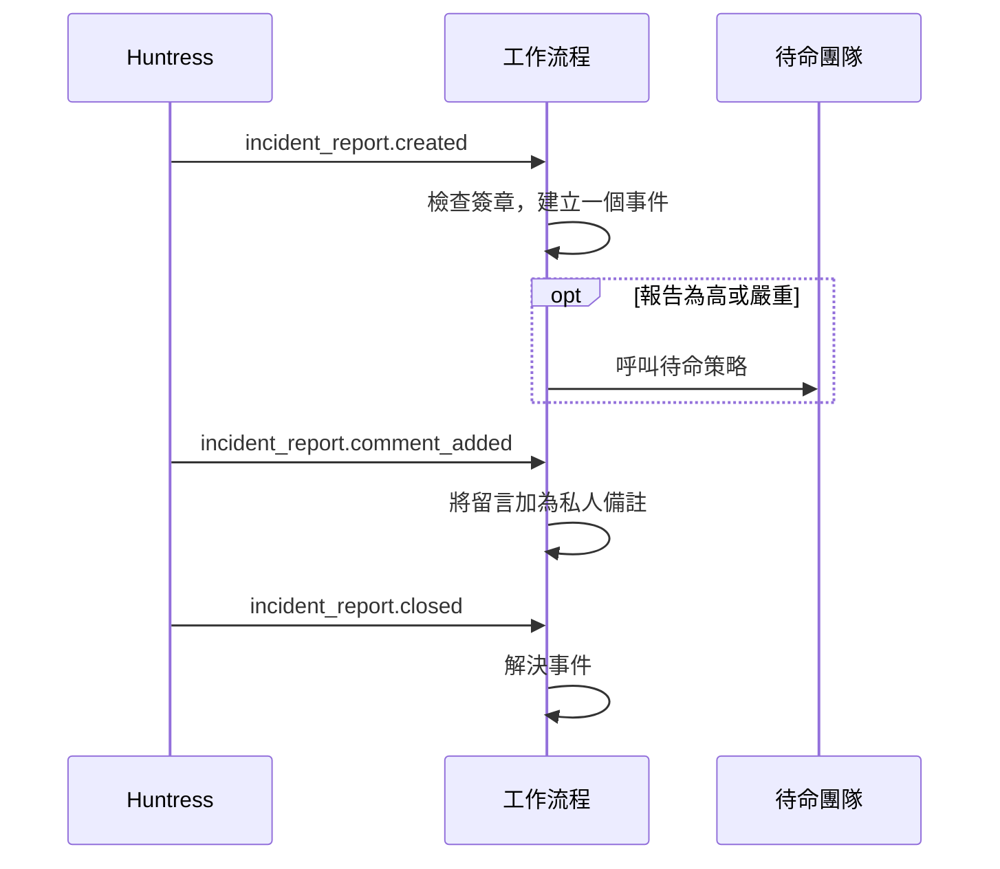

# Huntress 整合

用工作流程為 Huntress 事件報告呼叫你的待命團隊。當 Huntress SOC 針對某個端點或身分傳送事件報告時，工作流程會為它建立一個事件，呼叫你選擇的待命策略，把在 Huntress 中新增的留言加為私人備註，並在 Huntress 中關閉該報告時解決事件。

此整合是**入站**的：Huntress 會把事件報告的每個事件傳送到工作流程自己的 URL，並以端點的簽署密鑰簽署。OneUptime 從不呼叫 Huntress，因此不需要 Huntress API 金鑰。

:::cards
- [運作方式](#運作方式)：工作流程如何處理報告的每個事件。
- [設定步驟](#設定整合)：建立工作流程，在 Huntress 中新增端點，儲存其簽署密鑰，傳送測試。
- [觸發器](#huntress-incident-report-觸發器)：報告交給工作流程的值，以及觸發器的設定。
- [疑難排解](#疑難排解)：觸發器的錯誤代表什麼，以及該改什麼。
:::

## 運作方式

Huntress 會在報告送出時、有人留言時以及報告關閉時傳送事件報告的事件。**Huntress Incident Report** 觸發器會為每個事件啟動一次工作流程，它的 **Event** 說明是哪種事件：`created`、`comment-added` 或 `closed`。

1. **檢查。** 請求必須以端點的簽署密鑰簽署，且簽署時間不早於抵達前五分鐘。其他請求都會被拒絕，觸發器的設定會說明原因。
2. **啟動工作流程。** 每個事件啟動一次執行，報告的欄位成為觸發器的值。Huntress 重新傳送的事件不會再啟動任何內容。
3. **建立一個事件。** 對於 `created`，工作流程會建立一個以報告命名的事件，例如 `Huntress: Incident on DESKTOP-01 (Acme Corp)`。事件描述包含報告摘要、在 Huntress 中的嚴重性、組織、受影響的主機或身分、Huntress 發現的指標，以及指向 Huntress 中該報告的連結。事件會帶上報告所屬組織的標籤，當報告為高或嚴重時，會呼叫你選擇的待命策略。
4. **追蹤報告。** 對於 `comment-added`，留言會成為事件上的私人備註。對於 `closed`，事件會被解決，原因記錄在它的時間軸上。

事件會把報告編號保存在自訂欄位中，名為 `huntressReportId`：當 Huntress 留言或關閉該報告時，工作流程就靠它重新找到事件。以這種方式建立的事件永遠不會顯示在狀態頁上，你的事件規則（待命、負責人、標籤與隱私規則）會像對待其他事件一樣適用於它們。

## 開始之前

- 在 OneUptime 中具有能建立和編輯工作流程的角色，例如 **專案擁有者**、**專案管理員** 或 **工作流程管理員**。
- 在 Huntress 中具有 **Account Admin** 角色：只有帳戶管理員可以新增 Webhook。
- 一個要呼叫的待命策略。
- 在 OneUptime Cloud 上，需要包含工作流程的方案：Growth 或更高。Huntress 傳送的每個事件是一次工作流程執行。
- 自行託管的安裝需要 Huntress 能從網際網路透過 HTTPS 存取的 OneUptime：Huntress 只會將 Webhook 傳送到 `https://` URL。

## 設定整合

:::steps
### 建立工作流程

開啟**工作流程**，點選**建立工作流程**。在**或從範本開始**中選擇 **Huntress** 類別，選擇 **Open an incident for each Huntress incident report**，點選**使用此範本**，然後建立工作流程。工作流程會在**建構器**中開啟，處於關閉狀態。

### 選擇呼叫誰

點選 **Page an On-Call Policy** 步驟，選擇要呼叫的**待命策略**，然後儲存該步驟。

### 在 Huntress 中新增 Webhook 端點

點選 **Huntress Incident Report** 觸發器，在**在 Huntress 中新增 Webhook 端點**下點選**複製 URL**。URL 形如 `https://oneuptime.com/workflow/huntress/<key>`；自行託管的安裝會以你自己的主機開頭。

在 Huntress 中開啟右上角的選單，選擇 **Integrations**。點選 **Add an Integration**，選擇 **Webhooks**，然後點選 **Add Endpoint**。貼上 URL，開啟 **Incident Reports**，然後儲存。讓 **Escalations**、**Platform Actions** 與 **Account Notices** 保持關閉：觸發器會接收這些事件，但不會為它們啟動任何內容。

### 儲存端點的簽署密鑰

在 Huntress 中開啟端點的選單 (⋯)，選擇 **View Signing Secret**。完整複製它：它以 `whsec_` 開頭。在觸發器中點選**儲存簽署密鑰**，貼上後點選**儲存簽署密鑰**。密鑰會經過加密，且不會再次顯示。

在儲存密鑰之前，觸發器會拒絕所有請求。Huntress 稍後會重新傳送被拒絕的事件，所以現在被拒絕的事件之後仍會送達。

### 開啟工作流程並傳送測試

在**建構器**頂端開啟**已啟用**。在 Huntress 中開啟端點的選單 (⋯)，選擇 **Send Test**。幾秒內，觸發器會顯示**正在接收報告**。

> [!NOTE]
> 無論測試包含什麼，觸發器都會顯示它已送達。包含事件報告的測試會像其他報告一樣啟動工作流程。
:::

## 工作流程做什麼

範本在觸發器之後用一個 **Switch / Case**，為每種 **Event** 走一條路徑：

| Event | 工作流程做什麼 |
| --- | --- |
| `created` | 以觸發器的 **Incident Severity ID** 建立事件，並帶上其 **Organization Label ID** 標籤。對於高或嚴重的報告，**Page an On-Call Policy** 會呼叫你的策略；低報告不呼叫任何人。已有事件的報告不會再建立另一個事件。 |
| `comment-added` | 找到報告的事件，把留言作為私人備註加到事件上。 |
| `closed` | 找到報告的事件並解決它，除非它已經解決。原因記錄在它的時間軸上：Huntress 關閉了該報告。 |

它和其他工作流程一樣，所以你可以修改它做的事：修改 **Create One Incident** 之後的 **If / Else** 比較的內容，只為嚴重報告呼叫；用 Slack 或 Microsoft Teams 步驟把每份報告貼到聊天頻道；或用依 **Organization** 判斷的 **Switch / Case** 把每個組織送給它自己的待命策略。每次執行都會列在工作流程的執行記錄中，並顯示每個步驟做了什麼。

### 嚴重性

Huntress 會給每份事件報告三種嚴重性之一。觸發器的 **Incident Severity ID** 是報告建立事件時使用的事件嚴重性：由對應設定選擇，否則依**事件 → 設定 → 事件嚴重性**中列出的事件嚴重性順序決定：

| Huntress 嚴重性 | Huntress 的意思 | 設定 | 設定為空時的事件嚴重性 |
| --- | --- | --- | --- |
| Critical | 攻擊者正在直接操作、危險的惡意軟體或進行中的入侵，需要立即遏止。 | **嚴重報告的嚴重性** | 最高的 |
| High | 需要緊急處置的已確認惡意軟體，或需要採取行動的身分遭盜用。 | **高報告的嚴重性** | 第二 |
| Low | 可能不需要的程式、惡意軟體殘留以及較早的身分相關發現。 | **低報告的嚴重性** | 第三 |

嚴重性較少的專案會對其餘的使用最低的嚴重性。沒有嚴重性的報告視為高。如果你選擇的嚴重性被刪除，則重新依順序決定。

### 組織

觸發器的 **Organization Label ID** 是一個以報告所屬 Huntress 組織命名的標籤，例如 _Acme Corp_，該組織的第一份報告送達時會建立它。一個工作流程會接收你 Huntress 帳戶中所有組織的報告，觸發器的**僅限這些組織**可以縮小範圍：每行一個組織名稱或 ID，名稱不區分大小寫。

> [!TIP]
> 要呼叫每個客戶自己的團隊，請為每個組織新增一條事件待命規則，例如「如果**事件標籤**包含任一 _Acme Corp_」，執行該客戶的策略。請參閱[事件待命規則](/docs/incidents/settings#事件待命規則)。

## Huntress Incident Report 觸發器

觸發器開啟時顯示 Huntress 的資訊：它的 URL、每個已完成設定步驟旁的勾選記號，以及 Huntress 最後傳送的內容。它的設定都是選填的，收合在**更多欄位**中：**僅限這些組織**、**嚴重報告的嚴重性**、**高報告的嚴重性**與**低報告的嚴重性**。

| 值 | 內容 |
| --- | --- |
| **Event** | `created`、`comment-added` 或 `closed`。已經關閉或駁回的報告，無論由哪個事件帶來，都是 `closed`。 |
| **Report ID** | 報告在 Huntress 中的編號。 |
| **Severity** | `critical`、`high` 或 `low`。 |
| **Status** | 報告在 Huntress 中的狀態，例如 `sent`、`closed` 或 `dismissed`。 |
| **Subject** | 報告的主旨，即 Huntress 所寫的原文。 |
| **Summary** | SOC 分析師寫的內容。 |
| **Organization**、**Organization ID** | 報告涉及的 Huntress 組織。 |
| **Affected** | 報告涉及的主機或身分。 |
| **Platform**、**Indicators** | Huntress 在哪裡發現，以及發現了什麼。 |
| **Comment** | 對於 `comment-added`，某人新增的留言。 |
| **Report URL** | 報告在 Huntress 中開啟的位置。 |
| **Incident Title**、**Incident Description** | 關於該報告的事件的標題與 Markdown 描述。 |
| **Note** | 關於該事件的備註 Markdown：留言內容，或 Huntress 關閉了該報告。 |
| **Incident Severity ID**、**Organization Label ID** | 上文所述的事件嚴重性與標籤。 |
| **Received At** | OneUptime 收到該事件的時間。 |

**Summary** 與 **Comment** 是 Huntress 分析師寫的文字。要把它們放進事件或備註，請使用 **Incident Description** 與 **Note**：它們會保留格式，而且其中的內容不會載入圖片，也不會提及任何人。

要在沒有 Huntress 的情況下試用工作流程，請在**建構器**中點選**執行工作流程**，輸入 **Event**、**Report ID** 與你需要的欄位。使用同一個 **Report ID** 可以把一份報告從 `created` 追到 `closed`。

## 之前建立的 Huntress 連線

Huntress 以前在**事件 → 整合 → Huntress**中設定。每個 Huntress 連線都變成了一個同名、已開啟的工作流程，繼續做連線原本做的事：為同樣的報告呼叫同樣的待命策略，加上同樣的標籤，並以同樣的方式解決（或只新增備註）。它的 URL 仍是連線的 URL，即 `https://oneuptime.com/api/huntress/webhook/<connection-id>`，簽署密鑰也相同，因此 Huntress 中無需任何修改。連線建立的事件保留了各自報告的編號，所以當 Huntress 留言或關閉這些報告時，工作流程能找到它們。

## 安全性

- **只接受簽署的請求。** 觸發器會將 Huntress 傳送的 `svix-id`、`svix-timestamp` 與 `svix-signature` 標頭與原樣送達的請求本文進行驗證。未以已儲存密鑰簽署，或簽署時間前後相差超過五分鐘的請求都會被拒絕。
- **密鑰始終保密。** 它以加密方式儲存，API 從不回傳它，也不會再次顯示。觸發器中的**取代簽署密鑰**可以儲存另一個密鑰，例如新端點的密鑰。
- **URL 是位址，不是密碼。** 它以工作流程的金鑰結尾；只有以端點密鑰簽署的請求才會啟動工作流程。
- **每個工作流程一個端點。** 每個工作流程都有自己的 URL 與密鑰。要接收第二個 Huntress 帳戶的報告，請再建立一個工作流程。

## 改用電子郵件

Huntress 也會以電子郵件傳送事件報告，[傳入郵件監控](/docs/monitor/incoming-email-monitor)可以根據這些郵件建立事件，例如當主旨包含 `Critical Incident Report` 時。但它把郵件當作一個監控的狀態：在它的事件處於開啟狀態時，下一份報告不會再建立事件，而且事件是依監控的條件解決，而不是在 Huntress 關閉報告時解決。工作流程為每份報告建立一個事件，並隨報告一起解決每個事件，因此更建議使用它。工作流程開始接收報告後，請停止把郵件傳送到監控，否則每份報告都會呼叫兩次。

## 疑難排解

當觸發器拒絕請求時，它的設定會在**上一個請求被拒絕**下顯示原因。在 Huntress 中，端點選單 (⋯) 裡的 **View Delivery Attempts** 會列出每次投遞以及 OneUptime 的回應。

:::details "A request arrived but was refused, because no signing secret is saved for this workflow yet"
儲存端點的簽署密鑰：請參閱[設定整合](#設定整合)。Huntress 會重新傳送被拒絕的請求。
:::

:::details "The request's signature does not match the signing secret"
儲存的密鑰不是這個端點的。每個端點都有自己的密鑰：在 Huntress 中開啟端點的選單 (⋯)，選擇 **View Signing Secret**，完整複製後以**取代簽署密鑰**儲存。
:::

:::details "The request was signed more than five minutes from now"
Huntress 與你的 OneUptime 伺服器時鐘相差超過五分鐘，或者該請求是重放的舊請求。如果是自行託管的安裝，請檢查伺服器的時鐘是否準確。
:::

:::details "A request arrived while this workflow is off"
在**建構器**頂端開啟**已啟用**。Huntress 會重新傳送被拒絕的請求，屆時它會啟動工作流程。
:::

:::details "No Huntress workflow has this address."
工作流程已被刪除或封存，它的觸發器不再是 **Huntress Incident Report**，或者 Huntress 中端點的 URL 不是該工作流程的 URL。從觸發器複製 URL，然後把它重新貼到 Huntress 的端點中。
:::

:::details 沒有建立事件
開啟工作流程的執行記錄，以及該報告的那次執行。如果 **Create One Incident** 因事件嚴重性為空而失敗，表示專案沒有事件嚴重性：在**事件 → 設定 → 事件嚴重性**中新增一個。
:::

:::details 沒有呼叫任何人
低報告會建立事件但不呼叫。其他情況下，該報告的執行會顯示 **Page an On-Call Policy** 做了什麼，事件的**待命執行**頁面會顯示每個策略做了什麼。
:::

## 後續步驟

:::cards
- [工作流程觸發器](/docs/workflows/triggers)：啟動工作流程的其他方式。
- [事件待命規則](/docs/incidents/settings#事件待命規則)：依標籤呼叫每個組織自己的團隊。
- [事件狀態與嚴重程度](/docs/incidents/states-and-severities)：排列 Huntress 報告使用的嚴重性順序。
- [整合總覽](/docs/integrations/index)：你可以連線的其他工具。
:::
