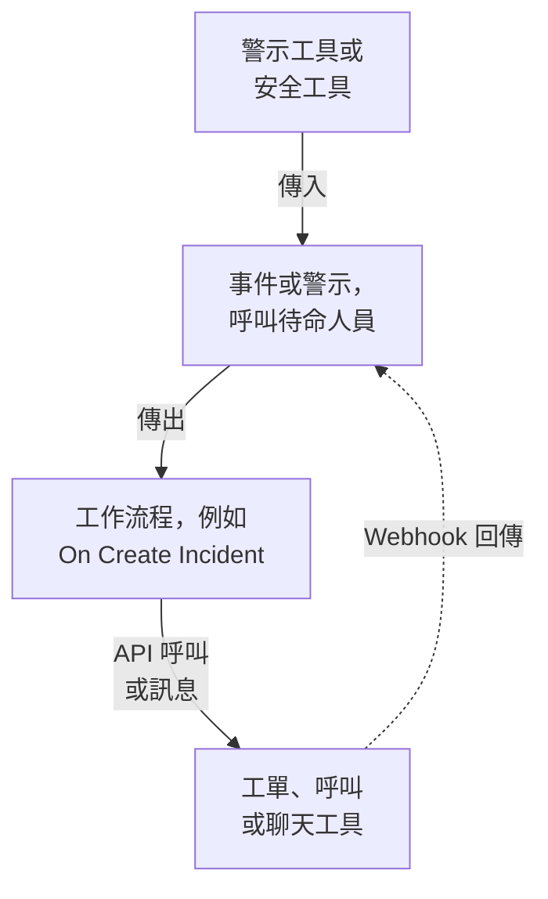

# 整合總覽

OneUptime 可以與你的團隊已經在用的工具配合使用。警示工具在 OneUptime 中建立事件，OneUptime 則在其他工具中建立工單、呼叫待命人員並發送聊天訊息。有些工具透過表單連接，有些透過現成的工作流程範本連接。其他任何帶有 Webhook 或 API 的工具，都可以透過你自己建置的工作流程連接。

:::cards
- [選擇連接方式](#選擇連接方式): 四種連接方式，以及各自的適用場景。
- [目錄](#目錄): 所有有指南的工具，按用途分組。
- [建置你自己的整合](#建置你自己的整合): 適用於任何其他工具的傳入和傳出模式。
- [妥善保管憑證](#妥善保管憑證): 密鑰變數，以及每個工具需要的標頭。
:::

## 整合的運作方式

每個整合都在一個方向或兩個方向上傳遞資料。**傳入** 時，另一個工具告訴 OneUptime 出了問題，OneUptime 建立事件或警示並呼叫待命團隊。**傳出** 時，OneUptime 中發生了某件事，工作流程把它告訴另一個工具：建立工單、呼叫某人或發布訊息。



像 Jira 或 Dynamics 365 這樣的雙向整合會同時使用兩個方向：一個工作流程把事件傳送出去，另一個由對方工具的 Webhook 啟動的工作流程把變更帶回來。

## 選擇連接方式

| 方式 | 最適合 | 範例 |
| --- | --- | --- |
| 內建連接 | OneUptime 自己連接的工具。只需填寫表單，無需建置任何東西。 | [Slack](/docs/workspace-connections/slack)、[Microsoft Teams](/docs/workspace-connections/microsoft-teams)、[安全性事件](/docs/telemetry/security-events) 連接 |
| 工作流程範本 | 雙向保持同步的工單工具、監控問題、安全性事件報告，以及聊天訊息。選擇一個範本並填寫幾項設定即可。 | [Jira](/docs/integrations/jira)、[Microsoft Dynamics 365](/docs/integrations/microsoft-dynamics-365)、[Huntress](/docs/integrations/huntress)、[Zabbix](/docs/integrations/zabbix) |
| Incoming Request 監測器 | 傳送 Webhook 的警示工具。無需工作流程，每條警示對應一個事件，通知待命人員，並在警示恢復時解決。 | [Zabbix](/docs/integrations/zabbix)、[Prometheus Alertmanager](/docs/integrations/prometheus-alertmanager)、[Grafana](/docs/integrations/grafana) |
| 你自己建置的工作流程 | 任何帶有 Webhook 或 REST API 的工具，以及你自己的任何邏輯。 | [PagerDuty](/docs/integrations/pagerduty)、[Opsgenie](/docs/integrations/opsgenie)、[ServiceNow](/docs/integrations/servicenow) |

從表格頂部開始看：越靠上的方式，需要維護的東西越少。

## 目錄

### 監控與警示工具

| 工具 | 方向 | 作用 |
| --- | --- | --- |
| [Zabbix](/docs/integrations/zabbix) | 雙向 | 把 Zabbix 問題轉為事件或警示，在恢復時解決它們，並從 OneUptime 確認或關閉這些問題。 |
| [Prometheus Alertmanager](/docs/integrations/prometheus-alertmanager) | 傳入 | 把 Alertmanager 通知轉為事件。 |
| [Grafana](/docs/integrations/grafana) | 傳入 | 把 Grafana 警示轉為事件。 |
| [Datadog](/docs/integrations/datadog) | 傳入 | 把 Datadog 監控警示轉為事件。 |

### 安全工具

| 工具 | 方向 | 作用 |
| --- | --- | --- |
| [Huntress](/docs/integrations/huntress) | 傳入 | 針對 Huntress 事件報告呼叫待命人員，並在報告關閉時解決事件。 |
| [Google SecOps](/docs/integrations/google-secops) | 雙向 | 把 Google SecOps 偵測結果與指標匯入安全性事件，並把 OneUptime 的發現傳送給 Google SecOps。 |
| [Microsoft Sentinel](/docs/integrations/microsoft-sentinel) | 雙向 | 把 Microsoft Sentinel 事件匯入安全性事件，並把 OneUptime 的發現傳送給 Microsoft Sentinel。 |
| [Microsoft Defender XDR](/docs/integrations/microsoft-defender-xdr) | 傳入 | 把 Microsoft Defender XDR 警示匯入安全性事件。 |
| [CrowdStrike Falcon](/docs/integrations/crowdstrike-falcon) | 傳入 | 把 CrowdStrike Falcon 警示匯入安全性事件。 |
| [Splunk Enterprise Security](/docs/integrations/splunk) | 雙向 | 把 Splunk 重要事件（notable event）匯入安全性事件，並把 OneUptime 的發現傳送給 Splunk。 |
| [Elastic Security](/docs/integrations/elastic-security) | 雙向 | 把 Elastic Security 偵測警示匯入安全性事件，並把 OneUptime 的發現傳送給 Elastic Security。 |
| [AWS Security Hub](/docs/integrations/aws-security-hub) | 傳入 | 把 AWS Security Hub 發現結果匯入安全性事件。 |
| [Okta System Log](/docs/integrations/okta) | 傳入 | 把 Okta 登入、帳戶變更和威脅偵測匯入安全性事件。 |

### 工單與 IT 服務管理

| 工具 | 方向 | 作用 |
| --- | --- | --- |
| [Jira](/docs/integrations/jira) | 雙向 | 為每個事件或警示建立一個 Jira 問題，並把狀態變更和留言同步回來。 |
| [Microsoft Dynamics 365](/docs/integrations/microsoft-dynamics-365) | 雙向 | 為每個事件或警示建立一個 Dynamics 365 案例，並把狀態變更和備註同步回來。 |
| [ServiceNow](/docs/integrations/servicenow) | 傳出 | 為每個 OneUptime 事件建立一個 ServiceNow 事件，並隨該事件一起解決。 |
| [GitHub](/docs/integrations/github) | 傳出 | 為事件建立一個 GitHub issue。 |
| [GitLab](/docs/integrations/gitlab) | 傳出 | 為事件建立一個 GitLab issue。 |

### 呼叫工具

| 工具 | 方向 | 作用 |
| --- | --- | --- |
| [PagerDuty](/docs/integrations/pagerduty) | 傳出 | 為每個 OneUptime 事件觸發一個 PagerDuty 事件，並隨該事件一起解決。 |
| [Opsgenie](/docs/integrations/opsgenie) | 傳出 | 為每個 OneUptime 事件建立一個 Opsgenie 警示，並隨該事件一起關閉。 |

### 聊天工具

| 工具 | 方向 | 作用 |
| --- | --- | --- |
| [Slack](/docs/workspace-connections/slack) | 雙向 | 內建連接：事件頻道、從 Slack 執行操作，以及待命。 |
| [Microsoft Teams](/docs/workspace-connections/microsoft-teams) | 雙向 | 內建連接：事件頻道、從 Teams 執行操作，以及待命。 |
| [Mattermost](/docs/workflows/components#mattermost) | 傳出 | 把事件更新發布到 Mattermost 頻道。 |
| [Discord](/docs/integrations/discord) | 傳出 | 把事件更新發布到 Discord 頻道。 |
| [Telegram](/docs/integrations/telegram) | 傳出 | 在警示觸發時，向 Telegram 聊天傳送一條訊息。 |
| [IRC](/docs/integrations/irc) | 傳出 | 把事件更新發布到 IRC 頻道。 |

> [!TIP]
> Slack 和 Microsoft Teams 也有工作流程步驟。事件頻道和待命請使用內建連接；如果只需要在頻道裡發一條訊息，請使用工作流程步驟。

### 託管平台

| 工具 | 方向 | 作用 |
| --- | --- | --- |
| [Vercel](/docs/integrations/vercel) | 傳入 | 從 Vercel Marketplace 新增 OneUptime：為你的 Vercel 專案提供追蹤、日誌、可用性監控和狀態頁。 |

## 從其他工具移轉

如果要離開其他待命、正常運作時間監控或狀態頁工具，請把團隊移轉過來，而不是把兩者連接起來。**專案設定 → 進階 → 從其他工具匯入** 會用 API 金鑰讀取你的帳戶，顯示它找到的內容，並建立你勾選的項目。每個工具都有一份指南：

- 待命和事件工具：[Opsgenie](/docs/moving-to-oneuptime/opsgenie)、[PagerDuty](/docs/moving-to-oneuptime/pagerduty)、[incident.io](/docs/moving-to-oneuptime/incident-io)、[Splunk On-Call](/docs/moving-to-oneuptime/splunk-on-call) 和 [Grafana OnCall](/docs/moving-to-oneuptime/grafana-oncall)。
- 正常運作時間和狀態頁工具：[UptimeRobot](/docs/moving-to-oneuptime/uptimerobot)、[Atlassian Statuspage](/docs/moving-to-oneuptime/atlassian-statuspage)、[Better Stack](/docs/moving-to-oneuptime/better-stack)、[Pingdom](/docs/moving-to-oneuptime/pingdom)、[StatusCake](/docs/moving-to-oneuptime/statuscake) 和 [Uptime Kuma](/docs/moving-to-oneuptime/uptime-kuma)。

## 建置你自己的整合

沒有指南的工具也符合兩種模式之一。如果它能傳送 Webhook，就使用傳入模式；如果它有 REST API，就使用傳出模式。兩者都是工作流程：請參閱 [工作流程概觀](/docs/workflows/index) 開始使用。

### 傳入：另一個工具把資料傳送到 OneUptime

對於警示工具，先從 [Incoming Request 監測器](/docs/monitor/incoming-request-monitor#接收其他系統的警示) 開始：它為每條警示建立一個事件，並在恢復時解決，無需建置任何東西。需要自己的邏輯時，再建置工作流程：

:::steps
1. 開啟 **工作流程**，點選 **建立工作流程**，然後點選 **從零開始**。為工作流程命名，然後點選 **建立工作流程**。
2. 點選虛線的 **選擇啟動此工作流程的方式** 區塊，選擇 **Webhook**。點選該觸發器，然後點選 **複製 URL**。
3. 在另一個工具中，把它的 Webhook 以 `POST` 請求傳送到該 URL，並帶上 `Content-Type: application/json`。
4. 新增處理它的區塊。這些區塊透過 `{{local.components.webhook-1.returnValues.request-body.status}}` 這樣的引用讀取請求：用 **If / Else** 區塊檢查某個欄位，再用 **Create One Incident** 宣告事件。
5. 在 **建構器** 頂部開啟 **已啟用**，從另一個工具傳送一次測試，然後開啟 **日誌 → 執行記錄** 檢視收到了什麼。
:::

URL 是唯一的憑證，所以要像對待密碼一樣對待它。請參閱 [Webhook](/docs/workflows/triggers#webhook)。

### 傳出：OneUptime 把資料傳送到另一個工具

:::steps
1. 按照[下文](#妥善保管憑證)所示，把該工具的 API 金鑰儲存為一個密鑰全域變數。
2. 建立一個工作流程，點選虛線區塊並選擇一個事件觸發器，例如 **On Create Incident**。點選該觸發器：它的 **Fields to pass on** 已經包含 **標題**，所以點選 **新增欄位**，再選擇要傳送的其他欄位，例如 **描述**。
3. 點選 **新增元件**，新增一個 **API Post (JSON)** 區塊。把觸發器的 **Success** 點連接到它。
4. 填寫它的 **URL**，在 **Request Headers** 中填入 `Authorization` 標頭，在 **Request Body** 中填入事件的欄位，例如 `{{local.components.incident-on-create-1.returnValues.model.title}}`。
5. 點選 **執行工作流程**，在 **事件** 中選擇一個事件，然後執行。測試執行會真的傳送請求。然後開啟 **已啟用**。
:::

如果工具需要先轉換資料格式，就在兩者之間新增一個 [Run Custom JavaScript](/docs/workflows/components#custom-code) 區塊。Zendesk、New Relic、AWS（透過 SNS）、StatusCake 以及其他各種工具都是同樣的做法：只有 URL 和請求內文不同。

## 妥善保管憑證

永遠不要把 API 金鑰或權杖貼上到區塊中。把它儲存一次，作為密鑰全域變數：

:::steps
1. 前往 **工作流程 → 全域變數**，點選 **建立工作流程 變數**。
2. 為它命名，例如 `JIRA_AUTH`，然後點選 **下一步**。
3. 把金鑰貼上到 **內容** 中，開啟 **密鑰**，然後點選 **建立工作流程 變數**。
:::

任何區塊都可以用 `{{global.variables.JIRA_AUTH}}` 讀取它。變數的內容儲存後就無法再讀回，密鑰變數在執行日誌中會被替換為 `[REDACTED]`。對於會過期的權杖，例如 Microsoft Entra ID 的權杖，[OAuth 2.0 變數](/docs/workflows/variables#oauth-20-變數會自動重新整理的權杖) 會自行取得新權杖。請參閱 [工作流程變數](/docs/workflows/variables#全域變數)。

### 驗證速查表

大多數傳出整合把金鑰放在標頭中。常見形式如下：

| 方案 | 要傳送的內容 | 使用者 |
| --- | --- | --- |
| Bearer 權杖 | `Authorization: Bearer {{global.variables.TOKEN}}` | GitHub，以及大多數現代 API |
| Basic 驗證 | `Authorization: Basic {{global.variables.BASE64_USER_PASS}}` | Jira Cloud、ServiceNow |
| API 金鑰標頭 | `Authorization: GenieKey {{global.variables.OPSGENIE_KEY}}` | Opsgenie |
| 私有權杖標頭 | `PRIVATE-TOKEN: {{global.variables.GITLAB_TOKEN}}` | GitLab |
| 請求內文中的金鑰 | JSON 請求內文中的 `routing_key` | PagerDuty Events API |
| OAuth 2.0 用戶端憑證 | 來自 OAuth 2.0 變數的 `Authorization: Bearer {{local.variables.dynamicsAccessToken}}` | Microsoft Dynamics 365 |

對於 Basic 驗證，把 `username:password` 或 `email:api_token` 編碼一次，然後把結果儲存為金鑰。在 macOS 或 Linux 上：

```bash
printf '%s' 'you@example.com:your_api_token' | base64 | tr -d '\n'
```

請使用 `printf`，不要用 `echo`：`echo` 會新增一個換行符，它會和其餘內容一起被編碼，從而破壞憑證。`tr` 讓較長的結果保持在一行。

## 自行託管安裝

自行託管的 OneUptime 從你的網路呼叫其他工具，其他工具則從它們的網路呼叫它：

- **傳出：** 除非管理員允許，否則發往私有網路位址的工作流程請求會被拒絕。請參閱 [對外網路存取](/docs/workflows/configuration#對外網路存取)。
- **傳入：** 工具的 Webhook 必須能透過 HTTPS 存取你的 OneUptime，因此雲端工具需要一個可以呼叫的公開位址。
- **內建整合** 各有一份設定指南：[Slack](/docs/self-hosted/slack-integration)、[Microsoft Teams](/docs/self-hosted/microsoft-teams-integration)、[GitHub](/docs/self-hosted/github-integration)、[Twilio](/docs/self-hosted/twilio-integration)、[SendGrid 傳入郵件](/docs/self-hosted/sendgrid-inbound-email) 和 [推播通知](/docs/self-hosted/push-notifications)。

## 後續步驟

:::cards
- [工作流程概觀](/docs/workflows/index): 工作流程如何執行，以及如何建置你的第一個工作流程。
- [傳入請求監控](/docs/monitor/incoming-request-monitor): 無需工作流程即可接收任何工具的警示。
- [Jira](/docs/integrations/jira): 一個完整的雙向整合，從範本開始。
- [工作流程變數](/docs/workflows/variables): 在區塊之間傳遞資料，並讓金鑰不出現在區塊中。
:::
