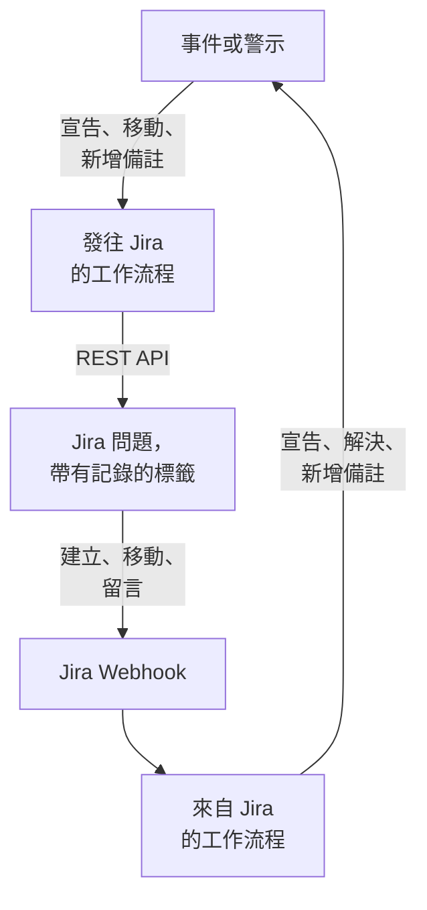

# Jira

讓 [Jira](https://www.atlassian.com/software/jira) 問題與你的 OneUptime 事件和警示雙向保持同步。現成的工作流程範本會為每個事件或警示建立一個問題，隨記錄的進展移動該問題，並把備註作為留言複製過去。另一些範本會根據新問題宣告事件，並把狀態變更、留言和編輯同步回來。無需安裝外掛程式：工作流程呼叫 Jira 的 REST API，Jira 呼叫工作流程的 Webhook URL。

:::cards
- [從範本開始](#從範本開始): 17 個範本、它們需要的設定，以及如何設定。
- [範本的運作方式](#範本的運作方式): 問題和記錄如何保持關聯，而不會形成迴圈。
- [自己建置](#自己建置): 範本不適用時，手動建置每個方向。
- [疑難排解](#疑難排解): Jira 的各種回應是什麼意思。
:::

> [!NOTE]
> Atlassian 正在為 Jira Cloud 中的概念改名：在介面的很多地方，**專案** 現在叫 **空間**，**問題** 現在叫 **工作項目**。各網站兩種叫法都在用，所以在措辭很重要的地方，本頁會同時給出兩種。

## 運作方式



每個範本都是一個小工作流程，所以你可以只選用需要的方向，用於事件、警示或兩者。OneUptime → Jira 範本從 OneUptime 中的事件啟動，呼叫 Jira 的 REST API。Jira → OneUptime 範本從 Jira Webhook 啟動。它們都透過問題上的兩個標籤找到彼此的記錄。

本頁的所有內容都是針對 **Jira Cloud** 編寫的。自管理 Jira 上有哪些不同，請參閱 [Jira Data Center](#jira-data-center)。

## 開始之前

- 一個 Jira Cloud 網站，例如 `https://your-domain.atlassian.net`，以及一個用來建立問題的專案。
- 一個用於整合的 Jira 使用者及其 API 權杖。在專案中為該使用者授予 **Browse Projects**、**Create Issues**、**Edit Issues**、**Add Comments** 和 **Transition Issues** 權限。
- 一位 Jira 管理員，用來註冊 Jira → OneUptime 範本所需的 Webhook。
- 在 OneUptime 中建立工作流程的權限。在 OneUptime Cloud 上，工作流程需要 **Growth** 或更高的方案。

## 從範本開始

**建立工作流程** 對話方塊的類別清單中，**Jira** 下有 17 個 Jira 範本：先是 9 個事件範本，然後是 8 個警示範本，每組都在自己的標題下。它們遵循同一個約定，即 Jira 問題上的標籤，因此任意組合都能一起工作。

### 事件範本

| 範本 | 作用 | 需要的設定 |
| --- | --- | --- |
| **OneUptime → Jira** | | |
| Create a Jira issue when an incident is declared | 為每個新事件建立一個問題，並用事件的 ID 為它加標籤。從 Jira 宣告的事件和私人事件會被跳過。 | API URL、API 權杖、專案鍵、問題類型、OneUptime URL |
| Move the Jira issue when the incident is acknowledged or resolved | 把關聯的問題向前推進：事件被確認時移到 In Progress 狀態，被解決時移到 Done 狀態。從不向後移動。 | API URL、API 權杖 |
| Copy incident private notes to the Jira issue | 把每條新的私人備註作為留言發布到關聯的問題上——在 Jira Service Management 中是內部留言。 | API URL、API 權杖 |
| Copy incident public notes to the Jira issue | 把每條新的公開備註作為留言發布到關聯的問題上。 | API URL、API 權杖 |
| Comment on the Jira issue when the incident is edited | 當事件的標題、嚴重程度、描述、根本原因或修復說明發生變化時，發布事件的當前情況——在 Jira Service Management 中是內部留言。 | API URL、API 權杖 |
| **Jira → OneUptime** | | |
| Declare an incident when a Jira issue is created | 為每個新問題宣告一個不顯示在狀態頁上的事件，嚴重程度根據問題的優先順序選擇，然後為問題加標籤，把兩者關聯起來。 | 網站 URL、API URL、API 權杖，以及用於 **Issue created** 的 Jira Webhook |
| Acknowledge or resolve the incident when its Jira issue moves | 關聯的問題移到 In Progress 狀態時確認事件，移到 Done 狀態時解決事件。 | 用於 **Issue updated** 的 Jira Webhook |
| Add Jira comments to the incident as private notes | 把關聯問題上的每條留言作為私人備註複製到事件中。 | 網站 URL、API URL、API 權杖，以及用於 **Comment created** 的 Jira Webhook |
| Add Jira issue changes to the incident as private notes | 把對關聯問題的每次編輯（優先順序、經辦人、摘要等）作為私人備註記錄到事件中。狀態變更交給上面的範本處理。 | 網站 URL，以及用於 **Issue updated** 的 Jira Webhook |

### 警示範本

警示範本為警示完成同樣的工作。它們少一個，因為警示沒有公開備註。其餘差異列在 [警示有何不同](#警示有何不同) 中。

| 範本 | 作用 | 需要的設定 |
| --- | --- | --- |
| **OneUptime → Jira** | | |
| Create a Jira issue when an alert is created | 為每個新警示建立一個問題，包括監測器產生的每一條警示，並用警示的 ID 為它加標籤。從 Jira 建立的警示和私人警示會被跳過。 | API URL、API 權杖、專案鍵、問題類型、OneUptime URL |
| Move the Jira issue when the alert is acknowledged or resolved | 把關聯的問題向前推進：警示被確認時移到 In Progress 狀態，被解決時移到 Done 狀態。從不向後移動。 | API URL、API 權杖 |
| Copy alert private notes to the Jira issue | 把每條新的私人備註作為留言發布到關聯的問題上——在 Jira Service Management 中是內部留言。 | API URL、API 權杖 |
| Comment on the Jira issue when the alert is edited | 當警示的標題、嚴重程度、描述、根本原因或修復說明發生變化時，發布警示的當前情況——在 Jira Service Management 中是內部留言。 | API URL、API 權杖 |
| **Jira → OneUptime** | | |
| Create an alert when a Jira issue is created | 為每個新問題建立一個警示，嚴重程度根據問題的優先順序選擇，然後為問題加標籤，把兩者關聯起來。 | 網站 URL、API URL、API 權杖，以及用於 **Issue created** 的 Jira Webhook |
| Acknowledge or resolve the alert when its Jira issue moves | 關聯的問題移到 In Progress 狀態時確認警示，移到 Done 狀態時解決警示。 | 用於 **Issue updated** 的 Jira Webhook |
| Add Jira comments to the alert as private notes | 把關聯問題上的每條留言作為私人備註複製到警示中。 | 網站 URL、API URL、API 權杖，以及用於 **Comment created** 的 Jira Webhook |
| Add Jira issue changes to the alert as private notes | 把對關聯問題的每次編輯（優先順序、經辦人、摘要等）作為私人備註記錄到警示中。狀態變更交給上面的範本處理。 | 網站 URL，以及用於 **Issue updated** 的 Jira Webhook |

除非你開啟相應開關，否則 OneUptime → Jira 範本都不會把標記為 [**私人事件**](/docs/incidents/declaring-incidents#第-1-步事件詳細資訊) 的事件或標記為 **私人警示** 的警示傳送到 Jira：記錄本身、它的狀態、備註和編輯都不會發送。請參閱 [限制](#限制)。

### 警示有何不同

每個警示範本都與對應的事件範本逐步對應。警示與事件不同的地方，範本也不同：

- **沒有公開備註。** 警示只有私人備註，因此警示範本發布的每條留言在 Jira Service Management 中都是內部留言。
- **沒有狀態頁。** 警示永遠不會出現在狀態頁上，因此 **Create an alert when a Jira issue is created** 只寫入嚴重程度、標題、描述和 `customFields.jiraIssueKey`，不寫入其他內容。
- **只有兩種嚴重程度，所以 Medium 會變成 Low。** 新專案有三種事件嚴重程度，但只有 High 和 Low 兩種警示嚴重程度。建立範本把 Jira 的優先順序分配到專案已有的嚴重程度上。在預設的兩種嚴重程度下，Highest、High、Critical 和 Blocker 會變成 High，其他所有優先順序（包括 Medium 和 Major）都會變成 Low。要把 Medium 傳送為 High，請在 `prepare-alert-1` 指令碼的 `PRIORITY_RANK` 中把 `medium: 1` 改為 `medium: 0`。
- **警示的連結和標籤。** 問題連結到 `/dashboard/<project id>/alerts/<alert id>`，並帶有標籤 `oneuptime-alert-<alert id>`。
- **編號會說明它是什麼的編號。** 在預設的 `#` 字首下，警示和事件可能都是 `#12`，因此範本會寫成 `Alert #12` 或 `Incident #12`。帶有自己字首的編號（例如 `ALT-12`）按原樣寫入。
- **私人警示。** 被手動或被警示隱私規則標記為 **私人警示** 的警示不會進入 Jira，除非你把 `SYNC_PRIVATE_ALERTS` 設為 `true`。

**監測器會自行產生警示，而且可能產生很多。** **Create a Jira issue when an alert is created** 會為每一條警示建立問題。除非每條警示都值得一張工單，否則請在 Jira 步驟前面加一個條件。只為 High 警示建立問題：

1. 開啟工作流程的 **建構器**，新增一個 **If / Else** 區塊。
2. 把 **Value to check** 設為 `{{local.components.alert-on-create-1.returnValues.model.alertSeverity.name}}`，**Comparison** 設為 **is equal to**，**Compare with** 設為 `High`。
3. 把從 `alert-on-create-1` 到 `prepare-issue-1` 的連線末端從點上拖開，刪除這條線（請參閱 [整理畫布](/docs/workflows/authoring#整理)）。把觸發器的 **Success** 連接到 **If / Else** 區塊，再把它的 **Yes** 連接到 `prepare-issue-1`。

走 **No** 一側的警示會在那裡結束執行，不會為它建立問題。

### 範本需要的設定

建立精靈的 **設定** 步驟最多詢問五個值。上面的表格列出了每個範本需要哪些值。

- **Jira Site URL** — 你開啟 Jira 的位址，例如 `https://your-domain.atlassian.net`。在 Jira Data Center 上，是它的基礎 URL，例如 `https://jira.example.com:8443` 或 `https://example.com/jira`。把 Jira 帶入 OneUptime 的範本會在它們寫入的描述或備註中連結問題，而且無論事件內容如何，這個連結總是指向這個網站。因此該欄位只接受網站位址：通訊協定、主機、連接埠（如果有），以及在 Data Center 上 Jira 執行的路徑。它會拒絕網站中某個頁面的位址、查詢或使用者名稱，並告訴你應改為輸入什麼。末尾帶斜線沒關係。如果之後清空了該變數，問題會以不帶連結的方式給出。
- **Jira API URL** — 工作流程傳送 Jira 請求的位址：你的網站，例如 `https://your-domain.atlassian.net`，末尾不帶斜線。使用帶範圍的 API 權杖（包括所有服務帳戶權杖）時，請改用 `https://api.atlassian.com/ex/jira/<cloudId>`。你的 `cloudId` 位於 `https://your-domain.atlassian.net/_edge/tenant_info` 傳回的 JSON 中。使用經典權杖時，它與 **Jira Site URL** 是同一個位址，因此在同時詢問兩者的範本中，在你自己輸入之前，精靈會用 **Jira Site URL** 填入它。
- **Jira API Token (base64 of email:token)** — 不是權杖本身，而是把帳戶的電子郵件和權杖編碼在一起的值，這是 Jira Cloud 接受 Basic 驗證的方式。具體做法見 [建立 API 權杖](#建立-api-權杖)。權杖會過期，預設在建立一年後過期，所以請把日期記下來。
- **Jira Project Key** — 建立新問題的專案（空間）：`OPS-123` 中的 `OPS`。
- **Jira Issue Type** — 要建立的問題類型，拼寫與該專案中的完全一致，例如 `Task`、`Bug` 或 `Incident`。
- **OneUptime URL** — 你開啟 OneUptime 的位址：`https://oneuptime.com` 或你自己的主機。問題的描述用它連結回事件或警示。

### 建立 API 權杖

:::steps
1. 為一個專用的 Jira 使用者建立權杖，即只供整合使用的普通 Atlassian 帳戶，而不是為某個人建立：問題和留言會記在權杖擁有者名下。以該使用者身分登入，在 [id.atlassian.com/manage-profile/security/api-tokens](https://id.atlassian.com/manage-profile/security/api-tokens) 建立權杖。經典權杖（**Create API token**）適用於你的網站 URL。帶範圍的權杖（**Create API token with scopes**）只適用於上面的 `api.atlassian.com` 位址。經典範圍 `read:jira-work` 和 `write:jira-work` 涵蓋範本發出的所有呼叫。
2. 對該帳戶的電子郵件和權杖進行編碼：

   ```bash
   printf '%s' 'jira-bot@example.com:your_api_token' | base64 | tr -d '\n'
   ```

   請使用 `printf`，不要用 `echo`：`echo` 會新增一個換行符，它會和其餘內容一起被編碼，Jira 就不再接受這些憑證。在你的網站 URL 上，這種情況很少表現為 `401`（請參閱 [限制](#限制)）。`tr` 讓輸出保持在一行：Linux 上的 GNU `base64` 每 76 個字元換一次行，而現在的權杖長到足以被換行。

3. 把輸出貼上到 **Jira API Token (base64 of email:token)** 中。
:::

也可以使用 Atlassian **服務帳戶**。由組織管理員在 [admin.atlassian.com](https://admin.atlassian.com) 的 **Directory → Service accounts** 下建立服務帳戶及其權杖。這種權杖總是帶範圍的，因此 **Jira API URL** 必須是 `https://api.atlassian.com/ex/jira/<cloudId>` 位址（**Jira Site URL** 仍是你的網站），而你編碼的電子郵件是服務帳戶自己的。像對待任何使用者一樣，為服務帳戶授予上面列出的專案權限。

### 建立工作流程

:::steps
1. 開啟 **工作流程 → 建立工作流程**。在 **或從範本開始** 下，從類別清單中選擇 **Jira**，或者在 **搜尋範本…** 中輸入 `Jira`，然後點選你想要的範本。範本開啟後會顯示它的作用以及將要詢問的設定。點選 **使用此範本**。
2. **名稱** 會根據範本自動填寫。如果願意，可以修改它。
3. **設定** 會詢問上面的這些值。它們儲存為工作流程自己的變數，位於工作流程選單的 **工作流程變數** 下。API 權杖儲存為金鑰：它在 **日誌 → 執行記錄** 中會被隱藏，並且只會放進 Jira 呼叫的 `Authorization` 標頭。
4. 點選 **建立工作流程**。每個工作流程建立時都處於關閉狀態：在它的 **建構器** 頂部開啟 **已啟用**。
:::

先從 **Create a Jira issue when an incident is declared** 開始，警示則從 **Create a Jira issue when an alert is created** 開始：同類的其他 OneUptime → Jira 範本都透過這個範本新增的標籤找到問題。啟用它，宣告一個測試事件或建立一個測試警示，然後開啟工作流程的 **日誌 → 執行記錄**。這次執行應以 **已執行** 結束，其最後一步 `create-issue-1` 的 **Response Body** 會給出新問題。

每個工作流程都儲存這些值的獨立副本。更換權杖時，請在每個詢問過它的 Jira 工作流程的 **工作流程變數** 下更新 `jiraBasicAuthToken`。如果 Jira 換了位址，請用同樣的方式更新 `jiraSiteUrl` 和 `jiraBaseUrl`。

### 連接 Webhook 範本

Jira → OneUptime 範本（4 個事件範本和 4 個警示範本）從 [Webhook 觸發器](/docs/workflows/triggers#webhook) 啟動，因此必須告訴 Jira 把事件傳送到哪裡。請按以下順序操作：

1. 建立工作流程，並且 **先啟用它**。處於關閉狀態的工作流程會以 `400` 回應 Jira，而 Jira 不會重試以 `4xx` 被拒絕的傳遞。在啟用之前傳送的事件會丟失，不會排入佇列。
2. 開啟工作流程的 **建構器**，點選 **Webhook** 觸發器區塊（`webhook-1`），然後點選其設定頂部的 **複製 URL**。URL 的樣子如下：

   ```text
   https://<your OneUptime host>/workflow/trigger/<webhook secret key>
   ```

3. 在 Jira 中前往 **Settings → System → WebHooks**（位於 **Advanced** 下），點選 **Create a WebHook**。貼上 URL，在 **Issue related events** 下勾選下表中的事件，並輸入一個 JQL 篩選器，使只有你專案中的問題會觸發它。不要勾選 **Exclude body**：工作流程從請求內文中讀取所有內容。

| 範本 | Jira 事件 | JQL 篩選器 |
| --- | --- | --- |
| **事件** | | |
| Declare an incident when a Jira issue is created | **Issue created** | `project = OPS AND (labels is EMPTY OR labels != oneuptime)` |
| Acknowledge or resolve the incident when its Jira issue moves | **Issue updated** | `project = OPS` |
| Add Jira comments to the incident as private notes | **Comment created** | `project = OPS` |
| Add Jira issue changes to the incident as private notes | **Issue updated** | `project = OPS` |
| **警示** | | |
| Create an alert when a Jira issue is created | **Issue created** | `project = OPS AND (labels is EMPTY OR labels != oneuptime)` |
| Acknowledge or resolve the alert when its Jira issue moves | **Issue updated** | `project = OPS` |
| Add Jira comments to the alert as private notes | **Comment created** | `project = OPS` |
| Add Jira issue changes to the alert as private notes | **Issue updated** | `project = OPS` |

把 `OPS` 替換為你的專案鍵。兩個建立記錄的範本上的篩選器，讓 OneUptime 建立的問題根本不會到達它們：即使到達，它們也會跳過，但從未到達的事件不佔用執行次數。只用 `labels != oneuptime` 會把所有沒有標籤的問題也排除掉，所以才加上 `labels is EMPTY`。其他範本只處理已關聯的問題，因此對它們來說，`project = OPS AND labels = oneuptime` 是更嚴格的篩選器。

每個工作流程都有自己的 URL，因此每個工作流程都需要自己的 Jira Webhook。兩個使用 **Issue updated** 的範本就需要兩個 Webhook，如果也使用警示版本，就需要四個。

**同時使用兩個建立記錄的範本？** **Declare an incident when a Jira issue is created** 和 **Create an alert when a Jira issue is created** 都監聽 **Issue created**。它們在建立任何內容之前都會向 Jira 檢查問題的標籤，但兩次傳遞會同時到達，因此一個新問題可能同時得到一個事件和一個警示。請按專案或問題類型，把這兩個範本註冊到不同的問題上：

```text
project = OPS AND issuetype = Incident AND (labels is EMPTY OR labels != oneuptime)
project = OPS AND issuetype = Alert AND (labels is EMPTY OR labels != oneuptime)
```

請使用你的專案中存在的問題類型，拼寫與 Jira 中的一致。

在依賴它之前：

- **Jira 只透過 HTTPS 呼叫，並且只使用允許的連接埠。** OneUptime Cloud 沒有問題。自行託管安裝必須能從網際網路透過 HTTPS、在 Jira 清單中的某個連接埠上存取。
- **任何擁有該 URL 的人都可以觸發工作流程。** Jira 的 Webhook 不帶任何工作流程可以驗證的內容，因此 URL 是唯一的秘密。擁有它的人可以宣告事件或建立警示（建立記錄的範本會向 Jira 確認所指的問題存在且尚未關聯，但標題、描述和優先順序取自請求），還可以移動他們知道 ID 或 Jira 問題鍵的事件和警示，或向其新增備註。這類請求的內容都會作為文字寫入（請參閱 [限制](#限制)），而問題的連結無論請求怎麼寫，都指向你的 **Jira Site URL** 所指的網站。只把 URL 儲存在 Jira 中。如果洩露，請在工作流程的 **建構器** 中點選 **Webhook** 觸發器，點選 **重設 URL**，然後把新 URL 貼上到 Jira Webhook 中。舊 URL 會立即失效。
- **每個事件都是一次執行。** 在 OneUptime Cloud 上，每次傳遞都計入你方案的工作流程執行次數，包括範本跳過的那些。JQL 篩選器可以減少這個數量。請參閱 [方案限制](/docs/workflows/configuration#方案限制)。

### 檢查是否正常工作

每次執行的 **步驟** 都會說明範本做了什麼，因此請在 **日誌 → 執行記錄** 中開啟這次執行，看看它是如何結束的：

- **已執行**：完成了工作，最後一步會給出問題、事件或警示。
- **已執行**，且 **Check With JavaScript** 步驟走了 **No**：有意跳過了該事件，該步驟會說明原因：問題沒有關聯到這類記錄、備註來自 Jira、記錄是私人的，或者新狀態沒有對應到任何 Jira 狀態。
- **錯誤**：某個步驟失敗了，它在 **步驟** 中的項目會說明原因。對於 Jira 呼叫，其中包含 Jira 的回應。
- 在 `link-issue-1` 處 **錯誤**：依 Jira 問題建立記錄的範本已建立了記錄，但 Jira 沒有接受關聯標籤，所以其他範本暫時找不到它。請手動新增標籤。

跳過是正常的：大多數 Jira 事件都不是某個特定範本要處理的。請參閱 [工作流程執行記錄](/docs/workflows/runs-and-logs)。

## 範本的運作方式

### 兩邊如何保持關聯

關聯儲存在 Jira 中。屬於某個事件或警示的問題帶有兩個標籤：

- `oneuptime`，標記該問題已關聯。
- 事件用 `oneuptime-incident-<incident id>`，警示用 `oneuptime-alert-<alert id>`，用來指明記錄。ID 是記錄在儀表板中位址的最後一部分：`/dashboard/<project id>/incidents/<incident id>`。

兩個建立問題的範本在建立問題時新增這兩個標籤，兩個根據 Jira 問題建立記錄的範本在記錄建立後立即新增這兩個標籤。其他所有範本都透過它們找到對方：OneUptime → Jira 範本在 Jira 中搜索記錄的標籤，Jira → OneUptime 範本從問題的標籤中讀取記錄的 ID。所以不要重新命名或刪除它們。要關聯一個手動建立的問題，請自己新增這兩個標籤，但前提是該記錄還沒有問題。

**一個問題只關聯到一個事件或一個警示，不會同時關聯兩者。** 建立記錄的範本會跳過任何帶有 `oneuptime`、或帶有以 `oneuptime-incident-` 或 `oneuptime-alert-` 開頭的標籤的問題；一類别範本會忽略關聯到另一類記錄的問題。手動關聯問題時，只給它一個記錄標籤，不要兩種各給一個。

**一條記錄只有一個問題。** 向問題發布內容或移動問題的範本，只在恰好有一個問題帶有該記錄的標籤時才會動作。在 Jira 中克隆問題會複製它的標籤，因此已關聯問題的克隆會聲稱屬於同一條記錄。從那以後這些範本會停止工作，每次執行都以一個給出兩個問題的跳過結束：

```text
More than one Jira issue is labelled oneuptime-incident-<id> (OPS-17, OPS-30). A cloned issue copies the label: remove it from every issue except the one filed for the incident.
```

另一個方向沒有這種檢查：克隆上的狀態變更、留言和編輯會像在原問題上做的一樣到達記錄。所以克隆已關聯的問題時，請從克隆中刪除這兩個標籤。

從 Jira 建立的事件和警示還會把問題鍵儲存在建立時寫入的 `customFields.jiraIssueKey` 中。建立問題的範本正是靠它得知記錄已經有問題了。

### 範本如何避免迴圈

一個方向上的每次寫入，在另一個方向上都是一個事件：在 Jira 中發布的留言會以 **Comment created** Webhook 的形式回來，在 OneUptime 中新增的備註會觸發備註觸發器。有三樣東西阻止這種回聲：

- **文字中的標記。** 範本在 Jira 中發布的每條留言都以 `Synced from OneUptime` 開頭。從 Jira 寫入的每條備註，以及從 Jira 發起的每次狀態變更的根本原因，都以 `Synced from Jira` 開頭。每個方向都會跳過帶有對方標記的文字，即使是有人引用了標記的留言也一樣。
- **新問題上的標籤。** OneUptime 建立的問題帶有 `oneuptime` 標籤，建立記錄的範本會跳過它們。這些範本在建立任何內容之前都會向 Jira 查詢問題的標籤，而不是信任事件本身。從 Jira 建立的記錄帶有 `customFields.jiraIssueKey`，建立問題的範本會跳過它們。
- **兩邊的狀態都只向前移動。** 狀態範本像 **解決** 按鈕一樣，在記錄的狀態時間線上寫入新的一筆，而且只會寫入更靠後的狀態。轉換範本也從不把問題往回移動。所以一邊解決之後，另一邊會發現自己已經完成，什麼也不改變。

編輯範本時請保留這些標記。它們是每個指令碼頂部輔助程式碼區塊中的 `FROM_ONEUPTIME` 和 `FROM_JIRA` 常量。沒有標記的留言或備註會被直接複製回去。

### 轉換範本如何選擇狀態

Jira 沒有"移到 Done"這樣的呼叫。問題透過轉換來移動，而它有哪些轉換取決於它的工作流程和狀態。所以 **Move the Jira issue when the incident is acknowledged or resolved** 和它對應的警示範本會讀取問題可用的轉換，並根據轉換通向的狀態選擇一個：

- **只向前。** Jira 把狀態分為三個類別：To Do、In Progress 和 Done。範本從不選擇通向比問題當前類別更早的類別的轉換，即使是 `STATE_TO_JIRA_STATUS` 中指定的狀態也不例外。確認一個其問題已經是 Done 的事件時，會以 `Jira issue OPS-17 is already Done, so it was not moved back to an In Progress status.` 結束。
- **先用常見的名稱。** 對於已解決的記錄，名為 Done、Resolved、Closed、Complete、Completed 或 Fixed 的狀態優先。對於已確認的記錄，In Progress 或 Work in Progress 優先。正確類別中其他名稱的狀態，只有在它是唯一合適的狀態時才會被使用。
- **絕不做會丟掉工作的猜測。** 名稱看起來像 Canceled、Declined、Rejected、Won't Do、Duplicate、Obsolete、Waiting、Pending、Escalated、On Hold 或 Blocked 的狀態永遠不會被選中，除非 `STATE_TO_JIRA_STATUS` 指定了它。所以一個既可以轉到 Resolved 也可以轉到 Canceled 的 Jira Service Management 請求會轉到 Resolved。
- **通向同一狀態的兩條路。** 當兩個轉換通向同一個狀態時，選擇沒有介面的那個。

如果這樣仍然無法確定，它就什麼也不移動，並說明原因：兩個狀態同樣合適，或者沒有一個轉換是它可以自行選擇的。

```text
Jira issue OPS-17 could move to Released or Deployed for a Done status. Name the one to use in STATE_TO_JIRA_STATUS.
Jira issue OPS-17 has no transition from In Review to a Done status that can be chosen without naming it in STATE_TO_JIRA_STATUS.
```

這時請在 `plan-transition-1` 指令碼頂部的 `STATE_TO_JIRA_STATUS` 中，按你的 OneUptime 狀態名稱指定狀態。列在這裡的狀態會按名稱把問題移到那個狀態，無論它屬於哪個類別，只要不是往回移動：

```javascript
const STATE_TO_JIRA_STATUS = {
  Resolved: "Resolved",
  Acknowledged: "In Progress",
};
```

### 更改範本的行為

開啟工作流程的 **建構器**，點選你想更改的區塊。你最可能想改的設定是指令碼頂部附近的常量，位於 **Check With JavaScript** 區塊的 **JavaScript Code** 中，就在共享的輔助程式碼區塊下面。範本的事件版本和警示版本在相同的區塊中有相同的常量：

| 常量 | 範本和區塊 | 控制的內容 |
| --- | --- | --- |
| `STATE_TO_JIRA_STATUS` | Move the Jira issue when the incident (or alert) is acknowledged or resolved — `plan-transition-1` | 把 OneUptime 狀態名稱對應到 Jira 狀態名稱，例如 `{ Resolved: 'Resolved', Acknowledged: 'In Progress' }`。未列出的狀態按含義處理：已確認會把問題移到 In Progress 狀態，已解決移到 Done 狀態，其他任何狀態都會被跳過。當執行日誌要求你這樣做時，在這裡指定狀態——請參閱 [轉換範本如何選擇狀態](#轉換範本如何選擇狀態)。 |
| `PREFERRED_STATUS`, `NEVER_GUESS` | Move the Jira issue when the incident (or alert) is acknowledged or resolved — `plan-transition-1` | 範本按含義選擇時優先使用的狀態名稱，以及除非 `STATE_TO_JIRA_STATUS` 指定、否則永不選擇的狀態名稱。兩者都是不區分大小寫、與狀態名稱進行符合的正規表示式。 |
| `SYNC_PRIVATE_INCIDENTS` | 每個事件用的 OneUptime → Jira 範本 — `prepare-issue-1`、`plan-transition-1` 或 `build-comment-1` | `false` 讓標記為 **私人事件** 的事件不進入 Jira：不為它建立問題，不移動它的問題，也不發布它的備註和編輯。設為 `true` 則照樣傳送。每個範本都有自己的副本，所以請在每個應傳送它們的範本中設定。 |
| `SYNC_PRIVATE_ALERTS` | 每個警示用的 OneUptime → Jira 範本 — `prepare-issue-1`、`plan-transition-1` 或 `build-comment-1` | 對標記為 **私人警示** 的警示作用相同：`false` 以同樣的方式讓它們不進入 Jira，`true` 則照樣傳送。請在每個應傳送它們的警示範本中設定。 |
| `JIRA_STATUS_TO_STATE` | Acknowledge or resolve the incident (or alert) when its Jira issue moves — `read-event-1` | 把 Jira 狀態名稱對應到 OneUptime 狀態名稱，例如 `{ 'In Review': 'Monitoring' }`。未列出的狀態按 Jira 的狀態類別處理：In Progress 確認事件或警示，Done 解決它，To Do 不對應到任何狀態。 |
| `PRIORITY_RANK` | Declare an incident when a Jira issue is created — `prepare-incident-1`；Create an alert when a Jira issue is created — `prepare-alert-1` | 把用小寫書寫的 Jira 優先順序對應到 `0`（最高的嚴重程度）、`1` 或 `2`（最低的嚴重程度），介於兩者之間的嚴重程度在這個範圍內分配。未列出的優先順序落在中間。對於新專案的兩種警示嚴重程度，`0` 是 High，`1` 和 `2` 都是 Low，所以除非你把它改為 `medium: 0`，否則 Medium 會變成 Low。 |
| `EVENTS` | Add Jira comments to the incident (or alert) as private notes — `read-comment-1` | 會變成備註的留言事件。新增 `'comment_updated'` 可以同時複製編輯（每次編輯都會成為一條新備註），同時還要在 Jira Webhook 上勾選 **Comment updated**。 |
| `IGNORED_FIELDS` | Add Jira issue changes to the incident (or alert) as private notes — `read-changes-1` | 變更不值得記成備註的 Jira 欄位（小寫）。只要欄位 ID 或名稱之一在清單中，該變更就會被忽略，`'rank'` 正是這樣捕獲到 Rank 的——它是一個以 `customfield_10019` 這樣的 ID 到達的自訂欄位。狀態在清單中，因為狀態由狀態範本處理。 |

用作鍵的狀態名稱必須與其名稱拼寫完全一致，包括大小寫。不要在程式碼中使用 `{{`：指令碼在執行前會像其他設定一樣被填入，因此連續兩個左大括號會被當作引用讀取。

要在新問題上傳送更多欄位，請編輯建立問題範本中 `create-issue-1` 區塊的 **Request Body**。它包含問題的專案、問題類型、摘要、標籤和描述，你可以在 `fields` 中按 [填寫更多欄位](#填寫更多欄位) 中描述的格式新增優先順序、元件、經辦人或自訂欄位。請保留這兩個標籤。摘要和描述的措辭在 `prepare-issue-1` 指令碼中。描述會給出記錄的嚴重程度、狀態和描述，然後是它的根本原因和修復說明（如果有）：監測器在產生事件或警示時會填寫這些內容，它們通常能解釋發生了什麼。

私人備註和編輯留言由其 `post-comment-1` 區塊的 **Request Body** 中的 `properties` 條目 `sd.public.comment` 標記為內部留言。只有 Jira Service Management 會讀取它。只有當客戶應該看到這些留言時才刪除它。

### 限制

- **僅限 Jira Cloud。** 範本使用 Basic 驗證呼叫 Jira Cloud REST API v3。Data Center 沒有 v3，並且以 `Bearer` 方式接受個人存取權杖，因此每個 API 區塊都需要 [Jira Data Center](#jira-data-center) 中的修改：`/rest/api/2/...` 路徑、用純字串代替 Atlassian Document Format 內文，以及標頭。`find-issue-1` 區塊改動最大：Data Center 沒有 `/search/jql`，因此它們必須改為向 `/rest/api/2/search` 傳送 `POST`。
- **從 Jira 宣告的事件是安靜的。** 它們建立時對狀態頁隱藏，也不通知狀態頁訂閱者，因為問題的文字不是為客戶寫的。要顯示某個事件，請在事件的 **設定** 頁面開啟 **於狀態頁面可見**（請參閱 [不在狀態頁上顯示事件](/docs/incidents/states-and-severities#讓事件不出現在狀態頁面上)），或者在範本的 `incident-from-another-tool-1` 區塊中開啟 **更多欄位** 底下的 **Show On Status Pages**。
- **私人事件和警示留在 OneUptime 中。** OneUptime → Jira 範本會跳過它們，每次跳過都會在 **日誌 → 執行記錄** 中註明。要照樣傳送，請把 `SYNC_PRIVATE_INCIDENTS` 或 `SYNC_PRIVATE_ALERTS` 設為 `true`。之後再把記錄設為私人，會從那時起停止同步，但不會收回 Jira 已有的內容。Jira → OneUptime 範本不做檢查，因此已關聯問題上的留言、編輯和狀態變更仍會到達私人記錄。
- **一切都不會往回走。** 重新開啟 Jira 問題不會改變 OneUptime 中的任何內容，To Do 類別中的狀態不對應到任何狀態。請參閱 [順序是真正的約束](/docs/incidents/states-and-severities#順序是真正的限制而不是顯示偏好)。轉換範本也從不把問題移到更早的狀態類別。
- **每個警示都會得到一個問題。** 除私人警示外，警示的建立問題範本會為每個警示建立問題，包括監測器產生的每一個。[警示有何不同](#警示有何不同) 介紹瞭如何新增條件。
- **最初幾秒可能找不到問題。** Jira 的搜尋會在問題變化後稍過片刻才跟上，因此在記錄建立後最初幾秒內發生的備註、狀態變更或編輯，可能找不到新問題，並以 `No Jira issue is labelled …` 跳過結束。這樣的執行不會重試。記錄剛從 Jira 建立、標籤尚未新增時也是如此。
- **私人和公開在 Jira 中的含義不同。** 在 Jira Service Management 專案中，帶有根本原因和修復內容的私人備註和編輯留言會成為內部留言，而事件的公開備註會成為客戶可以看到的留言。在其他任何類型的專案中，它們都是能看到該問題的任何人都能讀到的普通留言。
- **編輯留言跟隨儲存，而不是跟隨變更。** 事件和警示的詳細資訊表單每次儲存時都會發送標題和嚴重程度，因此只改了標籤或私人設定後儲存，也會發布一條留言，內容與上一條相同。觸發器交給工作流程的是記錄的當前狀態，而不是變更的內容。
- **格式不會跨系統保留。** 備註以純文字形式發布到 Jira，因此 Markdown 會以原始字元到達。Jira 的富文字以 Jira Webhook 傳送的維基標記（例如 `*bold*`）到達 OneUptime，並按原樣讀取：在問題、留言、狀態或名稱中輸入的圖片、連結、HTML、圖表或聊天提及（例如 `<!channel>`）只會顯示為字元，不起任何作用，因為在本會觸發它的字元之後會插入一個不可見的 word joiner。複製這段文字時 word joiner 也會被保留。問題的連結指向工作流程的 **Jira Site URL** 所指的網站。工作流程會保留它建立時的指令碼，因此用舊版本範本建立的工作流程會按那個版本的方式寫入文字：要獲得這種行為，請從範本重新建立它。
- **在有 Jira Site URL 之前建立的工作流程會把問題連結到事件所指的網站。** 工作流程會保留它建立時的指令碼和設定，因此在其範本詢問 **Jira Site URL** 之前建立的根據問題建立記錄、留言或問題變更工作流程，仍會從事件中問題的位址取得連結的網站。要連結到你自己的網站，請從會詢問 **Jira Site URL** 的範本重新建立該工作流程。啟用新工作流程，把它的 Webhook URL 貼上到 Jira Webhook 中替換舊的 URL（每個工作流程都有自己的 URL），然後刪除舊工作流程。
- **錯誤或過期的權杖很少直接說明問題。** 在你的網站 URL 上，Jira 對無法驗證身分的呼叫會像對待匿名存取者一樣回應，而不是傳回 `401`。因此錯誤或過期的權杖會表現為建立範本的 `The target project doesn't exist or you don't have permission to create issues in it`（一個 `400`）、`Issue does not exist or you do not have permission to see it`（一個 `404`），或者跳過資訊 `No Jira issue is labelled oneuptime-incident-<id>, or the Jira credentials cannot see it.`。單純的 `401` 主要是 `api.atlassian.com` 位址傳回的。要測試這個值，請把它傳送到 `/rest/api/3/myself`：值有效時，它會傳回帳戶的名稱和電子郵件；無效時傳回 `401`。

  ```bash
  curl -H 'Authorization: Basic <the encoded value>' https://your-domain.atlassian.net/rest/api/3/myself
  ```

- **同一個事件可能到達兩次。** Jira 會重試因伺服器錯誤或超時而失敗的傳遞。如果 OneUptime 已經開始了這次執行，留言範本和問題變更範本會新增第二條備註。建立記錄的範本不會建立第二條記錄：它們會先向 Jira 查詢問題的標籤，而在重試到達時，第一次執行已經為問題加上了標籤。但如果第一次執行建立了記錄而 Jira 拒絕了標籤，這就幫不上忙了：那次執行會在 `link-issue-1` 失敗，你應該手動新增標籤。

## 自己建置

範本涵蓋了常見情況。要自己建置某個方向，或者做超出常量範圍的修改，本節會針對事件手動建置兩個方向。[對警示做同樣的事](#對警示做同樣的事) 說明了如何把它套用到警示上。

### 儲存 Jira 憑證

Jira Cloud 接受由帳戶的電子郵件和 API 權杖編碼在一起構成的 Basic 驗證，與 [範本需要的設定](#範本需要的設定) 中的相同。

1. 前往 **工作流程 → 全域變數**，點選 **建立工作流程 變數**。將其命名為 `JIRA_AUTH`，把編碼後的值貼上到 **內容** 中，開啟 **密鑰**，然後建立它。
2. 再建立一個變數 `JIRA_URL`，值為不帶末尾斜線的 `https://your-domain.atlassian.net`，並保持 **密鑰** 關閉。

之後任何區塊都可以把 `Basic {{global.variables.JIRA_AUTH}}` 作為它的 `Authorization` 標頭髮送，權杖永遠不會出現在工作流程或其執行中。使用帶範圍的權杖時，`JIRA_URL` 改為 `https://api.atlassian.com/ex/jira/<cloudId>`，下面的每個路徑都原樣接在它後面。

權杖預設在一年後過期，並且不會自動重新整理。為了避免手動更換，使用 Atlassian 集中使用者管理的組織可以為服務帳戶提供 [OAuth 2.0 憑證](https://support.atlassian.com/user-management/docs/create-oauth-2-0-credential-for-service-accounts/)：工作流程用用戶端 ID 和金鑰換取短期權杖，做法與 [Microsoft Dynamics 365](/docs/integrations/microsoft-dynamics-365) 頁面相同。

### 為每個事件建立 Jira 問題

:::steps
1. 從零開始建立一個名為 `Incidents to Jira` 的工作流程。點選虛線區塊，新增 **On Create Incident** 觸發器。它的 **Fields to pass on** 已經包含 **標題**：點選 **新增欄位** 並選擇 **描述** 和 **事件編號**。ID 一定會被傳遞。它的 **Identifier** 保持為 `incident-on-create-1`。
2. 點選 **新增元件**，新增一個 **API Post (JSON)** 區塊，並把觸發器的 **Success** 點連接到它。把它的 **Identifier** 設為 `create-issue`，**URL** 設為 `{{global.variables.JIRA_URL}}/rest/api/3/issue`，並在 **更多欄位** 下把 **Request Headers** 設為 `{"Authorization": "Basic {{global.variables.JIRA_AUTH}}", "Accept": "application/json"}`。
3. 把它的 **Request Body** 設為問題內容，並把 `OPS` 和 `Bug` 替換為你的專案鍵和該專案中的一個問題類型：

   ```json
   {
     "fields": {
       "project": { "key": "OPS" },
       "issuetype": { "name": "Bug" },
       "summary": "OneUptime #{{local.components.incident-on-create-1.returnValues.model.incidentNumber}}: {{local.components.incident-on-create-1.returnValues.model.title}}",
       "labels": ["oneuptime"],
       "description": {
         "type": "doc",
         "version": 1,
         "content": [
           {
             "type": "paragraph",
             "content": [
               {
                 "type": "text",
                 "text": "{{local.components.incident-on-create-1.returnValues.model.description}}"
               }
             ]
           }
         ]
       }
     }
   }
   ```

4. 開啟 **已啟用**，宣告一個測試事件，然後開啟 **日誌 → 執行記錄**。`create-issue` 步驟會顯示 `201`，以及包含新問題的 `id`、`key` 和 `self` 的回應內文。
:::

描述看起來很繁瑣，是因為 Jira Cloud 的 v3 API 以 **Atlassian Document Format** 接受富文字，這是一棵文件樹，而不是字串。上面的內文包含最小的有效文件：一個只含一個文字節點的段落。`environment` 和多行文字自訂欄位也是如此。後面的區塊用 `{{local.components.create-issue.returnValues.response-body.key}}` 讀取新的問題鍵。

### 填寫更多欄位

在 `fields` 中可以新增：

- **優先順序**：`"priority": { "id": "20000" }`，使用你網站中的優先順序 ID。
- **經辦人**：`"assignee": { "id": "<accountId>" }`。Jira Cloud 用 Atlassian 帳戶 ID 指代人員。
- **標籤**：`"labels": ["oneuptime", "sev1"]`，一個不含空格的字串清單。
- **元件**：`"components": [{ "id": "10000" }]`。
- **自訂欄位**：`"customfield_10034": "..."`，按欄位自己的 ID 指定。單選欄位接受 `{"value": "red"}`，多行文字欄位接受像描述那樣的文件。

與其猜測，不如直接問 Jira 一個專案需要什麼。第一個呼叫列出專案的問題類型，第二個呼叫列出其中一個類型的欄位、哪些是必填的，以及它們的 `customfield_NNNNN` ID：

```bash
curl -u 'you@example.com:your_api_token' \
  'https://your-domain.atlassian.net/rest/api/3/issue/createmeta/OPS/issuetypes'

curl -u 'you@example.com:your_api_token' \
  'https://your-domain.atlassian.net/rest/api/3/issue/createmeta/OPS/issuetypes/10001'
```

### 把事件 ID 帶進 Jira

雙向同步的每一半都需要一個系統儲存另一個系統的 ID。把事件的 ID 儲存在問題上：這樣 Jira 會在每個事件中把它發回來，傳入工作流程從請求中讀取它。把它放進與 [範本](#兩邊如何保持關聯) 使用的相同的標籤中，這樣你的工作流程和範本就能找到彼此的問題：

```json
"labels": ["oneuptime", "oneuptime-incident-{{local.components.incident-on-create-1.returnValues.model._id}}"]
```

Jira 管理員也可以改為新增一個短文字自訂欄位，例如命名為 OneUptime Incident ID，然後你用 `"customfield_10050": "{{local.components.incident-on-create-1.returnValues.model._id}}"` 設定它。讀回它比讀回標籤更簡單。

要讓 Jira 中的每個人都能跳回來，請在 `create-issue` 之後新增一個 **API Post (JSON)** 區塊，向 `{{global.variables.JIRA_URL}}/rest/api/3/issue/{{local.components.create-issue.returnValues.response-body.key}}/remotelink` 發布一個遠端連結：

```json
{
  "globalId": "system=https://oneuptime.com&id={{local.components.incident-on-create-1.returnValues.model._id}}",
  "object": {
    "url": "https://oneuptime.com/dashboard/{{local.components.incident-on-create-1.returnValues.model.projectId.value}}/incidents/{{local.components.incident-on-create-1.returnValues.model._id}}",
    "title": "OneUptime incident #{{local.components.incident-on-create-1.returnValues.model.incidentNumber}}"
  }
}
```

為此請在觸發器的 **Fields to pass on** 中點選 **新增欄位** 並選擇 **專案 ID**，並保留 `.value`：儲存另一條記錄 ID 的欄位會以 `{"_type": "ObjectID", "value": "..."}` 的形式到達。`globalId` 讓這個呼叫可以安全地重複執行：Jira 會更新帶有它的連結，而不是再新增一個。

### 隨事件進展發表留言並轉換

把這部分建置為第二個工作流程，這樣這裡的失敗永遠不會妨礙建立問題。

:::steps
1. 建立一個名為 `Incident updates to Jira` 的工作流程，使用 **On Update Incident** 觸發器。在 **Fields to watch** 中點選 **新增欄位** 並選擇 **Current Incident State**。在 **Fields to pass on** 中點選 **新增欄位**，展開 **Current Incident State** 並選擇 **名稱**。
2. 新增一個 **If / Else** 區塊：**Value to check** 為 `{{local.components.incident-on-update-1.returnValues.model.currentIncidentState.name}}`，**Comparison** 為 **is equal to**，**Compare with** 為 `Resolved` 或你的已解決狀態的名稱。
3. 在它的 **Yes** 一側之後，用一個 **Identifier** 為 `find-issue` 的 **API Post (JSON)** 區塊查詢問題，發布到 `{{global.variables.JIRA_URL}}/rest/api/3/search/jql`：

   ```json
   {
     "jql": "project = OPS AND labels = \"oneuptime-incident-{{local.components.incident-on-update-1.returnValues.model._id}}\"",
     "fields": ["key"],
     "maxResults": 1
   }
   ```

4. 用 `{{local.components.find-issue.returnValues.response-body.issues[0].id}}` 讀取問題的 ID，並在下面的呼叫中使用它。
:::

請以請求內文發布 JQL，而不是把它放進 URL：URL 會按原樣傳送，不會替你編碼，而 JQL 中滿是空格、引號和 `=` 號。查詢必須有範圍限制，所以才有 `project =` 子句。在 Cloud 上，端點是 `/rest/api/3/search/jql`；舊的 `/rest/api/3/search` 已經不存在了。

- **留言**：一個發往 `{{global.variables.JIRA_URL}}/rest/api/3/issue/<id>/comment` 的 **API Post (JSON)** 區塊，以文件作為 `body`：`{"body": {"type": "doc", "version": 1, "content": [{"type": "paragraph", "content": [{"type": "text", "text": "Resolved in OneUptime."}]}]}}`。
- **轉換**：一個針對 `{{global.variables.JIRA_URL}}/rest/api/3/issue/<id>/transitions` 的 **API Get (JSON)** 區塊會列出問題當前狀態可用的轉換，每個轉換都有 `id`、`name` 以及它通向的狀態 `to`。向同一個 URL 傳送 `{"transition": {"id": "31"}}` 的 **API Post (JSON)** 區塊會執行一個轉換，並傳回 `204`。

轉換 ID 屬於問題的 Jira 工作流程，因此 Jira 管理員編輯該工作流程時，可能會使硬編碼的 ID 失效。像範本那樣在執行時讀取清單，就能避免這個問題。

### 接收來自 Jira 的變更

先建置接收工作流程：

1. 建立一個名為 `Jira to OneUptime` 的工作流程，使用 **Webhook** 觸發器。
2. 開啟工作流程的 **建構器**，點選 **Webhook** 觸發器，然後點選其設定頂部的 **複製 URL**。URL 的樣子如下：

   ```text
   https://oneuptime.com/workflow/trigger/<webhook secret key>
   ```

   自行託管安裝使用自己的主機。像對待密碼一樣對待這個 URL：任何擁有它的人都可以啟動工作流程。如果洩露，請在同一位置點選 **重設 URL**，舊 URL 會立即失效。

3. 從觸發器新增一個 **Update One Incident** 區塊。把它的 **Query** 設為 `{"_id": "{{local.components.webhook-1.returnValues.request-body.oneuptimeIncidentId}}"}`，**Data (JSON Object)** 設為要做的變更，例如新的 `currentIncidentStateId`。一個查詢為 `{"name": "Resolved"}` 的 **Find One Incident State** 區塊會以 `{{local.components.incident-state-find-one-1.returnValues.model._id}}` 給出那個 ID。

啟用它，然後讓 Jira 透過自動化規則或 Webhook 呼叫它：

:::tabs
@tab Automation rule
1. 在 Jira 中開啟專案的自動化：**Space settings → Automation**，舊網站上為 **Project settings → Automation**。如果涉及多個專案，請使用 **Settings → System → Global automation**。
2. 用 **Work item transitioned** 觸發器（舊網站上為 **Issue transitioned**）建立一條規則，設定為在狀態變為 **Done** 時執行。**Work item updated** 觸發器不包括狀態變更。
3. 新增 **Send web request** 操作：**Web request URL** 為工作流程的 URL，**HTTP method** 為 `POST`，一個 `Content-Type: application/json` 標頭，以及一個 **Custom data** 內文：

   ```json
   {
     "oneuptimeIncidentId": "{{issue.customfield_10050}}",
     "issueKey": "{{issue.key}}",
     "status": "{{issue.status.name}}"
   }
   ```

   如果用標籤而不是自訂欄位，請傳送 `"labels": "{{issue.labels}}"`，並用一個 **Run Custom JavaScript** 區塊把 ID 取出來。

4. 啟用規則，並把一個測試問題移到 Done。在 Jira 中檢視規則的稽核日誌，在 OneUptime 中檢視 **日誌 → 執行記錄**。

為確保請求來自你的規則，請新增第二個標頭 `X-OneUptime-Secret`，值由你自己設定，並對它使用該操作的 **Hide** 選項。在工作流程中，在更新之前放一個 **If / Else** 區塊：**Value to check** 為 `{{local.components.webhook-1.returnValues.request-headers.x-oneuptime-secret}}`，**Comparison** 為 **is equal to**，**Compare with** 為同一個值，儲存在一個密鑰全域變數中。

Send web request 只呼叫連接埠 80、8080、443、6017、8443、8444、7990、8090、8085、8060、8900 和 9900。Jira Cloud 會把規則執行次數計入取決於你方案的每月額度，因此對一個繁忙專案的每次轉換都執行的規則，次數會累積得很快。
@tab Jira webhook
1. 以 Jira 管理員身分前往 **Settings → System → WebHooks**（位於 **Advanced** 下），點選 **Create a WebHook**。
2. 貼上工作流程的 URL，勾選 **Issue updated**，並輸入一個 JQL 篩選器，例如 `project = OPS AND labels = oneuptime`。
3. 在工作流程中讀取 Jira 自己的酬載：`issue` 包含問題，`changelog.items` 包含每個已變更欄位變更前後的值。對於狀態變更，取 `field` 為 `status` 的那一項。讀取它最簡單的方式是用 **Run Custom JavaScript** 區塊。

Webhook 可以帶一個金鑰，這時 Jira 會在 `X-Hub-Signature` 標頭中對內文簽名。工作流程無法驗證它，因為 Webhook 觸發器交出的是已經按 JSON 讀取過的內文。Jira 對失敗的傳遞最多重試五次，因此工作流程必須能應對同一個事件到達兩次。
:::

無論哪種方式，工作流程的 URL 都是憑證：只把它儲存在 Jira 中，洩露時就重設它。

### 對警示做同樣的事

先從 [從範本開始](#從範本開始) 中的警示範本入手。要手動建置警示工作流程，請按上面的步驟操作，並使用每個區塊和欄位的警示版本：

| 事件 | 警示 |
| --- | --- |
| **On Create Incident** (`incident-on-create-1`) | **On Create Alert** (`alert-on-create-1`) |
| **On Update Incident** (`incident-on-update-1`) | **On Update Alert** (`alert-on-update-1`) |
| **On Create Incident Internal Note** | **On Create Alert Internal Note** |
| **On Create Incident Public Note** | 無：警示沒有公開備註 |
| `incidentNumber`, `currentIncidentState`, `incidentSeverity` | `alertNumber`, `currentAlertState`, `alertSeverity` |
| **Find One Incident State** | **Find One Alert State** |
| **Update One Incident** | **Update One Alert** |
| 標籤 `oneuptime-incident-<incident id>` | 標籤 `oneuptime-alert-<alert id>` |
| `/dashboard/<project id>/incidents/<incident id>` | `/dashboard/<project id>/alerts/<alert id>` |

一個工作流程恰好只有一個觸發器，因此事件和警示各需要一個工作流程。要為兩者做同樣的 Jira 工作，請在一個使用 **Manual** 觸發器的工作流程中建置一次，然後在兩邊都用一個 **Execute Workflow** 區塊啟動它。

## Jira Data Center

自管理的 Jira 也以相同的方式工作，只需替換幾處。Jira Server 已於 2024 年 2 月結束支援，因此自管理的目標是 Data Center。

| Cloud | Data Center |
| --- | --- |
| `/rest/api/3/...` | `/rest/api/2/...`：Data Center 上沒有 v3 |
| 用 `POST /rest/api/3/search/jql` 按 JQL 搜尋 | `POST /rest/api/2/search`：Data Center 上沒有 `/search/jql`。請求內文保留 `jql`、`fields` 和 `maxResults`；`expand` 以清單 `["transitions"]` 傳送 |
| `description` 為 Atlassian Document Format 文件 | `description` 為維基標記格式的純字串 |
| `Authorization: Basic base64(email:api_token)` | `Authorization: Bearer <personal access token>` |
| 來自 id.atlassian.com 的 API 權杖 | 你自己的 Jira 帳戶中的 **Profile → Personal access tokens → Create token** |
| 自動化操作 **Send web request** | 自動化操作 **Send outgoing web request** |

因此建立問題的區塊會變成向 `/rest/api/2/issue` 傳送的 `POST`，描述為純文字：

```json
{
  "fields": {
    "project": { "key": "OPS" },
    "issuetype": { "name": "Bug" },
    "summary": "OneUptime #123: Checkout is down",
    "description": "Plain text goes straight in here."
  }
}
```

其他需要考慮的差異：

- **Jira Site URL 就是你的基礎 URL**，即 **Administration → System → General configuration** 中顯示的那個，包括連接埠和 Jira 執行的路徑：`https://jira.example.com:8443` 或 `https://example.com/jira`。範本以 `<base URL>/browse/<key>` 連結問題。該欄位接受只有一段的路徑（例如 `/jira`），拒絕更長的路徑，因為那是 Jira 中某個頁面的位址，而不是它的基礎 URL。
- **個人存取權杖** 從 Jira Core 和 Jira Software 8.14 以及 Jira Service Management 4.15 開始提供。它們會過期，預設 365 天后過期。使用密碼的 Basic 驗證仍然可用，但幾次登入失敗後就會出現 CAPTCHA，在有人透過瀏覽器解除之前，該帳戶會被鎖定在 REST API 之外。請優先使用權杖。
- **自動化是內建的**，從 Jira Data Center 10.0 開始。在此之前，它是需要單獨安裝的 Automation for Jira 應用。
- **Webhook 傳遞是非同步的**，從 Data Center 10.0 開始，因此事件可能亂序到達。請讓接收工作流程能夠應對這種情況。

## 疑難排解

先在 **日誌 → 執行記錄** 中開啟失敗的步驟。Jira 會以 JSON 內文回應，說明它拒絕了什麼，API 區塊把它儲存在 `response-body` 中。

:::details 401 Unauthorized
用 `printf`（不要用 `echo`）重新編碼 `email:api_token` 並更新權杖：末尾的換行符是常見原因。然後檢查權杖所屬的帳戶能否在該專案中建立問題。在 Data Center 上，請檢查你傳送的是 `Bearer` 而不是 `Basic`。在 Cloud 網站 URL 上，錯誤的憑證更常表現為下一條中的情況。
:::

:::details Jira 說一個存在的專案或問題不存在，或者搜尋什麼也找不到
在 Cloud 網站 URL 上，這通常是憑證的問題，而不是資料的問題：Jira 對無法驗證身分的呼叫會像對待匿名存取者一樣回應。按 [限制](#限制) 中所示，把編碼後的值傳送到 `/rest/api/3/myself`。如果傳回 `401`，請重新編碼或更換權杖。如果傳回的是正確的帳戶，說明該帳戶在專案中缺少某個權限：檢視問題需要 **Browse Projects**，建立問題需要 **Create Issues**。
:::

:::details 指出某個欄位的 400 Bad Request
專案中不存在該問題類型，或者專案有一個你沒有傳送的必填欄位。針對該專案和問題類型執行 [填寫更多欄位](#填寫更多欄位) 中的 `createmeta` 呼叫並進行比較。關於 `description` 的 `400` 意味著 Cloud 的 v3 API 收到的是字串，而不是 Atlassian Document Format 文件。
:::

:::details 404 Not Found
檢查基礎 URL 和 API 版本：Cloud 上為 `/rest/api/3/...`，Data Center 上為 `/rest/api/2/...`。
:::

:::details 429 Too Many Requests
Jira 正在限制你的呼叫速度。回應中帶有以秒為單位的 `Retry-After`。對單個問題的寫入限制得很嚴，因此快速連續留言和轉換的工作流程可能會觸發它。請在呼叫之間放一個 **Sleep** 區塊，或者把批次工作移到排程工作流程中。
:::

:::details 轉換呼叫傳回 400
該轉換 ID 在問題當前的狀態下不可用。取得該問題的 `/transitions`，並使用回應中的 ID。
:::

:::details Jira 顯示規則或 Webhook 已執行，但 OneUptime 什麼也沒收到
先檢查連接埠：Jira 只呼叫允許的連接埠。然後用 `curl` 自己向工作流程的 URL 傳送一個請求，並在 **日誌 → 執行記錄** 中查詢它。如果你的請求到達了而 Jira 的沒有，問題出在 Jira 一側。如果執行存在但被拒絕，請檢查工作流程是否已啟用。
:::

:::details 工作流程執行了，但事件沒有變化
當查詢沒有符合到任何內容時，**Update One Incident** 區塊會報告 `Items Updated: 0`，這是成功，而不是錯誤。請檢查請求中的 ID 確實是 OneUptime 事件的 ID，並且你查詢的是 `_id`。
:::

:::details Jira 問題中按原樣顯示了引用
無法解析的引用會連同大括號按原樣傳送，而不會被清空。在執行的 **步驟** 索引標籤上，它所在的設定會被標記為 **Did not resolve**：通常是區塊識別碼拼寫錯誤或變數被重新命名了。
:::

## 後續步驟

:::cards
- [Microsoft Dynamics 365](/docs/integrations/microsoft-dynamics-365): 適用於 Dynamics 365 案例的同樣雙向同步。
- [工作流程變數](/docs/workflows/variables): 金鑰，以及如何在下一個區塊中讀取上一個區塊的值。
- [工作流程設定與安全](/docs/workflows/configuration): Webhook 安全、對外網路存取和方案限制。
- [整合總覽](/docs/integrations/index): 你可以連接的其他工具。
:::
