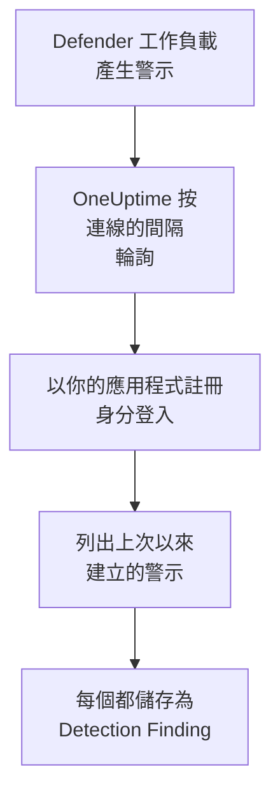

# Microsoft Defender XDR

把每個 [Microsoft Defender XDR](https://learn.microsoft.com/en-us/defender-xdr/) 工作負載（端點、身分、電子郵件和雲端應用程式）的警示匯入 OneUptime 的安全性事件。在那裡，你可以把它們與日誌、追蹤和指標放在一起搜尋，與其他所有來源進行關聯分析，並為重要的警示呼叫待命人員。OneUptime 透過你建立的應用程式註冊，經由 Microsoft Graph 安全性 API 讀取它們：不需要代理、playbook 或 Sentinel 工作區。

:::cards
- [設定連線](#設定連線): 一個應用程式註冊、一項權限，以及連線的表單。
- [匯入的內容](#匯入的內容): 每個 Defender 警示如何成為一個安全性事件。
- [輪詢的運作方式](#輪詢的運作方式): 每次輪詢讀取的時間窗，以及繁忙的租用戶對它的影響。
- [疑難排解](#疑難排解): 每個錯誤的含義，以及需要更改什麼。
:::

## 運作方式



OneUptime 每分鐘輪詢一次已過輪詢間隔的每個已啟用連線。一次輪詢會以你的應用程式註冊身分登入 Microsoft Entra ID，向 Microsoft Graph 請求自上次輪詢以來建立的警示（[List alerts_v2](https://learn.microsoft.com/en-us/graph/api/security-list-alerts_v2)），並把每個警示儲存為一個 [OCSF](https://schema.ocsf.io/) Detection Finding 事件（類別 `2004`）。之後，偵測規則、監測器和儀表板會像對待其他任何來源的安全性事件一樣對待它。

## 開始之前

- 在 OneUptime 中擁有 Project Owner、Project Admin 或 Security Admin 角色。Security Member 和 Security Viewer 可以檢視連線及其執行歷史，但不能更改它們。
- 一個擁有 Microsoft Defender XDR 授權的 Microsoft Entra 租用戶：任何已加入 Microsoft Defender 入口網站的 Defender 工作負載都可以，例如 Defender for Endpoint、for Identity、for Office 365 或 for Cloud Apps。
- 一個可以註冊應用程式的 Entra 角色，例如 Application Administrator，以及一位能授予管理員同意的 Global Administrator 或 Privileged Role Administrator。
- 從 OneUptime 應用程式和工作程序到 `login.microsoftonline.com` 和 `graph.microsoft.com` 的傳出 HTTPS；對於 Azure Government，則是到 `login.microsoftonline.us` 和 `graph.microsoft.us`。

## 設定連線

連線使用 [OAuth 2.0 用戶端認證流程](https://learn.microsoft.com/en-us/entra/identity-platform/v2-oauth2-client-creds-grant-flow) 登入：始終作為應用程式，而不是作為某個人，並且只使用一項應用程式權限。

:::steps
### 註冊應用程式

1. 登入 [Azure portal](https://portal.azure.com) 並開啟 **Microsoft Entra ID**。
2. 前往 **App registrations → New registration**。將其命名為 `OneUptime Security Events`，**Supported account types** 保持為 **Accounts in this organizational directory only**，重新導向 URI 留空，然後選擇 **Register**。
3. 在應用程式的 **Overview** 頁面上，複製 **應用程式（用戶端）ID** 和 **目錄（租用戶）ID**。

### 允許它讀取警示

1. 前往 **API permissions → Add a permission → Microsoft Graph → Application permissions**，選擇 `SecurityAlert.Read.All`，然後選擇 **Add permissions**。這是 [List alerts_v2](https://learn.microsoft.com/en-us/graph/api/security-list-alerts_v2#permissions) 呼叫接受的應用程式最低權限：不要新增 `SecurityAlert.ReadWrite.All`。
2. 為你的租用戶選擇 **Grant admin consent for**，並確認。該權限的狀態必須顯示為 **Granted**：沒有同意時，每次讀取都會以 `403` 被拒絕。

### 建立用戶端密碼

前往 **Certificates & secrets → Client secrets → New client secret**，選擇過期時間，然後選擇 **Add**。離開頁面之前，複製密碼的 **Value**，而不是它的 **Secret ID**：它不會再次顯示。

記下密碼何時過期。到了那一天，輪詢會以 `Microsoft Defender XDR token request failed (HTTP 401)` 停止，直到你用 **更新憑證** 替換它。

### 在 OneUptime 中新增連線

開啟 **產品 → Security Events → 連線**（`/dashboard/{projectId}/security-events/connections`），點選 **新增連線**，在 **EDR / XDR** 下選擇 **Microsoft Defender XDR**，然後點選 **下一步**。填寫下表中的設定，點選 **下一步**，並把密碼的值貼上到 **用戶端密碼** 中。

### 儲存之前先測試

點選 **儲存前測試** 下的 **測試這些設定**。測試會用表單中的值登入並讀取警示，但不會儲存任何內容，因此錯誤的密碼或缺失的同意會在連線存在之前暴露出來。然後點選 **下一步**，為連線填寫 **名稱** 並建立它。
:::

| 設定 | 在哪裡找到 |
| --- | --- |
| **目錄（租用戶）ID** | 應用程式的 **Overview** 頁面。租用戶的 GUID，或已驗證的網域，例如 `contoso.onmicrosoft.com`。 |
| **應用程式（用戶端）ID** | 應用程式的 **Overview** 頁面。擁有 `SecurityAlert.Read.All` 的應用程式的 GUID。 |
| **雲端** | **Azure 公用雲端**（也服務於 Microsoft 365 GCC），或用於 GCC High 的 **Azure Government（美國）** （`login.microsoftonline.us` 和 `graph.microsoft.us`）。不支援 Microsoft 365 DoD 和中國的 21Vianet 雲端。 |
| **用戶端密碼** | 密碼的 **Value**。它會被加密，API 從不傳回，也不會再次顯示。在連線上用 **更新憑證** 替換它。 |

**輪詢** 步驟還有選用的 **描述**、**輪詢間隔（分鐘）**（`1` 到 `1440` 之間的整數，初始為 `5`），以及初始為開啟的 **已啟用**。

## 匯入的內容

每個 Defender XDR [警示](https://learn.microsoft.com/en-us/graph/api/resources/security-alert) 都會成為一個 Detection Finding 事件（OCSF 類別 `2004`），供應商為 `Microsoft`，產品為 `Microsoft Defender XDR`，歸屬於 `Microsoft Defender XDR` 遙測服務：

| OCSF 欄位 | 警示欄位 |
| --- | --- |
| `eventUid` | `id`，即 Graph 警示 ID，也是去除重複所依據的值 |
| `time` | `firstActivityDateTime`，沒有時用 `createdDateTime` |
| `message`, `ruleName` | `title` |
| `ruleId` | `detectorId`，沒有時用 `alertPolicyId` |
| `severityName` | `severity`：`informational`、`low`、`medium` 或 `high`，`unknown` 保持為 Unknown |
| `statusName` | `status`：`new` 變為 New，`inProgress` 變為 In Progress，`resolved` 變為 Resolved |
| `mitreTechniques` | `mitreTechniques` |
| `mitreTactics` | `categories` 或 `category`（當它是 ATT&CK 戰術時）：`CredentialAccess` 變為 `TA0006`。其他類別保留在 `attributes` 中。 |
| `principalHost`, `principalUser`, `principalIp`, `principalProcess` | 具有 `source`、`attacker` 或 `compromised` 角色的 `evidence`，否則取每種類型的第一個 |
| `processName`, `processPath`, `processCommandLine`, `parentProcessName`, `parentProcessPath` | `principalProcess` 所來自的程序證據：其 `imageFile`、`processCommandLine` 和 `parentProcessImageFile`。Graph 不提供父程序的命令列。 |
| `targetHost`, `targetUser`, `targetIp`, `targetResource` | 具有目標角色（例如 `destination` 或 `attacked`）的 `evidence`。URL、信箱和雲端資源填入 `targetResource`。 |
| `observables` | `evidence` 中的每個主機名稱、IP、使用者、檔名、SHA-1 和 SHA-256、URL、網域、信箱和資源 ID |
| `attributes` | 整個警示，展平為點分隔的鍵，例如 `evidence.0.hostName`、`serviceSource` 和 `incidentId` |

來自每個 `serviceSource` 的警示都會被匯入，一旦 Sentinel 連接到 Defender 入口網站，Microsoft Sentinel 的警示也會被匯入。事件（incident）不會被匯入，但每個警示都會在 `attributes` 中保留它的 `incidentId` 和 `incidentWebUrl`。

## 輪詢的運作方式

每次輪詢都會列出在其時間窗內建立的警示，每頁 100 個，並跟隨 Graph 的 `@odata.nextLink`，直到讀完整個時間窗：

```text
GET https://graph.microsoft.com/v1.0/security/alerts_v2?$filter=createdDateTime ge {start} and createdDateTime lt {end}&$top=100
```

- **建立時間就是游標。** Defender 經常在 `firstActivityDateTime` 之後幾個小時才建立警示，基於活動時間的游標會跳過所有這樣的警示。
- **第一次輪詢會回溯 24 小時**，所以新連線會立刻顯示最近的警示。
- **之後的每次輪詢都從儲存的游標之前 1 分鐘開始**，所以在兩個時間窗邊界上建立的警示會被讀取兩次，但只匯入一次。
- **一次輪詢最多讀取游標之後 24 小時。** 在工作程序停機或租用戶被節流期間游標落後的連線，會透過一連串 24 小時的時間窗追趕。
- **重複項按警示的 `id` 去除重複**，範圍是專案中來自 `Microsoft` / `Microsoft Defender XDR` 的事件，所以重疊部分、重試的時間窗和匯入都不會把同一個警示儲存兩次。
- **失敗的執行不會改變任何東西。** 發生網路錯誤或 Graph 傳回錯誤狀態後，游標和時間窗長度保持不變，下一次輪詢會再次讀取同一個時間窗。唯一的例外是請求逾時：游標保持不變，但下一個時間窗的長度減半，因為太重而無法及時回應的時間窗每次重試都會逾時。

### 當一個時間窗包含的內容超過一次輪詢能讀取的量時

一次輪詢最多讀取 20 頁、每頁 100 個警示：共 2,000 個警示。當這個上限讓它在時間窗結束之前停下時，這次執行為 **部分**，並帶有以下警告：

```text
Stopped after 20 alerts requests (the per-run request limit) before reading the whole window. Microsoft Graph lists alerts newest first and documents no way to sort them oldest first, so this run cannot name a point to resume from.
```

[List alerts_v2](https://learn.microsoft.com/en-us/graph/api/security-list-alerts_v2) 記錄了 `$filter`、`$top`、`$skip` 和 `$count`，但沒有記錄 `$orderby`，並且它先傳回最新的警示。停下的執行讀取的 2,000 個警示是其時間窗中最新的那些，所以把游標移過它們會跳過它沒讀到的較早警示。因此 OneUptime 會改為縮短時間窗：

1. **縮小。** 下一次輪詢從同一個起點讀取長度減半的時間窗，並不斷減半，直到某個時間窗能被完整讀取，最短為一分鐘。執行的警告會說明這一點：`This window holds more records than one poll can read; the next poll reads a {n} minute window from the same starting point.` 已從較長時間窗匯入的警示會作為重複項被跳過。
2. **恢復。** 一個時間窗被完整讀取後，游標會移到它的末尾，下一個時間窗的長度會再次加倍，最長為 24 小時。
3. **越過單獨的一分鐘。** 如果連一分鐘內都有超過 2,000 個警示，輪詢會越過這一分鐘，讓更新的警示繼續到達。這次執行仍為 **部分**，**最近的錯誤** 顯示 `More records were created in the one minute from {cursor} to {end} than one poll can read. Polling moved past this minute so newer records keep arriving; use Import this time range in Diagnostics on this minute to recover what one run can read.` 用 **Import this time range** 匯入這一分鐘，即可找回一次執行能讀取的內容。

因其他原因而為 **部分** 的執行，例如某個警示無法被讀取為安全性事件，也會以同樣的方式從同一個起點重試。更改 **輪詢間隔（分鐘）** 不會改變以上任何一點：它決定輪詢多久開始一次，而不是時間窗從哪裡開始。

### 按需執行、預覽和匯入

在連線上點選 **診斷**，可以檢視它最近的執行，並手動操作它。能更改該連線的人都可以啟動這些操作；能檢視它的人都可以閱讀歷史記錄。

- **立即執行** 會立即開始一次輪詢，使用通常的游標，即使連線未處於 **已啟用** 狀態也可以。
- **Preview alerts** 讀取最長 7 天的時間範圍，不匯入任何內容。
- **Import this time range** 在你確認後匯入最長 7 天的範圍，不會移動游標。已匯入的警示會被跳過。
- 執行上的 **Copy diagnostics** 會複製它的報告以便提供給支援人員。報告從不包含認證資訊。

## 測試連線

連線所在列中的 **測試連線** 和表單中的 **測試這些設定** 在 API 程序中執行，而不是在背景工作程序中執行，所以即使工作程序出了問題，測試仍然會給出結果。它按順序執行以下檢查：

| 檢查 | 檢查的內容 |
| --- | --- |
| **設定** | 四項設定都存在且格式正確。此項失敗時不會連線到任何地方。 |
| **Authenticate with Microsoft Entra** | Microsoft Entra ID 在你選擇的雲端中頒發用於 Microsoft Graph 的權杖。密碼錯誤或已過期、租用戶或用戶端 ID 錯誤，或者雲端選錯時，此項失敗。 |
| **Read alerts from Microsoft Graph** | 可以讀取過去 24 小時內建立的一個警示（`$top=1`）。這裡出現 `403` 表示缺少 `SecurityAlert.Read.All` 權限、缺少管理員同意，或者租用戶沒有 Defender XDR。 |
| **Alerts available to import** | 過去 24 小時和過去 7 天內建立了多少警示，各讀取一頁 100 個，所以 `100+` 表示更多。7 天內一個都沒有是警告，而不是失敗。 |
| **Background workers**、**Poll scheduler**、**Security event storage** | OneUptime 自身的一側：有程序在處理 Worker 佇列的作業，輪詢作業每分鐘執行一次，安全性事件儲存能夠回應。 |
| **Scheduled polling** | 針對已儲存的連線：輪詢已開啟，沒有執行卡在等待工作程序的狀態，並且輪詢按時執行。 |

測試中的每個請求都有 20 秒的期限。測試從不匯入任何內容，也不移動游標，每個失敗的檢查都會說明需要更改什麼。

## 疑難排解

連線的 **最近的錯誤** 會保留完整的錯誤訊息（認證資訊已隱去），前面帶有一個指明失敗步驟的字首。連線出錯時，在它的 **操作** 欄中選擇 **檢視錯誤** 來閱讀，並在對話方塊中用 **複製錯誤** 複製。請先閱讀字首。

:::details Last Error 以 `Microsoft Defender XDR token request` 開頭
- `Microsoft Defender XDR token request failed (HTTP ...)`：Microsoft Entra ID 拒絕頒發權杖，所以根本沒有連線到 Graph。訊息末尾會有一條根據 Entra 的 `error` 代碼給出的提示：
  - `invalid_client` (`AADSTS7000215`)：密碼錯誤、已過期，或屬於另一個應用程式。在 **Certificates & secrets** 下建立一個新密碼，並用 **更新憑證** 儲存。
  - `unauthorized_client` (`AADSTS700016`)：**應用程式（用戶端）ID** 不在該 **目錄（租用戶）ID** 中，或者 **雲端** 選錯了。
  - `AADSTS90002`：沒有這樣的租用戶。
  - `invalid_scope`：你選擇的雲端中不存在該 Graph 範圍。請檢查 **雲端**。
- `Microsoft Defender XDR token request returned ...`：Microsoft Entra ID 傳回了無法使用的內容，即不是 JSON 或沒有 `access_token` 的內文。這通常是中間的代理或閘道器造成的，而不是認證資訊的問題。
- `Microsoft Defender XDR token request did not complete: ...`：無法存取權杖端點，或者它沒有及時回應。檢查 OneUptime 應用程式和工作程序到 `login.microsoftonline.com` 或 `login.microsoftonline.us` 的傳出 HTTPS。
:::

:::details Last Error 以 `Microsoft Defender XDR alerts request` 開頭
- `Microsoft Defender XDR alerts request failed (HTTP ...)`：Graph 拒絕列出警示。訊息會指出 Graph 的錯誤代碼，並給出一條提示：
  - `403` (`Authorization_RequestDenied`)：缺少 `SecurityAlert.Read.All` 或它的管理員同意，或者租用戶沒有 Defender XDR 授權。同意需要幾分鐘才能生效。
  - 權杖頒發後出現 `401` (`InvalidAuthenticationToken`)：通常是 **雲端** 與租用戶不符合。
  - `429` (`TooManyRequests`)：Graph 正在對應用程式節流，下一次輪詢會再次讀取同一個時間窗。訊息無法引用 Graph 的 `Retry-After`，因為 OneUptime 的 HTTP 用戶端在出錯時不保留回應頭。如果反覆出現，請調大 **輪詢間隔（分鐘）**。
  - `5xx`：Graph 一側的問題。下一次輪詢會重試。
  - `400`：Graph 不肯執行查詢，而查詢是由 OneUptime 建置的，與你的設定無關。請複製訊息提供給 OneUptime 支援人員。
- `Microsoft Defender XDR alerts request returned ...`：Graph 傳回了 `200`，但連接器無法使用其內容：內文不是 JSON、沒有 `value` 清單，或者 `@odata.nextLink` 不是指向你所在雲端的 Graph 主機的 `https://` 連結。這樣的連結會被拒絕，所以權杖永遠不會被髮送到其他地方。這種情況會被報告出來，而不是被當作空時間窗，所以游標永遠不會越過沒人讀過的警示。
- `Microsoft Defender XDR alerts request did not complete: ...`：無法存取 Graph，或者它沒有及時回應：輪詢為 60 秒，測試為 20 秒。檢查到 `graph.microsoft.com` 或 `graph.microsoft.us` 的傳出 HTTPS。
:::

:::details 測試通過，但 Last Polled 為 Never
輪詢作業從未執行過。閱讀 **Background workers** 和 **Poll scheduler** 檢查。在自行託管安裝中，常見原因是應用程式上設定了 `DISABLE_QUEUE_WORKERS=true`，卻沒有單獨的工作程序部署來處理作業：把它設為 `false`，或執行工作程序部署（Helm：`worker.enabled: true`，預設為 `false`）。
:::

:::details 輪詢成功，但你知道的某個警示不見了
在 Defender 入口網站中把該警示的 `createdDateTime` 與 **診斷** 中執行的時間窗進行比較：時間窗基於建立時間，而不是活動時間。

- 在連線存在之前建立的警示早於第一次 24 小時回溯。請用 **Import this time range** 匯入它。
- **部分** 執行是被 2,000 個警示的上限停下的。下一次輪詢會從同一個起點讀取更短的時間窗，所以一旦包含該警示的時間窗被完整讀取，它就會被匯入。
- 如果 **最近的錯誤** 指出了輪詢越過的某一分鐘，請用 **Import this time range** 匯入那一分鐘。
:::

:::details 同一個警示出現了兩次
這不是 1 分鐘的重疊造成的：第二次讀取會被計為重複項，不會被儲存。這是兩個具有相同 `eventUid` 的事件以不同的產品被匯入，例如同一個警示也透過 Microsoft Sentinel 連線到達。去除重複是按供應商和產品進行的。
:::

## 你會得到什麼

- **搜尋。** 在安全性事件探索器中，與該主機的日誌和指標放在一起，按嚴重程度、狀態、MITRE 技術、主機、使用者、IP 或任何 observable 篩選 Defender 警示。
- **關聯分析。** 每個警示的證據，即它的裝置、使用者、IP、檔案和 URL，都會作為 observable 建立索引，所以一次搜尋就能在所有來源中找到提到某個主機的所有內容。
- **偵測規則。** 按排程對你的安全性事件執行的 Sigma 規則，會開啟呼叫待命人員的警示。
- **監測器。** 安全性事件監測器統計符合的事件，並在超過閾值時開啟事件或警示。

安全性事件與其他遙測資料一樣，按擷取的 GB 數計費。請參閱 [定價](https://oneuptime.com/pricing)。

## 後續步驟

:::cards
- [安全性事件](/docs/telemetry/security-events): 搜尋、關聯分析你匯入的內容，並據此發出警示。
- [Microsoft Sentinel](/docs/integrations/microsoft-sentinel): 同時匯入 Sentinel 工作區的事件。
- [角色](/docs/permissions/reference#角色): Security 角色可以檢視和更改的內容。
- [整合總覽](/docs/integrations/index): 你可以連接的其他工具。
:::
