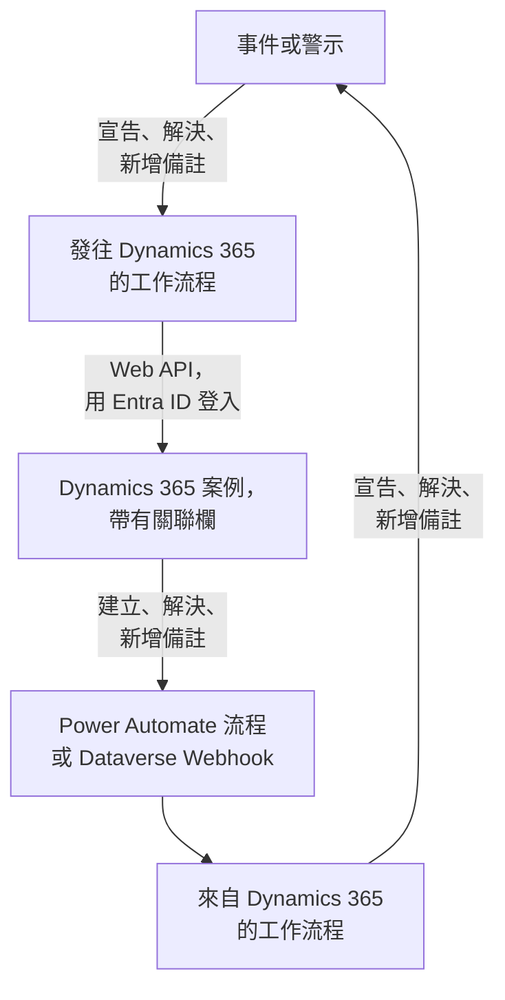

# Microsoft Dynamics 365

讓 [Microsoft Dynamics 365](https://www.microsoft.com/dynamics-365) 案例與你的 OneUptime 事件和警示雙向保持同步。現成的工作流程範本會為每個事件或警示建立一個案例，在記錄被解決時關閉它，並把備註複製進去。另一些範本會根據新案例宣告事件，並把解決結果和備註同步回來。無需安裝外掛程式：工作流程呼叫 Dataverse Web API，Dynamics 365 呼叫工作流程的 Webhook URL。

:::cards
- [準備 Dynamics 365](#準備-dynamics-365): 一個應用程式註冊、一個應用程式使用者和一個關聯欄。
- [從範本開始](#從範本開始): 13 個範本、它們需要的設定，以及如何設定。
- [範本的運作方式](#範本的運作方式): 案例和記錄如何保持關聯，而不會形成迴圈。
- [自己建置](#自己建置): 範本不適用時，手動建置每個方向。
:::

## 運作方式



每個範本都是一個小工作流程，所以你可以只選用需要的方向，用於事件、警示或兩者。OneUptime → Dynamics 365 範本透過 Microsoft Entra ID 以應用程式身分登入，呼叫 Dataverse Web API。Dynamics 365 → OneUptime 範本在 Power Automate 流程或 Dataverse Webhook 呼叫它們時啟動。你在 Case 表中新增的一個文字欄，把每個案例與它的記錄關聯起來。

## 開始之前

- 一個帶有 **Case** 表的 Dynamics 365 環境。案例來自 Dynamics 365 Customer Service：沒有它的 Dataverse 環境中沒有可寫入的 `incident` 表。
- 在 **Microsoft Entra ID** 中註冊應用程式的權限，以及在環境中建立應用程式使用者的權限。這兩項權限通常屬於兩位不同的管理員。
- 在 OneUptime 中建立工作流程的權限。在 OneUptime Cloud 上，工作流程需要 **Growth** 或更高的方案。

> [!NOTE]
> 本頁使用 Dataverse 中的名稱，而不是 Dynamics 表單上的標籤。案例是 `incident` 表，它在 URL 中的集合是 `incidents`，鍵是 `incidentid`，標題欄是 `title`。你看到的案例編號是 `ticketnumber`。

## 準備 Dynamics 365

範本和你自己建置的工作流程都需要以下準備。OneUptime 使用 OAuth 2.0 用戶端憑證流程，以應用程式而不是個人的身分登入。

:::steps
### 在 Microsoft Entra ID 中註冊應用程式

1. 以 Dynamics 環境所在租用戶的管理員身分登入 [Azure portal](https://portal.azure.com)，然後開啟 **Microsoft Entra ID**。
2. 前往 **App registrations → New registration**。將其命名為 `OneUptime Integration`，**Supported account types** 保持為 **Accounts in this organizational directory only**，然後選擇 **Register**。
3. 在應用的 **Overview** 頁面上，複製 **Application (client) ID** 和 **Directory (tenant) ID**。
4. 前往 **Certificates & secrets → Client secrets → New client secret**，在離開頁面之前複製金鑰的 **Value**，而不是它的 ID：它再也不會顯示。用戶端密鑰最長有效 24 個月，所以請記下它的過期時間。

不要新增 API 權限，也不要授予管理員同意：沒有已登入的使用者，它們不起任何作用。應用程式可以做什麼，由 Dynamics 365 透過它的應用程式使用者決定。

### 建立應用程式使用者

1. 在 [Power Platform 管理中心](https://admin.powerplatform.microsoft.com/) 中，選擇 **Manage → Environments**，然後選擇你的環境。
2. 選擇 **Settings → Users + permissions → Application users**，然後依次選擇 **+ New app user** 和 **+ Add an app**。選擇該應用程式註冊，然後選擇 **Add**。
3. 選擇一個 **Business unit**，然後透過 **Security roles** 旁邊的編輯圖示為它分配一個自訂安全形色。在 Organization 級別，該角色需要：
   - **Case**：Create、Read、Write、Append 和 Append To。
   - **Note**：Create、Read 和 Append，供備註範本使用。
   - **Activity**：Create、Read 和 Append，因為關閉案例會記錄一個 Case Resolution，而它是一種活動。
   - **Account**，如果案例是針對連絡人提交的，還有 **Contact**：Read 和 Append To。
4. 選擇 **Save**，然後選擇 **Create**。

應用程式使用者只能擁有自訂角色：複製一個現有角色，再刪減它的權限。沒有這個使用者時，Microsoft Entra ID 仍會頒發權杖，但對 Dynamics 365 的每次呼叫都會以 `403` 和 `0x80072560`（"The user isn't a member of the organization."）失敗。

### 在 Case 表中新增關聯欄

Dataverse 中沒有類似 Jira 標籤的東西，因此案例和 OneUptime 記錄透過你新增的一欄找到彼此。

1. 在 [make.powerapps.com](https://make.powerapps.com) 中選擇你的環境，開啟 **Tables → Case → Columns**，然後選擇 **New column**。
2. 將其命名為 `OneUptime Link`，**Data type** 保持為 **Single line of text**，然後儲存。預設最大長度 100 已經足夠：範本最多寫入 55 個字元。
3. 開啟新欄，複製它的 **Logical name**，例如 `new_oneuptimelink`。字首來自你的解決方案發行者，因此你的字首可能不同，例如 `cr4f2_oneuptimelink`。

如果客服人員應該看到這個關聯，請把該欄新增到 Case 表單中。
:::

## 從範本開始

**建立工作流程** 對話方塊的類別清單中，**Dynamics 365** 下有 13 個 Dynamics 365 範本：先是 7 個事件範本，然後是 6 個警示範本，每組都在自己的標題下。它們共用關聯欄，因此任意組合都能一起工作。

### 事件範本

| 範本 | 作用 | 需要的設定 |
| --- | --- | --- |
| **OneUptime → Dynamics 365** | | |
| Create a Dynamics 365 case when an incident is declared | 為每個新事件建立一個案例，優先順序根據事件的嚴重程度選擇，關聯欄中寫入事件的 ID。從 Dynamics 365 宣告的事件和私人事件會被跳過。 | 五項 Dynamics 365 設定、新案例的客戶，以及 OneUptime URL |
| Resolve the Dynamics 365 case when the incident is resolved | 事件被解決時，把關聯的案例以 **Problem Solved** 關閉，並像手動解決時一樣記錄一個 Case Resolution。從不重新開啟案例。 | 五項 Dynamics 365 設定 |
| Copy incident private notes to the Dynamics 365 case | 把每條新的私人備註作為備註新增到關聯的案例中。 | 五項 Dynamics 365 設定 |
| Copy incident public notes to the Dynamics 365 case | 把每條新的公開備註作為備註新增到關聯的案例中，讓客服人員可以告訴客戶狀態頁上寫了什麼。 | 五項 Dynamics 365 設定 |
| **Dynamics 365 → OneUptime** | | |
| Declare an incident when a Dynamics 365 case is created | 為每個新案例宣告一個不顯示在狀態頁上的事件，嚴重程度根據案例的優先順序選擇，然後把事件的 ID 寫入案例的關聯欄。 | 五項 Dynamics 365 設定，以及一個用於新案例的流程或 Webhook |
| Resolve the incident when its Dynamics 365 case is resolved | 關聯的案例被解決時，解決該事件。 | 五項 Dynamics 365 設定，以及一個用於案例狀態變更的流程或 Webhook |
| Add Dynamics 365 case notes to the incident as private notes | 把客服人員新增到關聯案例上的每條備註作為私人備註複製到事件中。 | 五項 Dynamics 365 設定，以及一個用於新備註的流程或 Webhook |

### 警示範本

警示範本為警示完成同樣的工作。它們少一個，因為警示沒有公開備註；而且 **Create an alert when a Dynamics 365 case is created** 不寫入任何狀態頁設定，因為警示永遠不會出現在狀態頁上。

| 範本 | 作用 | 需要的設定 |
| --- | --- | --- |
| **OneUptime → Dynamics 365** | | |
| Create a Dynamics 365 case when an alert is created | 為每個新警示建立一個案例，包括監測器產生的每一條警示。從 Dynamics 365 建立的警示和私人警示會被跳過。 | 五項 Dynamics 365 設定、新案例的客戶，以及 OneUptime URL |
| Resolve the Dynamics 365 case when the alert is resolved | 警示被解決時，把關聯的案例以 **Problem Solved** 關閉。 | 五項 Dynamics 365 設定 |
| Copy alert private notes to the Dynamics 365 case | 把每條新的私人備註作為備註新增到關聯的案例中。 | 五項 Dynamics 365 設定 |
| **Dynamics 365 → OneUptime** | | |
| Create an alert when a Dynamics 365 case is created | 為每個新案例建立一個警示，嚴重程度根據案例的優先順序選擇，然後把警示的 ID 寫入案例的關聯欄。 | 五項 Dynamics 365 設定，以及一個用於新案例的流程或 Webhook |
| Resolve the alert when its Dynamics 365 case is resolved | 關聯的案例被解決時，解決該警示。 | 五項 Dynamics 365 設定，以及一個用於案例狀態變更的流程或 Webhook |
| Add Dynamics 365 case notes to the alert as private notes | 把客服人員新增到關聯案例上的每條備註作為私人備註複製到警示中。 | 五項 Dynamics 365 設定，以及一個用於新備註的流程或 Webhook |

除非你開啟相應開關，否則 OneUptime → Dynamics 365 範本都不會把標記為 **私人事件** 的事件或標記為 **私人警示** 的警示傳送到 Dynamics 365：記錄本身、它的狀態和備註都不會發送。請參閱 [更改範本的行為](#更改範本的行為)。

**監測器會自行產生警示，而且可能產生很多。** **Create a Dynamics 365 case when an alert is created** 會為每一條警示建立案例。除非每條警示都值得一個案例，否則請在觸發器和工作流程的其餘部分之間放一個 **If / Else** 區塊，例如基於 `{{local.components.alert-on-create-1.returnValues.model.alertSeverity.name}}` 判斷，並且只把它的 **Yes** 一側繼續往後連接。

### 範本需要的設定

建立精靈的 **設定** 步驟最多詢問七個值：每個範本都會詢問前五個，也就是 Dynamics 365 設定，兩個建立案例的範本還會詢問最後兩個。它會在建立任何內容之前檢查每項 Dynamics 365 設定的格式，並告訴你應改為輸入什麼，因為格式錯誤的值在執行之前在任何地方都不會報錯。

- **Dynamics 365 Environment URL** — 你的環境位址，例如 `https://yourorg.crm.dynamics.com`，可在 [Power Platform 管理中心](https://admin.powerplatform.microsoft.com/) 的 **Environments** 下選擇你的環境後，在 **Environment URL** 中找到。只填位址：不是以 `/api/data/v9.2` 結尾的 Web API 端點，末尾也不要帶斜線。
- **Directory (Tenant) ID** — 來自應用程式註冊的 **Overview** 頁面。
- **Application (Client) ID** — 來自同一頁面。
- **Client Secret Value** — **Certificates & secrets** 中用戶端密鑰的 **Value**。不是它的 **Secret ID**，那是一個 GUID：精靈會拒絕在這裡填寫 GUID。
- **Case Link Column** — 關聯欄的邏輯名稱，例如 `new_oneuptimelink`。
- **Customer for New Cases** — 只有兩個建立案例的範本會詢問。每個案例都需要一個客戶，而 OneUptime 事件沒有客戶，因此所有新案例都針對同一個客戶提交：貼上一個客戶（account）的 ID，如果是連絡人則貼上 `contacts(<id>)`。在 Dynamics 365 中開啟該記錄：位址中 `id=` 之後的部分就是它的 ID。
- **OneUptime URL** — 只有兩個建立案例的範本會詢問：你開啟 OneUptime 的位址，例如 `https://oneuptime.com`。案例的描述用它連結回事件或警示。

**範本如何登入。** 精靈會把租用戶、用戶端 ID 和金鑰儲存到工作流程 **工作流程變數** 下的一個 [OAuth 2.0 變數](/docs/workflows/variables#oauth-20-變數會自動重新整理的權杖) `dynamicsAccessToken` 中：Client Credentials、權杖 URL `https://login.microsoftonline.com/<tenant>/oauth2/v2.0/token`、範圍 `<environment URL>/.default`，以及在請求內文中傳送並加密儲存的用戶端密鑰。對 Dynamics 365 的每次呼叫都會發送 `Authorization: Bearer {{local.variables.dynamicsAccessToken}}`。OneUptime 在某個步驟第一次需要權杖時取得它，在過期之前取得新權杖，並在執行日誌和步驟追蹤中把它替換為 `[REDACTED]`。

要在執行任何內容之前檢查登入，請開啟 **工作流程變數**，在 `dynamicsAccessToken` 上點選 **檢視**，然後點選 **立即重新整理**。顯示 **Access Token Fetched** 表示應用程式註冊正確。否則，Microsoft Entra ID 的錯誤會指出問題所在，例如 `AADSTS7000215: Invalid client secret provided`。

每個工作流程都儲存自己的副本。更換用戶端密鑰時，請在每個 Dynamics 365 工作流程中開啟 `dynamicsAccessToken`，並使用 **更新憑證**。

### 建立工作流程

:::steps
1. 開啟 **工作流程 → 建立工作流程**。在 **或從範本開始** 下，從類別清單中選擇 **Dynamics 365**，或者在 **搜尋範本…** 中輸入 `Dynamics`，然後點選你想要的範本。範本開啟後會顯示它的作用以及將要詢問的設定。點選 **使用此範本**。
2. **名稱** 會根據範本自動填寫。如果願意，可以修改它。
3. **設定** 會詢問上面的這些值。
4. 點選 **建立工作流程**。每個工作流程建立時都處於關閉狀態：在它的 **建構器** 頂部開啟 **已啟用**。
:::

先從 **Create a Dynamics 365 case when an incident is declared** 開始，警示則從 **Create a Dynamics 365 case when an alert is created** 開始：同類的其他 OneUptime → Dynamics 365 範本都透過這個範本寫入的關聯找到案例。啟用它，宣告一個測試事件或建立一個測試警示，然後開啟工作流程的 **日誌 → 執行記錄**。這次執行應以 **已執行** 結束，其最後一步 `create-case-1` 的 **Response Body** 中會有新案例的 `ticketnumber`，例如 `CAS-01001-X1Y2Z3`。

### 連接 Dynamics 365 → OneUptime 範本

Dynamics 365 → OneUptime 範本（3 個事件範本和 3 個警示範本）從 [Webhook 觸發器](/docs/workflows/triggers#webhook) 啟動，因此必須告訴 Dynamics 365 把事件傳送到哪裡。請按以下順序操作：

1. 建立工作流程，並且 **先啟用它**。處於關閉狀態的工作流程會拒絕傳遞，而且這些傳遞不會排入佇列。
2. 開啟工作流程的 **建構器**，點選 **Webhook** 觸發器區塊（`webhook-1`），然後點選其設定頂部的 **複製 URL**。URL 的樣子如下：

   ```text
   https://<your OneUptime host>/workflow/trigger/<webhook secret key>
   ```

3. 讓 Dynamics 365 透過 Power Automate 流程或 Dataverse Webhook 向它發布請求。

每個範本只需要知道哪一列發生了變化。它在做任何事之前都會從 Dynamics 365 重新讀取那一列，因此從不從請求中取得案例的標題、狀態或關聯，也不在乎是兩者中的哪一個傳送的。

:::tabs
@tab Power Automate flow
在 [Power Automate](https://make.powerautomate.com) 中，建立一個使用 **Microsoft Dataverse** 觸發器 **When a row is added, modified or deleted** 的 **Automated cloud flow**，按下表設定，並把 **Scope** 設為 **Organization**。新增內建的 **HTTP** 操作：**Method** 為 `POST`，**URI** 為工作流程的 URL，一個 `Content-Type: application/json` 標頭，以及下面的內文，其中列的 ID 從觸發器的動態內容中選取。

| 範本 | Change type | Table name | Select columns | Body |
| --- | --- | --- | --- | --- |
| 建立案例時宣告事件 / 建立警示 | Added | Cases | | `{"PrimaryEntityId": "<Case>"}` |
| 案例被解決時解決事件 / 警示 | Modified | Cases | `statecode,statuscode` | `{"PrimaryEntityId": "<Case>"}` |
| 把案例備註作為私人備註新增到事件 / 警示 | Added | Notes | | `{"PrimaryEntityId": "<Note>"}` |

如果只想傳送部分案例，請使用觸發器的 **Filter rows**，例如對高優先順序案例使用 `prioritycode eq 1`。本文用 `PrimaryEntityId` 指明這一列，與 Dataverse webhook 的做法相同：範本會從 Dynamics 365 重新讀取這一列本身。
@tab Dataverse webhook
用 [Plug-in Registration Tool](https://learn.microsoft.com/en-us/power-apps/developer/data-platform/register-web-hook) 註冊該 URL：選擇 **Register New WebHook**，使用 **HttpHeader** 驗證和你自己定義的標頭；URL 本身就是密鑰。然後為下面的每個事件在它上面註冊一個步驟，把 **Event Pipeline Stage of Execution** 設為 **PostOperation**，**Execution Mode** 設為 **Asynchronous**。

| 範本 | Message | Primary Entity | Filtering Attributes |
| --- | --- | --- | --- |
| 建立案例時宣告事件 / 建立警示 | `Create` | `incident` | |
| 案例被解決時解決事件 / 警示 | `Close`，以及用於他人所做狀態變更的 `Update` | `incident` | `statecode, statuscode` (Update) |
| 把案例備註作為私人備註新增到事件 / 警示 | `Create` | `annotation` | |

解決案例會觸發 **Close** 訊息，而不是 **Update**，這就是該範本兩者都需要的原因。Webhook 發布的是外掛程式執行內容，其中的列在 `PrimaryEntityId` 中給出，對於 **Close** 則在它的 `IncidentResolution` 中給出，範本從那裡讀取。Dataverse Webhook 只呼叫連接埠 80 和 443，並且自身沒有列篩選器：除非你用 `ONLY_PRIORITIES` 縮小範圍，否則每個新案例都會到達建立範本。
:::

在依賴其中任何一種之前：

- **任何擁有該 URL 的人都可以觸發工作流程。** 由於範本會從 Dynamics 365 重新讀取每一列，請求最多只能讓範本去檢視一個真實存在的案例或備註。但它仍然可以讓建立範本對一個尚未關聯的案例採取行動。只把 URL 儲存在流程或 Webhook 中。如果洩露，請在工作流程的 **建構器** 中點選 **Webhook** 觸發器，點選 **重設 URL**，然後把新 URL 貼上到流程或 Webhook 中。舊 URL 會立即失效。
- **每個事件都是一次執行**，包括範本跳過的那些。在 OneUptime Cloud 上，每次都計入你方案的工作流程執行次數，在流程中進行篩選可以減少這個數量。請參閱 [方案限制](/docs/workflows/configuration#方案限制)。
- **同時使用兩個根據案例建立記錄的範本？** **Declare an incident when a Dynamics 365 case is created** 和 **Create an alert when a Dynamics 365 case is created** 都會對傳送給它們的每個案例採取行動。它們都會先檢查關聯欄，但同一個新案例的兩次傳遞會同時到達，因此該案例最終可能同時有一個事件和一個警示。請把不同的案例傳送給這兩個範本，例如按案例類型區分。

### 檢查是否正常工作

每次執行的 **步驟** 都會說明範本做了什麼，因此請在 **日誌 → 執行記錄** 中開啟這次執行，看看它是如何結束的：

- **已執行**：完成了工作，最後一步會給出案例、事件或警示。
- **已執行**，且 **Check With JavaScript** 步驟走了 **No**：有意跳過了該事件，該步驟會說明原因：案例沒有關聯到這類記錄、備註來自另一邊、記錄是私人的，或者新狀態不會關閉案例。
- **錯誤**：某個步驟失敗了，它在 **步驟** 中的項目會說明原因。對於 Dynamics 365 呼叫，其中包含 Dynamics 365 的回應。
- 在 `link-case-1` 處 **錯誤**：根據案例建立記錄的範本已經建立了記錄，但 Dynamics 365 沒有接受關聯，因此其他範本暫時還找不到它。請手動在案例的欄中輸入關聯。

如果執行在第一個 Dynamics 365 步驟停止，並顯示 `Could not get an OAuth 2.0 access token for {{local.variables.dynamicsAccessToken}}`，說明登入設定有誤，訊息中會引用 Microsoft Entra ID 的回應。請參閱 [範本需要的設定](#範本需要的設定)。

## 範本的運作方式

### 兩邊如何保持關聯

關聯儲存在案例中。屬於事件的案例在其關聯欄中有 `oneuptime-incident-<incident id>`，屬於警示的案例則有 `oneuptime-alert-<alert id>`。ID 是記錄在儀表板中位址的最後一部分。

建立案例的範本在建立案例時寫入它，根據案例建立記錄的範本在記錄建立後立即寫入它。其他所有範本都透過它找到對方：OneUptime → Dynamics 365 範本按關聯查詢案例，Dynamics 365 → OneUptime 範本從案例中讀取記錄的 ID。要關聯一個手動建立的案例，請自己在它的關聯欄中輸入這個值，但前提是該記錄還沒有案例。

**一個案例只關聯到一個事件或一個警示，不會同時關聯兩者。** 一欄同時服務於兩類記錄。事件範本會忽略關聯到警示的案例，反之亦然；根據案例建立記錄的範本不會處理關聯欄中有任何內容的案例。

**一條記錄只有一個案例。** 向案例寫入的範本，只在恰好有一個案例帶有該記錄的關聯時才會動作。如果關聯被複制到第二個案例中，它們就會停止，每次執行都以一個給出兩個案例的跳過結束：

```text
More than one Dynamics 365 case holds the link oneuptime-incident-<id> (CAS-01001-X1Y2Z3, CAS-01002-K4L5M6). Clear it on every case except the one opened for the incident.
```

根據案例建立的事件和警示，還會把案例的 ID 和編號儲存在建立時寫入的 `customFields.dynamicsCaseId` 和 `customFields.dynamicsCaseNumber` 中。建立案例的範本正是靠它得知記錄已經有案例了。

### 範本如何避免迴圈

一個方向上的每次寫入，在另一個方向上都是一個事件：新增到案例中的備註會作為一條新備註回來，在 OneUptime 中新增的私人備註會觸發備註觸發器。有四樣東西阻止這種回聲：

- **文字中的標記。** 範本新增到案例中的每條備註都以 `Synced from OneUptime: …` 為標題，它們記錄的每個 Case Resolution 的主題也是如此。從 Dynamics 365 寫入的每條備註，以及從那裡發起的每次狀態變更的根本原因，都以 `Synced from Dynamics 365` 開頭。每個方向都會跳過帶有對方標記的文字，即使是有人引用了標記的備註也一樣。
- **從第一次儲存起就有的關聯。** OneUptime 建立的案例從它存在的那一刻起就帶有關聯，因此當它的 **Create** 回來時，根據案例建立記錄的範本會發現它已關聯，什麼也不做。
- **`customFields.dynamicsCaseId`.** 根據案例建立的記錄帶有它，建立案例的範本會跳過這樣的記錄。
- **兩邊的狀態都只向前移動。** 解決記錄會關閉案例，隨後案例的 **Close** 會發現記錄已經解決。當案例先被解決時，記錄會被解決，而它的更新會發現案例已經關閉。已經解決或已取消的案例永遠不會被重新開啟。

編輯範本時請保留這些標記。它們是每個指令碼頂部輔助程式碼區塊中的 `FROM_ONEUPTIME` 和 `FROM_DYNAMICS` 常量。

### 更改範本的行為

開啟工作流程的 **建構器**，點選你想更改的區塊。你最可能想改的設定是指令碼頂部附近的常量，位於 **Check With JavaScript** 區塊的 **JavaScript Code** 中，就在共享的輔助程式碼區塊下面。事件版本和警示版本在相同的區塊中有相同的常量。

| 常量 | 範本和區塊 | 控制的內容 |
| --- | --- | --- |
| `SYNC_PRIVATE_INCIDENTS`, `SYNC_PRIVATE_ALERTS` | 每個 OneUptime → Dynamics 365 範本 — `prepare-case-1`、`plan-case-1`、`build-note-1` | `false` 讓私人記錄不進入 Dynamics 365：不為它建立案例，不更改它的案例，也不新增它的備註。在每個應傳送它們的範本中把它設為 `true`。 |
| `SEVERITY_TO_PRIORITY`, `DEFAULT_PRIORITY` | Create a Dynamics 365 case — `prepare-case-1` | 專案的嚴重程度按順序分配到案例優先順序上：最高的嚴重程度建立 High 案例（`1`），最低的建立 Low 案例（`3`），介於兩者之間的建立 Normal 案例（`2`）。要自己選擇優先順序，請用小寫名稱列出嚴重程度，例如 `{ 'major incident': 1 }`。`DEFAULT_PRIORITY`（`2`）用於專案清單中沒有的嚴重程度，或只有一種嚴重程度的專案。 |
| `CASE_ORIGIN`, `CASE_TYPE` | Create a Dynamics 365 case — `prepare-case-1` | 新案例的 `caseorigincode`（`3`，Web）和 `casetypecode`（`2`，Problem）。要設定其他任何欄，請按邏輯名稱把它新增到同一指令碼的 `CASE` 中。 |
| `MAX_TITLE_LENGTH`, `MAX_DESCRIPTION_LENGTH` | Create a Dynamics 365 case — `prepare-case-1` | Case 表自身的限制，200 和 2000 個字元。無論截掉多少，描述都會保留連結回 OneUptime 的關聯。如果你的 Case 表允許更多，可以調高它們。 |
| `RESOLVED_CASE_STATUS` | Resolve the Dynamics 365 case — `plan-case-1` | 已解決的記錄關閉其案例時使用的狀態：`5` 是 Problem Solved，`1000` 是 Information Provided。 |
| `STATE_TO_CASE_STATUS` | Resolve the Dynamics 365 case — `plan-case-1` | 在你自己的已解決狀態下，按狀態名稱以另一個已解決狀態關閉案例：`{ Closed: 1000 }` 會以 Information Provided 關閉它。只有記錄被解決時才會變更它的案例：不會設定 Researching 之類的活動狀態。 |
| `PRIORITY_RANK` | Create from a Dynamics 365 case — `prepare-incident-1`、`prepare-alert-1` | 把案例優先順序（`1` High、`2` Normal、`3` Low）對應到 `0`（最高的嚴重程度）、`1` 或 `2`（最低的嚴重程度）。未列出的優先順序落在中間。對於新專案的兩種警示嚴重程度，除非你把 `2: 1` 改為 `2: 0`，否則 Normal 會變成 Low。 |
| `ONLY_PRIORITIES` | Create from a Dynamics 365 case — `prepare-incident-1`、`prepare-alert-1` | 為空時接受流程或 Webhook 傳送的每個案例。`[1]` 只為高優先順序案例建立記錄。 |
| `CASE_STATUS_TO_STATE`, `CASE_STATE_TO_STATE_FLAG` | Resolve when the Dynamics 365 case is resolved — `decide-state-1` | 按名稱把案例狀態原因對應到 OneUptime 狀態，例如 `{ Researching: 'Acknowledged' }`。否則由案例的狀態決定：Resolved 會解決記錄。新增 `2: 'isResolvedState'` 可以在案例被取消時也解決記錄。 |
| `MESSAGES` | 每個 Dynamics 365 → OneUptime 範本 — `read-event-1`，或 `prepare-incident-1` 和 `prepare-alert-1` | 範本會處理的事件。把 `'Update'` 新增到備註範本的清單中，可以同時複製編輯過的備註：每次編輯都會成為一條新備註。 |
| `MAX_NOTE_LENGTH` | 備註範本 — `build-note-1`、`read-note-1` | 每個範本寫入的最長備註：寫入 Dynamics 365 的為 100,000 個字元，這是備註本身的限制；寫入 OneUptime 的為 30,000 個字元。 |

用作鍵的狀態和狀態原因名稱必須與其名稱拼寫完全一致，包括大小寫。不要在程式碼中使用 `{{`：指令碼在執行前會像其他設定一樣被填入，因此連續兩個左大括號會被當作引用讀取。

### 限制

- **僅限 Microsoft 商業雲。** 權杖 URL 是 `login.microsoftonline.com`。對於美國政府雲（GCC High、DoD）或中國雲，請開啟 `dynamicsAccessToken`，使用 **編輯設定**，把權杖 URL 改為你所在雲的登入主機，例如 `login.microsoftonline.us`。
- **Dynamics 365 可能會拒絕解決案例。** 你的 Customer Service 設定可能會在案例有未完成的活動或未關閉的子案例時阻止解決它，商務規則或外掛程式也可能拒絕。執行會在 `close-case-1` 失敗並附上 Dynamics 365 給出的原因，案例保持原樣。
- **記錄和案例都不會往回走。** 重新開啟案例不會改變 OneUptime 中的任何內容，已解決的記錄也永遠不會被重新開啟。已經解決或已取消的案例永遠不會為了再次關閉而被重新開啟。
- **備註和描述都是純文字。** 在 Dynamics 365 富文字編輯器中寫的備註會以它顯示的文字到達 OneUptime，在編輯器中寫的或取自電子郵件的案例描述也是如此：段落和換行會保留，而格式、圖片和電子郵件自身的樣式會丟失。OneUptime 備註會以原始字元到達 Dynamics 365，包括 Markdown 在內。來自 Dynamics 365 的文字（案例的標題和描述、備註，以及狀態、優先順序、客戶和人員的名稱）會按原樣讀取：在其中輸入的圖片、連結、HTML、圖表或聊天提及（例如 `<!channel>`）只會顯示為字元，不起任何作用，因為在本會觸發它的字元之後會插入一個不可見的 word joiner。複製這段文字時 word joiner 也會被保留。工作流程會保留它建立時的指令碼，因此用舊版本範本建立的工作流程會按那個版本的方式寫入文字：要獲得這種行為，請從範本重新建立它。附件保留在 Dynamics 365 中；OneUptime 中的備註會給出檔名。
- **編輯過的備註不會被複制**，只複製新備註，除非你把 `'Update'` 新增到 `MESSAGES` 中。
- **私人事件和警示留在 OneUptime 中**，但 Dynamics 365 → OneUptime 範本不做檢查：已關聯案例上的備註和狀態變更仍會到達私人記錄。
- **每個案例都會得到一條記錄。** 除非你在流程中進行篩選或設定了 `ONLY_PRIORITIES`，否則根據案例建立記錄的範本會為傳送給它們的每個新案例建立一個事件或警示。在繁忙的客戶服務環境中，這會是很多條。
- **同一個事件可能到達兩次。** 當 OneUptime 回應 `502`、`503` 或 `504` 時，Dataverse Webhook 會重試一次。在第一次執行關聯了案例之後才到達的重試 **Create** 會被忽略。在第一次執行仍在進行時到達的重試可能會建立第二條記錄。

## 自己建置

範本涵蓋了常見情況。要自己建置某個方向，本節會在完成 [準備 Dynamics 365](#準備-dynamics-365) 之後，針對事件手動建置兩個方向。[對警示做同樣的事](#對警示做同樣的事) 說明了如何把它套用到警示上。

### 用 OAuth 2.0 變數登入

把權杖作為 [OAuth 2.0 變數](/docs/workflows/variables#oauth-20-變數會自動重新整理的權杖) 建立一次，供所有工作流程使用：

1. 前往 **工作流程 → 全域變數**，開啟 **建立工作流程 變數** 旁邊的 **更多** 選單（**⋯**），選擇 **Create OAuth 2.0 Variable**。將其命名為 `DYNAMICS_TOKEN`。
2. 在 **提供者** 中選擇 **Microsoft Entra ID**，把 **權杖 URL** 中的 `{tenant-id}` 替換為你的 Directory (tenant) ID，然後選擇 **Client Credentials**。
3. 在 **憑證** 中輸入 **用戶端 ID** 和 **用戶端密鑰**。在 **進階** 中把範圍設為 `https://yourorg.crm.dynamics.com/.default`，然後建立變數。

之後任何區塊都可以在它的 `Authorization` 標頭中傳送 `Bearer {{global.variables.DYNAMICS_TOKEN}}`。OneUptime 會取得權杖，在過期之前取得新權杖，並讓它不出現在執行日誌中。

範圍必須是你的環境 URL 加上 `/.default`。環境 URL 錯誤是 `AADSTS70011: The provided value for the input parameter 'scope' is not valid` 的常見原因。

### 為每個事件建立案例

:::steps
1. 從零開始建立一個名為 `Incidents to Dynamics 365` 的工作流程。點選虛線區塊，新增 **On Create Incident** 觸發器。它的 **Fields to pass on** 已經包含 **標題**：點選 **新增欄位** 並選擇 **描述** 和 **事件編號**。ID 一定會被傳遞。
2. 點選 **新增元件**，新增一個 **API Post (JSON)** 區塊，並把觸發器的 **Success** 點連接到它。把它的 **Identifier** 設為 `create-case`，**URL** 設為 `https://yourorg.crm.dynamics.com/api/data/v9.2/incidents?$select=incidentid,ticketnumber`。
3. 在 **更多欄位** 下，把它的 **Request Headers** 設為：

   ```json
   {
     "Authorization": "Bearer {{global.variables.DYNAMICS_TOKEN}}",
     "OData-MaxVersion": "4.0",
     "OData-Version": "4.0",
     "Accept": "application/json",
     "If-None-Match": "null",
     "Prefer": "return=representation"
   }
   ```

4. 把它的 **Request Body** 設為案例內容，並填入你的案例所屬客戶（account）的 GUID：

   ```json
   {
     "title": "OneUptime #{{local.components.incident-on-create-1.returnValues.model.incidentNumber}}: {{local.components.incident-on-create-1.returnValues.model.title}}",
     "description": "{{local.components.incident-on-create-1.returnValues.model.description}}",
     "caseorigincode": 3,
     "prioritycode": 1,
     "new_oneuptimelink": "oneuptime-incident-{{local.components.incident-on-create-1.returnValues.model._id}}",
     "customerid_account@odata.bind": "/accounts(00000000-0000-0000-0000-000000000000)"
   }
   ```

5. 開啟 **已啟用**，宣告一個測試事件，然後開啟 **日誌 → 執行記錄**。`create-case` 步驟會顯示 `201`，以及包含新的 `incidentid` 和 `ticketnumber` 的回應內文。
:::

每個案例都需要一個客戶，所以 `customerid` 是必填的。它可以指向客戶（account）或連絡人，因此你要寫 `customerid_account@odata.bind` 或 `customerid_contact@odata.bind`，拼寫必須完全一致。`Prefer: return=representation` 讓回應變為帶有案例本身的 `201`，這樣下一個區塊就可以讀取 `{{local.components.create-case.returnValues.response-body.incidentid}}`。沒有它時，Dynamics 365 會傳回不帶內文的 `204`。

`new_oneuptimelink` 是 [準備 Dynamics 365](#準備-dynamics-365) 中的關聯欄，儲存與範本寫入的相同的值，因此你的工作流程和範本能找到彼此的案例。請使用你的欄的邏輯名稱。

### 對應優先順序和狀態

Dynamics 365 自帶的 `severitycode` 只有一個選項，所以請改為設定 `prioritycode`，並用一個 **If / Else** 區塊根據事件的嚴重程度分支，為每個嚴重程度設定一個優先順序。以數字形式傳送這些欄：

| 欄 | 值 |
| --- | --- |
| `prioritycode` | `1` High, `2` Normal, `3` Low |
| `caseorigincode` | `1` Phone, `2` Email, `3` Web, `2483` Facebook, `3986` Twitter, `700610000` IoT |
| `casetypecode` | `1` Question, `2` Problem, `3` Request |
| `statecode` | `0` Active, `1` Resolved, `2` Cancelled |
| `statuscode` | `1` In Progress, `2` On Hold, `3` Waiting for Details, `4` Researching, `5` Problem Solved, `6` Cancelled, `1000` Information Provided, `2000` Merged |

`statuscode` 可以自訂，因此你的環境中可能有自己的值。

### 事件解決時解決案例

把這部分建置為第二個工作流程，這樣這裡的失敗永遠不會妨礙建立案例。

:::steps
1. 建立一個名為 `Close Dynamics 365 cases` 的工作流程，使用 **On Update Incident** 觸發器。在 **Fields to watch** 中點選 **新增欄位** 並選擇 **Current Incident State**。在 **Fields to pass on** 中點選 **新增欄位**，展開 **Current Incident State** 並選擇 **Is Resolved State**。
2. 新增一個 **If / Else** 區塊：**Value to check** 為 `{{local.components.incident-on-update-1.returnValues.model.currentIncidentState.isResolvedState}}`，**Comparison** 為 **is true**。
3. 在它的 **Yes** 一側之後，新增一個 **API Get (JSON)** 區塊，**Identifier** 為 `find-case`，使用不含 `Prefer` 的相同標頭和以下 **URL**：

   ```text
   https://yourorg.crm.dynamics.com/api/data/v9.2/incidents?$select=incidentid&$filter=new_oneuptimelink%20eq%20'oneuptime-incident-{{local.components.incident-on-update-1.returnValues.model._id}}'
   ```

4. 在它之後新增一個發往 `https://yourorg.crm.dynamics.com/api/data/v9.2/CloseIncident` 的 **API Post (JSON)** 區塊，使用相同的標頭和以下內文：

   ```json
   {
     "IncidentResolution": {
       "@odata.type": "Microsoft.Dynamics.CRM.incidentresolution",
       "subject": "Resolved in OneUptime",
       "incidentid@odata.bind": "/incidents({{local.components.find-case.returnValues.response-body.value[0].incidentid}})"
     },
     "Status": 5
   }
   ```
:::

URL 會按原樣傳送，因此 `$filter` 中的空格要寫成 `%20`。查詢以 `value` 清單回應，`value[0]` 是其中第一個案例。`Status` 是 Resolved 狀態下的一個 `statuscode`：`5` 是 Problem Solved。

請用 `CloseIncident` 來解決，而不是對 `statecode` 做 `PATCH`：它會記錄已解決案例應有的 Case Resolution，而在管理員設定了狀態轉換的地方，`PATCH` 會被拒絕。對於其他內容，例如優先順序或標題，請向 `https://yourorg.crm.dynamics.com/api/data/v9.2/incidents(<the case id>)` 傳送一個 **API Patch (JSON)** 區塊，帶上 `If-Match: *` 標頭（它能防止建立新案例），並且只包含你要更改的欄。

### 接收來自 Dynamics 365 的變更

先建置接收工作流程：

1. 建立一個名為 `Dynamics 365 to OneUptime` 的工作流程，使用 **Webhook** 觸發器。
2. 開啟工作流程的 **建構器**，點選 **Webhook** 觸發器，然後點選其設定頂部的 **複製 URL**。URL 的樣子如下：

   ```text
   https://oneuptime.com/workflow/trigger/<webhook secret key>
   ```

   在自行託管安裝中，URL 使用你自己的主機。像對待密碼一樣對待這個 URL：任何擁有它的人都可以啟動工作流程。如果洩露，請在同一位置點選 **重設 URL**，舊 URL 會立即失效。

3. 新增一個 **If / Else** 區塊，在做任何其他事之前先檢查共享金鑰：**Value to check** 為 `{{local.components.webhook-1.returnValues.request-headers.x-oneuptime-secret}}`，**Comparison** 為 **is equal to**，**Compare with** 為你自己設定、儲存在密鑰全域變數中的值。
4. 在它的 **Yes** 一側之後，新增一個 **Update One Incident** 區塊。把它的 **Query** 設為 `{"_id": "{{local.components.webhook-1.returnValues.request-body.oneuptimeIncidentId}}"}`，**Data (JSON Object)** 設為要做的變更，例如新的 `currentIncidentStateId`。一個查詢為 `{"name": "Resolved"}` 的 **Find One Incident State** 區塊會以 `{{local.components.incident-state-find-one-1.returnValues.model._id}}` 給出那個 ID。

啟用它，然後讓 Dynamics 365 呼叫它：

:::tabs
@tab Power Automate flow
1. 在 [Power Automate](https://make.powerautomate.com) 中，建立一個使用 **Microsoft Dataverse** 觸發器 **When a row is added, modified or deleted** 的 **Automated cloud flow**：**Change type** 為 `Modified`，**Table name** 為 `Cases`，**Scope** 為 `Organization`，**Select columns** 為 `statecode,statuscode`，使它只在狀態變化時觸發。
2. 新增針對 `Cases` 的 **Get a row by ID**，列的 ID 取自觸發器：更新只攜帶發生變化的欄。
3. 新增內建的 **HTTP** 操作：**Method** 為 `POST`，**URI** 為工作流程的 URL，標頭 `Content-Type: application/json` 和 `X-OneUptime-Secret: <your secret>`，以及根據該列建置的內文：`oneuptimeIncidentId` 是去掉 `oneuptime-incident-` 之後的關聯欄，例如 `replace(<link column>, 'oneuptime-incident-', '')`，與 `ticketnumber` 和 `statecode` 一起傳送。
4. 儲存流程並啟用它。

Microsoft Dataverse 連接器是進階連接器：流程的擁有者需要相應的授權，授權失效時流程會停止。傳遞通常只需幾秒。
@tab Dataverse webhook
1. 用 [Plug-in Registration Tool](https://learn.microsoft.com/en-us/power-apps/developer/data-platform/register-web-hook) 註冊工作流程的 URL：選擇 **Register New WebHook**，使用 **HttpHeader** 驗證和標頭 `X-OneUptime-Secret`。
2. 為 `incident` 上的 **Update** 訊息註冊一個步驟，把 **Filtering Attributes** 限制為你需要的欄，並使用 **PostOperation** 和 **Asynchronous**。
3. 在工作流程中讀取酬載：它是外掛程式執行內容，其中 `InputParameters` 是一個 `{key, value}` 對的清單，變化的列位於 `Target` 下。讀取它最簡單的方式是用 **Run Custom JavaScript** 區塊。

Dataverse 只呼叫連接埠 80 和 443，最多等待 60 秒的回應，並且只在 `502`、`503` 和 `504` 時重試一次。更新只攜帶發生變化的欄，因此如需其他欄，請註冊一個後映像（post image）。
:::

### 對警示做同樣的事

警示的運作方式相同。替換記錄類型即可，其他都不變：

| 事件 | 警示 |
| --- | --- |
| **On Create Incident** (`incident-on-create-1`) | **On Create Alert** (`alert-on-create-1`) |
| **On Update Incident** (`incident-on-update-1`) | **On Update Alert** (`alert-on-update-1`) |
| `incidentNumber`, `currentIncidentState`, `incidentSeverity` | `alertNumber`, `currentAlertState`, `alertSeverity` |
| **Find One Incident State** | **Find One Alert State** |
| **Update One Incident** | **Update One Alert** |

一個工作流程恰好只有一個觸發器，因此事件和警示各需要一個工作流程。要為兩者做同樣的 Dynamics 365 工作，請在一個使用 **Manual** 觸發器的工作流程中建置一次，然後在兩邊都用一個 **Execute Workflow** 區塊啟動它。

## 疑難排解

先在 **日誌 → 執行記錄** 中開啟失敗的步驟。兩個 Microsoft 端點都會以說明問題的 JSON 內文回應，API 區塊把它儲存在 `response-body` 中。

:::details 帶有 AADSTS70011 的 400：範圍無效
範圍不是你的環境 URL 加上 `/.default`。從 Power Platform 管理中心複製 URL，並去掉末尾的斜線和任何 `/api/data/...` 路徑。
:::

:::details 來自 Dynamics 365 的 401 Unauthorized
`Authorization` 標頭缺失或格式錯誤。它必須是 `Bearer`、一個空格，然後是權杖。
:::

:::details 帶有 0x80072560 的 403 Forbidden
"The user isn't a member of the organization"：應用程式使用者不存在，或者屬於另一個應用程式註冊。權杖本身沒有問題。請按 [準備 Dynamics 365](#準備-dynamics-365) 中的說明建立該使用者。
:::

:::details 帶有權限錯誤的 403 Forbidden
應用程式使用者存在，但它的安全形色缺少呼叫所需的某項權限，例如 **Case** 上的 Create、Read 或 Write。
:::

:::details 關於客戶的 400 Bad Request
`customerid` 是必填的。傳送拼寫完全一致的 `customerid_account@odata.bind` 或 `customerid_contact@odata.bind`，並附上 `/accounts(<guid>)` 這樣的位址。
:::

:::details CloseIncident 傳回 404 Not Found
`CloseIncident` 隨 Dynamics 365 Customer Service 提供，僅有 Dataverse 時沒有它。請在你環境的 `$metadata` 中搜索它。
:::

:::details 帶有 DuplicateRecord 的 412 Precondition Failed
某條重複偵測規則符合了。請縮小該規則的範圍，或者不再發送它用於符合的欄位。
:::

:::details 429 Too Many Requests
Dataverse 的服務保護限制允許每個使用者在任意五分鐘內發出約 6,000 個請求，並使用 20 分鐘的執行時間。回應中帶有以秒為單位的 `Retry-After`。請在請求集中爆發的工作流程中放一個 **Sleep** 區塊，或者把工作移到排程工作流程中。
:::

:::details OneUptime 什麼也沒收到
用 `curl` 自己向 Webhook URL 傳送一個請求，並在 **日誌 → 執行記錄** 中查詢它。如果你的請求到達了而 Dynamics 365 的沒有，請檢查上游：流程本身的執行歷史記錄，或者 Dataverse Webhook 失敗的 System Jobs。
:::

:::details 工作流程執行了，但事件沒有變化
當查詢沒有符合到任何內容時，**Update One Incident** 區塊會報告 `Items Updated: 0`，這是成功，而不是錯誤。請檢查請求中的 ID 確實是 OneUptime 事件的 ID，並且你查詢的是 `_id`。
:::

## 後續步驟

:::cards
- [Jira](/docs/integrations/jira): 適用於 Jira 問題的同樣雙向同步。
- [工作流程變數](/docs/workflows/variables#oauth-20-變數會自動重新整理的權杖): OAuth 2.0 變數，以及它們保持有效的權杖。
- [工作流程設定與安全](/docs/workflows/configuration): Webhook 安全、對外網路存取和方案限制。
- [IP 位址](/docs/configuration/ip-addresses): 如果 Dynamics 365 位於允許清單之後，OneUptime 的傳出位址。
:::
