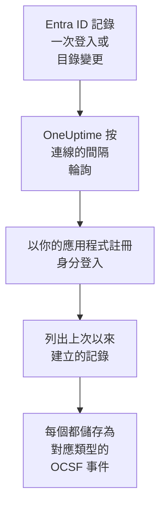

# Microsoft Entra ID

把 [Microsoft Entra ID](https://learn.microsoft.com/en-us/entra/identity/) 的登入和目錄變更匯入 OneUptime 的安全性事件；如果你願意，還可以匯入 [Microsoft 365 稽核日誌](https://learn.microsoft.com/en-us/purview/audit-log-activities) 中 Exchange、SharePoint、OneDrive 和 Teams 的活動。在那裡，你可以把它們與日誌、追蹤和指標放在一起搜尋，與其他所有來源進行關聯分析，並為重要的內容呼叫待命人員。OneUptime 透過你建立的應用程式註冊讀取它們，不會變更你租用戶中的任何內容。

:::cards
- [設定連線](#設定連線): 一個應用程式註冊、它的權限，以及連線的表單。
- [匯入的內容](#匯入的內容): 匯入哪些記錄，以及每筆記錄如何成為一個安全性事件。
- [輪詢的運作方式](#輪詢的運作方式): 每次輪詢讀取的時間窗，以及它為何與上一個時間窗重疊 30 分鐘。
- [疑難排解](#疑難排解): 每個錯誤的含義，以及需要更改什麼。
:::

## 運作方式

OneUptime 每分鐘輪詢一次已過輪詢間隔的每個已啟用連線。一次輪詢會以你的應用程式註冊身分登入 Microsoft Entra ID，按以下順序讀取自上次輪詢以來記錄的目錄變更（[List directoryAudits](https://learn.microsoft.com/en-us/graph/api/directoryaudit-list)）和登入（[List signIns](https://learn.microsoft.com/en-us/graph/api/signin-list)），然後在 **Microsoft 365 稽核日誌** 選項開啟時，讀取稽核日誌的新內容（[Office 365 Management Activity API](https://learn.microsoft.com/en-us/office/office-365-management-api/office-365-management-activity-api-reference)）。每筆記錄都儲存為一個 [OCSF](https://schema.ocsf.io/) 事件：登入存為 Authentication 事件，指派的角色存為 User Access Management 事件，網路釣魚判定存為 Detection Finding。

## 開始之前

- 在 OneUptime 中擁有 Project Owner、Project Admin 或 Security Admin 角色。Security Member 和 Security Viewer 可以檢視連線及其執行歷史，但不能更改它們。
- 對於登入：Microsoft Entra ID P1 或 P2，Microsoft 365 E3、E5 和 Business Premium 都包含它們：Microsoft Graph 只向這類租用戶提供登入。目錄變更在任何租用戶中都能讀取。
- 一個可以註冊應用程式的 Entra 角色，例如 Application Administrator，以及一位能授予管理員同意的 Global Administrator 或 Privileged Role Administrator。
- 對於 Microsoft 365 稽核日誌：租用戶已開啟稽核，預設即為開啟：在 [Microsoft Purview 入口網站](https://purview.microsoft.com) 中，**Audit** 不應顯示 **Start recording user and admin activity**。
- 從 OneUptime 應用程式和工作程序到 `login.microsoftonline.com`、`graph.microsoft.com` 和 `manage.office.com` 的傳出 HTTPS；Azure Government 則是到 `login.microsoftonline.us`、`graph.microsoft.us` 和 `manage.office365.us`。

## 設定連線

連線使用 [OAuth 2.0 用戶端認證流程](https://learn.microsoft.com/en-us/entra/identity-platform/v2-oauth2-client-creds-grant-flow) 登入：始終作為應用程式，而不是作為某個人，並且只使用唯讀權限。

:::steps
### 註冊應用程式

1. 登入 [Microsoft Entra 系統管理中心](https://entra.microsoft.com) 並開啟 **App registrations**。
2. 選擇 **New registration**。將其命名為 `OneUptime Security Events`，**Supported account types** 保持為 **Accounts in this organizational directory only**，重新導向 URI 留空，然後選擇 **Register**。
3. 在應用程式的 **Overview** 頁面上，複製 **應用程式（用戶端）ID** 和 **目錄（租用戶）ID**。

### 允許它讀取日誌

1. 前往 **API permissions → Add a permission → Microsoft Graph → Application permissions**，選擇 `AuditLog.Read.All`，然後選擇 **Add permissions**。Microsoft 文件說明登入清單還可能需要 `Directory.Read.All`：如果授予同意後登入仍以 `403` 被拒絕，請新增它。
2. 對於 Microsoft 365 稽核日誌，新增第二項權限：**Add a permission → Office 365 Management APIs → Application permissions**，然後選擇 `ActivityFeed.Read`。
3. 若要讓劇本停用、啟用和登出使用者（請參閱 [圍堵](/docs/telemetry/security-cases#圍堵)），請以同樣方式新增 `User.Read.All`、`User.EnableDisableAccount.All` 和 `User.RevokeSessions.All`。Microsoft 只允許同時具有 Privileged Authentication Administrator 角色的應用程式變更管理員的帳戶。
4. 為你的租用戶選擇 **Grant admin consent for**，並確認。每項權限的狀態都必須顯示為 **Granted**：沒有同意時，每次讀取都會以 `403` 被拒絕。

### 建立用戶端密碼

前往 **Certificates & secrets → Client secrets → New client secret**，選擇過期時間，然後選擇 **Add**。離開頁面之前，複製密碼的 **Value**，而不是它的 **Secret ID**：它不會再次顯示。到了過期那一天，輪詢會以 `Microsoft Entra ID token request failed (HTTP 401)` 停止，直到你用 **更新憑證** 替換它。

### 在 OneUptime 中新增連線

開啟 **產品 → Security Events → 連線**（`/dashboard/{projectId}/security-events/connections`），點選 **新增連線**，在 **身分** 下選擇 **Microsoft Entra ID**，然後點選 **下一步**。填寫下表中的設定，點選 **下一步**，並把密碼的值貼上到 **用戶端密碼** 中。在 **輪詢** 步驟中開啟 **Microsoft 365 稽核日誌**，即可同時讀取它。

### 儲存之前先測試

點選 **儲存前測試** 下的 **測試這些設定**。測試會用表單中的值登入並讀取每個日誌，但不會儲存任何內容，因此錯誤的密碼或缺失的同意會在連線存在之前暴露出來。然後點選 **下一步**，為連線填寫 **名稱** 並建立它。
:::

| 設定 | 在哪裡找到 |
| --- | --- |
| **目錄（租用戶）ID** | 應用程式的 **Overview** 頁面。租用戶的 GUID，或已驗證的網域，例如 `contoso.onmicrosoft.com`。開啟 **Microsoft 365 稽核日誌** 時必須是 GUID：Management API 只按 GUID 識別租用戶。 |
| **應用程式（用戶端）ID** | 應用程式的 **Overview** 頁面。擁有 `AuditLog.Read.All` 的應用程式的 GUID。 |
| **雲端** | **Azure 公用雲端**，或用於 GCC High 的 **Azure Government（美國）** （`login.microsoftonline.us`、`graph.microsoft.us` 和 `manage.office365.us`）。 |
| **Microsoft 365 稽核日誌** | 選用，預設關閉。開啟後，每次輪詢也會讀取 Microsoft 365 稽核日誌。應用程式需要 `ActivityFeed.Read`。 |
| **用戶端密碼** | 密碼的 **Value**。它會被加密，API 從不傳回，也不會再次顯示。在連線上用 **更新憑證** 替換它。 |

**輪詢** 步驟還有選用的 **描述**、**輪詢間隔（分鐘）**（`1` 到 `1440` 之間的整數，初始為 `5`），以及初始為開啟的 **已啟用**。

## 匯入的內容

每個事件的供應商為 `Microsoft`，產品為 `Microsoft Entra ID`。它的 `entra.log` 屬性說明登入或變更來自哪個日誌，Microsoft 365 記錄的 `microsoft365.contentType` 說明它的內容類型。

| 記錄 | OCSF 類別 | 嚴重性 |
| --- | --- | --- |
| 成功的登入 | Authentication (`3002`)，狀態 `Success` | Informational |
| 等待第二步的登入，例如 MFA（`50074`、`50076`）或要求變更密碼的提示 | Authentication (`3002`)，狀態 `Interrupted` | Informational：是一個步驟，不是失敗 |
| 失敗的登入，附帶 Entra 的原因和錯誤代碼 | Authentication (`3002`)，狀態 `Failure` | Low |
| Identity Protection 評為中等或高風險的登入 | Authentication (`3002`) | Medium 或 High |
| 依類別劃分的使用者、群組或角色變更 | Account Change (`3001`)、Group Management (`3006`)、User Access Management (`3005`)，其餘為 Entity Management (`3004`) | 特殊權限角色（例如 Global Administrator）為 Medium；失敗的變更為 Low |

開啟 **Microsoft 365 稽核日誌** 後，會從中匯入安全性團隊需要處理的記錄，其餘記錄（例如開啟的檔案或閱讀的郵件）只計數：

| Microsoft 365 記錄 | OCSF 類別 | 嚴重性 |
| --- | --- | --- |
| Exchange cmdlet（例如 `New-InboxRule` 或 `Set-Mailbox`）、在 Outlook 中建立的收件匣規則，或以他人身分傳送的郵件 | API Activity (`6003`) | 轉寄郵件時為 Medium，並將 `microsoft365.forwardsMail` 設為 `true` |
| 授予的信箱權限，例如 `Add-MailboxPermission` | User Access Management (`3005`) | Low |
| 在 SharePoint 或 OneDrive 中共用的檔案 | File Hosting Activity (`6006`) | 與來賓或任何人都能開啟的連結共用時為 Low，並將 `microsoft365.sharedOutside` 設為 `true` |
| 新增或移除的網站集合管理員 | User Access Management (`3005`) | Low |
| Microsoft Defender for Office 365 發現的惡意軟體或網路釣魚郵件 | Detection Finding (`2004`) | 惡意軟體為 High，網路釣魚為 Medium |
| Microsoft 365 發出的警示 | Detection Finding (`2004`) | 警示本身的嚴重性 |
| 新增到團隊的應用程式、機器人或連接器 | Application Lifecycle (`6002`) | Low |

Exchange 以其系統帳戶執行的內部維護作業會被排除，除非它轉寄郵件。每個事件都保留整筆記錄，並展平為帶點的鍵，例如 `status.errorCode` 或 `Parameters.ForwardTo`，因此規則可以按 Microsoft 給欄位取的名稱讀取任何欄位。規則庫中針對 Entra ID 的規則按這裡匯入的形式讀取它們。

同樣的登入和目錄變更也可以作為日誌到達 OneUptime：由 Azure 診斷設定匯出，並由 [你的日誌](/docs/telemetry/security-events#在日誌中尋找安全性事件) 讀取。無論走哪條路，每筆記錄都會得到相同的事件 ID，但兩條路都讀取的記錄會被儲存兩次：只透過一條路讀取 Entra ID。

## 輪詢的運作方式

- **記錄按 Entra ID 記錄它們的時間讀取**：變更為 `activityDateTime`，登入為 `createdDateTime`。
- **第一次輪詢會回溯 24 小時**，所以新連線會立刻顯示最近的記錄。
- **之後的每次輪詢都從儲存的游標之前 30 分鐘開始。** Microsoft 文件說明這兩個日誌都會晚幾分鐘到達，因此重疊部分會在下一次輪詢中讀取遲到的記錄，重複項目會在專案內按記錄 ID 捨棄。
- **一次輪詢最多讀取游標之後 24 小時。** 游標落後的連線會透過一連串 24 小時的時間窗追趕。
- **沒有 Microsoft Entra ID P1 或 P2 的租用戶** 會匯入其目錄變更，並且每次執行的 **Read sign-ins** 檢查都會警告未讀取登入。
- **失敗的執行不會改變任何東西。** 發生網路錯誤或 Graph 傳回錯誤狀態後，游標和時間窗長度保持不變，下一次輪詢會再次讀取同一個時間窗。唯一的例外是請求逾時：游標保持不變，但下一個時間窗的長度減半，因為太重而無法及時回應的時間窗每次重試都會逾時。

Microsoft 365 稽核日誌按 Microsoft 提供每個內容 blob 的時間讀取，每次一天，並且不會早於 Microsoft 保留它的 7 天。第一次輪詢會讓應用程式訂閱 `Audit.Exchange`、`Audit.SharePoint` 和 `Audit.General`，Microsoft 會在 12 小時內提供新訂閱的首批記錄。稽核日誌從不會阻止 Entra ID 日誌：缺少權限只是一個警告，時間窗照常前進；而 Microsoft 一側的故障（例如 `HTTP 503`）會讓執行變為 **部分**，以便重新讀取該時間窗。

### 當一個時間窗包含的內容超過一次輪詢能讀取的量時

每個日誌都有自己的預算：10 頁、每頁 500 筆目錄變更，20 頁、每頁 500 筆登入，以及 Microsoft 365 稽核日誌的 120 個請求和 10,000 筆記錄。一次輪詢在 4 分鐘後停止。當預算在時間窗結束前讓某個日誌停止時，執行為 **部分**，其警告會指明該日誌和預算。Microsoft Graph 先列出最新的記錄，因此 OneUptime 會縮短時間窗，而不是把游標移過它從未讀到的記錄：

1. **縮小。** 下一次輪詢從同一個起點讀取長度減半的時間窗，並不斷減半，直到某個時間窗能被完整讀取，最短為一分鐘。執行的警告會說明這一點：`This window holds more records than one poll can read; the next poll reads a {n} minute window from the same starting point.` 已從較長時間窗匯入的記錄會作為重複項目被跳過。
2. **恢復。** 一個時間窗被完整讀取後，游標會移到它的末尾，下一個時間窗的長度會再次加倍，最長為 24 小時。
3. **越過單獨的一分鐘。** 如果連一分鐘內的記錄都超過一次輪詢能讀取的量，輪詢會越過這一分鐘，讓更新的記錄繼續到達。這次執行仍為 **部分**，**最近的錯誤** 顯示 `More records were created in the one minute from {cursor} to {end} than one poll can read. Polling moved past this minute so newer records keep arriving; use Import this time range in Diagnostics on this minute to recover what one run can read.` 用 **Import this time range** 匯入這一分鐘，即可找回一次執行能讀取的內容。

更改 **輪詢間隔（分鐘）** 不會改變這些：它決定的是輪詢多久開始一次，而不是時間窗從哪裡開始。

### 按需執行、預覽和匯入

在連線上點選 **診斷**，可以檢視它最近的執行，並手動操作它。能更改該連線的人都可以啟動這些操作；能檢視它的人都可以閱讀歷史記錄。

- **立即執行** 會立即開始一次輪詢，使用通常的游標，即使連線未處於 **已啟用** 狀態也可以。
- **Preview records** 讀取最長 7 天的時間範圍，不匯入任何內容。
- **Import this time range** 在你確認後匯入最長 7 天的範圍，不會移動游標。已匯入的記錄會被跳過。有 P1 或 P2 時，Microsoft Entra ID 會保留 30 天的登入和目錄變更，沒有時保留 7 天。
- 執行上的 **Copy diagnostics** 會複製它的報告以便提供給支援人員。報告從不包含認證資訊。

## 測試連線

連線所在列中的 **測試連線** 和表單中的 **測試這些設定** 在 API 程序中執行，而不是在背景工作程序中執行，所以即使工作程序出了問題，測試仍然會給出結果。它按順序執行以下檢查：

| 檢查 | 檢查的內容 |
| --- | --- |
| **設定** | 每項設定都存在且格式正確。此項失敗時不會連線到任何地方。 |
| **Authenticate with Microsoft Entra** | Entra ID 在你選擇的雲端中為應用程式頒發 Microsoft Graph 的權杖。 |
| **Read sign-ins** | 可以讀取過去 24 小時的登入。在沒有 P1 或 P2 的租用戶中是警告，而不是失敗。 |
| **Read directory changes** | 可以讀取過去 24 小時的目錄變更。 |
| **Read the Microsoft 365 audit log** | 僅在開啟該選項時：Management API 有回應，以及應用程式訂閱了哪些內容類型。 |
| **Records available to import** | 過去 24 小時內有多少登入和目錄變更，每種最多數到 500，因此 `500+` 表示更多。一筆都沒有時為警告。 |
| **Background workers**、**Poll scheduler**、**Security event storage** | OneUptime 自身的一側：有程序在處理 Worker 佇列的作業，輪詢作業每分鐘執行一次，安全性事件儲存能夠回應。 |
| **Scheduled polling** | 針對已儲存的連線：輪詢已開啟，沒有執行卡在等待工作程序的狀態，並且輪詢按時執行。 |

測試中的每個請求都有 20 秒的期限。測試從不匯入任何內容，也不移動游標，每個失敗的檢查都會說明需要更改什麼。

## 疑難排解

連線的 **最近的錯誤** 會保留完整的錯誤訊息（認證資訊已隱去）。連線出錯時，在它的 **操作** 欄中選擇 **檢視錯誤** 來閱讀，並在對話方塊中用 **複製錯誤** 複製。每條訊息都以 `Microsoft Entra ID` 開頭，接著指明失敗的請求，並在有錯誤代碼時引用 Microsoft 的錯誤代碼。

:::details 最近的錯誤 顯示 `token request failed`
- `HTTP 401` 並帶有 `invalid_client`：用戶端密碼錯誤或已過期。請建立一個新的，並用 **更新憑證** 儲存。
- 提到應用程式（用戶端）ID 或租用戶的 `HTTP 400`：在應用程式的 **Overview** 頁面檢查這兩者，並確認 **雲端** 是該租用戶所在的雲端。
:::

:::details 最近的錯誤 顯示 `sign-ins request failed (HTTP 403)` 或 `audit logs request failed (HTTP 403)`
- 錯誤代碼 `Authorization_RequestDenied`：應用程式缺少 `AuditLog.Read.All`，或未授予同意。請授予管理員同意，等待幾分鐘後再測試。對於登入，還要授予 `Directory.Read.All`。
- 錯誤代碼 `Authentication_RequestFromNonPremiumTenantOrB2CTenant`：租用戶沒有 Microsoft Entra ID P1 或 P2。目錄變更仍會被匯入。
:::

:::details 未讀取 Microsoft 365 稽核日誌
- 帶有 `AF10001` 的 `subscriptions request failed (HTTP 401)` 或 `(HTTP 403)`：應用程式缺少 Office 365 Management APIs 的 `ActivityFeed.Read`，或未授予同意。
- `AF20010` 到 `AF20013`：Management API 不認識該 **目錄（租用戶）ID**。請使用租用戶的 GUID。
- 帶有 `AF20023` 的 `subscription start failed`：管理員關閉了該訂閱。無法訂閱的內容類型會在執行的警告中列出，其他類型仍會被讀取。
- 第一次輪詢後數小時沒有記錄：Microsoft 會在 12 小時內提供新訂閱的首批內容。
:::

:::details 最近的錯誤 顯示 `did not complete`
請求沒有得到回應：逾時、名稱無法解析或位址被拒絕。請檢查 OneUptime 應用程式和工作程序能否透過你使用的任何 Proxy 存取 [開始之前](#開始之前) 中的主機。
:::

:::details 測試通過，但 Last Polled 為 Never
輪詢作業從未執行過。閱讀 **Background workers** 和 **Poll scheduler** 檢查。在自行託管安裝中，常見原因是應用程式上設定了 `DISABLE_QUEUE_WORKERS=true`，卻沒有單獨的工作程序部署來處理作業：把它設為 `false`，或執行工作程序部署（Helm：`worker.enabled: true`，預設為 `false`）。
:::

## 後續步驟

:::cards
- [安全性事件](/docs/telemetry/security-events): 搜尋、關聯分析你匯入的內容，並據此發出警示。
- [Okta 系統日誌](/docs/integrations/okta): 匯入另一個身分識別提供者的登入。
- [Google Workspace](/docs/integrations/google-workspace): 匯入 Google 的登入和管理員變更。
- [整合總覽](/docs/integrations/index): 你可以連接的其他工具。
:::
