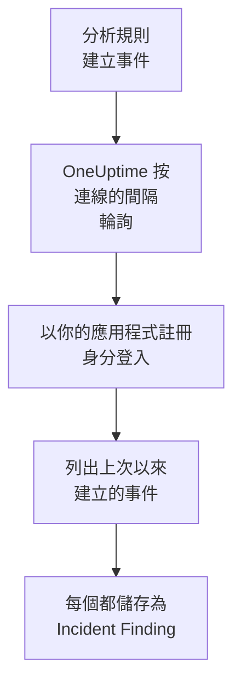

# Microsoft Sentinel

把 [Microsoft Sentinel](https://learn.microsoft.com/en-us/azure/sentinel/overview) 分析規則建立的事件（incident）匯入 OneUptime 的安全性事件。在那裡，你可以把它們與日誌、追蹤和指標放在一起搜尋，與其他所有來源進行關聯分析，並為重要的事件呼叫待命人員。OneUptime 透過你建立的應用程式註冊讀取它們，不會更改 Azure 中的任何內容。

:::cards
- [設定連線](#設定連線): 一個應用程式註冊、一個角色，以及連線的表單。
- [匯入的內容](#匯入的內容): 每個 Sentinel 事件如何成為一個安全性事件。
- [輪詢的運作方式](#輪詢的運作方式): 每次輪詢讀取的時間窗，以及繁忙的工作區對它的影響。
- [疑難排解](#疑難排解): 每個錯誤的含義，以及需要更改什麼。
:::

## 運作方式



OneUptime 每分鐘輪詢一次已過輪詢間隔的每個已啟用連線。一次輪詢會以你的應用程式註冊身分登入 Microsoft Entra ID，向 Azure Resource Manager 請求自上次輪詢以來建立的事件，並把每個事件儲存為一個 [OCSF](https://schema.ocsf.io/) Incident Finding 事件（類別 `2005`）。之後，偵測規則、監測器和儀表板會像對待其他任何來源的安全性事件一樣對待它。

## 開始之前

- 在 OneUptime 中擁有 Project Owner、Project Admin 或 Security Admin 角色。Security Member 和 Security Viewer 可以檢視連線及其執行歷史，但不能更改它們。
- 一個啟用了 Microsoft Sentinel 的 Log Analytics 工作區，位於 Azure 公用雲端或 Azure Government (US) 中。
- 在 Microsoft Entra ID 中建立應用程式註冊和用戶端密碼的權限。
- 在包含該工作區的資源群組上指派角色的權限，例如 Owner 或 User Access Administrator。

## 設定連線

連線使用 OAuth 2.0 用戶端認證流程登入：始終作為應用程式，而不是作為某個人。它的存取權限來自一個 Azure 角色，因此應用程式註冊不需要任何 API 權限。

:::steps
### 註冊應用程式

1. 登入 [Azure portal](https://portal.azure.com) 並開啟 **Microsoft Entra ID**。
2. 前往 **App registrations → New registration**。將其命名為 `OneUptime Sentinel connector`，**Supported account types** 保持為 **Accounts in this organizational directory only**，重新導向 URI 留空，然後選擇 **Register**。
3. 在應用程式的 **Overview** 頁面上，複製 **應用程式（用戶端）ID** 和 **目錄（租用戶）ID**。
4. 前往 **Certificates & secrets → Client secrets → New client secret**，選擇過期時間，然後選擇 **Add**。離開頁面之前，複製密碼的 **Value**，而不是它的 **Secret ID**：它不會再次顯示。

### 允許它讀取事件

1. 在 Azure portal 中，開啟包含 Log Analytics 工作區的資源群組。
2. 選擇 **Access control (IAM) → Add → Add role assignment**。
3. 在 **Role** 索引標籤上，選擇 **Microsoft Sentinel Reader**。
4. 在 **Members** 索引標籤上，選擇 **User, group, or service principal**，點選 **Select members**，然後按名稱選擇你的應用程式註冊。
5. 選擇 **Review + assign**。

該角色允許應用程式讀取事件（`Microsoft.SecurityInsights/incidents/read`），但不能寫入任何內容。Microsoft 建議在資源群組而不是工作區上指派它，這樣它也能涵蓋提供事件的 `SecurityInsights` 解決方案。新的指派可能需要幾分鐘才能生效。

### 找到工作區的詳細資訊

在 Azure portal 中開啟 Log Analytics 工作區。它的 **Overview** 頁面會顯示 **訂用帳戶 ID**、**Resource group** 和工作區的名稱。工作區的資源 ID 也包含這三項：

```text
/subscriptions/{Subscription ID}/resourceGroups/{Resource group}/providers/Microsoft.OperationalInsights/workspaces/{Workspace name}
```

### 在 OneUptime 中新增連線

開啟 **產品 → Security Events → 連線**（`/dashboard/{projectId}/security-events/connections`），點選 **新增連線**，選擇 **Microsoft Sentinel**，然後點選 **下一步**。填寫下表中的設定，點選 **下一步**，並把密碼的值貼上到 **用戶端密碼** 中。

### 儲存之前先測試

點選 **儲存前測試** 下的 **測試這些設定**。測試會用表單中的值登入並讀取事件，但不會儲存任何內容，因此錯誤的密碼或缺失的角色會在連線存在之前暴露出來。然後點選 **下一步**，為連線填寫 **名稱** 並建立它。
:::

| 設定 | 在哪裡找到 |
| --- | --- |
| **目錄（租用戶）ID** | 應用程式的 **Overview** 頁面。租用戶的 GUID，或已驗證的網域，例如 `contoso.onmicrosoft.com`。 |
| **應用程式（用戶端）ID** | 應用程式的 **Overview** 頁面。一個 GUID。 |
| **訂用帳戶 ID** | 工作區的 **Overview** 頁面。一個 GUID。 |
| **Resource group** | 工作區的 **Overview** 頁面。1 到 90 個字母、數字、底線、連字元、句點或括號，不能以句點結尾。 |
| **Workspace name** | 工作區的 **Overview** 頁面。3 到 90 個字母、數字或連字元，以字母或數字開頭和結尾。 |
| **雲端** | **Azure 公用雲端**（`login.microsoftonline.com`、`management.azure.com`）或 **Azure Government（美國）** （`login.microsoftonline.us`、`management.usgovcloudapi.net`）。 |
| **用戶端密碼** | 密碼的 **Value**。它會被加密，API 從不傳回，也不會再次顯示。在連線上用 **更新憑證** 替換它。 |

**輪詢** 步驟還有選用的 **描述**、**輪詢間隔（分鐘）**（`1` 到 `1440` 之間的整數，初始為 `5`），以及初始為開啟的 **已啟用**。

## 匯入的內容

每個 Sentinel 事件都會成為一個 Incident Finding 事件（OCSF 類別 `2005`，活動 `Create`），歸屬於 `Microsoft Sentinel` 遙測服務：

| OCSF 欄位 | Sentinel 事件欄位 |
| --- | --- |
| `time` | `properties.createdTimeUtc`，即 Sentinel 建立該事件的時間 |
| `eventUid` | `name`，即事件的 GUID，也是去除重複所依據的值 |
| `message`, `ruleName` | `properties.title` |
| `ruleId` | 第一個 `properties.relatedAnalyticRuleIds` 條目末尾的規則 GUID |
| `severityName` | `properties.severity`：`High`、`Medium`、`Low` 或 `Informational` |
| `statusName` | `properties.status`：`New`、`Active` 或 `Closed` |
| `mitreTactics` | `properties.additionalData.tactics`，轉換為 ATT&CK ID：`Persistence` 變為 `TA0003` |
| `principalUser` | `properties.owner.userPrincipalName` 或 `properties.owner.email` |
| `targetResource` | `properties.incidentUrl`，即指向 Azure portal 中該事件的連結 |
| `observables` | 擁有者的 UPN、電子郵件和物件 ID，以及每個標籤的名稱 |
| `attributes` | 整個事件，展平為點分隔的鍵，例如 `properties.classification` 和 `properties.firstActivityTimeUtc` |

在輪詢時間窗內建立的已關閉事件也會被匯入。在安全性事件探索器中按 `statusName` 篩選，即可只查看未關閉的事件。

## 輪詢的運作方式

每次輪詢都會列出在其時間窗內建立的事件，從最早的開始，每頁 50 個，並跟隨 API 的 `nextLink`，直到讀完整個時間窗：

```text
GET https://management.azure.com/subscriptions/{sub}/resourceGroups/{rg}/providers/Microsoft.OperationalInsights/workspaces/{ws}/providers/Microsoft.SecurityInsights/incidents
    ?api-version=2024-03-01
    &$filter=(properties/createdTimeUtc ge {windowStart}) and (properties/createdTimeUtc lt {windowEnd})
    &$orderby=properties/createdTimeUtc asc
    &$top=50
```

- **建立時間就是游標。** 每小時執行一次的排程分析規則，會在它符合的活動發生很久之後才建立事件，而事件的 `firstActivityTimeUtc` 可能早幾個小時甚至幾天。基於活動時間的游標會跳過所有這樣的事件。活動時間保留在 `attributes` 中，Diagnostics 中的樣本會同時顯示這兩個時間。
- **第一次輪詢會回溯 24 小時**，所以新連線會立刻顯示最近的事件。
- **之後的每次輪詢都從儲存的游標之前 1 分鐘開始**，所以在兩個時間窗邊界上建立的事件永遠不會被跳過。
- **一次輪詢最多讀取游標之後 24 小時。** 游標落後的連線會透過一連串 24 小時的時間窗追趕，此時它的 **健康狀況** 顯示為 **Catching up**。
- **重複項按事件的 GUID**（`name`）**在專案內去除重複**，所以重疊部分、重試的時間窗和匯入都不會把同一個事件儲存兩次。

### 當一個時間窗包含的內容超過一次輪詢能讀取的量時

一次輪詢最多讀取 20 頁、每頁 50 個事件：共 1,000 個事件。當這個上限讓它在時間窗結束之前停下時，這次執行為 **部分**，並帶有類似這樣的警告：

```text
Stopped after 20 incidents requests (the per-run request limit) before reading the whole window. Incidents are read oldest first; every incident created before 2026-09-14T08:12:44.000Z was read.
```

事件按從早到晚的順序讀取，所以 OneUptime 會把游標移到它讀取的最後一個事件的建立時間，下一次輪詢就從那裡開始，時間窗長度不變。繁忙的工作區每次輪詢大約追趕 1,000 個事件，而不是重複讀取相同的事件。在同一時刻建立的事件會被讀取兩次，而去除重複檢查會丟棄第二份。

當一次執行完全無法越過儲存的游標時，OneUptime 會改為縮短時間窗：

1. **縮小。** 下一次輪詢從同一個起點讀取長度減半的時間窗，並不斷減半，直到某個時間窗能被完整讀取，最短為一分鐘。執行的警告會說明這一點：`This window holds more records than one poll can read; the next poll reads a {n} minute window from the same starting point.`
2. **恢復。** 一個時間窗被完整讀取後，下一個時間窗的長度會再次加倍，最長為 24 小時。
3. **越過單獨的一分鐘。** 如果連一分鐘內的內容都超過一次輪詢能讀取的量，輪詢會越過這一分鐘，讓更新的事件繼續到達。這次執行仍為 **部分**，**最近的錯誤** 顯示 `More records were created in the one minute from {cursor} to {end} than one poll can read. Polling moved past this minute so newer records keep arriving; use Import this time range in Diagnostics on this minute to recover what one run can read.` 用 **Import this time range** 匯入這一分鐘，即可找回一次執行能讀取的內容。

因 Microsoft Entra ID 或 Azure Resource Manager 的錯誤而徹底失敗的執行，會保留游標和時間窗長度，下一次輪詢會再次讀取同一個時間窗。唯一的例外是請求逾時：游標保持不變，但下一個時間窗的長度減半，因為太重而無法及時回應的時間窗每次重試都會逾時。更改 **輪詢間隔（分鐘）** 不會改變以上任何一點：它決定輪詢多久開始一次，而不是時間窗從哪裡開始。

### 按需執行、預覽和匯入

在連線上點選 **診斷**，可以檢視它最近的執行，並手動操作它。能更改該連線的人都可以啟動這些操作；能檢視它的人都可以閱讀歷史記錄。

- **立即執行** 會立即開始一次輪詢，使用通常的游標，即使連線未處於 **已啟用** 狀態也可以。
- **Preview incidents** 讀取最長 7 天的時間範圍，不匯入任何內容。
- **Import this time range** 在你確認後匯入最長 7 天的範圍，不會移動游標。已匯入的事件會被跳過。
- 執行上的 **Copy diagnostics** 會複製它的報告以便提供給支援人員。報告從不包含認證資訊。

## 測試連線

連線所在列中的 **測試連線** 和表單中的 **測試這些設定** 在 API 程序中執行，而不是在背景工作程序中執行，所以即使工作程序出了問題，測試仍然會給出結果。它按順序執行以下檢查：

| 檢查 | 檢查的內容 |
| --- | --- |
| **設定** | 每項設定都存在且格式正確。此項失敗時不會連線到任何地方。 |
| **Authenticate with Microsoft Entra** | Microsoft Entra ID 向你的應用程式註冊頒發用於 Azure Resource Manager 的權杖。 |
| **Read incidents** | 可以讀取過去 24 小時內建立的一個事件（`$top=1`）。這證明了角色和工作區的詳細資訊正確。 |
| **Incidents available to import** | 過去 24 小時和過去 7 天內建立了多少事件，各讀取一頁 50 個，所以 `50+` 表示更多。7 天內一個都沒有是警告，而不是失敗。 |
| **Background workers**、**Poll scheduler**、**Security event storage** | OneUptime 自身的一側：有程序在處理 Worker 佇列的作業，輪詢作業每分鐘執行一次，安全性事件儲存能夠回應。 |
| **Scheduled polling** | 針對已儲存的連線：輪詢已開啟，沒有執行卡在等待工作程序的狀態，並且輪詢按時執行。 |

測試中的每個請求都有 20 秒的期限。測試從不匯入任何內容，也不移動游標，每個失敗的檢查都會說明需要更改什麼。

## 將安全性事件傳送到 Microsoft Sentinel

OneUptime 也可以透過 Azure Monitor 的 Logs Ingestion API 把它發現的內容傳送到 Microsoft Sentinel，寫入 Sentinel 所在工作區的一個自訂資料表。之後你的分析規則、搜捕查詢和活頁簿就可以在其他資料表旁邊查詢 `OneUptimeSecurityEvents_CL`。

:::steps
### 建立資料表及其資料收集規則

在 Azure 入口網站中，開啟工作區的 **Tables → Create → New custom log (DCR-based)**。將資料表命名為 `OneUptimeSecurityEvents`，新建一個資料收集規則，如果表單要求，再新建一個資料收集端點。把下面的範例當作範例檔案上傳，保持轉換不變，然後建立資料表。

### 讓應用程式向它傳送

依照 [註冊應用程式](#註冊應用程式) 中的步驟註冊一個應用程式並為它建立用戶端密碼。然後開啟資料收集規則，在 **Access control (IAM) → Add → Add role assignment** 中選擇 **Monitoring Metrics Publisher**，並選取該應用程式。

### 新增目的地

開啟 **產品 → Security Events → 連線**。在 **傳送到你的 SIEM** 下按一下 **新增目的地**，在 **SIEM** 下選擇 Microsoft Sentinel，然後按一下 **下一步**。填寫 **目錄（租用戶）ID**、**應用程式（用戶端）ID** 和 **用戶端密碼**，從資料收集端點（或規則）的 **Overview** 中取得的 **記錄擷取端點**，以及從規則的 **JSON View** 中取得的 **資料收集規則不可變 ID**。**串流** 是選用的：留空時為 `Custom-OneUptimeSecurityEvents_CL`。

### 傳送測試事件並開始傳送

按一下 **傳送測試事件**：幾分鐘內會有一列到達該資料表。接著在 **傳送內容** 下保留 **僅偵測結果** 或選擇 **所有安全事件**，再按一下 **開始傳送**。
:::

範例檔案，一列包含資料表的每一欄：

```json title="oneuptime-security-events-sample.json"
[
  {
    "TimeGenerated": "2026-10-21T10:00:00.000Z",
    "EventId": "0193c0de-cccc-4aaa-8bbb-000000000001",
    "EventUid": "okta-1",
    "ClassName": "Authentication",
    "CategoryName": "Identity & Access Management",
    "ActivityName": "Logon",
    "Severity": "Medium",
    "SeverityId": 3,
    "Status": "Failure",
    "Message": "Failed sign-in for alice",
    "VendorName": "Okta",
    "ProductName": "Okta System Log",
    "RuleId": "",
    "RuleName": "",
    "MitreTactics": [],
    "MitreTechniques": [],
    "PrincipalUser": "alice@example.com",
    "PrincipalHost": "laptop-7",
    "PrincipalIp": "203.0.113.7",
    "TargetUser": "",
    "TargetHost": "app.example.com",
    "TargetIp": "198.51.100.20",
    "TargetPort": 443,
    "TargetResource": "",
    "ProcessName": "",
    "ProcessCommandLine": "",
    "ParentProcessName": "",
    "Observables": [
      "alice@example.com",
      "203.0.113.7"
    ],
    "Attributes": {
      "okta.outcome.reason": "INVALID_CREDENTIALS"
    }
  }
]
```

- Logs Ingestion API 每次呼叫最多接受 1 MB，所以資料列以每批最多 500 列傳送。Azure 拒絕的批次會被拆分，直到找到它不接受的那一列並將其略去，節流（`429`）會重試。
- `403` 表示應用程式在該規則上缺少 **Monitoring Metrics Publisher**，`404` 表示不可變 ID 或串流有誤。
- OneUptime 從 Microsoft Sentinel 匯入的事件（incident）永遠不會被傳回 Microsoft Sentinel。

## 疑難排解

連線的 **最近的錯誤** 會保留完整的錯誤訊息（認證資訊已隱去），前面帶有一個指明失敗步驟的字首。連線出錯時，在它的 **操作** 欄中選擇 **檢視錯誤** 來閱讀，並在對話方塊中用 **複製錯誤** 複製。請先閱讀字首。

:::details Last Error 以 `Microsoft Sentinel token request` 開頭
- `Microsoft Sentinel token request failed (HTTP ...)`：Microsoft Entra ID 拒絕頒發權杖，所以根本沒有連線到 Azure。訊息會引用 Entra 的代碼：
  - `AADSTS7000215` 或 `invalid_client`：**用戶端密碼** 錯誤或已過期，或者填的是密碼的 ID 而不是它的值。建立一個新密碼，並用 **更新憑證** 儲存。
  - `AADSTS700016` 或 `unauthorized_client`：**應用程式（用戶端）ID** 不在所填的 **目錄（租用戶）ID** 中。把兩者與應用程式的 **Overview** 頁面進行比較。
  - `AADSTS90002` 或 `HTTP 404`：沒有這樣的租用戶。**目錄（租用戶）ID** 錯誤，或者它位於另一個雲端中：請檢查 **雲端**。
  - `HTTP 429` 或 `HTTP 5xx`：Microsoft Entra ID 正在節流或不可用。下一次輪詢會重試。
- `Microsoft Sentinel token request returned ...`：Microsoft Entra ID 傳回了無法使用的內容，例如不是 JSON 或沒有 `access_token` 的內文。這通常是中間的代理或閘道器造成的。
- 沒有狀態碼的 `Microsoft Sentinel token request failed:`，或 `Microsoft Sentinel token request timed out after ... seconds with no response`：請求沒有得到回應。檢查 OneUptime 應用程式和工作程序到 `login.microsoftonline.com` 的 DNS、TLS 和傳出 HTTPS。
:::

:::details Last Error 以 `Microsoft Sentinel incidents list` 開頭
- `Microsoft Sentinel incidents list failed (HTTP ...)`：Azure Resource Manager 拒絕了請求。
  - `HTTP 401`：它不接受該權杖。幾乎總是因為 **雲端** 與租用戶不符合，或者應用程式註冊已被刪除。在兩頁之間過期的權杖會自動續訂並重試一次。
  - `HTTP 403` 或 `AuthorizationFailed`：應用程式在資源群組上還沒有 **Microsoft Sentinel Reader**。指派該角色，並等待幾分鐘。
  - `HTTP 404`：沒有具有該 **訂用帳戶 ID**、**Resource group** 和 **Workspace name** 的工作區，或者該工作區未啟用 Microsoft Sentinel。請從工作區的 **Overview** 頁面複製它們。
  - `HTTP 429` 或 `HTTP 5xx`：Azure Resource Manager 正在節流或不可用。下一次輪詢會重試。
  - `HTTP 400`：Azure Resource Manager 拒絕了查詢，而查詢是由 OneUptime 建置的，與你的設定無關。請把訊息傳送給 OneUptime 支援人員。
- `Microsoft Sentinel incidents list returned ...`：Azure 傳回了 `200`，但沒有可讀的事件頁面，或者帶有一個指向其他主機的 `nextLink`，連接器會拒絕這種連結，讓權杖永遠不離開 Azure Resource Manager。這種情況會被報告出來，而不是被當作空時間窗，所以游標永遠不會越過沒人讀過的事件。
- 沒有狀態碼的 `Microsoft Sentinel incidents list failed:`，或 `Microsoft Sentinel incidents list timed out after ... seconds with no response`：請求沒有得到回應。檢查 OneUptime 工作程序到 `management.azure.com` 或 `management.usgovcloudapi.net` 的傳出 HTTPS。
:::

:::details Last Polled 為 Never 且 Last Error 為空
這個連線還沒有完成過任何輪詢。執行 **測試連線**：它的 **Background workers** 和 **Poll scheduler** 檢查會指出原因。在自行託管安裝中，常見原因是應用程式上設定了 `DISABLE_QUEUE_WORKERS=true`，卻沒有單獨的工作程序部署來處理作業：把它設為 `false`，或執行工作程序部署（Helm：`worker.enabled: true`）。
:::

:::details 執行為 Partial
- `Stopped after 20 incidents requests (the per-run request limit) before reading the whole window`：時間窗中的事件超過了一次執行能讀取的 1,000 個。不會遺失任何內容：下一次輪詢會從讀取的最後一個事件之後開始。一次又一次輪詢都保持 **部分** 的連線正在追趕積壓，它的 **最近輪詢** 和 **最近匯入的事件** 會持續前進。
- `Microsoft Sentinel returned incidents out of creation-time order, so this run cannot name a point to resume from.`：API 忽略了從早到晚的順序，所以這次執行無法把游標移到它的最後一個事件，下一次輪詢會改為讀取更短的時間窗。如果反覆出現，請把這次執行的報告發送給 OneUptime 支援人員。
- `More records were created in the one minute from ... than one poll can read`：輪詢越過了這一分鐘。請在 **診斷** 中用 **Import this time range** 匯入它。一次匯入讀取的量與一次輪詢相同。
:::

:::details 測試通過，但沒有匯入任何內容
閱讀測試報告中的 **Incidents available to import**。過去 7 天為 `0` 表示工作區的分析規則沒有建立任何事件，這不是連線的問題。在 Microsoft Sentinel 中檢查這些規則是否已啟用，並設定為建立事件。
:::

## Azure Government

把 **雲端** 設為 **Azure Government（美國）**。連線隨後會在 `login.microsoftonline.us` 以 `https://management.usgovcloudapi.net/.default` 範圍登入，並從 `management.usgovcloudapi.net` 讀取事件。其他一切，包括角色指派，都相同。

## 你會得到什麼

- **搜尋。** 在安全性事件探索器中，與其他所有來源放在一起，按嚴重程度、狀態、擁有者、標籤或戰術篩選事件。
- **關聯分析。** 每個事件的擁有者和標籤都會作為 observable 建立索引，所以一次搜尋就能找到提到它們的所有內容。
- **偵測規則。** 按排程對你的安全性事件執行的 Sigma 規則，會開啟呼叫待命人員的警示。
- **監測器。** 安全性事件監測器統計符合的事件，例如新的 High 事件，並在超過閾值時開啟事件或警示。

安全性事件與其他遙測資料一樣，按擷取的 GB 數計費。請參閱 [定價](https://oneuptime.com/pricing)。

## 後續步驟

:::cards
- [安全性事件](/docs/telemetry/security-events): 搜尋、關聯分析你匯入的內容，並據此發出警示。
- [Microsoft Defender XDR](/docs/integrations/microsoft-defender-xdr): 同時匯入每個 Defender 工作負載的警示。
- [角色](/docs/permissions/reference#角色): Security 角色可以檢視和更改的內容。
- [整合總覽](/docs/integrations/index): 你可以連接的其他工具。
:::
