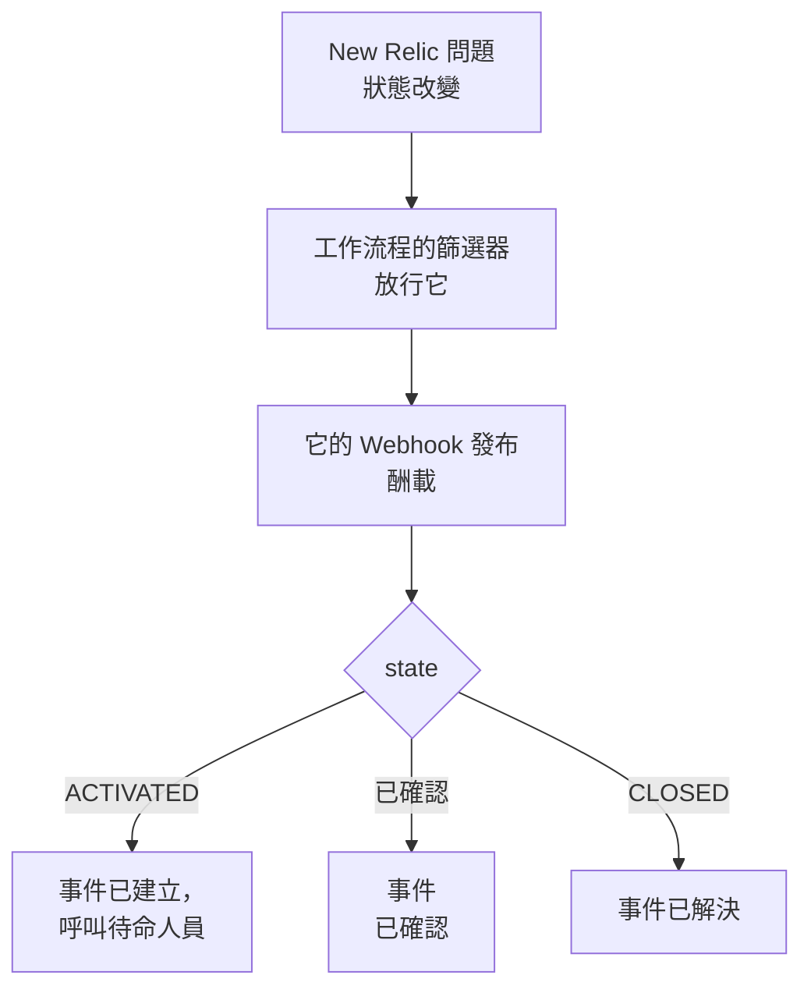

# New Relic

把 [New Relic](https://newrelic.com) 問題傳送到 OneUptime，讓每個問題都成為一個呼叫待命團隊的事件或警示，在有人確認問題時被確認，並在問題關閉時解決。New Relic 透過 [Webhook 目的地](https://docs.newrelic.com/docs/alerts/get-notified/notification-integrations/) 傳送它的問題，因此兩邊都無需安裝任何東西。

:::cards
- [從範本開始](#從範本開始): 選擇要呼叫誰、複製 URL，並了解每個問題會做什麼。
- [設定 New Relic](#設定-new-relic): 一個 Webhook 目的地，以及通知它的工作流程。
- [測試](#測試): 自己傳送一個問題，然後再從 New Relic 傳送一個。
- [疑難排解](#疑難排解): 問題沒有到達，或事件一直未關閉時。
:::

## 運作方式



New Relic 工作流程用它的篩選器挑選要傳送的問題，並在問題被啟動、確認或關閉時通知一個 Webhook 目的地，附帶由 New Relic 填入的 JSON 酬載。OneUptime 靠問題的 ID 找到它所建立的事件。

## 開始之前

- 一個可以建立目的地和工作流程的 New Relic 帳戶。
- 在 OneUptime 中建立工作流程的權限。在 OneUptime Cloud 上，工作流程需要 **Growth** 方案或更高。

## 從範本開始

先設定 OneUptime：它會給你 New Relic 要傳送到的 URL。**建立工作流程** 對話框在其類別清單的 **New Relic** 下有兩個 New Relic 範本：**Declare an incident for each New Relic issue**，以及用於警示的 **Create an alert for each New Relic issue**。兩者作用相同，各自建立自己種類的記錄。

:::steps
1. 前往 **工作流程**，點選 **建立工作流程**。在 **或從範本開始** 下，在類別清單中選擇 **New Relic**，點選 **Declare an incident for each New Relic issue**，或 **Create an alert for each New Relic issue**，然後點選 **使用此範本**。
2. 在 **Who to page for new New Relic issues** 底下選擇要呼叫的待命策略，不選則不呼叫任何人，然後點選 **建立工作流程**。工作流程會在 **建構器** 中開啟，處於關閉狀態。
3. 點選 **Webhook** 觸發器，然後點選 **複製 URL**，把 URL 留給 New Relic 使用。
4. 在 **建構器** 頂部開啟 **已啟用**。處於關閉狀態的工作流程會以 `400` 回應 New Relic。
:::

然後 [設定 New Relic](#設定-new-relic)，讓它把問題傳送到這個 URL。工作流程的 `read-event-1` 步驟一開始就有相同的設定，供你回到 **建構器** 時使用。

### 工作流程做什麼

在 **Webhook** 觸發器之後， **Check With JavaScript** 步驟 `read-event-1` 讀取 New Relic 傳送的 `state`，再由 **Incident From Another Tool**（警示範本中為 **Alert From Another Tool** ）依問題的 ID 執行它所代表的操作。事件把該 ID 保存在其自訂欄位 `newRelicIssueId` 中。

| New Relic 傳送的內容 | 工作流程做什麼 |
| --- | --- |
| `state` 為 `ACTIVATED` 或 `CREATED` | 宣告一個標題為 `New Relic: <issue>` 的事件，其嚴重程度為問題的優先順序所對應的嚴重程度，並且不顯示在你的狀態頁面上。它的描述連結到 New Relic 中的問題，並列出優先順序、實體、策略和條件。它會呼叫你選擇的待命策略。同一個問題再次出現，例如 New Relic 把它升為 CRITICAL，不會開啟第二個事件，也不會再次呼叫任何人。 |
| `state` 為 `ACTIVATED` 且 `isAcknowledged` 為 `true` | 確認問題的事件，待命上報隨之停止。原因記錄在它的時間軸上。 |
| `state` 為 `CLOSED` | 解決問題的事件，除非它已經解決。原因記錄在它的時間軸上。 |

沒有事件的問題收到確認或關閉，不會改變任何東西。其他任何內容，例如來自其他工具的請求，都會原樣保留： `read-event-1` 走 **No**，執行的 **步驟** 會說明原因。不會有任何內容回到 New Relic：它會在訊號恢復時自行關閉其問題，而這就是解決事件的原因。

### 優先順序與呼叫

每個新問題都會呼叫你選擇的待命策略，無論其優先順序為何：New Relic 會在同一個問題上把它從 HIGH 原地升為 CRITICAL，所以等待 CRITICAL 永遠不會為一個以 HIGH 開啟、後來惡化的問題呼叫。要讓呼叫的問題變少，請縮小 New Relic 中工作流程的篩選器：只有通過它的內容才會到達 OneUptime。在新專案中，優先順序對應到以下事件和警示嚴重程度：

| New Relic 優先順序 | 事件 | 警示 | 待命 |
| --- | --- | --- | --- |
| CRITICAL | Critical Incident | High | 呼叫 |
| HIGH | Major Incident | Low | 呼叫 |
| MEDIUM | Minor Incident | Low | 呼叫 |
| LOW | Minor Incident | Low | 呼叫 |

使用你自己的嚴重程度時，CRITICAL 對應最嚴重的一個，HIGH 對應中間的一個，MEDIUM 和 LOW 對應最輕的一個。New Relic 升級其問題時，事件保持它開啟時的嚴重程度。

要按名稱把某個優先順序對應到你的某個嚴重程度，請編輯 `read-event-1` 步驟中的 `SEVERITY_BY_NAME`，例如 `{ HIGH: 'Critical Incident' }`。

## 設定 New Relic

:::steps
### 新增 Webhook 目的地

在 New Relic 中，前往 **Alerts → Destinations**，新增一個 **Webhook** 目的地。把 **Webhook name** 設為 `OneUptime`，把 **Endpoint URL** 設為你從 OneUptime 複製的 URL，然後儲存。保持 **Use authorization** 關閉：URL 是唯一的憑證。

### 新增工作流程

前往 **Alerts → Workflows**，點選 **Add a workflow**。將其命名為 `OneUptime`。它的篩選器決定哪些問題會到達 OneUptime，例如只有 CRITICAL 的問題，或某個團隊的問題。

### 通知目的地

把你建立的 **Webhook** 目的地新增到工作流程。保留 New Relic 填入的酬載，並在 `state` 之後新增一行 `isAcknowledged`，讓事件隨它的問題一起被確認：

```json
{
  "id": {{ json issueId }},
  "issueUrl": {{ json issuePageUrl }},
  "title": {{ json annotations.title.[0] }},
  "priority": {{ json priority }},
  "impactedEntities": {{ json entitiesData.names }},
  "totalIncidents": {{ json totalIncidents }},
  "state": {{ json state }},
  "isAcknowledged": {{ json isAcknowledged }},
  "trigger": {{ json triggerEvent }},
  "isCorrelated": {{ json isCorrelated }},
  "createdAt": {{ createdAt }},
  "updatedAt": {{ updatedAt }},
  "sources": {{ json accumulations.source }},
  "alertPolicyNames": {{ json accumulations.policyName }},
  "alertConditionNames": {{ json accumulations.conditionName }},
  "workflowName": {{ json workflowName }}
}
```

要新增的行是 `"isAcknowledged": {{ json isAcknowledged }},`。然後點選 **Update message**。

### 在啟動、確認和關閉時通知

點選目的地上的三個點，選擇 **Notify when**。保持 **Activated**、**Acknowledged** 和 **Closed** 開啟。

### 啟用工作流程

點選 **Activate workflow**。
:::

OneUptime 工作流程讀取酬載的這些欄位，其他欄位則不理會：

| 欄位 | New Relic 填入的內容 |
| --- | --- |
| `id` | 問題的 ID。 |
| `issueUrl` | 指向 New Relic 中該問題的連結。 |
| `title` | 問題的標題。 |
| `priority` | 問題有多緊急：`CRITICAL`、`HIGH`、`MEDIUM` 或 `LOW`。 |
| `state` | 問題目前的狀態：`CREATED`、`ACTIVATED` 或 `CLOSED`。 |
| `isAcknowledged` | 有人在 New Relic 中確認問題後為 `true`。 |
| `impactedEntities` | 問題所涉及的實體的名稱。 |
| `alertPolicyNames` | 問題背後的策略的名稱。 |
| `alertConditionNames` | 問題背後的條件的名稱。 |

## 測試

像 New Relic 那樣，向你複製的 URL 傳送一個問題：

```bash
curl -X POST "<url>" \
  -H "Content-Type: application/json" \
  -d '{
    "id": "7d4a2e1c-3b5f-4c8e-9a1d-2f6b8c0e4a71",
    "issueUrl": "https://radar-api.service.newrelic.com/accounts/1234567/issues/7d4a2e1c-3b5f-4c8e-9a1d-2f6b8c0e4a71?notifier=WEBHOOK",
    "title": "High CPU on checkout-service",
    "priority": "CRITICAL",
    "impactedEntities": ["checkout-service"],
    "state": "ACTIVATED",
    "isAcknowledged": false,
    "alertPolicyNames": ["Production"],
    "alertConditionNames": ["CPU above 90%"]
  }'
```

會開啟一個標題為 `New Relic: High CPU on checkout-service` 的事件，並呼叫你選擇的待命策略。把 `isAcknowledged` 設為 `true` 後傳送同樣的請求，事件就會被確認。把 `state` 設為 `CLOSED` 後傳送，事件就會被解決。

然後從 New Relic 測試：開啟工作流程的 Webhook 訊息，點選 **Send test notification**。要確認它已到達，請開啟 OneUptime 工作流程的 **日誌 → 執行記錄**。

## 疑難排解

:::details OneUptime 沒有收到任何內容
- 檢查 New Relic 中的工作流程已啟用，並且它的篩選器讓該問題通過。
- 檢查目的地的 **Endpoint URL** 是 **Webhook** 觸發器的 URL。
- 處於關閉狀態的工作流程會回應 `400`。在它的 **建構器** 頂部開啟 **已啟用**。
:::

:::details 工作流程執行了，但沒有建立任何東西
在 **日誌 → 執行記錄** 中開啟該次執行。其 **步驟** 中的 `read-event-1` 項目會說明它為什麼走 **No**。

- `New Relic named no issue ID`：保持酬載中的 `"id": {{ json issueId }},` 這一行。
- `is in no state`：保持酬載中的 `"state": {{ json state }},` 這一行。
:::

:::details 事件沒有被確認
- 酬載需要 `"isAcknowledged": {{ json isAcknowledged }},` 這一行。沒有它，事件會開啟並隨其問題一起解決，但永遠不會被確認。
- New Relic 中的工作流程必須在 **Notify when** 下保持 **Acknowledged** 開啟。
:::

:::details 事件被建立但從未被解決
- New Relic 中的工作流程必須在 **Notify when** 下保持 **Closed** 開啟。
- 在 **日誌 → 執行記錄** 中開啟關閉的那次執行：它的最後一個步驟會說明原因。關閉的 `id` 必須是問題的 ID，所以請保持酬載中的 `"id": {{ json issueId }},` 不變。
:::

:::details 待命人員被呼叫得太多
每個到達 OneUptime 的新問題都會呼叫。縮小 New Relic 中工作流程的篩選器，讓只有應呼叫的問題才會到達。請參閱 [優先順序與呼叫](#優先順序與呼叫)。
:::

:::details 沒有呼叫待命人員
- 對於已有事件的問題，再收到通知不會再次呼叫任何人，所以升為 CRITICAL 不會呼叫任何人。
- 如果在 **建立工作流程** 對話框中沒有選擇任何人，工作流程就沒有呼叫的步驟。
:::

## 安全

- **像對待密碼一樣對待 URL。** 任何擁有它的人都可以建立事件。如果洩露，請在工作流程的 **Webhook** 觸發器中點選 **重設 URL**。然後更新 New Relic 中目的地的 **Endpoint URL**。
- **連結指向 New Relic。** 無論請求中寫了什麼，範本只會連結到 New Relic 網站上的問題，並把 New Relic 傳送的內容作為文字寫入。
- **自行託管？** New Relic 從網際網路傳送 Webhook，所以你的 OneUptime 必須能從網際網路透過 HTTPS 存取。

## 後續步驟

:::cards
- [工作流程範本](/docs/workflows/authoring): 從範本建立工作流程，並在建構器中修改它。
- [Datadog](/docs/integrations/datadog): 相同的範本，適用於 Datadog 監控器。
- [上報規則](/docs/on-call/escalation-rules): 決定待命策略呼叫誰、何時呼叫。
- [整合總覽](/docs/integrations/index): 你可以連接的其他工具。
:::
