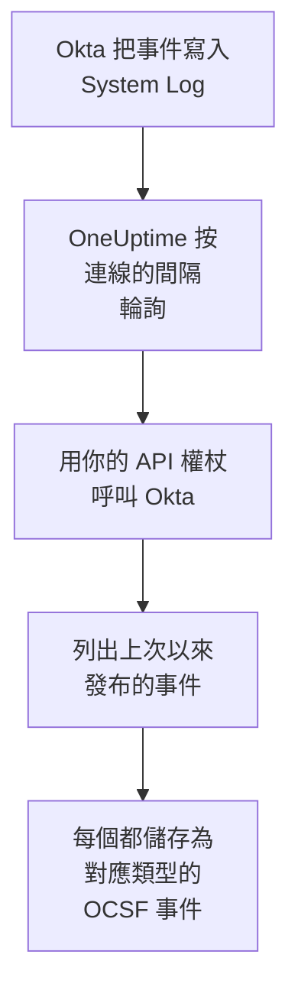

# Okta 系統日誌

把 [Okta System Log](https://developer.okta.com/docs/reference/system-log-query/) 匯入 OneUptime 的安全性事件：登入、MFA 質詢、帳戶和群組的變更，以及 Okta 自己的威脅偵測。在那裡，你可以把它們與日誌、追蹤和指標放在一起搜尋，與其他所有來源進行關聯分析，並為重要的事件呼叫待命人員。OneUptime 使用你建立的 API 權杖讀取它們，不會在 Okta 中更改任何內容。

:::cards
- [設定連線](#設定連線): 一個 API 權杖，以及連線的表單。
- [匯入的內容](#匯入的內容): 匯入哪些事件，以及每個事件如何成為一個安全性事件。
- [輪詢的運作方式](#輪詢的運作方式): 每次輪詢讀取的時間窗，以及它為何與上一個時間窗重疊 15 分鐘。
- [疑難排解](#疑難排解): 每個錯誤的含義，以及需要更改什麼。
:::

## 運作方式



OneUptime 每分鐘輪詢一次已過輪詢間隔的每個已啟用連線。一次輪詢會向 Okta 請求自上次輪詢以來發布的 System Log 事件，並把每個事件儲存為一個 [OCSF](https://schema.ocsf.io/) 事件：登入儲存為 Authentication 事件，帳戶編輯儲存為 Account Change，Okta 的偵測儲存為 Detection Finding。之後，偵測規則、監測器和儀表板會像對待其他任何來源的安全性事件一樣對待它。它適用於每個 Okta 單元，包括 `okta.com`、`oktapreview.com` 和 `okta-emea.com`，也適用於使用自訂網域的組織。

## 開始之前

- 在 OneUptime 中擁有 Project Owner、Project Admin 或 Security Admin 角色。Security Member 和 Security Viewer 可以檢視連線及其執行歷史，但不能更改它們。
- 一個能檢視 System Log 的 Okta 管理員，用來建立權杖。權杖能做它的管理員能做的事，所以請使用 Read-only Administrator：它讀取 System Log，不更改任何內容。只讀管理員也能看到使用者、群組、應用程式和設定，所以請像保管密碼一樣保管權杖。
- 最好為該管理員使用一個服務帳戶。當權杖的管理員被停用，或者權杖 30 天未被使用時，Okta 會停用該權杖。輪詢每隔幾分鐘就會使用它，所以只要連線處於啟用狀態，權杖就一直在使用中。
- 如果你的組織只接受來自某個網路地區的 API 呼叫，就需要一個包含 OneUptime 呼叫來源位址的地區：在 OneUptime Cloud 上是它的傳出位址，在自行託管安裝中是你的應用程式和工作程序主機的公開位址。

## 設定連線

:::steps
### 建立 API 權杖

1. 以只讀管理員身分登入 Okta **Admin Console**。
2. 開啟 **Security → API**，然後開啟 **Tokens** 索引標籤，選擇 **Create token**。
3. 為它命名，例如 `OneUptime security events`。除非你的組織需要某個地區，否則請把呼叫來源保持為 **Any IP**。
4. 選擇 **Create token**，然後複製 **Token Value**。Okta 只顯示一次。

每個權杖可以使用組織 API 速率限制的一部分，權杖在 **Tokens** 索引標籤中的那一列會顯示這個份額。一次輪詢最多發出 20 個請求，所以除非其他工具也使用同一個權杖，預設份額就綽綽有餘。

### 在 OneUptime 中新增連線

開啟 **產品 → Security Events → 連線**（`/dashboard/{projectId}/security-events/connections`），點選 **新增連線**，選擇 **Okta System Log**，然後點選 **下一步**。填寫下表中的設定，點選 **下一步**，然後把權杖貼上到 **API token** 中。

### 儲存之前先測試

點選 **儲存前測試** 下的 **測試這些設定**。測試會用表單中的值登入並讀取事件，不儲存任何內容，所以錯誤的 URL 或無效的篩選器會在連線建立之前就暴露出來。然後點選 **下一步**，為連線設定一個 **名稱** 並建立它。
:::

| 設定 | 填寫什麼 |
| --- | --- |
| **Okta organization URL** | 你的使用者登入時使用的位址，例如 `https://acme.okta.com`、`https://acme.oktapreview.com` 或 `https://login.example.com`。它必須使用 `https`，且不帶路徑。不能使用 Admin Console 的 `-admin` 位址，因為它不提供 API。 |
| **Event filter** | 可選。一個選擇要匯入哪些事件的 [System Log 篩選器](https://developer.okta.com/docs/reference/core-okta-api/#filter)，例如 `eventType sw "user.session" or eventType sw "security"`。留空時匯入下面的事件族。最多 2,000 個字元，寫在一行中，並且不能針對 `published`：時間範圍由 OneUptime 自己設定。 |
| **API token** | 權杖的值本身：OneUptime 會自己加上 `SSWS` 方案。它會被加密，API 從不傳回它，也不會再次顯示。要替換它，請在連線上使用 **更新憑證**。 |

**輪詢** 步驟還有選用的 **描述**、**輪詢間隔（分鐘）**（`1` 到 `1440` 之間的整數，初始為 `5`），以及初始為開啟的 **已啟用**。

## 匯入的內容

沒有 **Event filter** 時，OneUptime 按 `eventType` 字首匯入安全團隊關注的事件族。你自己的篩選器會替換這個清單，而不是在它基礎上新增：

| 字首 | 事件 |
| --- | --- |
| `user.session` | 登入和退出、存取 Admin Console、模擬使用者 |
| `user.authentication` | 驗證結果，包括單點登入 |
| `user.mfa` | 因素的註冊、質詢和重設 |
| `user.account` | 密碼更改和重設、鎖定、個人資料和權限變更 |
| `user.lifecycle` | 使用者的建立、啟用、暫停、停用和刪除 |
| `security.` | ThreatInsight、可疑活動報告以及 Okta 的其他偵測 |
| `policy.` | 登入政策評估和政策變更 |
| `system.api_token` | API 權杖的建立和吊銷 |
| `application.user_membership` | 應用程式指派 |
| `group.user_membership` | 群組成員身分變更 |

每個事件都會成為一個 OCSF 事件，供應商為 `Okta`，產品為 `Okta System Log`，類別由它的 `eventType` 決定：

| `eventType` | OCSF 類 | 活動 |
| --- | --- | --- |
| `user.session.start` | Authentication (`3002`) | `Logon` |
| `user.session.end` | Authentication (`3002`) | `Logoff` |
| `user.authentication.*` | Authentication (`3002`) | `Logon` |
| `user.mfa.*` | Authentication (`3002`) | `Authentication Ticket` |
| 其他 `user.session.*` 事件 | Authentication (`3002`) | `Other` |
| `user.account.*`, `user.lifecycle.*` | Account Change (`3001`) | 事件類型的最後一部分，例如 `Update Password` |
| `group.*` | Group Management (`3006`) | 事件類型的最後一部分，例如 `Add` |
| `security.*`，以及拒絕了存取的 `policy.evaluate_sign_on` | Detection Finding (`2004`) | `Create`，以事件類型作為規則名稱 |
| 其他所有內容 | `0`，以事件類型命名 | 事件類型的最後一部分 |

不屬於上述任何類的事件仍然保留每個欄位，並且可以按其中任何一個欄位搜尋。每個事件都會填入以下列：

| Okta 欄位 | OneUptime 欄位 |
| --- | --- |
| `uuid` | 事件 UID，也是去除重複所依據的值 |
| `published`，即事件發生的時間 | 事件時間 |
| `displayMessage`，否則事件類型和 `outcome.reason` | 訊息 |
| `severity`：`DEBUG` 和 `INFO` 為 Informational，`WARN` 為 Medium，`ERROR` 為 High | 嚴重程度 |
| `outcome.result`，例如 `SUCCESS`、`FAILURE`、`ALLOW` 或 `DENY` | 狀態 |
| `actor.alternateId`，否則 `actor.displayName`；`client.ipAddress` | 內文的使用者和 IP |
| `target` 中 `User` 的 `alternateId` | 目標使用者 |
| `target` 中 `AppInstance` 的 `alternateId` | 目標資源 |
| 操作者、每個目標以及用戶端的 IP | Observable |
| 整個事件，展平為點分隔的鍵，例如 `client.userAgent.browser` 和 `debugContext.debugData.requestUri` | `attributes` |

`INFO` 級別的失敗或被拒絕的登入會被提升為 Low，以便與成功的登入區分開。System Log 不包含 MITRE ATT&CK 引用，所以這些列保持為空。

## 輪詢的運作方式

每次輪詢列出在它的時間窗中發布的事件，從最早的開始，每頁 1,000 個，並跟隨 Okta 傳送的 `next` 連結，直到最後一頁：

```text
GET {Okta organization URL}/api/v1/logs?since={window start}&until={window end}&sortOrder=ASCENDING&limit=1000&filter={Event filter}
```

- **發布時間就是游標。** System Log 事件就是活動本身，所以 `published` 既是活動發生的時間，也是輪詢讀取的值。
- **第一次輪詢會回溯 24 小時**，所以新連線會立刻顯示最近的事件。
- **之後的每次輪詢都從儲存的游標之前 15 分鐘開始。** Okta 提示，帶有結束時間的請求可能會遺漏延遲的事件，但它稱這種情況很少見。重疊部分會在下一次輪詢中讀取這些事件。延遲超過 15 分鐘的事件可能會落在游標後面：匯入它的時間範圍即可找回。
- **一次輪詢最多讀取游標之後 24 小時。** 游標落後的連線會透過一連串 24 小時的時間窗追趕，此時它的 **健康狀況** 顯示為 **Catching up**。
- **重複項按 `uuid` 去除重複**，範圍是整個專案，所以重疊部分、重試的時間窗和匯入都不會把同一個事件儲存兩次。

由於權杖會隨每個請求一起傳送，指向你的 **Okta organization URL** 之外任何地方的 `next` 連結都不會被跟隨。

### 當一個時間窗包含的內容超過一次輪詢能讀取的量時

一次輪詢最多用 20 個請求讀取最多 10,000 個事件。當時間窗中的事件更多時，這次執行為 **部分**，並帶有如下警告：

```text
Stopped after collecting 10000 events; the window holds more. The last event read was published at 2026-09-14T08:12:44.000Z.
```

事件從最早的開始讀取，所以 OneUptime 會把游標移到它讀取的最後一個事件的發布時間，下一次輪詢就從那裡開始，不帶 15 分鐘的重疊，時間窗長度不變。繁忙的組織每次輪詢追趕 10,000 個事件，而不是重複讀取同樣的內容。當游標越過那個點 15 分鐘之後，重疊會恢復。

當一次執行完全無法越過儲存的游標時，例如僅 15 分鐘的重疊部分就包含超過 10,000 個事件，OneUptime 會改為縮短時間窗：

1. **縮小。** 下一次輪詢從同一個起點讀取長度減半的時間窗，並不斷減半，直到某個時間窗能被完整讀取，最短為一分鐘。執行的警告會說明這一點：`This window holds more records than one poll can read; the next poll reads a {n} minute window from the same starting point.`
2. **恢復。** 一個時間窗被完整讀取後，下一個時間窗的長度會再次加倍，最長為 24 小時。
3. **越過單獨的一分鐘。** 如果連一分鐘內的內容都超過一次輪詢能讀取的量，輪詢會越過這一分鐘，讓更新的事件繼續到達，之後輪詢的重疊部分也不會再回到這一分鐘。這次執行仍為 **部分**，**最近的錯誤** 顯示 `More records were created in the one minute from {cursor} to {end} than one poll can read. Polling moved past this minute so newer records keep arriving; use Import this time range in Diagnostics on this minute to recover what one run can read.` 用 **Import this time range** 匯入這一分鐘，就能找回一次執行能讀取的內容，或者縮小 **Event filter** 的範圍。

因 Okta 的錯誤而徹底失敗的執行，會保留游標和時間窗長度，下一次輪詢會再次讀取同一個時間窗。唯一的例外是請求逾時：游標保持不變，但下一個時間窗的長度減半，因為重到無法及時得到回應的時間窗每次嘗試都會逾時。更改 **輪詢間隔（分鐘）** 不會改變這些：它決定的是輪詢多久開始一次，而不是時間窗從哪裡開始。

### 按需執行、預覽和匯入

在連線上點選 **診斷**，可以檢視它最近的執行，並手動操作它。能更改該連線的人都可以啟動這些操作；能檢視它的人都可以閱讀歷史記錄。

- **立即執行** 會立即開始一次輪詢，使用通常的游標，即使連線未處於 **已啟用** 狀態也可以。
- **Preview log events** 讀取最長 7 天的時間範圍，不匯入任何內容。
- **Import this time range** 在你確認後匯入最長 7 天的範圍，不會移動游標。已匯入的事件會被跳過。Okta 會保留 90 天的 System Log。
- 執行上的 **Copy diagnostics** 會複製它的報告以便提供給支援人員。報告從不包含認證資訊。

## 測試連線

連線所在列中的 **測試連線** 和表單中的 **測試這些設定** 在 API 程序中執行，而不是在背景工作程序中執行，所以即使工作程序出了問題，測試仍然會給出結果。它按順序執行以下檢查：

| 檢查 | 檢查的內容 |
| --- | --- |
| **設定** | 每項設定都存在且格式正確。此項失敗時不會連線到任何地方。 |
| **Authenticate with Okta** | Okta 接受用於 System Log 的權杖，讀取一個事件且不帶篩選器。 |
| **Read System Log events** | 能透過輪詢使用的篩選器（你自己的或預設的）讀取過去 24 小時內的一個事件，所以無效的 **Event filter** 會在這裡失敗，而不是在第一次輪詢時失敗。 |
| **Events available to import** | 過去 24 小時和過去 7 天內發布了多少個事件，各統計一頁（1,000 個），所以 `1000+` 表示更多。7 天內一個都沒有是警告，而不是失敗。 |
| **Background workers**、**Poll scheduler**、**Security event storage** | OneUptime 自身的一側：有程序在處理 Worker 佇列的作業，輪詢作業每分鐘執行一次，安全性事件儲存能夠回應。 |
| **Scheduled polling** | 針對已儲存的連線：輪詢已開啟，沒有執行卡在等待工作程序的狀態，並且輪詢按時執行。 |

測試中的每個請求都有 20 秒的期限。測試從不匯入任何內容，也不移動游標，每個失敗的檢查都會說明需要更改什麼。

## 疑難排解

連線的 **最近的錯誤** 會保留完整的錯誤訊息（認證資訊已隱去），前面帶有一個指明失敗步驟的字首。連線出錯時，在它的 **操作** 欄中選擇 **檢視錯誤** 來閱讀，並在對話方塊中用 **複製錯誤** 複製。每條訊息都以 `Okta System Log events request` 開頭，並在狀態之後引用 Okta 自己的錯誤代碼；請閱讀後面的內容。

:::details Last Error 顯示 `failed (HTTP 400)`
Okta 拒絕了請求的參數（`E0000053`）。如果權杖有效，問題幾乎總是出在 **Event filter** 上：請檢查它的運算子（`eq`、`ne`、`co`、`sw`、`ew`、`pr`、`gt`、`ge`、`lt` 和 `le`）、它的 `and` 和 `or`，以及值兩邊的雙引號，或者清空它以使用預設事件族。對於匯入，這也可能表示範圍的開始時間早於 180 天前。
:::

:::details Last Error 顯示 `failed (HTTP 401)` 或 `failed (HTTP 403)`
- `HTTP 401`：Okta 沒有接受權杖（`E0000011`）。它已被吊銷、30 天未被使用，或隨它的管理員一起被停用；或者貼上時帶上了 `SSWS` 或多餘的字元。請以只讀管理員身分建立一個新權杖，並用 **更新憑證** 儲存。
- `HTTP 403`：權杖能登入，但它的管理員無法讀取 System Log（`E0000006`）。請以 Read-only Administrator 或 Super Administrator 身分建立權杖，並檢查它的網路地區是否允許 OneUptime 呼叫來源的位址。
:::

:::details Last Error 顯示 `failed (HTTP ...)` 和其他狀態
- `HTTP 404`：該 URL 不提供 Okta 的 API。請使用組織自己的位址，例如 `https://acme.okta.com`，不帶路徑，也不要使用 `-admin` 位址。
- `HTTP 3xx`：Okta 重新導向了請求，而由於權杖會隨每個請求一起傳送，重新導向會被拒絕。請使用組織自己的位址。
- `HTTP 429`：Okta 正在限制該權杖（`E0000047`）。下一次輪詢會重試。如果這種情況持續發生，請在 **Tokens** 索引標籤中提高該權杖的速率限制份額，給 OneUptime 一個專用權杖，或者降低輪詢頻率。
- `HTTP 5xx`：Okta 出現故障，或者查詢超過了 Okta 30 秒的限制（`E0000009`）。下一次輪詢會重試；如果這種情況持續發生，請檢視 [status.okta.com](https://status.okta.com)。
:::

:::details Last Error 顯示 `returned` 或 `did not complete`
- `returned a non-JSON body.` 或 `returned an unrecognized response shape`：回應的不是 Okta 的 API，而是其他東西，例如登入頁面或代理，或者 Okta 傳回了錯誤。這會被報告出來，而不是當作空時間窗處理，所以游標永遠不會越過沒人讀過的事件。
- `returned a next link outside the Okta organization URL`：某個 `next` 連結指向了別處，因此沒有被跟隨。Okta 自己從不這樣做：請查詢改寫標頭的代理。
- `did not complete`：請求沒有得到回應：逾時、無法解析的名稱、OneUptime 不信任的證書，或者被拒絕的位址。請檢查 OneUptime 應用程式和工作程序能否透過 HTTPS（經由你使用的任何代理）存取你的組織。
:::

:::details Last Polled 為 Never 且 Last Error 為空
這個連線還沒有完成過任何輪詢。執行 **測試連線**：它的 **Background workers** 和 **Poll scheduler** 檢查會指出原因。在自行託管安裝中，常見原因是應用程式上設定了 `DISABLE_QUEUE_WORKERS=true`，卻沒有單獨的工作程序部署來處理作業：把它設為 `false`，或執行工作程序部署（Helm：`worker.enabled: true`）。
:::

:::details 執行為 Partial
- `Stopped after collecting 10000 events`：時間窗中的事件超過了一次執行能讀取的 10,000 個。不會遺失任何內容：下一次輪詢會從讀取的最後一個事件之後開始。一次又一次輪詢都保持 **部分** 的連線正在追趕積壓的內容，它的 **最近輪詢** 和 **最近匯入的事件** 會不斷前進。如果它始終追不上，說明該組織發布的符合事件多到一個輪詢間隔裝不下：請縮小 **Event filter** 的範圍，或者縮短 **輪詢間隔（分鐘）**。
- `More records were created in the one minute from ... than one poll can read`：輪詢越過了這一分鐘。請在 **診斷** 中用 **Import this time range** 匯入它。一次匯入讀取的量與一次輪詢相同。
:::

:::details 測試通過，但沒有匯入任何內容
閱讀測試報告中的 **Events available to import**。使用預設篩選器時，有使用者的組織會一直髮布登入事件，所以過去 7 天為 `0` 表示該 URL 是一個沙盒或未使用的組織。使用你自己的 **Event filter** 時，這表示篩選器什麼都沒符合到：請與 Admin Console 的 System Log 中的事件類型進行比較。
:::

## 你會得到什麼

- **搜尋。** 在安全性事件探索器中，與其他所有來源放在一起，按嚴重程度、狀態、使用者、IP 或任何 observable 篩選登入、MFA 結果、帳戶變更和 Okta 偵測。
- **關聯分析。** 每個事件的使用者、應用程式和 IP 都會作為 observable 建立索引，所以一次搜尋就能找到某個使用者做過的所有事，並與其應用程式自己的日誌放在一起。
- **偵測規則。** 按排程對你的安全性事件執行的 Sigma 規則，例如按 IP 統計的登入失敗或按使用者統計的 MFA 拒絕，會開啟呼叫待命人員的警示。
- **監測器。** 安全性事件監測器統計符合的事件，並在超過閾值時開啟事件或警示。

安全性事件與其他遙測資料一樣，按擷取的 GB 數計費。請參閱 [定價](https://oneuptime.com/pricing)。

## 後續步驟

:::cards
- [安全性事件](/docs/telemetry/security-events): 搜尋、關聯分析你匯入的內容，並據此發出警示。
- [AWS Security Hub](/docs/integrations/aws-security-hub): 同時匯入你的雲端的發現結果。
- [角色](/docs/permissions/reference#角色): Security 角色可以檢視和更改的內容。
- [整合總覽](/docs/integrations/index): 你可以連接的其他工具。
:::
