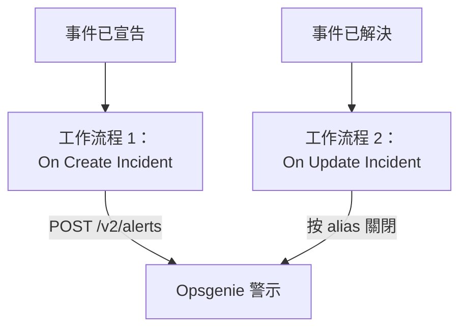

# Opsgenie

把 OneUptime 事件傳送到 [Opsgenie](https://www.atlassian.com/software/opsgenie)。宣告 OneUptime 事件時，一個工作流程建立 Opsgenie 警示；OneUptime 事件被解決時，第二個工作流程關閉它。在 Opsgenie 仍負責呼叫你的團隊、OneUptime 負責監控你的系統期間，請使用這種方式。

:::cards
- [儲存 API 金鑰](#儲存-api-金鑰): 讓 Opsgenie 的金鑰不出現在工作流程中。
- [建立 Opsgenie 警示](#為每個事件建立-opsgenie-警示): 一個工作流程，兩個區塊。
- [關閉它們](#關閉-opsgenie-警示): 第二個工作流程，跟隨事件的狀態。
- [疑難排解](#疑難排解): Opsgenie 拒絕請求時。
:::

> [!IMPORTANT]
> Atlassian 已於 2025 年 6 月停止銷售 Opsgenie，並將於 2027 年 4 月結束支援。OneUptime 也能透過待命策略、排班和上報規則呼叫人員。要把團隊移轉過來，請參閱 [從 Opsgenie 移轉](/docs/moving-to-oneuptime/opsgenie)：匯入功能可以移轉你的使用者、團隊、排班和上報規則。

## 運作方式



兩個工作流程都呼叫 [Opsgenie Alert API](https://docs.opsgenie.com/docs/alert-api)。第一個工作流程為警示設定一個由 OneUptime 事件 ID 生成的 `alias`，第二個工作流程按這個 alias 關閉警示。

## 開始之前

- 一個 Opsgenie **API** 整合及其 **API Key**。在 Opsgenie 的 **Settings → Integrations** 下新增；如果要把警示傳送給某個團隊，則在該團隊的 **Integrations** 下新增。
- 你的 Opsgenie 區域。在 `app.eu.opsgenie.com` 登入的歐洲帳戶使用 `api.eu.opsgenie.com`，其他所有帳戶使用 `api.opsgenie.com`。
- 在 OneUptime 中建立工作流程和全域變數的權限。在 OneUptime Cloud 上，工作流程需要 **Growth** 或更高的方案。

## 儲存 API 金鑰

:::steps
1. 前往 **工作流程 → 全域變數**，點選 **建立工作流程 變數**。
2. 將其命名為 `OPSGENIE_KEY`，然後點選 **下一步**。
3. 把 API 金鑰貼上到 **內容** 中，開啟 **密鑰**，然後點選 **建立工作流程 變數**。
:::

密鑰變數在執行日誌中會被替換為 `[REDACTED]`，因此金鑰永遠不會出現在執行中。

## 為每個事件建立 Opsgenie 警示

:::steps
### 建立工作流程

前往 **工作流程**，點選 **建立工作流程**，然後點選 **從零開始**。將其命名為 `Incidents to Opsgenie`，然後點選 **建立工作流程**。

### 新增觸發器

點選虛線的 **選擇啟動此工作流程的方式** 區塊，選擇 **On Create Incident**。點選該觸發器：它的 **Fields to pass on** 已經包含 **標題**，所以點選 **新增欄位** 並選擇 **描述**。

### 建立警示

點選 **新增元件**，新增一個 **API Post (JSON)** 區塊，並把觸發器的 **Success** 點連接到它。把它的 **URL** 設為 `https://api.opsgenie.com/v2/alerts`，在歐洲則設為 `https://api.eu.opsgenie.com/v2/alerts`。在 **更多欄位** 下，把 **Request Headers** 設為：

```json
{ "Authorization": "GenieKey {{global.variables.OPSGENIE_KEY}}" }
```

把 **Request Body** 設為：

```json
{
  "message": "{{local.components.incident-on-create-1.returnValues.model.title}}",
  "alias": "oneuptime-{{local.components.incident-on-create-1.returnValues.model._id}}",
  "description": "{{local.components.incident-on-create-1.returnValues.model.description}}",
  "priority": "P1",
  "source": "OneUptime"
}
```

### 測試，然後啟用

點選 **執行工作流程**，在 **事件** 中選擇一個測試事件，然後執行。**API Post (JSON)** 步驟會顯示 `202` 回應，片刻之後警示會出現在 Opsgenie 中。然後在 **建構器** 頂部開啟 **已啟用**。
:::

Opsgenie 的認證方式是單字 `GenieKey`、一個空格，然後是金鑰。Opsgenie 把 `message` 限制為 130 個字元，它的優先順序從 `P1` 到 `P5`：要傳送每個事件自己的優先順序，請參閱 [對應優先順序](#對應優先順序)。

## 關閉 Opsgenie 警示

一個工作流程只有一個觸發器，因此關閉需要第二個工作流程，在事件狀態變化時啟動。

:::steps
### 新增 On Update Incident 觸發器

建立一個名為 `Close Opsgenie alerts` 的工作流程，選擇 **On Update Incident** 作為觸發器。在 **Fields to watch** 中點選 **新增欄位** 並選擇 **Current Incident State**，使它只在狀態變化時執行。在 **Fields to pass on** 中請求新狀態是否為已解決狀態：點選 **新增欄位**，展開 **Current Incident State** 並選擇 **Is Resolved State**。也可以點選 **以 JSON 編輯**，把 JSON 取代為：

```json
{ "_id": true, "currentIncidentState": { "isResolvedState": true } }
```

### 檢查事件是否已解決

在觸發器之後新增一個 **If / Else** 區塊。把 **Value to check** 設為 `{{local.components.incident-on-update-1.returnValues.model.currentIncidentState.isResolvedState}}`，**Comparison** 設為 **is true**。

### 關閉警示

在 **Yes** 一側之後新增一個 **API Post (JSON)** 區塊，使用相同的 **Request Headers** 和以下 **URL**：

```text
https://api.opsgenie.com/v2/alerts/oneuptime-{{local.components.incident-on-update-1.returnValues.model._id}}/close?identifierType=alias
```

把它的 **Request Body** 設為 `{ "source": "OneUptime", "note": "Resolved in OneUptime" }`。

### 啟用

開啟 **已啟用**，然後在 OneUptime 中解決一個測試事件。Opsgenie 會關閉它的警示。
:::

`identifierType=alias` 告訴 Opsgenie，位址是按 alias 而不是按警示自己的 ID 來指定警示的。

## 對應優先順序

要把每個事件的嚴重程度作為 Opsgenie 優先順序傳送，請在觸發器和 **API Post (JSON)** 區塊之間新增一個 **Run Custom JavaScript** 區塊。

1. 在觸發器的 **Fields to pass on** 中點選 **新增欄位**，展開 **事件嚴重性** 並選擇 **名稱**。
2. 把該區塊的 **Arguments** 設為 `{ "severity": "{{local.components.incident-on-create-1.returnValues.model.incidentSeverity.name}}" }`，**JavaScript Code** 設為：

   ```javascript
   // Your incident severities, by name, to Opsgenie's priorities.
   const PRIORITY = {
     "Critical Incident": "P1",
     "Major Incident": "P2",
     "Minor Incident": "P3",
   };

   return { priority: PRIORITY[args.severity] || "P3" };
   ```

3. 在請求內文中，把 `"priority"` 設為 `"{{local.components.javascript-1.returnValues.returnValue.priority}}"`。

上面的名稱是新專案初始的三種嚴重程度。如果你重新命名過它們，請使用你自己的名稱。

## 疑難排解

:::details Opsgenie 傳回 401 或 403
金鑰錯誤，或者屬於另一個區域。請檢查標頭是 `GenieKey`、一個空格和金鑰，檢查金鑰屬於 **API** 整合，並檢查主機與你的區域一致：`api.opsgenie.com` 或 `api.eu.opsgenie.com`。
:::

:::details 關閉時傳回 404
沒有帶該 alias 的警示。兩個工作流程必須以相同的方式生成 alias，即 `oneuptime-` 加事件的 `_id`，並且 URL 必須以 `?identifierType=alias` 結尾。
:::

:::details 步驟顯示 202，但警示從未出現
Opsgenie 在處理請求之前就回應 `202`，因此之後被拒絕的請求仍然顯示 `202`。請在 Opsgenie 的日誌中查詢該請求，瞭解它被拒絕的原因，例如整合已被關閉。
:::

:::details 工作流程從未執行
檢查它是否已啟用：它的 **建構器** 頂部的 **已啟用**。然後開啟 **日誌 → 執行記錄**：走了 **If / Else** 區塊 **No** 一側的執行，是一次不是解決的更新。
:::

## 後續步驟

:::cards
- [從 Opsgenie 移轉](/docs/moving-to-oneuptime/opsgenie): 在 Opsgenie 停止服務之前，把你的團隊、排班和上報規則移轉過來。
- [上報規則](/docs/on-call/escalation-rules): 直接從 OneUptime 呼叫人員。
- [PagerDuty](/docs/integrations/pagerduty): 適用於 PagerDuty 的同樣兩個工作流程。
- [整合總覽](/docs/integrations/index): 每個整合背後的模式。
:::
