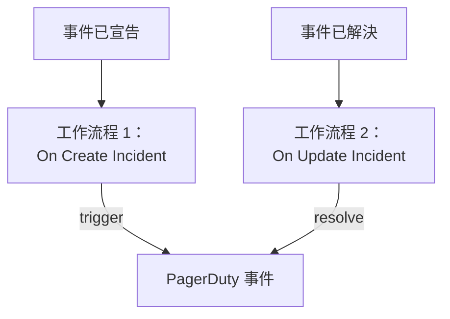

# PagerDuty

把 OneUptime 事件傳送到 [PagerDuty](https://www.pagerduty.com)。宣告 OneUptime 事件時，一個工作流程觸發 PagerDuty 事件；OneUptime 事件被解決時，第二個工作流程解決它。當 PagerDuty 負責呼叫你的團隊、OneUptime 負責監控你的系統時，請使用這種方式。

:::cards
- [儲存路由金鑰](#儲存路由金鑰): 讓 PagerDuty 的金鑰不出現在工作流程中。
- [觸發 PagerDuty 事件](#為每個事件觸發-pagerduty-事件): 一個工作流程，兩個區塊。
- [解決它們](#解決-pagerduty-事件): 第二個工作流程，跟隨事件的狀態。
- [疑難排解](#疑難排解): PagerDuty 拒絕某個事件時。
:::

> [!TIP]
> OneUptime 也能透過待命策略、排班和上報規則呼叫人員。要把團隊從 PagerDuty 移轉過來，請參閱 [從 PagerDuty 移轉](/docs/moving-to-oneuptime/pagerduty)：匯入功能可以移轉你的使用者、排班和上報策略。

## 運作方式



兩個工作流程都使用相同的 `dedup_key` 呼叫 PagerDuty 的 [Events API v2](https://developer.pagerduty.com/docs/events-api-v2/overview/)，該鍵由 OneUptime 事件的 ID 生成。PagerDuty 正是靠這個鍵知道 resolve 事件要關閉的是 trigger 事件開啟的那個事件。

## 開始之前

- 一個帶有 Events API v2 整合的 PagerDuty 服務。在 PagerDuty 中開啟該服務，然後開啟 **Integrations**，點選 **Add an integration** 並選擇 **Events API V2**。複製它的 **Integration Key**：Events API 把它稱為路由金鑰（routing key）。
- 在 OneUptime 中建立工作流程和全域變數的權限。在 OneUptime Cloud 上，工作流程需要 **Growth** 或更高的方案。

## 儲存路由金鑰

:::steps
1. 前往 **工作流程 → 全域變數**，點選 **建立工作流程 變數**。
2. 將其命名為 `PAGERDUTY_ROUTING_KEY`，然後點選 **下一步**。
3. 把整合金鑰貼上到 **內容** 中，開啟 **密鑰**，然後點選 **建立工作流程 變數**。
:::

密鑰變數在執行日誌中會被替換為 `[REDACTED]`，因此金鑰永遠不會出現在執行中。

## 為每個事件觸發 PagerDuty 事件

:::steps
### 建立工作流程

前往 **工作流程**，點選 **建立工作流程**，然後點選 **從零開始**。將其命名為 `Incidents to PagerDuty`，然後點選 **建立工作流程**。

### 新增觸發器

點選虛線的 **選擇啟動此工作流程的方式** 區塊，選擇 **On Create Incident**。點選該觸發器：它的 **Fields to pass on** 已經包含 **標題**，所以點選 **新增欄位** 並選擇 **描述**。

### 傳送 trigger 事件

點選 **新增元件**，新增一個 **API Post (JSON)** 區塊，並把觸發器的 **Success** 點連接到它。把它的 **URL** 設為 `https://events.pagerduty.com/v2/enqueue`，**Request Body** 設為：

```json
{
  "routing_key": "{{global.variables.PAGERDUTY_ROUTING_KEY}}",
  "event_action": "trigger",
  "dedup_key": "oneuptime-{{local.components.incident-on-create-1.returnValues.model._id}}",
  "payload": {
    "summary": "{{local.components.incident-on-create-1.returnValues.model.title}}",
    "source": "OneUptime",
    "severity": "critical",
    "custom_details": {
      "description": "{{local.components.incident-on-create-1.returnValues.model.description}}"
    }
  }
}
```

### 測試，然後啟用

點選 **執行工作流程**，在 **事件** 中選擇一個測試事件，然後執行。**API Post (JSON)** 步驟會顯示帶有 `"status": "success"` 的 `202` 回應，PagerDuty 會建立一個事件。然後在 **建構器** 頂部開啟 **已啟用**。
:::

該區塊傳送的是 JSON，因此不需要 `Content-Type` 標頭。PagerDuty 的 `severity` 是 `critical`、`error`、`warning` 和 `info` 之一：要傳送每個事件自己的嚴重程度，請參閱 [對應嚴重程度](#對應嚴重程度)。

## 解決 PagerDuty 事件

一個工作流程只有一個觸發器，因此解決需要第二個工作流程，在事件狀態變化時啟動。

:::steps
### 新增 On Update Incident 觸發器

建立一個名為 `Resolve PagerDuty incidents` 的工作流程，選擇 **On Update Incident** 作為觸發器。在 **Fields to watch** 中點選 **新增欄位** 並選擇 **Current Incident State**，使它只在狀態變化時執行。在 **Fields to pass on** 中請求新狀態是否為已解決狀態：點選 **新增欄位**，展開 **Current Incident State** 並選擇 **Is Resolved State**。也可以點選 **以 JSON 編輯**，把 JSON 取代為：

```json
{ "_id": true, "currentIncidentState": { "isResolvedState": true } }
```

### 檢查事件是否已解決

在觸發器之後新增一個 **If / Else** 區塊。把 **Value to check** 設為 `{{local.components.incident-on-update-1.returnValues.model.currentIncidentState.isResolvedState}}`，**Comparison** 設為 **is true**。

### 傳送 resolve 事件

在 **Yes** 一側之後新增一個 **API Post (JSON)** 區塊，使用相同的 **URL** 和以下 **Request Body**：

```json
{
  "routing_key": "{{global.variables.PAGERDUTY_ROUTING_KEY}}",
  "event_action": "resolve",
  "dedup_key": "oneuptime-{{local.components.incident-on-update-1.returnValues.model._id}}"
}
```

### 啟用

開啟 **已啟用**，然後在 OneUptime 中解決一個測試事件。PagerDuty 會解決它的事件。
:::

檢查 `isResolvedState` 而不是狀態名稱，這樣即使你重新命名了狀態也能繼續工作。請參閱 [事件狀態與嚴重程度](/docs/incidents/states-and-severities)。

## 對應嚴重程度

要傳送每個事件的嚴重程度，請在觸發器和 **API Post (JSON)** 區塊之間新增一個 **Run Custom JavaScript** 區塊，並在請求內文中讀取它的結果。

1. 在觸發器的 **Fields to pass on** 中點選 **新增欄位**，展開 **事件嚴重性** 並選擇 **名稱**。
2. 把該區塊的 **Arguments** 設為 `{ "severity": "{{local.components.incident-on-create-1.returnValues.model.incidentSeverity.name}}" }`，**JavaScript Code** 設為：

   ```javascript
   // Your incident severities, by name, to PagerDuty's.
   const SEVERITY = {
     "Critical Incident": "critical",
     "Major Incident": "error",
     "Minor Incident": "warning",
   };

   return { severity: SEVERITY[args.severity] || "info" };
   ```

3. 在請求內文中，把 `"severity"` 設為 `"{{local.components.javascript-1.returnValues.returnValue.severity}}"`。

上面的名稱是新專案初始的三種嚴重程度。如果你重新命名過它們，請使用你自己的名稱。

## 疑難排解

:::details PagerDuty 傳回 400
回應內文會說明 PagerDuty 拒絕了什麼，執行的 **API Post (JSON)** 步驟中可以看到它。通常是路由金鑰不是 Events API v2 整合金鑰：請從服務的 **Integrations** 中重新複製。缺少 `summary`、`source` 或 `severity` 的事件也會被拒絕。
:::

:::details resolve 事件沒有關閉任何東西
兩個事件必須帶有完全相同的 `dedup_key`。請檢查兩個請求內文都以 `oneuptime-` 加事件的 `_id` 的方式生成它，並檢查解決工作流程已啟用。
:::

:::details 工作流程從未執行
檢查它是否已啟用：它的 **建構器** 頂部的 **已啟用**。然後開啟 **日誌 → 執行記錄**：走了 **If / Else** 區塊 **No** 一側的執行，是一次不是解決的更新。
:::

:::details PagerDuty 顯示的是引用而不是值
無法解析的引用會連同大括號按原樣傳送。請檢查區塊的識別碼、欄位名，以及區分大小寫的變數名。在執行的 **步驟** 索引標籤上，帶有這種引用的設定會被標記為 **Did not resolve**。
:::

## 後續步驟

:::cards
- [從 PagerDuty 移轉](/docs/moving-to-oneuptime/pagerduty): 把你的團隊、排班和上報策略移轉過來。
- [上報規則](/docs/on-call/escalation-rules): 直接從 OneUptime 呼叫人員。
- [Opsgenie](/docs/integrations/opsgenie): 適用於 Opsgenie 的同樣兩個工作流程。
- [整合總覽](/docs/integrations/index): 每個整合背後的模式。
:::
