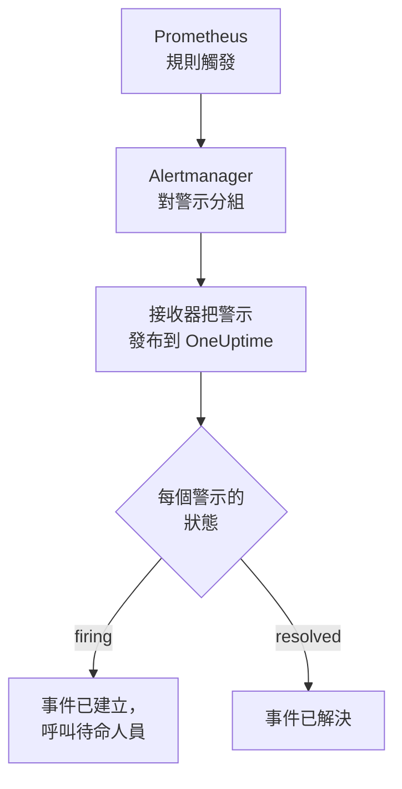

# Prometheus Alertmanager

把 [Prometheus Alertmanager](https://prometheus.io/docs/alerting/latest/alertmanager/) 警示傳送到 OneUptime，讓每個觸發的警示都成為一個呼叫待命團隊的事件，並在警示恢復時解決。Alertmanager 把通知發布到 Webhook 接收器，因此兩邊都無需安裝任何東西。

:::cards
- [選擇 OneUptime 接收警示的方式](#選擇-oneuptime-接收警示的方式): Incoming Request 監測器，或你自己的工作流程。
- [用監測器接收警示](#用監測器接收警示): 每個警示一個事件，恢復時自動解決。
- [設定 Alertmanager](#設定-alertmanager): 一個 Webhook 接收器，以及使用它的路由。
- [疑難排解](#疑難排解): 警示沒有到達，或事件一直未關閉時。
:::

## 運作方式



Prometheus 評估你的警示規則，並把觸發的警示傳送給 Alertmanager。Alertmanager 按路由 `group_by` 中的標籤對警示分組，並把每個組作為一個 JSON 通知發布到 Webhook 接收器。通知的 `alerts` 清單包含該組的每個警示，每個警示都有自己的 `status`（`firing` 或 `resolved`）、標籤和註解，以及識別它的 `fingerprint`。

## 開始之前

- 一個你可以編輯其 `alertmanager.yml`，並且能夠透過 HTTPS 存取你的 OneUptime 的 Alertmanager。
- 在 OneUptime 中建立監測器的權限；如果選擇工作流程方式，則需要建立工作流程的權限。

## 選擇 OneUptime 接收警示的方式

先設定 OneUptime：它會給你 Alertmanager 要傳送到的 URL。

| 方式 | 適用情況 |
| --- | --- |
| Incoming Request 監測器（建議） | 你希望每個警示都成為一個呼叫待命人員的事件，並在警示恢復時解決。無需建置任何東西。 |
| 帶 Webhook 觸發器的工作流程 | 你需要自己的邏輯：先篩選警示、轉換格式或呼叫其他系統。工作流程為每個通知（而不是每個警示）開啟一個事件，並且不會在恢復時解決它。 |

兩者從同一個接收器收到相同的 JSON，所以你可以先用其中一種，之後只需修改 `alertmanager.yml` 中的一個 URL 就能切換。

## 用監測器接收警示

[Incoming Request 監測器](/docs/monitor/incoming-request-monitor) 會給你一個 URL，它的條件決定每個通知做什麼。

:::steps
### 建立監測器

前往 **監測器**，點選 **建立監測器**。在 **監測器類型** 下選擇 **Incoming Request**，將其命名為 `Alertmanager`，然後點選 **下一步**。

### 為每個觸發的警示宣告事件

在 **條件** 步驟中，開啟第一個條件，也就是把監測器標記為離線的那個。把它的篩選器設為 **請求內文**、**包含**、`"status":"firing"`。這個條件在篩選器符合時已經會宣告事件。填寫事件資訊：

- **事件標題**：`{{requestBody.commonLabels.alertname}} on {{requestBody.commonLabels.instance}}`。
- **嚴重程度**：這些警示應有的事件嚴重程度。
- **待命** 下的 **待命策略**：要呼叫的策略。
- **更多欄位** 下的 **自動解決事件**：保持開啟，它預設就是開啟的。關閉後會忽略恢復，事件將一直保持開啟。

### 每個警示一個事件

在同一個條件中，開啟 **設定** 並開啟 **Group incidents and alerts by a payload field**。按下表填寫，讓每個警示都有自己的事件，並由它的恢復來解決：

| 欄位 | 值 |
| --- | --- |
| **Open a separate incident for each…** | `requestBody.alerts[*].fingerprint` |
| **Field that signals recovery** | `requestBody.alerts[*].status` |
| **Value that means recovered** | `resolved` |

### 讓監測器恢復線上

開啟第二個條件，也就是把監測器標記為線上的那個，把它的篩選器設為 **請求內文**、**包含**、`"status":"resolved"`。

### 複製 URL

點選 **建立監測器**。監測器的 **概覽** 頁面會顯示它的 **Heartbeat URL**。複製它供 Alertmanager 使用：

```text
https://oneuptime.com/heartbeat/<secret key>
```

自行託管安裝使用自己的主機來代替 `oneuptime.com`。
:::

`[*]` 會讀取通知中的每個警示，因此包含三個警示的通知可以開啟三個事件，數量最多為 **Max incidents per request**（不修改則為 `100`）。每個警示自己的 `status` 決定它的事件如何處理：當通知中的一個警示已解決、另外兩個仍在觸發時，只有已解決警示的事件會被關閉。每項設定的作用請參閱 [接收其他系統的警示](/docs/monitor/incoming-request-monitor#接收其他系統的警示)。

> [!WARNING]
> 請按同一個通知內各警示之間互不相同的值分組。Alertmanager 的 `fingerprint` 是警示整個標籤集的雜湊，所以總是不同。路由 `group_by` 中的標籤則永遠相同：正是它們把警示放進了同一個通知。在下面的路由中按 `requestBody.alerts[*].labels.alertname` 分組，會把通知中的所有警示合併成一個事件，而該事件會跟隨第一個警示的狀態。

## 為事件命名

上面的標題讀取通知中所有警示共有的標籤：`commonLabels` 包含這些標籤，`commonAnnotations` 包含它們共有的註解。下面的路由按 `alertname` 和 `instance` 分組，因此兩者都有。在 **描述** 下，為事件設定一個 **事件描述**，例如：

```text
{{requestBody.commonAnnotations.summary}}

{{requestBody.commonAnnotations.description}}
Severity: {{requestBody.commonLabels.severity}}
Alertmanager: {{requestBody.externalURL}}
```

- 分組鍵也是一個變數，以其路徑的最後一段命名：`{{fingerprint}}`。它是一個雜湊，所以對應變人員毫無意義。
- `{{requestBody.alerts[0].annotations.summary}}` 讀取通知中的第一個警示，而它並不總是開啟該事件的那個警示。
- 引用通知中不存在的欄位時，該引用會連同大括號按原樣保留，而不會被清空。

可以使用的所有變數請參閱 [事件與警示範本](/docs/monitor/incident-alert-templating)。

## 設定 Alertmanager

:::steps
### 新增 Webhook 接收器

在 `alertmanager.yml` 中新增一個發布到你複製的 URL 的接收器，並把它設為路由的接收器：

```yaml title="alertmanager.yml"
route:
  receiver: oneuptime
  group_by: ["alertname", "instance"]

receivers:
  - name: oneuptime
    webhook_configs:
      - url: "https://oneuptime.com/heartbeat/<secret key>"
        send_resolved: true
```

`send_resolved: true` 是 Alertmanager 的預設值，寫出來是為了讓它保持開啟：沒有它，OneUptime 永遠不會得知警示已恢復。Alertmanager 傳送 `Content-Type: application/json`，監測器需要它才能讀取通知中的欄位。

### 重新載入 Alertmanager

重新載入設定，或重新啟動 Alertmanager：

```bash
curl -X POST http://localhost:9093/-/reload
```
:::

該路由保留 Alertmanager 的預設時間設定。它在傳送新組之前等待 `30s`（`group_wait`），在傳送帶有新警示的組之前等待 `5m`（`group_interval`），在重複未變化的通知之前等待 `4h`（`repeat_interval`）。

## 測試

像 Alertmanager 那樣，向 OneUptime 傳送一個包含兩個觸發警示的通知：

```bash
curl -X POST "https://oneuptime.com/heartbeat/<secret key>" \
  -H "Content-Type: application/json" \
  -d '{
    "version": "4",
    "status": "firing",
    "receiver": "oneuptime",
    "groupLabels": { "alertname": "DiskFull", "instance": "web-1" },
    "commonLabels": { "alertname": "DiskFull", "instance": "web-1", "severity": "critical" },
    "commonAnnotations": { "summary": "Disk almost full on web-1" },
    "externalURL": "http://alertmanager:9093",
    "alerts": [
      {
        "status": "firing",
        "labels": { "alertname": "DiskFull", "instance": "web-1", "severity": "critical", "device": "/dev/sda1" },
        "fingerprint": "a1b2c3d4e5f60001"
      },
      {
        "status": "firing",
        "labels": { "alertname": "DiskFull", "instance": "web-1", "severity": "critical", "device": "/dev/sdb1" },
        "fingerprint": "a1b2c3d4e5f60002"
      }
    ]
  }'
```

會開啟兩個事件，每個 `fingerprint` 一個，標題都是 `DiskFull on web-1`。把每個 `status` 都設為 `resolved` 後傳送同樣的請求，兩個事件都會被解決。

要測試從 Alertmanager 開始的完整路徑，請用 `amtool` 觸發一個警示。Alertmanager 會在 `group_wait` 之後傳送它，並在幾分鐘後警示過期時傳送它的恢復：

```bash
amtool alert add test_alert severity=warning \
  --annotation=summary="Test from Alertmanager" \
  --alertmanager.url=http://localhost:9093
```

## 用工作流程接收警示

當你需要在 Alertmanager 和事件之間加入自己的步驟時，請使用 [工作流程](/docs/workflows/index)。

:::steps
### 建立工作流程

前往 **工作流程**，點選 **建立工作流程**，然後點選 **從零開始**。將其命名為 `Alertmanager alerts`，然後點選 **建立工作流程**。

### 新增 Webhook 觸發器

點選虛線的 **選擇啟動此工作流程的方式** 區塊並選擇 **Webhook**。點選該觸發器，然後點選 **複製 URL**，把該 URL 用在 `alertmanager.yml` 的接收器中。

### 檢查通知是否為觸發狀態

點選 **新增元件**，新增一個 **If / Else** 區塊，並把觸發器的 **Out** 點連接到它。把 **Value to check** 設為 `{{local.components.webhook-1.returnValues.request-body.status}}`，**Comparison** 設為 **is equal to**，**Compare with** 設為 `firing`。

### 宣告事件

新增一個 **Create One Incident** 區塊，並把 **If / Else** 區塊的 **Yes** 一側連接到它。在 **Incident Template** 中選擇一個設定了嚴重程度和要呼叫的待命策略的範本（請參閱 [事件範本](/docs/incidents/settings#事件範本)）。在 **JSON Object** 中設定來自 Alertmanager 的內容：

```json
{
  "title": "{{local.components.webhook-1.returnValues.request-body.commonLabels.alertname}}",
  "description": "{{local.components.webhook-1.returnValues.request-body.commonAnnotations.summary}}\nAlertmanager: {{local.components.webhook-1.returnValues.request-body.externalURL}}"
}
```

如果不使用範本，**JSON Object** 中還需要 `incidentSeverityId`，即專案中某個事件嚴重程度的 ID。

### 啟用工作流程

在 **建構器** 頂部開啟 **已啟用**。處於關閉狀態的工作流程會以 `400` 回應 Alertmanager。
:::

一次執行處理一個通知，所以無論通知包含多少個警示，它都只宣告一個事件。`resolved` 的通知會走向 **If / Else** 區塊的 **No** 一側，那裡沒有連接任何東西，因此執行到此結束。要讓每個警示一個事件並在恢復時解決，請使用監測器。

## 監控 Alertmanager 本身

兩種方式都不會察覺 Prometheus 或 Alertmanager 停止工作：沒有警示到達，看起來和一切正常完全一樣。因此，請把一個始終在觸發的警示路由到第二個監測器，當該警示不再到達時由它宣告事件。[kube-prometheus-stack](https://github.com/prometheus-community/helm-charts/tree/main/charts/kube-prometheus-stack) 內建這樣一個名為 `Watchdog` 的警示。在普通的 Prometheus 上，新增一條名為 `Watchdog`、運算式始終為真的警示規則，例如 `vector(1)`。

:::steps
### 建立看門狗監測器

建立第二個 Incoming Request 監測器，命名為 `Alertmanager watchdog`。把它第一個條件（把監測器標記為離線的那個）的篩選器設為 **Incoming Request**、**Not Recieved In Minutes**、`10`，把第二個條件的篩選器設為 **Incoming Request**、**Recieved In Minutes**、`10`。儀表板上這兩項就是這樣拼寫的。複製新監測器的 **Heartbeat URL**。

### 把看門狗警示路由到它

為看門狗監測器的 URL 新增一個接收器，並新增一個每五分鐘把 `Watchdog` 傳送給它的路由。子路由會先於父路由的接收器符合，因此 `Watchdog` 會發往看門狗監測器，其他所有警示仍發往第一個監測器：

```yaml title="alertmanager.yml"
route:
  receiver: oneuptime
  group_by: ["alertname", "instance"]
  routes:
    - receiver: oneuptime-watchdog
      matchers:
        - alertname = "Watchdog"
      group_wait: 0s
      group_interval: 5m
      repeat_interval: 5m

receivers:
  - name: oneuptime
    webhook_configs:
      - url: "https://oneuptime.com/heartbeat/<secret key>"
        send_resolved: true
  - name: oneuptime-watchdog
    webhook_configs:
      - url: "https://oneuptime.com/heartbeat/<watchdog secret key>"
```
:::

當看門狗警示十分鐘沒有到達時，看門狗監測器會變為離線並宣告事件。下一個看門狗通知會讓監測器恢復線上並解決該事件。

## 疑難排解

:::details OneUptime 沒有收到任何內容
- 檢查 Alertmanager 的日誌中是否有傳遞到接收器時的錯誤。
- 監測器會在檢查任何內容之前立即回應 `200`，即使金鑰錯誤也是如此。請檢視監測器的時間軸，確認通知是否到達。
- 處於關閉狀態的工作流程會回應 `400`。在它的 **建構器** 頂部開啟 **已啟用**。
:::

:::details 事件被建立但從未被解決
- 檢查沒有接收器設定了 `send_resolved: false`：那樣 Alertmanager 永遠不會發送恢復。
- 條件中的事件需要開啟 **更多欄位** 下的 **自動解決事件**。
- **Field that signals recovery** 必須是 `requestBody.alerts[*].status`，**Value that means recovered** 必須恰好是 `resolved`。比較區分大小寫。
- 通知中超出 **Max incidents per request** 的警示根本不會被讀取，所以它們的恢復也會遺失。
- 在突發中被跳過的恢復（見下文）會讓它的事件永遠保持開啟：Alertmanager 會重複傳送觸發中的警示，但從不重複傳送恢復。請手動解決這樣的事件。
:::

:::details 完全沒有開啟事件
分組路徑必須以 `requestBody.` 開頭，並且路徑中只有第一個 `[*]` 會讀取清單。違反任一規則的路徑不會符合任何內容，也不會顯示錯誤。
:::

:::details 一個裝滿警示的通知只得到一個事件
你按一個在通知內所有警示中都相同的標籤分組了，最常見的是路由 `group_by` 中的標籤。請改為按 `requestBody.alerts[*].fingerprint` 分組。
:::

:::details 事件顯示的是引用而不是值
引用了通知中不存在的欄位時，該引用會連同大括號按原樣保留。不同的規則設定不同的註解，所以請使用你的規則實際設定的欄位：`commonAnnotations` 中的欄位，或每個警示 `annotations` 中的欄位。
:::

:::details 事件太多
讓路由按更少的標籤分組，或調大 `group_interval`，讓 Alertmanager 把相關警示一起傳送。調低 **Max incidents per request** 可以限制一個通知產生的事件數，但超出上限的警示不會被讀取，所以它們的恢復也會遺失。
:::

:::details 突發中有些通知被跳過
當較新的請求在較早的請求被評估之前到達監測器時，OneUptime 只評估較新的那個，以免單一傳送方壓垮監測器。突發中的最後一個通知總會被評估，但關於其他警示的較早通知可能被跳過，因為 Alertmanager 把每個組都發送到同一個 URL。請調大 `group_wait` 和 `group_interval`，拉開通知之間的間隔。在自行託管安裝中，請在 OneUptime 應用程式的環境中設定 `INCOMING_REQUEST_INGEST_COALESCE_ENABLED=false`，以評估每個請求。
:::

## 安全

- **像對待密碼一樣對待 URL。** 任何擁有它的人都可以建立事件。如果洩露，請重設它：在監測器的 **設定** 頁面使用 **重設傳入請求密鑰**，或在工作流程的 **Webhook** 觸發器中使用 **重設 URL**。然後更新 `alertmanager.yml` 中接收器的 `url`。
- **自行託管？** 讓 Alertmanager 能夠穿過防火牆，透過 HTTPS 存取你的 OneUptime。

## 後續步驟

:::cards
- [傳入請求監控](/docs/monitor/incoming-request-monitor): 接收警示的監測器的所有設定。
- [Grafana](/docs/integrations/grafana): 適用於 Grafana 警示的相同設定。
- [上報規則](/docs/on-call/escalation-rules): 決定待命策略呼叫誰、何時呼叫。
- [整合總覽](/docs/integrations/index): 你可以連接的其他工具。
:::
