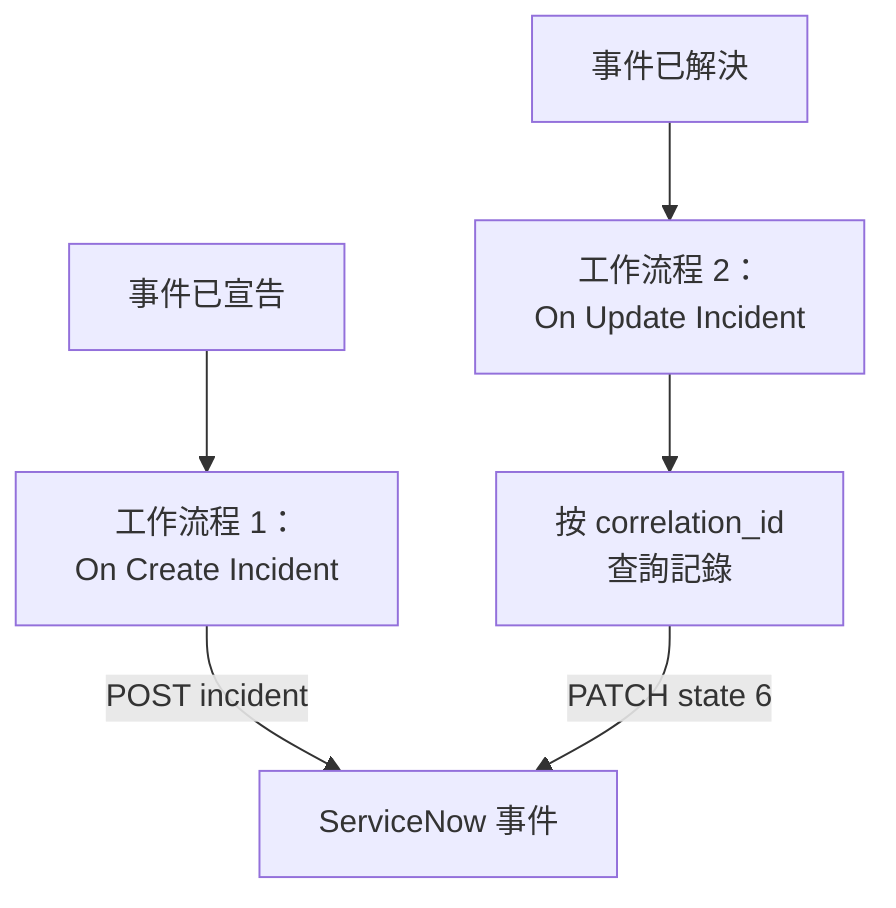

# ServiceNow

為每個 OneUptime 事件建立一個 [ServiceNow](https://www.servicenow.com) 事件，並在 OneUptime 事件被解決時解決它，讓你的服務檯跟上監控看到的情況。兩個工作流程呼叫 ServiceNow 的 [Table API](https://developer.servicenow.com/dev.do#!/reference/api/latest/rest/c_TableAPI)。

:::cards
- [儲存憑證](#儲存憑證): 讓 ServiceNow 密碼不出現在工作流程中。
- [建立 ServiceNow 事件](#為每個事件建立-servicenow-事件): 一個工作流程，兩個區塊。
- [解決它們](#解決-servicenow-事件): 找到記錄，然後關閉它。
- [疑難排解](#疑難排解): ServiceNow 拒絕請求時。
:::

## 運作方式



第一個工作流程把 OneUptime 事件的 ID 寫入記錄的 `correlation_id`。第二個工作流程按它查詢記錄，然後解決該記錄。

## 開始之前

- 一個 ServiceNow 執行個體，例如 `https://your-instance.service-now.com`。
- 一個用於整合的 ServiceNow 使用者，能夠在 `incident` 表中建立和更新記錄，通常具有 `itil` 角色。請求用它的使用者名稱和密碼簽名。
- 在 OneUptime 中建立工作流程和全域變數的權限。在 OneUptime Cloud 上，工作流程需要 **Growth** 或更高的方案。

## 儲存憑證

Table API 使用 Basic 驗證：把使用者名稱和密碼編碼在一起。

:::steps
1. 在 macOS 或 Linux 上編碼一次：

   ```bash
   printf '%s' 'integration.user:password' | base64 | tr -d '\n'
   ```

   請使用 `printf`，不要用 `echo`：`echo` 會新增一個換行符，它會和其餘內容一起被編碼，從而破壞憑證。

2. 在 OneUptime 中前往 **工作流程 → 全域變數**，點選 **建立工作流程 變數**。將其命名為 `SERVICENOW_AUTH`，然後點選 **下一步**。
3. 把編碼後的值貼上到 **內容** 中，開啟 **密鑰**，然後點選 **建立工作流程 變數**。
:::

## 為每個事件建立 ServiceNow 事件

:::steps
### 建立工作流程

前往 **工作流程**，點選 **建立工作流程**，然後點選 **從零開始**。將其命名為 `Incidents to ServiceNow`，然後點選 **建立工作流程**。

### 新增觸發器

點選虛線的 **選擇啟動此工作流程的方式** 區塊，選擇 **On Create Incident**。點選該觸發器：它的 **Fields to pass on** 已經包含 **標題**，所以點選 **新增欄位** 並選擇 **描述**。

### 建立記錄

點選 **新增元件**，新增一個 **API Post (JSON)** 區塊，並把觸發器的 **Success** 點連接到它。把它的 **URL** 設為 `https://your-instance.service-now.com/api/now/table/incident`。在 **更多欄位** 下，把 **Request Headers** 設為：

```json
{
  "Authorization": "Basic {{global.variables.SERVICENOW_AUTH}}",
  "Accept": "application/json"
}
```

把 **Request Body** 設為：

```json
{
  "short_description": "OneUptime: {{local.components.incident-on-create-1.returnValues.model.title}}",
  "description": "{{local.components.incident-on-create-1.returnValues.model.description}}",
  "urgency": "1",
  "impact": "1",
  "correlation_id": "oneuptime-{{local.components.incident-on-create-1.returnValues.model._id}}"
}
```

### 測試，然後啟用

點選 **執行工作流程**，在 **事件** 中選擇一個測試事件，然後執行。**API Post (JSON)** 步驟會顯示一個 `201` 回應，其中包含新記錄及其 `sys_id` 和 `number`，例如 `INC0012345`。然後在 **建構器** 頂部開啟 **已啟用**。
:::

`urgency` 和 `impact` 用 `1` 表示高、`2` 表示中、`3` 表示低，ServiceNow 根據這兩者算出優先順序。`incident` 表的任何其他欄位都可以按欄位名稱放進請求內文。

## 解決 ServiceNow 事件

一個工作流程只有一個觸發器，因此解決需要第二個工作流程，在事件狀態變化時啟動。

:::steps
### 新增 On Update Incident 觸發器

建立一個名為 `Resolve ServiceNow incidents` 的工作流程，選擇 **On Update Incident** 作為觸發器。在 **Fields to watch** 中點選 **新增欄位** 並選擇 **Current Incident State**，使它只在狀態變化時執行。在 **Fields to pass on** 中請求新狀態是否為已解決狀態：點選 **新增欄位**，展開 **Current Incident State** 並選擇 **Is Resolved State**。也可以點選 **以 JSON 編輯**，把 JSON 取代為：

```json
{ "_id": true, "currentIncidentState": { "isResolvedState": true } }
```

### 檢查事件是否已解決

在觸發器之後新增一個 **If / Else** 區塊。把 **Value to check** 設為 `{{local.components.incident-on-update-1.returnValues.model.currentIncidentState.isResolvedState}}`，**Comparison** 設為 **is true**。

### 查詢記錄

在 **Yes** 一側之後新增一個 **API Get (JSON)** 區塊，使用相同的 **Request Headers** 和以下 **URL**：

```text
https://your-instance.service-now.com/api/now/table/incident?sysparm_query=correlation_id=oneuptime-{{local.components.incident-on-update-1.returnValues.model._id}}&sysparm_fields=sys_id&sysparm_limit=1
```

### 解決記錄

在查詢區塊的 **Success** 之後新增一個 **API Patch (JSON)** 區塊，使用相同的 **Request Headers** 和以下 **URL**：

```text
https://your-instance.service-now.com/api/now/table/incident/{{local.components.api-get-1.returnValues.response-body.result[0].sys_id}}
```

把它的 **Request Body** 設為：

```json
{
  "state": "6",
  "close_code": "Solution provided",
  "close_notes": "Resolved in OneUptime"
}
```

### 啟用

開啟 **已啟用**，然後在 OneUptime 中解決一個測試事件。它對應的 ServiceNow 事件會變為 Resolved。
:::

在 ServiceNow 預設的事件狀態中，`state` `6` 表示 Resolved。`close_code` 必須是你的執行個體中的某個解決代碼。許多執行個體在沒有解決代碼和備註的情況下不會解決事件，所以兩者都要傳送。

## 疑難排解

:::details ServiceNow 傳回 401
憑證錯誤。用 `printf`（不要用 `echo`）重新編碼 `username:password`，並替換 `SERVICENOW_AUTH` 的內容。
:::

:::details ServiceNow 傳回 403
該使用者無法寫入 `incident` 表。為它授予 `itil` 角色或具有相同權限的角色，並檢查沒有存取控制規則阻止它使用 Table API。
:::

:::details ServiceNow 傳回 400，或者解決後沒有任何變化
某個欄位名稱或值與你的執行個體不符：例如自訂過的 `state` 清單，或者你的執行個體中沒有的 `close_code`。請與 ServiceNow 中 **System Definition → Tables** 下的 `incident` 表以及記錄本身的表單進行比較。
:::

:::details 解決時傳回 404
查詢步驟沒有找到記錄，所以 URL 中保留了按原樣寫的引用。請檢查第一個工作流程是否寫入了 `correlation_id`，以及兩個工作流程是否以相同的方式生成它：`oneuptime-` 加事件的 `_id`。
:::

## 後續步驟

:::cards
- [Jira](/docs/integrations/jira): 由現成範本保持同步的雙向整合。
- [工作流程元件](/docs/workflows/components#api): API 區塊的所有設定。
- [工作流程執行記錄](/docs/workflows/runs-and-logs): 檢視每個請求傳送了什麼、收到了什麼。
- [整合總覽](/docs/integrations/index): 每個整合背後的模式。
:::
