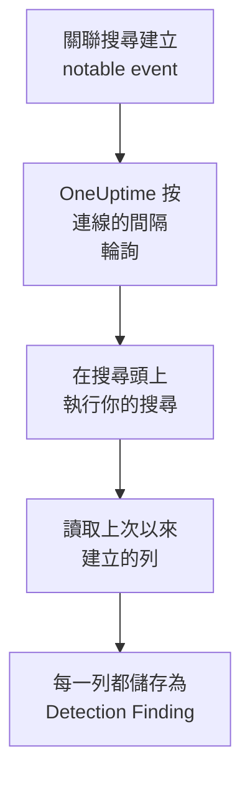

# Splunk Enterprise Security

把 [Splunk Enterprise Security](https://www.splunk.com/en_us/products/enterprise-security.html) 的關聯搜尋建立的 notable event 匯入 OneUptime 的安全性事件。在那裡，你可以把它們與日誌、追蹤和指標放在一起搜尋，與其他所有來源進行關聯分析，並為重要的事件呼叫待命人員。OneUptime 以你建立的 Splunk 使用者身分，在你的搜尋頭上執行一次搜尋來讀取它們，不會在 Splunk 中更改任何內容。由於這只是一次搜尋，它可以匯入任何索引或任何已儲存搜尋的輸出，而不僅僅是 notable event。

:::cards
- [設定連線](#設定連線): 一個權杖、一個角色，以及連線的表單。
- [匯入的內容](#匯入的內容): 搜尋的每一列如何成為一個安全性事件。
- [輪詢的運作方式](#輪詢的運作方式): 每次輪詢讀取的時間窗，以及繁忙的搜尋頭對它的影響。
- [疑難排解](#疑難排解): 每個錯誤的含義，以及需要更改什麼。
:::

## 運作方式



OneUptime 每分鐘輪詢一次已過輪詢間隔的每個已啟用連線。一次輪詢會透過搜尋頭的 REST API，針對自上次輪詢以來建立的列執行你的搜尋，並把每一列儲存為一個 [OCSF](https://schema.ocsf.io/) Detection Finding 事件（類 `2004`）。之後，偵測規則、監測器和儀表板會像對待其他任何來源的安全性事件一樣對待它。

## 開始之前

- 在 OneUptime 中擁有 Project Owner、Project Admin 或 Security Admin 角色。Security Member 和 Security Viewer 可以檢視連線及其執行歷史，但不能更改它們。
- 執行 Splunk Enterprise 9.0.1 或更高版本的搜尋頭，或 Splunk Cloud Platform。OneUptime 在管理連接埠（通常為 `8089`）上與其 REST API 通訊。連接埠 `8000` 上的 Splunk Web 不提供 REST API。
- 一個供 OneUptime 使用的 Splunk 使用者，其角色具有 `search` 能力，並且可以讀取搜尋所讀取的索引：對於 notable event 是 `notable`。Enterprise Security 的 `ess_analyst` 和 `ess_user` 角色兩者都會授予。連線只做讀取，所以角色不需要其他任何權限。
- 一個 OneUptime 能透過 HTTPS 存取到的搜尋頭。OneUptime Cloud 從網際網路連線，所以搜尋頭需要一個公開位址：私有位址會被拒絕。自行託管的 OneUptime 從它的應用程式和工作程序容器連線，可以存取你私有網路中的搜尋頭，除非 `DATA_SOURCE_BLOCK_PRIVATE_ADDRESSES` 為 `true`。

## 設定連線

連線使用 Splunk 驗證權杖，或者使用者名稱和密碼進行驗證。

:::steps
### 建立驗證權杖

1. 在 Splunk Web 中，開啟 **Settings → Tokens**。如果 Splunk 提示權杖驗證已關閉，請先選擇 **Enable Token Authentication**。
2. 選擇 **New Token**。在 **User** 中輸入為 OneUptime 建立的 Splunk 使用者，在 **Audience** 中說明權杖的用途，例如 `OneUptime security events`。
3. 選擇一個 **Expiration**，或者不設過期時間。會過期的權杖在你替換它之前會讓連線停止工作。
4. 選擇 **Create** 並複製權杖。Splunk 只顯示它一次。

如果要改用密碼進行驗證，請跳過這一步，並準備好該使用者的名稱和密碼。

### 在 OneUptime 中新增連線

開啟 **產品 → Security Events → 連線**（`/dashboard/{projectId}/security-events/connections`），點選 **新增連線**，選擇 **Splunk Enterprise Security**，然後點選 **下一步**。填寫下表中的設定，點選 **下一步**，然後把權杖貼上到 **Authentication token** 中，或者把密碼貼上到 **密碼** 中。

### 儲存之前先測試

點選 **儲存前測試** 下的 **測試這些設定**。測試會用表單中的值進行驗證並執行你的搜尋，不儲存任何內容，所以錯誤的連接埠或缺少的角色會在連線建立之前就暴露出來。然後點選 **下一步**，為連線設定一個 **名稱** 並建立它。
:::

| 設定 | 填寫什麼 |
| --- | --- |
| **Splunk management URL** | 搜尋頭的 REST API，例如 `https://splunk.example.com:8089`。它必須使用 `https`，且不帶查詢字串。路徑會被保留，以便用於在某個路徑下提供 API 的反向代理。 |
| **搜尋** | 選擇要匯入什麼內容的搜尋，在你更改之前為 `index=notable`。可以縮小它的範圍，例如 `index=notable urgency IN (high, critical)`。OneUptime 會自己新增時間範圍，所以搜尋不能設定 `earliest` 或 `latest`，也不能以管道符開頭。開頭的 `search` 會被去掉。 |
| **使用者名稱** | Splunk 使用者的名稱，僅當它使用密碼進行驗證時才需要。 |
| **Authentication token** | 第一步中的權杖。儲存了權杖時，使用的是權杖，而不是使用者名稱和密碼。 |
| **密碼** | Splunk 使用者的密碼，僅當不使用權杖時才需要。 |

**Authentication token** 和 **密碼** 會被加密，API 從不傳回它們，也不會再次顯示。要替換其中一個，請在連線上使用 **更新憑證**。要從一種驗證方式切換到另一種，請在那裡輸入新的方式，並開啟 **Remove the stored Authentication token** 或 **Remove the stored Password**。

**輪詢** 步驟還有選用的 **描述**、**輪詢間隔（分鐘）**（`1` 到 `1440` 之間的整數，初始為 `5`），以及初始為開啟的 **已啟用**。

## 匯入的內容

搜尋傳回的每一列都會成為一個 Detection Finding 事件（OCSF 類 `2004`），供應商為 `Splunk`，產品為 `Splunk Enterprise Security`。對於一個 notable event：

| Splunk 欄位 | OneUptime 欄位 |
| --- | --- |
| `event_id`，否則 `_bkt` 和 `_cd`，否則該列的雜湊 | 事件 UID，也是去除重複所依據的值 |
| `_time`，即關聯搜尋建立 notable event 的時間 | 事件時間 |
| `rule_name`，否則 `search_name`，否則 `source` | 規則名稱 |
| `search_name`，否則 `source`，否則 `rule_name` | 規則 ID |
| `rule_title`，否則 `rule_description`，否則規則名稱 | 訊息 |
| `urgency`，否則 `severity` | 嚴重程度 |
| `status_label`，否則 `status_description`，否則 `status` 中儲存的審查狀態的名稱 | 狀態 |
| `annotations.mitre_attack`，以及 `mitre_technique_id` 和 `mitre_tactic` 等欄位 | MITRE ATT&CK 戰術和技術 |
| `user` 或 `src_user`；`src`、`src_ip` 或 `src_host`；`process`、`process_name` 或 `parent_process` | 內文的使用者、IP、主機和程序 |
| `process_name` 或 `process_exec`、`process_path` 和 `process`；`parent_process_name` 或 `parent_process_exec`、`parent_process_path` 和 `parent_process` | 程序名稱、路徑和命令列；父程序名稱、路徑和命令列 |
| `dest_user`；`dest`、`dest_ip` 或 `dest_host`；`dest_port` | 目標的使用者、IP、主機和連接埠 |
| `file_path`、`url` 或 `risk_object` | 目標資源 |
| 每個使用者、主機和 IP，以及 `dvc`、`host`、`file_hash`、`file_name`、`url`、`domain`、`query` 和 `risk_object` | Observable |
| 該列中的每個欄位，例如 `security_domain`、`owner`、`orig_sid` 和 `_raw` | `attributes`，使用欄位本身的名稱 |

來自其他索引的列也以同樣的方式匯入。它的欄位填不滿的列保持為空，每個欄位仍然可以在 `attributes` 中搜尋。

## 輪詢的運作方式

每次輪詢都會在它的時間窗上執行一次匯出搜尋，從最早的開始：

```text
POST {Splunk management URL}/services/search/v2/jobs/export
    search=search index=notable | fields * | sort 0 _time | head 10001
    earliest_time={window start}
    latest_time={window end}
    output_mode=json
```

- **建立時間就是游標。** 時間窗針對的是 `_time`，對於 notable event，這是關聯搜尋建立它的時間，而不是它所發現的活動發生的時間。每小時執行一次的搜尋會把它的 notable event 標記為其執行的時間，所以不會有 notable event 落在游標後面。
- **第一次輪詢會回溯 24 小時**，所以新連線會立刻顯示最近的 notable event。
- **之後的每次輪詢都從儲存的游標之前 1 分鐘開始**，所以在兩個時間窗邊界上建立的列永遠不會被漏掉。
- **一次輪詢最多讀取游標之後 24 小時。** 游標落後的連線會透過一連串 24 小時的時間窗追趕，此時它的 **健康狀況** 顯示為 **Catching up**。
- **重複項按 `event_id`，或 Splunk 自己的 `_bkt` 和 `_cd` 去除重複**，範圍是整個專案，所以重疊部分、重試的時間窗和匯入都不會把同一列儲存兩次。

早於 9.0.1 的搜尋頭會對發往 `search/v2/jobs/export` 的請求傳回 `404`。這時 OneUptime 會把請求發往已棄用的 `search/jobs/export`，執行會在警告中說明這一點。請升級搜尋頭：當前版本會關閉該端點。

### 當一個時間窗包含的內容超過一次輪詢能讀取的量時

一次輪詢最多讀取 10,000 列。當時間窗中的行更多時，這次執行為 **部分**，並帶有如下警告：

```text
Stopped after collecting 10000 records; the window holds more. Records are read oldest first, and the last one read was created at 2026-09-14T08:12:44.000Z, where the next poll can resume.
```

搜尋按 `_time` 從早到晚對時間窗排序，所以 OneUptime 會把游標移到它讀取的最後一列的建立時間，下一次輪詢就從那裡開始，時間窗長度不變。繁忙的搜尋頭每次輪詢追趕 10,000 列，而不是重複讀取同樣的列。在同一時刻建立的列會被讀取兩次，去除重複檢查會丟棄第二份副本。Splunk 在傳回任何一列之前會先對整個時間窗排序，所以 **搜尋** 中找到遠超所需內容的搜尋會拖慢每一次輪詢。請讓它保持精確。

當一次執行完全無法越過儲存的游標時，OneUptime 會改為縮短時間窗：

1. **縮小。** 下一次輪詢從同一個起點讀取長度減半的時間窗，並不斷減半，直到某個時間窗能被完整讀取，最短為一分鐘。執行的警告會說明這一點：`This window holds more records than one poll can read; the next poll reads a {n} minute window from the same starting point.`
2. **恢復。** 一個時間窗被完整讀取後，下一個時間窗的長度會再次加倍，最長為 24 小時。
3. **越過單獨的一分鐘。** 如果連一分鐘內的內容都超過一次輪詢能讀取的量，輪詢會越過這一分鐘，讓更新的 notable event 繼續到達。這次執行仍為 **部分**，**最近的錯誤** 顯示 `More records were created in the one minute from {cursor} to {end} than one poll can read. Polling moved past this minute so newer records keep arriving; use Import this time range in Diagnostics on this minute to recover what one run can read.` 用 **Import this time range** 匯入這一分鐘，就能找回一次執行能讀取的內容。

因 Splunk 的錯誤而徹底失敗的執行，會保留游標和時間窗長度，下一次輪詢會再次讀取同一個時間窗。唯一的例外是請求逾時：游標保持不變，但下一個時間窗的長度減半，因為重到無法及時得到回應的時間窗每次嘗試都會逾時。更改 **輪詢間隔（分鐘）** 不會改變這些：它決定的是輪詢多久開始一次，而不是時間窗從哪裡開始。

### 按需執行、預覽和匯入

在連線上點選 **診斷**，可以檢視它最近的執行，並手動操作它。能更改該連線的人都可以啟動這些操作；能檢視它的人都可以閱讀歷史記錄。

- **立即執行** 會立即開始一次輪詢，使用通常的游標，即使連線未處於 **已啟用** 狀態也可以。
- **Preview notable events** 讀取最長 7 天的時間範圍，不匯入任何內容。
- **Import this time range** 在你確認後匯入最長 7 天的範圍，不會移動游標。已匯入的列會被跳過。
- 執行上的 **Copy diagnostics** 會複製它的報告以便提供給支援人員。報告從不包含認證資訊。

## 測試連線

連線所在列中的 **測試連線** 和表單中的 **測試這些設定** 在 API 程序中執行，而不是在背景工作程序中執行，所以即使工作程序出了問題，測試仍然會給出結果。它按順序執行以下檢查：

| 檢查 | 檢查的內容 |
| --- | --- |
| **設定** | 每項設定都存在且格式正確。此項失敗時不會連線到任何地方。 |
| **Authenticate with Splunk** | Splunk 接受權杖，或者使用者名稱和密碼，並說明使用者及其角色，方便你與原本想授予的角色進行比較。 |
| **Run the search on Splunk** | **搜尋** 中的搜尋在過去 24 小時上執行，只取一列，並說明是哪個匯出端點作出了回應。 |
| **Notable events available to import** | **搜尋** 中的搜尋在過去 24 小時和過去 7 天內找到的列數。7 天內一列都沒有是警告，而不是失敗。 |
| **Background workers**、**Poll scheduler**、**Security event storage** | OneUptime 自身的一側：有程序在處理 Worker 佇列的作業，輪詢作業每分鐘執行一次，安全性事件儲存能夠回應。 |
| **Scheduled polling** | 針對已儲存的連線：輪詢已開啟，沒有執行卡在等待工作程序的狀態，並且輪詢按時執行。 |

測試中的每個請求都有 20 秒的期限。測試從不匯入任何內容，也不移動游標，每個失敗的檢查都會說明需要更改什麼。

## 將安全性事件傳送到 Splunk

OneUptime 也可以透過 Splunk 的 HTTP Event Collector（HEC）把它發現的內容傳送到 Splunk，讓你的搜尋和儀表板在你自己的偵測結果旁邊看到 OneUptime 的偵測結果。每個安全性事件都是一個 sourcetype 為 `oneuptime:security` 的 HEC 事件，其欄位依 Splunk 的 Common Information Model 命名：`src`、`src_ip`、`src_user`、`dest`、`dest_ip`、`dest_port`、`user`、`signature` 和 `severity`。

:::steps
### 建立 HEC 權杖

在 Splunk Web 中開啟 **Settings → Data inputs → HTTP Event Collector**，按一下 **New Token**。為它命名，選擇它可以寫入的索引及其預設索引，然後複製權杖的值。在 Splunk Cloud 上，HEC 接聽 `https://http-inputs-<stack>.splunkcloud.com`；在 Splunk Enterprise 上，在 **Global Settings** 開啟權杖後接聽連接埠 `8088`。

### 新增目的地

開啟 **產品 → Security Events → 連線**。在 **傳送到你的 SIEM** 下按一下 **新增目的地**，在 **SIEM** 下選擇 Splunk，然後按一下 **下一步**。填寫 **HEC URL**，並把權杖貼到 **HEC 權杖** 中。**索引** 和 **來源類型** 是選用的：留空時，事件會以 sourcetype `oneuptime:security` 進入權杖的預設索引。

### 傳送測試事件並開始傳送

按一下 **傳送測試事件**：一個資訊等級的事件會依表單中的設定傳送到 Splunk，不會儲存任何內容。用 `sourcetype="oneuptime:security"` 搜尋它。接著在 **傳送內容** 下保留 **僅偵測結果** 或選擇 **所有安全事件**，再按一下 **開始傳送**。
:::

- **HEC URL** 必須使用 `https`，並帶有 OneUptime 信任的憑證：憑證檢查從不略過。
- 事件以每批最多 500 個傳送。Splunk 拒絕的事件會被略去並在 **檢視錯誤** 中列出，忙碌的收集器（`503`）會重試，權杖或索引被拒絕時會停止傳送，直到你修正它。
- OneUptime 從 Splunk 匯入的 notable event 永遠不會被傳回 Splunk。

## 疑難排解

連線的 **最近的錯誤** 會保留完整的錯誤訊息（認證資訊已隱去），前面帶有一個指明失敗步驟的字首。連線出錯時，在它的 **操作** 欄中選擇 **檢視錯誤** 來閱讀，並在對話方塊中用 **複製錯誤** 複製。請先閱讀字首。

:::details Last Error 以 `Splunk Enterprise Security authentication request` 開頭
- `Splunk Enterprise Security authentication request failed (HTTP ...)`：Splunk 拒絕說明呼叫者是誰。
  - `HTTP 401`：Splunk 沒有接受認證資訊。權杖錯誤、已過期或已刪除，搜尋頭上關閉了權杖驗證，或者使用者名稱或密碼錯誤。請建立一個新權杖，並用 **更新憑證** 儲存。
  - `HTTP 404`：**Splunk management URL** 不是 REST API。它指向了連接埠 `8000` 上的 Splunk Web，或者帶有搜尋頭不提供的路徑。
- `Splunk Enterprise Security authentication request returned ...`：回應的不是搜尋頭的 REST API，而是其他東西，例如連接埠 `8000` 上 Splunk Web 的 HTML 或某個代理的頁面。請讓 URL 指向管理連接埠。
:::

:::details Last Error 以 `Splunk Enterprise Security search export` 或 `Splunk Enterprise Security count search` 開頭
- `Splunk Enterprise Security search export failed (HTTP ...)`：Splunk 拒絕執行該搜尋。
  - `HTTP 400`：Splunk 無法解析該搜尋。在 Splunk Web 中執行 **搜尋** 中的搜尋，即可看到它的錯誤。
  - `HTTP 403`：使用者的角色缺少 `search` 能力，或者無法讀取該索引。請把 `notable` 或你的索引新增到該角色可以搜尋的索引中。
  - `HTTP 404`：該 URL 上兩個匯出端點都不存在，所以它不是搜尋頭的管理連接埠。
  - `HTTP 429` 或 `HTTP 5xx`：Splunk 正在限制該使用者、酬載過高，或者搜尋達到了它的某個限制。下一次輪詢會重試。
- `Splunk Enterprise Security search export was rejected by Splunk on an HTTP 200`：Splunk 作出了回應，但因錯誤停止了搜尋。訊息中會引用該錯誤。
- `Splunk Enterprise Security search export returned a body that is not newline-delimited JSON.`：回應的不是 REST API，而是其他東西，例如 Splunk Web 或某個代理的登入頁面。這會被報告出來，而不是當作空時間窗處理，所以游標永遠不會越過沒人讀過的列。
- `Splunk Enterprise Security count search ...`：同樣的失敗，來自 **Notable events available to import** 的計數，只有測試才會執行它。
:::

:::details Last Error 以 `did not complete` 結尾
`Splunk Enterprise Security search export did not complete`（其他步驟也一樣）表示請求沒有得到回應：逾時、無法解析的名稱、OneUptime 不信任的證書，或者被拒絕的私有位址。請檢查 OneUptime 應用程式和工作程序能否開啟到管理連接埠的 HTTPS 連線。如果搜尋頭能回應其他請求，但搜尋逾時，說明它排序的內容太多：下一次輪詢會讀取長度減半的時間窗，而把 **搜尋** 中的搜尋範圍縮小，就能徹底解決問題。
:::

:::details Last Polled 為 Never 且 Last Error 為空
這個連線還沒有完成過任何輪詢。執行 **測試連線**：它的 **Background workers** 和 **Poll scheduler** 檢查會指出原因。在自行託管安裝中，常見原因是應用程式上設定了 `DISABLE_QUEUE_WORKERS=true`，卻沒有單獨的工作程序部署來處理作業：把它設為 `false`，或執行工作程序部署（Helm：`worker.enabled: true`）。
:::

:::details 執行為 Partial
- `Stopped after collecting 10000 records; the window holds more`：時間窗中的行超過了一次執行能讀取的 10,000 列。不會遺失任何內容：下一次輪詢會從讀取的最後一列之後開始。一次又一次輪詢都保持 **部分** 的連線正在追趕積壓的內容，它的 **最近輪詢** 和 **最近匯入的事件** 會不斷前進。如果它始終追不上，說明 **搜尋** 中的搜尋在每個輪詢間隔內找到的行超過 10,000 列：請縮小它的範圍，或者縮短 **輪詢間隔（分鐘）**。
- `More records were created in the one minute from ... than one poll can read`：輪詢越過了這一分鐘。請在 **診斷** 中用 **Import this time range** 匯入它。一次匯入讀取的量與一次輪詢相同。
:::

:::details 測試通過，但沒有匯入任何內容
閱讀測試報告中的 **Notable events available to import**。過去 7 天為 `0` 表示 **搜尋** 中的搜尋在 Splunk 中什麼都沒找到：請在 Incident Review 中檢查關聯搜尋是否已啟用並在建立 notable event，以及 **搜尋** 中的搜尋是否比預期更窄。
:::

## 你會得到什麼

- **搜尋。** 在安全性事件探索器中，與其他所有來源放在一起，按緊急程度、狀態、規則、使用者、主機或任何 observable 篩選 notable event。
- **關聯分析。** 每一列的使用者、主機、IP 和網域都會作為 observable 建立索引，所以一次搜尋就能找到提到它們的所有內容。
- **偵測規則。** 按排程對你的安全性事件執行的 Sigma 規則，會開啟呼叫待命人員的警示。
- **監測器。** 安全性事件監測器統計符合的事件，例如新的嚴重 notable event，並在超過閾值時開啟事件或警示。

安全性事件與其他遙測資料一樣，按擷取的 GB 數計費。請參閱 [定價](https://oneuptime.com/pricing)。

## 後續步驟

:::cards
- [安全性事件](/docs/telemetry/security-events): 搜尋、關聯分析你匯入的內容，並據此發出警示。
- [Elastic Security](/docs/integrations/elastic-security): 同時匯入 Elastic 堆疊的偵測警示。
- [角色](/docs/permissions/reference#角色): Security 角色可以檢視和更改的內容。
- [整合總覽](/docs/integrations/index): 你可以連接的其他工具。
:::
