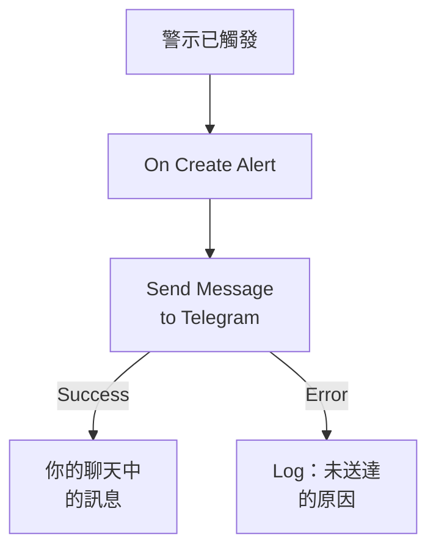

# Telegram

在警示觸發或事件開啟時，向 [Telegram](https://telegram.org) 聊天、群組或頻道傳送一條訊息。OneUptime 的工作流程步驟 **Send Message to Telegram** 以你建立的機器人身分傳送訊息，現成的範本會為警示建置工作流程。此整合屬於 **出站** 模式：機器人只發送訊息，不讀取聊天中的內容。

:::cards
- [運作方式](#運作方式): 警示觸發時工作流程會做什麼。
- [設定](#設定整合): 一個機器人、它的聊天，然後是工作流程：從範本建立或從零開始。
- [提示](#提示): 純文字、長訊息和事件。
- [疑難排解](#疑難排解): Telegram 的錯誤是什麼意思，以及該改什麼。
:::

## 運作方式



該步驟以你的機器人身分，透過 Telegram 的 Bot API 把 **Message Text** 傳送到聊天。Telegram 接受訊息時，它走 **Success** 輸出；Telegram 拒絕時，它帶著 Telegram 給出的原因走 **Error** 輸出。範本把一個 **Log** 步驟連接到 **Error**，所以未能傳送的執行會說明原因。

## 開始之前

- 一個 Telegram 帳戶，用來建立機器人並把它新增到聊天中。
- 在 OneUptime 中，擁有建立工作流程和變數的權限。在 OneUptime Cloud 上，工作流程需要 **Growth** 或更高的方案。

## 設定整合

:::steps
### 建立機器人

在 Telegram 中，向 [@BotFather](https://t.me/BotFather) 傳送 `/newbot` 並回答它的問題。它會給你機器人的權杖，例如 `123456789:ABCdefGhIJKlmnoPQRstuVWxyz`。任何擁有該權杖的人都可以用你的機器人傳送訊息，所以請像保管密碼一樣保管它。

### 找到聊天的 ID

1. 把機器人新增到群組，或者讓它成為頻道的管理員。要給某個人發訊息，需要對方先與機器人開始聊天。
2. 在群組中傳送一條提及機器人的訊息，例如 `/start@your_bot`，讓機器人看到它。
3. 在瀏覽器中開啟 `https://api.telegram.org/bot<token>/getUpdates`，把 `<token>` 換成機器人的權杖。
4. 在回應中找到 `"chat":{"id":`。它後面的數字就是聊天的 ID。群組的 ID 以 `-` 開頭，大型群組的 ID 以 `-100` 開頭。

公開頻道可以用它的 `@username` 來指定，而不用 ID。

### 建置工作流程

從範本開始，它會為警示建置整個工作流程，或者從零開始。

:::tabs
@tab 從範本建立
1. 開啟 **工作流程**，然後點選 **建立工作流程**。
2. 在 **搜尋範本…** 中輸入 `Telegram`，點選 **Tell Telegram when an alert fires**，然後點選 **使用此範本**。
3. 保留名稱 **Notify Telegram on new alert** 或更改它，然後點選 **下一步**。
4. 把權杖貼上到 **Telegram Bot Token** 中，把 ID 貼上到 **Telegram Chat ID** 中，然後點選 **建立工作流程**。

工作流程會在 **建構器** 中開啟，包含三個步驟：**On Create Alert**；**Send Message to Telegram**，它傳送警示的編號、標題、嚴重程度和狀態；以及連接在其 **Error** 輸出上的一個 **Log** 步驟。權杖會儲存為工作流程的機密變數 `telegramBotToken`，ID 儲存為 `telegramChatId`。
@tab 從零開始
1. 把權杖儲存為機密的全域變數：前往 **工作流程 → 全域變數**，點選 **建立工作流程 變數**，將其命名為 `TELEGRAM_BOT_TOKEN`，然後點選 **下一步**。把權杖貼上到 **內容** 中，開啟 **密鑰**，然後點選 **建立工作流程 變數**。
2. 前往 **工作流程**，點選 **建立工作流程**，選擇 **從零開始**，為工作流程命名，然後點選 **建立工作流程**。
3. 在 **建構器** 中，點選 **選擇啟動此工作流程的方式**，然後在 **熱門** 下選擇 **On Create Alert**。點選觸發器：它的 **Fields to pass on** 已經包含 **標題**，所以點選 **新增欄位**，再選擇訊息要顯示的其他欄位，例如 **Alert Number With Prefix**。
4. 點選 **新增元件**，搜尋 `telegram`，然後點選 **Send Message to Telegram**。把觸發器的 **Success** 輸出連接到它。
5. 點選新步驟。在 **Telegram Bot Token** 中點選 **{ }**，然後在 **Global variables** 下選擇 `TELEGRAM_BOT_TOKEN`。在 **Chat ID** 中輸入聊天的 ID，在 **Message Text** 中寫下訊息，並用 **{ }** 插入警示的欄位。
:::

從零開始編寫的訊息透過如下引用讀取警示的欄位：

```text
🚨 Alert {{local.components.alert-on-create-1.returnValues.model.alertNumberWithPrefix}} fired
Title: {{local.components.alert-on-create-1.returnValues.model.title}}
```

### 開啟並測試

在 **建構器** 頂部開啟 **已啟用**。從現在起，每個新警示都會發送到聊天中。

要在不觸發警示的情況下進行測試，請點選 **執行工作流程**，在 **警示** 下選擇一個既有的警示：清單中會列出最近的警示，輸入它的編號或標題的一部分可以找到其他警示。點選 **手動執行工作流程**，然後用 **執行** 確認。**工作流程執行** 面板會追蹤這次執行，訊息會出現在聊天中。如果該步驟改走 **Error**，**Log** 步驟的那一列會說明原因：請參閱 [疑難排解](#疑難排解)。
:::

## 提示

- **純文字。** 該步驟按輸入的原樣傳送文字，不使用 Telegram 的格式，所以 `*` 和 `_` 會原樣顯示。
- **注意 4,096 個字元的限制。** Telegram 接受最多 4,096 個字元的訊息。更長的訊息會被截斷，並以 "… (truncated — see OneUptime for the full text)" 結尾，而不是被拒絕。
- **事件也可以。** 基於 **On Create Incident** 建置同樣的工作流程，或者基於 **On Update Incident** 傳送狀態變更。要只發送部分警示，請在該步驟之前放一個 **If / Else** 區塊。
- **會檢查權杖的格式。** 格式不像 `123456789:ABCdef…` 的權杖會在傳送任何內容之前讓執行停止，並且權杖永遠不會寫入日誌。

## 疑難排解

當該步驟走 **Error** 時，執行會說明原因：範本的 **Log** 步驟會寫下 `❌ Telegram could not deliver the alert notification:`、Telegram 給出的原因，以及機器人必須在聊天中的提醒。

:::details Telegram 傳回 "Bad Request: chat not found"
**Chat ID** 錯誤，或者機器人看不到該聊天：請把機器人新增到群組，讓它成為頻道的管理員，或者請對方與機器人開始聊天。群組的 ID 以 `-` 開頭。
:::

:::details Telegram 傳回 "Forbidden: bot was blocked by the user" 或 "bot is not a member"
對方遮蔽了機器人，或者機器人已被移出群組或頻道。請把它重新添加回去，或者傳送到另一個聊天。
:::

:::details Telegram 傳回 "Unauthorized"
Telegram 沒有接受權杖：它已在 @BotFather 中被吊銷，或者複製錯了。請從 @BotFather 複製機器人當前的權杖，並替換變數的值。
:::

:::details Telegram 傳回 "Too Many Requests: retry after"
Telegram 會限制一個機器人的傳送速度，尤其是發往群組時。集中出現的警示可能會觸及這個限制：請傳送更少的訊息，例如只針對部分嚴重程度。
:::

## 後續步驟

:::cards
- [工作流程元件](/docs/workflows/components#telegram): 步驟的每項設定，以及各輸出的含義。
- [Discord](/docs/integrations/discord): 同樣的思路，用於 Discord 頻道。
- [工作流程執行記錄](/docs/workflows/runs-and-logs): 檢視工作流程每次執行都做了什麼。
- [整合總覽](/docs/integrations/index): 傳出模式，以及你可以連接的其他工具。
:::
