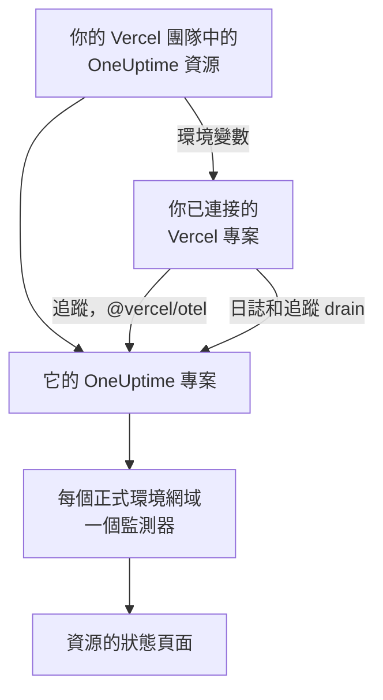

# Vercel

從 [Vercel Marketplace](https://vercel.com/marketplace) 把 OneUptime 新增到你的 Vercel 團隊。你以 Vercel 帳戶登入，費用計入你的 Vercel 帳單，你的 Vercel 專案會在 OneUptime 中取得追蹤、日誌、可用性監控和狀態頁面，不需要手動設定任何內容。

:::cards
- [把 OneUptime 新增到你的 Vercel 團隊](#把-oneuptime-新增到你的-vercel-團隊): 在 Vercel 主控台中選擇資源、方案和你的專案。
- [使用 @vercel/otel 傳送追蹤](#使用-vercelotel-傳送追蹤): 環境變數已經設定好了。
- [使用 drain 傳送日誌和追蹤](#使用-drain-傳送日誌和追蹤): Vercel 自己的日誌和 span，適用於 Pro 和 Enterprise。
- [方案和帳單](#方案和帳單): OneUptime 的方案，計入你的 Vercel 發票。
:::

## 運作方式

你在 Vercel 中新增的每個 OneUptime 資源都是一個獨立的 OneUptime 專案。你連接到該資源的每個 Vercel 專案都會從 Vercel 取得該資源的環境變數，專案藉由這些變數把追蹤傳送到 OneUptime。Drain 傳送 Vercel 的日誌和 span，而每個已連接專案的正式環境網域都會在資源的狀態頁面上取得一個可用性監測器。



此整合適用於 OneUptime Cloud（`oneuptime.com`）。自行託管的 OneUptime 無法從 Vercel Marketplace 新增：請參閱 [自行託管 OneUptime](#自行託管-oneuptime)。

## 開始之前

- **一個 Vercel 團隊**，任何方案皆可。日誌和追蹤 drain 需要 Vercel 的 Pro 或 Enterprise 方案；來自 `@vercel/otel` 的追蹤在所有方案上都能使用。
- Vercel 帳戶上的 **已驗證的電子郵件地址**。OneUptime 以它為你登入；如果你還沒有 OneUptime 帳戶，也會以它為你建立一個。
- **Vercel 中的付款方式**，所有方案都需要：監測器和遙測依用量計費，Free 方案也不例外。請參閱 [方案和帳單](#方案和帳單)。

## 把 OneUptime 新增到你的 Vercel 團隊

:::steps
### 在 Vercel Marketplace 上開啟 OneUptime

在 Vercel 主控台中開啟 **Integrations**，然後開啟 **Browse Marketplace**，在 **Observability** 下找到 OneUptime。點選 **安裝**，並接受 OneUptime 的條款。

### 選擇方案

選擇 **免費**、**Growth** 或 **Scale**。這些是 OneUptime 自己的方案，價格以 [oneuptime.com/pricing](https://oneuptime.com/pricing) 上列出的為準。

### 為資源命名並選擇設定

依資源要監控的對象為它命名，例如 `storefront`：它的 OneUptime 專案和狀態頁面都會以此命名。有兩項設定預設為開啟：

- **Monitor production domains**：為你連接的每個 Vercel 專案的正式環境網域建立一個網站監測器。
- **Create a status page**：為資源建立一個公開的狀態頁面，顯示這些監測器。

### 連接你的專案

選擇向此資源傳送資料的 Vercel 專案，以及取得其環境變數的環境。不要為連線設定自訂前綴：`@vercel/otel` 依變數原本的名稱讀取它們。
:::

資源會在幾秒鐘內準備就緒。點選 **Open in OneUptime** 查看它的專案。

## 每個資源提供的內容

| 內容 | 在哪裡找到 |
| --- | --- |
| 一個以資源命名的 OneUptime 專案 | 你是它的擁有者。你的團隊成員從 Vercel 開啟它時就會加入。 |
| 一個名為 `Vercel` 的擷取金鑰 | **專案設定 → 遙測與 APM → 擷取金鑰** |
| 每個已連接 Vercel 專案中的環境變數 | Vercel 中該專案的 **Settings → Environment Variables** |
| 每個已連接專案的一個網站監測器 | **監測器**，以 Vercel 專案命名 |
| 一個公開的狀態頁面 | **狀態頁面**，以資源命名 |

每個已連接專案中的環境變數都相同：

| 變數 | 值 |
| --- | --- |
| `OTEL_EXPORTER_OTLP_ENDPOINT` | `https://oneuptime.com/otlp` |
| `OTEL_EXPORTER_OTLP_HEADERS` | `x-oneuptime-token=` 加上資源的擷取金鑰 |
| `OTEL_EXPORTER_OTLP_PROTOCOL` | `http/protobuf` |
| `ONEUPTIME_TELEMETRY_INGESTION_KEY` | 擷取金鑰本身，由 drain 傳送 |

部署會在建置時取得這些變數：連接專案後，請重新部署。

## 使用 @vercel/otel 傳送追蹤

`@vercel/otel` 是 Vercel 為 Next.js 以及 Vercel 執行的其他框架提供的 OpenTelemetry 套件。它會讀取 `OTEL_EXPORTER_OTLP_*` 變數，因此連接到資源的專案只需要這個套件。

:::steps
### 安裝套件

```bash
npm install @vercel/otel @opentelemetry/api @opentelemetry/api-logs
```

### 註冊它

在專案根目錄下建立 `instrumentation.ts`（如果專案有 `src` 目錄，則在其中建立），並為服務命名：

```ts title="instrumentation.ts"
import { registerOTel } from "@vercel/otel";

export function register(): void {
  registerOTel({ serviceName: "storefront" });
}
```

### 部署

部署專案。它的追蹤會以服務名稱出現在 **追蹤** 中。
:::

在 Vercel 的 Pro 和 Enterprise 方案上，還要新增一個追蹤 drain：如此一來，Vercel 會把它為每個請求產生的 span 連同你的應用程式的 span 一起傳送給 OneUptime，而 `@vercel/otel` 會把這些 span 留給 drain 傳送，所以不會有任何資料重複到達。

## 使用 drain 傳送日誌和追蹤

Drain 會把 Vercel 記錄的關於你的專案的內容傳送到 OneUptime：日誌 drain 傳送專案的建置、函式、邊緣和請求日誌，追蹤 drain 傳送專案的 span。Drain 需要 Vercel 的 Pro 或 Enterprise 方案，Vercel 會把它們傳送的資料計入你的 Vercel 帳單。

:::steps
### 新增 drain

在 Vercel 中開啟 **Team Settings → Drains**，然後點選 **Add Drain**。選擇 **Logs** 或 **Traces**，然後在 **Native Integrations** 下選擇 OneUptime。

### 選擇專案

選擇專案；對於日誌，還要選擇來源和環境。Drain 使用資源的擷取金鑰傳送資料：不需要輸入任何內容。
:::

每個 Vercel 專案在 OneUptime 中都是一個以該專案命名的服務。日誌會保留它的時間、層級和訊息，它的請求資訊則使用 OpenTelemetry 的名稱：

| Vercel 欄位 | 在 OneUptime 中 |
| --- | --- |
| `projectName` | 服務，`service.name` |
| `timestamp`、`level`、`message` | 日誌的時間、嚴重程度和內文 |
| `deploymentId`、`environment` | `vercel.deployment.id`、`deployment.environment.name` |
| `proxy.method`、`proxy.path`、`proxy.statusCode` | `http.request.method`、`url.path`、`vercel.proxy.status_code` |
| `traceId`、`spanId` | 日誌所屬的追蹤，連結到 **追蹤** 中的該追蹤 |
| 其他所有欄位 | `vercel.` 下的屬性，例如 `vercel.source` |

## 可用性監測器和狀態頁面

當你連接一個 Vercel 專案時，OneUptime 會為它的正式環境網域建立一個網站監測器，從 OneUptime 的探測器進行檢查，並把它新增到資源的狀態頁面。在首次正式環境部署之前連接的專案還沒有網域：它的監測器會在那次部署時建立。中斷專案的連線會刪除它的監測器。

每個監測器都是一個作用中監測器，與其他監測器一樣計費，運作方式也與你自己建立的監測器相同：請參閱 [網站監控](/docs/monitor/website-monitor)。如果不想建立任何監測器，請在 Vercel 中資源的設定裡關閉 **Monitor production domains**。重新開啟它會建立仍然缺少的監測器。

## 從 Vercel 開啟 OneUptime

點選資源上的 **Open in OneUptime**，或者它在 Vercel 中的任何連結，你就會以 Vercel 帳戶的電子郵件地址登入 OneUptime。第一次開啟時你會加入資源的專案：如果你是 Vercel 團隊的擁有者或成員，就以管理員身分加入；如果你擁有團隊的某個唯讀角色，就以成員身分加入。

如果已經有使用該電子郵件地址的 OneUptime 帳戶，你登入的就是這個帳戶。如果該帳戶開啟了雙重驗證，或屬於 OneUptime 管理員，則改為使用它的密碼登入。無論哪種情況，你都會加入該專案。

## 方案和帳單

| | 運作方式 |
| --- | --- |
| 方案 | **免費**、**Growth** 和 **Scale**，價格與 oneuptime.com 上的相同：方案的每位使用者價格、每個監測器每月 $1 的作用中監測器，以及依 GB 計費的遙測。 |
| 在哪裡付款 | 在你的 Vercel 發票上，每月一次，每個資源分別計費。Vercel 會在資源上顯示當月到目前為止的用量，每小時更新一次。 |
| 試用期 | 方案試用期內不收取任何費用：使用者、監測器和遙測都不收費。 |
| 變更方案 | 在 Vercel 中的資源上變更，或在 OneUptime 的 **專案設定 → 帳單與發票 → 帳單** 下變更。在任一處變更都會同時變更兩邊。 |
| 未付發票 | Vercel 會在 15 天內重試付款。之後，專案會停止提供服務，直到發票付清：它的資料會保留，不會刪除任何內容。 |

在發票上，每個資源都有分別對應其使用者、作用中監測器、遙測以及餘額儲值（如有）的明細列，以每單位 $0.01 的用量單位計。

## 移除 OneUptime

| 你 | 結果 |
| --- | --- |
| 在 Vercel 中刪除資源 | 對截至當時的用量計費之後，它的專案會被刪除。已連接的 Vercel 專案會在下次部署時失去它的環境變數。 |
| 從團隊中解除安裝 OneUptime | 每個資源的專案都會被刪除，並寄出最終發票。 |
| 在 OneUptime 中刪除專案 | Vercel 中的資源也會被刪除。 |

> [!CAUTION]
> 刪除專案會永久刪除它的監測器、狀態頁面、事件和遙測。請先匯出你想保留的所有內容。

## 自行託管 OneUptime

自行託管的 OneUptime 無法從 Vercel Marketplace 新增，因為 Vercel Marketplace 只佈建 OneUptime Cloud。你的 Vercel 專案仍然可以向它傳送資料：

- **追蹤**：在 Vercel 專案的 **Settings → Environment Variables** 中，設定 [每個資源提供的內容](#每個資源提供的內容) 中的變數，端點使用 `https://YOUR-ONEUPTIME-HOST/otlp`，並使用你的專案的擷取金鑰。
- **日誌**：在 **Team Settings → Drains** 中新增一個自訂日誌 drain，傳送到 `https://YOUR-ONEUPTIME-HOST/telemetry/vercel/v1/logs`，格式為 JSON 或 NDJSON。新增帶有你的擷取金鑰的 `x-oneuptime-token` 標頭，並把 drain 的簽章密鑰設為同一個金鑰：OneUptime 只接受 Vercel 以它簽署的遞送。

同樣的自訂 drain 也適用於 OneUptime Cloud，只需把主機設為 `oneuptime.com`。

## 疑難排解

:::details 沒有追蹤到達
- 重新部署專案：在專案連接之前建置的部署沒有 `OTEL_EXPORTER_OTLP_*` 變數。
- 在專案的 **Settings → Environment Variables** 中檢查變數的名稱。以自訂前綴建立的連線會重新命名這些變數，`@vercel/otel` 就不再讀取它們：請不帶前綴重新連接專案。
- 檢查 `instrumentation.ts` 是否呼叫了 `registerOTel`；在 Next.js 14 及更早版本上，還要檢查 `next.config.js` 中是否開啟了 `experimental.instrumentationHook`。
:::

:::details Vercel 顯示 drain 發生錯誤
Vercel 會顯示 OneUptime 對 drain 遞送的回應：

- 訊息中帶有 `x-vercel-signature` 的 `403`：Vercel 沒有以它傳送的金鑰為遞送簽章。對於自訂 drain，請檢查它的 `x-oneuptime-token` 標頭，並把它的簽章密鑰設為同一個金鑰。
- `401`：OneUptime 找不到使用 drain 所傳送金鑰的專案：該金鑰已被刪除，或在兩處都打錯了。請使用 **專案設定 → 遙測與 APM → 擷取金鑰** 中的金鑰。
- `422`：該金鑰已被停用。請在同一頁面上重新啟用它，或改用另一個金鑰。
:::

:::details 已連接的專案沒有監測器
- Vercel 中資源的設定裡關閉了 **Monitor production domains**。
- 專案還沒有正式環境網域：它的監測器會在首次正式環境部署時建立。
- 專案的作用中監測器數量已達到其方案允許的上限：請升級方案，然後關閉再重新開啟 **Monitor production domains**。
:::

:::details Vercel 提示驗證你的電子郵件地址
OneUptime 需要一個經 Vercel 驗證的電子郵件地址，而使用該地址的現有 OneUptime 帳戶也需要驗證它自己的地址。驗證地址後，重新新增資源或再次開啟 OneUptime。
:::

## 後續步驟

:::cards
- [追蹤瀏覽器](/docs/telemetry/traces-explorer): 找到一個慢請求及其 span。
- [日誌瀏覽器](/docs/telemetry/logs-explorer): 搜尋你的 Vercel 日誌。
- [狀態頁面](/docs/status-pages/index): 為資源的狀態頁面套用你的品牌，並新增訂閱者。
- [擷取金鑰](/docs/telemetry/ingestion-keys): 輪替或停用資源的金鑰。
:::
