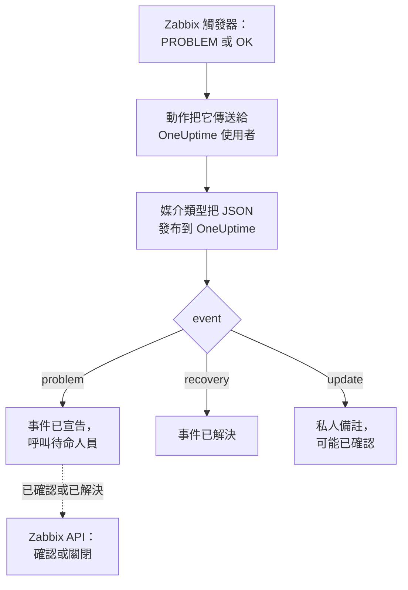

# Zabbix

把 [Zabbix](https://www.zabbix.com) 問題傳送到 OneUptime，讓每個問題都成為一個呼叫待命團隊的事件，並在 Zabbix 恢復時解決。現成的工作流程範本讓兩邊保持同步：人們在 Zabbix 中的操作會記錄到事件上，確認或解決事件會確認或關閉 Zabbix 中的問題。Zabbix 透過 Webhook 媒介類型傳送每個問題，因此兩邊都無需安裝任何東西。

:::cards
- [選擇 OneUptime 接收問題的方式](#選擇-oneuptime-接收問題的方式): 工作流程範本，或 Incoming Request 監測器。
- [從範本開始](#從範本開始): 六個範本，它們做什麼，以及需要填寫什麼。
- [設定 Zabbix](#設定-zabbix): 一個媒介類型、一個使用者和一個動作。
- [疑難排解](#疑難排解): 問題沒有到達，或事件一直未關閉時。
:::

## 運作方式



Zabbix 透過使用者的媒介把問題傳送給該使用者。這裡的媒介是一個名為 **OneUptime** 的 Webhook 媒介類型：每出現一個問題、每次問題恢復、每次有人在 Zabbix 中更新問題，它的指令碼都會把一個小的 JSON 文件發布到 OneUptime，其中包含問題的事件 ID、名稱、主機和嚴重程度。OneUptime 透過事件 ID 找到某個問題建立的事件。

## 開始之前

- 一臺由你管理的 Zabbix 伺服器。本指南針對 Zabbix 6.0 LTS 和 7.0 LTS 編寫。從 Zabbix 5.0 起，Webhook 媒介類型的運作方式相同。呼叫 Zabbix API 的範本需要 Zabbix 6.4 或更新版本，或者 [在 Zabbix 6.0 上做一處修改](#在-zabbix-60-上)。
- 一臺能夠透過 HTTPS 存取你的 OneUptime 的 Zabbix 伺服器；對於呼叫 Zabbix 的範本，還需要一個能夠存取 Zabbix 的 OneUptime。
- 在 OneUptime 中建立工作流程的權限；如果選擇監測器方式，則需要建立監測器的權限。在 OneUptime Cloud 上，工作流程需要 **Growth** 或更高的方案。

## 選擇 OneUptime 接收問題的方式

先設定 OneUptime：它會給你 Zabbix 要傳送到的 URL。

| 方式 | 適用情況 |
| --- | --- |
| 工作流程範本（推薦） | 你希望每個問題都按其 Zabbix 嚴重程度成為一個事件或警示，High 和 Disaster 時呼叫待命人員，恢復時解決，人們在 Zabbix 中的操作記錄在上面，並從 OneUptime 確認或關閉 Zabbix 中的問題。 |
| Incoming Request 監測器 | 你希望不用工作流程、在任何方案上都能建立事件，並有一個狀態跟隨 Zabbix 的監測器。不會有任何內容回到 Zabbix。 |

兩者從同一個媒介類型收到相同的 JSON，所以你可以先用其中一種，之後只需修改 Zabbix 中的一個 URL 就能切換。

## 從範本開始

**建立工作流程** 對話框在其類別清單的 **Zabbix** 下有六個 Zabbix 範本：三個用於事件，然後是同樣的三個用於警示。

| 範本 | 作用 | 需要填寫 |
| --- | --- | --- |
| **事件** | | |
| Declare an incident for each Zabbix problem | 接收 Zabbix 所傳送一切內容的工作流程。它為每個問題宣告一個事件，High 和 Disaster 時呼叫待命人員，記錄在 Zabbix 中所做的更新，並在恢復時解決事件。 | Zabbix URL |
| Acknowledge or close the Zabbix problem with the incident | 事件被確認時，確認其問題。事件被解決時，關閉問題；如果 Zabbix 不允許手動關閉，則改為確認問題。 | Zabbix URL、Zabbix API Token |
| Copy incident private notes to the Zabbix problem | 把事件上的每則私人備註作為訊息新增到其問題中。 | Zabbix URL、Zabbix API Token |
| **警示** | | |
| Create an alert for each Zabbix problem | 與事件相同，只是為每個問題建立一個警示。 | Zabbix URL |
| Acknowledge or close the Zabbix problem with the alert | 與事件相同，依據警示的狀態。 | Zabbix URL、Zabbix API Token |
| Copy alert private notes to the Zabbix problem | 把警示上的每則私人備註作為訊息新增到其問題中。 | Zabbix URL、Zabbix API Token |

先從 **Declare an incident for each Zabbix problem** 開始，警示則從 **Create an alert for each Zabbix problem** 開始：它建立的事件或警示會把問題的事件 ID 儲存在自訂欄位 `zabbixEventId` 中，另外兩個範本透過它找到問題。

### 範本需要填寫的內容

- **Zabbix URL**：你開啟 Zabbix 的位址，例如 `https://zabbix.example.com`；如果 Zabbix 在某個路徑下執行，則為 `https://example.com/zabbix`。指向問題的連結會指向這裡，呼叫 Zabbix 的範本會把請求傳送到它的 `api_jsonrpc.php`。該欄位不接受 Zabbix 內某個頁面的位址。
- **Zabbix API Token**：工作流程所代表的 Zabbix 使用者的 API 權杖。[建立 API 權杖](#建立-api-權杖) 說明了如何建立。它會儲存為秘密變數，並且只傳送給 Zabbix：放在 `Authorization` 標頭中，在 Zabbix 6.0 上則放在請求本文中。

### 用範本接收問題

:::steps
1. 前往 **工作流程**，點選 **建立工作流程**。在 **或從範本開始** 下，在類別清單中選擇 **Zabbix**，點選 **Declare an incident for each Zabbix problem**，然後點選 **使用此範本**。
2. 填寫 **Zabbix URL**。在 **Who to page for High and Disaster problems** 底下選擇要呼叫的待命策略，不選則不呼叫任何人，然後點選 **建立工作流程**。工作流程會在 **建構器** 中開啟，處於關閉狀態。
3. 點選 **Webhook** 觸發器，然後點選 **複製 URL**，把 URL 留給 Zabbix 使用。
4. 在 **建構器** 頂部開啟 **已啟用**。處於關閉狀態的工作流程會以 `400` 回應 Zabbix。
:::

然後 [設定 Zabbix](#設定-zabbix)，讓它把問題傳送到這個 URL。

### 工作流程做什麼

在 **Webhook** 觸發器之後， **Check With JavaScript** 步驟 `read-event-1` 讀取媒介類型傳送的 `event`，再由 **Incident From Another Tool**（警示範本中為 **Alert From Another Tool** ）依問題的事件 ID 執行它所代表的操作：

| 事件類型 | 工作流程做什麼 |
| --- | --- |
| `problem` | 宣告一個標題為 `Zabbix: <problem> on <host>` 的事件，其嚴重程度為 Zabbix 嚴重程度所對應的嚴重程度，並且不顯示在你的狀態頁面上。它的描述連結到 Zabbix 中的問題，並列出主機、嚴重程度、開始時間、運作資料和標籤。對於 High 或 Disaster 問題，它會呼叫你選擇的待命策略。Zabbix 以相同事件 ID 再次傳送的問題不會建立第二個事件。 |
| `recovery` | 解決問題的事件，除非它已經解決。原因記錄在它的時間軸上。 |
| `update` | 把在 Zabbix 中所做的操作作為私人備註新增到事件：誰做的、做了什麼、寫了什麼。如果這次更新確認了問題，它也會確認事件，待命上報隨之停止。 |

其他任何內容，例如來自其他工具的請求，都會原樣保留： `read-event-1` 走 **No**，執行的 **步驟** 會說明原因。失敗的步驟會讓執行失敗，它在 **步驟** 中的項目會說明原因。

### 嚴重程度

在新專案中，範本把 Zabbix 的六個嚴重程度對應到以下事件和警示嚴重程度：

| Zabbix 嚴重程度 | 事件 | 警示 | 待命 |
| --- | --- | --- | --- |
| Disaster | Critical Incident | High | 呼叫 |
| High | Critical Incident | High | 呼叫 |
| Average | Major Incident | Low | 不呼叫 |
| Warning | Major Incident | Low | 不呼叫 |
| Information | Minor Incident | Low | 不呼叫 |
| Not classified | Minor Incident | Low | 不呼叫 |

使用你自己的嚴重程度時，Disaster 和 High 對應最嚴重的一個，Average 和 Warning 對應中間的一個，Information 和 Not classified 對應最輕的一個。Zabbix 把嚴重程度編號為 0（Not classified）到 5（Disaster），範本讀取的是編號，所以在 Zabbix 中重新命名嚴重程度不會改變任何東西。

- 要按名稱把某個嚴重程度對應到你的某個嚴重程度，請編輯 `read-event-1` 步驟中的 `SEVERITY_BY_NAME`，例如 Warning 對應 `{ 2: 'Minor Incident' }`。
- 要讓 Average 問題也呼叫待命人員，請把 `if-page-1` **If / Else** 步驟的 **Compare with** 設為 `3`。

### 把確認和備註傳送回 Zabbix

:::steps
1. [建立 API 權杖](#建立-api-權杖)。
2. 從 **Acknowledge or close the Zabbix problem with the incident** 建立工作流程。填寫 **Zabbix URL** 和 **Zabbix API Token**，點選 **建立工作流程**，然後開啟 **已啟用**。
3. 如果也想把備註傳送到 Zabbix，請對 **Copy incident private notes to the Zabbix problem** 做同樣的操作。
:::

狀態範本會先向 Zabbix 查詢問題，因此 Zabbix 已經確認或解決的問題會保持原樣。要關閉問題，它的觸發器需要在 Zabbix 中啟用 **Allow manual close**。否則，問題會改為被確認，並附上一則說明事件已解決的訊息，Zabbix 會在問題恢復時關閉它。不是由 Zabbix 問題建立的事件，以及標記為 **私人事件** 的事件，永遠不會傳送到 Zabbix。

### 建立 API 權杖

:::steps
1. 使用 [接收問題](#建立接收問題的使用者) 的 `OneUptime` 使用者。Zabbix 不會把使用者自己的更新傳送給該使用者，因此使用這個使用者的權杖時，OneUptime 的確認和訊息永遠不會作為更新回到 OneUptime。
2. 在 **Users → User roles** 中檢查使用者的角色。它需要啟用 **Access to API**，並允許 **Acknowledge problems**、**Add problem comments** 和 **Close problems**。除非有人改過，**User role** 都允許這些操作。
3. 在 **Users → User groups** 中檢查使用者的使用者群組。對主機群組的 **Read** 權限足以確認問題和新增訊息。要關閉問題，需要 **Read-write**。
4. 前往 **Users → API tokens**，點選 **Create API token**。選擇 `OneUptime` 使用者，取消勾選 **Set expiration date and time** 或記下日期，然後點選 **Add**。
5. 複製 **Auth token**：Zabbix 只顯示一次。把它貼到 **Zabbix API Token** 中。
:::

### 在 Zabbix 6.0 上

Zabbix 6.0 從請求本文而不是 `Authorization` 標頭中讀取 API 權杖。在每個呼叫 Zabbix 的範本的 **Update Zabbix Problem** 步驟中，開啟 **更多欄位** 底下的 **Zabbix 6.0**。Zabbix 7.2 及更新版本會拒絕本文中的權杖，所以升級時請再次關閉它。

## 用監測器接收問題

[Incoming Request 監測器](/docs/monitor/incoming-request-monitor) 會給你一個 URL，它的條件決定每個請求做什麼。

:::steps
### 建立監測器

前往 **監測器**，點選 **建立監測器**。在 **監測器類型** 下選擇 **Incoming Request**，將其命名為 `Zabbix`，然後點選 **下一步**。

### 為每個問題宣告事件

在 **條件** 步驟中，開啟第一個條件，也就是把監測器標記為離線的那個。把它的篩選器設為 **請求內文**、**包含**、`"status":"1"`。這個條件在篩選器符合時已經會宣告事件。填寫事件資訊：

- **事件標題**：`Zabbix: {{requestBody.name}} on {{requestBody.host}}`。
- **嚴重程度**：Zabbix 問題應有的事件嚴重程度。
- **待命** 下的 **待命策略**：要呼叫的策略。
- **更多欄位** 下的 **自動解決事件**：保持開啟，它預設就是開啟的。關閉後會忽略恢復，事件將一直保持開啟。

### 每個問題一個事件

在同一個條件中，開啟 **設定** 並開啟 **Group incidents and alerts by a payload field**。按下表填寫，讓每個問題都有自己的事件，並由它的恢復來解決：

| 欄位 | 值 |
| --- | --- |
| **Open a separate incident for each…** | `requestBody.event_id` |
| **Field that signals recovery** | `requestBody.status` |
| **Value that means recovered** | `0` |

### 讓監測器恢復線上

開啟第二個條件，也就是把監測器標記為線上的那個，把它的篩選器設為 **請求內文**、**包含**、`"status":"0"`。

### 複製 URL

點選 **建立監測器**。監測器的 **概覽** 頁面會顯示它的 **Heartbeat URL**。複製它供 Zabbix 使用：

```text
https://oneuptime.com/heartbeat/<secret key>
```

自行託管安裝使用自己的主機來代替 `oneuptime.com`。
:::

監測器按原樣讀取請求的 JSON：`"status":"1"`，沒有空格。每項設定的作用請參閱 [接收來自其他系統的警示](/docs/monitor/incoming-request-monitor#接收其他系統的警示)。在 Zabbix 中所做的更新也以 `"status":"1"` 傳送，監測器會再次把它讀作該問題，不會建立第二個事件。

## 設定 Zabbix

Zabbix 需要三樣東西：一個發布到 OneUptime 的媒介類型、一個接收它的使用者，以及一個把問題傳送給該使用者的動作。

:::steps
### 建立 OneUptime 媒介類型

1. 前往 **Alerts → Media types**（在 Zabbix 6.0 上為 **Administration → Media types**），點選 **Create media type**。
2. 把 **Name** 設為 `OneUptime`，**Type** 設為 **Webhook**。
3. 新增以下 **Parameters**。每一項都把一個 Zabbix [宏](https://www.zabbix.com/documentation/current/en/manual/appendix/macros/supported_by_location) 對應到請求中：

   | 名稱 | 值 |
   | --- | --- |
   | `url` | `{ALERT.SENDTO}` |
   | `event_id` | `{EVENT.ID}` |
   | `event_name` | `{EVENT.NAME}` |
   | `event_value` | `{EVENT.VALUE}` |
   | `event_severity` | `{EVENT.SEVERITY}` |
   | `event_nseverity` | `{EVENT.NSEVERITY}` |
   | `host` | `{HOST.NAME}` |
   | `event_date` | `{EVENT.DATE}` |
   | `event_time` | `{EVENT.TIME}` |
   | `event_opdata` | `{EVENT.OPDATA}` |
   | `event_tags` | `{EVENT.TAGSJSON}` |
   | `trigger_id` | `{TRIGGER.ID}` |
   | `event_update_status` | `{EVENT.UPDATE.STATUS}` |
   | `event_update_action` | `{EVENT.UPDATE.ACTION}` |
   | `event_update_message` | `{EVENT.UPDATE.MESSAGE}` |
   | `event_update_user` | `{USER.FULLNAME}` |

4. 把以下內容貼上到 **Script** 中：

   ```javascript
   var params = JSON.parse(value);

   // Zabbix leaves a macro it has no value for as it is written, such as
   // {EVENT.UPDATE.MESSAGE} on a problem: it is sent as nothing.
   function given(text) {
     var written = String(text === undefined || text === null ? "" : text);
     return /^\{[A-Z0-9_.]+\}$/.test(written) || written === "*UNKNOWN*"
       ? ""
       : written;
   }

   var isUpdate = given(params.event_update_status) === "1";
   var payload = {
     source: "zabbix",
     // "problem", "recovery" or "update".
     event: isUpdate
       ? "update"
       : params.event_value === "0"
         ? "recovery"
         : "problem",
     event_id: params.event_id,
     name: params.event_name,
     host: params.host,
     severity: params.event_severity,
     // 0 Not classified, 1 Information, 2 Warning, 3 Average, 4 High, 5 Disaster.
     severity_number: params.event_nseverity,
     // "1" for a problem, "0" for its recovery.
     status: params.event_value,
     date: params.event_date,
     time: params.event_time,
     opdata: given(params.event_opdata),
     tags: [],
     trigger_id: params.trigger_id,
   };

   try {
     var tags = JSON.parse(given(params.event_tags) || "[]");
     payload.tags = Array.isArray(tags) ? tags : [];
   } catch (error) {
     payload.tags = [];
   }

   if (isUpdate) {
     payload.update = {
       action: given(params.event_update_action),
       message: given(params.event_update_message),
       user: given(params.event_update_user),
     };
   }

   var request = new HttpRequest();
   request.addHeader("Content-Type: application/json");

   var response = request.post(params.url, JSON.stringify(payload));

   if (request.getStatus() < 200 || request.getStatus() >= 300) {
     throw (
       "OneUptime responded with HTTP " + request.getStatus() + ": " + response
     );
   }

   return "OK";
   ```

5. 在 **Message templates** 索引標籤上，為 **Problem**、**Problem recovery** 和 **Problem update** 各新增一個範本。範本文字留空：請求由指令碼建置。Zabbix 只會把媒介類型用於它有範本的事件類型。
6. 點選 **Add**。

### 建立接收問題的使用者

1. 前往 **Users → Users**（在 Zabbix 6.0 上為 **Administration → Users**），點選 **Create user**。將其命名為 `OneUptime`，並為它指定一個使用者組和一個能夠接收通知的角色，例如 **User role**。
2. 在 **Media** 索引標籤上點選 **Add**。把 **Type** 設為 `OneUptime`，**Send to** 設為你從 OneUptime 複製的 URL。**When active** 和嚴重程度保持不變，或者取消勾選 OneUptime 不應收到的嚴重程度。
3. 點選 **Add**，然後再次點選 **Add** 儲存使用者。

### 用動作把問題傳送到 OneUptime

1. 前往 **Alerts → Actions → Trigger actions**（在 Zabbix 6.0 上為 **Configuration → Actions**），點選 **Create action**。將其命名為 `Notify OneUptime`。
2. 如有需要，在 **Conditions** 下縮小範圍，例如 **Trigger severity is greater than or equals Warning**。沒有條件時，每個問題都會被髮送。
3. 在 **Operations** 索引標籤上，新增一個透過 `OneUptime` 媒介類型傳送給 `OneUptime` 使用者的操作。
4. 在 **Recovery operations** 下新增同樣的操作，這樣恢復也會被傳送；再在 **Update operations** 下新增，這樣在 Zabbix 中所做的確認和留言也會被傳送。
5. 點選 **Add**，並檢查該動作已啟用。
:::

要把一些問題傳送到事件範本、另一些傳送到警示範本，請給 `OneUptime` 使用者兩個類型為 `OneUptime` 的媒介：每個媒介傳送到一個工作流程的 URL，並帶上它應接收的嚴重程度。

## 測試

1. 在 Zabbix 中開啟 **Alerts → Media types**，點選 `OneUptime` 旁邊的 **Test**。填入你複製的 URL，以及範例值，例如 `event_id` `12345`、`event_name` `Test problem`、`host` `web-1`、`event_nseverity` `4` 和 `event_value` `1`。點選 **Test**：Zabbix 會顯示指令碼的回應 `OK`，或者指令碼拋出的錯誤。
2. 在 OneUptime 中開啟工作流程的 **日誌 → 執行記錄** 檢查這次執行；或者開啟監測器，檢查是否建立了事件。
3. 用 `event_value` `0` 和相同的 `event_id` 再測試一次。事件會被解決。

然後讓一個真實的觸發器觸發，例如暫時調低某個閾值，觀察問題到達。要試試更新，請在 Zabbix 中附上一則訊息確認該問題：事件會得到一則私人備註，並被確認。

## 對應 Zabbix 嚴重程度

Zabbix 以文字形式傳送嚴重程度：`Not classified`、`Information`、`Warning`、`Average`、`High` 或 `Disaster`。

- **使用範本時**，嚴重程度會自動為你對應：參閱 [嚴重程度](#嚴重程度)。
- **使用監測器時**，為每組嚴重程度點選 **新增條件準則**，並把新條件拖到第一個條件上方：條件從上往下檢查，第一個符合的條件起決定作用。為每個條件設定兩個篩選器，`"status":"1"` 和一個嚴重程度，例如 `"severity":"Disaster"`，並把 **符合條件** 設為 **全部**。為每個條件設定一個事件，帶有自己的 **嚴重程度** 和 **自動解決事件**，以及相同的分組設定。

## 疑難排解

:::details OneUptime 沒有收到任何內容
- 在 Zabbix 中開啟 **Reports → Action log**，檢查動作是否傳送了問題，以及傳回了什麼。
- 從 Zabbix 伺服器自己傳送一個請求：`curl -i -X POST <url> -H 'Content-Type: application/json' -d '{"source":"zabbix","event":"problem","event_id":"1","name":"Test","host":"test","severity_number":"4","status":"1"}'`。
- 監測器會在檢查任何內容之前立即回應 `200`，即使金鑰錯誤也是如此。請檢視監測器的時間線，確認請求是否到達。
- 處於關閉狀態的工作流程會回應 `400`。在它的 **建構器** 頂部開啟 **已啟用**。
:::

:::details Zabbix 報告指令碼錯誤
開啟媒介類型並使用 **Test**：Zabbix 會顯示指令碼的結果或它擲回的錯誤。OneUptime 傳回的非 `2xx` 回應會被指令碼連同狀態碼一起擲回，所以請先檢查 URL。
:::

:::details 事件被建立但從未被解決
- 動作需要 **Recovery operations**，否則 Zabbix 永遠不會發送恢復。
- 使用範本時，開啟工作流程的 **日誌 → 執行記錄** 中恢復的那次執行：它的最後一步會說明原因。對於沒有建立事件的問題，恢復不會改變任何東西。
- 使用監測器時，條件中的事件需要啟用 **更多欄位** 下的 **自動解決事件**。**Field that signals recovery** 必須是 `requestBody.status`，**Value that means recovered** 必須恰好是 `0`。
:::

:::details Zabbix 中的問題沒有被確認或關閉
在 **日誌 → 執行記錄** 中開啟狀態範本的執行：它的最後一步會說明 Zabbix 的回應。

- `Not authorized`：API 權杖錯誤、已過期或已停用，或者 Zabbix 早於 6.4（參閱 [在 Zabbix 6.0 上](#在-zabbix-60-上)）。
- `Cannot close problem: trigger does not allow manual closing`：在觸發器上開啟 **Allow manual close**。範本已經會改為確認這類問題，而不是關閉它們。
- `No permissions to referred object or it does not exist!`：使用者能看到問題，但需要 **Read-write** 權限才能關閉它。
- `Zabbix has no problem with event ID`：使用者看不到問題的主機。請為其使用者群組授予對該主機群組的 **Read** 權限。
:::

:::details 事件顯示的是引用而不是值
引用了請求中不存在的欄位時，該引用會連同大括號按原樣保留，而不會被清空。請檢查 Zabbix 是否傳送了 `Content-Type: application/json`，以及你使用的欄位名（`name`、`host`、`severity`、`status`、`event_id`）是否與指令碼的酬載一致。對於工作流程，請在 **日誌 → 執行記錄** 中開啟這次執行，並與觸發器收到的內容進行比較。請參閱 [陷阱](/docs/workflows/variables#陷阱)。
:::

:::details 每個問題都到達兩次
動作很可能有兩個傳送給同一使用者的操作，例如第一步和一個上報步驟。無論收到什麼，範本對每個事件 ID 只建立一個事件，但每次投遞都是一次執行。請檢查動作的 **Operations**。
:::

## 安全

- **像對待密碼一樣對待 URL。** 任何擁有它的人都可以建立事件。如果洩露，請重設它：在工作流程的 **Webhook** 觸發器中使用 **重設 URL**，或在監測器的 **設定** 頁面使用 **重設傳入請求密鑰**。然後更新 Zabbix 使用者媒介中的 **Send to**。
- **連結指向你的 Zabbix。** 無論請求中寫了什麼，範本都會連結到其 **Zabbix URL** 所指網站上的問題，並把 Zabbix 傳送的內容作為文字寫入。
- **讓 API 權杖只做工作流程需要做的事。** 它是一個秘密變數，在執行日誌中會被隱藏，並且只傳送給 Zabbix：除非開啟了 **Zabbix 6.0**，否則放在 `Authorization` 標頭中。給它的使用者一個僅允許上述操作的角色，如果權杖洩露，請在 **Users → API tokens** 中刪除它。
- **只發送需要事件的內容。** 使用動作的條件或使用者媒介的嚴重程度，把低嚴重程度的問題留在 Zabbix 中。
- **自行託管？** 讓你的 Zabbix 伺服器能夠穿過防火牆，透過 HTTPS 存取你的 OneUptime。要呼叫私人網路中的 Zabbix，工作流程需要 [對外網路存取](/docs/workflows/configuration#對外網路存取)。

## 後續步驟

:::cards
- [工作流程範本](/docs/workflows/authoring): 從範本建立工作流程，並在建構器中修改它。
- [傳入請求監控](/docs/monitor/incoming-request-monitor): 接收 Zabbix 問題的監測器的所有設定。
- [上報規則](/docs/on-call/escalation-rules): 決定待命策略呼叫誰、何時呼叫。
- [整合總覽](/docs/integrations/index): 你可以連接的其他工具。
:::
