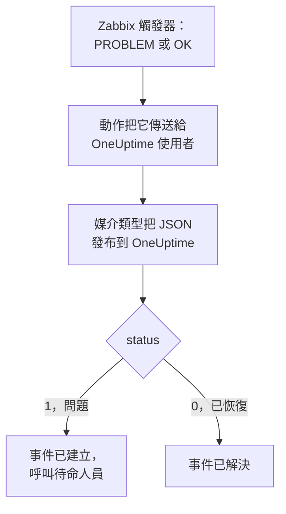

# Zabbix

把 [Zabbix](https://www.zabbix.com) 問題傳送到 OneUptime，讓每個問題都成為一個呼叫待命團隊的事件，並在 Zabbix 恢復時解決。Zabbix 透過 Webhook 媒介類型傳送每個問題，因此兩邊都無需安裝任何東西。

:::cards
- [選擇 OneUptime 接收問題的方式](#選擇-oneuptime-接收問題的方式): Incoming Request 監測器，或你自己的工作流程。
- [用監測器接收問題](#用監測器接收問題): 每個問題一個事件，恢復時自動解決。
- [設定 Zabbix](#設定-zabbix): 一個媒介類型、一個使用者和一個動作。
- [疑難排解](#疑難排解): 問題沒有到達，或事件一直未關閉時。
:::

## 運作方式



Zabbix 透過使用者的媒介把問題傳送給該使用者。這裡的媒介是一個名為 **OneUptime** 的 Webhook 媒介類型：它的指令碼把一個小的 JSON 文件發布到 OneUptime，其中包含問題的事件 ID、名稱、主機、嚴重程度和狀態。狀態為 `1` 表示問題，為 `0` 表示問題已恢復。

## 開始之前

- 一臺由你管理的 Zabbix 伺服器。本指南針對 Zabbix 6.0 LTS 和 7.0 LTS 編寫。從 Zabbix 5.0 起，Webhook 媒介類型的運作方式相同。
- 一臺能夠透過 HTTPS 存取你的 OneUptime 的 Zabbix 伺服器。
- 在 OneUptime 中建立監測器的權限；如果選擇工作流程方式，則需要建立工作流程的權限。

## 選擇 OneUptime 接收問題的方式

先設定 OneUptime：它會給你 Zabbix 要傳送到的 URL。

| 方式 | 適用情況 |
| --- | --- |
| Incoming Request 監測器（推薦） | 你希望每個 Zabbix 問題都成為一個呼叫待命人員的事件，並在 Zabbix 恢復時解決。無需建置任何東西。 |
| 帶 Webhook 觸發器的工作流程 | 你需要自己的邏輯：先篩選問題、轉換格式或呼叫其他系統。工作流程不會在恢復時自行解決事件。 |

兩者從同一個媒介類型收到相同的 JSON，所以你可以先用其中一種，之後只需修改 Zabbix 中的一個 URL 就能切換。

## 用監測器接收問題

[Incoming Request 監測器](/docs/monitor/incoming-request-monitor) 會給你一個 URL，它的條件決定每個請求做什麼。

:::steps
### 建立監測器

前往 **監測器**，點選 **建立監測器**。在 **監測器類型** 下選擇 **Incoming Request**，將其命名為 `Zabbix`，然後點選 **下一步**。

### 為每個問題宣告事件

在 **條件** 步驟中，開啟第一個條件，也就是把監測器標記為離線的那個。把它的篩選器設為 **請求內文**、**包含**、`"status":"1"`。這個條件在篩選器符合時已經會宣告事件。填寫事件資訊：

- **事件標題**：`Zabbix: {{requestBody.name}} on {{requestBody.host}}`。
- **嚴重程度**：Zabbix 問題應有的事件嚴重程度。
- **待命** 下的 **待命策略**：要呼叫的策略。
- **更多欄位** 下的 **自動解決事件**：保持開啟，它預設就是開啟的。關閉後會忽略恢復，事件將一直保持開啟。

### 每個問題一個事件

在同一個條件中，開啟 **設定** 並開啟 **Group incidents and alerts by a payload field**。按下表填寫，讓每個問題都有自己的事件，並由它的恢復來解決：

| 欄位 | 值 |
| --- | --- |
| **Open a separate incident for each…** | `requestBody.event_id` |
| **Field that signals recovery** | `requestBody.status` |
| **Value that means recovered** | `0` |

### 讓監測器恢復線上

開啟第二個條件，也就是把監測器標記為線上的那個，把它的篩選器設為 **請求內文**、**包含**、`"status":"0"`。

### 複製 URL

點選 **建立監測器**。監測器的 **概覽** 頁面會顯示它的 **Heartbeat URL**。複製它供 Zabbix 使用：

```text
https://oneuptime.com/heartbeat/<secret key>
```

自行託管安裝使用自己的主機來代替 `oneuptime.com`。
:::

監測器按原樣讀取請求的 JSON：`"status":"1"`，沒有空格。每項設定的作用請參閱 [接收來自其他系統的警示](/docs/monitor/incoming-request-monitor#接收其他系統的警示)。

## 用工作流程接收問題

當你需要在 Zabbix 和事件之間加入自己的步驟時，請使用 [工作流程](/docs/workflows/index)。

:::steps
### 建立工作流程

前往 **工作流程**，點選 **建立工作流程**，然後點選 **從零開始**。將其命名為 `Zabbix problems`，然後點選 **建立工作流程**。

### 新增 Webhook 觸發器

點選虛線的 **Choose what starts this workflow** 區塊並選擇 **Webhook**。點選該觸發器，然後點選 **複製 URL**，把 URL 留給 Zabbix 使用。

### 檢查是否為問題

點選 **新增元件**，新增一個 **If / Else** 區塊，並把觸發器的 **Out** 點連接到它。把 **Value to check** 設為 `{{local.components.webhook-1.returnValues.request-body.status}}`，**Comparison** 設為 **is equal to**，**Compare with** 設為 `1`。

### 宣告事件

新增一個 **Create One Incident** 區塊，並把 **If / Else** 區塊的 **Yes** 一側連接到它。在 **Incident Template** 中選擇一個設定了嚴重程度和要呼叫的待命策略的範本（請參閱 [事件範本](/docs/incidents/settings#事件範本)）。在 **JSON Object** 中設定來自 Zabbix 的內容：

```json
{
  "title": "Zabbix: {{local.components.webhook-1.returnValues.request-body.name}}",
  "description": "Host: {{local.components.webhook-1.returnValues.request-body.host}}\nSeverity: {{local.components.webhook-1.returnValues.request-body.severity}}\nZabbix event: {{local.components.webhook-1.returnValues.request-body.event_id}}"
}
```

如果不使用範本，**JSON Object** 中還需要 `incidentSeverityId`，即專案中某個事件嚴重程度的 ID。

### 啟用

在 **建構器** 頂部開啟 **已啟用**。處於關閉狀態的工作流程會以 `400` 回應 Zabbix。
:::

恢復會走向 **If / Else** 區塊的 **No** 一側，那裡沒有連接任何東西，因此執行到此結束。要在恢復時解決事件，請使用監測器。

## 設定 Zabbix

Zabbix 需要三樣東西：一個發布到 OneUptime 的媒介類型、一個接收它的使用者，以及一個把問題傳送給該使用者的動作。

:::steps
### 建立 OneUptime 媒介類型

1. 前往 **Alerts → Media types**（在 Zabbix 6.0 上為 **Administration → Media types**），點選 **Create media type**。
2. 把 **Name** 設為 `OneUptime`，**Type** 設為 **Webhook**。
3. 新增以下 **Parameters**。每一項都把一個 Zabbix [宏](https://www.zabbix.com/documentation/current/en/manual/appendix/macros/supported_by_location) 對應到請求中：

   | 名稱 | 值 |
   | --- | --- |
   | `url` | `{ALERT.SENDTO}` |
   | `event_id` | `{EVENT.ID}` |
   | `event_name` | `{EVENT.NAME}` |
   | `event_value` | `{EVENT.VALUE}` |
   | `event_severity` | `{EVENT.SEVERITY}` |
   | `host` | `{HOST.NAME}` |
   | `event_date` | `{EVENT.DATE}` |
   | `event_time` | `{EVENT.TIME}` |

4. 把以下內容貼上到 **Script** 中：

   ```javascript
   var params = JSON.parse(value);
   var request = new HttpRequest();
   request.addHeader("Content-Type: application/json");

   var payload = {
     source: "zabbix",
     event_id: params.event_id,
     name: params.event_name,
     host: params.host,
     severity: params.event_severity,
     // "1" for a problem, "0" for its recovery.
     status: params.event_value,
     date: params.event_date,
     time: params.event_time,
   };

   var response = request.post(params.url, JSON.stringify(payload));

   if (request.getStatus() < 200 || request.getStatus() >= 300) {
     throw (
       "OneUptime responded with HTTP " + request.getStatus() + ": " + response
     );
   }

   return "OK";
   ```

5. 在 **Message templates** 索引標籤上，為 **Problem** 和 **Problem recovery** 各新增一個範本。範本文字留空：請求由指令碼建置。Zabbix 只會把媒介類型用於它有範本的事件類型。
6. 點選 **Add**。

### 建立接收問題的使用者

1. 前往 **Users → Users**（在 Zabbix 6.0 上為 **Administration → Users**），點選 **Create user**。將其命名為 `OneUptime`，並為它指定一個使用者組和一個能夠接收通知的角色，例如 **User role**。
2. 在 **Media** 索引標籤上點選 **Add**。把 **Type** 設為 `OneUptime`，**Send to** 設為你從 OneUptime 複製的 URL。**When active** 和嚴重程度保持不變，或者取消勾選 OneUptime 不應收到的嚴重程度。
3. 點選 **Add**，然後再次點選 **Add** 儲存使用者。

### 用動作把問題傳送到 OneUptime

1. 前往 **Alerts → Actions → Trigger actions**（在 Zabbix 6.0 上為 **Configuration → Actions**），點選 **Create action**。將其命名為 `Notify OneUptime`。
2. 如有需要，在 **Conditions** 下縮小範圍，例如 **Trigger severity is greater than or equals Warning**。沒有條件時，每個問題都會被髮送。
3. 在 **Operations** 索引標籤上，新增一個透過 `OneUptime` 媒介類型傳送給 `OneUptime` 使用者的操作。
4. 在 **Recovery operations** 下新增同樣的操作，這樣恢復也會被髮送。
5. 點選 **Add**，並檢查該動作已啟用。
:::

## 測試

1. 在 Zabbix 中開啟 **Alerts → Media types**，點選 `OneUptime` 旁邊的 **Test**。填入你複製的 URL，以及範例值，例如 `event_id` `12345`、`event_name` `Test problem`、`host` `web-1` 和 `event_value` `1`。點選 **Test**：Zabbix 會顯示指令碼的回應 `OK`，或者指令碼擲回的錯誤。
2. 在 OneUptime 中開啟監測器，檢查是否建立了事件；或者開啟工作流程的 **日誌 → 執行記錄** 檢查這次執行。
3. 用 `event_value` `0` 和相同的 `event_id` 再測試一次。使用監測器時，事件會被解決。

然後讓一個真實的觸發器觸發，例如暫時調低某個閾值，觀察問題到達。

## 對應 Zabbix 嚴重程度

Zabbix 以文字形式傳送嚴重程度：`Not classified`、`Information`、`Warning`、`Average`、`High` 或 `Disaster`。

- **使用監測器時**，為每組嚴重程度點選 **新增條件準則**，並把新條件拖到第一個條件上方：條件從上往下檢查，第一個符合的條件起決定作用。為每個條件設定兩個篩選器，`"status":"1"` 和一個嚴重程度，例如 `"severity":"Disaster"`，並把 **符合條件** 設為 **全部**。為每個條件設定一個事件，帶有自己的 **嚴重程度** 和 **自動解決事件**，以及相同的分組設定。
- **使用工作流程時**，針對 `{{local.components.webhook-1.returnValues.request-body.severity}}` 新增一個 [Switch / Case](/docs/workflows/components#switch-case) 區塊，為每個嚴重程度設定一個分支，並在每個分支後面新增一個帶有自己範本的 **Create One Incident** 區塊。

## 疑難排解

:::details OneUptime 沒有收到任何內容
- 在 Zabbix 中開啟 **Reports → Action log**，檢查動作是否傳送了問題，以及傳回了什麼。
- 從 Zabbix 伺服器自己傳送一個請求：`curl -i -X POST <url> -H 'Content-Type: application/json' -d '{"status":"1","event_id":"1","name":"Test","host":"test"}'`。
- 監測器會在檢查任何內容之前立即回應 `200`，即使金鑰錯誤也是如此。請檢視監測器的時間線，確認請求是否到達。
- 處於關閉狀態的工作流程會回應 `400`。在它的 **建構器** 頂部開啟 **已啟用**。
:::

:::details Zabbix 報告指令碼錯誤
開啟媒介類型並使用 **Test**：Zabbix 會顯示指令碼的結果或它擲回的錯誤。OneUptime 傳回的非 `2xx` 回應會被指令碼連同狀態碼一起擲回，所以請先檢查 URL。
:::

:::details 事件被建立但從未被解決
- 動作需要 **Recovery operations**，否則 Zabbix 永遠不會發送恢復。
- 條件中的事件需要開啟 **更多欄位** 下的 **自動解決事件**。
- **Field that signals recovery** 必須是 `requestBody.status`，**Value that means recovered** 必須恰好是 `0`。
- 工作流程不會在恢復時解決事件。請使用監測器。
:::

:::details 事件顯示的是引用而不是值
引用了請求中不存在的欄位時，該引用會連同大括號按原樣保留，而不會被清空。請檢查 Zabbix 是否傳送了 `Content-Type: application/json`，以及你使用的欄位名（`name`、`host`、`severity`、`status`、`event_id`）是否與指令碼的酬載一致。對於工作流程，請在 **日誌 → 執行記錄** 中開啟這次執行，並與觸發器收到的內容進行比較。請參閱 [陷阱](/docs/workflows/variables#陷阱)。
:::

:::details 每個問題都到達兩次
動作很可能有兩個傳送給同一使用者的操作，例如第一步和一個上報步驟。請檢查動作的 **Operations**。
:::

## 安全

- **像對待密碼一樣對待 URL。** 任何擁有它的人都可以建立事件。如果洩露，請重設它：在監測器的 **設定** 頁面使用 **重設傳入請求密鑰**，或在工作流程的 **Webhook** 觸發器中使用 **重設 URL**。然後更新 Zabbix 使用者媒介中的 **Send to**。
- **只發送需要事件的內容。** 使用動作的條件或使用者媒介的嚴重程度，把低嚴重程度的問題留在 Zabbix 中。
- **自行託管？** 讓你的 Zabbix 伺服器能夠穿過防火牆，透過 HTTPS 存取你的 OneUptime。

## 後續步驟

:::cards
- [傳入請求監控](/docs/monitor/incoming-request-monitor): 接收 Zabbix 問題的監測器的所有設定。
- [上報規則](/docs/on-call/escalation-rules): 決定待命策略呼叫誰、何時呼叫。
- [工作流程觸發器](/docs/workflows/triggers#webhook): 工作流程的 Webhook URL 如何工作。
- [整合總覽](/docs/integrations/index): 你可以連接的其他工具。
:::
