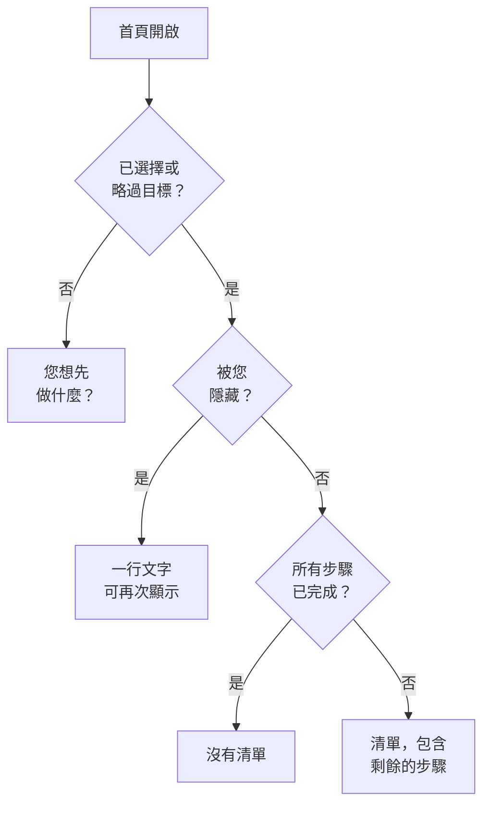

# 首頁與快速鍵

首頁是你在專案中看到的第一個頁面。它讓你一眼就知道現在是否有需要你處理的事情，並引導新專案完成初始設定。本頁說明首頁顯示的內容、如何在儀表板中找到任何產品、頁面或動作，以及能讓你少在選單中來回的鍵盤快速鍵。

:::cards
- [首頁顯示的內容](#首頁顯示的內容): 是否有問題、哪些事項需要你處理、專案包含哪些內容，以及所有產品。
- [四處瀏覽](#四處瀏覽): 產品選單，以及每個頁面頂端的列。
- [搜尋](#搜尋頁面設定或動作): 輸入名稱即可找到任何頁面、設定或動作。
- [鍵盤快速鍵](#鍵盤快速鍵): 按兩個鍵即可前往首頁、監測器或事件。
:::

## 首頁顯示的內容

在頂端列中開啟 **首頁**，或在任何地方按 `g` 再按 `h`。首頁是你的專案的概覽，只有這一個頁面，沒有側邊選單。它由上到下顯示：

1. 一個搜尋框，旁邊是 **宣告事件** 和 **建立**。
2. 一行說明是否有問題的文字，下方是五個數字，計算需要注意的事項。
3. **歡迎使用 OneUptime 👋**：新專案的清單，完成之前一直顯示。
4. **需要注意**：目前所有未解決的問題，逐一列出名稱。
5. **您的專案**：專案由哪些內容組成；排定了維護時，還會顯示 **即將進行的維護**。
6. **探索 OneUptime**：所有產品，每次顯示一個類別。

### 搜尋與建立

搜尋框會開啟搜尋，與按 `Mod` + `K` 相同：輸入任何頁面、監測器、事件、警示、狀態頁面或待命策略的名稱即可。請參閱 [搜尋](#搜尋頁面設定或動作)。**宣告事件** 會開啟用來宣告事件的表單。**建立** 提供 **建立監測器**、**安排維護** 和 **建立公告**。每一項都只會顯示給有權使用它的人。

### 狀態標題

頂端的這一行會指出目前未解決的最緊急事項，並使用與之相應的顏色：

| 情況 | 首頁顯示 |
| --- | --- |
| 有未解決的事件 | 有幾個進行中的事件，以紅色顯示 |
| 沒有未解決的事件，但有未解決的警示、無法運作的監測器或有風險的 SLO | 有幾個問題需要注意，以琥珀色顯示 |
| 沒有任何問題，且有維護正在進行 | 有幾個維護事件正在進行 |
| 監測器正在運作，且沒有任何未解決的事項 | **所有系統皆正常運作** |
| 專案中還沒有監測器 | **尚未監測任何項目** |

它的旁邊會顯示首頁上次讀取專案資料的時間，**重新整理** 會再讀取一次。當你離開一分鐘或更久後再回到首頁所在的瀏覽器分頁時，它會自動重新整理。

在尚未監測任何項目時，這一行的結尾會顯示 **建立您的第一個監測器**，它會開啟引導式設定 **在我的網站或 API 停擺時得知**。只有有權建立監測器的人才看得到它。

### 五個數字

每個數字計算某樣東西，告訴你它是否需要你處理，並在它所屬的產品中開啟它背後的清單。

| 數字 | 計算內容 | 計數為零時 | 開啟 |
| --- | --- | --- | --- |
| **進行中的事件** | 尚未解決的事件 | **一切正常** | **事件 → 進行中事件** |
| **進行中的警示** | 尚未解決的警示 | **一切正常** | **警示 → 進行中警示** |
| **無法運作的監測器** | 狀態不屬於運作中類狀態的監測器。已封存的監測器和已關閉監測的監測器不計入。 | **全部運作中** | **監測器 → 無法運作** |
| **進行中的維護** | 正在進行的排定維護活動 | **目前沒有進行中** | **排定維護 → 進行中的維護事件** |
| **有風險的 SLO** | 已開啟且有風險或已用完錯誤預算的 SLO | **預算健康** | **SLOs** |

計數大於零時顯示 **需要注意**，維護和 SLO 則分別顯示 **進行中** 和 **預算正在消耗**。只要有 SLO 處於風險中，**有風險的 SLO** 就會開啟 **SLOs** 清單，並只顯示這些 SLO。還沒有監測器的專案會看到 **尚無監測器**，沒有 SLO 的專案會看到 **尚無 SLO**：空的專案並不等於健康的專案。此時這兩項會開啟 **監測器** 和 **SLOs** 清單，你可以在那裡建立第一個。

### 歡迎清單

專案擁有者或管理員第一次開啟新專案的首頁時，卡片會問 **您想先做什麼？** 勾選一個或多個目標，例如 **在我的網站或 API 停擺時得知** 或 **只是隨意看看**，然後點擊 **繼續**：清單就會包含這些目標需要的步驟。**略過** 會給出每個專案都有的四個步驟。之後要重新回答，請點擊清單上的 **變更**。已經在使用監測器、遙測或待命的專案不會被詢問。

每個步驟在真正生效時自動勾選，而不是在記錄存在時，所有設定此專案的人在每台裝置上都看到同一份清單：

| 步驟 | 完成條件 | 開啟 |
| --- | --- | --- |
| **從您目前的工具匯入** | 從其他工具的匯入完成。 | **從其他工具匯入** |
| **建立您的第一個監測器** | 收到它的第一次檢查結果。 | 引導式設定 **在我的網站或 API 停擺時得知**，對於不能建立監測器的人則是 **監測器** 清單。 |
| **連線伺服器或叢集** | 收到它的第一批指標。 | **主機** |
| **傳送您的第一批日誌、指標或追蹤** | 收到專案的第一批日誌、指標、追蹤、例外或效能剖析。 | 引導式設定 **傳送日誌、指標和追蹤，然後接收警示** |
| **設定待命政策** | 測試呼叫被確認、呼叫送達某人，或待命規則執行一個能通知到某人的政策。 | 引導式設定 **出問題時呼叫合適的人** |
| **發布狀態頁面** | 狀態頁面顯示一個監測器。 | 引導式設定 **發布狀態頁面**，對於不能建立狀態頁面的人則是 **狀態頁面** 清單。 |
| **邀請您的團隊** | 有人接受了您的邀請。 | **使用者** |

要先做的步驟標有 **下一步**。在只限一人的 OneUptime Cloud Free 方案中，**邀請您的團隊** 會說明需要 Growth 方案，並開啟 **帳單**。在尚無法傳送電子郵件的自行託管伺服器上，伺服器管理員會先看到 **此伺服器尚無法傳送電子郵件**，它會開啟管理儀表板。

引導式設定在一個頁面上逐步完成整項工作，最後說明它設定了什麼以及下一步要做什麼。之後要再次開啟，請搜尋它的名稱。

在步驟下方，**OneUptime 如何運作** 依問題流經的順序展示四個核心產品：**監測器**、**事件與警示**、**待命** 和 **狀態頁面**。點選其中一個即可開啟。下方也說明了為這個流程提供輸入的是什麼，也就是遙測和基礎設施，並連結到 [核心概念](/docs/introduction/core-concepts) 和 [詞彙表](/docs/introduction/glossary)。

所有步驟完成後，清單會對所有人消失。要提前隱藏，請點擊 **隱藏**：它只對您隱藏，在每台裝置上都如此，並留下一行包含 **顯示** 和 **OneUptime 如何運作**。以成員身分受邀加入專案的人看不到這份清單。在任何專案中，**OneUptime 如何運作** 都只需點一下：從 **說明** 開啟，或點選 **探索 OneUptime** 旁邊的按鈕。

### 需要注意

**需要注意** 依名稱列出這些數字所計算的內容：未解決的事件、未解決的警示、無法運作的監測器、有風險的 SLO 和正在進行的維護，最緊急的排在最前面。每一列都會顯示其嚴重性或狀態，註明事件或警示何時開始、維護何時結束，並會開啟對應的記錄。每一種最多顯示五項，其餘的可以透過 **顯示全部** 查看，它開啟的清單與該種類的數字開啟的相同。沒有任何未解決的事項時，這裡會顯示 **沒有需要您注意的事項**。

### 設定健康狀況

當專案設定中的某些問題會讓相關人員收不到通知時，**需要注意** 的最後會出現 **設定**，顯示有多少項需要查看。點選它會開啟 **設定健康狀況**，依嚴重程度由高到低，在 **呼叫無法送達**、**值得修正** 和 **建議** 下列出設定有誤的地方：不呼叫任何人的監測器、沒有任何規則或監測器執行的待命策略、無法被呼叫的回應者、已關閉的 SMS、無人待命的待命排程、不顯示任何監測器的狀態頁面。每項發現都用一句話說明哪裡有問題，並附有開啟修正位置的按鈕；監測器的發現，就是它的 **停機時** 卡片指出的斷點。團隊刻意保留原樣的發現，可以填寫原因後對所有人隱藏，並可從 **已忽略** 中還原。在搜尋中可以透過 **設定健康狀況** 找到此頁面，詢問 AI 也會根據它回答「我的設定沒問題嗎？」。

### 您的專案

**您的專案** 計算專案中的 **監測器**、**狀態頁面**、**待命策略**、**SLOs**、**服務**、**儀表板** 和 **工作流程**，已封存的不計入。每一列都會開啟對應的清單。專案中一個都沒有的類型會顯示 **設定**，而不是數字。

**即將進行的維護** 列出接下來的三個排定維護時段，最早開始的排在最前面。沒有排定任何維護時，就不會顯示這一區。

### 探索 OneUptime

**探索 OneUptime** 展示 **產品** 選單中的產品，每次顯示一個類別，從基礎群組開始。每個產品都會說明它的用途，點選即可開啟。專案中隱藏的產品不會出現在這裡。

## 四處瀏覽

OneUptime 中的一切都在頂端列的 **產品** 下。選單把各個群組列為同一個清單中的列，並且開啟時一律展開第一個群組，也就是基礎：監測、事件、警示、待命、狀態頁面、排定維護和 SLOs。其他每個群組（可觀測性、安全性、AI、程式碼、資源、基礎設施、雲端、儀表板與自動化和設定）都收合為同一清單中的一列。每一列會列出該群組包含的產品，並說明有幾個。點選一列即可展開或收合它，也可以用方向鍵移到該列並按 **Enter**。

- **搜尋能找到一切。** 在選單的搜尋框中輸入，即可依名稱、依功能，或依 `k8s`、`RUM` 這類常用詞找到任何產品。搜尋也會查找收合的群組。
- **從你所在的位置開始。** 你目前所在頁面的群組會自動展開，最近開啟的產品會列在頂端。
- **你的選擇會保留。** 選單會在你的瀏覽器中記住你展開或收合了其他哪些群組。即使你收合過基礎群組，每次開啟選單時它都會重新展開。
- **在手機上**，選單按鈕以同樣的方式列出產品：基礎群組在頂端展開，其他每個群組都是一列，輕觸即可展開。
- **專案不使用的產品。** 專案擁有者或管理員可以在 **專案設定 → 基礎 → 產品** 中隱藏它們。隱藏的產品會移到選單的最後一列 **更多產品** 下：搜尋仍能找到它，它的頁面照常運作，資料也會持續送達。當其中某個產品開始收到資料時，首頁會告訴能重新顯示它的人。
- **釘選。** 把產品保留在頂端列中，位於 **首頁** 和 **產品** 旁邊：在選單中按下它卡片上的圖釘，或按下它頁面標題旁的 **釘選**。最多可以釘選五個，它們會跟著你到每個瀏覽器。在手機上，你釘選的產品會排在選單最前面。
- **正在使用的產品。** 除基礎群組和設定外，每個群組中專案正在使用的產品排在前面，尚未設定的產品會顯示 **未設定**。在 OneUptime Cloud 上，你的方案不包含的產品會顯示包含它的方案名稱。

### 頂端的列

每個頁面的頂端有兩列。

| 位置 | 內容 |
| --- | --- |
| 左上 | 專案選擇器：切換到你的另一個專案，或建立新專案。 |
| 右上 | **搜尋** 和 **詢問 AI**、顯示目前需要你處理的事項（進行中的事件和警示、你正在待命的待命策略、待處理的邀請）的通知鈴鐺、**說明**，以及你的頭像，它會開啟你的 [帳戶](/docs/introduction/your-account) 選單。 |
| 其下方 | 左側是 **首頁** 和 **產品**，右側是 **使用者設定**：OneUptime 在此專案中聯絡你的方式。 |

**說明** 先列出幫助你學習的內容：**快速開始**、**OneUptime 如何運作**、**詞彙表** 和本文件（**文件**）。下面是 **鍵盤快速鍵** 清單以及電子郵件和 Slack 支援。在平板電腦或窄視窗中，為了節省空間，**詢問 AI** 會被隱藏：可以在 **搜尋** 的操作中找到它。在手機上，**搜尋** 和 **說明** 會移到選單按鈕的清單中，分別位於頂部和底部；鈴鐺和你的頭像會保留。

帶有虛線底線的詞，例如新增監控器表單上的 **探測器**，在你指向它、用 Tab 鍵移到它上面或點按它時會顯示含義。點選 **閱讀更多** 會在 [詞彙表](/docs/introduction/glossary) 中開啟這個詞。

### 頁面與清單

每個頁面標題的上方都有一條路徑，例如 *專案 › Docker › 設定 › 擁有者規則*，說明頁面所在的位置。最後一步之前的每一步都會開啟它的頁面。

- **清單會自動保持最新。** 無論在哪裡建立、確認或解決了事件或警示，事件、警示和片段清單都會在幾秒內顯示出來，無需重新整理。當你正在清單上做某件事時，例如勾選了列或開啟了對話方塊，清單會等待，等你完成後再更新。
- **在手機上，篩選條件會收合起來**，收在 **篩選器** 後面，讓清單從更靠上的位置開始。你設定的篩選條件會和 **全部清除** 一起保持可見。按 **篩選器** 可以查看所有篩選條件，再按一次即可收合。
- 清單 **⋯** 選單中的 **欄位** 用來選擇清單顯示哪些欄位以及它們的順序，並在此瀏覽器中為你儲存。專案擁有者或專案管理員還可以在那裡勾選 **向此專案中的所有人顯示這些欄位**：沒有為該清單選擇自己欄位的人都會看到這些欄位，而 **重設為專案預設值** 會把你自己的欄位恢復為這些欄位。
- 同一選單中的 **緊湊列** 會讓所有清單的列變矮，長清單因此能多顯示約五分之一的列。這個選擇會儲存在此瀏覽器中。
- **在手機上，或在窄得放不下自身各列的卡片中，清單會顯示為卡片，每列一張。** 卡片上方的橫條會說明它們的排序方式，例如 **依名稱排序**：按下它可以選擇排序所依據的欄位，以及 **遞增** 或 **遞減**。
- **事件的頁面以其編號開頭。** 頁面標題、路徑中對應的一步和瀏覽器分頁都顯示為 `INC-42 Checkout is down`，提到它的對話方塊也是如此，因此標題相同的事件也能區分開。警示、排定維護事件和片段也一樣。

## 搜尋頁面、設定或動作

按 **Cmd+K**（Mac）或 **Ctrl+K**（Windows 和 Linux），或點選頂端列中的搜尋圖示，然後開始輸入。搜尋可以找到：

- **選單中的每個頁面**，依選單給它的名稱：API 金鑰、危險區域、待命排程、事件嚴重性、你自己的通知方式。每個結果都會顯示它所在的位置，例如 *專案設定 › 進階*，因此同名頁面（事件、警示和監測器中的自訂欄位）很容易區分。
- **頁面上的設定**，依其卡片或開關顯示的名稱：*登入時要求使用 SSO* 會找到 SSO，*自訂 SMTP 設定* 會找到 通知管道。名稱可以用英文輸入，也可以用你的語言輸入。
- **操作**，依你想做的事：宣告事件、建立監測器，或者開啟危險區域的 Delete Project。會變更內容的操作只提供給有權執行它的人。
- **你的監測器、事件、警示、狀態頁面和待命策略**，依名稱；事件和警示也可依編號尋找，例如 `INC-42`。每個事件和警示的結果都以編號開頭，因此標題相同的也能區分開。
- **文件**：在所有其他結果下方的 *文件* 群組中，以你的語言列出與你輸入的詞相符的頁面和章節，即使有拼字錯誤也能找到。每一項都會在新分頁中開啟，你不會離開目前的頁面。

搜尋會依你的本意理解你輸入的內容：

- 大小寫、重音符號、空格和連字號都不影響結果：*on-call*、*on call* 和 *oncall* 會找到相同的頁面，單字順序也不限。
- 它知道許多頁面的其他叫法（英文）：*pager* 或 *escalation* 對應待命策略，*rota* 對應待命排程，*2fa* 對應雙重驗證，*delete project* 對應危險區域。
- 加上產品名稱可以縮小搜尋範圍：*incident custom fields* 會找到事件的自訂欄位頁面。
- 即使有小的拼字錯誤，例如 *incidnet*，在沒有完全相符的結果時，仍然能找到你想要的內容。

搜尋框為空時，搜尋會列出你最近開啟的頁面、操作和產品。

## 鍵盤快速鍵

在儀表板的任何地方按 `?` 可查看所有快速鍵，也可以開啟 **說明** 並選擇 **鍵盤快速鍵**。在 Mac 上，`Mod` 是 Command 鍵；在 Windows 和 Linux 上，它是 Ctrl 鍵。

| 按鍵 | 作用 |
| --- | --- |
| `Mod` + `K` | 開啟命令面板：搜尋任何頁面、設定或動作。 |
| `Mod` + `I` | 就你正在查看的內容詢問 AI。 |
| `/` | 搜尋此頁面上的清單。 |
| `?` | 顯示鍵盤快速鍵。 |
| `Esc` | 關閉對話方塊或面板。 |

### 前往某個產品

按 `g`，然後按一個字母，即可直接前往某個產品。請在按下 `g` 後 1.5 秒內按下字母。

| 按鍵 | 前往 |
| --- | --- |
| `g` 然後 `h` | 首頁 |
| `g` 然後 `m` | 監測 |
| `g` 然後 `i` | 事件 |
| `g` 然後 `a` | 警示 |
| `g` 然後 `o` | 待命 |
| `g` 然後 `s` | 狀態頁面 |
| `g` 然後 `e` | 排定維護 |
| `g` 然後 `d` | 儀表板 |
| `g` 然後 `l` | 日誌 |
| `g` 然後 `t` | 追蹤 |

快速鍵不會妨礙你。在欄位中輸入時，`?`、`/` 和 `g` 不會有作用；對話方塊開啟時，任何按鍵都不會離開目前頁面，因此誤按一個鍵不會讓你遺失填到一半的表單。其他任何產品，只要用 `Mod` + `K` 搜尋即可到達。

## 後續步驟

:::cards
- [快速開始](/docs/introduction/quickstart): 一步步完成歡迎清單。
- [您的帳戶](/docs/introduction/your-account): 你的個人資料、登入安全性、語言和主題。
- [詢問 AI](/docs/ai/ask-ai): Ask AI 能為你回答什麼、做什麼。
- [核心概念](/docs/introduction/core-concepts): 監測器、事件、警示和待命分別是什麼。
:::
