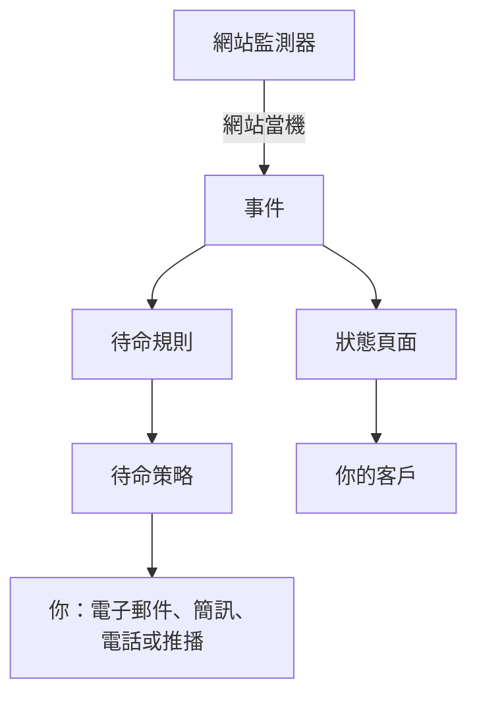

# 快速開始

本指南帶你在大約十五分鐘內，從一個新帳戶走到一套可運作的設定：一個每五分鐘檢查一次網站的監測器，一個在網站當機時呼叫你的待命策略，以及一個告知客戶的狀態頁面。它依照專案首頁上的 **歡迎使用 OneUptime 👋** 清單，以及清單各步驟開啟的引導式設定進行。

從其他工具移轉過來？請先 [匯入現有設定](/docs/introduction/getting-started#從其他工具移轉)：你的監測器、待命排程和狀態頁面都會一起移轉過來。

## 開始之前

- **一個帳戶。** 在 OneUptime Cloud 上，前往 [oneuptime.com](https://oneuptime.com/accounts/register) 註冊，並開啟寄給你的電子郵件中的連結。在你自己的安裝上，在瀏覽器中開啟它並註冊：第一個帳戶會成為主管理員。若要安裝 OneUptime，請參閱 [Docker Compose](/docs/installation/docker-compose)。
- **一個要監控的網站。** 任何透過 HTTP 或 HTTPS 回應的位址都可以，例如你公司的首頁。

## 建立專案

OneUptime 中的一切都位於專案中：你的監測器、事件、待命策略、狀態頁面，以及處理它們的人員。

:::steps
### 開始一個新專案

第一次登入時，OneUptime 會顯示 **沒有專案**。點選 **建立新專案**。如果已有人邀請你加入某個專案，請改為在同一頁面上接受邀請。

### 為它命名

輸入 **專案名稱**，例如你公司的名稱。在 OneUptime Cloud 上，還要在其下方選擇一個方案：已預設選取 Free，付費方案從免費試用開始。

### 建立它

點選 **建立專案**。專案首頁隨即開啟，頂端是 **歡迎使用 OneUptime 👋** 清單。 它會先問 **您想先做什麼？**：勾選 **在我的網站或 API 停擺時得知**、**出問題時呼叫合適的人** 和 **用狀態頁面告知我的客戶**，然後點擊 **繼續**。
:::

## 監控你的網站

:::steps
### 開啟網站設定

在清單中點選 **建立您的第一個監測器**。它會開啟引導式設定 **在我的網站或 API 停擺時得知**，在一個頁面上檢查你的網站、選擇通知誰並傳送一次測試。不能建立監測器的人會改為看到 **監測器** 清單。

### 輸入位址

在 **我們要檢查什麼？** 下，在 **網站或 API 位址** 中輸入網站的完整位址，例如 `https://example.com`，然後點選 **開始檢查**。探測器會立即檢查它，之後每 5 分鐘檢查一次：當網站沒有回應，或回傳錯誤時，監測器會變為 **離線** 並宣告事件。點選 **繼續**。

在 OneUptime Cloud 的 Free 方案中，監測器依用量計費，因此專案需要先有付款方式才能檢查你的網站：沒有付款方式時，該步驟會請你 [新增付款方式](/docs/configuration/billing#付款方式)。

### 選擇通知誰

在 **要通知誰？** 下，你已經在 **呼叫對象** 中。點選 **儲存並繼續**：這會建立 `Default on-call policy`，它會在專案中每個新事件與警示時呼叫你，一開始透過電子郵件。若也要呼叫已在專案中的團隊成員，請先點選 **新增團隊成員**。

### 傳送測試給自己

在 **傳送測試** 下，點選 **傳送測試呼叫給我**，選擇 **嚴重程度**，然後點選 **傳送測試呼叫**。開啟電子郵件中的連結（郵件中寫有 TEST），並在那裡確認這次呼叫。接著點選對話框中的 **完成**，再點選 **繼續**：設定會以一份它所設定內容的摘要結束。
:::

若要自己設定每個選項，或檢查網站以外的內容，請從 **產品** 選單開啟 **監測器**，然後點選 **建立監測器**。[建立監測器](/docs/monitor/create-monitor) 說明了表單和每種監測器類型。

若要同時檢查 API，並了解第一次檢查一直沒有結果時該怎麼辦，請依照 [在網站或 API 停擺時收到通知](/docs/guides/website-down) 操作。

## 在網站當機時收到呼叫

網站設定已經建立了 `Default on-call policy`，它會在每個新事件與警示時透過電子郵件呼叫你，因此清單會把 **設定待命政策** 標為已完成。它的引導式設定仍然可以新增你的手機、與你一起被呼叫的人，以及無人回應時會發生什麼。

:::steps
### 開啟待命設定

按 `Ctrl+K`（Mac 上按 `Cmd+K`），輸入 `get paged`，然後選擇 **出問題時呼叫合適的人**。在清單尚未勾選 **設定待命政策** 時，該步驟也會開啟同一個引導式設定。

### 選擇聯絡你的方式

在 **我們該如何聯絡你？** 下，你的登入電子郵件已經列出。若要接收推播通知，請從 App Store 或 Google Play 安裝 OneUptime On-Call 應用程式並登入，然後點選 **重新檢查**。若也要透過簡訊和電話聯絡你，請點選 **開啟簡訊和電話**，在 **你的電話號碼** 中輸入號碼，然後點選 **透過簡訊傳送驗證碼**：在 OneUptime Cloud 上，簡訊和電話從專案餘額中付費，所以該步驟會先請你儲值。點選 **繼續**。

### 選擇還有誰被呼叫

在 **還有誰待命？** 下，在 **待命策略** 中保留 `Default on-call policy`。若要與你一起呼叫團隊成員，請在 **新增到第一條上報規則** 下新增他們。點選 **儲存並繼續**。

### 決定無人回應時怎麼辦

在 **如果無人回應怎麼辦？** 下，當專案中只有你一個人時，選擇 **再次呼叫同一批人**。有團隊成員加入後，**呼叫其他人** 會呼叫你在 **接著呼叫** 下選擇的人。在 OneUptime Cloud 上，只有付費方案提供此選項。點選 **儲存並繼續**。

### 傳送測試呼叫

在 **傳送測試呼叫** 下，點選 **測試此策略**，選擇 **嚴重程度**，然後點選 **傳送測試呼叫**。從電子郵件、簡訊或電話中確認這次呼叫，然後點選對話框中的 **完成**，再點選 **繼續**。設定以 **呼叫已設定** 結束。
:::

> [!NOTE]
> 新專案中的簡訊和電話預設關閉。專案擁有者、Billing Admin 或具有 Manage Billing 權限的人，可以在 **專案設定 → 通知 → 通知管道** 下的 **通知管道** 卡片中開啟它們。

兩條待命規則執行這個策略：一條針對每個新事件，一條針對每個新警示。若要查看第一條，請從 **產品** 選單開啟 **事件**，在側邊選單中展開 **規則** 並選擇 **待命規則**：它符合 **所有事件**。若只想在部分事件（例如嚴重事件）時呼叫該策略，請在那裡編輯該規則，或點選 **建立Incident On-Call Rule** 新增你自己的規則。

若要改為逐一欄位建立策略，請從 **產品** 選單開啟 **待命**，然後點選 **建立待命策略**。關於更多層級、輪值以及每個層級等待多久，請參閱 [上報規則](/docs/on-call/escalation-rules) 和 [待命排程](/docs/on-call/schedules)。

關於設定的每個畫面，以及呼叫沒有送達時該怎麼辦，請依照 [透過電話、簡訊或推播接收呼叫](/docs/guides/paging) 操作。

## 發布狀態頁面

:::steps
### 開啟狀態頁面設定

在清單中點選 **發布狀態頁面**。它會開啟引導式設定 **發布狀態頁面**，為頁面命名、把你的監測器放到頁面上，並展示客戶看到的內容。不能建立狀態頁面的人會改為看到 **狀態頁面** 清單。網站設定的摘要也會以 **在狀態頁面上顯示** 開啟同一個設定。

### 命名並選擇你的監測器

在 **命名並選擇要顯示的內容** 下，保留它建議的 **狀態頁面名稱**，或輸入你自己的名稱。在 **顯示的內容** 下，勾選你的網站監測器，然後點選 **建立狀態頁面**。從這一刻起，頁面在它的連結上公開：任何知道其位址的人都能開啟它。

### 開啟頁面

在 **這是客戶看到的內容** 下，開啟 **公開連結** 下的位址：你的網站顯示為運作中。回到設定中，點選 **看起來不錯**。設定會以一份下一步該做什麼的摘要結束。
:::

若要改為手動建立頁面，請從 **產品** 選單開啟 **狀態頁面**，點選 **建立狀態頁面**，然後在它的 **概覽** 中透過 **新增監測器** 新增你的監測器。若要為頁面使用你自己的標誌和色彩，請參閱 [狀態頁品牌與網域](/docs/status-pages/branding-and-domains)。

若要透過 HTTPS 把狀態頁面放到你自己的網域上，請依照 [發布狀態頁面](/docs/guides/status-page) 操作。

## 邀請你的團隊

在清單中點選 **邀請您的團隊**，或從 **產品** 選單的 **設定** 下開啟 **使用者**。點選 **邀請使用者**，輸入對方的 **電子郵件**，並選擇一個 **團隊**：預設選取的是成員團隊。點選 **邀請**。OneUptime 會以電子郵件寄出邀請，而團隊決定對方可以做什麼。請參閱 [使用者、團隊與權限](/docs/permissions/index)。

## 試試看

宣告一個測試事件，看看整條流程如何運作。

:::steps
### 宣告測試事件

開啟 **事件** 並點選 **宣告事件**。輸入 **標題**，例如 `Test incident`，選擇 **事件嚴重性**，然後點選 **下一步**。在 **監測器** 下選擇你的網站監測器，這樣事件就會顯示在你的狀態頁面上。持續點選 **下一步** 直到摘要，然後點選 **宣告事件**。

### 觀察結果

一兩分鐘內，你的待命策略會呼叫你，事件也會顯示在你的狀態頁面上。

### 解決它

在事件頁面上點選 **解決**。呼叫停止，事件從你的狀態頁面上消失。
:::

> [!WARNING]
> 在你解決測試事件之前，任何開啟你狀態頁面的人都會看到它。請在分享頁面位址之前進行測試。

## 疑難排解

:::details 我沒有收到呼叫
開啟事件，在其側邊選單中選擇 **待命執行**：它會顯示你的策略是否執行，以及呼叫了誰。如果沒有執行，請檢查你的待命規則是否已啟用並指定了該策略。如果執行了，請檢查 **使用者設定 → 通知方式** 下的方式是否已驗證。
:::

:::details 事件沒有顯示在我的狀態頁面上
當事件的某個監測器在狀態頁面上時，狀態頁面才會顯示該事件。請檢查事件受影響的資源中是否列出了你的監測器，以及該監測器是否在狀態頁面上。
:::

:::details 監測器顯示離線，但我的網站正常
開啟監測器，查看探測器收到了什麼。請參閱 [網站監控](/docs/monitor/website-monitor) 的疑難排解章節。
:::

## 後續步驟

:::cards
- [核心概念](/docs/introduction/core-concepts): 你剛剛設定的內容背後的概念。
- [詞彙表](/docs/introduction/glossary): 你一路上遇到的每個詞彙，用一兩句話說明。
- [待命排程](/docs/on-call/schedules): 與團隊分擔待命。
- [狀態頁品牌與網域](/docs/status-pages/branding-and-domains): 讓狀態頁面展現你的品牌。
- [OpenTelemetry](/docs/telemetry/open-telemetry): 從你的應用程式傳送日誌、指標和追蹤。
:::
