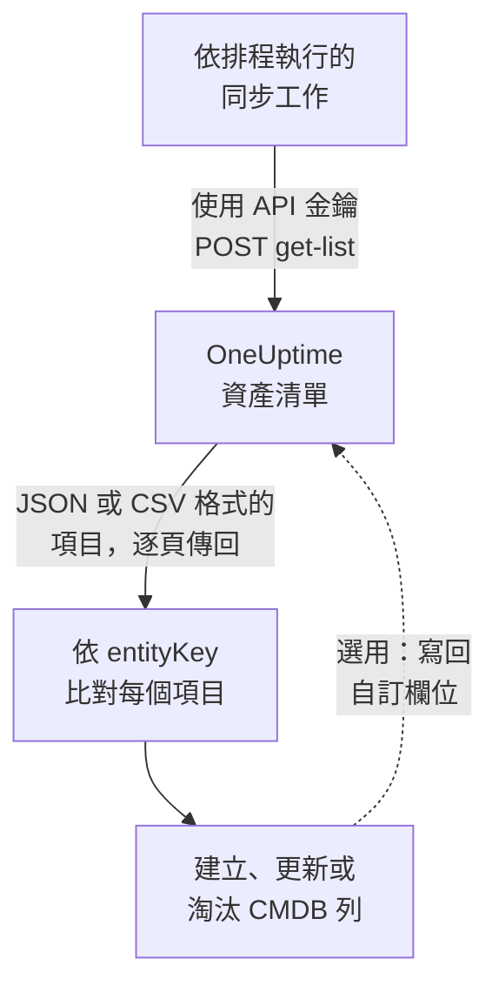

# 匯出至 CMDB

如果你已經在使用 CMDB 或資產台帳，OneUptime 並不打算取代它。OneUptime 擁有而 CMDB 通常缺少的，是一幅關於實際正在執行什麼的樣貌，而且不需要任何人維護就能保持最新：它從遙測中探索而來，也從已在監看你的網路和雲端帳戶的輪詢器中探索而來。本頁說明如何把這幅樣貌匯入你自己的記錄系統。

:::cards
- [同步如何運作](#同步如何運作): 一個依排程執行的工作，讀取清單並依穩定的鍵進行比對。
- [拉取目錄](#拉取目錄): 請求，逐頁取得 JSON 或 CSV。
- [資產詳細資料](#資產詳細資料): 主機和網路裝置共用的資訊和鍵。
- [寫回](#寫回): 把你的資產標籤推送到 OneUptime，並新增它看不到的東西。
:::

## 同步如何運作

同步是一個依排程執行的工作。它使用 API 金鑰透過 REST API 讀取資產清單，依身分鍵把每個項目與 CMDB 中的一列比對，並建立、更新或淘汰列，使兩者一致。它也可以把值寫回項目的自訂欄位。



## 可以拉取什麼

有三個 REST 資源，每個都具有 [OneUptime API](/docs/api-reference/api-reference) 的標準端點：

| 資源 | 端點 | 包含什麼 |
| --- | --- | --- |
| 資產清單項目 | `/api/inventory-item` | 環境中每樣東西一列 |
| 自訂欄位定義 | `/api/inventory-item-custom-field` | 你的專案自己的欄位詞彙 |
| 關係 | `/api/inventory-item-relationship` | 項目之間有方向的連結 |

資產清單項目中實用的欄：

| 欄 | 意義 |
| --- | --- |
| `_id` | OneUptime 的 ID：用作你的外部參照 |
| `entityType` | `host`、`k8s.pod`、`network.device`、`appliance`、… |
| `entityKey` | 穩定的身分雜湊。它在重新命名後保持不變，因此更適合用來比對 |
| `displayName` | 供人閱讀的名稱 |
| `source` | `discovered`、`inventory` 或 `manual` |
| `description` | 自由文字 |
| `identifyingAttributes` | 使項目成為其本身的屬性，永遠不會改變 |
| `descriptiveAttributes` | 在它上面觀察到的其他一切：請參閱下文的 [資產詳細資料](#資產詳細資料)、[主機資產屬性](#主機資產屬性) 和 [網路裝置資產屬性](#網路裝置資產屬性) |
| `customFields` | 你自己的欄位，以欄位名稱為鍵 |
| `resourceType` / `resourceId` | 指向更完整的 OneUptime 記錄的指標（如果有的話） |
| `firstSeenAt` / `lastSeenAt` | 首次和最後一次觀察到它的時間 |
| `isArchived` | 是否已移出作用中的清單 |

## 開始之前

同步需要一把可以讀取資產清單的 API 金鑰。在 OneUptime Cloud 上，API 金鑰需要 **Growth** 以上的方案。

:::steps
### 建立 API 金鑰

開啟 **專案設定 → 進階 → API 金鑰**，然後點選 **建立API 金鑰**。為它填寫 **名稱**，並在 **存取** 下選擇 **檢視者** 以讀取專案中的一切，或選擇 **稍後選擇權限** 以只授予同步所需的權限。

### 只授予所需的權限

唯讀匯出需要一項權限，即 **Read Telemetry Service**：資產清單共用遙測權限，而沒有自己的權限。在金鑰的頁面上點選 **新增權限** 並選擇它。若要寫回值，還需新增 **Edit Telemetry Service**。

### 複製金鑰

從金鑰的頁面複製 **API 金鑰**，並讓你的工作可以使用它：

```bash
export ONEUPTIME_API_KEY="your-api-key"
```
:::

金鑰透過每個請求的 `ApiKey` 標頭傳送，讀取的是它自己專案的資產清單，因此請求不需要指明專案。

## 拉取目錄

帶上你需要的欄，向清單端點傳送 `POST`。`select` 是必要的：API 只會傳回你要求的內容。

```bash
curl -X POST 'https://oneuptime.com/api/inventory-item/get-list' \
  -H "ApiKey: $ONEUPTIME_API_KEY" \
  -H 'Content-Type: application/json' \
  -d '{
    "query": { "isArchived": false },
    "select": {
      "_id": true,
      "entityType": true,
      "entityKey": true,
      "displayName": true,
      "source": true,
      "customFields": true,
      "descriptiveAttributes": true,
      "lastSeenAt": true
    },
    "sort": { "displayName": "ASC" },
    "limit": 100,
    "skip": 0
  }'
```

在自行託管的安裝中，請用你自己的 OneUptime 位址取代 `https://oneuptime.com`。回應為 `{ "data": [...], "count": ... }`，其中 `count` 是符合條件的項目總數。依你的 `limit` 遞增 `skip` 來翻頁，直到取完全部；`limit` 最大為 10,000。日期和 `_id` 以外的 ID 會經過包裝後傳回，形如 `{ "_type": "DateTime", "value": "..." }` 和 `{ "_type": "ObjectID", "value": "..." }`：請從 `value` 中讀取。

### 僅網路裝置

依 `entityType` 縮小清單：

```bash
curl -X POST 'https://oneuptime.com/api/inventory-item/get-list' \
  -H "ApiKey: $ONEUPTIME_API_KEY" \
  -H 'Content-Type: application/json' \
  -d '{
    "query": { "entityType": "network.device", "isArchived": false },
    "select": { "_id": true, "entityKey": true, "displayName": true, "customFields": true },
    "limit": 100,
    "skip": 0
  }'
```

每個網路裝置的 `descriptiveAttributes` 包含其主機名稱、IP 位址、序號、MAC 位址、製造商、型號、韌體、作業系統、角色、站點和位置：請參閱下文的 [網路裝置資產屬性](#網路裝置資產屬性)。輪詢器知道的其他資訊（例如介面和鄰居）位於 Network Device 記錄本身：順著 `resourceId` 存取 `/api/network-device/:id/get-item`，或直接拉取 `/api/network-device/get-list`。

### 以 CSV 格式

任何清單端點在加上 `?output-type=csv` 後都會以 CSV 而不是 JSON 回應：

```bash
curl -X POST 'https://oneuptime.com/api/inventory-item/get-list?output-type=csv' \
  -H "ApiKey: $ONEUPTIME_API_KEY" \
  -H 'Content-Type: application/json' \
  -d '{ "query": {}, "select": { "displayName": true, "entityType": true, "customFields": true }, "limit": 500, "skip": 0 }' \
  -o inventory.csv
```

儀表板中的 **All Items** 清單也以同樣方式匯出，包含你已開啟的自訂欄位欄。每項 [資產詳細資料](#資產詳細資料) 在那裡也是一欄：**主機名稱**、**IP 位址**、**序號**、**模型** 等一開始是隱藏的，請在欄選擇器中開啟它們，匯出就會為每項資訊包含一欄，無論該列是主機還是網路裝置。

## 資產詳細資料

主機和網路裝置以相同的資訊描述，並儲存在相同的鍵下。無論某一列是伺服器還是交換器，CMDB 的同一欄都儲存序號；儀表板中項目的 **資產詳細資料** 卡片對兩者都以相同順序顯示每項資訊。沒有任何來源回報過的資訊會顯示為 **未知**，而不是被省略，因此缺口一目了然。

| 資訊 | 鍵 | 在主機上 | 在網路裝置上 |
| --- | --- | --- | --- |
| 主機名稱 | `host.name` | 主機的名稱。它是主機的身分，因此位於 `identifyingAttributes` 中 | 裝置自己的名稱：其 SNMP `sysName`，否則為探索時找到的 NetBIOS 或 DNS 名稱。絕不會是它的 IP 位址 |
| IP 位址 | `host.ip` | 收集器回報的每個位址 | OneUptime 輪詢的位址（當它是 IP 位址時），否則為其探測器將該 DNS 名稱解析到的位址 |
| MAC 位址 | `host.mac` | 偵測取得 | 在裝置上輸入，或從走訪過的路由器的 ARP 表中得知 |
| 序號 | `host.serial_number` | 標記 | ENTITY-MIB |
| 製造商 | `device.manufacturer` | 標記 | ENTITY-MIB，否則為 `sysDescr` 或 `sysObjectID` 指明的內容 |
| 模型 | `device.model.name` | 標記 | ENTITY-MIB，否則為 `sysDescr` 指明的內容 |
| 韌體版本 | `device.firmware.version` | 標記 | ENTITY-MIB，否則為 `sysDescr` 指明的內容 |
| 作業系統 | `os.name` | `os.description`（或 `os.type`） | `sysDescr` 指明的內容：Cisco IOS、Junos OS、Arista EOS、Linux |
| 作業系統版本 | `os.version` | 偵測取得 | ENTITY-MIB，否則為 `sysDescr` 指明的內容 |
| Device Type | `device.type` | 標記。否則卡片會根據其作業系統和名稱加以分類（伺服器、防火牆……） | 它的角色：你指派的角色，否則為拓撲圖繪製它時使用的角色 |
| 位置 | `device.location` | 標記。否則卡片會顯示其雲端可用區域 | `sysLocation`。卡片會優先顯示其站點 |

下文的 [主機表](#主機資產屬性) 和 [網路裝置表](#網路裝置資產屬性) 詳細說明了每個值的來源。

## 主機資產屬性

主機上的 `descriptiveAttributes` 包含 CMDB 列通常需要的資產資訊，以其 OpenTelemetry 屬性名稱為鍵：

| 欄位 | 鍵 | 預設收集？ |
| --- | --- | --- |
| IP 位址 | `host.ip` | 是：機器有多個時以逗號分隔 |
| MAC 位址 | `host.mac` | 是：以逗號分隔，每個已啟用的介面一個，格式如 `AC-DE-48-23-45-67` |
| 架構 | `host.arch` | 是 |
| 機器 ID | `host.id` | 是：Windows 上為機器 GUID，Linux 上為 `/etc/machine-id` |
| 作業系統 | `os.type`、`os.description`、`os.version` | 是 |
| 雲端位置 | `cloud.provider`、`cloud.region`、`cloud.availability_zone` | 僅在有雲端偵測器時 |
| 序號 | `host.serial_number` | 需要一個設定步驟 |
| 製造商 | `device.manufacturer` | 需要一個設定步驟 |
| 型號 | `device.model.name` | 需要一個設定步驟 |
| 韌體（BIOS 或 UEFI）版本 | `device.firmware.version` | 需要一個設定步驟 |
| 作業系統名稱 | `os.name` | 僅來自會回報它的 SDK：否則由 `os.description` 指明作業系統 |
| 裝置類型 | `device.type` | 選用：以同樣方式標記（`Hypervisor`、`Workstation`） |
| 位置 | `device.location` | 選用：以同樣方式標記（`Frankfurt DC, Rack B4`） |

所有標為「是」的項目都來自收集器的 `resourcedetection` 處理器，並且已經包含在 OneUptime 為你產生的設定中。

`cloud.*` 鍵需要該處理器中有雲端偵測器：`detectors: [system, env, ec2]`，其他雲端則為 `gcp` 或 `azure`。隨附的設定只執行 `[system, env]`，因此在你新增偵測器之前，這三個鍵會維持空白。

序號、製造商、型號和韌體沒有資源偵測器：它們存放在機器的韌體中，在 Windows 上透過 WMI、在 Linux 上透過 DMI 讀取，因此在機器佈建時一次性標記到資源上。你希望出現在列中的裝置類型或位置也以同樣方式標記。[資產清單屬性](/docs/telemetry/host-otel-collector#清單屬性ipmac序號製造商型號韌體) 提供了每種作業系統的確切程式碼片段。`host.manufacturer`、`host.model.name`、`host.firmware.version` 和 `host.bios.version` 也被接受為其他寫法，並儲存在 `device.*` 鍵下（`device.serial_number` 則儲存在 `host.serial_number` 下），因此同步對每項資訊只需讀取一個鍵。

如果你的 CMDB 已經以硬體識別碼為鍵，`host.id` 值得考慮作為比對鍵：與 `entityKey` 不同，它是機器自己的 ID，因此與端點管理工具為同一台機器回報的值一致。

屬性只會新增，不會清空：停止回報的屬性仍保留在列中，因此你的同步已讀取過的值永遠不會悄悄消失。

## 網路裝置資產屬性

網路裝置（`entityType: network.device`）從其 Network Device 記錄鏡像而來，其 `descriptiveAttributes` 對相同的資訊使用與主機相同的鍵，因此無論該列是伺服器還是交換器，CMDB 的同一欄都儲存序號：

| 欄位 | 鍵 | 來源 |
| --- | --- | --- |
| 主機名稱 | `host.name` | 裝置自己的名稱：其 SNMP `sysName`，否則為探索時找到的 NetBIOS 或反向 DNS 名稱。只有 IP 位址能命名它時會省略 |
| IP 位址 | `host.ip` | OneUptime 輪詢的位址（當它是 IP 位址時）。對於以 DNS 名稱輪詢的裝置，為其探測器最近一次將該名稱解析到的位址 |
| DNS 名稱 | `net.device.dns_name` | 探索時找到的反向 DNS 名稱，或 OneUptime 輪詢的 DNS 名稱 |
| MAC 位址 | `host.mac` | 在裝置上輸入，或從走訪過的路由器的 ARP 表中得知 |
| 製造商 | `device.manufacturer` | ENTITY-MIB `entPhysicalMfgName`，否則為 `sysDescr` 指明的廠商，否則為 `sysObjectID` 的供應商 |
| 型號 | `device.model.name` | ENTITY-MIB `entPhysicalModelName`，否則為 `sysDescr` 指明的型號 |
| 序號 | `host.serial_number` | ENTITY-MIB `entPhysicalSerialNum` |
| 韌體版本 | `device.firmware.version` | ENTITY-MIB `entPhysicalFirmwareRev`，否則為 Ubiquiti、HPE 和 Aruba 裝置上 `sysDescr` 指明的韌體 |
| 作業系統 | `os.name` | `sysDescr` 指明的作業系統 |
| 軟體或作業系統版本 | `os.version` | ENTITY-MIB `entPhysicalSoftwareRev`，否則為 `sysDescr` 指明的版本 |
| 系統描述 | `os.description` | `sysDescr` |
| 裝置類型 | `device.type` | 你為裝置指派的角色，否則為拓撲圖對它分類的角色，使用你的專案為該角色取的名稱 |
| 位置 | `device.location` | `sysLocation`，除非它是代理程式的預設值，例如 Net-SNMP 的「Sitting on the Dock of the Bay」 |
| 站點 | `oneuptime.site.name` | 裝置所指派到的 Network Site |
| 輪詢位址 | `net.device.hostname` | OneUptime 輪詢的位址：IP 位址或 DNS 名稱。為在 `host.name` 和 `host.ip` 出現之前撰寫的同步而保留 |

ENTITY-MIB 列會在裝置的首次 SNMP 走訪之後填入。未被走訪的裝置（僅透過 ping 監控或尚未輪詢）仍會從對其位址的最近一次探索掃描透過 SNMP 讀取的內容取得名稱、製造商、作業系統和位置，並從走訪過的路由器的 ARP 表取得 MAC 位址。未實作 ENTITY-MIB 的裝置沒有可回報的序號或韌體。不過對許多平台而言，它的 `sysDescr` 仍會指明型號和作業系統：Cisco Meraki MX 回報 `Meraki MX85`，從而填入製造商和型號。`sysDescr` 沒有已知格式的平台不會新增任何內容，而不是去猜測。

儲存在裝置上的值（手動輸入或透過 API 設定）絕不會被探索讀取的內容取代。在裝置自身走訪讀取的值和掃描讀取的值之間，使用較新的那個。只有當掃描在該位址找到的是同一台機器時，才會使用它讀取的內容：當它讀取的系統名稱、`sysObjectID` 或 NetBIOS 名稱與裝置的不符時，它在那裡讀取的任何內容都不會被使用。項目的 **資產詳細資料** 卡片會說明每個值的來源和時間。

主機名稱永遠不會是 IP 位址。只有位址能命名的裝置有 `host.ip`，沒有 `host.name`。一旦它的 SNMP 走訪回報了系統名稱，`host.name` 會在下一輪處理時出現。

這些值每十五分鐘從 Network Device 記錄複製一次，並且會 **取代** 先前的值，而不是附加到先前的值上，因此在裝置上清除的值（例如移除的 MAC 位址）也會從資產清單項目中消失。

沒有*可用升級*版本：SNMP 沒有用於此的標準物件，因此 OneUptime 記錄的是裝置正在執行的版本。

## 將項目與 CMDB 列比對

依 `entityKey` 比對，而不是依 `displayName`。它是項目身分屬性的雜湊，因此在重新命名和新標籤之後保持不變：重新加上標籤的主機在顯示名稱改變時仍保留相同的鍵。`_id` 同樣穩定，如果你只與一個專案往來，它是最簡單的外部鍵。

`customFields` 中的日期是 ISO-8601 UTC 字串，CSV 匯出也以這種方式寫入，而不是用儀表板顯示的較友善形式，因此匯入時不會出現剖析上的意外。

## 保持最新

沒有變更動態。以適合你的間隔輪詢清單端點，並依 `entityKey` 比較。`lastSeenAt` 表示項目最後一次被觀察到的時間，這通常是找出自上次執行以來變得靜默之項目最省事的方法。

在兩次執行之間消失的項目，要麼已經到期（探索的項目靜默時間超過了其時間範圍），要麼其所屬記錄已被刪除。帶有自訂欄位值的鏡像項目在其記錄消失時會被封存而不是刪除，因此用 `"isArchived": true` 查詢，即可在不遺失其附帶資產資料的情況下查看已淘汰的項目。

## 寫回

相同的端點也接受寫入，因此同步可以把值推送到 `customFields`：例如，把你的 CMDB 已擁有的資產標籤標記到對應的 OneUptime 項目上。為此，金鑰需要 **Edit Telemetry Service**。

你也可以為 OneUptime 看不到的東西新增項目：使用 `POST /api/inventory-item`，`entityType` 為 `external.service`、`external.database` 或 `appliance`，並提供 `displayName`。OneUptime 會為你計算身分鍵，這些項目永遠不會到期。為此，金鑰需要 **Create Telemetry Service**。

## 疑難排解

:::details 每個請求都被拒絕並傳回 402 Payment Required
在 OneUptime Cloud 上，只有當專案處於 **Growth** 以上的方案時，API 金鑰才能運作。不會刪除任何內容：專案一回到該方案，金鑰就會原樣恢復運作。請參閱 [低於其方案時的 API 金鑰和 SCIM](/docs/api-reference/api-reference#低於其方案時的-api-金鑰和-scim)。
:::

:::details 每個請求都傳回 422 You do not have permissions
該金鑰沒有任何可讀取資產清單的權限。用 **稍後選擇權限** 建立的金鑰在取得權限之前什麼也做不了：依照 [開始之前](#開始之前) 的說明，在其頁面上新增 **Read Telemetry Service**。
:::

:::details 清單傳回時缺少我需要的欄
清單只會傳回 `select` 指明的欄以及 `_id`。把你讀取的每一欄都加入 `select`，包括 `descriptiveAttributes` 和 `customFields`。
:::

:::details 我預期的項目不見了
當你傳送 `"isArchived": false` 時，已封存的項目會被排除。探索的項目靜默超過其時間範圍後會被移除，鏡像的項目會隨其記錄一起消失。要求 `"isArchived": true` 即可查看已封存的項目。
:::

## 後續步驟

:::cards
- [資產清單概觀](/docs/inventory/overview): 項目從哪裡來，以及每個項目保留多久。
- [資產清單自訂欄位](/docs/inventory/custom-fields): 定義你的同步讀寫的欄位。
- [OneUptime API 參考](/docs/api-reference/api-reference): 請求、狀態碼，以及每次寫入都遵循的規則。
:::
