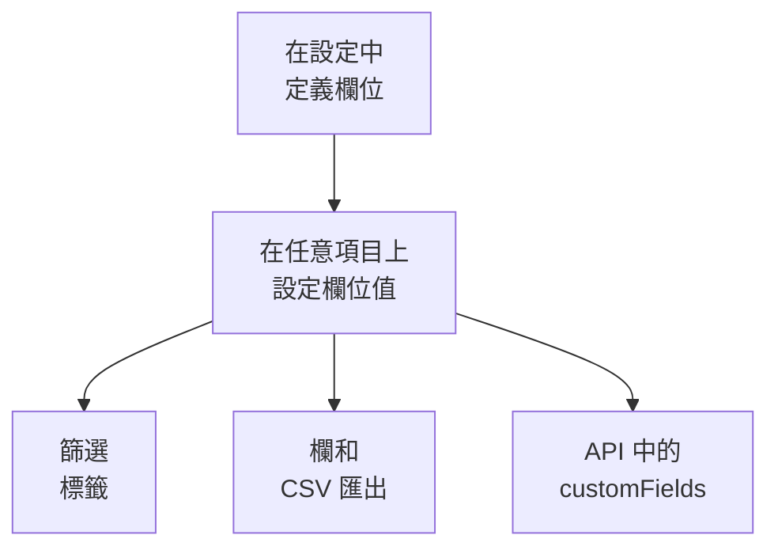

# 資產清單自訂欄位

OneUptime 會探索你的環境裡有什麼。自訂欄位記錄的是再怎麼監看也無從得知的資訊：貼紙上的序號、保固到期的日期、哪個團隊擁有某樣東西、它是在使用中還是放在備品抽屜裡。為專案定義一次欄位，然後在每個項目上填寫。

:::cards
- [自訂欄位如何運作](#自訂欄位如何運作): 一套詞彙，用在每個項目上，無論其來源。
- [定義欄位](#定義欄位): 建立欄位、選擇類型、列出下拉式選單的選項。
- [篩選清單](#篩選清單): 點兩下就能找到下一季到期的東西。
- [注意事項與限制](#注意事項與限制): 重新命名、重複、日期和已刪除的欄位。
:::

## 自訂欄位如何運作

欄位為專案定義一次，每個項目都可以為它存一個值：OneUptime 探索的項目、它鏡像的項目，以及你手動新增的項目都可以。欄位會成為清單上方的篩選標籤、一個可選用的欄，以及 CSV 匯出中的一欄。API 讀寫相同的值，位於每個項目的 `customFields` 之下。

> [!NOTE]
> 在 OneUptime Cloud 上，自訂欄位屬於 **Growth** 以上的方案。低於該方案時，欄位無法定義、列出或變更：API 會回應 `402 Payment Required`，清單也不會顯示自訂欄位的篩選標籤或欄。

## 定義欄位

:::steps
### 開啟自訂欄位頁面

前往 **產品 → 資源 → 資產清單**，在側邊選單中開啟 **設定**，然後開啟 **自訂欄位**。

### 建立欄位

點選 **建立Inventory Item Custom Field**。為它填寫 **欄位名稱**、可選填的 **欄位描述**，並從下表中選擇 **欄位類型**。

### 列出下拉式選單的選項

對於下拉式選單類型，在 **下拉選單選項** 下新增選項。每個選項都可以帶一種顏色，在表格儲存格和篩選標籤中以相同方式使用：選擇一種具名顏色、**無顏色**，或選擇 **自訂顏色** 以使用精確的色碼。拖曳選項的把手可以改變它在清單中的位置。
:::

| 類型 | 適用於 |
| --- | --- |
| **文字** | 序號、資產標籤、機架位置、採購單號 |
| **數字** | 成本、機架單元、連接埠數 |
| **布林值** | 是否在支援期內、是否在 PCI 範圍內 |
| **下拉式選單（單選）** | 生命週期狀態、環境、重要程度：從固定清單中選一個答案 |
| **下拉式選單（多選）** | 法規遵循範圍、標籤：從固定清單中選多個答案 |
| **日期** | 採購日期、保固到期日、終止支援日期 |
| **日期與時間** | 上次稽核時間、除役時間 |
| **長文字** | 存取說明、備註：多行純文字 |
| **格式化文字（Markdown）** | 帶格式和連結的備註，在 Markdown 編輯器中撰寫 |
| **檔案** | 保固證書、已簽署的採購訂單、機架標籤的照片：一個檔案 |
| **多個檔案** | 手冊、發票和照片：最多 10 個檔案 |

## 一套完整的資產詞彙範例

典型的硬體資產台帳可以直接對應到這些欄位：

| 欄位名稱 | 類型 | 範例 |
| --- | --- | --- |
| `Serial Number` | 文字 | `FDO24160ABC` |
| `Asset Tag` | 文字 | `IT-004821` |
| `Purchase Date` | 日期 | 2024-03-11 |
| `Warranty Expiry` | 日期 | 2027-03-10 |
| `Lifecycle Status` | 下拉式選單 | 使用中、備用、維修中、已除役 |
| `Assigned Site` | 下拉式選單 | 倫敦資料中心、法蘭克福資料中心、總部辦公室 |
| `Owner Team` | 下拉式選單 | 網路、平台、資安 |
| `Cost Centre` | 文字 | `CC-4410` |

在項目的 **自訂欄位** 頁面上設定這些值。任何項目都可以填寫，無論其來源，因此 OneUptime 探索的交換器和它鏡像的網路裝置，都與你手動新增的設備使用同一套資產詞彙。

## 篩選清單

每個自訂欄位都會成為 **All Items** 清單上方的篩選標籤，標籤會提供適合其類型的比較方式：

| 欄位類型 | 比較方式 |
| --- | --- |
| **文字**、**長文字**、**格式化文字（Markdown）** | 是、不是、包含、不包含、開頭是、結尾是、為空、不為空 |
| **數字** | 是、不是、大於、大於或等於、小於、小於或等於、為空、不為空 |
| **布林值**、**下拉式選單（單選）**、**下拉式選單（多選）** | 是、不是、為空、不為空 |
| **日期**、**日期與時間** | 是、之前、之後、之間、為空、不為空 |
| **檔案**、**多個檔案** | 是 |

**檔案** 或 **多個檔案** 欄位的篩選標籤只問一件事：欄位是 **有檔案** 還是 **無檔案**。

篩選標籤之間以「且」組合，因此「Warranty Expiry 在 2026-10-01 之前，且 Lifecycle Status 是 使用中」就是清單的一個檢視。這正是資產台帳存在所要回答的問題，也是使用日期類型而不是在文字欄位中寫日期的原因：文字欄位照樣可以儲存 `2026-10-01`，卻無法告訴你下一季有什麼會到期。

自訂欄位的欄一開始是隱藏的：請在欄選擇器中開啟。它們無法排序，因為這些值一起存放在一個 JSON 欄中，而清單無法依該欄排序。

## 注意事項與限制

- 值會依欄位名稱存放在每個項目上。重新命名欄位不會搬移已依舊名稱存放的值。事件的自訂欄位是例外：重新命名其中一個會搬移它的值（請參閱 [重新命名欄位](/docs/incidents/settings#重新命名欄位)）。
- 在項目已經有值之後，下拉式選單的選項仍可以新增、重新命名、拖曳排序和移除。重新命名的選項會在所有用到它的項目上跟著變更；移除的選項會保留在用到它的項目上，並顯示為已不再是選項，除非你為這些項目另選一個（請參閱 [變更下拉選單選項](/docs/incidents/settings#變更下拉選單選項)）。
- 沒有任何機制會讓值保持唯一。兩個項目可以有相同的序號，沒有什麼會阻止你。
- 日期以 ISO-8601 UTC 時間戳記儲存，並以你自己的時區顯示。
- 刪除欄位會將它從清單和篩選列中移除。已經寫入的值會保留在項目上。
- **檔案** 或 **多個檔案** 欄位接受每個不超過 10 MB 的檔案，種類見 [檔案欄位](/docs/incidents/settings#檔案欄位)，且須在本專案中上傳。只有能檢視該項目的人可以下載這些檔案；一個檔案不再被任何地方引用時即會刪除。

## 後續步驟

:::cards
- [資產清單概觀](/docs/inventory/overview): 項目從哪裡來，以及每個頁面顯示什麼。
- [匯出至 CMDB](/docs/inventory/cmdb-sync): 把項目及其自訂欄位匯入另一個系統。
- [事件自訂欄位](/docs/incidents/settings#自訂欄位): 事件上也有相同的欄位類型，還多了幾種。
:::
