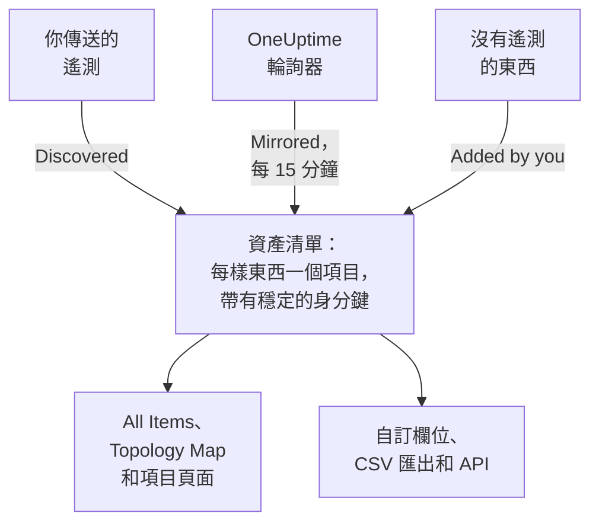

# 資產清單概觀

資產清單是一份清單，彙整了 OneUptime 對你的環境所知道的一切：服務、主機、Kubernetes 物件、虛擬機器、網路裝置、雲端資源、IoT 裝置、無伺服器函式，以及完全不傳送遙測的東西。其中大部分會根據 OneUptime 已在監看的內容自動填入。你要補上的是監看無法告訴它的資訊：某樣東西的用途、誰擁有它、保固何時到期。[詞彙表](/docs/introduction/glossary#你監看的對象) 說明了其中每一類紀錄是什麼。

:::cards
- [項目如何進入資產清單](#項目如何進入資產清單): 探索、鏡像，或由你新增。
- [熟悉各個頁面](#熟悉各個頁面): 資產清單的頁面，以及每個項目自己的頁面。
- [從 Esper 匯入裝置](#從-esper-匯入裝置): 你的 Esper 租用戶註冊的每台 Android 裝置和 Apple 裝置，並保持最新。
- [從 Microsoft Intune 匯入裝置](#從-microsoft-intune-匯入裝置): Intune 管理的每台 Windows 電腦、Mac、iPhone、iPad 和 Android 裝置，並保持最新。
- [手動新增](#手動新增): 第三方 API、外部資料庫或設備。
- [封存而不是刪除](#封存而不是刪除): 整理清單並讓它保持整齊的方法。
:::

## 項目如何進入資產清單

OneUptime 為了監控本來就在觀察你的環境，因此目錄是根據它觀察到的內容建立的，而不是根據某人記得輸入的內容。每個項目都有一個來源，來源決定了項目歸誰管理：你能否編輯它，以及它能否自行消失。

| 來源 | API 中的值 | 來自哪裡 | 保留多久 |
| --- | --- | --- | --- |
| **已發現** | `discovered` | 遙測抵達時讀取的 OpenTelemetry 資源屬性：傳送遙測的服務、主機、Kubernetes 物件或虛擬機器。 | 每批遙測都會重新登記。靜默時間超過其類別的時間範圍後會被移除（見下文）。 |
| **已鏡像** | `inventory` | OneUptime 輪詢器維護的記錄：網路裝置、雲端資源、IoT 裝置、無伺服器函式、RUM 應用程式、Docker 主機、Podman 主機，以及 Esper 或 Microsoft Intune 連線匯入的裝置。每 15 分鐘複製一次；Esper 裝置則在其連線每次被讀取時複製。 | 與其記錄同在。刪除記錄，項目也會隨之消失。 |
| **由您新增** | `manual` | 由你為 OneUptime 看不到的東西新增：第三方 API、由廠商代管的資料庫、機架裡的設備。 | 直到你刪除它。不會自動到期。 |

探索或鏡像的項目無法重新命名，也無法改為其他類型：來源會在下一輪處理時覆寫這些變更。項目的 **設定** 頁面會告訴你應在哪裡做持久的變更。無論來源為何，你隨時都能為任何項目加上的是自訂欄位值：請參閱 [資產清單自訂欄位](/docs/inventory/custom-fields)。

### 靜默的項目保留多久

探索的項目有心跳。每當它的遙測抵達，最後出現時間就會往前推進，清單的 **狀態** 欄會顯示這個時間有多近。來自 Esper 或 Intune 的裝置也是如此：它每次向其裝置管理服務簽入時都會更新。其他鏡像的項目和你新增的項目沒有心跳，因此它們的狀態維持空白，而不是顯示警示。

| 狀態 | 意義 |
| --- | --- |
| **即時** | 最近 30 分鐘內出現過。 |
| **最近** | 最近一天內出現過。 |
| **已過時** | 超過一天沒有出現。**已沉寂** 頁面會列出這些項目。 |

OneUptime 每 3 小時移除一次靜默時間超過其類別時間範圍的探索項目，已封存的也包括在內，它們的自訂欄位值也會隨之消失。鏡像的項目和你新增的項目永遠不會以這種方式被移除。

| 項目類別 | 沒有遙測多久後被移除 |
| --- | --- |
| Pod、Deployment、Proxmox 客體、OpenStack 執行個體和 VMware 虛擬機器 | 1 天 |
| Kubernetes 節點和命名空間、Proxmox 節點、OpenStack 虛擬化主機、VMware 主機、叢集和資料存放區，以及你的追蹤所呼叫的資料庫和遠端服務 | 7 天 |
| 服務、主機、Kubernetes、Proxmox 和 Ceph 叢集、OpenStack 雲端、儲存陣列、vCenter 和 Docker Swarm 叢集 | 30 天 |

OneUptime 探索到的關係如果 30 天內沒有再次出現，就會被移除。

## 熟悉各個頁面

開啟 **產品 → 資源 → 資產清單**。它的側邊選單包含以下頁面。**依來源**、**設定**、**說明** 和 **進階** 一開始是收合的：點選區段標題即可展開。

| 頁面 | 你在那裡能找到什麼 |
| --- | --- |
| **概覽** | 你有多少項目、它們是什麼、有多少已經靜默，以及最近新增了什麼。 |
| **所有項目** | 所有項目。依名稱、描述或身分鍵搜尋，依類型、來源、狀態或自訂欄位縮小清單，並手動新增項目。 |
| **受管理的裝置** | 你的 Esper 和 Microsoft Intune 連線，以及它們匯入的每台裝置，附帶其狀態、群組、型號和作業系統。 |
| **拓撲地圖** | 項目之間如何連接：服務、它們呼叫的對象，以及它們執行所在的主機、Pod 和裝置。 |
| **已沉寂** | 超過一天沒有動靜的項目：沒有傳送遙測的探索項目，以及不再向 Esper 簽入的裝置。 |
| **依來源** | 某一個來源的項目：**已發現**、**已鏡像** 或 **由您新增**。 |
| **設定 → 自訂欄位** | 你的專案在每個項目上記錄的欄位。 |
| **說明 → 文件** | 資產清單的簡短指南，以及它能辨識的項目類別。 |
| **進階 → 已封存** | 你封存的項目。可以在這裡取消封存。 |

開啟一個項目，它自己的側邊選單中有 **概覽**（類型、來源和狀態，以及在它上面觀察到的每個屬性）、**連線** 和 **自訂欄位**；**日誌**、**追蹤**、**指標**、**效能剖析** 和 **例外**；以及 **事件**、**警示** 和 **排定維護**。**進階** 底下有 **設定**、**稽核日誌** 和 **刪除項目**。遙測頁面顯示項目本身傳送的內容。事件、警示和維護事件屬於該項目所代表的服務、主機或 Kubernetes 叢集；在其他任何項目上，這些頁面會告訴你應該改看哪個資源。

### 資產詳細資料

主機或網路裝置有一張 **資產詳細資料** 卡片，以相同的方式描述兩者：主機名稱、IP 位址、MAC 位址、序號、製造商、型號、韌體版本、作業系統、作業系統版本、裝置類型和位置。Android 裝置的卡片還有其安全性修補程式等級，來自 Android 代理程式或 Esper。沒有任何來源回報過的資訊會顯示為 **未知**，卡片會說明原因以及如何補齊這些未知的資訊：裝置未透過 SNMP 回報這些資訊、裝置尚未被讀取，或 Meraki 裝置的這些資訊保存在其儀表板中。

- 主機的資訊來自其遙測中的資源屬性：IP 和 MAC 位址、架構和作業系統一開始就有，序號、製造商、型號和韌體則在你標記後才有。
- 網路裝置的資訊來自其 SNMP 輪詢、角色和站點。其輪詢尚未讀取的資訊來自探索：對其位址的最近一次掃描、路由器的 ARP 表，或其探測器的 DNS 查詢。沒有 ENTITY-MIB 的裝置（例如 Meraki MX）仍會從系統描述取得製造商、型號和作業系統，並從自身的連接埠取得 MAC 位址。它的 IP 位址永遠不會顯示為主機名稱。
- 當 [Meraki 連線](/docs/monitor/network-traffic#不用-netflow-的-cisco-meraki) 讀取其組織時，Meraki 裝置還會從 Meraki 儀表板取得其輪詢留空的資訊，其中包括序號、型號和韌體。

**所有項目** 可以找出需要處理的 Android 裝置。它的 **安全性修補程式等級** 篩選條件會列出 **需要更新** 的裝置，也就是安全性修補程式等級距今超過 90 天的裝置，這與 [主機監控](/docs/monitor/host-monitor) 的 Security Patch Out of Date 警示所依據的規則相同。它的 **代理程式權限** 篩選條件會列出 [Android 代理程式](/docs/telemetry/android-agent) 仍缺少 READ_LOGS、READ_DROPBOX_DATA 或使用狀況存取權的裝置。每個篩選條件都有一個同名的欄，在你開啟之前是隱藏的，CSV 匯出也會包含它。

卡片會說明每項資訊的來源和時間。大多數資訊共有的來源，例如主機的收集器、網路裝置自身的 SNMP 輪詢或讀取它的探索掃描，只在資訊下方提及一次。其他來源，例如路由器的 ARP 表或儲存在裝置上的值，會在對應資訊下方說明。儲存在網路裝置上的值絕不會被探索讀取的內容取代，兩者不同時，卡片會同時顯示兩者。

網路裝置的卡片上有一個 **重新整理** 按鈕，供有權編輯網路裝置的人使用。它會立即重新讀取裝置：其探測器會在一分鐘內輪詢它，其 Meraki 連線會重新讀取組織。卡片會說明新的讀取結果何時到達，或探測器無法連線到該裝置；讀取結果一到，項目就會從裝置複製。

這些資訊也是 **所有項目** 清單中的欄，在你開啟之前是隱藏的，並會納入清單的 CSV 匯出。[匯出至 CMDB](/docs/inventory/cmdb-sync#資產詳細資料) 列出了它們的鍵。

### 連線

項目的 **連線** 頁面列出它在兩個方向上的相鄰項目，分成 **呼叫**、**呼叫方**、**執行於** 和 **相關** 幾組。每組會顯示總數（連線超過 100,000 個的組會顯示「100,000+」），**顯示更多** 可以翻看其餘部分，因此繁忙的叢集、命名空間或節點會顯示每一個連線，而不只是前幾個。這個頁面不受時間範圍限制：它包含透過 API 手動新增的關係，以及已封存的相鄰項目。已不在資產清單中的相鄰項目會以其鍵顯示。

## 從 Esper 匯入裝置

連線一個 Esper 租用戶後，它註冊的每台裝置都會出現在資產清單中：它的 Android 裝置，包括應用程式從未啟動過的裝置，以及它的 iPhone、iPad 和 Apple TV。每台裝置是一台主機，帶有只有 Esper 才知道的資訊：它的群組，它的作業系統和組建編號，它的序號和 IMEI，它的電池和儲存空間，以及 Android 裝置的安全性修補程式等級和已安裝的應用程式。Esper 不會主動傳送任何內容，因此 OneUptime 依排程讀取：每 15 分鐘讀取一次裝置，每 6 小時讀取一次每台 Android 裝置的應用程式。

:::steps
### 在 Esper 中建立 API 金鑰

在 Esper 主控台中，於 API Key Management 下建立一個金鑰。OneUptime 只會讀取資料，因此只要金鑰所屬使用者的 Esper 角色能夠讀取裝置、群組和應用程式就足夠了。金鑰一旦被取代，或其所屬使用者被刪除，就會失效。

### 連線租用戶

前往 **產品 → 資源 → 資產清單**，然後開啟 **受管理的裝置**，點選 **連線裝置管理服務**，然後選擇 **Esper**。輸入 **租用戶**，也就是你的 Esper 主控台位址中 `.esper.cloud` 之前的名稱（`acme.esper.cloud` 對應 `acme`），以及 **API 金鑰**。**更多欄位** 中包含連線的名稱和讀取頻率。

### 檢查首次讀取

**連線** 會在儲存任何內容之前測試金鑰：它會告訴你一次讀取將匯入多少台裝置，或者告訴你哪裡出錯以及如何修正。首次讀取會在一分鐘內開始，連線所在的列會顯示讀取結果。
:::

| Esper 回報的內容 | 顯示位置 |
| --- | --- |
| 型號、製造商、序號、作業系統及其版本、組建編號，以及 IP 和 MAC 位址 | 裝置的 **資產詳細資料** 卡片，以及 **所有項目** 的欄 |
| 狀態、上次簽入、群組、安全性修補程式等級、IMEI、電池、儲存空間和 Esper 代理程式 | 裝置的 **Esper** 卡片，以及 **受管理的裝置** 的 **裝置** 清單 |
| 應用程式及其版本 | 裝置的 **已安裝的應用程式** 清單 |

### 一台裝置，而不是兩台

從裝置傳送遙測的應用程式或 Android Agent，只要以與 Esper 相同的方式命名裝置，就會與 Esper 匯入的裝置合併為一個項目。請根據 Esper 在每台裝置上填入的受管理設定，設定以下資源屬性：

| 資源屬性 | 受管理設定值 | 說明 |
| --- | --- | --- |
| `host.name` | `${esper.deviceName}` | 裝置在 Esper 中的名稱，例如 `ESP-ID-AAAAW`。必填。 |
| `host.serial_number` | `${esper.serialNumber}` | 裝置的序號。選填。 |

OneUptime 先依裝置在 Esper 中的名稱尋找其項目，再依其序號尋找，都不相符時才新建一個。Android Agent 會依據其 `device_name` 和 `device_serial` 設定來設定這兩個屬性，[Android 端設定](/docs/rum/android-setup#從-esper-匯入裝置群) 則示範了應用程式的受管理設定。

### 裝置沉寂或離開 Esper 時

超過 30 分鐘未簽入的 Android 裝置會顯示為 **離線**，並說明它上次簽入是多久以前；iPhone、iPad 和 Apple TV 在 Apple 推播服務喚醒它們時才簽入，間隔可能長達數小時，因此超過一天未簽入才顯示為 **離線**。其項目的 **狀態** 取決於它的上次簽入，如果它的遙測較新，則取決於遙測，因此靜默一天的裝置會出現在 **已沉寂** 頁面上。

從 Esper 移除的裝置會標示為 **已移除**，其項目會被封存：它會離開清單，並在 **進階 → 已封存** 下等待。回到 Esper 的裝置也會回到清單中。裝置離開 30 天後，它會被刪除，其項目也會被刪除，除非遙測或你為該項目新增了內容。

### 裝置停止簽入時收到警示

在 **受管理的裝置** 中，點選連線所在列的 **設定警示**，然後建立 **Esper Android Device Stopped Checking In** 和 **Esper Apple Device Stopped Checking In**。前者會為每台超過 1 小時未向 Esper 簽入的 Android 裝置各開啟一則以該裝置命名的警示，後者則為每台超過一天未簽入的 Apple 裝置開啟，裝置再次簽入後警示即被解決。

每次讀取該連線時，都會以指標 `oneuptime.managed_device.check_in.age` 記錄每台裝置上次簽入距今多少分鐘，監測器每 5 分鐘檢查一次每台裝置的最新值。同時執行 Android Agent 的裝置交由 **Host Stopped Reporting** 監測，因此不會重複發出警示；從 Esper 移除的裝置，其警示會被解決。讀取失敗時不會記錄任何內容，因此在下一次讀取之前，警示既不會開啟也不會解決。對於夜間關機的裝置群，請調高監測器的閾值。

## 從 Microsoft Intune 匯入裝置

連線一個 Microsoft Intune 租用戶後，Intune 管理的每台裝置都會出現在資產清單中：它的 Windows 電腦、Mac、iPhone、iPad、Android 裝置和 Linux 電腦。每台裝置是一台主機，帶有 Intune 掌握的資訊：它的類別，它的作業系統及其版本，它的序號和 IMEI，它的合規性、擁有權和註冊方式，它的儲存空間，以及 Intune 在它上面探索到的應用程式。Intune 不會主動傳送任何內容，因此 OneUptime 依排程讀取：每 15 分鐘讀取一次裝置，每 6 小時讀取一次每台裝置的應用程式。

:::steps
### 在 Microsoft Entra 中註冊應用程式

在 Microsoft Entra 系統管理中心開啟 `App registrations`，點選 `New registration`。為它命名，保留 `Accounts in this organizational directory only`，然後註冊。它的 `Overview` 頁面會顯示 OneUptime 需要的兩個識別碼：`Application (client) ID` 和 `Directory (tenant) ID`。

### 讓它讀取 Intune 的裝置

在 `API permissions` 下，依序點選 `Add a permission`、`Microsoft Graph`、`Application permissions`，然後新增 `DeviceManagementManagedDevices.Read.All`。接著點選 `Grant admin consent`，只有租用戶的管理員才能這麼做。OneUptime 只需要這一個權限：它能列出裝置以及 Intune 在裝置上探索到的應用程式，而且什麼也改不了。

### 建立用戶端祕密

在 `Certificates & secrets` 下，點選 `New client secret`，複製它的 `Value`，而不是它的 `Secret ID`：Microsoft 只會顯示一次這個值。祕密到期後就無法使用，所以請在到期前建立新的祕密，並在編輯連線時填入。

### 連線 Intune 租用戶

前往 **產品 → 資源 → 資產清單**，然後開啟 **受管理的裝置**，點選 **連線裝置管理服務**，然後選擇 **Microsoft Intune**。輸入 **租用戶識別碼**、**應用程式 (用戶端) 識別碼** 和 **用戶端密鑰**。如果租用戶位於美國政府雲端中，請在 **更多欄位** 下的 **雲端** 中選擇它。**連線** 會在儲存任何內容之前測試應用程式註冊：它會告訴你一次讀取將匯入多少台裝置，或者哪裡出了問題以及如何修正。
:::

裝置大約每 8 小時向 Intune 簽入一次，它的上次簽入就是它最後一次簽入的時間：一天沒有簽入的裝置會顯示為 **離線**。它的應用程式是 Intune 在它上面探索到的應用程式，Microsoft Graph 只在其 beta 版本中列出它們：對於個人裝置，是 Intune 管理的應用程式。Intune 的群組是 Microsoft Entra 的群組，此權限不會讀取，因此裝置的群組就是它的裝置類別。不會讀取任何關於裝置使用者的資訊。

Intune 以裝置擁有者取的名稱來命名裝置，因此兩台裝置可能同名：所有沒人改過名稱的 iPhone 都叫 `iPhone`。一個連線中兩台裝置共用的名稱，在資產清單中不屬於其中任何一台：每台裝置改用其序號命名，一旦沒有其他裝置使用這個名稱，就會取回自己的名稱。

若要在裝置停止簽入時收到警示，請點選連線所在列的 **設定警示**，然後建立 **Intune Device Stopped Checking In**。它會為每台超過一天未向 Intune 簽入的裝置各開啟一則以該裝置命名的警示。週末關機的筆記型電腦看起來也一樣，所以如果一天對你的裝置來說太短，請調高監測器的閾值。

## 手動新增

為 OneUptime 永遠無法自行看到的東西新增項目，這樣相依關係就能落在真實存在的對象上，而這個對象也能帶有你的自訂欄位。

:::steps
### 開啟所有項目

前往 **產品 → 資源 → 資產清單**，然後開啟 **所有項目**。

### 新增項目

點選 **新增項目**。選擇它的 **類型**，為它填寫 **名稱**，並可選擇填寫 **描述**。名稱和類型共同構成項目的身分，因此同一類型的兩個項目不能同名。

### 填寫自訂欄位

開啟新項目。它的來源顯示為 **由您新增**，它的 **自訂欄位** 頁面可以填寫你的專案所追蹤的值。
:::

可以手動新增的類型有三種：

- `external.service`（**外部服務**）：第三方 API 或軟體即服務的相依項目。
- `external.database`（**外部資料庫**）：不屬於 OneUptime 可建模之伺服器的資料庫。資料庫伺服器，無論是自行託管還是代管服務，從 PostgreSQL 到 Snowflake，都應改在 **資料庫 → 建立資料庫** 中新增（[資料庫](/docs/telemetry/databases)）：那筆記錄會與指向同一位址的追蹤、容器和引擎指標連結，而資產清單項目永遠做不到這一點；用兩種方式新增同一台伺服器，會留下兩筆互不連結的記錄。
- `appliance`（**專用設備**）：沒有代理程式的硬體或軟體。

這項限制是為了防止重複。手動建立的、OneUptime 能觀察到之類型的項目（例如主機）會以你輸入的名稱作為鍵，而同一台機器的探索項目則以它回報的屬性作為鍵。兩者永遠不會合併，於是同一台主機會永久地在你的清單中出現兩次。

## 封存而不是刪除

封存會把項目移出清單，同時保留它的身分、歷程和自訂欄位值。它的意思是：我已經看到它了，不想讓它出現在我的清單裡。封存的項目仍會繼續收集遙測。

| 來源 | 封存 | 刪除 |
| --- | --- | --- |
| **已發現** | 維持封存。 | 隨下一批遙測回來。 |
| **已鏡像** | 維持封存。 | 隨下一次複製回來。請改為刪除原始記錄。 |
| **由您新增** | 維持封存。 | 永久消失。 |

要封存項目，可以在 **所有項目** 中選取它們一次封存，也可以開啟一個項目，使用其 **設定** 頁面上的 **封存** 卡片。已封存的項目位於 **資產清單 → 進階 → 已封存**，你可以在那裡選取它們並取消封存。

> [!NOTE]
> 當鏡像的裝置從其所屬記錄中移除時，OneUptime 也會移除它的項目，除非該項目帶有你填寫的自訂欄位值。這些值是唯一的副本，而且無法復原，因此項目會被封存而不是刪除。你可以在 **進階 → 已封存** 中找到它，你填寫的所有內容都完好無缺。

## 關係與拓撲

OneUptime 在觀察項目時，會以有方向的關係把它們連接起來。**資產清單 → 拓撲地圖** 會繪製這些關係，項目的 **連線** 頁面會列出它自己的關係。請參閱 [拓撲](/docs/telemetry/topology)。

| 關係 | 範例 |
| --- | --- |
| `runs-on` | Pod 在節點上執行；虛擬機器在它的主機上執行。 |
| `member-of` | Pod、節點或命名空間是叢集的成員。 |
| `hosted-on` | 服務託管在主機上。 |
| `part-of` | Pod 是其 Deployment 的一部分。 |
| `depends-on` | 一個服務呼叫另一個服務，依據是在兩者之間往來的 Span。 |

## 後續步驟

:::cards
- [資產清單自訂欄位](/docs/inventory/custom-fields): 追蹤序號、保固日期、擁有者和生命週期狀態。
- [匯出至 CMDB](/docs/inventory/cmdb-sync): 把目錄匯入你自己的記錄系統。
- [資料庫](/docs/telemetry/databases): 監控你的服務所使用的資料庫伺服器。
:::
