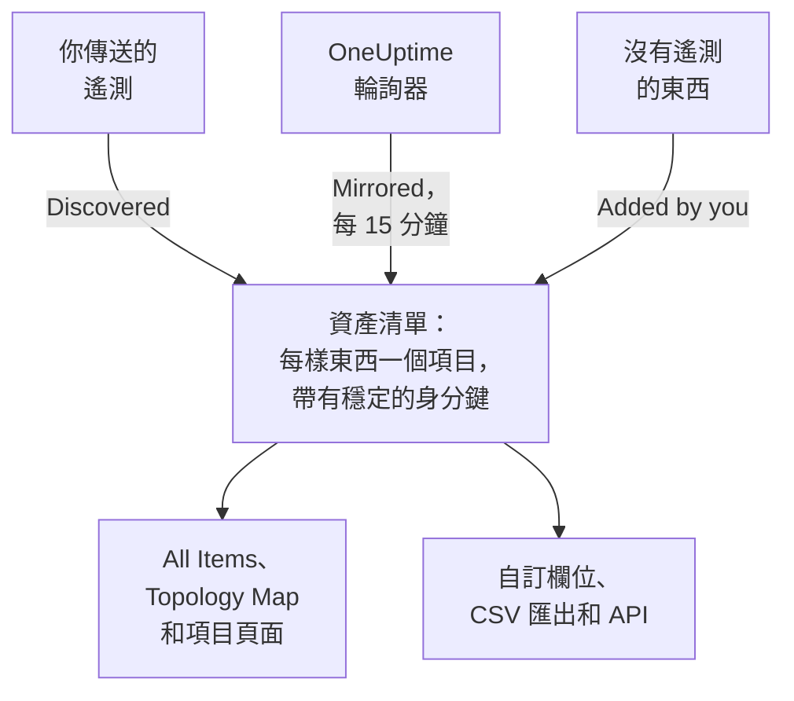

# 資產清單概觀

資產清單是一份清單，彙整了 OneUptime 對你的環境所知道的一切：服務、主機、Kubernetes 物件、虛擬機器、網路裝置、雲端資源、IoT 裝置、無伺服器函式，以及完全不傳送遙測的東西。其中大部分會根據 OneUptime 已在監看的內容自動填入。你要補上的是監看無法告訴它的資訊：某樣東西的用途、誰擁有它、保固何時到期。

:::cards
- [項目如何進入資產清單](#項目如何進入資產清單): 探索、鏡像，或由你新增。
- [熟悉各個頁面](#熟悉各個頁面): 資產清單的頁面，以及每個項目自己的頁面。
- [手動新增](#手動新增): 第三方 API、外部資料庫或設備。
- [封存而不是刪除](#封存而不是刪除): 整理清單並讓它保持整齊的方法。
:::

## 項目如何進入資產清單

OneUptime 為了監控本來就在觀察你的環境，因此目錄是根據它觀察到的內容建立的，而不是根據某人記得輸入的內容。每個項目都有一個來源，來源決定了項目歸誰管理：你能否編輯它，以及它能否自行消失。

| 來源 | API 中的值 | 來自哪裡 | 保留多久 |
| --- | --- | --- | --- |
| **Discovered** | `discovered` | 遙測抵達時讀取的 OpenTelemetry 資源屬性：傳送遙測的服務、主機、Kubernetes 物件或虛擬機器。 | 每批遙測都會重新登記。靜默時間超過其類別的時間範圍後會被移除（見下文）。 |
| **Mirrored** | `inventory` | OneUptime 輪詢器維護的記錄：網路裝置、雲端資源、IoT 裝置、無伺服器函式、RUM 應用程式、Docker 主機和 Podman 主機。每 15 分鐘複製一次。 | 與其記錄同在。刪除記錄，項目也會隨之消失。 |
| **Added by you** | `manual` | 由你為 OneUptime 看不到的東西新增：第三方 API、由廠商代管的資料庫、機架裡的設備。 | 直到你刪除它。不會自動到期。 |

探索或鏡像的項目無法重新命名，也無法改為其他類型：來源會在下一輪處理時覆寫這些變更。項目的 **設定** 頁面會告訴你應在哪裡做持久的變更。無論來源為何，你隨時都能為任何項目加上的是自訂欄位值：請參閱 [資產清單自訂欄位](/docs/inventory/custom-fields)。

### 靜默的項目保留多久

探索的項目有心跳。每當它的遙測抵達，最後出現時間就會往前推進，清單的 **狀態** 欄會顯示這個時間有多近。鏡像的項目和你新增的項目沒有心跳，因此它們的狀態維持空白，而不是顯示警示。

| 狀態 | 意義 |
| --- | --- |
| **Live** | 最近 30 分鐘內出現過。 |
| **Recent** | 最近一天內出現過。 |
| **Stale** | 超過一天沒有出現。**Gone Quiet** 頁面會列出這些項目。 |

OneUptime 每 3 小時移除一次靜默時間超過其類別時間範圍的探索項目，已封存的也包括在內，它們的自訂欄位值也會隨之消失。鏡像的項目和你新增的項目永遠不會以這種方式被移除。

| 項目類別 | 沒有遙測多久後被移除 |
| --- | --- |
| Pod、Deployment、Proxmox 客體和 VMware 虛擬機器 | 1 天 |
| Kubernetes 節點和命名空間、Proxmox 節點、VMware 主機、叢集和資料存放區，以及你的追蹤所呼叫的資料庫和遠端服務 | 7 天 |
| 服務、主機、Kubernetes、Proxmox 和 Ceph 叢集、儲存陣列、vCenter 和 Docker Swarm 叢集 | 30 天 |

OneUptime 探索到的關係如果 30 天內沒有再次出現，就會被移除。

## 熟悉各個頁面

開啟 **產品 → 資源 → 資產清單**。它的側邊選單包含以下頁面。**By Source**、**設定**、**說明** 和 **進階** 一開始是收合的：點選區段標題即可展開。

| 頁面 | 你在那裡能找到什麼 |
| --- | --- |
| **概覽** | 你有多少項目、它們是什麼、有多少已經靜默，以及最近新增了什麼。 |
| **All Items** | 所有項目。依名稱、描述或身分鍵搜尋，依類型、來源、狀態或自訂欄位縮小清單，並手動新增項目。 |
| **Topology Map** | 項目之間如何連接：服務、它們呼叫的對象，以及它們執行所在的主機、Pod 和裝置。 |
| **Gone Quiet** | 超過一天沒有傳送遙測的探索項目。 |
| **By Source** | 某一個來源的項目：**Discovered**、**Mirrored** 或 **Added by You**。 |
| **設定 → 自訂欄位** | 你的專案在每個項目上記錄的欄位。 |
| **說明 → 文件** | 資產清單的簡短指南，以及它能辨識的項目類別。 |
| **進階 → 已封存** | 你封存的項目。可以在這裡取消封存。 |

開啟一個項目，它自己的側邊選單中有 **概覽**（類型、來源和狀態，以及在它上面觀察到的每個屬性）、**Connections** 和 **自訂欄位**；**日誌**、**追蹤**、**指標**、**效能設定檔** 和 **例外**；以及 **事件**、**警示** 和 **排定維護**。**進階** 底下有 **設定**、**稽核日誌** 和 **Delete Item**。遙測頁面顯示項目本身傳送的內容。事件、警示和維護活動屬於該項目所代表的服務、主機或 Kubernetes 叢集；在其他任何項目上，這些頁面會告訴你應該改看哪個資源。

### 資產詳細資料

主機或網路裝置有一張 **資產詳細資料** 卡片，以相同的方式描述兩者：主機名稱、IP 位址、MAC 位址、序號、製造商、型號、韌體版本、作業系統、作業系統版本、裝置類型和位置。沒有任何來源回報過的資訊會顯示為 **未知**，卡片會說明如何補齊這些未知的資訊。

- 主機的資訊來自其遙測中的資源屬性：IP 和 MAC 位址、架構和作業系統一開始就有，序號、製造商、型號和韌體則在你標記後才有。
- 網路裝置的資訊來自其 SNMP 輪詢、角色和站點。其輪詢尚未讀取的資訊來自探索：對其位址的最近一次掃描、路由器的 ARP 表，或其探測器的 DNS 查詢。沒有 ENTITY-MIB 的裝置（例如 Meraki MX）仍會從系統描述取得製造商和型號。它的 IP 位址永遠不會顯示為主機名稱。

卡片會說明每項資訊的來源和時間。大多數資訊共有的來源，例如主機的收集器、網路裝置自身的 SNMP 輪詢或讀取它的探索掃描，只在資訊下方提及一次。其他來源，例如路由器的 ARP 表或儲存在裝置上的值，會在對應資訊下方說明。儲存在網路裝置上的值絕不會被探索讀取的內容取代，兩者不同時，卡片會同時顯示兩者。

這些資訊也是 **All Items** 清單中的欄，在你開啟之前是隱藏的，並會納入清單的 CSV 匯出。[匯出至 CMDB](/docs/inventory/cmdb-sync#資產詳細資料) 列出了它們的鍵。

### 連線

項目的 **Connections** 頁面列出它在兩個方向上的相鄰項目，分成 **呼叫**、**Called by**、**Runs on** 和 **Related** 幾組。每組會顯示總數（連線超過 100,000 個的組會顯示「100,000+」），**顯示更多** 可以翻看其餘部分，因此繁忙的叢集、命名空間或節點會顯示每一個連線，而不只是前幾個。這個頁面不受時間範圍限制：它包含透過 API 手動新增的關係，以及已封存的相鄰項目。已不在資產清單中的相鄰項目會以其鍵顯示。

## 手動新增

為 OneUptime 永遠無法自行看到的東西新增項目，這樣相依關係就能落在真實存在的對象上，而這個對象也能帶有你的自訂欄位。

:::steps
### 開啟 All Items

前往 **產品 → 資源 → 資產清單**，然後開啟 **All Items**。

### 新增項目

點選 **新增Item**。選擇它的 **類型**，為它填寫 **名稱**，並可選擇填寫 **描述**。名稱和類型共同構成項目的身分，因此同一類型的兩個項目不能同名。

### 填寫自訂欄位

開啟新項目。它的來源顯示為 **Added by you**，它的 **自訂欄位** 頁面可以填寫你的專案所追蹤的值。
:::

可以手動新增的類型有三種：

- `external.service`（**External Service**）：第三方 API 或軟體即服務的相依項目。
- `external.database`（**External Database**）：不屬於 OneUptime 可建模之伺服器的資料庫。資料庫伺服器，無論是自行託管還是代管服務，從 PostgreSQL 到 Snowflake，都應改在 **Databases → 建立資料庫** 中新增（[資料庫](/docs/telemetry/databases)）：那筆記錄會與指向同一位址的追蹤、容器和引擎指標連結，而資產清單項目永遠做不到這一點；用兩種方式新增同一台伺服器，會留下兩筆互不連結的記錄。
- `appliance`（**Appliance**）：沒有代理程式的硬體或軟體。

這項限制是為了防止重複。手動建立的、OneUptime 能觀察到之類型的項目（例如主機）會以你輸入的名稱作為鍵，而同一台機器的探索項目則以它回報的屬性作為鍵。兩者永遠不會合併，於是同一台主機會永久地在你的清單中出現兩次。

## 封存而不是刪除

封存會把項目移出清單，同時保留它的身分、歷程和自訂欄位值。它的意思是：我已經看到它了，不想讓它出現在我的清單裡。封存的項目仍會繼續收集遙測。

| 來源 | 封存 | 刪除 |
| --- | --- | --- |
| **Discovered** | 維持封存。 | 隨下一批遙測回來。 |
| **Mirrored** | 維持封存。 | 隨下一次複製回來。請改為刪除原始記錄。 |
| **Added by you** | 維持封存。 | 永久消失。 |

要封存項目，可以在 **All Items** 中選取它們一次封存，也可以開啟一個項目，使用其 **設定** 頁面上的 **封存** 卡片。已封存的項目位於 **資產清單 → 進階 → 已封存**，你可以在那裡選取它們並取消封存。

> [!NOTE]
> 當鏡像的裝置從其所屬記錄中移除時，OneUptime 也會移除它的項目，除非該項目帶有你填寫的自訂欄位值。這些值是唯一的副本，而且無法復原，因此項目會被封存而不是刪除。你可以在 **進階 → 已封存** 中找到它，你填寫的所有內容都完好無缺。

## 關係與拓撲

OneUptime 在觀察項目時，會以有方向的關係把它們連接起來。**資產清單 → Topology Map** 會繪製這些關係，項目的 **Connections** 頁面會列出它自己的關係。請參閱 [拓撲](/docs/telemetry/topology)。

| 關係 | 範例 |
| --- | --- |
| `runs-on` | Pod 在節點上執行；虛擬機器在它的主機上執行。 |
| `member-of` | Pod、節點或命名空間是叢集的成員。 |
| `hosted-on` | 服務託管在主機上。 |
| `part-of` | Pod 是其 Deployment 的一部分。 |
| `depends-on` | 一個服務呼叫另一個服務，依據是在兩者之間往來的 Span。 |

## 後續步驟

:::cards
- [資產清單自訂欄位](/docs/inventory/custom-fields): 追蹤序號、保固日期、擁有者和生命週期狀態。
- [匯出至 CMDB](/docs/inventory/cmdb-sync): 把目錄匯入你自己的記錄系統。
- [資料庫](/docs/telemetry/databases): 監控你的服務所使用的資料庫伺服器。
:::
