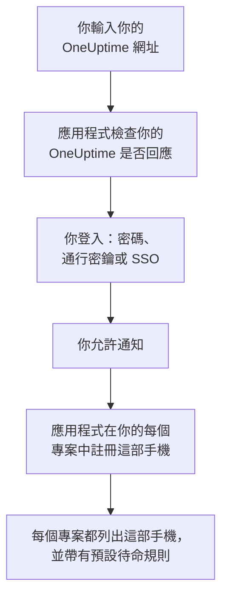
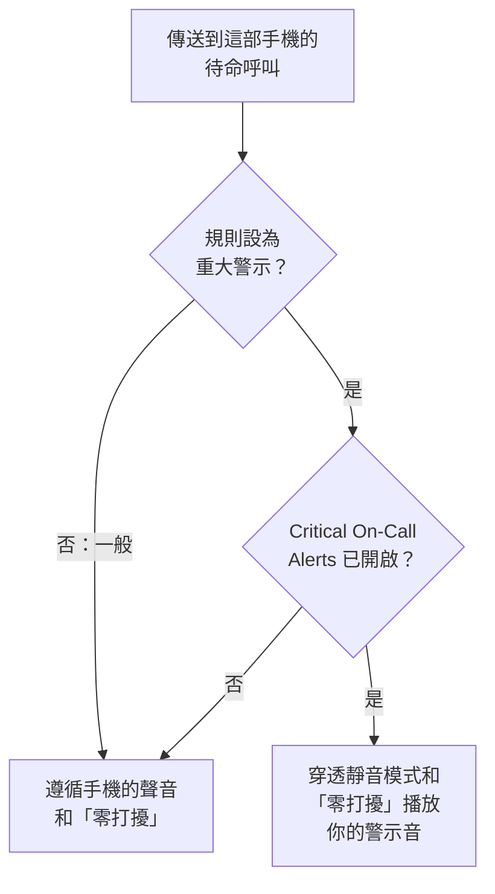

# Android 安裝

在 Android 手機或平板上安裝 **OneUptime On-Call**，將它連線到你的 OneUptime 並登入。然後給自己傳送一則測試通知，並讓緊急的待命呼叫穿透靜音模式和「零打擾」響起。

:::cards
- [安裝應用程式](#安裝應用程式): 從 Google Play 安裝，或在沒有 Google Play 的手機上安裝 APK。
- [登入](#登入): 先輸入你的 OneUptime 網址，再登入帳號。
- [確認呼叫能送達手機](#確認呼叫能送達手機): 在儀表板中找到這部手機並測試。
- [穿透靜音模式](#穿透靜音模式): 重大警示和警示音。
- [疑難排解](#疑難排解): 登入、通知和安裝問題。
:::

## 開始之前

- 執行 Android 7.0 或更高版本的手機或平板。
- 一個 OneUptime 專案中的帳號。要接收呼叫，你還必須在待命：請參閱 [上報規則](/docs/on-call/escalation-rules)。
- 你的 OneUptime 的網址：OneUptime Cloud 上是 `https://oneuptime.com`，或你自己的網址，例如 `https://oneuptime.example.com`。應用程式只透過 HTTPS 連線。

## 安裝應用程式

:::tabs
@tab Google Play
1. 在手機上開啟 [Google Play 上的 OneUptime On-Call](https://play.google.com/store/apps/details?id=com.oneuptime.oncall)，或在 Google Play 中搜尋 OneUptime On-Call。
2. 輕觸 **安裝**，然後輕觸 **開啟**。

Google Play 會讓應用程式保持最新。
@tab APK
適用於沒有 Google Play 的手機。每個 OneUptime 版本都會用同一份程式碼建置 APK，並把它附在 GitHub 上的發布版本中。

1. 在手機上開啟 [最新的 APK](https://github.com/OneUptime/oneuptime/releases/latest/download/oneuptime-on-call-android-app.apk)。
2. 開啟下載的檔案。如果 Android 詢問，請允許你的瀏覽器安裝未知應用程式，然後輕觸 **安裝**。
3. 從你的應用程式清單中開啟 OneUptime On-Call。

APK 不會自動更新：請不時在其上覆蓋安裝最新的 APK。你的登入狀態和設定會保留。
:::

## 登入

:::steps
### 輸入你的 OneUptime 網址
開啟應用程式。在 **Connect your workspace** 上，使用 OneUptime Cloud 時保留 `https://oneuptime.com`，否則輸入你自己的 OneUptime 網址，然後輕觸 **Connect**。`https://<your-oneuptime>/api/status` 回應後，應用程式就會繼續。

### 登入你的帳號
使用你的帳號支援的登入方式：

- 你的電子郵件和密碼，然後輕觸 **Sign In**。**Forgot password?** 會透過電子郵件給你傳送一個設定新密碼的連結。
- **Sign in with SSO**，如果你的組織使用單一登入。選擇你的身分識別提供者，或輸入你的工作電子郵件並輕觸 **Continue**。會開啟一個安全瀏覽器，登入後你會回到應用程式。
- **Sign in with a passkey**，前提是你已在儀表板中新增了通行密鑰：請參閱 [加入通行密鑰](/docs/introduction/your-account#加入通行密鑰)。瀏覽器會開啟以確認它，然後把你帶回應用程式。

開啟雙重驗證後，輸入驗證器應用程式中的六位數驗證碼，或你的一個備用碼。應用程式中無法使用安全金鑰。如果管理員要求雙重驗證而你還沒有設定，應用程式會先和你一起設定驗證器應用程式。

### 允許通知
當 Android 詢問是否允許 OneUptime On-Call 傳送通知時，輕觸 **允許**。Android 13 及更高版本會詢問；更早的版本預設允許，除非你關閉。

隨後，應用程式會在你的每個專案中註冊這部手機。每個專案都會把它列在你的推播裝置中，並帶有預設待命規則，因此從現在起你的呼叫會送達它。
:::

應用程式一次顯示一個專案：輕觸畫面頂端的專案名稱即可切換。要求單一登入的專案會在 **Settings → Manage Projects** 中顯示 **SSO Required**，直到你在那裡輕觸 **Authenticate with SSO**。

## 確認呼叫能送達手機

:::steps
### 在儀表板中找到這部手機
在儀表板中，開啟 **使用者設定 → 通知方式** 和 **Push Notifications** 分頁。這部手機按型號名稱列在 **推送通知裝置** 下。每個專案都有自己的清單。

### 傳送測試
點選手機所在列的 **測試通知**。手機會收到一則通知；輕觸它即可開啟應用程式。
:::

你的待命規則決定哪些呼叫傳送到這部手機，以及多快傳送：請參閱 **使用者設定 → 待命規則**。新手機會獲得與你新增的任何其他方式相同的預設規則。

## 穿透靜音模式

預設情況下，待命呼叫遵循手機的聲音設定：靜音的手機保持安靜，「零打擾」會攔下呼叫。重大警示讓待命呼叫穿透這兩者響起。它們預設關閉，需要你在每部手機上分別開啟。

:::steps
### 開啟 Critical On-Call Alerts
在應用程式中開啟 **Settings**，在 **Notifications** 下開啟 **Critical On-Call Alerts**。

### 允許「零打擾」存取權
Android 會開啟它的 **「零打擾」存取權** 清單。為 OneUptime On-Call 開啟存取權，然後返回應用程式：應用程式會檢查存取權，並在開關下方說明呼叫是否會穿透。

### 選擇警示音
輕觸開關下方的 **Alarm sound**。除了手機自己的聲音，它還提供 Klaxon、Siren、Digital alarm、Smoke alarm 和由輕到響的 Rising alarm。輕觸聲音旁邊的播放按鈕即可試聽。重大呼叫以手機的鬧鐘音量播放，所以請把鬧鐘音量調高。
:::

只有待命呼叫會穿透，而且只有來自設為 **重大警示**（預設值）的待命規則的呼叫才會穿透。設為 **一般** 的規則無論開關如何都會遵循手機的設定，這樣你可以在嚴重事件時被叫醒，而輕微事件只會靜默呼叫你。把手機靜音後傳送一則 **測試通知**，即可聽到呼叫會怎樣響起。

## 防止呼叫延遲送達

OneUptime 以高優先順序傳送待命呼叫，Android 即使在手機閒置了幾個小時後也會傳遞它們。但限制應用程式電池使用的手機仍可能攔下它們：

- 開啟 **設定 → 應用程式 → OneUptime On-Call → 電池**，然後選擇 **不受限制**。有些手機稱之為 **應用程式的電池用量**。
- 在 **設定 → 應用程式 → OneUptime On-Call → 通知** 下確認應用程式的通知已開啟。
- 不要把 OneUptime On-Call 放進手機的任何省電清單或休眠應用程式清單。

## 鎖定應用程式

在應用程式的 **Settings** 下開啟 **Biometrics Login**，應用程式每次啟動時都會要求你的指紋、臉部或手機的螢幕鎖定。手機設定了指紋或臉部解鎖後，這個開關才會出現。同一畫面上的 **Appearance** 用於選擇淺色或深色外觀，或跟隨手機設定。

## 更新、登出或解除安裝

- **更新。** Google Play 會更新應用程式。若使用 APK，請在其上覆蓋安裝最新的 APK。應用程式的版本顯示在其 **Settings** 畫面底部。
- **登出。** **Settings → Log Out** 會讓你登出，並從每個專案的推播裝置中移除這部手機及其待命規則。再次登入會以預設規則重新新增它。
- **解除安裝。** 像解除安裝其他應用程式一樣移除它。如果你當時仍處於登入狀態，這部手機會一直留在你的清單中，直到傳送到它的推播失敗：OneUptime 隨後會將其標記為 **未收到通知**。用 **刪除** 刪除該條目：重新安裝應用程式並登入後，這部手機會作為新條目新增，並帶有預設規則。

## 疑難排解

:::details 「Could not connect to the server」
應用程式無法存取 `https://<your-oneuptime>/api/status`。檢查網址，包括 `https://`。如果你的 OneUptime 位於私人網路中，請先將手機連線到該網路，例如透過 VPN。在手機的瀏覽器中開啟該網址：當手機能存取 OneUptime 時，它會顯示 `{"status":"ok"}`。
:::

:::details 收不到通知
- 檢查 Android 設定中應用程式的通知是否已開啟，以及「零打擾」是否已關閉或重大警示是否已開啟。
- 檢查這部手機是否列在 **使用者設定 → 通知方式** 的 **Push Notifications** 中，並向它傳送一則 **測試通知**。
- 如果這部手機被標記為 **未收到通知**，請在登入狀態下開啟應用程式。它會重新註冊這部手機；請參閱 [手機需要重新註冊的情況](/docs/mobile-desktop-apps/faq-troubleshooting#手機需要重新註冊的情況)。
- 在 **使用者設定 → 待命規則** 下檢查你的待命規則。
- 在自架的 OneUptime 上，檢查你的伺服器能否存取它的推播中繼：請參閱 [推播通知](/docs/self-hosted/push-notifications#網路存取)。
:::

:::details 重大警示在「零打擾」下不響
開啟應用程式的 **Settings**：**Critical On-Call Alerts** 下方的那一行會說明缺少什麼。通常是沒有允許「零打擾」存取權：在 **設定 → 通知 → 「零打擾」存取權** 下允許它，然後返回應用程式。如果你選擇了警示音，該聲音的通知類別也必須被允許略過「零打擾」。
:::

:::details 安裝 APK 時提示「未安裝應用程式」
手機上已經有來自其他來源（例如 Google Play）的 OneUptime On-Call，而 Android 不會在一個之上安裝另一個。解除安裝它，安裝 APK，然後重新登入。
:::

:::details 沒有 Biometrics Login 開關
在 Android 設定中設定指紋或臉部解鎖後，這個開關就會出現。
:::

## 後續步驟

:::cards
- [常見問題與疑難排解](/docs/mobile-desktop-apps/faq-troubleshooting): 手機不再收到呼叫時該怎麼辦。
- [iOS 安裝](/docs/mobile-desktop-apps/ios-installation): 在 iPhone 或 iPad 上使用同一個應用程式。
- [上報規則](/docs/on-call/escalation-rules): 決定呼叫誰以及何時呼叫。
- [推播通知](/docs/self-hosted/push-notifications): 自架的 OneUptime 如何向手機傳送呼叫。
:::
