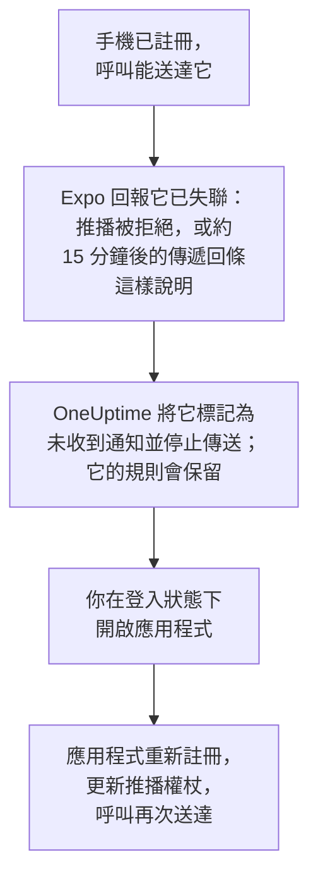

# 常見問題與疑難排解

關於 OneUptime 行動應用程式和桌面應用程式的常見問題解答，以及最常見問題的解決方法：登入、收不到的通知，以及需要重新註冊的手機。

:::cards
- [行動應用程式常見問題](#行動應用程式常見問題): 裝置、專案、自架和安全。
- [桌面應用程式常見問題](#桌面應用程式常見問題): 桌面應用程式是什麼，以及它不能做什麼。
- [手機需要重新註冊的情況](#手機需要重新註冊的情況): 手機為什麼不再收到呼叫，以及如何恢復。
- [疑難排解](#疑難排解): 登入、通知和安裝問題。
:::

## 行動應用程式常見問題

:::details 這個應用程式免費嗎？
是的。OneUptime On-Call 在 App Store、Google Play 上免費提供，在 GitHub 上也有免費的 APK。你使用 OneUptime 帳號登入。
:::

:::details 它能在哪些手機和平板上執行？
執行 iOS 或 iPadOS 16.4 或更高版本的 iPhone 和 iPad，以及執行 Android 7.0 或更高版本的 Android 手機和平板。
:::

:::details 它適用於自架的 OneUptime 嗎？
適用。在應用程式啟動時輸入你的 OneUptime 的 `https://` 網址，或在登入畫面上輕觸 **Change Server**。預設情況下，你的伺服器透過 OneUptime 推播中繼向手機傳送呼叫，因此它不需要 Apple、Google 或 Expo 帳號：請參閱 [推播通知](/docs/self-hosted/push-notifications)。
:::

:::details 我可以在多個專案中使用它嗎？
可以。應用程式會在你所屬的每個專案中註冊這部手機，因此每個專案都可以呼叫你。它一次顯示一個專案：輕觸畫面頂端的專案名稱即可切換。
:::

:::details 我可以在多部手機上登入嗎？
可以。每部手機或平板都是一個獨立的推播裝置，有自己的待命規則和自己的重大警示設定。
:::

:::details 我能在應用程式中做什麼？
- **Home**: 專案中需要關注的內容：進行中的事件和警示、未關閉的安全案件（如果你的角色可以檢視）、有問題的監測器，以及分組後的事件。
- **Monitors**: 所有監測器，可按健康狀況篩選，並可檢視各自的詳情。
- **Inbox**: 事件和警示，以及將它們分組的片段。開啟其中一個即可 **Acknowledge**、**Resolve** 或 **Add Note**。如果你的角色可以檢視專案的安全案件，**Security** 會列出未關閉的案件：開啟其中一個，即可對等待核准的劇本步驟使用 **Approve** 或 **Reject**、用 **Assign to me** 接手案件，或使用 **Close case**。
- **On-Call**: 你是否在待命以及待命到何時、還有誰在待命、傳送給你的呼叫，以及 **Cover for me**，它會在一段時間內把你的呼叫交給一位隊友。
- **Settings**: 你的專案和單一登入、外觀、重大警示和警示音、**Biometrics Login**、你的待命行事曆訂閱，以及 **Log Out**。

其他所有內容都在儀表板中。
:::

:::details 我可以直接從通知確認呼叫嗎？
不可以。輕觸通知：應用程式會在正確的專案中開啟它所涉及的事件、警示、片段或安全案件，你在那裡確認它。如果應用程式已鎖定或你已登出，它會在你進入後立即開啟該呼叫。
:::

:::details 我在手機上的登入安全嗎？
應用程式只透過 HTTPS 與你的 OneUptime 通訊。你的登入資訊儲存在手機上應用程式自己的儲存中，**Log Out** 會刪除它，並在伺服器上登出該工作階段。開啟 **Biometrics Login**，應用程式每次啟動時都會要求你的臉部、指紋或密碼。
:::

:::details 應用程式可以離線使用嗎？
不可以。沒有網路連線時，它會在畫面頂端顯示 **No internet connection**，連線恢復後會繼續運作。
:::

## 桌面應用程式常見問題

:::details 桌面應用程式是什麼？
它是從瀏覽器安裝為應用程式的 OneUptime 儀表板：有自己的視窗，在「開始」功能表、Dock 或啟動器中有圖示，並且能顯示通知。它能做儀表板能做的一切，因為它就是儀表板。
:::

:::details 為什麼它不在應用程式商店中？
不需要。應用程式每次開啟時都會從你的 OneUptime 載入儀表板，因此無論在 Windows、macOS 還是 Linux 上，它始終是你的 OneUptime 正在執行的版本，無需更新任何內容。
:::

:::details 它能像手機一樣叫醒我嗎？
不能。瀏覽器無法略過勿擾模式或專注模式，因此桌面通知最多只能和電腦允許的一樣響。對於必須叫醒你的呼叫，請使用開啟了重大警示的行動應用程式。
:::

:::details 它可以離線使用嗎？
不可以。它需要連線到你的 OneUptime，就像瀏覽器標籤頁中的儀表板一樣。
:::

## 手機需要重新註冊的情況

OneUptime 透過 Expo 傳送手機的呼叫，Expo 再把它們交給 Apple 或 Google。當 Expo 表示已無法再聯絡到這部手機時，OneUptime 就會停止向它傳送，直到應用程式重新註冊它。

當手機上的應用程式被刪除，或其推播權杖不再有效時，Expo 會回報這部手機已失聯。手機不會被刪除：**使用者設定 → 通知方式** 的 **Push Notifications** 分頁會將它顯示為 **未收到通知**，未送達它的呼叫的待命時間軸會說明原因。你的其他手機和通知方式會照常收到呼叫。

應用程式每次啟動、你登入時以及你回到應用程式時都會註冊這部手機，但最多每五分鐘一次。註冊時會再次向 Expo 請求推播權杖，從而更新權杖，手機會以原有的規則再次收到呼叫。

| 發生了什麼 | 怎麼做 | OneUptime 怎麼做 |
| --- | --- | --- |
| 應用程式仍已安裝 | 在登入狀態下開啟它 | 手機再次收到通知，規則保持不變 |
| 你在 iPhone 或 iPad 上重新安裝了應用程式 | 安裝並登入 | 通常會帶回同一個條目及其規則 |
| 你在 Android 上重新安裝了應用程式 | 安裝、登入並刪除舊條目 | 新建一個帶預設規則的條目；舊條目保持標記狀態 |
| 用舊手機的備份設定的新手機 | 在新手機上開啟應用程式 | 如果舊手機的條目已被標記，新手機會連同規則一起接管它；否則新手機會獲得自己的條目 |
| 從頭設定的新手機 | 登入並刪除舊條目 | 新建一個帶預設規則的條目 |
| 你登出了應用程式 | 重新登入 | 登出已刪除這部手機及其規則；它會帶著預設規則回來 |

瀏覽器的推播訂閱過期時，它也可能不再收到通知。儀表板會在可以時續訂；如果瀏覽器一直處於標記狀態，請在該瀏覽器中用 **註冊裝置** 重新註冊它。

## 疑難排解

### 登入

:::details 「Could not connect to the server」
應用程式無法存取 `https://<your-oneuptime>/api/status`。檢查網址，包括 `https://`：應用程式不會透過一般 HTTP 連線。如果你的 OneUptime 位於私人網路中，請先將手機連線到該網路，例如透過 VPN。當手機能存取 OneUptime 時，在手機瀏覽器中開啟該網址會顯示 `{"status":"ok"}`。
:::

:::details 「No SSO configuration found for the email」
該電子郵件所屬的專案都沒有設定單一登入，或者該電子郵件在這個 OneUptime 上沒有帳號。檢查電子郵件，或使用密碼登入。管理員為整個安裝設定的身分識別提供者會列在電子郵件欄位之前。
:::

:::details 安全金鑰是你唯一的第二因素
應用程式無法使用安全金鑰。請使用你的一個備用碼登入，或在儀表板中為你的帳號新增驗證器應用程式：請參閱 [開啟雙重驗證](/docs/introduction/your-account#開啟雙重驗證)。
:::

:::details 通行密鑰登入失敗
通行密鑰要求你的 OneUptime 網址以 `https://` 開頭，並且需要你為這個 OneUptime 新增的通行密鑰：請參閱 [加入通行密鑰](/docs/introduction/your-account#加入通行密鑰)。要使用其他伺服器，請在登入畫面上輕觸 **Change Server**。
:::

### 通知

:::details 手機收不到通知
- 檢查手機是否允許來自 OneUptime On-Call 的通知，以及勿擾模式或專注模式是否在攔下它們。
- 在 **使用者設定 → 通知方式** 的 **Push Notifications** 分頁中，確認這部手機已列出，並向它傳送一則 **測試通知**。
- 如果它被標記為 **未收到通知**，請在登入狀態下開啟應用程式：請參閱 [手機需要重新註冊的情況](#手機需要重新註冊的情況)。
- 在 **使用者設定 → 待命規則** 下檢查你的待命規則：它們決定哪些呼叫送達哪種方式。
- 在自架的 OneUptime 上，檢查伺服器能否存取它的推播中繼：請參閱 [推播通知](/docs/self-hosted/push-notifications#網路存取)。
:::

:::details Android 上的呼叫延遲送達
在 Android 的 OneUptime On-Call 設定中，將應用程式的電池使用設為 **不受限制**，並且不要把應用程式放進任何省電清單：請參閱 [防止呼叫延遲送達](/docs/mobile-desktop-apps/android-installation#防止呼叫延遲送達)。
:::

:::details 重大警示無法穿透靜音模式
開啟應用程式的 **Settings**：**Critical On-Call Alerts** 下方的那一行會說明這部手機缺少什麼。然後在 **使用者設定 → 待命規則** 下確認傳送該呼叫的待命規則設為 **重大警示**，而不是 **一般**。每部手機都有自己的開關。
:::

### 桌面應用程式

:::details 網址列中沒有安裝圖示
請在登入後從儀表板頁面、透過 `https://`、在 Edge 或 Chrome 中安裝，或在 macOS Sonoma 14 或更高版本上的 Safari 中安裝。如果圖示沒有出現，也可以用瀏覽器的選單安裝：請參閱 [Windows 安裝](/docs/mobile-desktop-apps/windows-installation#安裝應用程式)。
:::

:::details 電腦上沒有通知
在 **使用者設定 → 通知方式** 的 **Push Notifications** 分頁中，用 **註冊裝置** 註冊瀏覽器，在詢問時允許通知，並檢查電腦本身的通知設定。自架的 OneUptime 需要設定 VAPID 金鑰才能傳送瀏覽器通知。
:::

## 取得協助

如果這裡的內容與你看到的不符，請 [在 GitHub 上提交 issue](https://github.com/OneUptime/oneuptime/issues)，並附上你的應用程式版本（位於其 **Settings** 畫面底部）和你使用的平台。

## 後續步驟

:::cards
- [應用程式概觀](/docs/mobile-desktop-apps/index): 該用哪個應用程式，以及應用程式如何連線 OneUptime。
- [Android 安裝](/docs/mobile-desktop-apps/android-installation): 在 Android 上安裝並設定應用程式。
- [iOS 安裝](/docs/mobile-desktop-apps/ios-installation): 在 iPhone 或 iPad 上安裝並設定應用程式。
- [推播通知](/docs/self-hosted/push-notifications): 自架的 OneUptime 如何傳送呼叫，以及 Expo 的錯誤。
:::
