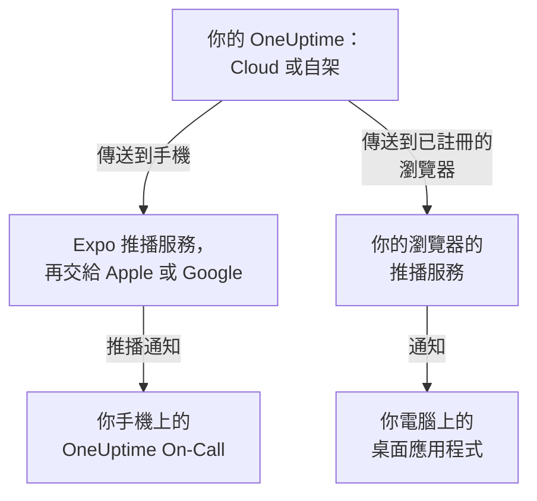

# 應用程式概觀

OneUptime 有一個手機應用程式和一個電腦應用程式。適用於 iPhone、iPad 和 Android 的 **OneUptime On-Call** 會在你待命時呼叫你，讓你無論身在何處都能確認和解決事件。在 Windows、macOS 和 Linux 上，OneUptime 儀表板可以從瀏覽器安裝為桌面應用程式，在自己的視窗中開啟。兩者都適用於 OneUptime Cloud 和自架的 OneUptime。

:::cards
- [選擇應用程式](#選擇應用程式): 並排比較每個應用程式的用途。
- [應用程式如何連線 OneUptime](#應用程式如何連線-oneuptime): 登入和待命呼叫經過的路徑。
- [取得行動應用程式](#取得行動應用程式): 從 App Store、Google Play 或 GitHub 取得。
- [取得桌面應用程式](#取得桌面應用程式): 從 Edge、Chrome 或 Safari 安裝儀表板。
:::

## 選擇應用程式

|  | 行動應用程式 | 桌面應用程式 |
| --- | --- | --- |
| 是什麼 | OneUptime On-Call，適用於 iPhone、iPad 和 Android 的原生應用程式 | 從瀏覽器安裝的 OneUptime 儀表板 |
| 從哪裡取得 | App Store、Google Play 或 GitHub 上的 APK | 你自己的 OneUptime：無需下載任何內容 |
| 待命呼叫 | 能穿透靜音模式和勿擾模式響起的推播通知 | 註冊瀏覽器之後的瀏覽器通知 |
| 能做什麼 | 事件、警示、安全案件、監測器以及誰在待命；確認、解決、核准劇本步驟和新增備註 | 儀表板能做的一切 |
| 更新 | 從應用程式商店更新，或安裝更新的 APK | 每次開啟時從你的 OneUptime 載入儀表板 |
| 執行環境 | iOS 16.4 或更高版本，Android 7.0 或更高版本 | Windows、macOS 和 Linux 上的 Edge 或 Chrome，或 macOS Sonoma 14 或更高版本上的 Safari |

兩者可以同時使用：工作時讓桌面應用程式保持開啟，夜裡讓手機叫醒你。

## 應用程式如何連線 OneUptime

行動應用程式登入你的 OneUptime，並在你所屬的每個專案中註冊這部手機。此後，OneUptime 透過 Expo 推播服務傳送手機的推播通知（包括待命呼叫），Expo 再把它們交給 Apple 或 Google 傳遞。自架的 OneUptime 預設透過 OneUptime 推播中繼傳送，因此不需要自己的 Apple、Google 或 Expo 帳號：請參閱 [推播通知](/docs/self-hosted/push-notifications)。

桌面應用程式就是在自己視窗中的儀表板本身。為推播通知註冊它的瀏覽器之後，它就會顯示通知：Windows、macOS 和 Linux 的頁面會說明如何註冊。

## 開始之前

- 一個 OneUptime 專案中的帳號。要接收呼叫，你還必須在待命：請參閱 [上報規則](/docs/on-call/escalation-rules)。
- 你的 OneUptime 的網址。在 OneUptime Cloud 上是 `https://oneuptime.com`；自架的 OneUptime 有自己的網址，例如 `https://oneuptime.example.com`。
- 透過 HTTPS 提供的 OneUptime。行動應用程式不會透過一般 HTTP 連線，而瀏覽器只為 HTTPS 網站顯示通知，Edge 和 Chrome 也只為 HTTPS 網站安裝應用程式。

## 取得行動應用程式

:::steps
### 安裝 OneUptime On-Call
在 iPhone 或 iPad 上從 [App Store](https://apps.apple.com/us/app/oneuptime-on-call/id6759615391) 取得，在 Android 上從 [Google Play](https://play.google.com/store/apps/details?id=com.oneuptime.oncall) 取得。沒有 Google Play 的 Android 手機，請改為安裝 [APK](https://github.com/OneUptime/oneuptime/releases/latest/download/oneuptime-on-call-android-app.apk)。儀表板的 **專案設定 → 通知 → 行動應用程式** 中也有同樣的連結。

### 連線到你的 OneUptime
開啟應用程式，使用 OneUptime Cloud 時保留 `https://oneuptime.com`，否則輸入你自己的 OneUptime 網址，然後用密碼、通行密鑰或單一登入登入。

### 允許通知
手機詢問時允許通知。應用程式會在你的每個專案中註冊這部手機，待命呼叫就會開始送達。
:::

每一步的詳細說明以及之後要檢查的內容，請參閱 [Android 安裝](/docs/mobile-desktop-apps/android-installation) 和 [iOS 安裝](/docs/mobile-desktop-apps/ios-installation)。

## 取得桌面應用程式

:::steps
### 開啟儀表板
在 Microsoft Edge 或 Google Chrome 中登入你的 OneUptime，在 Mac 上也可以用 Safari。

### 安裝
在 Edge 或 Chrome 中，點選網址列右側的安裝圖示。在 Safari 中，選擇 **檔案 → 加入 Dock**。

### 像其他應用程式一樣開啟它
它會從「開始」功能表、Dock 或應用程式啟動器在自己的視窗中開啟。
:::

各瀏覽器的逐步說明，請參閱 [Windows 安裝](/docs/mobile-desktop-apps/windows-installation)、[macOS 安裝](/docs/mobile-desktop-apps/macos-installation) 和 [Linux 安裝](/docs/mobile-desktop-apps/linux-installation)。

## 後續步驟

:::cards
- [Android 安裝](/docs/mobile-desktop-apps/android-installation): 在 Android 上安裝應用程式、登入，並確認呼叫能夠送達。
- [iOS 安裝](/docs/mobile-desktop-apps/ios-installation): 在 iPhone 或 iPad 上安裝應用程式並開啟重大警示。
- [Windows 安裝](/docs/mobile-desktop-apps/windows-installation): 從 Edge 或 Chrome 安裝儀表板。
- [macOS 安裝](/docs/mobile-desktop-apps/macos-installation): 從 Safari、Chrome 或 Edge 把儀表板加入 Dock。
- [Linux 安裝](/docs/mobile-desktop-apps/linux-installation): 從 Chrome、Chromium 或 Edge 安裝儀表板。
- [常見問題與疑難排解](/docs/mobile-desktop-apps/faq-troubleshooting): 解答、修復方法，以及手機不再收到呼叫時該怎麼辦。
:::
