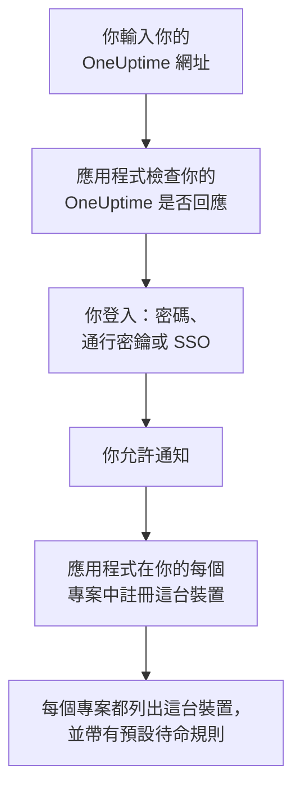
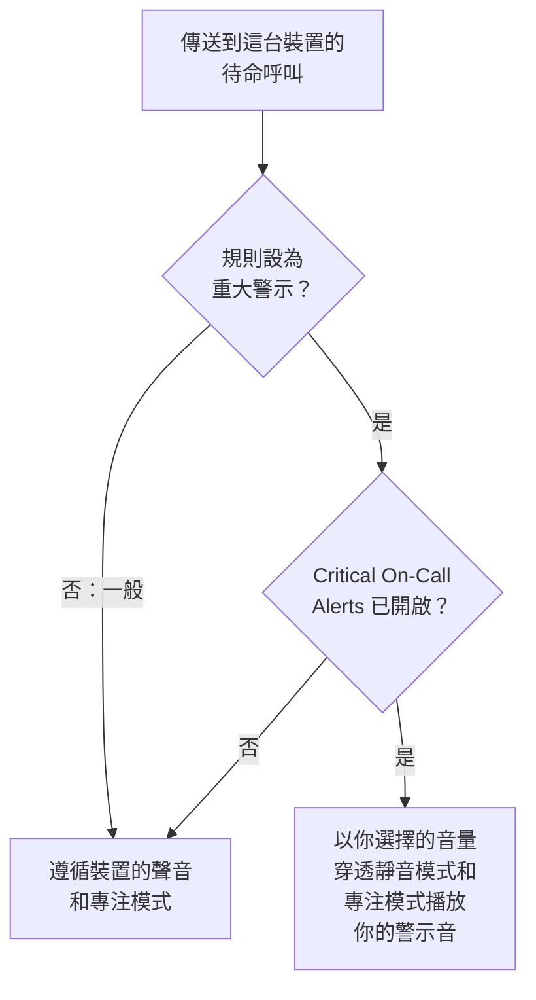

# iOS 安裝

從 App Store 在 iPhone 或 iPad 上安裝 **OneUptime On-Call**，將它連線到你的 OneUptime 並登入。然後給自己傳送一則測試通知，並讓緊急的待命呼叫穿透靜音模式和專注模式響起。

:::cards
- [安裝應用程式](#安裝應用程式): 從 App Store 安裝。
- [登入](#登入): 先輸入你的 OneUptime 網址，再登入帳號。
- [確認呼叫能送達裝置](#確認呼叫能送達裝置): 在儀表板中找到它並測試。
- [穿透靜音模式](#穿透靜音模式): 重大警示、警示音及其音量。
- [疑難排解](#疑難排解): 登入、通知和重大警示問題。
:::

## 開始之前

- 執行 iOS 16.4 或更高版本的 iPhone，或執行 iPadOS 16.4 或更高版本的 iPad。
- 一個 OneUptime 專案中的帳號。要接收呼叫，你還必須在待命：請參閱 [上報規則](/docs/on-call/escalation-rules)。
- 你的 OneUptime 的網址：OneUptime Cloud 上是 `https://oneuptime.com`，或你自己的網址，例如 `https://oneuptime.example.com`。應用程式只透過 HTTPS 連線。

## 安裝應用程式

1. 在 iPhone 或 iPad 上開啟 [App Store 上的 OneUptime On-Call](https://apps.apple.com/us/app/oneuptime-on-call/id6759615391)，或在 App Store 中搜尋 OneUptime On-Call。
2. 點一下 **取得**，然後用 Face ID、Touch ID 或你的 Apple 帳戶密碼確認。
3. 點一下 **打開**，或從主畫面開啟 OneUptime On-Call。

只要 **設定 → App Store** 中的 **App 更新** 處於開啟狀態，App Store 就會讓應用程式保持最新。

## 登入

:::steps
### 輸入你的 OneUptime 網址
開啟應用程式。在 **Connect your workspace** 上，使用 OneUptime Cloud 時保留 `https://oneuptime.com`，否則輸入你自己的 OneUptime 網址，然後點一下 **Connect**。`https://<your-oneuptime>/api/status` 回應後，應用程式就會繼續。

### 登入你的帳號
使用你的帳號支援的登入方式：

- 你的電子郵件和密碼，然後點一下 **Sign In**。**Forgot password?** 會透過電子郵件給你傳送一個設定新密碼的連結。
- **Sign in with SSO**，如果你的組織使用單一登入。選擇你的身分識別提供者，或輸入你的工作電子郵件並點一下 **Continue**。會開啟一個安全瀏覽器，登入後你會回到應用程式。
- **Sign in with a passkey**，前提是你已在儀表板中新增了通行密鑰：請參閱 [加入通行密鑰](/docs/introduction/your-account#加入通行密鑰)。會開啟一個瀏覽器面板以確認它，然後把你帶回應用程式。

開啟雙重驗證後，輸入驗證器應用程式中的六位數驗證碼，或你的一個備用碼。應用程式中無法使用安全金鑰。如果管理員要求雙重驗證而你還沒有設定，應用程式會先和你一起設定驗證器應用程式。

### 允許通知
當 iOS 詢問是否允許 OneUptime On-Call 向你傳送通知時，點一下 **允許**。

隨後，應用程式會在你的每個專案中註冊這台 iPhone 或 iPad。每個專案都會把它列在你的推播裝置中，並帶有預設待命規則，因此從現在起你的呼叫會送達它。
:::

應用程式一次顯示一個專案：點一下畫面頂端的專案名稱即可切換。要求單一登入的專案會在 **Settings → Manage Projects** 中顯示 **SSO Required**，直到你在那裡點一下 **Authenticate with SSO**。

## 確認呼叫能送達裝置

:::steps
### 在儀表板中找到這台裝置
在儀表板中，開啟 **使用者設定 → 通知方式** 和 **Push Notifications** 分頁。這台 iPhone 或 iPad 按型號名稱列在 **推送通知裝置** 下。每個專案都有自己的清單。

### 傳送測試
點選裝置所在列的 **測試通知**。裝置會收到一則通知；點一下它即可開啟應用程式。
:::

你的待命規則決定哪些呼叫傳送到這台裝置，以及多快傳送：請參閱 **使用者設定 → 待命規則**。新裝置會獲得與你新增的任何其他方式相同的預設規則。

## 穿透靜音模式

預設情況下，待命呼叫遵循裝置的聲音設定：靜音模式會讓它保持安靜，而勿擾模式等專注模式會攔下它。重大警示讓待命呼叫穿透這兩者響起。它們預設關閉，需要你在每台裝置上分別開啟。

:::steps
### 開啟 Critical On-Call Alerts
在應用程式中開啟 **Settings**，在 **Notifications** 下開啟 **Critical On-Call Alerts**。

### 允許重大警示
當 iOS 詢問是否允許 OneUptime On-Call 傳送重要警示時，點一下 **允許**。隨後 iOS 會在 **設定 → 通知 → OneUptime On-Call** 下為應用程式新增一個 **重要警示** 開關，你以後可以在那裡改變主意。應用程式開關下方的那一行會說明呼叫是否會穿透。

### 選擇警示音及其音量
點一下開關下方的 **Alarm sound**。除了裝置本身的重要警示聲音，它還提供 Klaxon、Siren、Digital alarm、Smoke alarm 和由輕到響的 Rising alarm。點一下聲音旁邊的播放按鈕即可試聽。然後選擇呼叫播放的音量：25%、50%、75% 或 100%（預設）。
:::

只有待命呼叫會穿透，而且只有來自設為 **重大警示**（預設值）的待命規則的呼叫才會穿透。設為 **一般** 的規則無論開關如何都會遵循裝置的設定，這樣你可以在嚴重事件時被叫醒，而輕微事件只會靜默呼叫你。把裝置設為靜音後傳送一則 **測試通知**，即可聽到呼叫會怎樣響起。**Alarm sound** 畫面上的試聽以鈴聲音量播放，在靜音模式下則完全不播放；真正的呼叫會以你選擇的音量穿透靜音模式。

> [!NOTE]
> 重大警示需要 App Store 上的 OneUptime On-Call 1.5.0 或更高版本。更早的版本在建置時沒有獲得 Apple 的重大警示許可，所以 iOS 從未為它們提供這個開關。

## 防止呼叫被攔下

沒有重大警示時，專注模式或摘要可能會攔下呼叫：

- **專注模式。** 在 **設定 → 專注模式** 下，把 OneUptime On-Call 新增到每個專注模式允許的 App 中。
- **排定摘要。** 在 **設定 → 通知 → 排定摘要** 下，不要把 OneUptime On-Call 加入其中：摘要中的通知會等到摘要的下一個時間才送達。
- **通知。** 在 **設定 → 通知 → OneUptime On-Call** 下保持 **允許通知** 開啟。

## 鎖定應用程式

在應用程式的 **Settings** 下開啟 **Biometrics Login**，應用程式每次啟動時都會要求 Face ID、Touch ID 或你的密碼。裝置設定了 Face ID 或 Touch ID 後，這個開關才會出現。同一畫面上的 **Appearance** 用於選擇淺色或深色外觀，或跟隨裝置設定。

## 更新、登出或刪除應用程式

- **更新。** App Store 會更新應用程式；你也可以在 App Store 的帳戶頁面中手動更新。應用程式的版本顯示在其 **Settings** 畫面底部。
- **登出。** **Settings → Log Out** 會讓你登出，並從每個專案的推播裝置中移除這台裝置及其待命規則。再次登入會以預設規則重新新增它。
- **刪除。** 按住應用程式圖示，然後點一下 **移除 App** 和 **刪除 App**。如果你當時仍處於登入狀態，這台裝置會一直留在你的清單中，直到傳送到它的推播失敗：OneUptime 隨後會將其標記為 **未收到通知**。重新安裝應用程式並登入後，通常會帶回同一個條目及其規則；如果你不再使用這台裝置，請用 **刪除** 刪除該條目。

## 疑難排解

:::details 「Could not connect to the server」
應用程式無法存取 `https://<your-oneuptime>/api/status`。檢查網址，包括 `https://`。如果你的 OneUptime 位於私人網路中，請先將裝置連線到該網路，例如透過 VPN。在裝置上的 Safari 中開啟該網址：當裝置能存取 OneUptime 時，它會顯示 `{"status":"ok"}`。
:::

:::details 收不到通知
- 檢查 **設定 → 通知 → OneUptime On-Call** 下的 **允許通知** 是否開啟，以及是否有專注模式在攔下呼叫。
- 檢查這台裝置是否列在 **使用者設定 → 通知方式** 的 **Push Notifications** 中，並向它傳送一則 **測試通知**。
- 如果這台裝置被標記為 **未收到通知**，請在登入狀態下開啟應用程式。它會重新註冊這台裝置；請參閱 [手機需要重新註冊的情況](/docs/mobile-desktop-apps/faq-troubleshooting#手機需要重新註冊的情況)。
- 在 **使用者設定 → 待命規則** 下檢查你的待命規則。
- 在自架的 OneUptime 上，檢查你的伺服器能否存取它的推播中繼：請參閱 [推播通知](/docs/self-hosted/push-notifications#網路存取)。
:::

:::details iOS 設定中沒有「重要警示」開關
先在應用程式中開啟 **Critical On-Call Alerts**：只有在應用程式請求重大警示之後，iOS 才會新增它的開關。如果應用程式提示此版本無法接收重大警示，請從 App Store 更新 OneUptime On-Call。
:::

:::details 重大警示不響
開啟應用程式的 **Settings**：**Critical On-Call Alerts** 下方的那一行會說明缺少什麼。檢查 **設定 → 通知 → OneUptime On-Call** 下的 **重要警示** 是否開啟，以及應用程式 **Alarm sound** 畫面上的音量是否設得太低。
:::

:::details 沒有 Biometrics Login 開關
在 **設定 → Face ID 與密碼** 或 **設定 → Touch ID 與密碼** 下設定 Face ID 或 Touch ID 後，這個開關就會出現。
:::

## 後續步驟

:::cards
- [常見問題與疑難排解](/docs/mobile-desktop-apps/faq-troubleshooting): 手機不再收到呼叫時該怎麼辦。
- [Android 安裝](/docs/mobile-desktop-apps/android-installation): 在 Android 上使用同一個應用程式。
- [上報規則](/docs/on-call/escalation-rules): 決定呼叫誰以及何時呼叫。
- [推播通知](/docs/self-hosted/push-notifications): 自架的 OneUptime 如何向手機傳送呼叫。
:::
