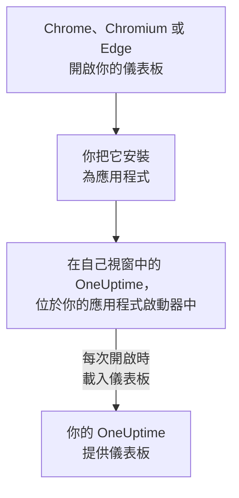

# Linux 安裝

OneUptime 儀表板可以從 Google Chrome、Chromium 或 Microsoft Edge 在 Linux 上安裝為應用程式。它在自己的視窗中開啟，在桌面的應用程式啟動器中有自己的條目，並且可以顯示通知。無需下載任何內容：這個應用程式就是你的 OneUptime 的儀表板，只要你的 OneUptime 是最新的，它就是最新的。

:::cards
- [安裝應用程式](#安裝應用程式): 從 Chrome、Chromium 或 Edge 安裝。
- [從應用程式啟動器開啟它](#從應用程式啟動器開啟它): 和其他桌面應用程式一樣。
- [在這台電腦上接收通知](#在這台電腦上接收通知): 為推播通知註冊瀏覽器。
- [疑難排解](#疑難排解): 沒有安裝圖示、沒有通知、啟動器中沒有條目。
:::

## 桌面應用程式的運作方式

已安裝的應用程式與其瀏覽器共享登入狀態、設定和通知權限。關閉瀏覽器後，應用程式仍會在自己的視窗中繼續執行。

## 開始之前

- 裝有較新版本的 Google Chrome、Chromium 或 Microsoft Edge 的 Linux 桌面。
- 透過 HTTPS 存取的你的 OneUptime 網址：OneUptime Cloud 上是 `https://oneuptime.com`，或你自己的網址，例如 `https://oneuptime.example.com`。
- 一個可以登入儀表板的帳號。

## 安裝應用程式

:::tabs
@tab Chrome
1. 在 Chrome 或 Chromium 中開啟你的 OneUptime 並登入。
2. 在任意儀表板頁面上，點選網址列右側的安裝圖示，然後點選 **安裝**。或者開啟 **⋮ → 投放、儲存及分享 → 將頁面安裝為應用程式**。
3. Chrome 會在自己的視窗中開啟 OneUptime，並將其新增到你的應用程式啟動器。
@tab Edge
1. 在 Edge 中開啟你的 OneUptime 並登入。
2. 在任意儀表板頁面上，點選網址列右側的安裝圖示，然後點選 **安裝**。或者開啟 **設定及其他 (…) → 更多工具 → 應用程式 → 將此網站安裝為應用程式**。
3. Edge 會在自己的視窗中開啟 OneUptime，並將其新增到你的應用程式啟動器。
:::

請在登入後從儀表板頁面安裝：登入頁面不是這個應用程式。

## 從應用程式啟動器開啟它

瀏覽器會為應用程式新增一個桌面條目，即 `~/.local/share/applications` 中的一個 `.desktop` 檔案，因此 OneUptime 會出現在 GNOME、KDE Plasma 和其他啟動器中。你可以從那裡把它釘選到 Dock 或面板上，就像其他應用程式一樣。

## 在這台電腦上接收通知

應用程式透過其瀏覽器顯示通知，前提是你在每個想接收通知的專案中為推播通知註冊了該瀏覽器。

:::steps
### 開啟你的推播裝置
在應用程式中，開啟 **使用者設定 → 通知方式** 和 **Push Notifications** 分頁。

### 註冊這個瀏覽器
點選 **註冊裝置**，保留建議的 **裝置名稱**（例如 `Chrome on Linux`）或修改它，然後再次點選 **註冊裝置**。當瀏覽器詢問是否允許 OneUptime 顯示通知時，選擇 **允許**。

### 傳送測試
在 **Browser Registered** 對話方塊中，點選 **Send Test Notification**。你的桌面會透過其通知服務顯示它；如果什麼都沒有出現，請參閱 [疑難排解](#疑難排解)。
:::

瀏覽器無法穿透桌面的勿擾模式響起。對於必須叫醒你的呼叫，請使用開啟了重大警示的行動應用程式：請參閱 [Android 安裝](/docs/mobile-desktop-apps/android-installation#穿透靜音模式)。

在自架的 OneUptime 上，瀏覽器通知需要伺服器的 VAPID 金鑰：請參閱 [推播通知](/docs/self-hosted/push-notifications#自架設定)。

## 更新

無需更新任何內容。應用程式每次開啟時都會從你的 OneUptime 載入儀表板，因此你的 OneUptime 升級後它也會隨之變化。如果某個視窗在升級前就已開啟，請按 Ctrl+R 重新載入。

## 解除安裝

:::tabs
@tab Chrome
在應用程式視窗中開啟 **⋮** 選單，選擇解除安裝該應用程式的選單項目，然後選擇 **移除**。
@tab Edge
在 Edge 中開啟 `edge://apps`，在 OneUptime 上選擇 **詳細資料**，然後選擇 **解除安裝**。
:::

解除安裝應用程式不會取消註冊它的瀏覽器：瀏覽器仍會收到通知。要停止通知，請在 **使用者設定 → 通知方式** 的 **Push Notifications** 分頁中，用 **刪除** 刪除該瀏覽器。

## 疑難排解

:::details 網址列中沒有安裝圖示
請在登入後開啟儀表板頁面，而不是登入頁面，並確認網址以 `https://` 開頭：瀏覽器只會從安全網站安裝應用程式。如果圖示仍未出現，請按上文所述使用瀏覽器的選單。其他瀏覽器可能無法將網站安裝為應用程式；請使用 Chrome、Chromium 或 Edge。
:::

:::details 沒有顯示通知
- 在 **使用者設定 → 通知方式** 的 **Push Notifications** 分頁中，確認這個瀏覽器已列出，並向它傳送一則 **測試通知**。
- 確認桌面的勿擾模式已關閉，並且其通知設定允許該瀏覽器。
- 如果瀏覽器封鎖了 OneUptime 的通知，請點選網址列左側的圖示，允許該網站的通知，然後重新註冊瀏覽器。
- 在自架的 OneUptime 上，如果伺服器沒有 VAPID 金鑰，**註冊裝置** 對話方塊會說明這一點。
:::

:::details 啟動器中沒有這個應用程式
改為從瀏覽器開啟它：在 Chrome 或 Chromium 中是 `chrome://apps`，在 Edge 中是 `edge://apps`。只在登入時讀取桌面條目的啟動器，會在你登出並重新登入後顯示它。
:::

## 後續步驟

:::cards
- [Android 安裝](/docs/mobile-desktop-apps/android-installation): 在手機上接收呼叫，並使用重大警示。
- [Windows 安裝](/docs/mobile-desktop-apps/windows-installation): 在 Windows 上使用同一個應用程式。
- [常見問題與疑難排解](/docs/mobile-desktop-apps/faq-troubleshooting): 關於兩個應用程式的解答。
- [您的帳戶](/docs/introduction/your-account): OneUptime 如何在每個專案中聯絡你。
:::
