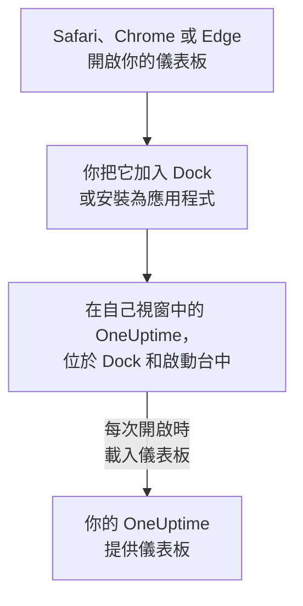

# macOS 安裝

OneUptime 儀表板可以作為應用程式安裝在 Mac 上：從 Safari 將它加入 Dock，或從 Google Chrome 或 Microsoft Edge 安裝。它在自己的視窗中開啟，在 Dock 和啟動台中有自己的圖示，並且可以顯示通知。無需下載任何內容：這個應用程式就是你的 OneUptime 的儀表板，只要你的 OneUptime 是最新的，它就是最新的。

:::cards
- [安裝應用程式](#安裝應用程式): 從 Safari、Chrome 或 Edge 安裝。
- [將它保留在 Dock 中](#將它保留在-dock-中): 一鍵開啟，或在登入時開啟。
- [在這台 Mac 上接收通知](#在這台-mac-上接收通知): 為推播通知註冊應用程式。
- [疑難排解](#疑難排解): 沒有「加入 Dock」、沒有通知、需要重新登入。
:::

## 桌面應用程式的運作方式

Safari 網頁 App 有自己的登入狀態、Cookie 和設定，與 Safari 分開。從 Chrome 或 Edge 安裝的應用程式則與該瀏覽器共享這些內容。

## 開始之前

- 使用 Safari 需要 macOS Sonoma 14 或更高版本。Chrome 和 Edge 可以在它們能執行的任何 macOS 上安裝應用程式。
- 透過 HTTPS 存取的你的 OneUptime 網址：OneUptime Cloud 上是 `https://oneuptime.com`，或你自己的網址，例如 `https://oneuptime.example.com`。
- 一個可以登入儀表板的帳號。

## 安裝應用程式

:::tabs
@tab Safari
1. 在 Safari 中開啟你的 OneUptime 並登入。
2. 在任意儀表板頁面上，選擇 **檔案 → 加入 Dock**，或按一下工具列中的分享按鈕，然後按一下 **加入 Dock**。
3. 保留名稱或修改它，然後按一下 **加入**。
4. 從 Dock 開啟 OneUptime，並再登入一次：網頁 App 不共享 Safari 的登入狀態。
@tab Chrome
1. 在 Chrome 中開啟你的 OneUptime 並登入。
2. 在任意儀表板頁面上，點選網址列右側的安裝圖示，然後點選 **安裝**。或者開啟 **⋮ → 投放、儲存及分享 → 將頁面安裝為應用程式**。
3. Chrome 會在自己的視窗中開啟 OneUptime，並將其加入啟動台。
@tab Edge
1. 在 Edge 中開啟你的 OneUptime 並登入。
2. 在任意儀表板頁面上，點選網址列右側的安裝圖示，然後點選 **安裝**。或者開啟 **設定及其他 (…) → 更多工具 → 應用程式 → 將此網站安裝為應用程式**。
3. Edge 會在自己的視窗中開啟 OneUptime，並將其加入啟動台。
:::

請在登入後從儀表板頁面安裝：登入頁面不是這個應用程式。Safari 會把網頁 App 儲存在你的個人專屬資料夾中的「應用程式」資料夾裡。

## 將它保留在 Dock 中

- **Dock。** 在應用程式開啟時，按住 Control 鍵並按一下它在 Dock 中的圖示，然後選擇 **選項 → 保留在 Dock 中**。Safari 網頁 App 已經在 Dock 中。
- **登入時開啟。** 按住 Control 鍵並按一下 Dock 中的圖示，然後選擇 **選項 → 登入時打開**。
- **Spotlight。** 按下 Command-空白鍵並輸入 OneUptime。

## 在這台 Mac 上接收通知

在每個想接收通知的專案中為推播通知註冊應用程式後，應用程式就會顯示通知。請在網頁 App 內部註冊 Safari 網頁 App：它本身就是一個獨立的瀏覽器。從 Chrome 或 Edge 安裝的應用程式會隨其瀏覽器一起註冊。

:::steps
### 開啟你的推播裝置
在應用程式中，開啟 **使用者設定 → 通知方式** 和 **Push Notifications** 分頁。

### 註冊這個應用程式
按一下 **註冊裝置**，保留建議的 **裝置名稱**（例如 `Safari on macOS`）或修改它，然後再次按一下 **註冊裝置**。當 macOS 或瀏覽器詢問是否允許 OneUptime 傳送通知時，選擇 **允許**。

### 傳送測試
在 **Browser Registered** 對話方塊中，按一下 **Send Test Notification**。如果什麼都沒有出現，請檢查 Mac 的通知設定：請參閱 [疑難排解](#疑難排解)。
:::

瀏覽器無法穿透勿擾模式等專注模式響起。對於必須叫醒你的呼叫，請使用開啟了重大警示的行動應用程式：請參閱 [iOS 安裝](/docs/mobile-desktop-apps/ios-installation#穿透靜音模式)。

在自架的 OneUptime 上，瀏覽器通知需要伺服器的 VAPID 金鑰：請參閱 [推播通知](/docs/self-hosted/push-notifications#自架設定)。

## 更新

無需更新任何內容。應用程式每次開啟時都會從你的 OneUptime 載入儀表板，因此你的 OneUptime 升級後它也會隨之變化。如果某個視窗在升級前就已開啟，請按 Command-R 重新載入。

## 解除安裝

:::tabs
@tab Safari
在 Finder 中開啟你的個人專屬資料夾，再開啟其中的「應用程式」資料夾，將 OneUptime 拖到垃圾桶。
@tab Chrome
在應用程式視窗中開啟 **⋮** 選單，選擇解除安裝該應用程式的選單項目，然後選擇 **移除**。
@tab Edge
在 Edge 中開啟 `edge://apps`，在 OneUptime 上選擇 **詳細資料**，然後選擇 **解除安裝**。
:::

解除安裝應用程式不會取消它的註冊：它的瀏覽器仍會收到通知。要停止通知，請在 **使用者設定 → 通知方式** 的 **Push Notifications** 分頁中，用 **刪除** 刪除它。

## 疑難排解

:::details Safari 中沒有「加入 Dock」
從 macOS Sonoma 14 開始，Safari 才能把網頁 App 加入 Dock。請更新 macOS，或改為從 Chrome 或 Edge 安裝應用程式。
:::

:::details 沒有顯示通知
- 在 **使用者設定 → 通知方式** 的 **Push Notifications** 分頁中，確認應用程式或其瀏覽器已列出，並傳送一則 **測試通知**。
- 在 Mac 上開啟 **系統設定 → 通知**，確認 OneUptime（或安裝它的瀏覽器）被允許傳送通知，並且沒有專注模式在攔下通知。
- 如果瀏覽器封鎖了 OneUptime 的通知，請在瀏覽器的網站設定中允許通知，然後重新註冊。
- 在自架的 OneUptime 上，如果伺服器沒有 VAPID 金鑰，**註冊裝置** 對話方塊會說明這一點。
:::

:::details 應用程式要求你重新登入
Safari 網頁 App 有自己的登入狀態：請在應用程式內登入。從 Chrome 或 Edge 安裝的應用程式共享其瀏覽器的登入狀態，因此在瀏覽器中登出或清除其 Cookie，也會讓它登出。
:::

## 後續步驟

:::cards
- [iOS 安裝](/docs/mobile-desktop-apps/ios-installation): 在 iPhone 上接收呼叫，並使用重大警示。
- [Windows 安裝](/docs/mobile-desktop-apps/windows-installation): 在 Windows 上使用同一個應用程式。
- [常見問題與疑難排解](/docs/mobile-desktop-apps/faq-troubleshooting): 關於兩個應用程式的解答。
- [您的帳戶](/docs/introduction/your-account): OneUptime 如何在每個專案中聯絡你。
:::
