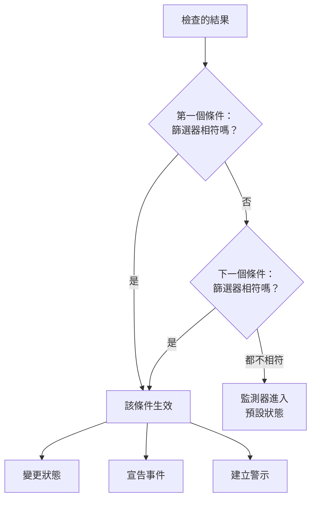
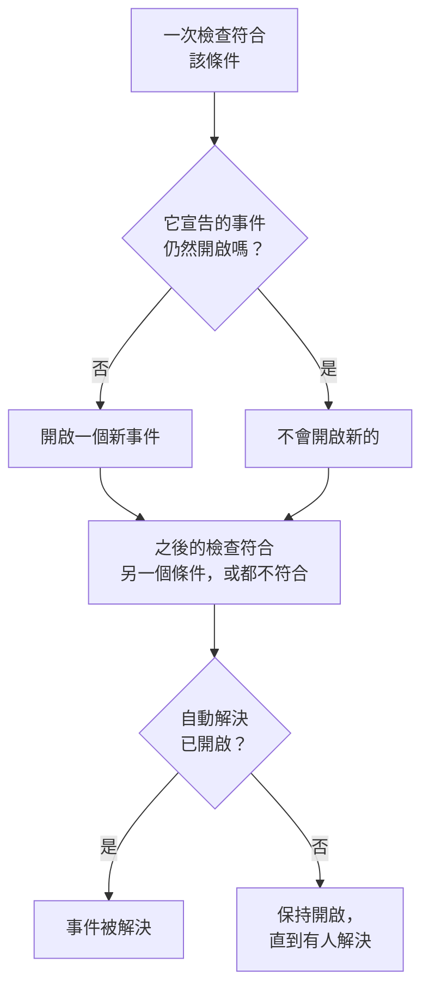

# 監測器條件與狀態

監測器的條件決定每次檢查代表什麼：監測器是正常還是停擺，以及 OneUptime 是宣告事件還是建立警示。狀態是您專案中監測器可能處於的狀態清單，從 **運作中** 到 **離線**。本頁針對所有監測器類型說明這兩者；每種類型自己的頁面會列出它提供的篩選器。

:::cards
- [條件如何決定](#條件如何決定): 由上而下，第一個相符的勝出。
- [條件包含什麼](#條件包含什麼): 篩選器、符合條件、操作和設定。
- [變更監測器的條件](#變更監測器的條件): 編輯、新增、排序和測試條件。
- [監測器狀態](#監測器狀態): 內建狀態和您自己的狀態。
:::

## 條件如何決定

每次檢查監測器時，它的條件會從清單頂端往下判斷結果。第一個篩選器相符的條件決定會發生什麼，這次檢查不會再看它下面的條件。如果沒有任何條件相符，監測器會進入它的 **預設監測器狀態**。

順序是規則的一部分。新監測器依從壞到好的順序列出條件：先是離線，然後是該類型有的警告（即將到期的憑證或網域），最後是上線。像 **Is Online** 設為 **是** 這樣寬泛的健康條件幾乎符合每次檢查，所以放在最後：如果放在其他條件之上，它每次都會先相符，其他條件就永遠不會生效。

一個相符但不變更狀態的條件仍然決定了這次檢查：監測器保持現有狀態，它下面的條件等待下一次檢查。**預設監測器狀態** 只在沒有任何條件相符時才適用。新監測器的預設值是 **運作中**；可以在條件下方的 **更多欄位** 中變更。

> [!NOTE]
> 依主機、容器、磁碟或介面分別開啟事件或警示的監測器，每次檢查都會判斷所有條件，因此兩台主機可以同時符合兩個不同的條件。這指的是查詢帶有 **分組依據** 的監測器，例如指標監測器或日誌監測器，或者為每個磁碟或介面指定 `*` 的條件。依酬載欄位將事件分組的傳入請求監測器，仍然會在第一個相符處停止。

## 條件包含什麼

開啟一個條件，它有一個名稱和三個區段，每個區段都可以收合為一行摘要。

| 部分 | 包含什麼 |
| --- | --- |
| **條件名稱** | 條件清單中的名稱，也會出現在該條件開啟的每個事件和警示的根本原因中。**新增條件準則** 會依新條件的篩選器為它命名，在您輸入自己的名稱之前，名稱會隨篩選器變化。 |
| **篩選器** | 檢查必須顯示的內容，由一個或多個篩選器表示。Kubernetes 和指標監測器稱之為 **Alert Rules**。 |
| **操作** | 篩選器相符時發生的事：變更狀態、建立警示、宣告事件，或其中任意組合。 |
| **設定** | **啟用此條件**、選填的 **描述**，以及傳入請求監測器上的 **Group incidents and alerts by a payload field**。 |

### 篩選器

篩選器從檢查中讀取一個值並進行比較：**篩選器類型**（讀取什麼，例如 **回應狀態碼**）、**篩選條件**（如何比較，例如 **大於**）和 **值**。比較指標的監測器，例如 Kubernetes 和指標監測器，改為要求填寫 **條件** 和 **閾值**。每種監測器類型都提供自己的篩選器類型，列在各自的頁面上，例如 [監測條件](/docs/monitor/website-monitor#監測條件)。

有兩個或更多篩選器時，下方會出現 **符合條件**：**全部** 表示每個篩選器都必須相符，**任何** 表示一個就夠了。新條件從 **全部** 開始。

對每次檢查都進行測量的篩選器，例如 **Is Online**、**回應狀態碼** 和 **回應時間（毫秒）**，提供 **在一段時間內評估此條件**。它判斷最近一段時間內的檢查，而不只是最新一次，預設是最近 5 分鐘並使用 **All Values**，也就是只有當時間範圍內的每次檢查都相符時才相符。請參閱 [在一段時間內評估](/docs/monitor/website-monitor#在一段時間內評估)。

### 操作

每個操作都是 **操作** 下的一個開關：

| 開關 | 作用 |
| --- | --- |
| **當篩選器相符時，變更監測器狀態。** | 將監測器移到 **將監測器狀態變更為** 中選擇的狀態。 |
| **當篩選器相符時，建立警示。** | 建立在 **建立警示** 下設定的警示。警示只通知您的團隊，從不顯示在狀態頁面上。 |
| **當篩選器相符時，宣告事件。** | 宣告在 **建立事件** 下設定的事件。您的狀態頁面可以顯示它們。 |

事件或警示需要填寫標題、**嚴重程度**，以及收合起來的描述、擁有者、標籤和待命策略。標題和描述可以包含檢查中的值，例如 `{{monitorName}}`：請參閱 [事件與警示範本](/docs/monitor/incident-alert-templating)。若要在條件相符時呼叫某人，請在 **待命** 下選擇一個策略：請參閱 [待命策略](/docs/on-call/policies)。

### 設定

每個新條件的 **啟用此條件** 都是開啟的。關閉它可以保留條件但不使用：它在每次檢查中都會被略過，不變更狀態，不開啟任何東西，而且標題上會顯示 **已停用**。

**Group incidents and alerts by a payload field** 會為傳入請求中找到的每個值開啟一個事件，因此一個 webhook 位址可以同時讓多個事件保持開啟。請參閱 [開啟事件分組](/docs/monitor/incoming-request-monitor#開啟事件分組)。

## 事件和警示何時開啟和關閉

宣告事件的條件在相符時開啟一個事件。監測器恢復後，如果條件這樣設定，事件會自動關閉。

- **一次一個。** 當條件宣告的事件仍然開啟時，同一條件再次相符不會宣告另一個事件。警示也是如此。依主機或酬載欄位分組的監測器，每個主機或值保持一個開啟；開啟了 **為每封電子郵件新建一個事件** 的 Incoming Email 條件，會為每封電子郵件開啟一個。
- **關閉。** 在之後的某次檢查中，如果另一個條件相符或沒有條件相符，條件開啟了 **自動解決事件** 的事件會被解決，開啟了 **自動解決警示** 的警示也是如此。這兩項都在事件或警示的 **更多欄位** 中，新監測器一開始的條件都開啟了它們。
- **多個探測器。** 由多個探測器檢查的監測器，只有在探測器結果一致時才會改變。請參閱 [如何評估條件](/docs/monitor/create-monitor#如何評估條件)。
- **父監測器停擺。** 在監測器的 **設定 → 相依性** 頁面上，**Depends On Monitors** 指定它所相依的監測器。當其中一個處於 **Suppress When Parent Status Is** 中列出的狀態時（留空則為任何離線狀態），該監測器不會開啟事件或警示。它的狀態仍會改變，已開啟的仍會被解決。
- **排定維護。** 處於進行中維護事件的監測器不會被檢查，因此其條件不會執行。請參閱 [排定維護概觀](/docs/scheduled-maintenance/index)。

若要查看一次檢查是如何判斷的，請開啟監測器的 **概覽**：**監測器摘要** 卡片會顯示哪個條件相符、每個條件做了什麼，包括因已有一個開啟而略過的事件。

## 變更監測器的條件

:::steps
### 開啟條件頁面

前往 **監測器** 並開啟該監測器。在其側邊選單中展開 **設定**，然後點選 **條件**。**監測條件** 卡片會顯示每個條件、它檢查什麼以及它做什麼。

### 點選 Edit Monitoring Criteria

編輯器會展開顯示每個條件。點選條件的標題可將其收合為一行：名稱、篩選器數量以及它做什麼。

### 新增、變更或重新排序條件

**新增條件準則** 會在底部新增一個展開的條件，並依其篩選器命名。拖曳條件左側的控點即可移動它：第一個相符的勝出，所以把最壞的情況放在最前面。**刪除條件** 會刪除一個條件；監測器至少保留一個條件。

### 儲存條件

點選 **儲存變更**。下一次檢查將依新的條件判斷。

### 測試監測器

對於由探測器檢查的監測器，點選卡片上的 **測試監測器**，在 **選擇探測器** 中選擇一個探測器，然後點選 **執行測試**。**監測器測試結果** 會顯示檢查發現了什麼。
:::

手動監測器沒有條件：它的狀態由您自行設定。請參閱 [更新狀態](/docs/monitor/manual-monitor#更新狀態)。

## 監測器狀態

監測器總是處於專案的某個狀態中。新專案有三個狀態，從最健康到最差：

| 狀態 | 位置 | 顏色 | OneUptime 如何使用它 |
| --- | --- | --- | --- |
| **運作中** | 1 | 綠色 | 新監測器從這裡開始，它也是新監測器的 **預設監測器狀態**。內建。 |
| **效能下降** | 2 | 黃色 | 本身不做任何事：由您的某個條件把監測器移到這裡。 |
| **離線** | 3 | 紅色 | 新監測器的離線條件會把它移到這裡，OneUptime 將處於此狀態的監測器視為停擺。內建。 |

這個清單就是一個順序。在多個監測器一起顯示的地方，清單中最下方的狀態勝出：監測器群組、狀態頁面群組和狀態頁面的整體狀態，都會顯示其監測器中最差的狀態。

### 狀態在哪裡起作用

| 位置 | 狀態決定什麼 |
| --- | --- |
| **監測器** 清單 | 每個監測器的目前狀態。**無法運作** 會列出處於運作中以外任何狀態的監測器，旁邊有一個紅色計數。 |
| 狀態頁面 | 每一列的顏色及其正常運作時間：只有頁面 **計為停機時間** 中的狀態才會計入。新狀態頁面從除了運作中以外的所有狀態開始。請參閱 [決定頁面上顯示什麼](/docs/status-pages/index#決定頁面上顯示什麼)。 |
| 監測器群組 | 群組的狀態：其監測器中最差的一個。請參閱 [監測器群組](/docs/monitor/monitor-groups)。 |
| SLO | SLO 計算的停機時間，依據它自己的狀態清單。請參閱 [哪些狀態計為停機](/docs/slo/introduction#哪些狀態計為停機)。 |
| 相依性 | 父監測器是否壓住其子監測器的事件和警示：預設情況下，是在它處於離線狀態時。 |

之後新增的狀態不會加入現有狀態頁面的 **計為停機時間** 清單：請自行把它加進去。

### 新增您自己的狀態

:::steps
### 開啟監測器狀態

前往 **監測 → 設定 → 監測器狀態**。側邊選單中的 **設定** 預設是收合的：請先展開它。**監測器 狀態** 卡片依從最健康到最差的順序列出狀態。

### 建立狀態

點選 **建立監測器狀態**，填寫 **名稱**、**描述** 和 **顏色**。新狀態會放在離線狀態的正上方，因此故障仍然顯示為最差。

### 把它放到合適的位置

拖曳狀態的控點。清單中越下方的狀態，被視為比它上面的每個狀態都更差。

### 在條件中使用它

在有條件把監測器移入之前，狀態什麼也不做。在應該設定它的條件的 **將監測器狀態變更為** 中選擇它。
:::

運作中和離線狀態標記為 **內建**：您可以重新命名它們並變更顏色，但不能刪除它們。在 OneUptime Cloud 上，建立或變更狀態需要 Growth 方案。管理狀態需要 Project Owner、Project Admin 或 Monitor Admin 角色，或擁有相應監測器狀態權限的自訂角色。

### 狀態時間軸

每次狀態變化都會保存在監測器的 **狀態時間軸** 上：何時開始、持續多久，以及設定它的條件的 **檢視原因**。**建立監測器 狀態 事件** 可以手動新增一個狀態。對於由探測器檢查的監測器，下一次符合帶有狀態之條件的檢查，會再次設定該狀態。

只有當擁有者在通知設定中開啟了 **監測器狀態已變更** 時，監測器狀態的變化才會通知他們：它預設是關閉的。因為沒有條件相符而回到 **預設監測器狀態** 的監測器，不會通知任何人。請參閱 [新成員預設開啟的內容](/docs/notifications/notification-settings#新成員預設開啟的內容)。

## 封存監測器狀態

對於團隊不應再使用的狀態，請將其封存而不是刪除。封存不會變更任何監測器：處於該狀態的監測器會維持該狀態直到其狀態改變，其狀態時間軸仍會顯示它。

- **封存** 位於該列的 **⋯** 選單中。它會先要求確認，並列出設定為使用該狀態的監測器條件、範本和狀態頁：在您變更它們之前，它們會繼續使用該狀態。
- **任何人都無法再選擇它。** 條件、監測器的狀態選單、事件或維護事件的監測器狀態以及狀態頁的停機狀態都不會提供它。API、Terraform 和 MCP 會拒絕它。
- **已封存的狀態會另外列出**，位於表格下方摺疊的 **已封存的監測器狀態** 區段。**取消封存** 會將其恢復原樣。
- **內建狀態無法封存。** 新監測器從正常運作狀態開始，OneUptime 會將處於離線狀態的監測器視為停機。它們的 **封存** 已鎖定，並說明原因。

## 疑難排解

:::details 網站停擺了，但監測器仍然是運作中
清單中更上方的條件先相符了。開啟 **設定 → 條件** 檢查順序：健康條件應放在最後。也請檢查離線條件的 **啟用此條件** 是否開啟，以及它的操作 **當篩選器相符時，變更監測器狀態。** 是否開啟並選擇了狀態。
:::

:::details 監測器停擺時沒有開啟事件
檢查相符的條件：**當篩選器相符時，宣告事件。** 必須開啟。當同一條件的事件仍然開啟、**Depends On Monitors** 中的父監測器停擺，或監測器處於排定維護中時，不會宣告事件。監測器 **概覽** 上的 **監測器摘要** 卡片會說明是哪一種情況。
:::

:::details 監測器恢復後事件仍然開啟
開啟該事件的條件，並在其事件中展開 **更多欄位**：**自動解決事件** 必須開啟。來自您後來刪除之條件的事件，不會由監測器解決：請手動解決它。
:::

:::details 離線的刪除按鈕被鎖定
**運作中** 和 **離線** 是內建的：OneUptime 會把監測器移入它們，因此它們可以重新命名但不能刪除。請改為刪除您自己的狀態，或重新命名內建狀態。
:::

## 後續步驟

:::cards
- [建立監測器](/docs/monitor/create-monitor): 新監測器的三個步驟。
- [事件與警示範本](/docs/monitor/incident-alert-templating): 把檢查中的值放進標題和描述。
- [監測器群組](/docs/monitor/monitor-groups): 將多個監測器彙總為一個狀態。
- [事件概觀](/docs/incidents/index): 條件宣告事件之後會發生什麼。
:::
