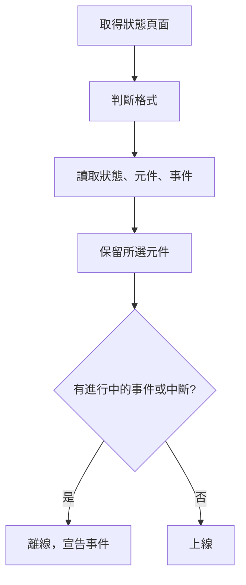

# 外部狀態頁監控

外部狀態頁監測器會留意你所依賴之服務（AWS、GCP、Azure、GitHub、OpenAI、Anthropic 等眾多服務）的公開狀態頁面，並在該供應商回報服務中斷或效能下降時對你發出警示。用它在供應商回報上游問題的第一時間得知，並把這些問題與你自己的問題區分開來。

它也能逐一讀取用 OneUptime 製作的狀態頁面中的資源，並分辨計畫維護與服務中斷：監測另一個團隊的專案，或狀態頁面執行在 OneUptime 上的供應商。

:::cards
- [建立監測器](#建立外部狀態頁監測器): 貼上狀態頁面的 URL，並選擇要留意的內容。
- [選擇元件](#元件): 只留意你依賴的元件。
- [條件](#監控條件): 預設情況下什麼算是停止運作。
- [OneUptime 狀態頁面](#oneuptime-狀態頁面): 另一個專案的資源及其維護。
- [常用狀態頁面](#常用狀態頁面-url): 大多數團隊所依賴之服務的 URL。
:::

## 運作方式

每次檢查時，探測器會取得狀態頁面，判斷它使用的格式，並讀取整體狀態、元件和進行中的事件。如果你選擇了元件或元件群組，就只計算這些內容。接著由條件決定監測器是上線還是離線。

你可以用它來：

- 監控你的應用程式所依賴之第三方服務的可用性
- 在上游供應商發生服務中斷時收到警示
- 追蹤各個元件的狀態
- 只留意你依賴的元件（例如 GitHub 的 Git Operations 和 Pull Requests，或 OpenAI 的 "APIs" 群組），讓頁面上其他無關的事件不會觸發你的監測器
- 在效能下降影響使用者之前發現它
- 把你自己的事件與上游供應商的問題關聯起來

## 支援的供應商

| 供應商 | 說明 |
| ------------------------ | ---------------------------------------------------------------------- |
| **Auto**（預設） | 自動判斷狀態頁面的格式 |
| **Atlassian Statuspage** | 由 Atlassian Statuspage 提供的狀態頁面（JSON API） |
| **incident.io** | 由 incident.io 提供的狀態頁面（例如 `https://status.openai.com`） |
| **OneUptime Status Page** | 用 OneUptime 製作的狀態頁面：每個資源的狀態，以及哪些正在維護 |
| **RSS** | 提供 RSS 摘要的狀態頁面 |
| **Atom** | 提供 Atom 摘要的狀態頁面 |

### 自動判斷

設定為 **Auto** 時，OneUptime 會依下列順序自動判斷狀態頁面的格式：

1. 首先嘗試 incident.io 狀態頁面 API（`/proxy/<host>`）。
2. 接著嘗試 Atlassian Statuspage JSON API（`/api/v2/status.json`、`/api/v2/components.json` 和 `/api/v2/incidents/unresolved.json`）。
3. 接著要求 OneUptime 狀態頁面的狀態概要（`/status-page-api/summary/<page>`）。
4. 如果都失敗，就嘗試把頁面剖析為 RSS 或 Atom 摘要。
5. 最後的退路是一次基本的 HTTP 連線能力檢查。

> [!NOTE]
> 之所以先檢查 incident.io，是因為某些 incident.io 狀態頁面（例如 `https://status.openai.com`）也公開了一個功能有限、與 Atlassian 相容的端點，其中省略了元件群組和進行中的事件。先檢查 incident.io 可以確保使用更豐富、包含群組資訊的資料。

當你明確選擇的供應商失敗時，也會退回連線能力檢查。它只會告訴你頁面是否有回應（回傳 `2xx` 或 `3xx` 即為上線），不會回報任何元件或事件。

## 建立外部狀態頁監測器

:::steps
### 開始一個新的監測器

前往 **監測器**，點選 **建立監測器**。在 **監測器類型** 下點選 **更多監測器類型**，然後在 **Basic Monitoring** 下選擇 **External Status Page**，或在搜尋方塊中輸入 `statuspage`。輸入 **名稱**，然後點選 **下一步**。

### 輸入狀態頁面的 URL

輸入 **狀態頁面 URL**。除非你知道格式，否則請把 **提供者** 保留為 **Auto**。

### 視需要選擇元件

開啟 **元件**，從頁面本身的清單中選擇你依賴的元件，例如 GitHub 的 `Git Operations` 和 `Pull Requests`；留空則留意整個頁面。若要改為只留意一個群組，請開啟 **更多欄位**，輸入 **Component Group Filter**（例如 `APIs`）。

### 測試

點選 **測試監測器** 取得一次頁面，查看它找到的供應商、元件和事件。

### 檢查條件

條件步驟會從[預設條件](#預設條件)開始，當供應商回報範圍內有進行中的事件或服務中斷時，它們會把監測器標示為離線。視需要修改，然後點選 **下一步**。

### 選擇探測器並建立

選擇 **探測器** 和 **監測間隔**（一開始為 **每 5 分鐘**），然後點選 **建立監測器**。
:::

## 設定選項

| 選項 | 要輸入的內容 | 預設值 |
| --- | --- | --- |
| **狀態頁面 URL** | 狀態頁面的 URL。對於由 Atlassian Statuspage 和 incident.io 提供的網站，通常是根 URL（例如 `https://status.example.com`）。對於 RSS/Atom 摘要，請直接輸入摘要的 URL。 | — |
| **提供者** | **Auto** 表示自動判斷格式；如果你知道格式，可選擇 **Atlassian Statuspage**、**incident.io**、**OneUptime Status Page**、**RSS** 或 **Atom**。 | **Auto** |
| **元件** | 要留意的元件，從頁面本身的清單中選擇或直接輸入。 | 整個頁面 |
| **Component Group Filter** | 監測器限定到的群組。位於 **更多欄位** 下。 | 所有群組 |
| **逾時（ms）** | 等待狀態頁面的最長時間。位於 **更多欄位** 下。 | `10000`（10 秒） |
| **重試** | 第一次嘗試失敗後重試的次數，每次間隔一秒；`0` 表示只嘗試一次。位於 **更多欄位** 下。 | `3`（最多 4 次嘗試） |

### 元件

選擇你依賴的元件後，監測器只留意它們：**External Status Page Component Status** 只比較它們的狀態，整體狀態取它們之中最差的那個，**External Status Page Active Incidents** 只計算至少影響其中一個元件的事件。無論選擇多少個元件，對頁面的檢查仍然只有一次。

開啟 **元件** 時，你的瀏覽器會從 Atlassian Statuspage、incident.io 頁面或 OneUptime 狀態頁面讀取頁面本身的清單，並依頁面的群組顯示；未正常運作的元件會註明它目前的狀況。你選擇的名稱只留意與它完全同名的元件，不區分大小寫：GitHub 頁面上的 `Copilot` 不是 `Copilot AI Model Providers`。

如果無法讀取清單（內部頁面、不向你的瀏覽器分享清單的頁面、RSS 或 Atom 摘要），請輸入名稱並按 Enter。`*` 代表任意文字：`*us-east-1*` 會留意名稱中含有 `us-east-1` 的所有元件。對於 RSS 或 Atom 摘要，標題中含有其中某個名稱的項目會被計入。

留意所選元件時，沒有指明任何元件的事件不會被計入：沒有任何資訊表示它影響這些元件。如果什麼都沒選，監測器會留意整個頁面，所有事件都會被計入。

使用舊的元件名稱篩選器儲存的監測器會繼續留意原本留意的內容：該篩選器在 **元件** 中顯示為前後加上星號的名稱，例如 `*API*`，它會符合名稱中含有該名稱的所有元件。

> [!WARNING]
> 什麼都比對不到的名稱什麼也不留意，看起來卻是正常的。**元件** 和 **測試監測器** 都會列出頁面上沒有的所選元件。

### Component Group Filter

如果狀態頁面把元件分成群組，你可以把監測器限定到單一群組。例如在 `https://status.openai.com` 上輸入 `APIs`，就會把監測器限定到 OpenAI 的 API 服務。

設定了元件群組後，**進行中的事件數** 和 **整體狀態** 只會根據該群組中的元件計算：影響無關群組（例如 ChatGPT）的事件不會觸發限定到 "APIs" 群組的監測器。如果同時選擇了元件，就只計算該群組中所選的元件。

**Atlassian Statuspage**、**incident.io** 和 **OneUptime Status Page** 供應商支援依元件群組篩選。RSS 和 Atom 摘要不提供元件群組。

## 監控條件

你可以設定條件，依據下列內容決定外部服務何時被視為上線或離線：

| 篩選器類型 | 檢查內容 | 篩選條件 |
| --- | --- | --- |
| **External Status Page Is Online** | 狀態頁面是否可以連線並傳回狀態資料 | 是 或 否 |
| **External Status Page Overall Status** | 頁面回報的整體狀態 | 等於、不等於、包含、不包含、開頭是、結尾是 |
| **External Status Page Component Status** | 範圍內每個元件的狀態（設定後為所選元件或該群組的元件）：運作中、Under Maintenance、Degraded Performance、Partial Outage、Major Outage 或 Full Outage | 等於、不等於、包含、不包含、開頭是、結尾是 |
| **External Status Page Active Incidents** | 狀態頁面上目前進行中的事件數（選擇了元件或群組時，只計算影響範圍內元件的事件） | 等於、不等於以及數值比較 |
| **External Status Page Response Time (in ms)** | 取得狀態頁面資料所花的時間 | 大於、小於、大於或等於、小於或等於 |

整體狀態就是頁面上寫的內容，因此其值會因供應商而異：Atlassian Statuspage 回報它自己的描述，例如 `All Systems Operational`；OneUptime 狀態頁面回報範圍內元件中最差的狀態，例如 `under_maintenance`；摘要回報 `operational` 或 `degraded_performance`；連線能力檢查回報 `reachable` 或 `unreachable`。選擇了元件或群組時，無論是哪種頁面，它都是其中最差的狀態。這些比較會區分大小寫。若要針對服務中斷發出警示，**External Status Page Active Incidents** 和 **External Status Page Component Status** 通常比較可靠。

對於 RSS 或 Atom 摘要，最近 24 小時內的項目算作進行中的事件：RSS 項目依發布日期，Atom 項目依更新日期。日期在未來的項目要到該日期才計入。

### 預設條件

根據預設，OneUptime 會依狀態頁面真正重要的內容建立條件，也就是進行中的事件和元件的健康狀況，而不只是連線能力：

| 條件 | 篩選器 | 效果 |
| --- | --- | --- |
| Offline | 下列 **任何** 一項：頁面不在線上；範圍內至少有一個進行中的事件；範圍內有元件回報 Degraded Performance、Partial Outage、Major Outage 或 Full Outage | 將監測器標示為離線並宣告一個事件，該事件會在條件不再符合時自動解決 |
| Online | 下列 **全部** 成立：頁面在線上；範圍內沒有進行中的事件 | 將監測器標示為上線 |

由於進行中的事件數和元件狀態都遵循所選的元件和群組，這些預設條件會自動只針對你在意的元件。

## OneUptime 狀態頁面

若要監測用 OneUptime 製作的狀態頁面（另一個團隊的專案，或供應商在 OneUptime Cloud 或自行託管的 OneUptime 上的頁面），請把提供者選為 **OneUptime Status Page** ，或保留 **Auto** 。在 **狀態頁面 URL** 中輸入頁面本身的位址：有網域就輸入網域，例如 `https://status.example.com`，沒有就輸入 `https://oneuptime.com/status-page/<status-page-id>`。

監測器讀取頁面的狀態概要 `/status-page-api/summary/<page>`（請參閱 [讀取狀態概要](/docs/status-pages/public-api#讀取狀態概要)）：只讀取頁面向訪客顯示的內容，不讀取另一個專案的其他任何內容。頁面上的每個資源（一個監測器或一個監測器群組）都是一個元件，使用頁面為它取的名稱，位於頁面的群組中；群組中的群組寫作 `Core / Databases`。在 **元件** 中選擇資源，或用 **Component Group Filter** 監測一個群組。

元件的狀態是它在頁面上的狀態所代表的值，因此元件狀態條件的用法與任何狀態頁面相同：

| 頁面上 | 元件狀態 |
| --- | --- |
| 專案的正常運作狀態 | `operational` |
| 名為 `Degraded` 的狀態 | `degraded_performance` |
| 名為 `Offline`、`Down` 或 `Major Outage` 的狀態 | `major_outage` |
| 名為 `Partial Outage` 的狀態 | `partial_outage` |
| 名為 `Full Outage` 的狀態 | `full_outage` |
| 名為 `Maintenance` 的狀態 | `under_maintenance` |
| 其他任何狀態 | `degraded_performance` |
| 頁面隱藏的狀態（**Show current status** 已關閉） | `unknown` |

當進行中的排定維護事件影響某個資源時（事件指定了該資源的某個監測器，或其監測器群組中的某個監測器），無論其監測器處於什麼狀態，該元件都是 `under_maintenance`：事件佔用監測器期間，監測器不會被檢查。尚未開始或已經結束的事件不會改變任何事。頁面上進行中的事件會計入它們影響的資源。

[預設條件](#預設條件) 絕不會把維護當成服務中斷：在另一個專案的計畫工作期間，監測器保持在線。

### 在你的監測器上顯示上游維護

:::steps
### 新增條件

在監測器的條件中點選 **新增條件準則** 。為它設定篩選器 **External Status Page Component Status** 、 **等於** 、 **Under Maintenance** ，並在 **將監測器狀態變更為** 中選擇你的維護狀態。

### 把它移到最上面

把新條件拖到其他條件上方：第一個符合的條件生效。

### 用測試監測器檢查

在另一個專案有維護進行時點選 **測試監測器** ：受影響的元件會顯示 **Under Maintenance**。
:::

### OneUptime 狀態頁面允許監測器讀取的內容

任何人都能開啟的頁面，會依訪客看到的樣子被讀取。要求登入、SSO 或密碼的私人頁面無法讀取：選擇 **OneUptime Status Page** 時，檢查會失敗並說明原因。設定了 IP 允許清單的頁面必須放行探測器的位址：請從該網路內部的探測器進行監測。

## 範本變數

從外部狀態頁監測器建立事件或警示時，你可以在標題、描述和修復說明中使用這些變數（請參閱 [事件與警示範本](/docs/monitor/incident-alert-templating)）：

| 變數 | 說明 |
| ------------------------- | ------------------------------------------------------------------------------- |
| `{{isOnline}}`            | 狀態頁面是否在線上（true/false） |
| `{{responseTimeInMs}}`    | 回應時間，單位為毫秒 |
| `{{failureCause}}`        | 失敗原因（如果有） |
| `{{overallStatus}}`       | 整體狀態指標值 |
| `{{activeIncidentCount}}` | 進行中的事件數（如果選擇了元件，則只計算所留意元件的事件） |
| `{{componentStatuses}}`   | 元件狀態的 JSON 陣列（`name`、`status`、`description`、`groupName`） |
| `{{provider}}`            | 判斷出的供應商（Atlassian Statuspage、incident.io、OneUptime Status Page、RSS、Atom）；連線能力檢查之後為空 |
| `{{componentGroup}}`      | 監測器限定到的元件群組（如果有） |
| `{{componentName}}`       | 監測器留意的元件，以逗號分隔（如果選擇了元件） |

## 常用狀態頁面 URL

下列是一些常用服務的狀態頁面。其中許多使用 Atlassian Statuspage 或 incident.io，因此 **Auto** 供應商會自動判斷它們。既不是以這兩者為基礎、也不是摘要的頁面只會進行連線能力檢查；對於這類頁面，如果供應商有發布 RSS 或 Atom 摘要，請改為監控該摘要。

| 服務 | 狀態頁面 URL |
| ---------------------------- | --------------------------------------------- |
| AWS                          | `https://health.aws.amazon.com/health/status` |
| Google Cloud Platform        | `https://status.cloud.google.com`             |
| Microsoft Azure              | `https://status.azure.com`                    |
| GitHub                       | `https://www.githubstatus.com`                |
| OpenAI                       | `https://status.openai.com`                   |
| Anthropic                    | `https://status.anthropic.com`                |
| Cloudflare                   | `https://www.cloudflarestatus.com`            |
| Datadog                      | `https://status.datadoghq.com`                |
| PagerDuty                    | `https://status.pagerduty.com`                |
| Twilio                       | `https://status.twilio.com`                   |
| Stripe                       | `https://status.stripe.com`                   |
| Slack                        | `https://status.slack.com`                    |
| Atlassian (Jira, Confluence) | `https://status.atlassian.com`                |
| Vercel                       | `https://www.vercel-status.com`               |
| Netlify                      | `https://www.netlifystatus.com`               |
| DigitalOcean                 | `https://status.digitalocean.com`             |
| Heroku                       | `https://status.heroku.com`                   |
| MongoDB Atlas                | `https://status.cloud.mongodb.com`            |
| Fastly                       | `https://status.fastly.com`                   |
| New Relic                    | `https://status.newrelic.com`                 |
| Sentry                       | `https://status.sentry.io`                    |
| CircleCI                     | `https://status.circleci.com`                 |

## 最佳做法

- **使用 Auto 供應商** —— 除非你知道確切的格式，自動判斷適用於大多數狀態頁面。
- **選擇你依賴的元件** —— 例如選擇 GitHub 的 Git Operations 和 Pull Requests，這樣無關的事件就不會產生雜訊。
- **留意整個群組** —— 如果你依賴整個群組（例如 OpenAI 的 "APIs"），之後加入該群組的元件也會被留意。
- **與你自己的監測器搭配使用** —— 把外部狀態頁監測器與你自己的 API 和網站監測器搭配使用。兩者同時停止運作時，上游狀態頁面能更快指出根本原因。

## 疑難排解

:::details 監測器離線了，但事件涉及的是我沒有使用的那部分服務
在 **元件** 中選擇你依賴的元件，或在 **Component Group Filter** 中指定一個群組。這樣進行中的事件數和元件狀態就只會計算這些內容；沒有指明任何元件的事件不會被計入。
:::

:::details 即使在服務中斷期間，監測器也從不離線
可能是所選名稱在頁面上什麼都沒比對到（這看起來是正常的），也可能是頁面只進行了連線能力檢查。執行 **測試監測器**：它會顯示找到的供應商和元件，並列出頁面上沒有的所選元件。
:::

:::details Auto 選錯了格式，或找不到任何元件
把 **提供者** 設定為你知道該頁面所使用的那一個。對於 RSS 或 Atom 摘要，請輸入摘要本身的 URL，而不是狀態頁面的 URL。
:::

:::details 元件清單無法載入
清單由你的瀏覽器直接從狀態頁面讀取。瀏覽器無法連線的內部頁面、不向其他網站分享清單的頁面，以及 RSS 或 Atom 摘要，都沒有可供選擇的清單：請依頁面上顯示的樣子輸入每個元件的名稱，然後按 Enter。探測器仍會像以前一樣讀取頁面。
:::

:::details OneUptime 狀態頁面沒有顯示任何元件
把 **提供者** 選為 **OneUptime Status Page** ，然後點選 **測試監測器** ：結果會說明頁面是否為私人頁面，或其 IP 允許清單是否把探測器擋在外面。很久沒有更新的自行託管 OneUptime 還不提供狀態概要：在更新之前，該頁面只會得到連線能力檢查，或被當作摘要讀取。
:::

:::details 無法連線到內部狀態頁面
除非獲得允許，否則探測器會拒絕私有網路位址。在你網路內部的探測器上設定 `PROBE_ALLOW_PRIVATE_NETWORK_MONITORS=true`，請參閱 [私有網路存取](/docs/self-hosted/private-network-access)。
:::

## 後續步驟

:::cards
- [事件與警示範本](/docs/monitor/incident-alert-templating): 把供應商的狀態放進事件標題。
- [API 監控](/docs/monitor/api-monitor): 在供應商的狀態之外檢查你自己的端點。
- [建立監測器](/docs/monitor/create-monitor): 所有監測器類型共通的步驟。
:::
