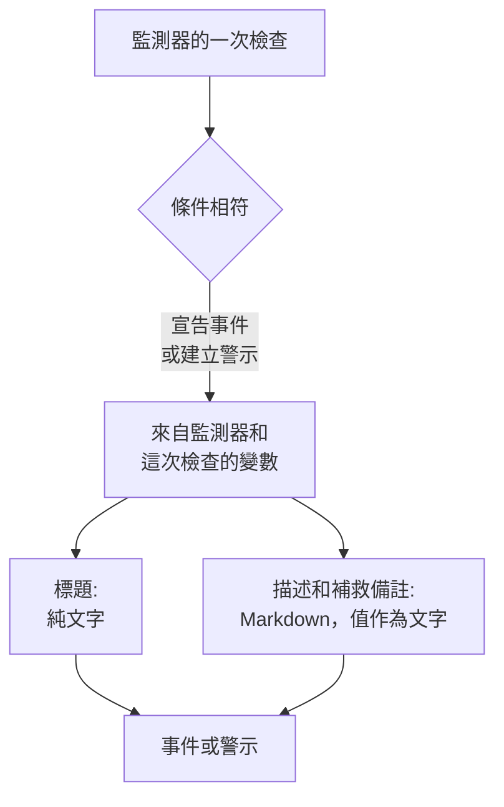

# 事件與警示範本

當監測器的條件宣告事件或建立警示時，它會用你撰寫的範本填入標題、描述和補救備註。在其中放入 `{{variable}}` 預留位置(例如 `{{monitorName}}` 或 `{{responseStatusCode}}`)，每個事件就會用開啟它的那次檢查中的值說明出了什麼問題。

:::cards
- [在哪裡撰寫範本](#在哪裡撰寫範本): 條件所建立的事件或警示的標題、描述和補救備註。
- [基本用法](#基本用法): 預留位置、進入物件的路徑，以及清單。
- [所有監測器都有的變數](#所有監測器都有的變數): 監測器的名稱，以及超過臨界值的資源。
- [依監測器類型區分的變數](#依監測器類型區分的變數): 每種檢查回報的內容。
:::

## 範本的運作方式

範本只在條件建立事件或警示時填入一次。OneUptime 從監測器和相符的那次檢查中收集變數，把每個值放到它的預留位置所在處，然後儲存結果。之後修改範本，只會改變此後建立的事件和警示，不會改變已經開啟的那些。



- **標題是純文字。** 無論在哪裡顯示，讀起來都和範本呈現的結果完全一樣。
- **描述和補救備註是 Markdown。** 你撰寫的 Markdown 會被呈現，而受監控系統傳送的每個值都以文字形式放入，因此其中的任何內容都無法加入連結、圖片或提及。請參閱 [描述和補救備註中的值](#描述和補救備註中的值)。
- **分組監測器會為每個事件填入它自己的序列。** 依主機、Pod 或裝置各開啟一個事件的監測器，會用該序列的值填入每個範本；如果你的範本還沒有寫出序列的名稱，就會把它加到標題中。

## 在哪裡撰寫範本

:::steps
### 開啟監測器的條件

前往 **監測器**，開啟該監測器，然後在其側邊選單中點選 **條件**。點選 **編輯監測條件**。

### 開啟事件或警示

在條件的 **操作** 下，開啟 **當篩選器相符時，宣告事件。** 或 **當篩選器相符時，建立警示。** 其下方會開啟事件或警示的表單。

### 撰寫標題

在 **事件標題** 或 **警示標題** 中輸入標題，例如 `{{monitorName}} is down`。旁邊的 **Learn about dynamic templates** 會開啟 **Dynamic Template Variables**：列出此監測器類型的所有變數及其內容。點選變數即可複製。

### 撰寫描述和補救備註

開啟 **描述** 以撰寫 **事件描述** 或 **警示描述**，開啟 **更多欄位** 以撰寫 **補救備註**。這些編輯器會直接提供變數：**範本變數** 在編輯器下方列出變數，工具列中的 **插入變數** 會開啟同一份清單，輸入 `{{` 會在游標處開啟它。

### 儲存條件

點選 **儲存變更**。此條件建立的下一個事件或警示會使用新的範本。
:::

## 基本用法

預留位置是以雙大括號括起來的變數名稱。建立事件時，OneUptime 會把它取代為變數的值，周圍的文字則保持你寫的樣子。

```text title="Title template"
{{monitorName}} returned {{responseStatusCode}} in {{responseTimeInMs}} ms
```

如果監測器名為 `Checkout API`，回應狀態碼為 `502`，回應耗時 `842` 毫秒，那麼事件的標題為：

```text title="Title as created"
Checkout API returned 502 in 842 ms
```

### 物件和清單中的路徑

保存物件或清單的變數以路徑讀取，方式與 [JavaScript 運算式](/docs/monitor/javascript-expression) 相同：

| 寫法 | 讀取的內容 | 範例 |
| --- | --- | --- |
| `{{object.field}}` | 物件的某個欄位，任意深度 | `{{responseBody.error.message}}` |
| `{{list[0]}}` 或 `{{list.0}}` | 清單的某一項，從 0 開始計數 | `{{diskMetrics[0].usagePercent}}` |
| `{{list[last]}}` | 清單的最後一項 | `{{processes[last].name}}` |
| `{{object}}` | 整個物件或清單，以 JSON 形式 | `{{responseBody}}` |

欄位名稱可以包含連字號，例如 `{{responseHeaders.content-type}}`。負數索引(例如 `[-1]`)什麼也讀不到：請使用 `[last]`。

### 值不存在時

路徑無處可達的預留位置會依你寫的樣子連同大括號一起留在文字中：如果回應中沒有 `error` 欄位，`{{responseBody.error.id}}` 就會原樣出現在標題裡。這次檢查沒有回報的變數也是如此，例如未失敗的檢查中的 `failureCause`。檢查回報為空白文字的值會被取代為空。

若要撰寫一個無論監測器是否分組都能用的範本，請使用 [受影響的資源](#受影響的資源) 變數：它們一律存在，監測器未分組時為空。

### 描述和補救備註中的值

描述和補救備註是 Markdown：它們會顯示在事件或警示的頁面、電子郵件，以及其 Slack 和 Microsoft Teams 頻道中。範本放入其中的值是受監控系統傳送的內容——回應本文或標頭、傳入的請求或郵件、裝置或序列的標籤——因此每個值都以文字形式放入。無論範本把它放在哪裡，讀起來都和傳送時完全一樣；其中的連結、圖片、HTML 標籤或像 `<!channel>` 這樣的 Slack 提及都會顯示為文字，而不會生效。值中的裸網址仍會變成連結，但會顯示它指向哪裡。你在範本本身中撰寫的 Markdown 會依你寫的樣子呈現。

值可以是任意大小——回應本文或數 MB 的日誌——通知仍會帶著它送出。每個頻道只承載它能接受的部分，對它來說過長的描述會被截斷(有換行時在換行處截斷)，並以 "… (truncated — see OneUptime for the full text)" 結尾：

- **電子郵件**：每則描述、備註或根本原因最多承載約 256 KB 的郵件本文，更長時結尾的說明會連結到事件或警示。整封郵件(本文和螢幕截圖)保持在 3 MB 以下，所有郵件伺服器和 Microsoft Graph 都能接受：本文旁放不下的螢幕截圖會被省略，並在原處留下說明。
- **事件或警示的頁面** 會顯示全部內容。超過 128 KB 且排版耗時較長的描述會以純文字逐行顯示。
- **Slack** 最多承載 Slack 能顯示的訊息長度(約 30,000 個字元)。**Microsoft Teams** 透過 OneUptime 應用程式傳送的訊息約承載 40,000 個字元，透過傳入 Webhook(狀態頁面訂閱者、工作流程)約承載 12,000 個字元——依訊息傳送時測量，因此表格依其轉換後的 HTML 計算。
- **簡訊、電話、推播通知、WhatsApp 和 Telegram** 承載各自供應商所接受的內容：請參閱 [各層級如何呼叫人員](/docs/on-call/escalation-rules#各級別如何呼叫人員)。

每個頻道呈現文字所需的時間都隨長度增加。會讓呈現器耗時長得多的部分——超過 64 KB 的行、由一般行組成的長段落、充滿從未關閉的 `*`、`_` 或 `[` 的段落、巢狀超過十六層的引言或清單，以及在事件或警示頁面上超過一千行的表格或清單——會在原處以純文字顯示，描述的其餘部分照常呈現。

## 進階用法

### 逐一處理清單

`{{#each path}}` 會把直到 `{{/each}}` 的文字，針對 `path` 處清單中的每一項各重複一次：

```text title="Loop syntax"
{{#each arrayPath}}
  ...text with {{field}} placeholders for each item...
{{/each}}
```

在迴圈內部：

- `{{field}}` 和 `{{field.nested}}` 讀取目前的項目。目前項目沒有的名稱，會先在外層項目中尋找，再在整個範本的變數中尋找。
- `{{@index}}` 是該項目的位置，從 0 開始計數。
- `{{this}}` 是該項目本身，用於字串等一般值組成的清單。
- 對不是清單的路徑或空清單進行迴圈，不會輸出任何內容。
- 迴圈可以巢狀：位於另一個迴圈內的 `{{#each}}` 會讀取每個外層項目的內層清單。

例如，一個接收以下警示通知的 [傳入請求監測器](/docs/monitor/incoming-request-monitor)：

```json title="Request body"
{
  "receiver": "payments",
  "alerts": [
    { "status": "firing", "labels": { "alertname": "HighLatency" } },
    { "status": "resolved", "labels": { "alertname": "DiskFull" } }
  ]
}
```

如果它的描述範本是：

```text title="Description template"
Alerts for {{requestBody.receiver}}:
{{#each requestBody.alerts}}
- {{@index}}: {{labels.alertname}} ({{status}})
{{/each}}
```

就會建立一個描述如下的事件。每個項目都保留其前後的換行，因此各項目之間會有一個空行，而描述仍顯示為一份清單：

```text title="Description as created"
Alerts for payments:

- 0: HighLatency (firing)

- 1: DiskFull (resolved)
```

### 分組監測器的值

帶有 **Group by** 屬性的指標型監測器會為每個序列開啟一個事件，每個屬性的值都是以該屬性名稱命名的變數。依 `host.name` 分組會得到 `{{host.name}}`，依 `resource.k8s.pod.name` 分組會得到 `{{resource.k8s.pod.name}}`。`{{seriesLabels}}` 以物件形式包含它們全部。

分組的 [日誌監測器](/docs/monitor/logs-monitor) 也是如此：每個分組屬性的值都是以其鍵命名的變數。

## 所有監測器都有的變數

### 監測器

| 變數 | 內容 | 範例 |
| --- | --- | --- |
| `monitorName` | 監測器的名稱。 | `Checkout API` |
| `monitorId` | 監測器的 ID。 | `a0f78958-da0a-4775-9fd9-c9fc63d3456f` |
| `monitorType` | 監測器的類型。 | `Website`、`Synthetic Monitor` |

### 受影響的資源

這些變數描述分組監測器為其開啟事件的那個序列：一個 Pod、一個容器、一台主機、一顆磁碟。未分組的監測器中它們為空，因此任何監測器的範本都可以使用它們。

| 變數 | 內容 |
| --- | --- |
| `seriesResourceSuffix` | 序列的識別資訊，以分隔符號開頭，用於放在標題結尾。 |
| `seriesResourceSummary` | 不帶分隔符號的同一識別資訊，用於放進句子裡。 |
| `seriesResourceBlock` | 序列的所有標籤，以 Markdown 清單形式。最適合用在描述中。 |
| `seriesDebugCommands` | 針對這個資源的唯讀命令(例如 `kubectl` 或 `docker`)，以 Markdown 清單形式。 |

## 依監測器類型區分的變數

### 網站和 API 監測器

| 變數 | 內容 | 類型 |
| --- | --- | --- |
| `responseBody` | 回應本文：為 JSON 時是物件，否則是文字。 | `JSON` 或 `string` |
| `responseHeaders` | 回應標頭，依小寫名稱。 | `Dictionary<string>` |
| `responseStatusCode` | HTTP 狀態碼。 | `number` |
| `responseTimeInMs` | 回應時間，以毫秒為單位。 | `number` |
| `isOnline` | 監測器是否把該回應視為上線。 | `boolean` |

### 傳入請求監測器

| 變數 | 內容 | 類型 |
| --- | --- | --- |
| `requestBody` | 請求本文：為 JSON 時是物件。 | `JSON` 或 `string` |
| `requestHeaders` | 請求標頭，依小寫名稱。 | `Dictionary<string>` |
| `requestMethod` | HTTP 方法，例如 `POST`。 | `string` |
| `incomingRequestReceivedAt` | 收到請求的時間，以 ISO 8601 時間戳記表示。 | `string` |

當條件開啟了 **Group incidents and alerts by a payload field** 時，分組鍵也會成為變數，以分組路徑的 **最後一段** 命名：依 `requestBody.alerts[*].labels.alertname` 分組會得到 `{{alertname}}`，依 `requestBody.alerts[*].fingerprint` 分組會得到 `{{fingerprint}}`。完整的 `requestBody` 仍在旁邊可用。

> [!NOTE]
> `[*]` 只在分組路徑欄位中有效。在範本中它什麼也讀不到，因此預留位置會原樣保留。`{{requestBody.alerts[0].annotations.summary}}` 一律讀取酬載中的第一個警示，而不是事件所針對的那個警示：請使用分組變數和酬載的共用欄位，例如 `commonLabels` 和 `commonAnnotations`。請參閱 [傳入請求監測器](/docs/monitor/incoming-request-monitor)。

### 傳入郵件監測器

| 變數 | 內容 | 類型 |
| --- | --- | --- |
| `emailSubject` | 郵件的主旨。 | `string` |
| `emailFrom` | 寄件者的電子郵件地址。 | `string` |
| `emailTo` | 郵件的收件者，監測器自身的地址會被遮蔽。 | `string` |
| `emailBody` | 郵件的純文字本文。 | `string` |
| `emailReceivedAt` | 收到郵件的時間，以 UTC 的 ISO 8601 時間戳記表示。 | `string` |

在標題中，這些值都會被截成最多 150 個字元的一行。描述和補救備註會得到完整的值。請參閱 [傳入郵件監測器](/docs/monitor/incoming-email-monitor#範本變數)。

### Ping、IP 和連接埠監測器

| 變數 | 內容 | 類型 |
| --- | --- | --- |
| `isOnline` | 目標是否有回應。 | `boolean` |
| `responseTimeInMs` | 回應時間，以毫秒為單位。對連接埠而言，是 DNS 查詢和 TCP 連線的總和。 | `number` |
| `failureCause` | 檢查失敗時的原因。 | `string` |
| `isTimeout` | 檢查是否逾時。 | `boolean` |

### NTP 監測器

| 變數 | 內容 | 類型 |
| --- | --- | --- |
| `isOnline` | 時間伺服器是否回應了探測器的請求。 | `boolean` |
| `isSynchronized` | 它是否以 stratum 1 到 15 回應，沒有閏秒警報，並帶有真實的時間戳記。 | `boolean` |
| `stratum` | 伺服器回報的 stratum：主要伺服器為 1，未同步時為 16，kiss-o'-death 為 0。 | `number` |
| `clockOffsetInMs` | 伺服器的時鐘與探測器的時鐘相差多少毫秒。正值表示伺服器超前。 | `number` |
| `referenceId` | 伺服器同步的對象：在 stratum 1 時是 `GPS` 之類的來源，否則是其上游伺服器的位址。 | `string` |
| `leapIndicator` | 一切正常時為 0 到 2，伺服器表示其時鐘未同步時為 3。 | `number` |
| `kissCode` | stratum 為 0 時，伺服器代替時間傳送的四字母代碼，例如 `RATE`。 | `string` |
| `responseTimeInMs` | 從請求到回覆的時間，以毫秒為單位。 | `number` |
| `roundTripDelayInMs` | 這次交換的網路來回時間，不含伺服器自身的處理時間。 | `number` |
| `rootDelayInMs` | 從伺服器到其參考時鐘的來回時間，以毫秒為單位。 | `number` |
| `rootDispersionInMs` | 伺服器對自身最大誤差的估計，以毫秒為單位。 | `number` |
| `serverTime` | 伺服器傳送回覆時的伺服器時鐘，以 ISO 8601 時間戳記表示。 | `string` |
| `referenceTime` | 伺服器時鐘最近一次設定或校正的時間，以 ISO 8601 時間戳記表示。 | `string` |
| `serverAddress` | 請求傳往的位址。 | `string` |
| `port` | 請求傳往的 UDP 連接埠。 | `number` |
| `failureCause` | 伺服器為何沒有回應，或為何未同步。 | `string` |
| `isTimeout` | 伺服器是否沒有及時回應。 | `boolean` |

### SSL 憑證監測器

| 變數 | 內容 | 類型 |
| --- | --- | --- |
| `isOnline` | 憑證檢查是否成功。 | `boolean` |
| `isSelfSigned` | 憑證是否為自我簽署。 | `boolean` |
| `createdAt` | 憑證的簽發時間，以 ISO 8601 時間戳記表示。 | `string` |
| `expiresAt` | 憑證的到期時間，以 ISO 8601 時間戳記表示。 | `string` |
| `commonName` | 憑證的一般名稱(CN)。 | `string` |
| `organizationalUnit` | 其組織單位(OU)。 | `string` |
| `organization` | 其組織(O)。 | `string` |
| `locality` | 其所在地(L)。 | `string` |
| `state` | 其州或省(ST)。 | `string` |
| `country` | 其國家(C)。 | `string` |
| `serialNumber` | 其序號。 | `string` |
| `fingerprint` | 其 SHA-1 指紋。 | `string` |
| `fingerprint256` | 其 SHA-256 指紋。 | `string` |
| `failureCause` | 檢查失敗時的原因。 | `string` |

### DNS 監測器

| 變數 | 內容 | 類型 |
| --- | --- | --- |
| `isOnline` | 查詢是否得到回應。 | `boolean` |
| `responseTimeInMs` | 查詢時間，以毫秒為單位。 | `number` |
| `isTimeout` | 查詢是否逾時。 | `boolean` |
| `isDnssecValid` | DNSSEC 驗證結果。 | `boolean` |
| `records` | 傳回的記錄，每筆形如 `{type, value, ttl}`。 | `Array<Object>` |
| `recordValues` | 僅記錄的值。 | `Array<string>` |
| `failureCause` | 查詢失敗時的原因。 | `string` |

### DNSSEC 監測器

| 變數 | 內容 | 類型 |
| --- | --- | --- |
| `isOnline` | 檢查是否完成。 | `boolean` |
| `domainName` | 檢查的區域。 | `string` |
| `isZoneSigned` | 該區域是否有 DNSKEY 記錄。 | `boolean` |
| `isParentDsPresent` | 父區域中是否有它的 DS 記錄。 | `boolean` |
| `isChainValid` | 信任鏈是否通過驗證。 | `boolean` |
| `resolverConsensusAd` | 是否每個解析器都傳回了 AD 旗標。 | `boolean` |
| `isNameserverConsistent` | 是否每個權威名稱伺服器都傳回了相同的 SOA 序號。 | `boolean` |
| `earliestSignatureExpiration` | 最早的 RRSIG 簽章的到期時間，以 ISO 8601 時間戳記表示。 | `string` |
| `daysUntilSignatureExpiry` | 距該簽章到期還有多少天。 | `number` |
| `dnskeyCount` | DNSKEY 記錄的數量。 | `number` |
| `dsRecordCount` | 父區域中 DS 記錄的數量。 | `number` |
| `rrsigCount` | 看到的 RRSIG 記錄的數量。 | `number` |
| `responseTimeInMs` | 檢查耗時，以毫秒為單位。 | `number` |
| `failureCause` | 檢查失敗時的原因。 | `string` |

### 網域監測器

| 變數 | 內容 | 類型 |
| --- | --- | --- |
| `isOnline` | 註冊資訊查詢是否成功。 | `boolean` |
| `domainName` | 查詢的網域。 | `string` |
| `lookupMethod` | 回應的通訊協定：RDAP 或 WHOIS。 | `string` |
| `registrar` | 註冊商。 | `string` |
| `createdDate` | 網域的註冊時間。 | `string` |
| `updatedDate` | 註冊資訊最近一次變更的時間。 | `string` |
| `expiresDate` | 註冊的到期時間。 | `string` |
| `nameServers` | 網域的名稱伺服器。 | `Array<string>` |
| `domainStatus` | 註冊管理機構的狀態代碼，例如 `clientTransferProhibited`。 | `Array<string>` |
| `dnssec` | 註冊管理機構的 DNSSEC 狀態。 | `string` |
| `responseTimeInMs` | 查詢耗時，以毫秒為單位。 | `number` |
| `failureCause` | 查詢失敗時的原因。 | `string` |

### 伺服器 / VM 監測器

| 變數 | 內容 | 類型 |
| --- | --- | --- |
| `hostname` | 伺服器的主機名稱。 | `string` |
| `requestReceivedAt` | 收到伺服器報告的時間，以 ISO 8601 時間戳記表示。 | `string` |
| `cpuUsagePercent` | 使用中的 CPU，0 到 100。 | `number` |
| `cpuCores` | CPU 核心數。 | `number` |
| `memoryUsagePercent` | 使用中的記憶體，0 到 100。 | `number` |
| `memoryFreePercent` | 可用記憶體，0 到 100。 | `number` |
| `memoryTotalBytes` | 記憶體總量，以位元組為單位。 | `number` |
| `diskMetrics` | 每顆已掛載的磁碟一筆記錄。 | `Array<Object>` |
| `diskMetrics[].diskPath` | 磁碟的掛載點。 | `string` |
| `diskMetrics[].usagePercent` | 磁碟上已使用的空間，0 到 100。 | `number` |
| `diskMetrics[].freePercent` | 磁碟上的可用空間，0 到 100。 | `number` |
| `diskMetrics[].totalBytes` | 磁碟的大小，以位元組為單位。 | `number` |
| `processes` | 代理程式回報的執行中處理程序。 | `Array<Object>` |
| `processes[].pid` | 處理程序 ID。 | `number` |
| `processes[].name` | 處理程序名稱。 | `string` |
| `processes[].command` | 啟動該處理程序所用的命令。 | `string` |
| `failureCause` | 檢查失敗時的原因。 | `string` |

### 合成監控

合成監測器會針對它被設定使用的每種瀏覽器和螢幕尺寸各執行一次指令碼，例如桌面螢幕上的 Chromium 和行動裝置螢幕上的 Firefox。`syntheticResponses` 為每次執行保存一筆記錄：可以依位置讀取某一次執行，如 `{{syntheticResponses[0].browserType}}`，也可以用 `{{#each syntheticResponses}}` 讀取每一次執行。

| 變數 | 內容 | 類型 |
| --- | --- | --- |
| `failureCause` | 檢查失敗時的原因。 | `string` |
| `syntheticResponses` | 指令碼執行過的每種瀏覽器和螢幕尺寸各一筆記錄。 | `Array<Object>` |
| `syntheticResponses[].executionTimeInMs` | 這次執行耗時多少毫秒。 | `number` |
| `syntheticResponses[].result` | 指令碼傳回的內容。 | `string`、`number`、`boolean` 或 `JSON` |
| `syntheticResponses[].scriptError` | 執行結束時的錯誤(如果有)。 | `string` |
| `syntheticResponses[].logMessages` | 這次執行記錄的日誌。 | `Array<string>` |
| `syntheticResponses[].screenshots` | 這次執行擷取的螢幕截圖，依名稱，每張都是 base64 文字。請參閱 [顯示螢幕截圖](#顯示螢幕截圖)。 | `Object` |
| `syntheticResponses[].browserType` | 這次執行的瀏覽器。 | `string` |
| `syntheticResponses[].screenSizeType` | 這次執行的螢幕尺寸。 | `string` |

#### 顯示螢幕截圖

`screenshots` 中的每一項都是指令碼擷取的一張螢幕截圖，位於指令碼為它取的名稱之下(`screenshots["login-page"] = await page.screenshot()`)，以 base64 文字形式保存。若要在事件或警示的描述或補救備註中顯示它，請把它包在一張圖片裡：

```text title="Description template"
{{syntheticResponses[0].scriptError}}


```

這樣，螢幕截圖就會出現在事件或警示的頁面上、顯示該事件的狀態頁面上、有關它的電子郵件通知中，以及有關它的 Slack 和 Microsoft Teams 訊息中。在電子郵件中，螢幕截圖會作為附件並顯示在本文裡，Gmail、Outlook 和 Apple Mail 都能顯示，因此待命人員不必開啟 OneUptime 就能看到頁面當時的樣子。

- 會顯示 PNG、JPEG、GIF 和 WebP 螢幕截圖。`image/png` 也適用於 JPEG 螢幕截圖(`page.screenshot({ type: "jpeg" })`)。
- 一封郵件最多承載 2 MB 的圖片，最多 20 張。放不下的圖片會被取代為帶有其替代文字的說明，所以請為每張圖片提供替代文字。JPEG 螢幕截圖比 PNG 小得多，而失敗執行的一張螢幕截圖通常比每次執行的每張螢幕截圖更能說明問題。
- 在 Slack 和 Microsoft Teams 中，螢幕截圖會顯示在描述中它所在的位置：單獨佔一行的圖片會佔據那一行，位於句子、清單或表格中間的圖片會在那裡留下其替代文字，並在其後顯示。Slack 會顯示 PNG、JPEG 和 GIF 螢幕截圖，每則訊息最多 10 張、10 MB；OneUptime 應用程式會把每張圖片以私人方式上傳到你的 Slack 工作區，並在訊息中顯示。Teams 會在訊息的卡片中顯示每張最大 1 MB 的 PNG、JPEG 和 GIF 螢幕截圖，每則訊息最多 10 張、2 MB。
- 上傳到 Slack 需要應用程式的 `files:write` 權限。如果你的工作區在 OneUptime 要求該權限之前就已連接 Slack，請在 **專案設定 → 工作區 → Slack** 中重新連接 Slack(在自行託管的伺服器上，請先為你的 Slack 應用程式加入該權限——請參閱 [Slack 整合](/docs/self-hosted/slack-integration#訊息中的圖片))。
- 聊天無法顯示的螢幕截圖——WebP、超出上述限制的螢幕截圖、被 Slack 或 Teams 拒絕的螢幕截圖，或透過傳入 Webhook 傳送的訊息中的任何螢幕截圖——會顯示為其替代文字，沒有替代文字時顯示為 "[image]"，所以請為每張圖片提供替代文字。圖片的 base64 永遠不會進入聊天。
- 只有你在範本中撰寫的圖片才會顯示。受監控的頁面或指令碼所回報的值(錯誤訊息、日誌行)中的圖片仍會顯示為文字(請參閱 [描述和補救備註中的值](#描述和補救備註中的值))。
- OneUptime AI 讀取的是螢幕截圖周圍的文字，而不是螢幕截圖本身。調查、起草的事後檢討或備註、執行手冊的 AI 步驟或工作流程的 AI 步驟交給模型的內容中，圖片位置會有一段簡短的說明，例如 `[image omitted: PNG, 340 KB]`：模型讀取的是文字而不是圖片，而螢幕截圖的 base64 每次呼叫都會佔用數十萬個權杖。調查的活動記錄會說明省略了什麼。

若要顯示每次失敗執行的螢幕截圖，請把圖片放進迴圈中。這裡指令碼把每張螢幕截圖儲存為 `screenshots["failure"]`：

```text title="Description template"
### What the page looked like
{{#each syntheticResponses}}
**{{browserType}} / {{screenSizeType}}**: {{scriptError}}


{{/each}}
```

### 自訂 JavaScript 程式碼監測器

| 變數 | 內容 | 類型 |
| --- | --- | --- |
| `result` | 指令碼傳回的內容。以路徑讀取欄位，例如 `{{result.status}}`。 | `string`、`number`、`boolean` 或 `JSON` |
| `executionTimeInMs` | 指令碼執行了多少毫秒。 | `number` |
| `scriptError` | 指令碼結束時的錯誤(如果有)。 | `string` |
| `logMessages` | 指令碼用 `console.log` 記錄的內容。 | `Array<string>` |
| `failureCause` | 檢查失敗時的原因。 | `string` |

### 網路設備監測器

| 變數 | 內容 | 類型 |
| --- | --- | --- |
| `isOnline` | 設備能否透過 ping **或** SNMP 連線。每次輪詢都會設定。 | `boolean` |
| `responseTimeInMs` | SNMP **走訪** 的回應時間，以毫秒為單位。絕不是 ping 的來回時間。 | `number` |
| `failureCause` | SNMP 走訪失敗時的原因。 | `string` |
| `isTimeout` | SNMP 走訪是否逾時。 | `boolean` |
| `oidResponses` | 查詢的 OID，每個形如 `{oid, name, value, type}`。 | `Array<Object>` |
| `{{OID_NAME}}` | 具名 OID 的值，依其名稱讀取，如 `{{sysUpTime}}`。 | `string` 或 `number` |
| `sysName` | 設備的名稱，來自 SNMP 系統群組。 | `string` |
| `sysDescr` | 設備的描述，來自 SNMP 系統群組。 | `string` |
| `sysObjectId` | 廠商註冊的企業 OID：設備的指紋。 | `string` |
| `sysLocation` | 設備的位置，來自 SNMP 系統群組。 | `string` |
| `downInterfaces` | 管理狀態為啟用但運作狀態為關閉的介面，每個形如 `{name, alias, interfaceIndex}`。需要介面監控。 | `Array<Object>` |
| `interfacesTotal` | 走訪的介面數量。 | `number` |
| `interfacesUp` | 管理狀態和運作狀態皆為啟用的介面。 | `number` |
| `interfacesDown` | 管理狀態為啟用但運作狀態為關閉的介面。 | `number` |
| `interfaceWalkFailure` | 介面走訪失敗時的錯誤。 | `string` |
| `tables` | 設備的 SNMP 表格，依鍵：每個表格的 `rowCount`、`rows`、`unhealthyRowCount` 和 `unhealthyRows`，如 `{{tables.ipsec_tunnels.unhealthyRowCount}}`。 | `Object` |
| `snmpTable` | 逐列警示所針對的 SNMP 表格。 | `string` |
| `snmpTableRow` | 逐列警示所針對的列：一條通道、一個無線電、一個鄰居。 | `string` |
| `trapOid` | Trap 的 OID。僅在 SNMP trap 觸發檢查時。 | `string` |
| `trapSourceIp` | Trap 的來源位址。僅在 SNMP trap 觸發檢查時。 | `string` |
| `trapVarbinds` | Trap 的 varbind，每個形如 `{oid, value}`。僅在 SNMP trap 觸發檢查時。 | `Array<Object>` |

網路設備在每次輪詢時都會被 ping，只有在有認證資訊時才會透過 SNMP 走訪，因此 **在上面的變數中，僅支援 ping 的設備只會填入 `isOnline`**：其他所有變數都來自 SNMP 走訪，沒有走訪時會原樣保留。在可能用於沒有認證資訊之設備的範本中，請以 `{{isOnline}}` 和設備的名稱開頭。每種輪詢收集哪些內容，請參閱 [網路設備監測器](/docs/monitor/network-device-monitor#what-a-poll-actually-does)。

### 資料庫健康狀態監測器

| 變數 | 內容 | 類型 |
| --- | --- | --- |
| `isOnline` | 探測器能否連線並執行基準查詢。缺少指標永遠不會讓它變為 false。 | `boolean` |
| `responseTimeInMs` | 連線並執行基準查詢所用的時間，以毫秒為單位。 | `number` |
| `failureCause` | 檢查失敗時的原因。 | `string` |
| `connectionError` | 連線錯誤，不含認證資訊或連線字串。 | `string` |
| `engineVersion` | 資料庫伺服器回報的版本。 | `string` |
| `collectedGroups` | 在這次檢查中產生了值的指標群組。 | `Array<string>` |
| `unavailableGroups` | 無法收集的群組，每個形如 `{group, reason, message, remediation}`。 | `Array<Object>` |
| `collectionIssueSummary` | 關於每個無法使用之群組的一行文字，可直接用於標題。全部收集成功時為空。 | `string` |
| `metrics` | 收集到的值，依序列名稱。 | `Object` |

`metrics` 中的序列名稱包含句點，例如 `oneuptime.monitor.database.connections.used.percent`，而路徑會把每個句點當作進入物件的一步，因此範本無法從 `metrics` 中取出單一值。請把 `{{metrics}}` 作為 JSON 整體放入，或使用 `{{collectionIssueSummary}}`。未收集到的指標在 `metrics` 中不存在，而不是零。若要針對單一值作判斷，請在條件中用 [JavaScript 運算式](/docs/monitor/javascript-expression) 進行比較。

### 外部狀態頁面監測器

| 變數 | 內容 | 類型 |
| --- | --- | --- |
| `overallStatus` | 狀態頁面的整體狀態，例如 `major_outage`。 | `string` |
| `activeIncidentCount` | 狀態頁面上處於開啟狀態的事件數量。 | `number` |
| `componentStatuses` | 它的元件，每個形如 `{name, status, description, groupName}`。 | `Array<Object>` |
| `provider` | 狀態頁面的類型：Atlassian Statuspage、incident.io、RSS 或 Atom。 | `string` |
| `componentGroup` | 監測器關注的元件群組(如果有)。 | `string` |
| `componentName` | 監測器關注的元件(如果有)。 | `string` |
| `isOnline` | 狀態頁面是否有回應。 | `boolean` |
| `responseTimeInMs` | 狀態頁面回應所用的時間，以毫秒為單位。 | `number` |
| `failureCause` | 檢查失敗時的原因。 | `string` |

### 指標和基礎設施監測器

Metrics、Kubernetes、Docker、Host、Podman、Docker Swarm、Proxmox、VMware、Ceph 和 Storage Array 監測器各有一個自己的變數：

| 變數 | 內容 | 類型 |
| --- | --- | --- |
| `metricName` | 監測器的第一個查詢所讀取的指標名稱，例如 `container.cpu.time`。 | `string` |

分組時，它們還有每個 **Group by** 屬性的值以及 `seriesLabels`：請參閱 [分組監測器的值](#分組監測器的值)。IoT Device 監測器沒有 `metricName`，但分組的 IoT Device 監測器(其範本都是分組的)有 `{{device.id}}`。

### 其他監測器類型

Logs、Traces、Exceptions、Security Events、AI / LLM 和 SQL Query 監測器沒有自己的變數。請使用 [所有監測器都有的變數](#所有監測器都有的變數)，在分組的 Logs 監測器上還可以使用 [分組的值](#分組監測器的值)。

## 範例

### 緩慢的 API

```text title="Title"
{{monitorName}} is slow: {{responseTimeInMs}} ms
```

```text title="Description"
### API error
Status: **{{responseStatusCode}}**
Latency: **{{responseTimeInMs}} ms**
Message: `{{responseBody.error.message}}`
```

### 即將到期的憑證

```text title="Title"
Certificate for {{commonName}} expires {{expiresAt}}
```

### 空間即將用盡的伺服器

```text title="Description"
### {{hostname}}
CPU: **{{cpuUsagePercent}}%**
Memory: **{{memoryUsagePercent}}%**

**Disks:**
{{#each diskMetrics}}
- {{diskPath}}: {{usagePercent}}% used ({{freePercent}}% free)
{{/each}}

**Processes:**
{{#each processes}}
- [{{pid}}] {{name}}: {{command}}
{{/each}}
```

### 失敗的 Ping、IP 或連接埠檢查

```text title="Description"
{{monitorName}} could not be reached: {{failureCause}}
Timed out: {{isTimeout}}
Response time: {{responseTimeInMs}} ms
```

### 合成監測器的每次執行

```text title="Description"
### Synthetic monitor results
{{#each syntheticResponses}}
- **{{browserType}} / {{screenSizeType}}**: {{result}} in {{executionTimeInMs}} ms
  - Script error: {{scriptError}}
  - First log line: {{logMessages[0]}}
{{/each}}
```

### 自訂程式碼檢查

```text title="Description"
The script ran for {{executionTimeInMs}} ms and returned {{result}}.
Last log line: {{logMessages[last]}}
```

### 網路設備

這些範例假設設備有 SNMP 認證資訊：在僅支援 ping 的設備上，除 `{{isOnline}}` 外的所有內容都會原樣保留。

```text title="Title"
{{sysName}}: {{interfacesDown}} interfaces down
```

```text title="Description"
### {{sysName}} ({{sysLocation}})
Online: {{isOnline}}
SNMP walk: {{responseTimeInMs}} ms

{{#each downInterfaces}}
- {{name}} ({{alias}}) is down
{{/each}}
```

### Alertmanager 或 Grafana 警示

```text title="Title"
[{{requestBody.status}}] {{requestBody.receiver}}
```

```text title="Description"
### Alerts from {{requestBody.receiver}}
{{#each requestBody.alerts}}
**Alert {{@index}}**: {{labels.alertname}}
- Status: {{status}}
- Summary: {{annotations.summary}}
- Source: {{generatorURL}}
{{/each}}
```

## 疑難排解

:::details 標題中顯示了預留位置，連同大括號
這次檢查中路徑沒有通往任何值。請對照上面的表格檢查變數的名稱和大小寫，或在條件中開啟 **Learn about dynamic templates**：它會列出此監測器類型的變數。進入回應或請求本文的路徑必須與傳送時的本文相符，而 `[*]` 和 `[-1]` 之類的負數索引什麼也讀不到：請使用 `[0]` 或 `[last]`。
:::

:::details 某個值顯示為 JSON
路徑停在了物件或清單上，因此整個物件或清單以 JSON 形式放入。把你需要的欄位加到路徑上，例如 `{{responseBody.error.message}}`，或用 `{{#each}}` 逐一處理清單。
:::

:::details 迴圈沒有輸出任何內容
`#each` 之後的路徑在這次檢查中不是清單，或者清單為空。請對照酬載檢查路徑，並確認每個 `{{#each}}` 都有對應的 `{{/each}}`。
:::

:::details 值中的 Markdown 顯示為文字
這是刻意的設計：受監控系統傳送的值以文字形式放入，因此它永遠無法在描述中加入連結、圖片或提及。請改為在值周圍的範本中撰寫格式。請參閱 [描述和補救備註中的值](#描述和補救備註中的值)。
:::

:::details 螢幕截圖沒有顯示在 Slack、Microsoft Teams 或電子郵件中
請對照 [顯示螢幕截圖](#顯示螢幕截圖) 檢查圖片的格式和大小。在 Slack 中，OneUptime 應用程式需要 `files:write` 權限：如果你的工作區在 OneUptime 要求該權限之前就已連接 Slack，請在 **專案設定 → 工作區 → Slack** 中重新連接 Slack。
:::

## 後續步驟

:::cards
- [JavaScript 運算式](/docs/monitor/javascript-expression): 在條件的判斷中使用同樣的預留位置。
- [宣告事件](/docs/incidents/declaring-incidents): 條件宣告事件之後會發生什麼。
- [合成監控](/docs/monitor/synthetic-monitor): 擷取描述可以顯示的螢幕截圖。
- [傳入請求監控](/docs/monitor/incoming-request-monitor): 把 Webhook 變成以每個警示命名的事件。
:::
