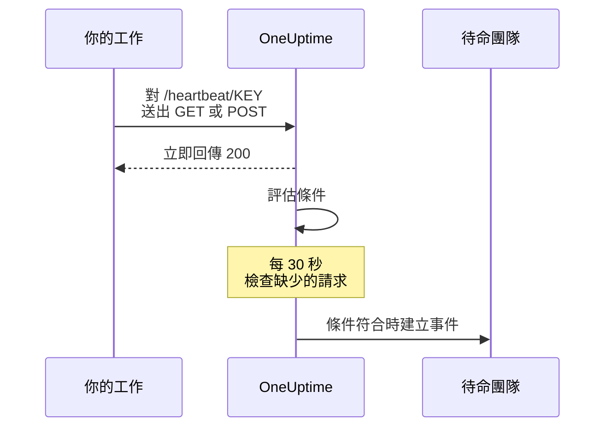
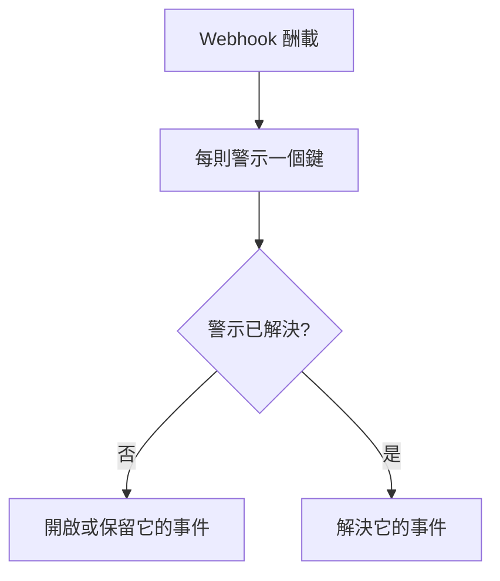

# 傳入請求監控

傳入請求監測器會提供一個 URL，讓其他系統對它送出 HTTP 請求。OneUptime 會依你的條件評估每一個請求，並可以變更監測器狀態、宣告事件，以及呼叫待命人員。

它涵蓋兩種不同的工作：

- **心跳監控** —— cron 工作、worker 或裝置依排程呼叫該 URL，當呼叫不再送達時，OneUptime 就建立事件。
- **接收其他系統的警示** —— Prometheus Alertmanager、Grafana，或任何能夠 POST JSON 的系統把警示推送進來，OneUptime 將每一則轉成事件，帶有待命升級，並在復原時自動解決。

兩者使用同一種監測器類型。差別在於你所設定的條件。

:::cards
- [建立監測器](#建立傳入請求監測器): 幾個步驟就能取得一個心跳 URL。
- [傳送心跳](#傳送心跳): 從 curl、cron、Node.js、Python 或 Go 傳送。
- [呼叫停止時發出警示](#10-分鐘內沒有心跳就標示為離線失效開關): 把監測器變成一個失效開關。
- [接收警示](#接收其他系統的警示): Alertmanager 或 Grafana 的每則警示對應一個事件。
- [訂閱 SNS 或 Event Grid](#訂閱-amazon-sns-或-azure-event-grid): 一鍵確認訂閱。
:::

## 運作方式

沒有任何東西從外部檢查你的系統：你的系統呼叫監測器的 URL，OneUptime 立即回應，接著依監測器的條件評估這個請求。檢查請求是否 *不再* 送達的條件，還會每 30 秒在背景重新檢查一次，因此沉默也能觸發事件。



你可以用它來：

- 監控 cron 工作與排程任務
- 確認背景 worker 正在執行
- 監控防火牆後方、外部無法連線的服務
- 接收來自 Prometheus Alertmanager、Grafana 及其他警示系統的警示
- 追蹤任何支援 HTTP 的系統送出的心跳訊號

## 建立傳入請求監測器

:::steps
### 開始一個新的監測器

前往 **監測器**，點選 **建立監測器**。

### 選擇傳入請求

在 **監測器類型** 下選擇 **傳入請求**，它是最上方的常用類型之一。輸入 **名稱**，然後點選 **下一步**。

### 檢查條件

**條件** 步驟會從[預設條件](#預設提供的內容)開始。若是心跳，請點選 **新增條件準則**，為新條件設定一個 **傳入請求** / **在指定分鐘內未收到** 篩選器，讓它把狀態改為離線並宣告一個事件，同時開啟 **自動解決事件**。然後把它拖到清單最上方，原因請參閱[條件範例](#條件範例)。

### 建立監測器

點選 **建立監測器**。監測器會在 **概覽** 頁面開啟，**Send the first heartbeat** 卡片會顯示附有複製按鈕的 **Heartbeat URL**，以及一條 `curl` 指令範例。

### 傳送第一個請求

設定你的服務對該 URL 傳送請求（請參閱[傳送心跳](#傳送心跳)）。第一個請求送達後，這張卡片會讓位給監測器的歷程記錄，一張 **Heartbeat URL** 卡片會顯示 URL 以及最後一個請求送達的時間。
:::

> [!NOTE]
> URL 中包含監測器的密鑰，因此只有能編輯監測器的人才看得到。你隨時可以在監測器的 **文件** 頁面上再次找到它，該頁面位於側邊選單的 **設定** 區段中。

## 請求 URL

你的監測器有一個如下格式的唯一 URL：

```text
https://oneuptime.com/heartbeat/YOUR_SECRET_KEY
```

如果是自行託管，請把 `https://oneuptime.com` 換成你的 OneUptime 執行個體的 URL。

對這個 URL 送出 **GET** 或 **POST** 請求。HEAD 也會被接受並當作 GET 處理；PUT、PATCH 和 DELETE 會傳回 404。路徑中的密鑰就是認證資訊，不需要任何標頭或權杖，除非專案[要求每個請求都攜帶密鑰](#要求每個請求都攜帶密鑰)。查詢字串會被忽略：請把條件要讀取的內容放在請求內文或標頭中傳送。

> [!WARNING]
> 任何知道這個 URL 的人都能把監測器標示為正常，因此請把它當作機密看待。如果它外洩了，請開啟監測器的 **設定** 頁面，點選 **重設傳入請求密鑰**，然後更新每一個傳送端。監測器的概覽會依其日誌保留的樣子顯示最新請求：機密與個人資料已遮蔽，關閉 **保留請求內容** 時不會顯示標頭與內文。遮蔽只能辨識它已知的名稱與模式，因此請不要傳送 API 金鑰或權杖到這個端點。

> [!IMPORTANT]
> OneUptime 會立即以一個空的 JSON 物件（`{}`）傳回 `200`，並透過佇列處理請求。這個回應是在任何驗證之前就寫出的，因此 `200` **並不** 代表請求已被接受：錯誤的密鑰、已刪除的監測器和已停用的監測器同樣會傳回 `200`。請查看監測器本身的時間軸，確認請求確實送達。要求每個請求都攜帶密鑰的專案會對未攜帶密鑰的請求傳回 `401`；在傳遞前先檢查 URL 的服務會收到它預期的回應：請參閱 [會先檢查 URL 的服務](#會先檢查-url-的服務)。

### 傳送請求內文

如果你想參照請求內文中的欄位（事件標題中的 `{{requestBody.status}}`、事件分組中的 JSON 路徑，或 JavaScript 運算式條件），請傳送 `Content-Type: application/json`。本文件通篇都假設使用這種格式。請求內文必須是 JSON 物件或陣列：格式錯誤的 JSON，或像 `"error"` 這樣的單一值，會以 `500` 拒絕。

| 內容類型 | 條件和範本看到的內容 |
| --- | --- |
| `application/json` | 剖析後的 JSON。 |
| `application/x-www-form-urlencoded` | 剖析後的表單。帶方括號的鍵會形成巢狀（`alerts[0][status]=firing`），每個值都是字串。 |
| `text/plain` | 文字是 JSON 物件或陣列時，為剖析後的 JSON：Amazon SNS 就是這樣傳送訊息的。其他任何文字就是文字本身，因此傳送 `backup failed: error 42` 會讓監測器在預設條件下離線。 |
| `application/cloudevents+json` 或其他 `+json` 類型 | 剖析後的 JSON：Azure Event Grid 就是這樣傳遞 CloudEvents 的。 |
| 其他任何類型，或沒有 | 空的請求內文（`{}`），因此對 `requestBody` 的參照都不會被解析，範本會將其原封不動地保留。 |

最多接受 50 MB 的請求內文；更大的會以 `413` 拒絕。不要以 `Content-Encoding: gzip` 壓縮請求內文：那樣它就不會以 JSON 形式儲存，其中的路徑也無法解析。

### 傳送心跳

每個範例都會傳送一個請求。請把 `YOUR_SECRET_KEY` 換成你監測器 URL 中的密鑰。

:::tabs
@tab curl
```bash
# Simple GET request
curl https://oneuptime.com/heartbeat/YOUR_SECRET_KEY

# POST request with a JSON body
curl -X POST https://oneuptime.com/heartbeat/YOUR_SECRET_KEY \
  -H "Content-Type: application/json" \
  -d '{"status": "healthy", "version": "1.2.3"}'
```
@tab Cron
```bash
# Send a heartbeat every 5 minutes
*/5 * * * * curl -fsS https://oneuptime.com/heartbeat/YOUR_SECRET_KEY > /dev/null

# Or ping only when the job succeeds, so a failed run counts as a missed heartbeat
0 2 * * * /usr/local/bin/backup.sh && curl -fsS https://oneuptime.com/heartbeat/YOUR_SECRET_KEY > /dev/null
```
@tab Node.js
```javascript title="heartbeat.mjs"
// Node.js 18 or later: fetch is built in. Run with `node heartbeat.mjs`.
const response = await fetch(
  "https://oneuptime.com/heartbeat/YOUR_SECRET_KEY",
  {
    method: "POST",
    headers: { "Content-Type": "application/json" },
    body: JSON.stringify({ status: "healthy", version: "1.2.3" }),
  },
);

console.log(response.status); // 200
```
@tab Python
```python title="heartbeat.py"
# Python 3, standard library only. Run with `python3 heartbeat.py`.
import json
import urllib.request

request = urllib.request.Request(
    "https://oneuptime.com/heartbeat/YOUR_SECRET_KEY",
    data=json.dumps({"status": "healthy", "version": "1.2.3"}).encode(),
    headers={"Content-Type": "application/json"},
    method="POST",
)

with urllib.request.urlopen(request, timeout=10) as response:
    print(response.status)  # 200
```
@tab Go
```go title="heartbeat.go"
// Run with `go run heartbeat.go`.
package main

import (
	"bytes"
	"fmt"
	"net/http"
)

func main() {
	body := []byte(`{"status": "healthy", "version": "1.2.3"}`)

	resp, err := http.Post(
		"https://oneuptime.com/heartbeat/YOUR_SECRET_KEY",
		"application/json",
		bytes.NewReader(body),
	)
	if err != nil {
		panic(err)
	}
	defer resp.Body.Close()

	fmt.Println(resp.StatusCode) // 200
}
```
@tab PowerShell
```powershell
# Windows PowerShell 5.1 or PowerShell 7
Invoke-RestMethod -Method Post `
  -Uri "https://oneuptime.com/heartbeat/YOUR_SECRET_KEY" `
  -ContentType "application/json" `
  -Body '{"status": "healthy", "version": "1.2.3"}'
```
:::

## 要求每個請求都攜帶密鑰

任何擁有監測器 URL 的人都可以對它傳送請求。專案擁有者或專案管理員可以讓專案中的每個傳入請求監測器額外要求專案自己的某個密鑰，無論監測器是由誰設定的：開啟 **要求每個請求都攜帶密鑰**。未攜帶密鑰的請求會以 `401` 拒絕並說明原因，不會計為心跳、不會儲存為監測器的最新請求，也不會到達任何條件。攜帶密鑰的請求會像以往一樣進入監測器自己的條件。

專案擁有者和專案管理員管理這些密鑰和開關，擁有 Create、Read、Edit 和 Delete Incoming Request Secret 權限的自訂角色也可以：Read 可檢視密鑰的值，Edit 還可以開啟和關閉開關。

:::steps
### 建立密鑰

前往 **監測器 → 設定 → 傳入請求密鑰** 並建立一個密鑰。為它命名後，OneUptime 會產生值；從清單中複製它。

### 從每個傳送端傳送它

依傳送端能設定的方式，在 `X-OneUptime-Secret` 標頭中傳送密鑰，或在 `Authorization` 標頭中以 Bearer 權杖傳送。無法自行設定標頭的傳送端，可以改為用密鑰為每個請求簽章：請參閱[用密鑰為請求簽章](#用密鑰為請求簽章)。

### 找出遺漏的傳送端

專案一有密鑰，OneUptime 就會檢查每個請求是否攜帶密鑰，但暫不拒絕任何請求。同一頁面上的 **未攜帶密鑰的請求** 會列出過去 24 小時內收到過未攜帶有效密鑰之請求的每個傳入請求監測器及其原因：未傳送密鑰，或傳送了錯誤的密鑰。請修正這些傳送端。傳送端已修正的監測器，其 **最近一次有密鑰** 會晚於 **最近一次無密鑰**，並會在 24 小時內從清單中消失。

### 開啟要求

開啟 **要求每個請求都攜帶密鑰**。專案沒有任何密鑰時無法開啟，因此不會誤拒任何傳送端。開啟之前，如果有傳入請求監測器在過去 24 小時內收到過未攜帶有效密鑰的請求，它會說明有多少個：從那時起，它們的傳送端都會遭到拒絕。
:::

```bash
curl -X POST https://oneuptime.com/heartbeat/YOUR_SECRET_KEY \
  -H "X-OneUptime-Secret: YOUR_PROJECT_SECRET"

# Or as a bearer token
curl -X POST https://oneuptime.com/heartbeat/YOUR_SECRET_KEY \
  -H "Authorization: Bearer YOUR_PROJECT_SECRET"
```

OneUptime 從不儲存密鑰：在儲存任何內容之前，它會從請求中移除該標頭，並遮蔽屬於專案密鑰的 Bearer 權杖。

在 15 分鐘內向同一監測器傳送超過 10 個不同錯誤密鑰的位址，此後無論傳送的密鑰是否正確，都會以 `429` 遭到拒絕，直到其 `Retry-After` 標頭指出的時間，最長 15 分鐘。其他位址上的傳送端不受影響，而一直傳送同一個舊密鑰的傳送端會繼續收到說明問題所在的 `401`。

> [!TIP]
> 若要在不拒絕任何人的情況下替換密鑰，請建立第二個密鑰，將傳送端切換到它，等舊密鑰的 **上次使用** 不再變化後再刪除舊密鑰。專案的任一密鑰只要未限定於其他監測器都會被接受，而在要求開啟期間無法刪除最後一個涵蓋某個監測器的密鑰。

### 用密鑰為請求簽章

傳送端可以用密鑰為每個請求簽章，而不是傳送密鑰本身，這樣更安全：不會傳輸任何機密，別人攔截的請求日後也無法再次傳送。只要傳送端能夠簽章，就優先使用這種方式。OneUptime 會檢查以下簽章，每個簽章都是以密鑰為金鑰的十六進位 HMAC-SHA256：

| 傳送端 | 標頭 | 簽章的內容 |
| --- | --- | --- |
| 你自己的程式碼 | `X-OneUptime-Signature: t=<time>,v1=<signature>` | `<time>.<body>` |
| GitHub webhook | `X-Hub-Signature-256` | 請求本文 |
| Slack | `X-Slack-Signature`，以及 `X-Slack-Request-Timestamp` | `v0:<time>:<body>` |
| Stripe | `Stripe-Signature` | `<time>.<body>` |

`<time>` 是請求簽章的時間，以 1970 年以來的秒數表示。與 OneUptime 時鐘相差超過 5 分鐘的簽章會遭到拒絕，第二次傳送的同一個已簽章請求也會遭到拒絕；GitHub 的簽章不含時間，因此 OneUptime 會把每個簽章記住一天。對於 GitHub，請把專案的某個密鑰設為 webhook 的密鑰。Slack 和 Stripe 會產生自己的簽章密鑰：請在 **更多欄位** 中用該值建立專案的密鑰。

```bash
body='{"status":"healthy"}'
t=$(date +%s)
sig=$(printf '%s.%s' "$t" "$body" | openssl dgst -sha256 -hmac "YOUR_PROJECT_SECRET" | sed 's/^.* //')

curl -X POST https://oneuptime.com/heartbeat/YOUR_SECRET_KEY \
  -H "Content-Type: application/json" \
  -H "X-OneUptime-Signature: t=$t,v1=$sig" \
  -d "$body"
```

不接受放在 URL 查詢字串中的密鑰：代理和存取記錄會保存完整的 URL，與監測器自己的金鑰放在一起。探測器的傳入請求 Ingress 會按原樣轉送已簽章請求的本文，因此經由探測器傳送時簽章同樣有效。

### 將密鑰限定於部分監測器

除非你加以限制，專案的每個傳入請求監測器都會接受某個密鑰；若專案的每個租戶各自傳送自己的密鑰，就應加以限制：在 **更多欄位** 中選擇 **特定監測器** 或 **帶標籤的監測器**。其他監測器會以 `401` 拒絕它，就像拒絕錯誤的密鑰一樣，而 **未攜帶密鑰的請求** 會將原因顯示為 **密鑰不適用於此監測器**。在要求開啟期間，專案至少保留一個涵蓋某個監測器的密鑰。

## 監控條件

你可以設定條件，決定服務何時被視為上線、效能下降或離線。每個條件篩選器都有一個 **篩選器類型**（看什麼）、一個 **篩選條件**（如何比較）和一個 **值**。

### 預設提供的內容

新的傳入請求監測器建立時會帶有兩個讀取請求內文的條件：

| 條件 | 篩選器類型 | 篩選條件 | 值 | 效果 |
| -------- | ------------ | ---------------- | ------- | -------------------------------------------- |
| Offline  | 請求內文 | 包含 | `error` | 將監測器標示為離線，開啟一個事件 |
| Online   | 請求內文 | 不包含 | `error` | 將監測器標示為上線 |

這適合傳送端在酬載中回報自身健康狀況的常見情況：請求內文提到 `error` 的請求會讓監測器下線，下一個不含該字的請求會讓監測器恢復上線並解決事件。完全沒有請求內文的請求算作「不包含 `error`」，因此單純的心跳呼叫會讓監測器保持上線。

請把值改成你的傳送端實際送出的內容（`"status":"firing"`、`FAILED` 等）：比對方式是在整個請求內文（包含鍵）中進行區分大小寫的子字串搜尋，因此 `{"error":null}` 也會符合 `error`。

> [!NOTE]
> 這些預設條件 **不是** 失效開關：請求不再送達時，這裡的任何條件都不會觸發。如果你希望在沉默時收到警示，請依下文說明加入一個 **傳入請求** / **在指定分鐘內未收到** 條件。

### 可用的篩選器類型

| 篩選器類型 | 檢查內容 | 備註 |
| --------------------- | ------------------------------------------------------ | -------------------------------------------------------------------------------------------- |
| 傳入請求 | 是否在某個時間範圍內收到了請求 | 唯一一個在什麼都沒送達時也能觸發的檢查 |
| 請求內文 | 請求的內文 | 子字串比對。物件請求內文以精簡的 JSON 比較 |
| 請求標頭 | 請求標頭的名稱 | 與完整的標頭名稱完全比對，不區分大小寫 |
| 請求標頭值 | 請求標頭的值 | 與完整的標頭值完全比對，不區分大小寫 |
| JavaScript 運算式 | 任何以 `requestBody` 和 `requestHeaders` 為基礎的運算式 | 最有彈性的選項，請參閱 [JavaScript 運算式](/docs/monitor/javascript-expression) |

### 篩選條件

每種篩選器類型都有自己的一組條件：

| 篩選器類型 | 條件 |
| --- | --- |
| **傳入請求** | **在指定分鐘內收到** —— 在指定的分鐘數內收到了請求。**在指定分鐘內未收到** —— 在指定的分鐘數內沒有收到請求。 |
| **請求內文**、**請求標頭**、**請求標頭值** | **包含** 和 **不包含** |
| **JavaScript 運算式** | **計算結果為真** |

> [!NOTE]
> 標頭的名稱和值會轉為小寫後，與完整的名稱或值比較，而不是子字串比對：`application/json` 不會符合 `application/json; charset=utf-8`。只有 **請求內文** 會做子字串比對。你的 Proxy 或 OneUptime 本身的負載平衡器加上的標頭（`x-forwarded-for`、`x-real-ip`）也會被儲存。

物件請求內文會以不含空格的精簡 JSON 比較，因此 **請求內文** / **包含** 篩選器必須寫成 `"status":"firing"`：從排版過的酬載中複製 `"status": "firing"` 永遠不會符合。

### 條件範例

#### 10 分鐘內沒有心跳就標示為離線（失效開關）

| 欄位 | 值 |
| --- | --- |
| **篩選器類型** | 傳入請求 |
| **篩選條件** | 在指定分鐘內未收到 |
| **值** | `10` |

#### 依請求內文的內容標示為效能下降

| 欄位 | 值 |
| --- | --- |
| **篩選器類型** | 請求內文 |
| **篩選條件** | 包含 |
| **值** | `"status":"degraded"` |

> [!IMPORTANT]
> 把失效開關放在預設條件 **之上**。條件是由上往下檢查，第一個符合的條件說了算。背景檢查會重新讀取最後一個請求，因此預設的上線條件（"請求內文 不包含 `error`"）會一直符合它，排在它下面的條件永遠輪不到。**新增條件準則** 會把條件加到最底部：請把它拖上去。

> [!WARNING]
> 只有當監測器至少有一個條件檢查 **傳入請求** 時，它才會在背景重新評估。條件只檢查請求內文、請求標頭或 JavaScript 運算式的監測器，只會在請求送達時評估，其他時候都不會，因此它永遠不會自行下線。如果你需要心跳缺失的警報，就需要一個 **傳入請求** 條件。

背景檢查以整分鐘計算，在經過的時間 *超過* 該值時觸發："在指定分鐘內未收到: 10" 大約在最後一個請求之後 11 分鐘觸發（檢查每 30 秒執行一次）。從未收到請求的監測器會把建立時間當作最後一個請求，因此同樣的條件放在一個全新的監測器上，即使傳送端從未接上，也會在建立後大約 11 分鐘觸發。只有 OneUptime 正在接收資料的分鐘才會計入該值：OneUptime 本身重新啟動、升級或追趕積壓期間的分鐘不算，詳見 [OneUptime 未接收資料時](/docs/monitor/when-oneuptime-is-not-receiving)。

## 接收其他系統的警示

Alertmanager、Grafana 和類似的工具會 POST 一份描述一則或多則警示的 JSON 文件。根據預設，一個條件只會開啟 **一個** 事件，因此一個帶有五則警示的酬載只會產生一個事件。事件分組改變了這一點：它從酬載中擷取一個值，並 **為每個不同的值開啟一個獨立的事件**，這些事件可以同時處於開啟狀態。



### 開啟事件分組

:::steps
1. 開啟條件並展開 **設定**。
2. 開啟 **Group incidents and alerts by a payload field**。
3. 填寫 **Open a separate incident for each…**。如果希望每個事件自動解決，也要填寫 **Auto-resolve each incident when…** 下的欄位和值（請見下文）。然後儲存監測器。
:::

| 欄位 | 範例 | 作用 |
| ---------------------------------- | ---------------------------------------- | ---------------------------------------------------------------------- |
| Open a separate incident for each… | `requestBody.alerts[*].labels.alertname` | 以其不同的值把事件分開的路徑 |
| Field that signals recovery | `requestBody.alerts[*].status` | 用來判斷某則警示已復原所檢查的路徑 |
| Value that means recovered | `resolved` | 表示已復原的確切值 |
| Max incidents per request | `100`（預設） | 安全上限，避免取值很多的欄位開啟無限多個事件 |

分組只屬於開啟它的那個條件。監測器的其他條件不分組：當其中一個與請求相符時，它會像在沒有任何條件分組的監測器上一樣，開啟自己的事件和警示。

### 路徑語法

路徑必須以字面前置詞 `requestBody.` 開頭。沒有這個前置詞的路徑（例如 `alerts[*].labels.alertname`）在任何請求中都找不到值。`{{ }}` 包裝是選用的：`requestBody.status` 和 `{{requestBody.status}}` 的行為相同。

- `[*]` 會展開一個陣列：每個 **不同** 的值一個事件。產生相同值的兩個元素會合併成一個事件，該事件的狀態（觸發中/已解決）取自 **第一個** 符合的元素。**一個路徑中只有第一個 `[*]` 是萬用字元**；`requestBody.groups[*].alerts[*].name` 什麼都比對不到。
- `[0]` 和 `[last]` 會選取單一元素，而且可以接在 `[*]` 之後。
- 物件和陣列值、空字串以及 null 會被略過。`0` 和 `false` 是有效的鍵。
- 請求內文必須是 JSON 物件；最上層是陣列的酬載不會被分組。

### 沒有該欄位的請求

與分組條件相符、但在其路徑上沒有值的請求（欄位缺少或為空、包含物件或清單，或請求內文不是 JSON 物件）仍會開啟該條件的事件和警示：整個監測器一個，就像該條件不分組時一樣。因請求停止抵達而相符的分組條件也是如此。引用分組變數的標題（例如 `{{alertname}}`）會照原樣顯示該變數，因為沒有可以填入的值。

如果 **自動解決事件** 已開啟，那麼當之後沒有該欄位的請求回報已復原，或之後的請求與另一個條件相符時，該事件就會被解決。這樣的復原不會開啟任何新內容。

當陣列中有些元素有值、有些沒有時，每個值會開啟自己的事件，沒有值的元素本身不會開啟任何內容。

監測器 **概覽** 上的 **監測器摘要** 卡片會顯示每個請求做了什麼，包括某個條件將其當作整個監測器處理，或沒有開啟任何新內容的情況。

### 解決由事件驅動

一個 Webhook 只描述該酬載中的內容，因此 OneUptime 絕不會因為某個鍵不再出現就解決它的事件。只有當酬載明確表示該鍵已復原時，事件才會被解決。下列兩點必須同時成立：

1. **Field that signals recovery** 和 **Value that means recovered** 已設定並與酬載相符。比對是完全且區分大小寫的：`Resolved` 不會符合 `resolved`。
2. 條件的事件開啟了 **自動解決事件**，該選項位於事件表單的 **更多欄位** 下。沒有它，符合的復原事件會被忽略，事件會保持開啟。（警示和 **自動解決警示** 亦同。）預設的離線條件一開始就開啟了它；你自己加入條件的事件一開始則是關閉的。

你自己加入條件的警示，一開始也關閉了 **自動解決警示**，因此在開啟它之前，恢復會讓警示保持開啟。**Auto-resolve each incident when…** 會顯示恢復會解決該條件的哪些事件和警示，並列出它會保持開啟的每一項，附帶一個開啟相應開關的按鈕。監測器 **概覽** 上的 **監測器摘要** 卡片會列出恢復保持開啟的每個事件和警示，以及原因。

**Max incidents per request** 限制的是擷取，而不只是建立。超出上限的鍵對復原判斷同樣不可見，因此在一個不同鍵數量超過上限的酬載中，超出上限的部分即使回報 `resolved`，也不會關閉它的事件。

> [!NOTE]
> 某個條件依酬載欄位分組的監測器，會依到達順序逐一評估它收到的每一個請求，因此一波突發的警示與恢復會為每個值開啟並解決各自的事件與警示。最多有 1,000 個請求（或 16 MB）可以等待評估；超過之後，等待中最早的請求會被略過， **監測器摘要** 卡片會顯示略過了多少個。沒有分組的監測器只評估等待中的最新請求。

> [!NOTE]
> 如果 **Field that signals recovery** 包含 `[*]`，而 **Open a separate incident for each…** 不包含，那麼只有當該陣列的每個元素都表示已復原時，請求才算已復原。使用 `requestBody.alerts[*].status` 和 `resolved` 時，依 `requestBody.groupLabels.alertname` 分組的事件會在請求的所有警示都已解決時解決，只要還有一個仍在觸發就會保持開啟。

> [!WARNING]
> 不含 `[*]` 的復原路徑會針對整個酬載求值，因此酬載層級的 `status: resolved` 會解決該酬載中的每一個鍵，包括自身狀態仍在觸發中的警示。

### 為事件命名

分組鍵會以 **路徑最後一段** 命名的變數形式提供給事件和警示範本：

| 路徑 | 變數 |
| ---------------------------------------- | ----------------- |
| `requestBody.alerts[*].labels.alertname` | `{{alertname}}`   |
| `requestBody.alerts[*].fingerprint`      | `{{fingerprint}}` |
| `requestBody.commonLabels.severity`      | `{{severity}}`    |

完整的酬載也同時可用，因此事件標題用 `{{alertname}}`、描述參照 `{{requestBody.commonAnnotations.summary}}`，兩者都可行。請參閱 [事件與警示範本](/docs/monitor/incident-alert-templating)。

> [!WARNING]
> 變數名稱是 OneUptime 用來把復原事件對應到開啟中事件的身分的一部分。把分組路徑改成最後一段不同的路徑後，所有在舊路徑下仍然開啟的事件都會成為孤兒：它們無法再自動解決，必須手動關閉。

`[*]` **只** 在這兩個分組路徑欄位中有效。在其他地方它不會被解析，而未解析的預留位置會 **原封不動** 地輸出，而不是被清空：標題 `{{requestBody.alerts[*].labels.alertname}}` 顯示時仍帶著大括號。標題 `{{requestBody.alerts[0].annotations.summary}}` 可以解析，但一律讀取酬載中的第一則警示，而不是為其開啟這個事件的那一則。請優先使用分組變數加上酬載中共用的 `commonAnnotations` 欄位。

### 完整範例

完整的 Alertmanager 設定請參閱 [Prometheus Alertmanager](/docs/integrations/prometheus-alertmanager)。Grafana 請參閱 [Grafana](/docs/integrations/grafana)。

## 會先檢查 URL 的服務

有些服務在向新端點傳遞任何內容之前，會先檢查這個端點：它們向端點傳送一個請求，只有端點依預期回應後才開始傳遞。OneUptime 會自行回應這些檢查，因此只需把監測器的 **Heartbeat URL** 貼到服務中。

| 服務 | 檢查請求 | OneUptime 的回應 |
| --- | --- | --- |
| Azure Event Grid，Event Grid 結構描述 | 一個 `SubscriptionValidationEvent` | 它的 `validationCode`，作為 `validationResponse` |
| Azure Event Grid，CloudEvents 結構描述 | 一個說明來源的 `OPTIONS` 請求 | `WebHook-Allowed-Origin`，帶上該來源 |
| Slack Events API | 一個 `url_verification` 請求 | 它的 `challenge` |
| Microsoft Graph 變更通知 | 帶有 `validationToken` 的 `POST` | 該權杖，以 `text/plain` 傳回 |
| Okta 事件掛鉤 | 帶有 `X-Okta-Verification-Challenge` 的 `GET` | 該標頭的值，作為 `verification` |

只有監測器本身的 URL 才會回應檢查，而且只在請求有效時回應：在要求每個請求都攜帶密鑰的專案中，未攜帶密鑰的檢查會像其他請求一樣被拒絕並傳回 `401`，因此服務必須在標頭中傳送密鑰。回應只包含服務為了取回而傳送的值，不含請求的其他任何內容，並且只在該值符合服務給出的格式時才包含。

檢查和其他請求一樣會送達監測器，因此監測器的條件會評估它，它也會顯示在監測器的 **概覽** 上；CloudEvents 檢查只會得到回應，僅此而已。探測器的傳入請求 Ingress 對檢查的回應與對其他請求一樣，都是 `{}`，因此請把這些服務指向 OneUptime 本身的 URL。

## 訂閱 Amazon SNS 或 Azure Event Grid

在有人開啟 Amazon SNS 傳來的連結、確認訂閱之前，Amazon SNS 不會向新端點傳送任何內容。對於不回應其檢查的端點，Azure Event Grid 也會傳送這樣的連結，而 OneUptime 會回應該檢查。當一個仍待開啟的連結送達時，監測器 **概覽** 上的 **監測器摘要** 卡片會顯示服務在等待什麼、主題，以及一個會在新分頁中開啟該連結的按鈕。

| 服務 | 請求 | 按鈕 | 連結有效期 |
| --- | --- | --- | --- |
| Amazon SNS | `SubscriptionConfirmation`，用於新的 HTTPS 訂閱 | **確認訂閱** | 2 天 |
| Amazon SNS | `UnsubscribeConfirmation`，在訂閱被刪除時傳送 | **還原訂閱** | 2 天 |
| Azure Event Grid | `SubscriptionValidationEvent`，用於新的 Webhook 事件訂閱 | **驗證訂閱** | 10 分鐘 |

即使你開啟了連結，按鈕也會一直保留，直到監測器收到下一個請求。連結過期後，卡片會改為說明如何取得新的連結。如果之後又有新的請求送達，請開啟 **監測日誌**，在該請求所在的列上點選 **檢視摘要**。

連結及其中的權杖在請求被保留的所有地方都不會被遮蔽：請求詳細資料、日誌，以及它開啟的事件和警示。這個連結唯一能做的，就是開始傳送訊息到此監測器。只有指向服務本身位址的連結才算數：其他連結照常被遮蔽，也不會顯示按鈕。

### Amazon SNS

:::steps
1. 在 Amazon SNS 主控台中開啟主題，選擇 **Create subscription**。通訊協定選擇 `HTTPS`，端點填入監測器的 **Heartbeat URL**。
2. 開啟監測器的 **概覽**，在 **監測器摘要** 卡片中點選 **確認訂閱**。在 SNS 主控台中，該訂閱的狀態會從 **Pending confirmation** 變為已確認。
:::

SNS 以標示為 `text/plain` 的 JSON 傳送訊息，監測器會把它們當作 JSON 讀取，因此條件、範本和事件分組都可以使用其中的欄位，例如 `{{requestBody.Subject}}` 和 `{{requestBody.Message}}`。通知本身的 JSON（例如 CloudWatch 警報的 JSON）會以文字形式出現在 `Message` 中。

如果卡片顯示連結已無法開啟，請在 SNS 主控台中選取該訂閱並選擇 **Request confirmation**。SNS 會刪除 48 小時內未確認的訂閱；如果發生這種情況，請重新建立訂閱。

### Azure Event Grid

:::steps
1. 在 Azure 入口網站中開啟你想取得其事件的資源，並新增一個事件訂閱。事件結構描述選擇 **Event Grid Schema** 或 **Cloud Event Schema v1.0**，端點類型選擇 **Web Hook**，端點填入監測器的 **Heartbeat URL**。
2. 建立事件訂閱。OneUptime 會回應 Event Grid 的檢查，因此訂閱在建立時即通過驗證，其事件也開始送達。
:::

Event Grid 會驗證這樣的端點：它把驗證碼原樣傳回，或者它的擁有者開啟了 Event Grid 傳送的連結。OneUptime 會傳回驗證碼，因此只有對 OneUptime 未回應的驗證，**監測器摘要** 卡片才會提供 **驗證訂閱**：請在 10 分鐘內開啟它。該連結指向連接埠 553 上的 Event Grid，你瀏覽器前方的防火牆必須允許這個連接埠。如果先過了 10 分鐘，事件訂閱就會失敗：請重新建立它。

## 最佳做法

1. **適當設定時間範圍** —— 如果你的 cron 工作每 5 分鐘執行一次，就把 "在指定分鐘內未收到" 門檻設為 10–15 分鐘，以容許偶爾的延遲，並把這個條件放在第一位。
2. **附上有意義的資料** —— 在請求內文中傳送狀態資訊，以便設定更細的條件。
3. **使用帶 `Content-Type: application/json` 的 POST** —— 所有讀取請求內文內容的功能都依賴它。
4. **不要在一個監測器上混用兩種工作** —— 接收事件驅動警示的監測器沒有固定的節奏，因此在它上面設定 "在指定分鐘內未收到" 條件會反覆切換。請為失效開關使用另一個監測器。
5. **監控監控本身** —— 確保傳送請求的服務妥善處理錯誤，不讓失敗的請求無聲無息。

## 疑難排解

:::details 我的傳送端收到了 200，但監測器上什麼都沒有
`200` 是在驗證請求之前送出的，因此它無法證明請求已被接受。確認 URL 中的密鑰與監測器的 **Heartbeat URL** 一致，而且監測器沒有被停用。然後查看監測器的時間軸，看請求是否送達。
:::

:::details 傳送端收到 401
專案要求每個請求都攜帶密鑰，而請求沒有傳送密鑰，或傳送的密鑰不屬於該專案：回應會說明是哪一種。請依照[要求每個請求都攜帶密鑰](#要求每個請求都攜帶密鑰)的說明，在 `X-OneUptime-Secret` 標頭中或以 Bearer 權杖傳送專案的某個密鑰。被拒絕的請求永遠不會到達監測器。如果傳送的是限定於其他監測器的專案密鑰，或者已簽章請求的簽章超過 5 分鐘、先前已傳送過，或是用其他密鑰或根據途中被改動的本文產生的，也會收到 `401`。
:::

:::details 傳送端收到 429
其位址在 15 分鐘內向同一監測器傳送了超過 10 個不同的錯誤密鑰或簽章，因此在其 `Retry-After` 標頭指出的時間之前，它傳往該監測器的每個攜帶密鑰的請求都會遭到拒絕。用錯誤密鑰簽章的傳送端每次都會產生新的錯誤簽章，很快就會到這一步：請依照[要求每個請求都攜帶密鑰](#要求每個請求都攜帶密鑰)的說明，給它一個該監測器接受的密鑰，時間一過，它的請求就會被接受。
:::

:::details 要求密鑰後，監測器不再收到請求
它的傳送端沒有傳送密鑰，或傳送了錯誤的密鑰，因此它們傳送的每個請求都會遭到拒絕。監測器的 **Heartbeat URL** 下方有一行說明最近一次遭拒絕的請求何時到達，**未攜帶密鑰的請求** 則會列出過去 24 小時內收到過此類請求的每個監測器及其原因。請依照[要求每個請求都攜帶密鑰](#要求每個請求都攜帶密鑰)的說明，從這些傳送端傳送專案的某個密鑰。
:::

:::details 心跳停止後監測器從不下線
只有 **傳入請求**（**在指定分鐘內未收到**）條件能察覺沉默。如果沒有就加入一個，並把它拖到預設條件之上：預設的上線條件在每次背景檢查時都會符合最後一個請求，而第一個符合的條件說了算。
:::

:::details 請求內文篩選器從不符合
傳送 `Content-Type: application/json`，並把值寫成精簡的 JSON：`"status":"firing"`，冒號後面沒有空格。沒有 JSON、表單或 `text/plain` 內容類型時，請求內文為空，針對它的篩選器永遠不會符合。
:::

:::details 服務提示 URL 沒有回應它的檢查
把監測器在 OneUptime 本身（而不是探測器）上的 **Heartbeat URL** 提供給服務。如果專案要求每個請求都攜帶密鑰，除非服務傳送了密鑰，否則檢查會被拒絕並傳回 `401`。然後讓服務再次檢查該 URL：它會立即得到回應。
:::

:::details 「請求標頭」篩選器從不符合
標頭的名稱和值是整體比較的。請提供完整的值，例如 `application/json; charset=utf-8`，而不是其中一部分。
:::

:::details Amazon SNS 顯示訂閱正在等待確認
在監測器 **概覽** 上的 **監測器摘要** 卡片中點選 **確認訂閱**。如果之後又有新的請求送達，請開啟 **監測日誌**，在該確認請求所在的列上點選 **檢視摘要**。關閉 **保留請求內容** 時，監測器不會保留請求內文，因此也不會保留連結：在監測器的 **設定** 中開啟它，最新的請求就會連同連結再次顯示。
:::

:::details 傳送端收到 500
請求宣告了 `Content-Type: application/json`，但請求內文不是 JSON 物件或陣列。請傳送有效的 JSON，或改用其他內容類型。
:::

## 後續步驟

:::cards
- [Prometheus Alertmanager](/docs/integrations/prometheus-alertmanager): 完整的傳入警示設定。
- [Grafana](/docs/integrations/grafana): 同樣的設定，用於 Grafana 警示。
- [事件與警示範本](/docs/monitor/incident-alert-templating): 標題和描述中可用的所有變數。
- [JavaScript 運算式](/docs/monitor/javascript-expression): 運算式語法和引號規則。
:::
