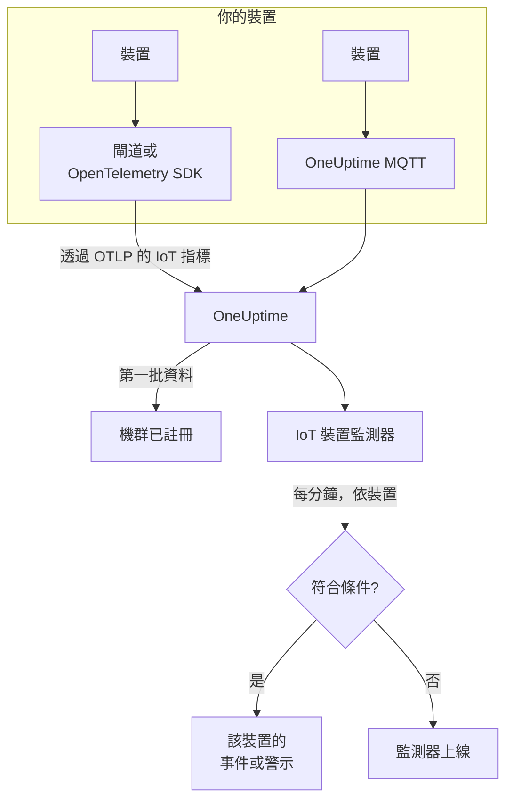

# IoT 裝置監控

IoT 裝置監測器會監看一個裝置機群，並在裝置離線、電池電量低、訊號變弱、過熱或 CPU 持續忙碌時通知你。它讀取你的裝置透過 OpenTelemetry 或 MQTT 傳送到 OneUptime 的 `iot_*` 指標，因此不會從外部進行任何檢查，也不涉及探測器。

:::cards
- [建立監測器](#建立-iot-裝置監測器): 在儀表板中的六個步驟。
- [範本](#預建警示範本): 五個現成的警示，每個裝置一個事件。
- [離線偵測](#離線偵測): 如何發現當機或靜默的裝置。
- [指標](#收集的指標): 監測器讀取的 `iot_*` 序列。
:::

## 運作原理

你的裝置(或與它們通訊的閘道)會把讀數傳送到 OneUptime：透過 OpenTelemetry，或直接傳送到 OneUptime 的 MQTT 端點。每個讀數都帶有機群的名稱 `iot.fleet.name` 和裝置自己的 ID `device.id`。第一批資料送達時會註冊該機群。

IoT 裝置監測器繫結到一個機群。它每分鐘對該機群的指標執行一次查詢，並將結果與其條件比較。範本依 `device.id` 分組，因此 30 個離線的感測器會開啟 30 個事件，每個事件都寫出它的裝置，並在該裝置復原時自行解決。



## 開始之前

- **讓你的裝置開始回報。** [IoT 裝置指南](/docs/telemetry/iot-devices) 介紹了如何用 OpenTelemetry SDK 或 Collector，或透過 MQTT 傳送指標。
- **確認機群已註冊。** 它會以裝置傳送的 `iot.fleet.name` 命名，出現在 **產品 → 基礎設施 → IoT → All Fleets** 下。
- **註冊你預期的裝置**，在機群的 **Device Registry** 下註冊，這樣裝置靜默時你會收到通知：請參閱 [離線偵測](#離線偵測)。

## 建立 IoT 裝置監測器

:::steps
### 新增監測器

前往 **監測器**，點選 **建立監測器**。

### 選擇 IoT Device

在 **監測器類型** 下點選 **更多監測器類型**，然後在 **基礎設施** 下選擇 **IoT Device**，或在搜尋方塊中輸入 `iot`。輸入 **名稱**(它會用在事件和警示標題中)，然後點選 **下一步**。

### 選擇機群

在 **IoT Monitor Configuration** 下，從 **IoT Fleet** 中選擇機群。每個傳送過資料的機群都在清單中。

### 選擇要監看的內容

選擇三個索引標籤之一：

- **Quick Setup**：點選一個 [範本](#預建警示範本)。它會設定指標、彙總、時間範圍、依 `device.id` 的分組和臨界值，並用自己的條件取代下面的條件。你仍然可以修改 **時間範圍**。
- **Custom Metric**：從 **IoT Metric** 中選擇一個指標，然後設定 **彙總** 和 **時間範圍**。[篩選器](#監測器設定) 可以把它縮小到一個裝置或一種裝置類型。自訂指標不分組：它把整個機群作為一個整體來判斷。
- **進階**：在 **選擇指標** 下自行建構查詢和公式，也可以使用你自己的指標名稱，例如已用記憶體佔裝置記憶體大小的百分比。以 `device.id` 進行 **Group by**，即可分別判斷每個裝置。

### 檢查條件

開啟 **監測器條件** 下的每個條件，檢查其 **Select Metric Variable**、**彙總**、**條件** 和 **Threshold**。範本會填入這些內容。使用 **Custom Metric** 或 **進階** 時，監測器會從 [預設條件](#預設條件) 開始，它只會注意到指標降為零，所以請設定你自己的臨界值。

### 建立監測器

點選 **建立監測器**。OneUptime 會開啟監測器的頁面，並每分鐘評估一次。它發出的事件和警示會像其他任何監測器一樣，送達你的待命原則、Slack、Microsoft Teams、電子郵件、簡訊和 Webhook。
:::

> [!TIP]
> 若要一次設定多個範本，請從 **產品 → 基礎設施 → IoT** 開啟機群，然後前往 **Recommendations**。選擇你需要的範本和要呼叫的人員，OneUptime 會為每個範本建立一個監測器。

## 監測器設定

| 欄位 | 索引標籤 | 作用 |
| --- | --- | --- |
| **IoT Fleet** | 全部 | 必填。把每個查詢限定到 `resource.iot.fleet.name`。 |
| **資源範圍** | Custom Metric、進階 | 選填。**裝置** 或 **Fleet**：對 `iot.scope` 屬性的完全比對。選擇指標後會設定為 **裝置**。 |
| **Device ID** | Custom Metric、進階 | 選填。一個裝置，依其 `device.id`，例如 `sensor-001`。 |
| **Device Type** | Custom Metric、進階 | 選填。回報該 `iot.device.type` 的裝置，例如 `sensor` 或 `gateway`。 |
| **IoT Metric** | Custom Metric | [目錄](#收集的指標) 中的一個指標。 |
| **彙總** | Custom Metric | 如何合併樣本：**平均**、**最大值**、**最小值**、**總和** 或 **計數**。從該指標的常用彙總開始。 |
| **時間範圍** | 全部 | 查詢讀取的滾動視窗，從 **Past 1 Minute** 到 **Past 365 Days**。新監測器從 **Past 1 Minute** 開始；範本會設定自己的值。 |
| **選擇指標** | 進階 | 查詢建構器：**指標**、**Aggregate by**、**Filter by attributes**、**Group by**，以及用於合併查詢的 **新增指標** 和 **新增公式**。 |

篩選器會同時生效：同時設定了 **Device ID** 和 **Device Type** 時，其他類型的裝置什麼也比對不到。

## 預建警示範本

**Quick Setup** 提供 5 個範本。每個範本都會建構一個完整的監測器：指標查詢、依 `device.id` 的分組、一個觸發條件和一個復原條件。臨界值是可以編輯的起點。

只有當條件在視窗的每一分鐘都成立時，條件才會觸發——**Device Offline** 例外，它在第一次讀數低於 1 時就會觸發。臨界值條件會在超過臨界值 10% 之後復原，因此在這條線附近徘徊的值不會來回切換。

| 範本 | 類別 | 嚴重程度 | 監看內容 | 觸發條件 | 復原條件 |
| --- | --- | --- | --- | --- | --- |
| Device Offline | 可用性 | 嚴重 | `iot_device_up`，依 `device.id` 取 Min，過去 30 分鐘 | 任一讀數低於 1，或某個已註冊的裝置在整個視窗內什麼也沒傳送 | 恢復為 1 |
| Low Battery | Power | Warning | `iot_battery_percent`，依 `device.id` 取 Avg，過去 5 分鐘 | 低於 20% | 達到或高於 22% |
| Weak Signal | Connectivity | Warning | `iot_signal_strength_dbm`，依 `device.id` 取 Avg，過去 5 分鐘 | 低於 -100 dBm | 達到或高於 -90 dBm |
| High Temperature | 環境 | 嚴重 | `iot_temperature_celsius`，依 `device.id` 取 Max，過去 5 分鐘 | 高於 70 °C | 達到或低於 63 °C |
| High CPU Usage | System | Warning | `iot_cpu_usage_ratio`，依 `device.id` 取 Avg，過去 5 分鐘 | 高於 0.9(其 CPU 的 90%) | 達到或低於 0.81 |

**嚴重程度** 是選擇器顯示的標籤。範本建立的事件和警示會以專案中最嚴重的事件和警示嚴重程度開始；可以在條件中修改。

- **Device Offline 讀取 30 分鐘**，這樣每隔幾分鐘回報一次的裝置不會在兩次回報之間被判定為離線。回報頻率低於大約每 15 分鐘一次的裝置需要更長的視窗。
- **High Temperature 在每一分鐘內使用 Max**，這樣一次高溫讀數不會被同一分鐘內較低的讀數掩蓋。它仍然必須在視窗的每一分鐘都保持高溫。
- **High CPU Usage 比較的是比率：** `iot_cpu_usage_ratio` 的範圍是 0 到 1，因此 0.9 就是 90%。

## 離線偵測

當裝置回報 `iot_device_up = 0` 時，**Device Offline** 會觸發。當機或靜默的裝置會透過三種方式觸發它：

| 方式 | 會發生什麼 |
| --- | --- |
| **閘道回報** | 閘道或收集器為它無法再連線的裝置傳送 `iot_device_up = 0`。 |
| **MQTT Last Will** | 連線到 OneUptime MQTT 端點的裝置會在其 `status` 主題上註冊一個 Last Will。裝置當機時，訊息代理程式會在工作階段中斷的那一刻為它傳送 `iot_device_up = 0`：不必輪詢，也不必等待錯過的回報。請參閱 [透過 MQTT 傳送指標](/docs/telemetry/iot-devices#透過-mqtt-傳送指標)。 |
| **裝置已註冊** | 機群 **Device Registry** 中的裝置是預期會回報的。它在整個視窗內什麼也沒傳送時，監測器會把它當作回報了 `0`，因此它會得到自己的事件，並在裝置再次回報時自行解決。 |

已註冊的裝置也會以離線狀態保留在機群的清單中，而未註冊的裝置在靜默 15 分鐘後會被移除。靜默偵測需要在 `iot_device_up` 的條件上使用 **Treat As Zero** 無資料原則，從範本建立的 Device Offline 監測器已經帶有該原則。在裝置註冊功能推出之前建立的 Device Offline 監測器，需要手動設定該原則，或從範本重新建立。

> [!NOTE]
> 沒有 Last Will 也沒有閘道回報就靜默的未註冊裝置，只是停止傳送資料，而依裝置分組的監測器無法把它單獨找出來。請註冊你的裝置，或為關鍵裝置單獨設定一個監測器(使用其 **Device ID** 的 **Custom Metric**)，並把 **如果沒有資料** 設定為 **觸發器**。靜默偵測還需要機群中至少還有一個其他裝置在回報：一個完全失聯的機群(例如在閘道故障期間)只會為該監測器發出一個事件，而不是每個裝置一個。

## 收集的指標

每個序列都帶有裝置的 `device.id` 標籤，以及 `iot.scope`、`iot.device.type` 和 `iot.device.kind` 屬性。

| 指標 | 單位 | 描述 |
| --- | --- | --- |
| `iot_device_up` | — | 裝置運作時為 1，故障或離線時為 0。 |
| `iot_battery_percent` | `%` | 剩餘電量，0 到 100。電量下降表示裝置很快會停止回報。 |
| `iot_signal_strength_dbm` | `dBm` | 無線訊號強度。越接近 0 越強；訊號變弱通常發生在連線中斷之前。 |
| `iot_temperature_celsius` | `°C` | 裝置的溫度。讀數過高可能表示硬體過熱，或其周圍存在問題。 |
| `iot_cpu_usage_ratio` | `ratio` | 使用中的 CPU，從 0 到 1，1 表示滿載。 |
| `iot_memory_usage_bytes` | `bytes` | 使用中的記憶體。與裝置的記憶體大小比較，即可看出記憶體壓力。 |
| `iot_uptime_seconds` | `s` | 裝置已運作的時間。重新啟動時會降為零。 |

## 監控條件

條件會把監測器的某個查詢或公式與臨界值比較。IoT 裝置監測器的條件只提供一種 **篩選器類型**，即 **Metric Value**：每條規則都用以下欄位檢查指標值。

| 欄位 | 作用 |
| --- | --- |
| **篩選器類型** | 一律為 **Metric Value**，這是此監測器提供的唯一檢查。 |
| **Select Metric Variable** | 要檢查的查詢或公式，依其變數名稱。 |
| **彙總** | 視窗中的值如何變成一個答案：**平均**、**總和**、**Maximum Value**、**Minimum Value**、**All Values**(每個值都必須相符)或 **Any Value**(一個就夠)。 |
| **條件** | **Greater Than**、**Less Than**、**Greater Than Or Equal To**、**Less Than Or Equal To** 或 **Equal To**——或者一個異常條件：**Anomalously High**、**Anomalously Low** 或 **Anomalous**。 |
| **Threshold** | 用於比較的值。指標有單位時，旁邊會有一份單位清單。異常條件不會顯示此欄位。 |
| **敏感度** | 僅限異常條件。**低**(4σ)、**中**(3σ，預設)或 **高**(2σ)。 |
| **基準視窗** | 僅限異常條件。14 天(預設)、28、60 或 90 天的歷史。 |
| **如果沒有資料** | 位於 **更多欄位** 下。某個序列在視窗中沒有樣本時會發生什麼：**Ignore**(預設)略過它，**Treat As Zero** 把它讀作 `0`，**觸發器** 讓條件相符。 |

異常條件會把每個值與基準中一週內相同時段的值比較。在基準視窗累積足夠的歷史之前，它們會一直處於 "Learning" 狀態，不會發出任何警示。

### 預設條件

不是從範本建構的監測器會以兩個條件開始：

| 順序 | 條件 | 相符時機 | 然後 |
| --- | --- | --- | --- |
| 1 | Check if _monitor name_ is offline | 第一個查詢的任一值為 `0` | 把監測器標記為 **離線**，並宣告事件 "_monitor name_ is offline"，監測器復原時該事件會自行解決。 |
| 2 | Check if _monitor name_ is online | 任一值大於 `0` | 把監測器標記為 **運作中**。 |

> [!IMPORTANT]
> 靜默不會符合任何一個條件：停止傳送資料的機群會讓監測器保持原樣。若要在資料停止時收到通知，請在某個條件上把 **如果沒有資料** 設定為 **觸發器**。OneUptime 本身未接收資料的時間永遠不算作沒有資料：視窗包含這段時間的檢查會改為等待，正如 [OneUptime 未接收資料時](/docs/monitor/when-oneuptime-is-not-receiving) 所說明的那樣。

## Terraform

[OneUptime Terraform 提供者](/docs/terraform/monitor-steps) 在 `iot_monitor` 屬性中承載 IoT 裝置監測器步驟的設定：即 `iotMonitor` 設定(`fleetIdentifier`、`resourceFilters`、`metricViewConfig`、`rollingTime`)的原始 JSON，用 `jsonencode()` 撰寫：

```hcl title="main.tf"
monitor_steps = [{
  iot_monitor = jsonencode({
    fleetIdentifier = "building-a-sensors"
    resourceFilters = {}
    rollingTime     = "Past 5 Minutes"
    metricViewConfig = {
      queryConfigs = [{
        metricAliasData = { metricVariable = "battery_percent", title = "Battery", description = "", legend = "" }
        metricQueryData = {
          filterData = {
            metricName     = "iot_battery_percent"
            attributes     = {}
            aggegationType = "Avg"
            aggregateBy    = {}
          }
          groupByAttributeKeys = ["device.id"]
        }
      }]
      formulaConfigs = []
    }
  })
  criteria = [ /* ... */ ]
}]
```

`fleetIdentifier` 是機群的 `iot.fleet.name`，而不是它的 OneUptime ID。

## 疑難排解

:::details 機群不在 IoT Fleet 清單中
機群會根據裝置的資料自行註冊。請檢查裝置是否傳送了 `iot.fleet.name`，並依照 [IoT 裝置指南](/docs/telemetry/iot-devices) 確認資料已經送達。
:::

:::details 整個機群只觸發一個事件，而不是每個裝置一個
查詢沒有分組。使用 **Custom Metric** 的監測器會把機群作為一個整體來判斷；請使用範本，或在 **進階** 中以 `device.id` 進行 **Group by**。
:::

:::details 裝置當機了，但 Device Offline 沒有觸發
裝置沒有傳送 Last Will，也沒有閘道回報它，因此它只是靜默了。請在機群的 **Device Registry** 中註冊它，並檢查 `iot_device_up` 條件的 **如果沒有資料** 是否為 **Treat As Zero**。請參閱 [離線偵測](#離線偵測)。
:::

:::details Device Offline 對正常的裝置觸發
它們的回報頻率低於 30 分鐘視窗所能涵蓋的頻率，因此有些視窗中沒有它們的任何資料。請延長 **時間範圍**，或讓裝置更頻繁地回報。在 WebSocket MQTT 端點上，請把 MQTT keepalive 保持在 5 分鐘以下：OneUptime 會在 300 秒後關閉閒置的 WebSocket 連線，這會傳送 Last Will。
:::

:::details 範本沒有顯示資料
範本會精確讀取 `iot_*` 指標名稱，並依 `device.id` 標籤分組。請在機群的 **指標** 頁面上，把你的裝置傳送的內容與 [指標慣例](/docs/telemetry/iot-devices#指標慣例) 比較。
:::

## 後續步驟

:::cards
- [IoT 裝置](/docs/telemetry/iot-devices): 透過 OpenTelemetry 或 MQTT 傳送裝置指標。
- [指標監控](/docs/monitor/metrics-monitor): 對任何指標發出警示，而不只是 IoT 指標。
- [事件與警示範本](/docs/monitor/incident-alert-templating): 把裝置的 ID 放進事件標題。
:::
