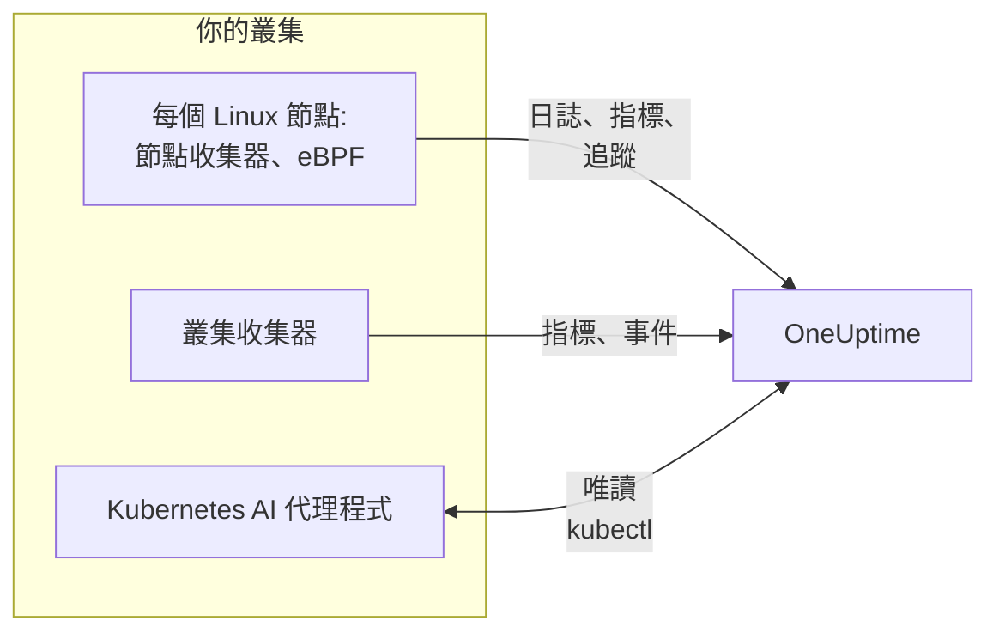

# Kubernetes 代理程式(Helm 安裝)

OneUptime Kubernetes 代理程式是一個 Helm Chart，它會收集叢集的指標、事件和 Pod 日誌、透過 eBPF 擷取的應用程式追蹤，以及每個節點的作業系統指標，並傳送到 OneUptime。只需一次 `helm install` 即可部署，不必修改應用程式的程式碼。[Kubernetes 監測器](/docs/monitor/kubernetes-monitor) 會根據它傳送的資料發出警示。

:::cards
- [安裝代理程式](#安裝代理程式): 使用 Helm 的四個步驟。
- [選擇預設組合](#選擇預設組合): 標準叢集、GKE Autopilot 或 EKS Fargate。
- [常用選項](#常用選項): 大多數叢集會修改的設定。
- [疑難排解](#疑難排解): 一個診斷指令碼和常見問題。
:::

## Chart 安裝的內容

Chart 會在它自己的命名空間中執行幾個工作負載。每個工作負載都使用你提供的擷取金鑰，透過 OTLP 把收集到的資料傳送到你的 OneUptime URL。



| 工作負載 | 類型 | 作用 | 預設開啟 |
| --- | --- | --- | --- |
| 叢集收集器 | Deployment | 從 Kubernetes API 收集叢集指標、Kubernetes 事件，以及 Pod、節點和工作負載的完整規格。 | 是 |
| 節點收集器 | DaemonSet | 來自 `/var/log/pods` 的 Pod 日誌、kubelet 和 cAdvisor 指標，以及節點的作業系統指標。 | 是 |
| eBPF 檢測(OBI) | DaemonSet | 來自每個 Pod 的 HTTP、gRPC、SQL 和 Redis 追蹤與請求指標，以及服務地圖。 | 是 |
| Kubernetes AI 代理程式 | Deployment | 讓 OneUptime AI 在調查此叢集上的事件或警示時執行唯讀的 `kubectl`。 | 是 |
| 日誌追蹤器 | Deployment | 在節點收集器無法讀取的地方，透過 Kubernetes API 取得 Pod 日誌。 | 在 `gke-autopilot` 和 `eks-fargate` 預設組合中 |
| eBPF 剖析器 | DaemonSet | 每個處理程序的持續 CPU 火焰圖。 | 否 |
| kube-state-metrics | Deployment | Pod 階段、容器等待原因和資源配額。 | 否 |

每個代理程式映像檔都只支援 Linux，因此每個工作負載都固定在 Linux 節點上。

## 開始之前

- **一個擷取金鑰。** 在 OneUptime 的 **專案設定 → 遙測與 APM → 擷取金鑰** 中建立。代理程式會把它作為 `x-oneuptime-token` 標頭傳送，因此專案 API 金鑰在這裡無法使用。
- **Helm 3** 以及對叢集的 `kubectl` 存取權。升級會使用 `--reset-then-reuse-values`，它需要 Helm 3.14 或更新版本。
- **叢集的名稱**，在你的專案中唯一。沒有名稱時 Chart 會拒絕安裝：兩個同名叢集會顯示為一個。
- 從叢集到你的 OneUptime URL 的 **輸出 HTTPS**。

## 安裝代理程式

:::steps
### 新增 Helm 存放庫

```bash
helm repo add oneuptime https://helm-chart.oneuptime.com
helm repo update
```

### 安裝 Chart

把 URL 換成你的 OneUptime URL，並把兩個預留位置換成你的擷取金鑰和叢集的名稱：

```bash
helm install oneuptime-agent oneuptime/kubernetes-agent \
  --namespace oneuptime-kubernetes-agent \
  --create-namespace \
  --set oneuptime.url=https://oneuptime.com \
  --set oneuptime.apiKey=<YOUR_API_KEY> \
  --set clusterName=<A_UNIQUE_NAME_FOR_THIS_CLUSTER>
```

這使用的是 `standard` 預設組合。在 GKE Autopilot 或 EKS Fargate 上，請改為 [選擇它們的預設組合](#選擇預設組合)。

### 檢查 Pod 是否在執行

```bash
kubectl get pods -n oneuptime-kubernetes-agent
```

每個 Pod 都應在一兩分鐘內進入 `Running` 狀態。

### 在 OneUptime 中找到叢集

開啟 **產品 → 基礎設施 → Kubernetes → 所有叢集**。幾分鐘內，叢集會以其名稱出現，其節點、Pod 和工作負載也會陸續填入。
:::

## 選擇預設組合

有些 Kubernetes 平台不允許工作負載掛載 `hostPath` 磁碟區或執行 DaemonSet，而節點收集器兩者都要用到。`preset` 設定用來選擇在你的平台上可行的方式：

| 預設組合 | 適用於 | Pod 日誌 | 每個節點上 |
| --- | --- | --- | --- |
| `standard`(預設) | 自行管理、**EKS on EC2**、**GKE Standard**、**AKS**、minikube、kind、k3s | 節點收集器讀取 `/var/log/pods` | kubelet、cAdvisor 和作業系統指標 |
| `gke-autopilot` | **GKE Autopilot** | 日誌追蹤器透過 Kubernetes API 讀取 | kubelet 和 cAdvisor 指標，不使用 `hostPath` |
| `eks-fargate` | **EKS Fargate** | 日誌追蹤器透過 Kubernetes API 讀取 | 無：Fargate 不執行 DaemonSet |

如果不確定，請不要設定 `preset`，以使用 `standard`。如果安裝因提到 `hostPath` 的 Pod Security 錯誤而失敗，請用 `gke-autopilot` 重新安裝，在 EKS Fargate 上則用 `eks-fargate`。

GKE Autopilot 和 EKS Fargate 也會拒絕 eBPF 檢測和剖析所需的特權 Pod，因此它們的預設組合會同時省略這兩者：

:::tabs
@tab Standard
```bash
helm install oneuptime-agent oneuptime/kubernetes-agent \
  --namespace oneuptime-kubernetes-agent --create-namespace \
  --set oneuptime.url=https://oneuptime.com \
  --set oneuptime.apiKey=<YOUR_API_KEY> \
  --set clusterName=prod
```
@tab GKE Autopilot
```bash
helm install oneuptime-agent oneuptime/kubernetes-agent \
  --namespace oneuptime-kubernetes-agent --create-namespace \
  --set oneuptime.url=https://oneuptime.com \
  --set oneuptime.apiKey=<YOUR_API_KEY> \
  --set clusterName=prod-gke-autopilot \
  --set preset=gke-autopilot
```
@tab EKS Fargate
```bash
helm install oneuptime-agent oneuptime/kubernetes-agent \
  --namespace oneuptime-kubernetes-agent --create-namespace \
  --set oneuptime.url=https://oneuptime.com \
  --set oneuptime.apiKey=<YOUR_API_KEY> \
  --set clusterName=prod-eks-fargate \
  --set preset=eks-fargate
```
:::

## 為叢集加上標籤

你在安裝時傳入的標籤會附加到叢集上，以及此代理程式回報的服務和主機上。`--set oneuptime.labels.<key>=<value>` 會成為名為 `<key>:<value>` 的專案標籤：

```bash
helm install oneuptime-agent oneuptime/kubernetes-agent \
  --namespace oneuptime-kubernetes-agent \
  --create-namespace \
  --set oneuptime.url=https://oneuptime.com \
  --set oneuptime.apiKey=<YOUR_API_KEY> \
  --set clusterName=prod \
  --set oneuptime.labels.team=payments \
  --set oneuptime.labels.env=production \
  --set oneuptime.labels.region=us-east-1
```

或者把它們放在 values 檔案中：

```yaml title="values.yaml"
oneuptime:
  url: https://oneuptime.com
  apiKey: <YOUR_API_KEY>
  labels:
    team: payments
    env: production
    region: us-east-1
clusterName: prod
```

```bash
helm install oneuptime-agent oneuptime/kubernetes-agent \
  --namespace oneuptime-kubernetes-agent --create-namespace \
  -f values.yaml
```

這樣，此代理程式傳送的每筆記錄——日誌、指標、追蹤和剖析資料——都會帶有 `team:payments`、`env:production` 和 `region:us-east-1`。每個標籤都是一個 `oneuptime.label.<key>=<value>` 資源屬性，OneUptime 會把每個以 `oneuptime.label.` 開頭的屬性變成標籤。標籤比對時不區分大小寫，因此既有的 `Production` 標籤會被重複使用，而不會重複建立。代理程式絕不會刪除你在 OneUptime 中加入的標籤。

## Pod 日誌

`preset` 會設定 `logs.mode`，你也可以自行設定它：

| `logs.mode` | 如何讀取日誌 | 優點 | 注意事項 |
| --- | --- | --- | --- |
| `daemonset` | 每個節點上的一個節點收集器會追蹤 `/var/log/pods` 下的檔案。 | 負擔最低，隨節點擴展，不會增加 Kubernetes API 伺服器的負載，能跟隨日誌輪替。 | 需要 `hostPath` 和 DaemonSet。 |
| `api` | 一個日誌追蹤器從 Kubernetes API 串流取得每個容器的日誌，就像 `kubectl logs -f` 一樣。 | 在 `hostPath` 被封鎖或適用 `restricted` Pod Security Standard 的地方也能運作。 | 每個容器串流都是與 API 伺服器的一條長時間連線。一個副本可處理幾千個容器。 |
| `disabled` | 什麼都不做。 | 適用於已經用其他方式傳送日誌的應用程式。 | |

若要關閉日誌收集，請設定 `--set logs.enabled=false`，並改用 [OpenTelemetry](/docs/telemetry/open-telemetry) SDK 傳送應用程式日誌。指標不受影響：節點收集器會繼續執行。

### 混合作業系統叢集(Windows 節點集區)

Windows 節點上從不執行代理程式 Pod。關於這些節點及其 Pod 的叢集層級資料仍會送達，因為它們來自 Kubernetes API：節點狀況、Pod 階段、Kubernetes 事件和 kube-state-metrics。Windows 節點缺少的是在節點上收集的資料：作業系統指標、kubelet 和 cAdvisor 指標、eBPF 追蹤、剖析資料，以及在 `daemonset` 日誌模式下的 Pod 日誌。

若要同時收集 Windows 節點上 Pod 的日誌，請開啟混合模式：

```bash
helm upgrade oneuptime-agent oneuptime/kubernetes-agent \
  --namespace oneuptime-kubernetes-agent --reset-then-reuse-values \
  --set logs.windowsPods.enabled=true
```

日誌追蹤器接著會與節點收集器並行執行，只處理 Windows 節點上的 Pod。Linux Pod 繼續使用負擔較低的檔案追蹤，兩者依節點的作業系統劃分 Pod，因此不會有日誌行被傳送兩次。

- **追蹤器映像檔的版本。** 僅針對 Windows 的劃分內建在 `kubernetes-log-tailer` 映像檔中。舊映像檔會忽略它並追蹤 *每個* Pod，把每個 Linux Pod 的日誌傳送兩次。不要把 `logs.api.image.tag` 固定到比 Chart 發行版本更舊的版本；如果某個節點可能快取了舊的 `release` 映像檔，請在升級時加入 `--set logs.api.image.pullPolicy=Always`。
- **依嚴重性篩選。** 設定了 `filters.logs.minSeverity` 時，沒有可辨識嚴重性的行在節點收集器的路徑上會被捨棄，但在日誌追蹤器的路徑上會被保留——請參閱 [依日誌嚴重性篩選](/docs/telemetry/kubernetes-agent#依日誌嚴重性篩選)。因此，Windows Pod 傳送的無層級行可能比 Linux Pod 多。

## 使用 eBPF 的應用程式追蹤

Chart 會在每個節點上執行 [OpenTelemetry eBPF Instrumentation (OBI)](https://opentelemetry.io/docs/zero-code/obi/)。OBI 把 eBPF 程式載入 Linux 核心並觀察每個 Pod 的網路流量，因此不必對應用程式做任何變更(沒有 SDK，也沒有 sidecar)就能重建 HTTP 和 HTTPS、gRPC 以及 SQL 和 Redis 呼叫。它會把這些作為追蹤和請求指標傳送到 OneUptime。

一兩分鐘內，你的服務會出現在 **產品 → 追蹤** 下和服務地圖上，`k8s.cluster.name` 設定為叢集的名稱，因此可以依叢集篩選。

### 何時關閉 eBPF

eBPF 預設開啟。在以下情況下，請用 `--set ebpf.enabled=false` 關閉它：

- 叢集是 **GKE Autopilot** 或 **EKS Fargate**。它們的預設組合會替你關閉：這兩個平台會拒絕特權 Pod，而 OBI 必須擁有特權才能載入其程式。
- 節點執行的核心早於 **Linux 5.8** 且沒有 BTF。Debian 11、Ubuntu 20.10、Fedora 34、RHEL 9 及更新版本都沒有問題。
- 你的應用程式已經透過 OpenTelemetry SDK 傳送追蹤，而你不想要重複的資料。

### eBPF 傳送的內容

OBI 會傳送幾種訊號。每一種都可以用 `--set ebpf.features.<key>=false` 關閉：

| 設定 | 預設值 | 加入的內容 |
| --- | --- | --- |
| `ebpf.features.httpMetrics` | 開啟 | 每個服務的 HTTP 和 gRPC 請求指標：請求速率、延遲直方圖和錯誤。 |
| `ebpf.features.spanMetrics` | 開啟 | Span 指標：依服務、路由或作業、Span 類型和狀態統計的呼叫次數與耗時——`traces.span.metrics.calls` 和 `traces.span.metrics.duration`(秒)。 |
| `ebpf.features.serviceGraph` | 開啟 | 從一個服務到另一個服務的每次呼叫的速率和延遲，用於繪製服務地圖。 |
| `ebpf.features.networkMetrics` | 開啟 | 每對 Pod 之間經由 TCP 和 UDP 傳輸的位元組和封包，帶有它們的 Kubernetes 名稱。即使是 OBI 無法解析的通訊協定，也能顯示每一對相互通訊的 Pod。 |
| `ebpf.features.networkInterZoneMetrics` | 關閉 | 同樣的資料，但統計可用區域之間。會使序列數量加倍：只有在依區域排程時才開啟。 |
| `ebpf.features.tcpStats` | 開啟 | 每個節點的 TCP 統計：來回時間、失敗的連線和重新傳輸。 |

### 跨服務連結追蹤

OBI 也能讓追蹤跨越一次呼叫延續下去：當 Pod A 透過 HTTP 或 gRPC 呼叫 Pod B 時，B 端的 Span 會加入 A 的追蹤，兩個應用程式中都不需要 SDK。**此功能預設關閉。** 閱讀下面的警告後，用 `--set ebpf.contextPropagation=true` 開啟它。

| 選項 | 預設值 | 作用 |
| --- | --- | --- |
| `ebpf.contextPropagation` | 關閉 | 把 W3C `traceparent` 寫入輸出流量，使 Span 在服務之間連結起來。 |
| `ebpf.contextPropagationMode` | `headers` | 方式：`headers`(HTTP/1.1 請求標頭，範圍最窄)、`tcp`(TCP 選項，透過 Linux Traffic Control)或 `all`(兩者都用)。僅在 `contextPropagation` 開啟時讀取。 |
| `ebpf.trackRequestHeaders` | 開啟 | 在核心中追蹤請求標頭，使接收端在一般 HTTP 伺服器上也能找到 `traceparent`。僅在 `contextPropagation` 開啟時生效。 |

> [!WARNING]
> 每種傳播模式都會修改已經在傳輸中的流量。對於一般 HTTP，OBI 會在核心中擴大輸出請求以容納標頭；對於 TLS 和原始 TCP，它會從 Traffic Control 掛鉤加入一個 TCP 選項，重寫封包及其總和檢查碼。如果之後連線的位元組計數沒有被精確修正，資料串流就會 **失去同步**：經過 nginx 這類 Proxy 的傳輸一旦回應超過約 64 KB 就會中途卡住，直到連線逾時。小請求仍能正常運作，因此看起來像是應用程式或 Proxy 的錯誤。沒有哪個核心版本能讓這種重寫消失。追蹤、請求指標和服務地圖在沒有它的情況下都能運作；服務中的 OpenTelemetry SDK 完全不需要核心重寫就能連結追蹤。如果你要開啟它，請先在非正式環境的叢集上試用，並檢查經過 Proxy 的大型傳輸。

### 將日誌連結到追蹤

**預設關閉。** 開啟後，OBI 會在它檢測的每個處理程序的 `write()` 系統呼叫上掛載一個探針，並且：

- **JSON 日誌行** 會獲得 `trace_id` 和 `span_id` 欄位(行中已有的欄位會保留)。節點收集器會把它們移到日誌記錄自身的追蹤欄位上，因此在 OneUptime 中，一個 Span 的日誌只需一次點選就能看到，日誌行的追蹤也是如此。
- **其他任何日誌行** 都會原樣收集，不帶連結。

```bash
helm upgrade oneuptime-agent oneuptime/kubernetes-agent \
  --namespace oneuptime-kubernetes-agent --reset-then-reuse-values \
  --set ebpf.logToTraceCorrelation=true
```

| 選項 | 預設值 | 作用 |
| --- | --- | --- |
| `ebpf.logToTraceCorrelation` | `false` | 開啟 OBI 的日誌擴充器以及節點收集器對 `trace_id` 的提取。 |
| `ebpf.logEnricher.services` | `[{service: [{exe_path: "*"}]}]` | 擴充器會處理哪些處理程序。每個項目都是一個 OBI [GlobAttributes](https://opentelemetry.io/docs/zero-code/obi/configure/options/#service-discovery) 選取器，帶有 `exe_path`、`languages`、`k8s_pod_labels`、`k8s_pod_annotations`、`open_ports` 和 `cmd_args` 等欄位。 |

#### 與它一起使用會當機的 APM 代理程式

擴充器會 **在處理程序內部** 重寫應用程式的輸出緩衝區：當相符的處理程序呼叫 `write()` 時，OBI 會清空原始位元組並寫入擴充後的副本。透過 `LD_PRELOAD` 載入、並且自己也包裝 `write()` 的 APM 代理程式無法承受這一點：

| APM 代理程式 | 程式庫 | 會發生什麼 |
| --- | --- | --- |
| Dynatrace OneAgent | `liboneagentproc.so` | 應用程式以 SIGSEGV(結束代碼 139)當機。Dynatrace 監看程式自身的 `write()` 卡住超過其 10 秒限制，OneAgent 不斷循環重新啟動。 |
| New Relic | `libnewrelic*.so` | 同樣的當機。 |
| AppDynamics | `libappdynamics*.so` | 同樣的當機。 |
| Datadog | `libdd*.so` | 同樣的當機。 |
| Instana | `libinstana*.so` | 同樣的當機。 |

**.NET 應用程式受影響最大：** Dynatrace 的 .NET 代理程式一律透過 `LD_PRELOAD` 載入，而 Microsoft.Extensions.Logging 的主控台日誌不經緩衝，因此每一行都會走這條路徑。Python 和 Go 應用程式通常不受影響。

若要與這些代理程式之一一起使用，請讓 `logEnricher.services` 只指向沒有該代理程式的 Pod。擴充器無法排除，因此請列出要擴充的 Pod：

```yaml title="values.yaml"
ebpf:
  logToTraceCorrelation: true
  logEnricher:
    services:
      # Enrich only pods with the apm-agent=none label
      - service:
          - k8s_pod_labels:
              apm-agent: "none"
```

或者依執行階段選擇。Dynatrace 的 `LD_PRELOAD` 載入針對的是 .NET，因此只擴充 Python、Go、Ruby 和 Node.js 就能避開它：

```yaml title="values.yaml"
ebpf:
  logToTraceCorrelation: true
  logEnricher:
    services:
      - service:
          - languages: "python,go,ruby,nodejs"
```

#### 日誌必須是 JSON 且不緩衝

- **只有 JSON 行才會獲得 `trace_id`。** 請把記錄器切換為 JSON 格式：`structlog`、`pino`、`winston`、`serilog`、`logback-json`、klog `--logging-format=json` 等。
- **緩衝的輸出會中斷連結**，因為此時 `write()` 發生在與請求不同的執行緒上。在 **Python** 中，設定 `PYTHONUNBUFFERED=1`。在 **.NET** 中，在啟動時呼叫 `Console.SetOut(new StreamWriter(Console.OpenStandardOutput()) { AutoFlush = true })`；Microsoft.Extensions.Logging 的 `AddConsole()` 和 Serilog 的非同步接收器無法使用，Serilog 一般的 `WriteTo.Console()` 則可以。
- Greenlet、gevent、Tornado 和其他自訂非同步執行階段不受支援。

### 調整 eBPF

| 選項 | 預設值 | 作用 |
| --- | --- | --- |
| `ebpf.enabled` | `true` | 執行 eBPF DaemonSet。`false` 則不部署它。 |
| `ebpf.image.tag` | `v0.14.0` | OBI 映像檔。OBI 還處於 1.0 之前：請固定你測試過的版本，更換前再測試一次。 |
| `ebpf.autoTargetExe` | `*` | 要檢測的執行檔的萬用字元模式，以逗號分隔。縮小範圍(例如 `*/python,*/java`)可以檢測較少的執行階段。 |
| `ebpf.excludeExePaths` | Shell、叢集基礎元件、服務網格 sidecar、CNI 代理程式、瀏覽器、ClickHouse、收集器和 OBI 本身 | 要略過的執行檔的萬用字元模式，以逗號分隔。範圍過廣的模式也會略過你自己的二進位檔。 |
| `ebpf.logLevel` | `info` | `debug`、`info`、`warn` 或 `error`。 |
| `ebpf.printTraces` | `false` | 同時把 Span 印到 OBI 自己的日誌中，以便檢查它擷取了什麼。 |
| `ebpf.resources.*` | 請求 `100m` CPU 和 `512Mi` 記憶體，限制 `2000m` 和 `2Gi` | 在流量大或短生命週期處理程序多的節點上調高。 |

若要檢查 OBI 是否在執行並能看到流量：

```bash
kubectl get pods -n oneuptime-kubernetes-agent -l component=ebpf-instrument
kubectl logs -n oneuptime-kubernetes-agent -l component=ebpf-instrument --tail=200
```

## 持續 CPU 剖析

[OpenTelemetry eBPF Profiler](https://github.com/open-telemetry/opentelemetry-ebpf-profiler) 也可以在每個節點上執行，使用 `otel/opentelemetry-collector-ebpf-profiler` 映像檔。它以每秒 19 次的頻率對每個處理程序正在執行的內容取樣，支援 Go、Java、.NET、Python、Ruby、Node.js、PHP、Perl、C、C++ 和 Rust，並把剖析資料傳送到 OneUptime。這些資料會顯示在 **產品 → 效能設定檔** 下，也會作為火焰圖顯示在每個追蹤 Span 上。

**剖析預設關閉：** 它每個節點耗用的 CPU 和記憶體比 eBPF 檢測更多。用 `--set profiling.enabled=true` 開啟它。

如果同時開啟了 eBPF 檢測(預設)，每個樣本都會帶有它所屬的追蹤，因此每個 Span 都有自己的火焰圖。為此，Chart 會要求 OBI 讓目前的追蹤內容保持可用(`OTEL_EBPF_BPF_POPULATE_TRACE_CONTEXT=true`)，這會讓被檢測的應用程式在每次非同步內容切換時付出少許代價。設定 `profiling.obiProcessContext=false` 可得到不連結 Span 的火焰圖。

剖析需要 **Linux 5.10** 或更新版本，以及一個擁有節點處理程序 ID 的特權 Pod：它無法在 GKE Autopilot 或 EKS Fargate 上執行，它們的預設組合會讓它保持關閉。在本身就是容器的節點上(例如 kind 或 k3d)，它無法區分處理程序，幾乎沒有樣本能連結到 Span。

| 選項 | 預設值 | 作用 |
| --- | --- | --- |
| `profiling.enabled` | `false` | 執行剖析器 DaemonSet。 |
| `profiling.image.tag` | `0.152.0` | 剖析器映像檔。它還處於 1.0 之前：請固定你測試過的版本。 |
| `profiling.samplesPerSecond` | `19` | 每秒取樣多少次。19 可以避免與常見的計時器頻率對齊。 |
| `profiling.offCpuThreshold` | `0` | 大於 0 且不超過 1 的值也會剖析 CPU 之外花費的時間，從而顯示鎖定爭用和封鎖 I/O，但會帶來一些額外負擔。 |
| `profiling.tracers` | `""`(每種執行階段) | 要載入的語言追蹤器，以逗號分隔，例如 `go,python`。 |
| `profiling.obiProcessContext` | `true` | 把樣本連結到 OBI 的追蹤，並讓 OBI 為此保持追蹤內容可用。 |

## 其他資料收集

| 選項 | 預設值 | 加入的內容 |
| --- | --- | --- |
| `hostMetrics.enabled` | 開啟 | 每個節點來自 `/proc` 和 `/sys` 的作業系統指標：磁碟 I/O 佇列、檔案系統 inode、網路介面錯誤、分頁和平均負載。在節點收集器中執行，不需要額外的 Pod。 |
| `kubeletstats.utilizationMetrics.enabled` | 開啟 | 容器和 Pod 的 CPU 與記憶體佔其 request 和 limit 的百分比，CPU 和記憶體飽和監測器會讀取這些資料。對於沒有 request 或 limit 的 Pod 一律為 0。 |
| `kubeletstats.volumeMetrics.enabled` | 開啟 | 每個 PVC 的可用空間和總空間(`k8s.volume.available`、`k8s.volume.capacity`)，PVC Low Disk Space 監測器會讀取這些資料。每個 Pod 的每個 PVC 一個序列。 |
| `cadvisor.enabled` | 開啟 | 來自每個 kubelet 的 `/metrics/cadvisor` 的 CPU 節流和 OOM 終止：`container_cpu_cfs_throttled_seconds_total`、`container_cpu_cfs_periods_total` 和 `container_oom_events_total`，沒有其他內容。 |
| `kubeStateMetrics.enabled` | 關閉 | 來自 kube-state-metrics 的 Pod 階段(Pending、Terminating)、無法排程的 Pod、容器等待原因(CrashLoopBackOff、ImagePullBackOff)和資源配額使用情況。`kubeStateMetrics.mode: bundled`(預設)會為你執行一個小型 kube-state-metrics；`external` 則讀取你已在執行的執行個體，位於 `kubeStateMetrics.endpoint`。 |
| `auditLogs.enabled` | 關閉 | Kubernetes 稽核日誌 `/var/log/kubernetes/audit.log`：對 API 的每個請求，由誰發出、針對什麼。僅限自行管理的叢集：受管理的叢集(EKS、GKE、AKS、DOKS)會把它傳送給雲端供應商。 |
| `csi.enabled` | 關閉 | 來自帶有 `app=csi-driver` 或 `app.kubernetes.io/component=csi-driver` 標籤之 Pod 的 CSI 儲存驅動程式指標：磁碟區掛接和卸離時間、佈建失敗、IOPS。 |
| `coreDns.enabled` | 關閉 | `:9153/metrics` 上的 CoreDNS 指標：查詢速率、延遲、快取命中和錯誤。 |
| `controlPlane.enabled` | 關閉 | etcd、API 伺服器、排程器和控制器管理員。僅限自行管理的叢集：受管理的叢集不會公開這些元件。 |
| `cost.enabled` | 關閉 | 每個工作負載的成本。請參閱 [Kubernetes 成本可觀測性](/docs/telemetry/kubernetes-cost)。 |

## 常用選項

| 選項 | 預設值 | 作用 |
| --- | --- | --- |
| `oneuptime.url` | (必填) | 你的 OneUptime URL。 |
| `oneuptime.apiKey` | (必填) | 擷取金鑰，來自 **專案設定 → 遙測與 APM → 擷取金鑰**。作為 `x-oneuptime-token` 標頭傳送；專案 API 金鑰無法使用。 |
| `clusterName` | (必填) | 叢集的名稱，在專案中唯一。每筆記錄都把它作為 `k8s.cluster.name` 攜帶。 |
| `preset` | (空白：`standard`) | `standard`、`gke-autopilot` 或 `eks-fargate`。請參閱 [選擇預設組合](#選擇預設組合)。 |
| `oneuptime.labels` | `{}` | 此代理程式傳送的每筆記錄的標籤。請參閱 [為叢集加上標籤](#為叢集加上標籤)。 |
| `namespaceFilters.rules` | 把 `kube-system` 排除在 `podLogs` 和 `ebpfDiscovery` 之外 | 針對 `podLogs`、`ebpfDiscovery`、`metrics` 和 `traces` 包含或排除命名空間的規則。模式可以使用 `*`，排除一律優先。 |
| `filters.logs.minSeverity` | `""` | 捨棄低於此層級的 Pod 日誌行：`TRACE`、`DEBUG`、`INFO`、`WARN`、`ERROR` 或 `FATAL`。 |
| `filters.metrics.exclude` | `[]` | 要捨棄的指標名稱。 |
| `sampling.traces.percentage` | `100` | 要保留的追蹤比例，從 0 到 100。追蹤會整個保留或捨棄。 |
| `logs.enabled` | `true` | 收集 Pod 日誌。 |
| `logs.mode` | (來自 `preset`) | `daemonset`、`api` 或 `disabled`。覆寫預設組合。 |
| `logs.windowsPods.enabled` | `false` | 同時追蹤 Windows 節點上的 Pod。請參閱 [混合作業系統叢集](#混合作業系統叢集windows-節點集區)。 |
| `logs.api.replicas` | `1` | 在 `api` 模式下日誌追蹤器的副本數。 |
| `ebpf.enabled` | `true` | eBPF 追蹤和請求指標。請參閱 [使用 eBPF 的應用程式追蹤](#使用-ebpf-的應用程式追蹤)。 |
| `profiling.enabled` | `false` | CPU 火焰圖。請參閱 [持續 CPU 剖析](#持續-cpu-剖析)。 |
| `kubeStateMetrics.enabled` | `false` | 來自 kube-state-metrics 的叢集狀態。 |
| `aiAgent.enabled` | `true` | Kubernetes AI 代理程式。它可以做什麼，請參閱 [Kubernetes AI 代理程式](/docs/telemetry/kubernetes-agent#kubernetes-ai-代理程式)。 |

Chart 的 [`values.yaml`](https://github.com/OneUptime/oneuptime/blob/master/HelmChart/Public/kubernetes-agent/values.yaml) 列出並說明了每個選項，[Kubernetes 代理程式](/docs/telemetry/kubernetes-agent) 則介紹了篩選、取樣以及如何控制資料量。

## 升級

```bash
helm repo update
helm upgrade oneuptime-agent oneuptime/kubernetes-agent \
  --namespace oneuptime-kubernetes-agent \
  --reset-then-reuse-values
```

`--reset-then-reuse-values`(Helm 3.14 及更新版本)會保留你設定的值——預設組合、叢集名稱、篩選器——並從新 Chart 取得其他所有值。在它後面加入任何新的 `--set`。在 Helm 3.13 或更早版本上，請改為使用你設定的值進行升級：

```bash
helm repo update
helm get values oneuptime-agent --namespace oneuptime-kubernetes-agent -o yaml > values.yaml && \
  helm upgrade oneuptime-agent oneuptime/kubernetes-agent \
  --namespace oneuptime-kubernetes-agent -f values.yaml
```

不要使用 `--reuse-values` 升級：它還會保留你升級前那個 Chart 的預設值，因此新 Chart 的預設值(包括其 eBPF 映像檔)永遠不會生效。當某個發行版本使用舊 Chart 的預設值執行時，Helm 在安裝或升級後印出的說明會以一則警告和修正它的命令結尾。

> [!WARNING]
> **eBPF Span 指標有了新名稱。** `ebpf.features.spanMetrics` 現在傳送 `traces.span.metrics.calls` 和 `traces.span.metrics.duration`(秒)，取代 `traces_spanmetrics_calls_total` 和 `traces_spanmetrics_latency`：同樣的序列，使用 OBI 保留的名稱(它已淘汰舊名稱)。使用舊名稱的儀表板、圖表或指標監測器在升級後會收不到新資料，也不會報錯——請把它們改為新名稱，並更新所有提到舊名稱的 `filters.metrics` 項目。

## 解除安裝

```bash
helm uninstall oneuptime-agent --namespace oneuptime-kubernetes-agent
kubectl delete namespace oneuptime-kubernetes-agent
```

## 疑難排解

:::details 叢集顯示為 Disconnected，或沒有資料送達
執行 Chart 的診斷指令碼。它會檢查 Pod、擷取金鑰以及離開叢集的網路路徑，詢問 OneUptime 金鑰是否被接受，並印出一個結論。它只會讀取，不做任何變更：

```bash
curl -fsSL https://raw.githubusercontent.com/OneUptime/oneuptime/master/HelmChart/Public/kubernetes-agent/troubleshoot.sh \
  | bash -s -- -n oneuptime-kubernetes-agent
```

常見原因(尤其是在重新安裝之後)是擷取金鑰錯誤或已被撤銷：OneUptime 拒絕它，收集器會捨棄每一批資料，而它的 Pod 仍處於 `Running` 狀態。
:::

:::details 安裝失敗，顯示 "hostPath volumes are not allowed"
叢集封鎖了 `hostPath`。請切換到透過 Kubernetes API 讀取日誌的預設組合，它也會省略 eBPF：

```bash
helm repo update
helm upgrade oneuptime-agent oneuptime/kubernetes-agent \
  --namespace oneuptime-kubernetes-agent \
  --reset-then-reuse-values \
  --set preset=gke-autopilot
```

在 EKS Fargate 上，請使用 `--set preset=eks-fargate`。
:::

:::details 代理程式 Pod 在 Windows 節點上卡在 ImagePullBackOff
舊版 Chart 會把代理程式的 DaemonSet 排程到 Windows 節點上，而那裡永遠無法提取它們的 Linux 映像檔。執行 `helm upgrade`：目前的 Chart 會把每個工作負載固定在 Linux 節點上，卡住的 Pod 就會消失。若要收集 Windows 節點上 Pod 的日誌，請參閱 [混合作業系統叢集](#混合作業系統叢集windows-節點集區)。
:::

:::details 沒有日誌送達 OneUptime
檢查代理程式的 Pod 及其日誌：

```bash
kubectl get pods -n oneuptime-kubernetes-agent
kubectl logs -n oneuptime-kubernetes-agent -l app.kubernetes.io/part-of=oneuptime --tail=200
```

在 `api` 模式下，日誌追蹤器會在 `/healthz`(連接埠 13133)上回報其匯出的狀態：用 `kubectl port-forward` 存取它。
:::

:::details eBPF Pod 處於 CrashLoopBackOff，或無法啟動
查看 OBI 的日誌：

```bash
kubectl logs -n oneuptime-kubernetes-agent -l component=ebpf-instrument --tail=200
```

- **核心太舊，或沒有 BTF。** OBI 需要帶 BTF 的 Linux 5.8 或更新版本；在節點上用 `uname -r` 檢查。如果無法升級核心，請用 `--set ebpf.enabled=false` 關閉 eBPF。
- **特權 Pod 被拒絕。** 有些叢集即使不是 Autopilot 或 Fargate 也會拒絕它們。請關閉 eBPF。
- **OBI 在執行，但沒有追蹤送達。** 設定 `--set ebpf.printTraces=true` 並再次查看 OBI 的日誌。如果那裡有 Span，表示匯出到 OneUptime 失敗：請檢查 URL 和擷取金鑰。如果那裡沒有 Span，可能是流量被 OBI 無法讀取的 TLS 程式庫(例如靜態連結的程式庫)加密了。
:::

:::details 開啟追蹤連結後，大型傳輸卡住
這是 `ebpf.contextPropagation` 在重寫流量：請參閱 [跨服務連結追蹤](#跨服務連結追蹤) 中的警告。用 `--set ebpf.contextPropagation=false` 關閉它。
:::

:::details 開啟日誌連結後，應用程式以結束代碼 139 當機
同一個 Pod 中有透過 `LD_PRELOAD` 載入的 APM 代理程式：請參閱 [與它一起使用會當機的 APM 代理程式](#與它一起使用會當機的-apm-代理程式)。關閉 `ebpf.logToTraceCorrelation`，或讓 `ebpf.logEnricher.services` 指向沒有該代理程式的 Pod。
:::

:::details 一個日誌追蹤器不足以應付叢集(api 模式)
把命名空間分配到多個發行版本中，每個發行版本都用自己的命名空間規則安裝：

```bash
helm install oneuptime-agent-ns-a oneuptime/kubernetes-agent \
  --set preset=gke-autopilot \
  --set-json 'namespaceFilters.rules=[{"action":"include","namespaces":["app-a","app-b"],"scopes":["podLogs"]}]' \
  ...
```

增加 `logs.api.replicas` 會增加追蹤器，但每個追蹤器都會讀取所有允許的命名空間，因此仍需要拆分命名空間以避免重複。
:::

## 後續步驟

:::cards
- [Kubernetes 監控](/docs/monitor/kubernetes-monitor): 根據代理程式傳送的資料發出警示。
- [Kubernetes 代理程式](/docs/telemetry/kubernetes-agent): 篩選、取樣、AI 代理程式，以及如何控制資料量。
- [Kubernetes 成本可觀測性](/docs/telemetry/kubernetes-cost): 查看每個工作負載的成本。
- [追蹤監控](/docs/monitor/traces-monitor): 根據 eBPF 擷取的追蹤發出警示。
:::
