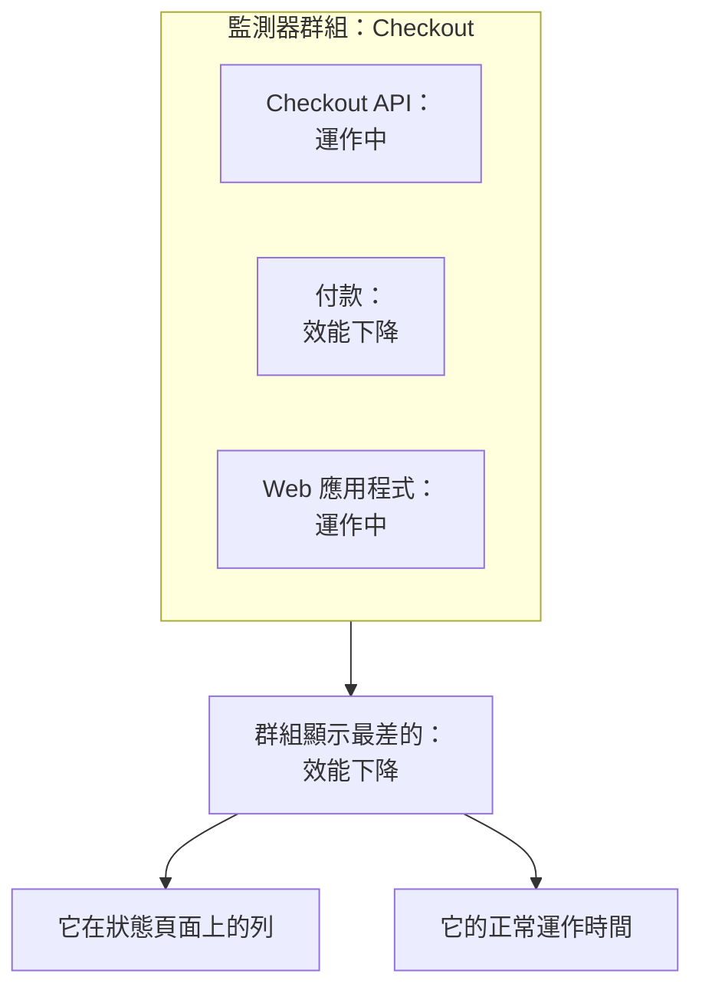

# 監測器群組

監測器群組將多個監測器彙總為一個狀態。把共同組成一項服務的監測器放進一個群組，例如 Checkout：它的 API、付款服務和 Web 應用程式。群組會顯示其中最差的狀態，保留自己的正常運作時間，狀態頁面可以將整個群組顯示為一列。

:::cards
- [群組的狀態如何得出](#群組的狀態如何得出): 其監測器中最差的狀態。
- [啟用監測器群組](#啟用監測器群組): 專案設定中的一個開關。
- [建立監測器群組](#建立監測器群組): 為它命名，然後加入監測器。
- [在狀態頁面上顯示群組](#在狀態頁面上顯示群組): 整個群組顯示為一列。
:::

## 群組的狀態如何得出

群組從您的運作中狀態開始，並取其監測器中最差的狀態：也就是專案監測器狀態清單中最下方的那個。一個監測器變為 **效能下降**，整個群組就變為 **效能下降**；一個變為 **離線**，群組就變為 **離線**。

- **已封存的監測器不計入。** 已封存的監測器不會被檢查，因此其狀態被凍結；群組會略過它。
- **空群組為運作中。** 沒有監測器或只有已封存監測器的群組，會顯示您的運作中狀態。
- **順序由您決定。** 哪個狀態最差，取決於 **監測 → 設定 → 監測器狀態** 中的順序。請參閱 [監測器狀態](/docs/monitor/criteria-and-statuses#監測器狀態)。

監測器群組不是狀態頁面群組。狀態頁面群組是某個狀態頁面上容納若干列的標題。監測器群組是代表多個監測器的一列，任何狀態頁面都可以顯示它。

## 開始之前

- **您的方案。** 在 OneUptime Cloud 上，監測器群組需要 Scale 方案。
- **開關。** 在為專案開啟 **監測器群組** 之前，監測器群組是隱藏的（見下文）。開啟它需要 Project Owner 角色，或擁有 Edit Project 或 Manage Billing 權限的自訂角色。
- **您的角色。** 建立、變更和刪除群組需要 Project Owner、Project Admin、Project Member、Monitor Admin 或 Monitor Member 角色，或擁有相應監測器群組權限的自訂角色。Viewer 可以檢視群組，但不能變更。

## 啟用監測器群組

:::steps
### 開啟功能旗標

前往 **專案設定 → 進階 → 功能旗標**。側邊選單中的 **進階** 預設是收合的：請先展開它。

### 切換開關

切換 **監測器群組** 開關。它會立即儲存：**監測器群組** 會出現在 **監測器** 側邊選單中，每個狀態頁面的 **監測器** 選單項目會改名為 **資源**，您可以在那裡新增群組。
:::

再次關閉開關會把 **監測器群組** 從選單中隱藏。不會刪除任何群組。

## 建立監測器群組

:::steps
### 開啟監測器群組

前往 **監測 → 監測器群組**。**監測器群組** 卡片會列出每個群組及其 **目前狀態**、標籤和擁有者。

### 建立群組

點選 **建立監測器 群組**，輸入 **名稱**，如有需要再輸入 **描述**，然後點選表單底部的 **建立監測器 群組**。群組建立時沒有任何監測器。

### 加入其監測器

開啟該群組：在它還沒有監測器時，其 **概覽** 會提供 **Add Monitors**。之後，點選其側邊選單中的 **監測器**，再點選 **Add Monitors**。在 **監測器** 中選擇群組中的每個監測器，然後點選 **Add Monitors**。

### 檢查其狀態

點選 **概覽**。**目前狀態** 會顯示群組目前的狀態，**正常運作時間圖** 會顯示最近 90 天，每天一個長條。
:::

若要將監測器從群組中移出，請在 **群組中的監測器** 中該監測器的列上點選 **移除**。監測器本身不會改變。一個監測器可以屬於多個群組。

## 群組的頁面

開啟一個群組，即可在側邊選單中看到它的頁面：

| 頁面 | 顯示什麼 |
| --- | --- |
| **概覽** | **監測器群組詳細資訊**、**目前狀態**，以及顯示群組最近 90 天正常運作時間百分比的 **正常運作時間圖**。沒有監測器的群組會在圖表的位置顯示 **Add Monitors**。 |
| **監測器** | **群組中的監測器**，以及 **Add Monitors** 和 **移除**。 |
| **事件** | 群組中任一監測器上的事件。 |
| **警示** | 群組中任一監測器上的警示。 |
| **擁有者** | 負責該群組的人員和團隊。它位於預設收合的 **進階** 之下。 |
| **稽核日誌** | 誰在何時變更了該群組，同樣位於 **進階** 之下。 |
| **刪除群組** | 刪除該群組，同樣位於 **進階** 之下。 |

**概覽** 上的正常運作時間會將除了運作中以外的所有狀態都計為停機。狀態頁面只計算它自己的 **計為停機時間** 清單中的狀態：請參閱 [決定頁面上顯示什麼](/docs/status-pages/index#決定頁面上顯示什麼)。

**監測器群組** 清單可以依擁有者和標籤篩選群組，一次為多個群組設定標籤和擁有者，並以 JSON 格式匯出或匯入群組。

## 在狀態頁面上顯示群組

:::steps
### 開啟狀態頁面的資源

前往 **狀態頁面**，開啟該頁面，然後點選其側邊選單中的 **資源**。

### 把對話方塊切換為群組

點選 **新增監測器**。在監測器下拉式選單下方，點選 **Add a Monitor Group instead.** 下拉式選單會變為 **監測器 群組**。

### 選擇群組並新增

選擇該群組。**顯示名稱** 是訪客看到的名稱，在您輸入自己的名稱之前會填入群組名稱。點選 **新增監測器**：該列會帶著群組的狀態出現在頁面上。
:::

在狀態頁面上，這一列代表群組中的每個監測器：

- **它的狀態。** 是群組的狀態：其監測器中最差的一個。
- **它的事件。** 群組中任一監測器上的事件都會出現在頁面上，並在受影響的資源中列出該群組。
- **它的訂閱者。** 選擇該群組的訂閱者會收到群組中每個監測器的消息。請參閱 [讓訂閱者自己挑資源與事件類型](/docs/status-pages/subscribers#讓訂閱者自己挑資源與事件類型)。

關於這一列的其他選項，例如它的正常運作時間和歷史圖表，請參閱 [狀態頁資源與群組](/docs/status-pages/resources-and-groups)。

> [!WARNING]
> 刪除監測器群組也會從每個顯示它的狀態頁面上刪除它的列。群組中的監測器及其事件不會被刪除。

## API 和 Terraform

一個群組是 `/api/monitor-group`，群組中的每個監測器是 `/api/monitor-group-resource` 的一列，將 `monitorGroupId` 與 `monitorId` 配對。在 Terraform 中，它們是 `oneuptime_monitor_group` 和 `oneuptime_monitor_group_resource`：請參閱 [監測器群組](/docs/terraform/examples#監測器群組)。

## 疑難排解

:::details 監測器選單中沒有監測器群組
**監測器群組** 開關是關閉的。請在 **專案設定 → 進階 → 功能旗標** 中開啟它。在 OneUptime Cloud 上，群組還需要 Scale 方案。
:::

:::details 群組顯示離線，但它的大多數監測器都正常
這是規則：群組會顯示其最差的監測器。開啟群組上的 **監測器** 找出停擺的監測器，或移除不屬於該群組的監測器。
:::

:::details 狀態頁面無法新增該群組
**Add a Monitor Group instead.** 只在專案的 **監測器群組** 開關開啟時，才會出現在對話方塊中。
:::

## 後續步驟

:::cards
- [監測器條件與狀態](/docs/monitor/criteria-and-statuses): 是什麼設定了每個監測器的狀態。
- [狀態頁資源與群組](/docs/status-pages/resources-and-groups): 安排狀態頁面上的列。
- [訂閱者與公告](/docs/status-pages/subscribers): 把群組的事件告訴客戶。
:::
