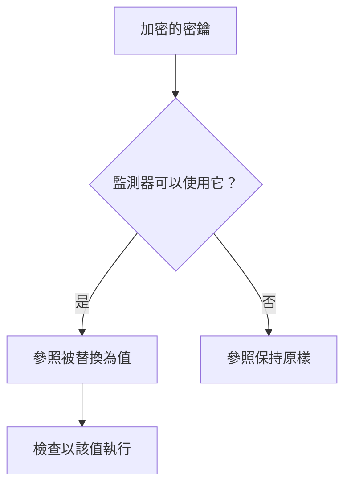

# 監控密鑰

監測器密鑰讓監測器所需的密碼、API 金鑰和權杖不必寫在監測器本身中。您只需將值加密儲存一次，選擇哪些監測器可以使用它，然後在監測器需要的地方以 `{{monitorSecrets.NAME}}` 參照它。

:::cards
- [新增密鑰](#新增密鑰): 儲存一個值，並選擇誰可以使用它。
- [選擇存取權](#選擇哪些監測器可以使用密鑰): 所有監測器、特定監測器或帶標籤的監測器。
- [使用密鑰](#使用密鑰): `{{monitorSecrets.NAME}}` 在哪裡有效。
- [使用一次性驗證碼登入](#使用一次性驗證碼登入): 讓監測器通過網站的雙重驗證登入。
:::

## 密鑰如何送達監測器

密鑰以加密形式儲存，儲存後就不會再顯示。在 OneUptime 把監測器交給探測器之前，它會把監測器可以使用的每個參照替換為解密後的值；監測器不能使用的參照則保持原樣。一次性驗證碼密鑰是例外：探測器會在檢查執行時產生它的驗證碼（請參閱[使用一次性驗證碼登入](#使用一次性驗證碼登入)）。



執行檢查的探測器會收到該值，因此使用密鑰的監測器應在您信任的探測器上執行：OneUptime 自己的探測器，或者您自行執行的 [自訂探測器](/docs/probe/custom-probe)。

## 開始之前

- **Growth 方案或更高方案**，適用於 OneUptime Cloud。自行託管的安裝沒有方案。
- **可以管理密鑰的角色**：專案擁有者、專案管理員，或者擁有 Create Monitor Secret 權限的自訂角色。

## 管理密鑰

### 新增密鑰

:::steps
1. 前往 **監測器 → 設定 → 密鑰**，點選 **建立監測器密鑰**。
2. 輸入 **名稱** 和 **密鑰值**。名稱是您參照時使用的，例如 `ApiKey`。它只能包含字母、數字、連字號（`-`）和底線（`_`），而且同一個專案中的兩個密鑰不能同名。如果是網站的雙重驗證設定金鑰，請先選擇 **一次性驗證碼 (TOTP)** （請參閱[使用一次性驗證碼登入](#使用一次性驗證碼登入)）。
3. 在 **存取** 步驟中選擇哪些監測器可以使用它（請參閱下一節），然後點選 **建立監測器密鑰**。
:::

> [!IMPORTANT]
> 密鑰會經過加密並安全儲存。密鑰值儲存後就不會再顯示——不會出現在表格中、編輯表單中，也不會透過 API 回傳。如果您遺失了該值，需要從它的來源重新取得並再次設定。若要輪替密鑰，請使用其所在列的 **更新密鑰值** 按鈕；不必刪除後重新建立。同一個按鈕還能連同新值一起變更密鑰保存的內容，即 **文字** 或 **一次性驗證碼 (TOTP)** ，使用該密鑰的監測器會在下一次檢查時採用新類型。

### 選擇哪些監測器可以使用密鑰

每個密鑰都有三種存取選項之一：

| 選項 | 哪些監測器可以使用該密鑰 | 適用於 |
| --- | --- | --- |
| **所有監測器** | 專案中的每個監測器，包括您之後建立的監測器。 | 許多監測器共用的認證資訊。 |
| **特定監測器** | 只有您選擇的監測器。這是預設選項，在這些選項出現之前建立的密鑰也是這樣運作的。 | 用於一個或少數幾個監測器的認證資訊。 |
| **帶標籤的監測器** | 至少擁有您所選標籤之一的監測器。為監測器加上其中一個標籤即可讓它取得存取權，移除該標籤後，監測器會在下次執行時失去存取權。 | 用於隨時間變化之一組監測器的認證資訊。 |

您可以隨時透過密鑰所在列的 **編輯** 變更選項。只會保留所選選項對應的清單：切換到 **所有監測器** 會清空密鑰的監測器清單和標籤清單，在 **特定監測器** 和 **帶標籤的監測器** 之間切換則會清空您切換前的那份清單。

密鑰永遠不會提供給其他專案中的監測器。

> [!WARNING]
> 任何可以編輯「能使用某個密鑰的監測器」的人，都可以把該密鑰傳送到監測器連線的任何地方。使用 **所有監測器** 時，這包括專案中所有可以建立或編輯監測器的人。使用 **帶標籤的監測器** 時，還包括所有可以為監測器加上其中某個標籤的人。

透過 API 時，存取選項是 `monitorAccess` 欄位：`All Monitors`、`Specific Monitors` 或 `Monitors With Labels`。`monitors` 和 `labels` 欄位保存相應的清單。建立時未指定 `monitorAccess` 的密鑰會得到 `Specific Monitors`。

### 使用密鑰

若要使用密鑰，請在接受密鑰的欄位中寫入 `{{monitorSecrets.SECRET_NAME}}`。例如，請求標頭 `Authorization: Bearer {{monitorSecrets.ApiKey}}` 會傳送 `ApiKey` 密鑰的值。

以下監測器類型和欄位接受密鑰：

| 監測器類型 | 欄位 |
| --- | --- |
| API | URL、請求標頭和內文，以及用戶端憑證、私密金鑰和複雜密碼（mTLS） |
| 網站 | URL，以及用戶端憑證、私密金鑰和複雜密碼（mTLS） |
| Ping, IP, 連接埠, NTP, SSL 憑證 | 要檢查的主機或 URL |
| DNS | 網域名稱和 DNS 伺服器 |
| DNSSEC, 網域 | 網域名稱 |
| SQL 查詢 | 主機、資料庫名稱、使用者名稱、密碼和查詢 |
| 資料庫健康狀況 | 主機、資料庫名稱、使用者名稱和密碼 |
| 外部狀態頁面 | 狀態頁 URL |
| 合成監測器, 自訂 JavaScript 程式碼 | 指令碼 |
| 網路裝置 | SNMP 社群字串，以及 SNMPv3 的驗證金鑰和隱私金鑰 |

密鑰會在 合成監測器 或 自訂 JavaScript 程式碼 監測器的指令碼執行之前填入，因此指令碼中諸如 `{{monitorSecrets.ApiKey}}` 的參照在執行時就是解密後的值。

如果監測器參照了它不能使用的密鑰，該參照會保持原樣，不會被替換為值。

當 API、網站或外部狀態頁面監測器的檢查失敗時，錯誤中只寫出 URL 的通訊協定、主機和連接埠，例如 `https://api.example.com`，因此 URL 中的密鑰永遠不會顯示。

在儲存監測器之前測試它時，只會填入對 **所有監測器** 可用的密鑰，因為新的監測器還不在任何清單中，也還沒有標籤。儲存監測器後，測試會使用該監測器可以使用的每個密鑰。

## 使用一次性驗證碼登入

有些網站在登入時會要求輸入驗證器應用程式中的驗證碼。**一次性驗證碼 (TOTP)** 密鑰會保存該網站的設定金鑰，讓監測器能像您一樣登入：只要監測器使用該密鑰，探測器就會在檢查需要驗證碼的當下，以自己的時鐘產生目前的驗證碼。設定金鑰和任何密鑰值一樣會加密儲存，不會再次顯示，也絕不會寫入監測器。

1. 為監測器用來登入的帳戶開啟雙重驗證。在網站顯示 QR 碼的地方，改為選擇手動輸入金鑰，然後複製設定金鑰或 `otpauth://` 連結。
2. 前往 **監測器 → 設定 → 密鑰**，點選 **建立監測器密鑰**，選擇 **一次性驗證碼 (TOTP)**，然後將金鑰或連結貼到 **設定金鑰** 中。
3. 確認下方的 **目前的驗證碼** 與驗證器應用程式目前顯示的驗證碼相符，然後和其他密鑰一樣，在 **存取** 步驟中選擇哪些監測器可以使用該密鑰。

| 您貼上的內容 | 監測器產生的驗證碼 |
| --- | --- |
| 設定金鑰，例如 `JBSW Y3DP EHPK 3PXP` | SHA1、6 位數，每 30 秒一個新驗證碼：所有驗證器應用程式預設的設定 |
| `otpauth://totp/` 連結 | 連結的 `algorithm`（`SHA1`、`SHA256` 或 `SHA512`）、`digits`（`6` 或 `8`）以及以秒為單位的 `period`（連結中沒有時為 `30`） |

| 監測器類型 | 驗證碼放在哪裡，以及何時產生 |
| --- | --- |
| API | URL、請求標頭或請求內文中的 `{{monitorSecrets.NAME}}`，在每次嘗試傳送之前產生 |
| 合成監測器, 自訂 JavaScript 程式碼 | 指令碼中的 `{{monitorSecrets.NAME}}`（在指令碼開始時產生），以及 `await oneuptime.getTotpCode("NAME")`（在指令碼要求時產生） |

其他欄位都會保留 `{{monitorSecrets.NAME}}` 的原樣。在 JSON 請求內文中，請用引號括住參照，例如 `{"otp": "{{monitorSecrets.LoginCode}}"}`，因為驗證碼可能以 0 開頭。

登入通常在指令碼開始幾頁之後才會到達輸入驗證碼的步驟，所以請在那裡要求驗證碼。下面的指令碼使用密碼和一次性驗證碼登入：

```javascript
await page.goto("https://app.example.com/login");
await page.fill("#email", "monitoring@example.com");
await page.fill("#password", "{{monitorSecrets.AppPassword}}");
await page.click("button[type=submit]");

// The code is made now, when the sign-in asks for it.
await page.waitForSelector("#otp");
await page.fill("#otp", await oneuptime.getTotpCode("AppLoginCode"));
await page.click("button[type=submit]");

await page.waitForSelector(".dashboard", { timeout: 10000 });

return {
  data: { signedIn: true },
};
```

探測器絕不會交出剩餘時間不到五秒的驗證碼（週期較短時為週期的三分之一）：它會改為等待下一個驗證碼，最多五秒，並且不把這段等待計入檢查的執行時間。檢查產生的每個驗證碼，在其日誌訊息、結果、錯誤和螢幕截圖名稱中都會顯示為星號，例如 `******`。螢幕截圖是頁面的影像，所以請在輸入驗證碼之前或頁面跳轉之後擷取。

> [!NOTE]
> 驗證碼由探測器產生，因此自訂探測器需要 OneUptime 17.1.0 或更新版本。在較舊的探測器上，需要驗證碼的檢查不會執行，而是失敗，並附上一句提示更新探測器的話；監測器的表單和探測器的頁面會列出過舊的探測器，[更新探測器](/docs/probe/custom-probe#更新探測器)說明了如何更新。探測器的時鐘也必須準確，因為時鐘偏差一分鐘的探測器產生的驗證碼，網站早已不再接受。

## 疑難排解

:::details 監測器按字面傳送了 `{{monitorSecrets.NAME}}`
監測器不能使用該密鑰，或者名稱不相符。請透過密鑰所在列的 **編輯** 檢查其存取選項，並確認參照中的名稱與密鑰名稱完全相同。
:::

:::details 測試新的監測器時沒有填入密鑰
監測器儲存之前，只會填入對 **所有監測器** 可用的密鑰。儲存監測器後再測試一次。
:::

:::details 某個欄位忽略了密鑰
只有上表中的欄位接受密鑰。在其他任何欄位中，`{{monitorSecrets.NAME}}` 會按原樣傳送。
:::

:::details 網站拒絕一次性驗證碼
請檢查儲存密鑰時 **目前的驗證碼** 是否與驗證器應用程式相符、探測器的時鐘是否準確，以及 JSON 請求內文中的參照是否用引號括住。如果登入要過一陣子才會到達輸入驗證碼的步驟，請在那裡用 `oneuptime.getTotpCode` 要求驗證碼。
:::

:::details 檢查提示探測器版本過舊，無法產生一次性驗證碼
該探測器執行的版本早於 OneUptime 17.1.0，無法產生一次性驗證碼，因此檢查沒有在它上面執行。請更新探測器（請參閱[更新探測器](/docs/probe/custom-probe#更新探測器)），或改用執行 17.1.0 或更新版本的探測器來檢查該監測器。
:::

## 後續步驟

:::cards
- [API 監控](/docs/monitor/api-monitor): 在請求標頭中傳送密鑰。
- [合成監控](/docs/monitor/synthetic-monitor): 在瀏覽器指令碼中使用密鑰。
- [SQL 查詢監控](/docs/monitor/sql-monitor): 讓資料庫密碼保持加密。
:::
