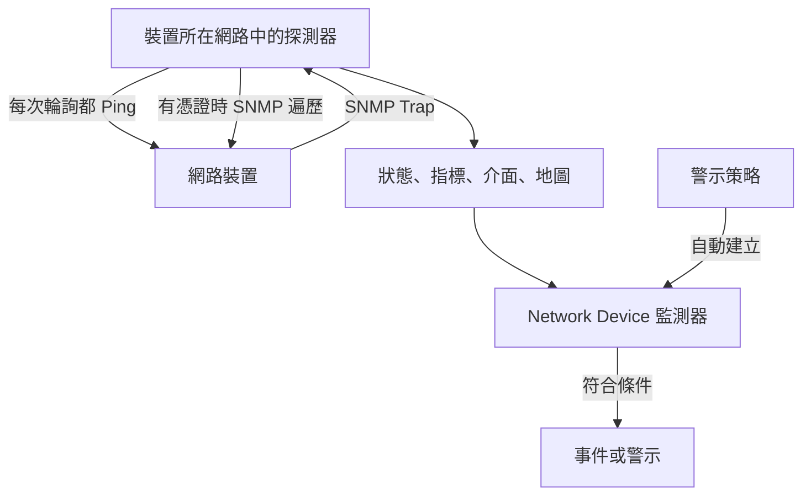
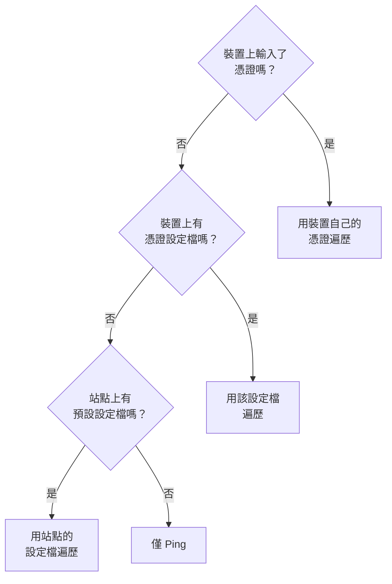
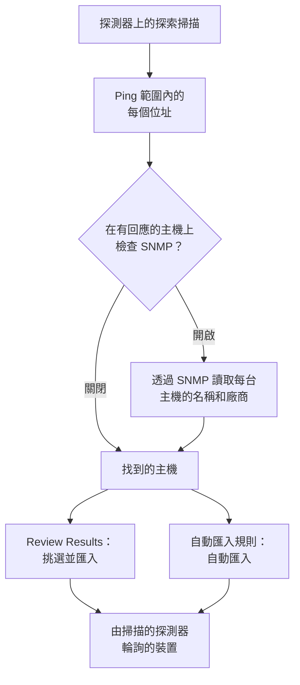
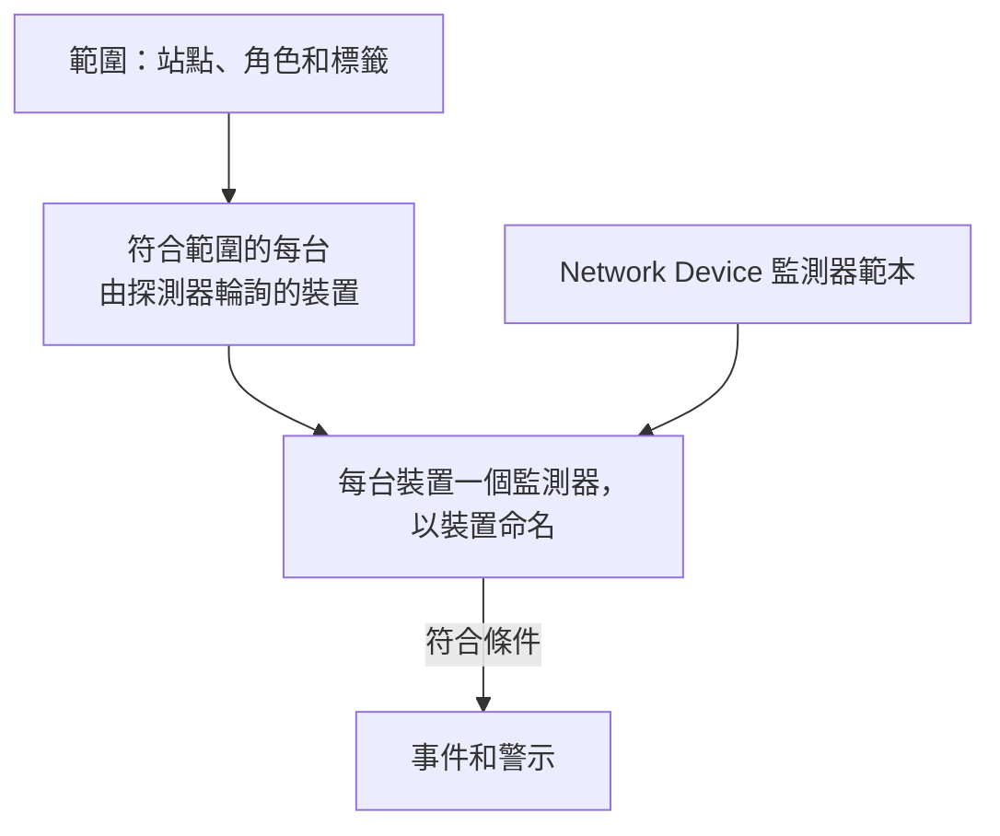
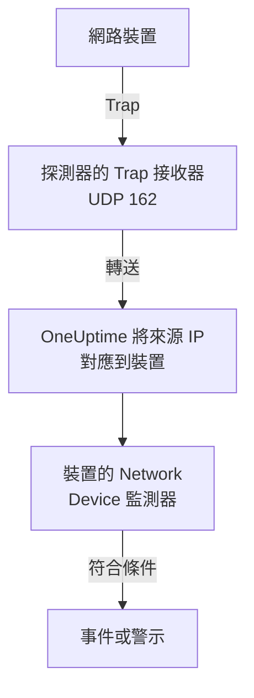

# 網路設備監控

監控交換器、路由器、防火牆、存取點、PDU、攝影機和印表機：網路上任何有位址的東西，不論它是否支援 SNMP。

以位址和探測器新增裝置後，探測器會依排程 Ping 它：裝置會得到在線或停擺狀態、在網路地圖上的位置，以及在其站點健康狀況中的一票。為它提供 SNMP 憑證後，同一個探測器還會遍歷它：介面及其中的光模組、硬體清單、LLDP 和 CDP 鄰居，以及健康 OID。新增一個監測器，或為整個裝置群新增一條警示策略，它的輪詢和 Trap 就會產生事件和警示。

:::cards
- [新增裝置](#新增網路裝置): 位址和探測器，一個頁面就完成。
- [探索網路](#透過網路掃描探索裝置): 掃描一個位址範圍，匯入有回應的主機。
- [透過 SNMP 讀取裝置](#snmp-憑證和憑證設定檔): 介面、光模組、清單和健康狀況。
- [接收警示](#警示): 單台裝置用監測器，裝置群用策略。
- [查看地圖](#網路拓撲): 即時繪製的鄰居，可匯出為 PDF。
- [排解問題](#疑難排解): 待處理的裝置、失敗的遍歷、收不到的 Trap。
:::

## 運作方式



裝置和監測器的職責不同：

| 部分 | 作用 | 何時需要 |
| --- | --- | --- |
| 裝置 | 探測器依裝置自己的排程輪詢它。每次輪詢都會記錄可達性、Ping 往返時間和封包遺失率；帶有 SNMP 憑證的輪詢還會讀取裝置的身分、介面、鄰居和健康 OID。 | 一律需要：你新增的就是裝置。 |
| 監測器 | 針對裝置的每個輪詢結果和每個 Trap 評估條件，並建立事件和警示。 | 只有需要事件和警示時。狀態、清單、圖表和地圖都不需要監測器。 |

## 開始之前

- **能到達裝置的探測器。** 探測器從它自己的網路 Ping 和遍歷裝置，所以位於私有位址的裝置需要該網路內的[自訂探測器](/docs/probe/custom-probe)：公用網際網路上的探測器無法到達它。
- **SNMP，用於 Ping 以外的資料。** 選用。需要在裝置上設定 v1 或 v2c 社群字串或 SNMPv3 使用者，並允許探測器存取 UDP 161。沒有它，裝置只會被 Ping。
- **Trap、syslog 和流。** 選用。探測器在 UDP 162 上接收 SNMP Trap，開啟後在 UDP 5140 上接收 syslog，在 UDP 2055、4739 和 6343 上接收流記錄，因此請放行從裝置到探測器的這些連接埠。

## 網路概覽

**網路 → 概覽**是網路區域的入口，它先給出答案：一句話說明你的網路是否健康；如果不健康，說明哪裡出了問題，最壞的消息排在最前面。

| 顯示的內容 | 何時 |
| --- | --- |
| **3 台裝置停擺** | 裝置的探測器或監測器無法到達它。 |
| **2 個站點需要關注** | 所有裝置都有回應，但某個站點的健康狀況不是正常運作。 |
| **5 個介面停擺** | 所有裝置都有回應，但有連接埠不通。 |
| **2 台裝置未回報其詳細資訊** | 它們回應 Ping，但 SNMP 遍歷失敗，所以介面和健康狀況沒有更新：通常是憑證問題。 |
| **正在等待首次檢查** | 裝置已新增，但探測器還沒有檢查它們。 |
| **全部 40 台裝置都在線上** | 所有裝置都有回應。仍在等待首次檢查的裝置單獨列為一行。 |

下面一行說明裝置停擺時是否有東西會建立事件：開啟了多少條[警示策略](#警示策略)，或者一條都沒有時顯示 **Set up alerts** 連結。旁邊的 **Add Device** 和 **Discover Devices** 按鈕會開啟對應的表單，下方的磚塊和清單提供細節：需要關注的裝置和站點、依廠商劃分的裝置群，以及最近的掃描。

在新增任何內容之前，概覽會改為顯示兩種入門方式：**探索裝置**掃描一個位址範圍，讓你挑選要新增的內容，最適合整個網路或新站點；**新增單一裝置**依 IP 位址或主機名稱新增一台裝置。

網路選單讓你每天開啟的頁面一直可見：**概覽**、**Devices**、**站點**、**Map**、**Traffic** 和 **Discovery**。其餘頁面收合在各區段中，開啟區段中的任一頁面時該區段會自動展開：

| 區段 | 頁面 |
| --- | --- |
| **拓撲** | **Device Topology**、**端點**、**Latency Matrix**、**Site Links**、**Device Links** |
| **規則** | **Auto Import Rules**、**Site Assignment Rules**、**擁有者規則**、**標籤規則**、**Link Rules** |
| **設定** | **Alert Policies**、**SNMP 憑證**、**Device Roles**、**Site Types**、**OID Collection Templates** |
| **進階** | **Archived Devices** |

## 新增網路裝置

:::steps
### 開啟 Devices 清單
前往**網路 → Devices**，按一下 **Add Device**。網路**概覽**上的 **Add Device** 也會開啟同一個表單。

### 輸入裝置位址
在**主機名稱**中輸入它的 IP 位址或主機名稱。**名稱**留空時，裝置會以主機名稱命名。

### 檢查站點和探測器
如果你使用站點，請選擇裝置所在的 **Site**。**探測器**會自動填入站點的預設探測器，或專案唯一的自訂探測器；請確認它能到達該裝置。

### 新增裝置
按一下 **Add Device**。幾分鐘內探測器就會 Ping 該裝置，其狀態會變為 **Up** 或 **Down**。有 SNMP 憑證時，首次遍歷成功後，概覽中還會填入裝置的身分、介面和健康狀況。
:::

表單只有一頁（主機名稱、名稱、站點和探測器），下方收合著 **SNMP** 和**更多欄位**。它不會詢問裝置要如何監控：你新增的每台裝置都由其探測器輪詢，少數需要的裝置可以在裝置的**設定**頁面上使用[綁定監測器覆寫](#綁定監測器覆寫)。

裝置的詳細資料（名稱、描述、角色、站點、標籤和位址）之後在一個地方編輯：裝置**設定**頁面上的 **Device Settings** 卡片。概覽上的**裝置詳細資料**卡片會顯示這些資訊，並附有**在設定中編輯**連結。

### 裝置

| 欄位 | 說明 | 必填 |
| --- | --- | --- |
| 主機名稱 | 探測器 Ping 的 IP 位址或主機名稱，裝置有憑證後也會透過 SNMP 遍歷它。 | 是 |
| 名稱 | 好記的名稱，例如 core-switch-01。留空時以主機名稱命名。API 也一樣：不帶名稱建立的裝置會以主機名稱命名。 | 否 |
| Site | 裝置所在的[網路站點](/docs/monitor/network-sites)。站點的健康狀況由其裝置彙總而來，設有預設探測器的站點會填入下方的探測器。 | 否 |
| 探測器 | Ping 此裝置、有憑證時透過 SNMP 遍歷它，並接收其 Trap、syslog 和[流記錄](/docs/monitor/network-traffic)的探測器。它必須能直接到達裝置：公用網際網路上的探測器無法到達私有位址。 | 是 |

**探測器**會盡可能自動填入：只有一個自訂探測器的專案會預設使用它，選擇站點後會換成[站點的預設探測器](/docs/monitor/network-sites#監控預設值)。它絕不會覆寫你自己選擇的探測器。在站點上設定預設探測器後，只憑位址就能新增裝置。

### 更多欄位（收合）

| 欄位 | 說明 | 必填 |
| --- | --- | --- |
| 描述 | 自由文字。 | 否 |
| Device Role | 核心交換器、存取交換器、防火牆等。它決定裝置在地圖上的層級，並限定警示策略的範圍。 | 否 |
| MAC 位址 | 裝置自己的 MAC。對於既不支援 LLDP 也不支援 CDP 的裝置，地圖會用它把裝置放到學到該 MAC 的交換器連接埠上；請參閱[僅 Ping 裝置及其交換器連接埠](#僅-ping-裝置及其交換器連接埠)。通常會從路由器的 ARP 表中自動學到。 | 否 |
| 同時建立用於事件的 Ping 監測器 | 探測器已經在 Ping 裝置並為它提供狀態；把失敗的 Ping 變成事件的是 Ping 監測器。勾選後，儲存時會在主機名稱上建立一個監測器並綁定到裝置。它會計入你的方案，而且在你從監測器頁面開啟之前，它的事件處於關閉狀態。 | 否 |

勾選 Ping 監測器核取方塊會顯示 **Ping from probes**，也就是監測器自己的探測器。它們必須能到達裝置的網路；留空則使用專案的預設探測器。若要一次為多台裝置設定警示，請改用[警示策略](#警示策略)。

### SNMP（收合，選用）

保持收合時裝置只會被 Ping：收合的區段會用一句話說明這一點。裝置仍會在首次輪詢時取得狀態，仍位於其站點和地圖上，但在有憑證之前沒有介面、清單或健康 OID。展開該區段即可輸入社群字串或 v3 使用者，或選擇已儲存的憑證設定檔。

:::tabs
@tab SNMP v1 / v2c
| 欄位 | 說明 | 必填 |
| --- | --- | --- |
| SNMP 版本 | V1、V2c 或 V3。 | 是，預設 V2c |
| SNMP Community String | v1 或 v2c 社群字串，例如 `public`。 | 否：留空表示僅 Ping |
| SNMP Port | 代理程式監聽的 UDP 連接埠。 | 否，預設 161 |
| SNMP Credential Profile | 已儲存的憑證組，用來取代在此處輸入憑證。 | 否 |
@tab SNMPv3
| 欄位 | 說明 | 必填 |
| --- | --- | --- |
| SNMP v3 Security Level | No Auth, No Priv；Auth, No Priv；或 Auth, Priv。 | 是 |
| SNMP v3 Username | 裝置上設定的安全名稱（使用者）。 | 是：留空表示僅 Ping |
| SNMP v3 Authentication Protocol | MD5、SHA、SHA-256 或 SHA-512。 | 使用驗證時 |
| SNMP v3 Authentication Key | 驗證密碼片語。 | 使用驗證時 |
| SNMP v3 Privacy Protocol | DES、AES 或 AES-256。 | 使用加密時 |
| SNMP v3 Privacy Key | 隱私（加密）密碼片語。 | 使用加密時 |
:::

在裝置上輸入的憑證優先於在旁邊選擇的憑證設定檔，裝置所在的站點也可以帶有預設設定檔。設定檔上的憑證會靜態加密。輸入到裝置上的憑證受相同的讀取權限保護，但不會靜態加密：這是把共用憑證放在設定檔中的又一個理由。

## 一次變更多台裝置

對客戶網路的一次探索掃描會帶進幾十台裝置，它們屬於同一個站點、共用一個角色、來自同一個廠商。你不必逐台開啟：在 **Devices** 清單中勾選列，或選取篩選條件符合的所有裝置，然後開啟**批次動作**。

| 動作 | 作用 |
| --- | --- |
| **設定站點** / **清除站點** | 把所有選取的裝置移到你選擇的站點，它們會計入該站點的健康狀況；沒有自己探測器的裝置會使用站點的預設探測器。**清除站點**會把它們移出所在站點。被站點指派規則比對到的裝置會在下次輪詢時回到規則指定的站點，所以對於探索會持續找到的裝置，請改為在**網路 → 規則 → Site Assignment Rules** 下新增規則；**設定站點**對話方塊中有前往該處的連結。 |
| **設定裝置角色** / **清除裝置角色** | 為所有選取的裝置設定同一個角色，例如二十台都是「Access Switch」的交換器。角色是專案自己的，位於**網路 → 設定 → Device Roles** 下，對話方塊中有前往該處的連結。**清除裝置角色**會根據每台裝置的 SNMP 身分重新判斷其角色。 |
| **套用廠商範本** | 把一個[廠商範本](#廠商健康範本)的健康 OID 和 SNMP 表格新增到所有選取的裝置。對話方塊中的第一個選項**依每台裝置的廠商比對**會根據每台裝置的 SNMP 遍歷結果選出它自己的範本，因此混合的選取也能在每台裝置上得到正確的範本；也可以為所有裝置選擇同一個範本。 |

每個動作都是針對整個選取的一個對話方塊、一次儲存，每台裝置都要經過與在其自己的設定頁面上編輯時相同的檢查：權限、你的角色的標籤和擁有者範圍，以及裝置可收集內容的上限。

**套用廠商範本**在執行任何動作之前會先顯示它將做什麼：多少台裝置會得到哪個範本，多少台會被略過以及原因。它只在每台裝置已收集的內容上新增，不移除任何內容，已經擁有範本中全部內容的裝置不會被重寫。它會略過由監測器支援的裝置（沒有東西輪詢它）、連結到 [OID Collection Template](#oid-收集範本) 的裝置（由範本決定它收集什麼，因此請把廠商的 OID 加到那裡），以及在比對模式下尚未透過 SNMP 遍歷或其廠商沒有範本的裝置。

動作完成後，它會列出多少台裝置已變更、哪些失敗以及原因（你的角色無權編輯的裝置、超出上限的清單），以及哪些沒有變更以及原因：已在該站點或角色中的裝置，或廠商範本略過的裝置。

其他批次動作在各自所屬的位置介紹：**Set OID Collection Template** 請見 [OID 收集範本](#oid-收集範本)，**Set SNMP Credential Profile**、**Switch to Probe Polling** 和 **Create Ping Monitors** 請見[批次處理](#批次處理)，**Shorten Names to Hostname** 請見[探索到的裝置如何命名](#探索到的裝置如何命名)。

## 一次輪詢實際做了什麼

對由探測器輪詢的裝置，每次輪詢都是一次 Ping。當裝置有可用的 SNMP 憑證時，探測器還會執行一次完整的 SNMP 遍歷。兩者並行執行，遍歷從不等待 Ping，所以位於會丟棄 ICMP 的 ACL 後方的 SNMP 裝置仍會回報 **Up**。

| 結果 | 僅 Ping 裝置 | 有 SNMP 憑證的裝置 |
| --- | --- | --- |
| 狀態（Up 或 Down） | 來自 Ping | 來自 Ping 或遍歷：任一方有回應即可 |
| Ping 往返時間和封包遺失率 | 記錄為裝置指標 | 記錄為裝置指標 |
| SNMP 回應時間 | — | 遍歷的時間，絕不是 Ping 的時間 |
| 介面、鄰居、端點 | — | 來自成功的遍歷 |
| 系統身分、廠商、型號、序號 | — | 來自成功的遍歷 |
| 健康 OID 和 SNMP 表格 | — | 來自成功的遍歷 |

可用的憑證是指透過[憑證鏈](#snmp-憑證和憑證設定檔)找到的、帶有社群字串的 v1 或 v2c 憑證組，或帶有使用者名稱的 v3 憑證組。空的憑證組會被略過，因此裝置絕不會用猜測的預設社群字串去遍歷。

封包遺失率沿用 [Ping 監測器](/docs/monitor/ping-monitor)的序列，所以在整個產品中讀法一致。往返時間有自己的序列 `oneuptime.monitor.ping.round.trip.time`，因為在網路裝置上，一般的回應時間是 SNMP 遍歷的時間。裝置的**指標**頁面會繪製介面使用率和健康 OID 的圖表；最近一小時的往返時間繪製在地圖上裝置的詳細資料面板中。

### "SNMP failing" 不等於 "Down"

回應 Ping 但遍歷失敗的裝置是 **Up**，並帶有 **SNMP failing** 標記，兩部分都很重要：

- 它是 Up，因為該位址上有東西在回應。把它標成紅色，會把一台運作良好的裝置計入你的事件數。
- 它是 SNMP failing，因為它的介面、清單和健康 OID 已停止更新，幾乎總是由於憑證、被停用的 SNMP 代理程式或 ACL。頁面上沒有其他任何東西會告訴你這些數字已經凍結。

Ping 和遍歷都失敗的裝置就是 **Down**，所以這個標記只會出現在綠色徽章旁邊。

### 解讀裝置狀態

所有顯示裝置的地方（Devices 清單、站點的 Devices 頁面、概覽、地圖）都使用相同的三種判定，以及旁邊相同的限定標記。

| 判定 | 意義 |
| --- | --- |
| **Up** | 上一次輪詢（Ping 或 SNMP）或綁定的監測器到達了裝置。 |
| **Down** | 上一次輪詢（Ping 或 SNMP）或綁定的監測器無法到達裝置。 |
| **待處理** | 尚無判定：從未輪詢過、未指派探測器，或未綁定監測器。 |

| 限定標記 | 何時顯示 | 怎麼做 |
| --- | --- | --- |
| **Stale** | 遠超過裝置的間隔時間都沒有嘗試輪詢。 | 檢查裝置的探測器是否在線上，並且跟得上它負責的裝置群。 |
| **No probe** | 裝置由探測器輪詢，但沒有探測器，或其輪詢已關閉。 | 指派一個能到達它的探測器；在此之前沒有東西輪詢它。 |
| **No monitor** | 裝置使用[綁定監測器覆寫](#綁定監測器覆寫)，但沒有綁定任何監測器。 | 綁定一個監測器，或把它切換回探測器輪詢。 |
| **SNMP failing** | Ping 顯示 Up，但上一次 SNMP 遍歷失敗。 | 檢查憑證、SNMP 代理程式或 ACL。 |

**Devices** 清單有一個 **SNMP** 篩選器，有三個值：**OK**（上次遍歷成功）、**Failing**（上次遍歷失敗）和 **Not configured**（僅 Ping、沒有憑證或從未輪詢）。「哪些裝置的憑證失效了」只需按一下。對於只被 Ping、從未被遍歷的裝置，清單的 **Interfaces (Up / Down)** 欄會顯示 **No SNMP** 而不是 `0 / 0`：沒有可用的連接埠是另一種說法，而且是錯誤的說法。

## SNMP 憑證和憑證設定檔

裝置會使用依下列順序找到的第一個可用憑證組進行遍歷，找到第一個就停止搜尋：



站點這一步只讀取裝置自己的站點，不再往上：Unit 中的裝置不會沿用其上層 Region 上設定的設定檔。站點的預設探測器則會沿著樹往下傳遞，因為探測器只在裝置上複製一次，而憑證在每次輪詢時都會重新讀取；詳情請見[網路站點](/docs/monitor/network-sites#監控預設值)。

### SNMP 憑證頁面

**網路 → 設定 → SNMP 憑證**存放專案的憑證設定檔。一個設定檔是一組具名的憑證（v1 或 v2c 社群字串，或帶有安全層級、協定和金鑰的 v3 使用者），任意數量的裝置和站點都可以指向它。裝置上不會複製任何內容，所以輪替社群字串只需在這裡編輯一次，使用該設定檔的每台裝置都會在下次輪詢時取得新值。

設定檔上的機密會靜態加密，只有可以讀取裝置自身憑證的角色才能讀取它們。顯示其設定檔的裝置或站點只會顯示設定檔的名稱和版本，絕不顯示其機密。

仍被裝置或站點指向的設定檔無法刪除：刪除會被拒絕，並列出阻礙刪除的項目數量。先把這些裝置和站點移到另一個設定檔，或清除它們上的設定檔，然後再刪除。

### 把裝置改回僅 Ping 裝置

在裝置的**設定**頁面上，**編輯設定**的 **SNMP 憑證**步驟中有一個 **Ping only — clear this device's own SNMP credentials** 核取方塊。儲存時它會清除裝置自己的社群字串和 v3 使用者名稱。之所以有它，是因為該清空哪個欄位並不明顯：只要 v3 裝置的使用者名稱還在，不論你清空其他什麼，它都仍可被遍歷。

清除裝置自己的憑證不會清除設定檔。如果裝置或其站點仍指定了設定檔，裝置會繼續用它遍歷；若要讓裝置只被 Ping，請一併清除設定檔。

### 批次處理

在 **Devices** 清單中選取裝置，然後使用：

- **Set SNMP Credential Profile** / **Clear SNMP Credential Profile**：為選取的裝置附加或移除設定檔。
- **Switch to Probe Polling**：用於使用綁定監測器覆寫的裝置。選擇一個探測器後，每台選取的裝置從此依排程被 Ping，有憑證後也會被遍歷。已經綁定的監測器保持綁定；裝置的狀態現在來自探測器。
- **Create Ping Monitors**：針對使用綁定監測器覆寫的裝置，在每台裝置的主機名稱上建立一個 Ping 監測器並綁定它，讓裝置顯示 Up 或 Down。

當專案中有使用綁定監測器覆寫但沒有綁定任何監測器的裝置（沒有東西輪詢、也沒有東西回報的裝置）時，**Devices** 頁面會顯示一則橫幅，並連結到可修正它們的選取。

## 站點監控預設值

[網路站點](/docs/monitor/network-sites#監控預設值)為其中的裝置提供兩個預設值。它的 **Default Probe** 會複製到在該站點中建立、或移入該站點且沒有自己探測器的裝置上。它的 **Default SNMP Credential Profile** 會在每次輪詢該站點中沒有自己憑證的裝置時被讀取。在站點上設定這兩項後，那裡的裝置只憑位址就能新增，並從首次輪詢起被 Ping 和遍歷。站點指南說明了每個預設值沿著站點樹往下傳遞多遠。

## 綁定監測器覆寫

有些裝置是探測器無法到達或 Ping 沒有意義的：NAT 後方的裝置、更適合用 HTTP 檢查判斷健康狀況的設備、真正訊號是連接埠檢查的服務。對於這些裝置，裝置**設定**頁面上的**編輯設定**中有一個 **Monitoring Method**：

| 方式 | 意義 |
| --- | --- |
| **探測器** | 預設值。由指派的探測器依排程 Ping，有憑證時透過 SNMP 遍歷。 |
| **Bound monitor** | 一個現有監測器的狀態就是此裝置的狀態。 |

把裝置切換為 **Bound monitor** 會停止輪詢它。探測器、間隔和輪詢開關會從 **Polling & Data Collection** 卡片中移除，裝置舊的輪詢結果會被清除，其狀態來自你綁定的監測器。綁定是選用的：在你綁定之前，裝置會顯示為**待處理**，並帶有 **No monitor** 標記。

切換回**探測器**會恢復輪詢並要求選擇探測器。之前綁定的監測器保持綁定並繼續發出警示；它只是不再決定裝置的狀態。

大多數裝置不需要這樣做。每台由探測器輪詢的裝置都已經有可達性狀態，因此不需要為了取得狀態而綁定 Ping 監測器；當你需要那個監測器的事件時才綁定監測器。

## 輪詢與資料收集

輪詢設定位於裝置**設定**頁面的 **Polling & Data Collection** 卡片上（**編輯Polling**）。預設值適合新裝置，因此不需要調整：

| 設定 | 說明 | 預設值 |
| --- | --- | --- |
| 探測器 | 輪詢裝置的探測器。 | 新增裝置時設定 |
| Polling Enabled | 探測器依下方的排程輪詢裝置。關閉它可以暫停輪詢而不刪除裝置。 | 開啟 |
| Polling Interval (Minutes) | 探測器輪詢裝置的頻率。至少 1 分鐘。 | 5 |
| Walk Interfaces | 每次輪詢時遍歷介面表（IF-MIB）：每個連接埠的狀態、頻寬、使用率和錯誤，以及用於地圖的 LLDP 和 CDP 鄰居。 | 開啟 |
| Collect Connected Endpoints | 另外遍歷 ARP 表和橋接轉送表，找出接在裝置上的東西：POS 終端機、印表機、電話、筆記型電腦。從 ARP 表中還會填入註冊在這些位址上的裝置的 MAC 位址。每次輪詢會多出幾次遍歷。 | 關閉 |
| OID Collection Template | 裝置收集的一個共用、具名的 OID 清單。編輯範本會在下次輪詢時改變每台連結的裝置。 | 無 |
| Device-Specific Health OIDs | 在範本的 OID 之外，僅此裝置收集的額外 OID。 | 無 |
| Auto-Apply Vendor Health Template | 當辨識出裝置的廠商且其自己的 OID 清單為空時，在下次輪詢時用廠商的範本填入該清單。 | 關閉；探索匯入的裝置為開啟 |
| Device-Specific SNMP Tables | 在範本的表格之外，僅此裝置遍歷的額外 [SNMP 表格](#snmp-表格)。與範本表格鍵相同的表格會在此裝置上取代它。 | 無 |

從 **Walk Interfaces** 往下的所有設定都需要 SNMP 憑證：在僅 Ping 裝置上，這些設定會被保留，但沒有遍歷可以套用。

### 介面遍歷

開啟 **Walk Interfaces** 並找到憑證後，每次輪詢都會追蹤每個介面的運作狀態和管理狀態、輸入和輸出位元、使用率和錯誤。同一次遍歷還會為地圖收集 LLDP 和 CDP 鄰居。

在裝置的 **Interfaces** 頁面上將介面設為靜音（例如實驗用的連接埠或刻意拔掉的連結），它會保留在清單中，但不再參與警示和指標。失敗的遍歷絕不會只清除一半已收集的內容：上一次的介面快照會保留，裝置會被標記為 **SNMP failing**，這樣就沒有人會把它誤認為最新的。

### 廠商健康範本

在 **Health OIDs** 編輯器中，**Vendor Health Template** 會套用一組為裝置廠商預先建立的 OID。許多範本還附帶 [SNMP 表格](#snmp-表格)，可在 **SNMP Tables** 編輯器中透過 **Add a Vendor's Tables** 新增。

| 廠商範本 | 健康 OID | SNMP 表格 |
| --- | --- | --- |
| Generic (Host Resources MIB) | CPU 負載、總 RAM 和可用 RAM、平均負載 | CPU 核心（每個核心一列，不論平台如何編號） |
| Arista EOS | CPU 負載、平均負載、總 RAM 和可用 RAM | — |
| Cambium Networks cnMatrix | CPU、RAM、快閃記憶體、溫度、供電電壓 | 風扇、PoE 連接埠、備援電源供應器 |
| Cambium Networks Enterprise Wi-Fi (cnPilot, XV, XE, XH) | CPU、可用記憶體、Wi-Fi 用戶端、cnMaestro 連線 | Wi-Fi 射頻（頻段、頻道、頻寬、發射功率、用戶端、雜訊底限、空中時間、狀態）、SSID |
| Cisco IOS / IOS-XE | CPU、已用和可用記憶體、溫度、風扇狀態、電源供應器狀態 | — |
| Dell Force10 / OS9 | CPU、記憶體 | — |
| Extreme Networks EXOS / Switch Engine | CPU、溫度、過熱警報、電源狀態 | 電源供應器、風扇、每個插槽的記憶體、堆疊成員 |
| Extreme Networks Fabric Engine / VOSS | vIST 工作階段、I-SID 數量 | 依鄰居命名的 Fabric（IS-IS）相鄰關係、每個插槽的 CPU 和記憶體、溫度感測器、風扇、電源供應器 |
| Extreme Networks IQ Engine (HiveOS) Access Points | CPU、記憶體、Wi-Fi 用戶端、溫度 | Wi-Fi 射頻（頻道、發射功率、雜訊底限）、SSID |
| Extreme Networks Wireless Controller (XIQ-C, ExtremeWireless) | 存取點、作用中的存取點、Wi-Fi 用戶端 | 存取點（狀態、用戶端、位址、軟體）、Wi-Fi 射頻（頻段、頻道、頻寬、雜訊底限、忙碌空中時間）、WLAN（SSID、用戶端） |
| Fortinet FortiGate | CPU、記憶體、磁碟 | — |
| HPE / Aruba ProCurve | CPU、總記憶體和可用記憶體 | — |
| HPE Aruba Instant (AOS 8) | 叢集名稱、韌體版本、主控（conductor） | 存取點（狀態、型號、CPU、記憶體）、依存取點命名的 Wi-Fi 射頻（頻道、發射功率、雜訊底限、使用率、用戶端、狀態）、SSID（用戶端） |
| HPE Aruba Mobility Controller (AOS 8) | 存取點、Wi-Fi 用戶端、控制器角色 | 存取點（狀態、型號、AP 群組）、依存取點命名的 Wi-Fi 射頻（頻段、頻道、發射功率、使用率、用戶端、模式）、SSID（用戶端、上線和停擺的存取點）、處理器、記憶體 |
| Huawei VRP | CPU、記憶體、溫度 | — |
| Juniper Junos | CPU、記憶體緩衝區、溫度 | — |
| MikroTik RouterOS | CPU 負載、溫度、電壓 | — |
| Palo Alto PAN-OS | 管理平面 CPU、工作階段使用率、作用中工作階段 | — |
| Sophos Firewall (SFOS / XGS) | 記憶體、磁碟、交換空間、HA 狀態和對端狀態、IPsec 服務、CPU 溫度（SFOS v22 及更新版本） | IPsec 通道（狀態需要 SFOS v20 及更新版本）、CPU 核心 |
| TP-Link Omada Access Points (EAP) | Wi-Fi 用戶端 | — |
| Ubiquiti EdgeOS / EdgeSwitch / UniFi Switches | CPU 負載、總 RAM 和可用 RAM | — |
| Ubiquiti UniFi Access Points | 隔離狀態、平均負載、總 RAM 和可用 RAM | Wi-Fi 射頻（頻段、空中時間）、SSID（頻段、頻道、用戶端、發射功率、連線品質）、CPU 核心 |

範本的 OID 會複製到裝置自己的清單中，你可以在那裡刪減或擴充。首次遍歷辨識出廠商後，裝置頁面會建議相符的範本。比對時會讀取裝置的 `sysObjectID`，在一個企業編號下有兩個作業系統時還會讀取其 `sysDescr`：執行在通用硬體上的 Extreme Fabric Engine 回報的企業編號（1916）與 EXOS 相同，只有其描述（`…-FabricEngine (9.0.4.0)`）能區分兩者。UniFi 存取點也以同樣方式與 Ubiquiti 的路由器區分（`U6-Pro 6.6.50.15098`），舊韌體使用 Net-SNMP 的 arc 回應時也是如此；IQ Engine 存取點則以同樣方式與共用其 arc 的 Aerohive 交換器區分（`AP230, HiveOS 8.2r1`）。

開啟 **Auto-Apply Vendor Health Template** 的裝置會在首次輪詢時取得範本的 OID 和表格：自動匯入規則帶進的裝置，以及從 **Review Results** 匯入且開啟了廠商範本開關的裝置（除非你關閉，否則該開關是開啟的）。若要一次為多台裝置套用範本（例如在該開關出現之前探索到的裝置群），請在 **Devices** 清單中選取它們並使用**套用廠商範本**（請參閱[一次變更多台裝置](#一次變更多台裝置)）。

套用廠商範本是一次性的複製，所以範本變更時不會傳遞任何內容。對於不只一台裝置的情況，請改用 **OID Collection Template**；建立時會提供廠商範本作為起點。

### OID 收集範本

**OID Collection Template**（**網路 → 設定 → OID Collection Templates**）是一份具名的 OID 清單，通常以裝置類型命名，例如「Cisco Catalyst 9300」，任意數量的裝置都可以連結到它。連結是即時的，而不是複本：裝置的 OID 清單在每次輪詢時組合，因此編輯範本會在下次輪詢時改變每台連結裝置收集的內容，不需要同步步驟。

建立之前，先確認你需要它。每個連接埠的輸入和輸出位元、運作狀態、使用率和每秒錯誤數，在每次輪詢時都會為每個連接埠收集，完全不需要 OID（請參閱[介面遍歷](#介面遍歷)），而且已經可以依連接埠設定警示。範本用於不是依連接埠的資料：CPU、記憶體、溫度、風扇、電源供應器、BGP 對等。

如果你從 Zabbix 移轉過來：

| Zabbix | OneUptime |
| --- | --- |
| 範本 | OID Collection Template |
| 監控項目 | 該範本上的一個 OID |
| 帶有監控項目原型的「Network interfaces by SNMP」探索規則 | 對介面計數器內建且一律開啟：不需要撰寫任何內容 |
| 觸發器 | 監測器條件 |
| 觸發器原型，每個探索到的介面一個 | 將**介面**設為 `*` 的條件，會依連接埠展開 |
| 針對任何其他 SNMP 表格（通道、射頻、風扇）的帶有監控項目原型的探索規則 | 範本上的 [SNMP 表格](#snmp-表格) |
| 針對此類表格的觸發器原型 | 將 **Row** 設為 `*` 的 SNMP Table Value 或 SNMP Table Row Is Unhealthy 條件 |
| 主機群組 | 標籤 |
| 「主機探索時連結範本」動作 | 自動匯入規則的 **OID Collection Template** |
| 針對主機群組的動作（「對每台交換器發出警示」） | [警示策略](#警示策略) |

範本上的 OID 依原樣收集，所以指向表格中某一列的 OID（`…ifSpeed.3`）只會收集那一列，不論輪詢當天索引 3 上是什麼。凡是清單形式的資料（通道、射頻、風扇、鄰居）都應放在 [SNMP 表格](#snmp-表格)中，它會遍歷每一列，並隨著列的出現和消失而追蹤。依連接埠的介面資料兩者都不需要：介面遍歷會把運作狀態、每秒輸入和輸出位元、使用率以及合併的每秒錯誤率記錄為序列。依方向的錯誤、捨棄、管理狀態和連結速率會進入裝置的介面清單，但不是序列，無法設定警示。

連結裝置有三種方式，對於探索會持續找到的裝置群，第三種最重要：

- 一次一台，在裝置的 **Polling & Data Collection** 卡片上。
- 批次，在 **Devices** 清單中選取裝置並使用 **Set OID Collection Template**。清單的 **Template** 欄會顯示哪些裝置連結到了什麼。
- 自動，在自動匯入規則上設定 OID Collection Template，讓掃描匯入的每台裝置在建立時就被連結。

裝置會先收集範本的 OID，再收集它自己的 **Device-Specific Health OIDs**。兩者指定同一個 OID 時只收集一次，以裝置的名稱和描述為準；範本項目保持其位置，因此裝置專屬的新增項目永遠不會把它們擠出去。

| 上限 | 值 |
| --- | --- |
| 裝置輪詢的健康 OID | 200 |
| 範本上的 OID | 150 |
| 已連結裝置自己的 OID | 50 |
| 未連結裝置自己的 OID | 200 |

這些上限會相加，所以已連結的裝置輪詢的 OID 永遠不會超過 200 個。超出時會在儲存時出現驗證錯誤，而不會在輪詢時被悄悄截斷；連結一台自己已有超過 50 個 OID 的裝置會被拒絕，並顯示需要移除多少個的訊息。

仍有裝置連結的範本無法刪除。請先取消連結，例如使用 **Clear OID Collection Template** 批次動作，這樣刪除就永遠不會悄悄停止整個裝置群的收集。

### 自訂 OID

在範本上或作為裝置專屬的新增項目，加入你希望每次輪詢都收集的任何 OID：

| 欄位 | 說明 | 必填 |
| --- | --- | --- |
| OID | 數字形式的 OID，例如 1.3.6.1.2.1.1.1.0。 | 是 |
| 名稱 | OID 的好記名稱，例如 sysDescr。 | 否 |
| 描述 | 該 OID 代表什麼。 | 否 |

收集到的值會在裝置的**指標**頁面上繪製成圖表，**SNMP OID Value** 和 **SNMP OID Exists** 條件會根據它們發出警示。這些條件上的 OID 選擇器會列出選取的裝置收集的 OID（包括其範本的和它自己的），所以不需要手動輸入。

長的 OID 清單會拆分成多個 SNMP GET 要求，讓每個要求都能放進一個 UDP 資料包。如果你因為舊版本把回應 `tooBig` 的裝置回報為離線而讓 OID 清單保持簡短，現在已經不需要了。

### SNMP 表格

裝置知道的一些資訊是清單：每個 IPsec 通道、Wi-Fi 射頻、SSID、Fabric 鄰居、風扇或電源供應器各一列。SNMP 表格由其欄定義，每次輪詢都會遍歷每一列，所以新增、重新命名或刪除的通道都會被追蹤，不需要任何人編輯。

| 欄位 | 作用 |
| --- | --- |
| 名稱和鍵 | 表格的名稱。鍵（字母、數字和底線，留空時由名稱產生）供條件、指標和範本變數使用，因此重新命名表格永遠不會破壞警示。 |
| 種類 | 列是什麼：VPN 通道、Wi-Fi 存取點、Wi-Fi 射頻、Wi-Fi SSID、路由鄰居、硬體或一般。Wi-Fi 種類會為裝置的 [Wi-Fi 頁面](#wi-fi-分頁)提供資料。 |
| 欄 | 要收集的欄 OID（表格項目的 OID 加上欄號，例如 Sophos 通道狀態的 `1.3.6.1.4.1.2604.5.1.6.1.1.1.1.9`），每一欄都有名稱，並可選擇設定單位、角色（狀態、頻段、頻道、頻道頻寬、發射功率、用戶端、雜訊底限、使用率、SSID）、值標籤和健康值。 |
| 列名稱 | 選用的欄，其值用來為每一列命名，例如通道的連線名稱。沒有它們時，列以索引命名。名稱可以來自共用相同索引的同層表格（Fabric Engine 用 `rcIsisAdjHostName` 為 IS-IS 相鄰關係命名），也可以來自其索引是此表格索引開頭部分的上層表格（Aruba Instant 用存取點的名稱為每個射頻命名）。以名稱為索引的表格（ArubaOS 以 SSID 作為其 SSID 表格的索引）會以解碼後的索引命名。 |
| 列數上限 | 保留多少列：預設 100，最多 250。 |

數字會當作數字讀取，以數字開頭的文字也會當作該數字讀取（`"36"`、`"-95 dBm"`、`"80MHz"`），因為很多廠商會把數字放在字串裡。對於只是看起來像數字的值，請把欄的值類型設為 **Text only**。**Value labels** 會把代碼變成文字（`0=inactive, 1=active`）：用於繪圖和比較的仍是原始值，顯示的是標籤。**Healthy values**（`1`）說明哪些值代表一切正常：它們會為裝置 **SNMP Tables** 頁面上的列上色，並驅動 **SNMP Table Row Is Unhealthy** 條件。

有些廠商範本的欄還會對讀取的數字進行**調整**，用於以自身單位儲存數值的 MIB：ArubaOS 回報的發射功率是兩倍（讀取值 × 0.5），Aruba Instant 回報的雜訊底限不帶正負號（× −1），Aerohive 回報的雜訊底限加了 256（− 256），Extreme 的控制器以 20 MHz 為級距回報頻道頻寬（× 20）。顯示、繪圖和比較使用的是調整後的數字，所以 **Noise Floor Greater Than -80** 在每個廠商上意義都相同，表格編輯器會在欄下方顯示這項換算。

表格來自 [OID Collection Template](#oid-收集範本)，由每台連結的裝置共用（最多 10 個表格），或來自裝置本身的 **Device-Specific SNMP Tables**（再多 10 個）。它們在每次輪詢時依鍵合併，範本優先，鍵相同的裝置表格會取代範本的表格。兩個編輯器都提供 **Add a Vendor's Tables**。

探測器把每一欄當作子樹遍歷，在裝置上所有表格共用的 30 秒時間預算內完成。無法遍歷的表格會說明原因，且絕不會讓輪詢失敗：裝置的 **SNMP Tables** 頁面會保留上一次正常的列，並說明最近一次遍歷失敗；而條件只判斷這次遍歷的結果，因此逾時永遠不會被當作空表格。每個數值儲存格都會記錄為指標 `oneuptime.monitor.snmp.table.value`，帶有屬性 `snmpTableKey`、`snmpTableName`、`snmpTableColumn`、`snmpTableColumnOid`、`snmpTableRow` 和 `snmpTableRowIndex`，所以儀表板可以繪製每條通道的狀態或每個射頻的發射功率，Metrics 監測器也可以依 `snmpTableRow` 分組。

### Wi-Fi 分頁

遍歷結果中包含 Wi-Fi 表格（存取點、射頻或 SSID，由 Wi-Fi 廠商範本帶來）的裝置會有一個 **Wi-Fi** 頁面。頁面開頭是在線上的存取點（控制器上）、開啟的射頻、用戶端和 SSID，接著列出控制器管理的每個存取點及其狀態、射頻和用戶端；每個射頻及其頻段、頻道、頻率、頻道頻寬、發射功率、用戶端、雜訊底限和空中時間；以及每個 SSID 及其頻段和用戶端。欄依其角色尋找，所以任何為欄標註了角色的廠商表格都會以相同方式顯示。

各廠商拆分這些資訊的方式不同，頁面會把它們重新組合起來：

- 頻率根據頻段和頻道，依 802.11 頻道規劃（2.4、5 和 6 GHz）計算得出。在 MIB 中標示為頻道的位置卻回報頻率的控制器（Extreme 的）會被反過來讀取。
- 不回報頻段的射頻依其頻道歸類：1 到 14 是 2.4 GHz，32 到 177 是 5 GHz，只有 6 GHz 使用的編號（37、53、181……）是 6 GHz。
- UniFi 依 SSID 回報頻道、發射功率和用戶端：射頻會從其頻段上的 SSID 取得這些值。
- Aruba 依射頻計算用戶端：存取點的用戶端就是其各射頻的用戶端。
- 不廣播任何網路的介面（IQ Engine 會列出每個介面，對這些介面顯示 N/A）不會被列為 SSID。

對於尚未回報 Wi-Fi 的裝置，頁面會列出其廠商範本的名稱（依自動套用的方式根據最近一次輪詢比對），並可以用**套用範本**套用它；射頻會在下一次輪詢後出現。

### 支援的 Wi-Fi 廠商

每個 Wi-Fi 廠商透過 SNMP 回報的內容，以及只有其雲端才有的內容：

| 廠商 | 存取點和控制器 | 廠商範本 | 透過 SNMP 讀取 | 需要廠商的雲端 API（未實作） |
| --- | --- | --- | --- | --- |
| Cambium Networks | Enterprise Wi-Fi 存取點（cnPilot、XV、XE、XH） | Cambium Networks Enterprise Wi-Fi (cnPilot, XV, XE, XH) | 每個射頻的頻段、頻道、頻寬、發射功率、用戶端、雜訊底限、空中時間和狀態；SSID；CPU、記憶體 | cnMaestro 中的裝置群檢視 |
| Ubiquiti UniFi | UniFi 存取點（UAP、U6、U7、UK） | Ubiquiti UniFi Access Points | 每個射頻的頻段和空中時間；每個 SSID 的頻道、用戶端和發射功率；每個核心的 CPU、記憶體 | UniFi Network 應用程式中的各用戶端資料和站點檢視 |
| HPE Aruba | 透過虛擬控制器存取的 Instant 叢集（AOS 8） | HPE Aruba Instant (AOS 8) | 每個存取點的狀態、CPU 和記憶體；每個射頻的頻道、發射功率、雜訊底限、使用率、用戶端和狀態；帶有用戶端數的 SSID | — |
| HPE Aruba | Mobility Controller（AOS 8） | HPE Aruba Mobility Controller (AOS 8) | 每個受管理存取點的狀態；每個射頻的頻段、頻道、發射功率、使用率和用戶端；帶有用戶端數的 SSID；控制器的 CPU 和記憶體 | — |
| HPE Aruba | 由 Aruba Central 管理的 AOS 10 存取點 | — | 可達性（Ping） | 射頻、SSID 和用戶端：Aruba Central API |
| Extreme Networks | IQ Engine（HiveOS）存取點 | Extreme Networks IQ Engine (HiveOS) Access Points | 每個射頻的頻道、發射功率和雜訊底限；SSID；CPU、記憶體、用戶端、溫度 | ExtremeCloud IQ 中的用戶端和裝置群檢視 |
| Extreme Networks | ExtremeCloud IQ Controller（原 Extreme Campus Controller）和 ExtremeWireless 控制器 | Extreme Networks Wireless Controller (XIQ-C, ExtremeWireless) | 每個存取點的狀態和用戶端；每個射頻的頻段、頻道、頻寬、雜訊底限和忙碌空中時間；帶有用戶端數的 WLAN | — |
| TP-Link | Omada 存取點（EAP） | TP-Link Omada Access Points (EAP) | 用戶端數量，需韌體帶有 TP-Link 的 EAP 用戶端 MIB | 射頻、頻道和 SSID：Omada Controller API |
| Juniper | Mist 存取點 | — | 可達性（Ping）；透過 Mist 的 Webhook 得知存取點上線和停擺 | 其他一切：Mist 雲端 API |

範本根據每台裝置的 `sysObjectID` 和 `sysDescr` 比對，所以自動套用、**套用廠商範本**批次動作的**依每台裝置的廠商比對**以及 Wi-Fi 頁面都能自動選出範本，但 TP-Link 的除外，需要你自己套用。依廠商開啟 SNMP 的方法：

- **Cambium**：在 cnMaestro 中，SNMP 依 AP 群組設定（Configuration → Wi-Fi Profiles → AP Groups → Management → SNMP），使用 v2c 社群字串或 v3 使用者。逐一新增存取點。
- **Ubiquiti UniFi**：在 UniFi Network 應用程式中開啟 SNMP，它會在其管理的裝置上設定。逐一新增存取點。
- **HPE Aruba Instant**：為叢集開啟 SNMP，並把其虛擬控制器的位址新增為一台裝置；它會代表每個存取點回應。
- **HPE Aruba Mobility Controller**：新增控制器；園區存取點本身不回應 SNMP。
- **Extreme IQ Engine**：在 ExtremeCloud IQ 推送到存取點的網路原則中開啟 SNMP，並逐一新增存取點。
- **Extreme Wireless Controller**：在控制器的管理設定中開啟 SNMP，並新增控制器。
- **TP-Link Omada**：在 Omada Controller 中為站點開啟 SNMP（Network Config → SNMP），新增存取點，然後在其設定頁面上或用**套用廠商範本**套用範本。
- **Juniper Mist**：Mist 存取點不回應 SNMP。把它們新增為僅 Ping 裝置以取得可達性，並把 Mist 的 `device-updowns` Webhook 傳送到 [Incoming Request 監測器](/docs/monitor/incoming-request-monitor)，把存取點離線變成事件。

控制器的表格最多保留 250 列：在存取點或射頻超過 250 個的控制器上，其餘部分不會列出，表格會說明這一點。其存取點數和用戶端數是健康 OID，所以會計算全部。

### 收發器

裝置連接埠中的 SFP、SFP+、SFP28 和 QSFP 光模組會在每次遍歷介面的輪詢中讀取：不需要開啟任何東西，也不需要套用範本。對每個光模組，OneUptime 會保存：

- 它是什麼：光模組回報的廠商、料號、序號、版本、類型和波長。第三方光模組（FS.com、FLEXOPTIX、Carritech 等）的讀取方式與交換器廠商自己的相同。
- 它的讀數：來自其數位光學監控（DOM，也稱為 DDM）的溫度、供電電壓、雷射偏壓電流以及發射和接收光功率。QSFP 依通道回報功率和偏壓電流。
- 裝置自己的臨界值：交換器為每個讀數回報的低／高警告和警報限值。光模組只依這些限值判斷；OneUptime 絕不會自行編造限值。
- 一個月的接收光功率：過去 30 天中最弱通道的每日平均值。髒汙的連接器、彎折的光纖或老化的光模組，會在連結中斷前幾週就在這裡顯現。

裝置的 **Interfaces** 頁面以**收發器**卡片開頭：先列出問題，接著每個光模組一列，顯示其連接埠、它是什麼、以文字描述的狀態及其讀數。超過臨界值的讀數會被上色並標註（**低警報**、**高警告**），RX 值旁邊有一個月接收光功率的小圖表；QSFP 的列顯示其最差的通道。按一下某一列，即可查看每個通道相對於每個臨界值的情況、帶有最佳日的接收光功率趨勢，以及光模組的身分資訊。不回報光模組的裝置（只有銅線連接埠，或代理程式不公開它們）完全不會顯示該卡片。

| 狀態 | 意義 |
| --- | --- |
| 健康 | 裝置有臨界值的每個讀數都在臨界值之內。 |
| Warning | 某個讀數達到或超過警告臨界值。 |
| 警報 | 某個讀數達到或超過警報臨界值，或裝置標示了訊號遺失或發射器故障。 |
| 未偵測到 | 連接埠曾有光模組，現在不再回報，而連接埠仍處於啟用狀態。頁面仍會顯示之前在那裡的光模組名稱。 |
| 無臨界值 | 光模組回報了讀數，但裝置沒有回報用於判斷的限值。請用 **SNMP Transceiver Reading** 為其設定警示。 |
| Detected | 光模組完全不回報診斷資訊：銅線 SFP 和直連纜線通常如此。 |
| 連接埠已停用 | 連接埠已關閉，因此其雷射依設計處於關閉狀態：會顯示其讀數，但絕不判斷。 |

裝置的 `sysObjectID` 決定讀數來自哪裡：先用廠商自己的表格（當它包含標準表格沒有的內容時），以 ENTITY-SENSOR-MIB 作為備援。

| 裝置 | 讀取來源 | 臨界值 |
| --- | --- | --- |
| Cisco | CISCO-ENTITY-SENSOR-MIB，透過 ENTITY-MIB 對應到連接埠 | 是 |
| Arista | ENTITY-SENSOR-MIB，以及 ARISTA-ENTITY-SENSOR-MIB 的臨界值 | 是 |
| Juniper | JUNIPER-DOM-MIB，多通道光模組提供各通道讀數 | 是 |
| HPE Comware 和 H3C | HH3C-TRANSCEIVER-INFO-MIB | 是 |
| HPE Aruba ProCurve / ArubaOS-Switch | HP-ICF-TRANSCEIVER-MIB | 是 |
| MikroTik RouterOS | MIKROTIK-MIB（`mtxrOpticalTable`），帶有訊號遺失和發射器故障旗標 | 否 |
| Cambium Networks cnMatrix（4.5 及更新版本） | CAMBIUM-NETWORKS-TRANSCEIVER-MIB | 否 |
| 其他所有裝置 | ENTITY-SENSOR-MIB（RFC 3433），透過 ENTITY-MIB 對應到連接埠 | 否 |

首次輪詢會讀取全部內容。之後的輪詢只讀取會變化的內容（讀數，以及用於辨識光模組被更換的序號），其餘內容（臨界值、身分資訊、哪個光模組在哪個連接埠）會在光模組插入、拔出或更換時重新讀取，而且至少每小時讀取一次。沒有任何這些 MIB 的裝置，每嘗試一個 MIB 只花費一次要求。讀取有自己的 20 秒時間預算，逾時或被中斷的讀取會保留裝置上一次正常的光模組資訊，而不會回報它們消失了。

啟用的連接埠上缺少的光模組會立即在頁面上顯示為**未偵測到**，並在連續兩次輪詢後才在警示中計為缺少，所以代理程式偶爾回傳一次空結果不會呼叫任何人。從已關閉的連接埠拔出的光模組會被直接遺忘，已設為靜音的介面會在頁面上保留其光模組，但絕不會為其發出警示。

每個讀數也是一個裝置指標，每個連接埠和通道一個序列，單位與頁面顯示的相同：`oneuptime.monitor.snmp.transceiver.temperature`（°C）、`oneuptime.monitor.snmp.transceiver.voltage`（V）、`oneuptime.monitor.snmp.transceiver.bias.current`（mA）、`oneuptime.monitor.snmp.transceiver.tx.power` 和 `oneuptime.monitor.snmp.transceiver.rx.power`（dBm），帶有屬性 `interfaceName`、`interfaceIndex` 和 `lane`。儀表板可以繪製一條連結數個月來的光功率，Metrics 監測器可以為其設定警示。

OneUptime AI 調查來自 Network Device 監測器的事件或警示時，會從相關連接埠的光模組開始：是否仍被偵測到、每個讀數與裝置臨界值的對照，以及最近幾週的接收光功率。當你詢問時，AI 也可以讀取任何裝置的光模組。

### 裝置身分

首次遍歷成功後，OneUptime 會讀取 SNMPv2 系統群組，並在裝置支援時讀取 ENTITY-MIB，然後填寫裝置記錄：系統名稱、描述、位置、聯絡人、運作時間、廠商、型號、序號和韌體版本。廠商的企業 OID（`sysObjectID`）是裝置的指紋：它標示廠商並選出相符的廠商範本。同樣的資訊會與其他所有資產一起出現在[資產清單](/docs/inventory/cmdb-sync#network-device-asset-attributes)中。

僅 Ping 裝置會保留你或探索掃描為它指定的名稱和位址：沒有 SNMP 代理程式可以詢問更好的資訊。

## 透過網路掃描探索裝置

不必逐台新增裝置，可以從探測器掃描一個位址範圍，匯入有回應的主機。



:::steps
### 開啟 Discovery
前往**網路 → Discovery**，按一下**開始掃描**。網路**概覽**上的 **Discover Devices** 也會開啟同一個表單。

### 說明要掃描什麼
在**掃描目標**步驟中，輸入範圍，檢查**探測器**，並決定是否啟用 **Check SNMP on hosts that answer**。

### 新增要嘗試的憑證
開啟 SNMP 時，**SNMP 憑證**步驟會要求提供要嘗試的憑證組。關閉時沒有第二步：掃描是[僅 Ping 掃描](#僅-ping-掃描)，**開始掃描**就在第一頁上。

### 開始掃描
按一下**開始掃描**。探測器會掃描該範圍，並回報它掃描了多少主機、有多少回應：有多少回應了 SNMP，或者在僅 Ping 掃描中有多少回應了 Ping。

### 匯入找到的內容
在完成的掃描上按一下 **Review Results**，選取你需要的裝置，然後按一下 **Import Selected**。
:::

| 欄位 | 說明 | 必填 |
| --- | --- | --- |
| 掃描目標 | 要掃描的位址，使用 [CIDR 或八位元組範圍表示法](#掃描目標表示法)。 | 是 |
| 探測器 | 執行掃描的探測器。它必須能直接到達該範圍。只有一個自訂探測器的專案會預設使用它。 | 是 |
| Check SNMP on hosts that answer | 掃描會先 Ping 該範圍；此選項決定是否接著透過 SNMP 向有回應的主機詢問其名稱和廠商。關閉它即為[僅 Ping 掃描](#僅-ping-掃描)。在建立掃描時選擇，之後不可變更。預設開啟。 | 否 |
| SNMP Configs | 第二步：要依序嘗試的憑證組。每台主機會依次以每個憑證組詢問，直到有一個得到回應，因此請為每組共用相同版本和社群字串或 v3 使用者的裝置新增一個憑證組。 | 開啟 Check SNMP 時 |

收合在第一步的**更多欄位**下，供需要的掃描使用：

| 欄位 | 說明 | 預設值 |
| --- | --- | --- |
| 名稱 | 掃描的用途，方便與其他掃描區分。留空時清單會顯示掃描目標。 | 空白 |
| 查詢 Windows 名稱（NetBIOS） | 透過 UDP 137 向每台沒有 SNMP 系統名稱的主機詢問其 NetBIOS 名稱，也就是其 Windows 電腦名稱。該名稱優先於主機的反向 DNS 名稱。僅限私有位址和自訂探測器；請參閱[探索到的裝置如何命名](#探索到的裝置如何命名)。 | 開啟 |
| Name devices by their short hostname | 用完整網域名稱的第一部分為匯入的裝置命名：用 `core-sw-01` 而不是 `core-sw-01.corp.example.com`。 | 關閉 |
| Repeat this scan | 依 **Rescan Interval (Minutes)** 間隔（至少 15 分鐘）再次執行掃描，讓探索持續進行；請參閱[自動匯入規則](#使用自動匯入規則自動匯入)。重複掃描找到的主機會等待你審核，除非有自動匯入規則比對到它們。 | 關閉 |

### 掃描目標表示法

掃描目標接受兩種表示法，都只支援 IPv4。CIDR 是一個連續的子網路：

```text
192.168.1.0/24
10.0.5.0/28
```

網路位址和廣播位址會被略過，所以 `/24` 會掃描 254 台主機。`/31` 和 `/32` 沒有需要略過的網路位址或廣播位址，因此其中的每個位址都會被掃描。

在八位元組範圍中，四個八位元組中的任何一個都可以是包含兩端的 `low-high` 範圍，而不是單一數字：

```text
10.16-22.0-255.51-66
10.48-50.0-255.51-66
192.168.1.10-40
10.0.0.5
```

結果中的每個位址都會被掃描，沒有一個會被視為網路位址或廣播位址，因為沒有前置長度可以用來推算：`10.0.0.0-255` 包含 `10.0.0.0` 和 `10.0.0.255`。

- 每個八位元組是 0 到 255 之間的數字，或下限在前的範圍。`10.22-16.0.1` 會被當作反向範圍拒絕，而不是悄悄地什麼都不掃描。
- 單獨的位址（`10.0.0.5`）只會掃描那一台主機。
- 一次掃描最多涵蓋 32,768 個位址。更大的目標會在儲存掃描時被拒絕：請拆分成多個掃描，或縮小範圍。

目標會在儲存掃描時檢查，所以打錯字會顯示在表單上，而不是幾分鐘後變成失敗的掃描。

八位元組範圍適用於形狀不像 CIDR 區塊的網路。`10.16-22.0-255.51-66` 會掃描從 `10.16` 到 `10.22` 的每個 `/24` 中的 `.51` 到 `.66`：共 28,672 個位址。用 CIDR 寫需要 1,792 次掃描，而包含它的最小 CIDR 區塊（`10.16.0.0/13`）有 512k 個位址，其中 95% 不值得探測。

### 掃描會匯入什麼

掃描找到的每台主機都會匯入為由探測器輪詢的裝置，指派掃描的探測器並開啟輪詢，所以它從首次輪詢起就有狀態。主機之間的差別在於一併匯入的內容：

- 回應了 SNMP 的主機匯入時，會以回應的位址作為主機名稱，名稱依下文選擇，並帶上回應的憑證，所以 v3 掃描匯入的裝置已準備好透過 v3 遍歷，會立即開始收集介面和清單。
- 回應了 Ping 但沒有回應 SNMP 的主機（[僅 Ping 掃描](#僅-ping-掃描)找到的每台主機，以及 SNMP 掃描無法辨識的主機）匯入時不帶憑證。探測器會依排程 Ping 它們；之後在裝置上、或作為裝置或其站點上的設定檔新增憑證，同一個探測器也會開始遍歷它們。

已註冊的裝置會被標示並略過。只有在你需要某個 [Ping](/docs/monitor/ping-monitor) 或 [IP](/docs/monitor/ip-monitor) 監測器的事件時，才把它綁定到匯入的裝置；對於裝置群，[警示策略](#警示策略)通常是更好的答案。

當掃描找到 SNMP 主機時，**Review Results** 會提供**在首次輪詢時為每台 SNMP 主機套用其廠商範本（建議）** 選項，預設開啟：每台匯入的 SNMP 裝置都會取得與其首次遍歷結果對應的[廠商範本](#廠商健康範本)，包括健康 OID 和 SNMP 表格，就像自動匯入規則帶進的裝置一樣。廠商沒有範本的裝置保持不變。對於應該不帶範本開始的一批裝置，請關閉這個開關。

### 探索到的裝置如何命名

探索到的主機會以下列順序中它擁有的第一個名稱命名：

1. 它的 SNMP 系統名稱（`sysName`），也就是裝置為自己回報的名稱。`localhost` 之類的預留位置名稱或 IP 位址不算。
2. 當掃描開啟了**查詢 Windows 名稱（NetBIOS）** 時，它的 NetBIOS 名稱，也就是 Windows 或 Samba 主機為自己回報的電腦名稱。它會保留主機回報的大小寫：`WB0024KDS03`。
3. 它的反向 DNS 名稱，也就是探測器在掃描後查詢的 PTR 記錄。
4. 它的 IP 位址。

裝置自己的名稱排在前面，因為那是其擁有者使用的名稱：一台名為 `WB0024KDS03` 的 Windows 主機，即使其反向區域稱它為 `wb-0024-kds03.wbhq.com`，也會保留原名。反向 DNS 名稱也會被保留：**Review Results** 會在位址旁顯示它，裝置會把它保存為 **DNS Name**。NetBIOS 會把電腦名稱截斷為 15 個字元，所以如果 NetBIOS 名稱是一個更長的反向 DNS 名稱的開頭（`WB-0024-KITCHEN` 對應 `wb-0024-kitchen-display-03.wbhq.com`），就會讓位給反向 DNS 名稱。

**Review Results** 會顯示裝置將得到的名稱，不論你在那裡匯入，還是由[自動匯入規則](#使用自動匯入規則自動匯入)匯入，它都會得到相同的名稱。裝置的主機名稱一律是其 IP 位址。只要裝置的名稱仍是探索給它的名稱，其概覽就會以**名稱來源**顯示名稱的來源。

**Name devices by their short hostname** 會把完整網域名稱截斷為第一個標籤：`core-sw-01.corp.example.com` 會匯入為 `core-sw-01`。它適用於反向 DNS 名稱，以及屬於完整網域名稱的 `sysName`；其他任何名稱（`Core Switch`、`ubuntu-22.04`、IP 位址）都保持不變。它只改變裝置的稱呼，所以不需要重新掃描：**Review Results** 和自動匯入規則會在下次為主機命名時使用它，已匯入的裝置會保留其名稱。

從有反向 DNS 名稱的主機匯入的裝置會把完整名稱保存為 **DNS Name**，不論掃描是否使用短名稱。它會顯示在裝置的概覽上，**Devices** 清單的搜尋會比對它，站點指派規則也會用它比對主機名稱模式，所以 `*.store-0660.corp.example.com` 規則仍會放置名稱已去掉網域的裝置。NetBIOS 名稱絕不會保存為 DNS Name：它是主機關於自身的回報，而不是 DNS 記錄。

> [!WARNING]
> 標籤規則和擁有者規則依裝置名稱比對。針對 DNS 名稱（`*.wbhq.com`）或完整名稱（`*.corp.example.com`）撰寫的模式，不會比對到以自身名稱或短名稱命名的裝置。站點指派規則還會嘗試 DNS Name，因此仍能比對。

若要縮短已匯入裝置的名稱，請在 **Devices** 清單中選取它們並使用 **Shorten Names to Hostname**。確認視窗會顯示將被重新命名的裝置數量和範例。沒有 DNS Name 的裝置會把完整名稱保存為其 DNS Name，除非該名稱也是其 SNMP 系統名稱，或長到在匯入時已被截斷。當另一台裝置已經使用其短名稱、兩台選取的裝置會得到相同的短名稱，或其名稱在你選取之後發生了變化時，該裝置會被略過。每台被重新命名的裝置都會重新執行站點指派規則；標籤規則和擁有者規則不會，因此請對比對裝置名稱的規則使用 [Run Now](/docs/configuration/run-rules-now)。現有的 Ping 監測器會保留其名稱，以裝置名稱作為標籤的指標序列會以新名稱開始一個新序列。

:::details NetBIOS 名稱：查詢如何運作
Windows 和 Samba 主機通常沒有 SNMP 代理程式，因此沒有這個功能時，它們會以其擁有者可能不使用的反向 DNS 名稱或位址列出。開啟**查詢 Windows 名稱（NetBIOS）** 後，探測器會在掃描後透過傳送到 UDP 137 的 NBSTAT 查詢，向每台沒有 SNMP 系統名稱的主機詢問其 NetBIOS 名稱，沒有反向 DNS 名稱的主機優先。新掃描預設開啟此選項，在此選項出現之前建立的掃描則預設關閉；開啟或關閉它會保留掃描的結果，並在掃描下次執行時生效。它會盡力而為：

- 只詢問私有位址（`10.0.0.0/8`、`172.16.0.0/12`、`192.168.0.0/16`）和電信級 NAT 位址（`100.64.0.0/10`）上的主機。絕不詢問公用位址。
- 不論掃描如何設定，全域探測器都不會傳送這些查詢。請從網路內的[自訂探測器](/docs/probe/custom-probe)執行掃描，並允許從探測器發出的 UDP 137 及其回覆。
- 名稱會保留主機回報的大小寫（`FILESRV01`），而且只有在長度為 1 到 15 個字元、是有效的主機名稱標籤且包含字母時才會使用。
- 每次掃描最多詢問 2,000 台主機，並在掃描結束時增加最多約一分鐘。自訂探測器可以用 `PROBE_DISCOVERY_NETBIOS_MAX_HOSTS` 提高主機數量。當上限或時間限制讓它提前停止時，掃描的狀態訊息會說明有多少主機未被詢問，不回應的主機會保留其反向 DNS 名稱或位址作為名稱。
- 向大量主機傳送 NBSTAT 查詢可能會觸發入侵偵測規則。在這點很重要的網路上掃描時請關閉此選項，或先告知你的資安團隊。
:::

:::details 主機沒有名稱時
在 **Review Results** 中以位址列出的主機會顯示 **No name found**，旁邊有一個 (i)。將滑鼠游標停在 (i) 上或聚焦它，即可查看每種命名方式傳回了什麼：

- SNMP：掃描沒有檢查 SNMP，主機沒有回應，或者回應中沒有系統名稱或名稱無效，例如 `localhost` 或 IP 位址。
- NetBIOS：掃描關閉了該選項，掃描在全域探測器上執行，該位址未被詢問（公用位址，或達到了主機數量或時間限制），或主機沒有在 UDP 137 上回應。
- 反向 DNS：探測器的 DNS 伺服器沒有該位址的 PTR 記錄，傳回的不是有效的主機名稱，沒有及時回應，失敗（SERVFAIL），拒絕了查詢或無法連線；或者該位址從未被查詢，因為掃描用於名稱查詢的時間用完了，或 DNS 伺服器完全沒有回應。

探測器透過它自己的 DNS 伺服器查詢名稱，也就是其執行位置的 `/etc/resolv.conf` 中的伺服器：隨附的 Docker Compose 探測器使用主機的，Kubernetes 中的探測器使用叢集的 DNS。它們可能不是你工作站所詢問的伺服器，所以當一台你知道有 PTR 記錄的主機顯示沒有記錄時，請在探測器的容器或 Pod 內執行 `nslookup <address>` 進行比較。逾時或失敗的查詢會在掃描的名稱查詢時間內重試一次，並依序詢問每個已設定的名稱伺服器（最多三個），只有第一個名稱伺服器的「沒有 PTR 記錄」才是最終結果。查詢仍然失敗時，掃描的狀態訊息會說明涉及多少台主機，重新掃描會再次嘗試。探測器 `/etc/hosts` 中的名稱會在詢問 DNS 之前使用。
:::

:::details 之後找到的更好名稱
掃描不一定能第一次就找到主機的最佳名稱。執行中的掃描上傳的部分結果不帶名稱，因為反向 DNS 和 NetBIOS 名稱是在掃描結束後統一查詢一次的，所以從部分結果匯入的主機（由自動匯入規則匯入，或在掃描仍在執行時從 **Review Results** 匯入）一開始會以其 IP 位址命名。NetBIOS 回覆可能遺失，主機也可能在匯入後才裝上 SNMP 代理程式。

因此，由探索命名的裝置會記住其名稱的來源。當針對其位址完成的掃描找到更好的名稱時（以 SNMP 系統名稱或 NetBIOS 名稱取代反向 DNS 名稱，以任何名稱取代 IP 位址），裝置會被重新命名為現在匯入時會得到的名稱，如果沒有 DNS Name 則會填入。如果另一台裝置已使用該名稱，裝置就會以括號中帶有位址的名稱命名（`FILESRV01 (10.0.0.5)`），如果這個名稱也被占用，它就保留原名。

名稱只會變得更好：裝置的 DNS 記錄變化，或之後的掃描沒有收到 NetBIOS 回覆時，裝置會保留其名稱。有 DNS 名稱的裝置只會被在其位址上找到相同 DNS 名稱的掃描重新命名，所以當該位址現在屬於另一台機器（例如 DHCP 租用轉移了）時，裝置不會採用那台機器的名稱。你重新命名過的裝置（在其設定頁面上、透過 API，或用 **Shorten Names to Hostname**）絕不會被掃描重新命名。在探索開始記錄名稱來源之前匯入的裝置會保留其名稱，但仍在執行的掃描以 IP 位址匯入的裝置會在該掃描完成時被重新命名。
:::

### 使用自動匯入規則自動匯入

逐一手動審核掃描在超過最初幾個子網路後就難以為繼。**網路 → 規則 → Auto Import Rules** 是你一次寫下匯入規則的地方：規則說明要認領哪些探索到的主機（一個 IP 範圍，以及選用的系統名稱、描述和 `sysObjectID` 模式），以及（選用）它匯入的裝置會得到哪個監測器範本和 [OID Collection Template](#oid-收集範本)。標示為排除的規則不認領任何主機，並否決其他規則：這就是從廣泛的子網路規則中排除印表機和電話的方法。

規則沒有自己的排程，也不需要。已啟用的規則會在每次掃描的結果到達時自動執行，包括長時間掃描在執行過程中上傳的部分結果，所以主機在被找到後一分鐘內就會匯入，而不是等到範圍掃描結束。在探索掃描上開啟 **Repeat this scan**，兩者就成為一套常設機制：掃描會依你的間隔再次掃描其範圍，找到的每台新主機都會自動匯入，不需要任何人操作。

儲存規則時，它也會套用到專案已有的結果：你今天撰寫或啟用的規則會在約一分鐘內涵蓋過去 24 小時內探索到的主機，所以在一次性掃描後撰寫的規則不會一直等待一個永遠不會再執行的掃描。更早的結果保持不變，因為匯入上個月探索到的整個環境是一項決定，而不是儲存規則的副作用。規則上的兩個按鈕就是你做出這項決定的方式，它們會涵蓋專案中的每次掃描，不論多舊：

- **Dry Run** 會評估每次已完成的掃描，並回報規則會匯入和監控什麼。它不寫入任何內容，因此是在正式環境中啟用規則之前查看規則會認領什麼的安全方法。已停用的規則也可以試執行；只有實際執行時才需要啟用它，這就是在儀表板中建立的規則一開始**已啟用**為關閉的原因：先試執行，再開啟它。
- **Run Rule** 會執行相同的評估並實際匯入。

**誰可以執行規則。** 一次執行會涵蓋專案的每次掃描，所以按下 **Dry Run** 或 **Run Rule** 需要涵蓋整個專案的權限：編輯該規則的權限、建立網路裝置的權限，以及（當規則帶有 Monitor Template 時）建立監測器的權限，每項權限的範圍都必須是專案中的所有資源。僅限於標籤或自有裝置的權限是不夠的，團隊在建立裝置或監測器上帶有標籤的封鎖也會拒絕這次執行。站點指派規則或裝置標籤規則的 **Run Now** 需要編輯該規則和編輯網路裝置的權限，同樣必須涵蓋整個專案（請參閱[對現有資源執行規則](/docs/configuration/run-rules-now#開始之前)，其中列出了每項權限）。

大型環境會分批依節奏匯入。建立裝置或監測器會執行完整的流程（站點指派、擁有者、標籤，對於監測器還有方案、狀態和狀態頁面的處理），所以一次執行每次建立數百個，而不是一下子建立數萬個。按一次 **Run Rule** 就會推進環境所需的全部批次並回報總數，所以掃描 900 台路由器只需按一次。如果執行在還有剩餘工作時停止，報告會準確說明剩餘多少（「Stopped at the run cap with 409 active Network Device monitors still to create」），再按一次按鈕就會繼續：已匯入的主機和已建立的監測器會被略過，所以再次執行永遠不會重複新增。

裝置和監測器是各自獨立、有各自上限的工作：在裝置匯入後才取得監測器範本的規則完全不會建立裝置，只會建立監測器，其報告也會這樣說明。

### 僅 Ping 掃描

關閉 **Check SNMP on hosts that answer**，掃描就是一次單純的 ICMP 掃描：它會 Ping 範圍內的每個位址，回報有回應的位址，完全不傳送 SNMP 封包。SNMP 憑證步驟會從表單中消失，所以表單只有一頁，上面就有**開始掃描**，掃描也不會詢問或儲存任何版本、社群字串或 v3 憑證。

這個選擇在建立掃描時做出，之後無法變更：以僅 Ping 方式建立的掃描一律是僅 Ping，包括重複掃描的每次執行。若要用另一種方式掃描同一範圍，請建立第二個掃描。

在下列情況使用它：

- 你沒有該範圍的 SNMP 憑證：實驗室、租戶網路、你接手的子網路。僅 Ping 掃描可以告訴你那裡有什麼是活的，而不需要你先猜測社群字串。
- 你想要的是清單掃描而不是身分檢查：這個範圍上有什麼在回應，而不是它是什麼型號。它也是兩者中較快的一種，因為它略過了 SNMP 探測，以及對回應 Ping 但不跟你說 SNMP 的主機的逐台逾時。

執行之前需要了解兩點：

- 探測器需要允許 ICMP 的執行環境。掃描會執行作業系統的 `ping`，所以探測器容器需要 `NET_RAW` 能力和該二進位檔。OneUptime 自己的部署兩者都有：`docker-compose.base.yml` 和 Helm 圖表的 `probeContainerSecurityContext` 加入了 `NET_RAW`，探測器映像檔安裝了 `iputils-ping`。這裡失敗通常表示強化過的 Kubernetes `securityContext` 移除了 `NET_RAW`，或自訂探測器映像檔漏掉了 `ping`。這時僅 Ping 掃描沒有其他可以嘗試的方式，因此會失敗並顯示說明這一點的訊息，而不是回報一個空範圍。如果 Ping 在中途停止運作，掃描會保留已經確認的主機，並說明該範圍沒有完整檢查。
- 它找到的所有內容都會匯入為不帶憑證、由探測器輪詢的裝置，從首次輪詢起由掃描的探測器 Ping。只要你有了憑證，就可以在裝置上、或作為裝置或其站點上的設定檔新增，探測器也會開始遍歷該裝置。

僅 Ping 掃描只能找到回應 ICMP 回應要求的主機。丟棄 Ping 的主機（預設設定下的 Windows 主機，以及常見的管理 VLAN）即使回應 SNMP，對它來說也是看不見的。SNMP 掃描涵蓋這種情況：當其 Ping 階段完全沒有找到 SNMP 回應者時，它會回頭透過 SNMP 詢問那些沒有回應的位址。所以如果你預期某個範圍中有受管理的裝置，而僅 Ping 掃描傳回空結果，請開啟 **Check SNMP on hosts that answer** 再掃描一次。

## 警示

輪詢會提供狀態、清單和圖表。事件、警示和呼叫需要監測器，取得監測器有兩種方式：為一組裝置中的每台裝置維持一個監測器的警示策略，或為一台裝置建立的監測器。

### 警示策略

**網路 → 設定 → Alert Policies** 是一次寫下裝置群警示設定的地方。策略說明哪些裝置（站點、裝置角色和標籤的範圍）以及要對什麼發出警示（一個 Network Device 監測器範本），所以「每台倉庫交換器在無法連線時建立事件」只是一列，而不是兩百個監測器。



接著 OneUptime 會在裝置被新增、在站點之間移動、重新標記、封存和移除的過程中，為每台符合的裝置維持一個由範本產生的 Network Device 監測器；第二百零一台交換器在被找到的那一刻就會被涵蓋。對少數裝置的變更會立即套用，每五分鐘一次的巡檢會帶入更大的變更，例如把一千台裝置移入某個站點。

- **範圍**在不同種類之間是 AND，在同一種類內是 OR：裝置必須同時符合站點、角色和標籤，其中「在站點 A 或站點 B」符合任一即可。空的種類符合一切，所以每個種類都為空的策略會涵蓋專案中的每台裝置，表格中會顯示 **All devices**。
- 只涵蓋有探測器、由探測器輪詢的裝置。使用綁定監測器覆寫的裝置已經有自己的監測器，已封存的裝置則不受影響。
- 自動建立的監測器以裝置命名，並與範本保持同步：編輯範本的條件，每個監測器都會跟著變；手動編輯自動建立的監測器，下次同步會覆寫它。停用策略會讓其監測器停止運作但不刪除；刪除策略會刪除它建立的監測器。
- 一個範本只能支援一條策略，而且不能同時被自動匯入規則選用，因為一個自動建立的監測器只屬於一台裝置和一個範本。表單會用一句話拒絕這些選擇。策略的壽命比其範本更長：它會保留名稱和範圍，在選擇另一個範本之前不建立任何內容，並在表格中顯示為沒有範本。

> [!IMPORTANT]
> 策略建立的每個監測器都會計入你的方案。涵蓋大型環境的策略一次儲存就會產生大量監測器，所以建議策略的確認視窗會在建立任何內容之前列出專案的裝置數量。

表格中的 **Covered Devices** 欄在策略首次同步之前會顯示 **Not counted yet**，**Last Sync** 說明同步發生的時間或失敗的原因。

還沒有策略時，頁面會提供 **Create the recommended policy**：一個帶有[建議警示套件](#建議警示套件)的 **Network device alert pack (recommended)** 監測器範本，以及一條把它套用到整個專案的 **Alert on every device** 策略。範本會透過其描述中的標記再次被找到，所以這個動作永遠不會建立第二份複本，它也是一個你可以用於自己建立的監測器的監測器範本。如果整個專案範圍太大，之後再縮小策略的範圍。

### 一次一台裝置

開啟裝置頁面，在 **Monitors alerting on this device** 卡片上按一下**建立監測器**。監測器表單會以 Network Device 類型和該裝置開啟，並已填入[建議警示套件](#建議警示套件)：檢查它，設定嚴重程度和待命策略，然後儲存。

若改為從**監測器**建立：

1. 前往**監測器**，按一下**建立監測器**。
2. 選擇 **Network Device** 作為監測器類型。
3. 選擇要發出警示的網路裝置。所有與收集資料有關的內容（主機名稱、憑證、排程、介面遍歷、健康 OID）都來自裝置；監測器只透過其條件選擇要對什麼發出警示。

Network Device 監測器沒有自己的間隔：每當裝置的輪詢結果到達，以及每當來自裝置的 Trap 到達時，都會對它進行評估。

### 自訂欄位預設值

如果你的專案定義了監測器自訂欄位（廠商、組態項目、所屬服務，以及你的 CMDB 需要的任何內容），監測器範本可以填入它們。從**監測器 → 設定 → 範本**開啟範本，並設定其 **Custom Field Defaults**。

此後從該範本建立的每個監測器都會帶有這些值：你用**從範本建立監測器**建立的監測器，以及當[探索掃描](#透過網路掃描探索裝置)一次帶進一千台裝置時，由自動匯入規則或警示策略建立的監測器。

- 範本上留空的欄位不是預設值：每個監測器會繼續自行填寫它，所以範本可以為整個交換器裝置群設定預設廠商，而組態項目仍依裝置填寫。
- 預設值在建立監測器時套用，不會套用到已存在的監測器。同一張卡片上的 **Sync Custom Fields to Linked Monitors** 會把它們推送到現有的監測器。它會覆寫範本設有預設值的欄位，包括手動輸入的值，其確認視窗會先列出這些欄位；範本留空的欄位絕不會被變動。

一般的**從範本同步**不會變動自訂欄位：推送條件或間隔永遠不會改寫你監測器上的這些值。

## 監控條件

條件會檢查每個輪詢結果和 Trap，並建立事件或警示。

### 可用的篩選器類型

| 篩選器類型 | 檢查什麼 | 在僅 Ping 輪詢上 |
| --- | --- | --- |
| SNMP Device Is Online | 裝置是否可以透過 Ping 或 SNMP 到達：與其狀態相同的判定。 | 會評估 |
| SNMP Walk Is Succeeding | 上一次 SNMP 遍歷是否成功。False 即「SNMP failing」狀態：可以到達，但介面和清單已停止更新。 | 不評估 |
| SNMP Response Time (in ms) | 遍歷的回應時間（毫秒），絕不是 Ping 的時間。 | 不評估 |
| SNMP OID Value | 一個 OID 傳回的值。 | 不評估 |
| SNMP OID Exists | OID 是否傳回值。 | 不評估 |
| SNMP Interface Is Down | 管理上已啟用的介面在運作上停擺時為 true。 | 不評估 |
| SNMP Interface Utilization (in %) | 最繁忙介面的連結使用率。 | 不評估 |
| SNMP Interface Errors (per second) | 最差介面的錯誤率。 | 不評估 |
| SNMP Transceiver Not Detected | 曾有光模組的連接埠在仍啟用的情況下連續兩次輪詢都沒有回報光模組時為 true。 | 不評估 |
| SNMP Transceiver Past Alarm Threshold | 光模組的讀數達到或超過裝置回報的警報臨界值，或裝置標示了訊號遺失或發射器故障時為 true。 | 不評估 |
| SNMP Transceiver Past Warning Threshold | 在警告臨界值上的相同判斷；超過警報臨界值的光模組也算在內。 | 不評估 |
| SNMP Transceiver RX Power Drop (in dB) | 光模組的接收光功率比過去 30 天中最佳的每日平均值低多少。 | 不評估 |
| SNMP Transceiver Reading | 一個讀數（RX 或 TX 光功率（dBm）、溫度（°C）、供電電壓（V）或偏壓電流（mA））與你自己設定的值比較，用於不回報臨界值的裝置。範圍內任何光模組的任何通道符合即成立。 | 不評估 |
| SNMP Table Value | [SNMP 表格](#snmp-表格)的一欄，逐列檢查。範圍內任何一列符合即成立；Row `*` 會為每一列發出一個警示。 | 不評估 |
| SNMP Table Row Is Unhealthy | 範圍內某一列的狀態超出其欄的健康值時為 true。Row `*` 會為每一列發出一個警示。 | 不評估 |
| SNMP Table Row Count | 表格或範圍內的列有多少列。 | 不評估 |
| SNMP Trap Received (Trap OID) | 來自裝置、具有指定 OID 的 Trap 到達時成立。 | 由 Trap 觸發 |
| SNMP Trap Varbind Value | Trap 攜帶的值，或其中一個 varbind。 | 由 Trap 觸發 |

在沒有執行遍歷的輪詢上，標示為「不評估」的條件不會傳回判定，而不是傳回失敗。當 SNMP 回應時間過長時建立事件的條件，不可能在只被 Ping 的裝置上觸發，所以被以遍歷為基礎的條件監看的僅 Ping 裝置永遠不會產生誤報。

介面檢查需要在裝置的輪詢設定中開啟 **Walk Interfaces**，預設即為開啟。OID 檢查會讀取裝置設定的健康 OID。管理上停用的介面是刻意停擺的，永遠不會算作故障。

SNMP 表格條件會選擇一個表格、一欄（用於 SNMP Table Value）和一個列範圍。留空會把所有列當作一個合併的警示判斷；`*` 會為每一列發出單獨的警示，每個警示各自解決並以其列命名；其他值則依名稱或索引指定一列。數字依數字比較，文字同時與原始值和其標籤比較，所以 Not Equal To `active` 和 Not Equal To `1` 都能抓到停擺的 Sophos 通道。這次輪詢遍歷失敗的表格不會被評估，而不是被當作空表格，表格條件只判斷目前這次遍歷，而不是一段時間。

收發器條件的範圍與介面檢查相同：留空會把所有光模組當作一個合併的警示判斷，`*` 會為每個裝有光模組的連接埠發出單獨的警示（每個警示各自解決並以其連接埠命名），其他值則依名稱或別名指定一個連接埠。它們判斷的是這次輪詢時裝置的[收發器](#收發器)，而收發器已經帶有歷史（光模組缺少了多少次輪詢、一個月的接收光功率），所以它們也不是在一段時間上評估的。收發器讀取失敗的輪詢會讓它們繼續依上一次正常的讀取判斷，所以未解決的警示不會在一次無法查看的輪詢上被解決。

### 建議警示套件

在條件表單上按一下 **Add Recommended Alerts**，即可新增一組預先建立的條件：大多數網路維運人員都需要的警示，不需要每次手動建立。從裝置頁面建立監測器時會自動填入這個套件，建議警示策略的範本攜帶的也是它。

| 條件 | 何時觸發 | 建立 |
| --- | --- | --- |
| Device unreachable | 裝置停止回應 Ping 和 SNMP。 | 事件 |
| SNMP walk failing | 裝置回應 Ping，但其 SNMP 遍歷失敗。 | 警示 |
| Interface down | 管理上已啟用的介面在運作上停擺。 | 事件 |
| Interface saturated | 介面使用率超過 80%。 | 警示 |
| Interface errors | 介面每秒記錄超過 1 個錯誤。 | 警示 |
| Transceiver not detected | 在仍啟用的連接埠中，連續兩次輪詢都偵測不到光模組。 | 警示 |
| Transceiver past its alarm threshold | 光模組的讀數超過裝置回報的警報臨界值，或裝置標示了訊號遺失或發射器故障。 | 警示 |
| Transceiver RX power dropping | 光模組接收的光比過去 30 天中最佳的一天至少少 2 dB。 | 警示 |

當裝置遍歷宣告了健康值的 [SNMP 表格](#snmp-表格)時，套件還會為每個這樣的表格新增一個 Row 為 `*` 的 **SNMP Table Row Is Unhealthy** 條件：對通道、路由鄰居和控制器的存取點，每列一個事件（「IPsec Tunnels: row unhealthy」，或對於從控制器消失的存取點是「Access Points: row unhealthy」）；對硬體表格和射頻，每列一個警示。

SNMP walk failing 是警示而不是事件，這是刻意的：裝置並沒有停擺，所以為此在凌晨 2 點叫醒別人是不對的，但其清單已停止更新，應該有人去修正憑證。它永遠不會在僅 Ping 裝置上觸發，因為沒有執行遍歷時不會評估該條件。

三個收發器條件會為每個連接埠發出一個警示（`*`），基於同樣的原因，它們是警示而不是事件：熄滅的光模組已經讓其介面停擺，而 Interface down 會為此呼叫，這些條件則說明原因，或在問題發生前發出警告。2 dB 大約是三分之一的光不見了：遠超過健康連結每天零點幾 dB 的波動，又夠早，能在連結失去餘裕之前清潔連接器。在不回報光模組的裝置上，它們都不會觸發。

新增套件後，像平常一樣為每個條件選擇嚴重程度和待命策略；臨界值和你自己建立的任何條件一樣可以編輯。

## SNMP Trap

輪詢會在下一次輪詢時發現問題；Trap 能在幾秒內發現問題。每個探測器都會執行一個 SNMP Trap 接收器，接收 v1 和 v2c 的 Trap 和 Inform，並把它們轉送給 OneUptime。



### 啟用 Trap 接收器

接收器預設開啟，監聽 UDP 162。在探測器上以環境變數設定它：

| 環境變數 | 說明 | 預設值 |
| --- | --- | --- |
| `PROBE_SNMP_TRAP_RECEIVER_ENABLED` | 設為 `false` 可關閉 Trap 接收器。 | `true` |
| `PROBE_SNMP_TRAP_RECEIVER_PORT` | 接收器監聽的 UDP 連接埠。 | `162` |
| `PROBE_SNMP_TRAP_RATE_LIMIT_PER_MINUTE` | 每分鐘轉送的 Trap 數量，超出的部分會被丟棄。 | `300` |

如果探測器在 Docker 中執行，請發布 UDP 連接埠，讓 Trap 能夠到達它：

```bash
docker run ... -p 162:162/udp oneuptime/probe
```

在 Docker 之外，低於 1024 的連接埠需要提升的權限：以該權限執行探測器，或把 `PROBE_SNMP_TRAP_RECEIVER_PORT` 設為高於 1024 的連接埠，並把裝置的 Trap 傳送到那裡。繫結失敗會被記錄到日誌中，且絕不會影響輪詢。

接著把裝置的 Trap 目的地指向探測器；例如在 Cisco IOS 上：

```text
snmp-server host <probe-ip> traps version 2c <community>
```

### Trap 如何對應到監測器

Trap 會透過裝置清單進行比對：

1. Trap 到達探測器的接收器，並被轉送給 OneUptime。
2. OneUptime 會尋找指派給該探測器、且主機名稱或某個**其他位址**是 Trap 來源 IP 位址的網路裝置。
3. Trap 會記錄到裝置的 Trap 歷史中，比對到的裝置上的每個 Network Device 監測器都會根據其條件（通常是 **SNMP Trap Received (Trap OID)** 篩選器）評估它。

比對依據的是位址而不是憑證，所以僅 Ping 裝置也能接收 Trap：你沒有讀取憑證的裝置仍然可以傳送 Trap。請用裝置傳送 Trap 時使用的位址註冊裝置，或在其**設定**頁面上把該位址加到**其他位址**。SNMPv1 一般 Trap（coldStart、linkDown、linkUp 等）會轉換為其標準的 SNMPv2 通知 OID，所以不論 SNMP 版本為何，linkDown 都會比對到 Trap OID `1.3.6.1.6.3.1.1.5.3`。

#### 範例：在 linkDown 時建立事件

- **篩選器類型**：SNMP Trap Received (Trap OID)
- **篩選條件**：Equal To
- **值**：`1.3.6.1.6.3.1.1.5.3`

該篩選器還提供 Contains、Starts With 和 Ends With，所以一個條件就能依 OID 前置碼比對一整類企業 Trap。

#### 範例：區分共用同一個 Trap OID 的事件

有些廠商會把每個事件都以同一個 Trap 傳送，並把事件放在一個文字 varbind 中：每則 Sophos Firewall 通知都是 `sfosNotification`（`1.3.6.1.4.1.2604.5.1.8.1.1`），訊息在 `sfosTrapMessage`（`1.3.6.1.4.1.2604.5.1.8.1.2`）中。在一個條件中結合兩者：

- **SNMP Trap Received (Trap OID)**：Equal To `1.3.6.1.4.1.2604.5.1.8.1.1`
- **SNMP Trap Varbind Value**：varbind OID `1.3.6.1.4.1.2604.5.1.8.1.2`，Contains `IPSec`

否定篩選器（Not Contains、Not Equal To、Is Empty）只有在範圍內沒有任何 varbind 符合其肯定形式時才成立。將 varbind OID 留空即可搜尋 Trap 攜帶的所有 varbind。

## 警示的範本變數

Network Device 監測器上的事件範本和警示範本可以使用下列變數：

| 變數 | 說明 |
| --- | --- |
| `{{isOnline}}` | 裝置是否可透過 Ping 或 SNMP 到達（true 或 false） |
| `{{responseTimeInMs}}` | SNMP 遍歷的時間（毫秒） |
| `{{failureCause}}` | SNMP 遍歷失敗時的錯誤訊息 |
| `{{isTimeout}}` | SNMP 遍歷是否逾時（true 或 false） |
| `{{oidResponses}}` | OID 回應，以陣列形式 |
| `{{OID_NAME}}` | 依名稱指定的一個 OID 的值：`{{sysUpTime}}` |
| `{{sysName}}` | 來自 SNMP 系統群組的裝置名稱 |
| `{{sysDescr}}` | 來自 SNMP 系統群組的裝置描述 |
| `{{sysObjectId}}` | 廠商的企業 OID（裝置的指紋） |
| `{{sysLocation}}` | 來自 SNMP 系統群組的裝置位置 |
| `{{downInterfaces}}` | 管理上開啟但運作上停擺的介面，每個都帶有 `name`、`alias` 和 `interfaceIndex` |
| `{{interfacesTotal}}` | 遍歷的介面數量 |
| `{{interfacesUp}}` | 管理上和運作上都開啟的介面 |
| `{{interfacesDown}}` | 管理上開啟但運作上停擺的介面 |
| `{{interfaceWalkFailure}}` | 介面遍歷失敗時的錯誤訊息 |
| `{{trapOid}}` | Trap OID，用於由 Trap 觸發的檢查 |
| `{{trapSourceIp}}` | Trap 的來源位址，用於由 Trap 觸發的檢查 |
| `{{trapVarbinds}}` | Trap 攜帶的 varbind，每個都帶有 `oid` 和 `value` |
| `{{tables.<key>.rowCount}}` | 依鍵指定的 [SNMP 表格](#snmp-表格)中遍歷到的列數：`{{tables.ipsec_tunnels.rowCount}}` |
| `{{tables.<key>.unhealthyRowCount}}` / `{{tables.<key>.unhealthyRows}}` | 狀態超出其健康值的列，每列都帶有 `name`、`index` 和 `values.<column>` |
| `{{tables.<key>.rows}}` | 每一列（最多 50 列），每列都帶有 `name`、`index` 和 `values.<column>`，欄名為小寫，空格寫作 `_` |
| `{{snmpTable}}` / `{{snmpTableRow}}` | 在依列警示（Row `*`）上，該警示所涉及的表格和列 |

`{{isOnline}}` 在每次輪詢時都會填入。其他所有變數都來自 SNMP 遍歷，所以在僅 Ping 輪詢上它們都是空的：如果策略的範圍可能包含沒有憑證的裝置，請撰寫以 `{{isOnline}}` 和裝置名稱開頭的範本。介面變數和系統變數還需要開啟介面遍歷，Trap 變數只有在 Trap 觸發檢查時才會設定。像這樣的事件標題：

```text
{{downInterfaces.0.name}} on {{sysName}} is down
```

會顯示為「Gi0/1 on core-switch-01 is down」。[事件與警示範本](/docs/monitor/incident-alert-templating)介紹了範本的一般用法。

## 網路拓撲

**網路 → 拓撲 → Device Topology** 是你網路的即時地圖，根據介面遍歷收集的 LLDP 鄰居建立，在 Cisco 環境中還加入了 CDP。受管理的裝置是實心的，非受管理的 LLDP 對端是空心的；節點的顏色就是其裝置的狀態，按一下受管理的裝置即可開啟它。

要讓地圖填滿：

- 為裝置提供 SNMP 憑證。鄰居表來自遍歷，所以僅 Ping 裝置會出現在地圖上，但不會回報自己的鄰居。
- 在裝置的輪詢設定中保持 **Walk Interfaces** 開啟：鄰居表會與介面一起遍歷。
- 在裝置本身上開啟 LLDP，在 Cisco 裝置上開啟 CDP。

按一下一個非受管理的對端，**Add to Monitoring** 會把它註冊為由探測器輪詢的裝置。它會使用其鄰居一致使用的探測器，所以從首次輪詢起就會被 Ping；如果發現它支援 SNMP，你之後可以新增憑證。

### 將地圖匯出為 PDF

地圖頂端的**匯出 PDF** 會把你正在查看的地圖下載為 PDF，你可以把它附加到評估報告、變更要求或事件檢討中，或離線閱讀。裝置地圖的每個檢視都有它：**Device Topology**、**Map** 上的站點，以及**拓撲**的**網路**分頁。

PDF 包含：

- 整張地圖，而不只是畫面上的部分，以向量繪製，因此在任何縮放比例下都保持清晰。每台裝置都有其名稱、代表其類型的形狀和代表其狀態的顏色（Up、Down 或 Unknown）。每條連結都依其狀態繪製，沒有連結的裝置會歸入 **Not linked to anything** 群組。
- 你的檢視：你選擇的版面配置、你拖曳過的裝置，以及你的篩選條件（隱藏的節點類型、端點 VLAN、健康篩選或搜尋，搜尋會淡化不符合的裝置）。頁首會說明哪些篩選條件處於開啟狀態。
- 圖例，以及包含專案、站點和匯出時間的頁首。
- 兩個表格：每台裝置（類型、種類、狀態、廠商和型號、位址、介面和連結數量），以及每條連線（兩端的連接埠、其狀態、使用率以及找到它的方式）。

小型站點可以放在一頁 A4 上。更大的網路會得到更大的第一頁，讓放大時裝置名稱仍清晰可讀，表格則接在後續的 A4 頁面上。不論你使用哪種主題，PDF 一律是淺色的，並由你的瀏覽器根據畫面上的地圖產生。其中的文字是英文：以內建字型無法繪製的文字（例如中文、日文或西里爾字母）寫成的名稱會被取代，PDF 會說明這一點。

### 從地圖執行 Ping 和 traceroute

在地圖上按一下受管理的裝置會開啟其詳細資料面板，面板的 **Connectivity** 區段會回答「它在線上嗎？」之後通常會問的兩個問題：它最近狀況如何，以及我現在能否到達它。

- **Round-trip time, past hour** 是一個小圖表，顯示裝置自身輪詢得到的 Ping 往返時間，下方是目前值、平均值和尖峰值，旁邊是這一小時內最嚴重的封包遺失率。**Open metrics** 會開啟裝置的**指標**頁面。過去一小時內沒有被 Ping 過的裝置會顯示 **No ping data in the last hour.**
- **Ping** 會向裝置傳送五個 ICMP 回應要求，並回報它是否回應、最小、平均和最大往返時間、抖動和封包遺失率。只回應了其中一部分的裝置會被回報為可到達，並附上封包遺失率。
- **Traceroute** 會逐一躍點回報從探測器到裝置的路徑（躍點編號、回應的主機及其往返時間），逾時的躍點標示為 `* * *`；當路由沒有到達裝置時，會指出在哪一個躍點中斷。

兩者都從裝置指派的探測器執行，而不是從 OneUptime 伺服器執行，所以結果反映的是從實際監控裝置的位置看到的情況。探測器會在大約十秒內取走要求，一旦它回報，結果就會出現。如果探測器在兩分鐘內沒有回應，面板會說明這一點，並建議檢查探測器是否在線上、執行的版本是否支援診斷。沒有探測器的裝置會顯示一則指向其**設定**頁面的提示，而不是按鈕。執行診斷需要 **Create Network Device Diagnostic** 權限，專案成員擁有這項權限；沒有它時按鈕會被隱藏，但往返時間圖表仍會顯示。

結果會保留兩天，然後刪除。同樣的工具也在裝置概覽的 **Connectivity tools** 卡片中，供你直接來到裝置而不是地圖時使用。

### 僅 Ping 裝置及其交換器連接埠

收銀機、電話、自助服務機或攝影機既不支援 LLDP 也不支援 CDP，所以它回報的任何內容都無法把它放到地圖上。不過它的交換器知道：每台被遍歷的交換器都會回報其轉送表，也就是在哪個連接埠上學到了哪個 MAC，地圖會利用這一點繪製裝置的纜線，從交換器連到裝置自己的節點，並標示學到它的連接埠和 VLAN。每次載入地圖時都會根據最近一次遍歷計算連結，所以當裝置移到另一個連接埠或交換器時，地圖會在下一次輪詢時跟上。

為此，地圖必須知道哪個學到的 MAC 屬於該裝置。有兩種方式，而且你很少需要手動處理任何一種：

- 從 ARP 表：當站點的路由器，或任何遍歷結果中包含 ARP 表的裝置開啟了 **Collect Connected Endpoints** 時，該表會把每個位址繫結到一個 MAC，主機名稱是該位址的已註冊裝置會自動填入其 **MAC 位址**。以這種方式學到的 MAC 會在之後的遍歷把該位址繫結到另一個 MAC 時被更正；你手動輸入的 MAC 絕不會被變動。依 IP 位址註冊的裝置（探索匯入裝置時就是如此）不需要其他任何操作。
- 手動輸入：當裝置的主機名稱是 DNS 名稱，或站點上沒有路由器被遍歷時，在裝置的**設定**頁面或概覽卡片上設定 **MAC 位址**。常見的各種寫法都可以接受。

裝置所連接的交換器也需要開啟 **Collect Connected Endpoints**：連接埠資訊就來自那裡。位址會在裝置所在的站點內比對，因為每個分點都有一個 `10.0.0.5`；MAC 則不論站點都能比對。

裝置的概覽上有一個 **Connected to** 卡片，顯示交換器、連接埠和 VLAN。在地圖上，裝置詳細資料面板的 **Connected to** 下會顯示相同的內容，連結詳細資料面板會說明它是從交換器的轉送表學到的。Parent-Child 檢視會把裝置繪製在其交換器下方。你在 **Device Links** 下為同一對裝置手動繪製的連結會與學到的連結合併，而不是重複：學到的連接埠會取代打錯的連接埠，你在手繪連結上設定的上層裝置會被保留。


## 最佳實務

- **註冊所有裝置，能加憑證的地方就加上憑證。** 沒有 SNMP 憑證的裝置仍然有狀態、站點和地圖上的位置，所以在尋找社群字串的期間不要漏掉任何裝置。
- **在站點上設定監控預設值。** 每個站點設定預設探測器和預設憑證設定檔，代表新裝置只憑位址就能新增，整個站點的憑證輪替也只需編輯一次。
- **優先使用憑證設定檔而不是逐台裝置的憑證，優先使用 SNMPv3 而不是 v2c。** 這樣輪替社群字串只涉及一個設定檔，而不是數百台裝置，而 v3 還增加了驗證和加密。
- **先探索，再匯入。** 探索掃描比手動新增裝置更快、更不容易出錯，它找到的所有裝置從匯入那一刻起就會被輪詢。
- **把裝置群的警示寫成策略。** 策略既涵蓋你已有的裝置，也涵蓋你即將探索到的裝置；手動建立的監測器只涵蓋你當時已有的裝置。
- **以裝置傳送 Trap 時使用的位址註冊裝置**，或把該位址列在**其他位址**下：Trap 依來源 IP 比對。
- **在交換器和路由器上保持介面遍歷開啟，並在每個站點的交換器和路由器上開啟 Collect Connected Endpoints。** 介面遍歷支撐介面警示、使用率和地圖；端點遍歷會把每台僅 Ping 裝置放到它所接入的連接埠上。
- **只對探測器無法到達的裝置使用綁定監測器覆寫。** 它會關閉輪詢，介面、清單和裝置自身的指標也會隨之關閉。

## 疑難排解

:::details 裝置一直處於待處理狀態
在還沒有任何內容回報裝置時，裝置會顯示為**待處理**。查看狀態徽章旁邊的限定標記：

- **No probe**：指派一個探測器，或重新開啟 **Polling Enabled**。在此之前沒有東西輪詢該裝置。
- **No monitor**：裝置使用[綁定監測器覆寫](#綁定監測器覆寫)，但沒有綁定任何監測器。綁定一個監測器，或使用 **Switch to Probe Polling** 讓其探測器 Ping 它。
- 完全沒有限定標記：裝置有探測器，正在等待首次輪詢。在大型裝置群中，探測器每個週期只分發有限數量的裝置，所以首次輪詢可能比裝置的間隔時間更久。

如果同一個探測器上有憑證的裝置都正常，而僅 Ping 裝置卻持續數小時處於待處理狀態，請檢查該探測器的版本。Ping 優先輪詢之前的探測器無法 Ping 裝置，把沒有憑證的裝置交給它，會讓它用預設社群字串遍歷，並把健康的裝置回報為 Down。所以伺服器不會把僅 Ping 裝置分配給舊探測器，並為每一批記錄一則警告，寫明探測器以及它保留了多少台裝置。這些裝置會一直處於待處理狀態（明顯是在等待，而絕不會被錯誤地標示為 Down），直到探測器升級；之後它們會在下一個週期回報，不需要其他操作。
:::

:::details 裝置是 Up，但帶有 "SNMP failing" 標記
裝置回應 Ping，但其 SNMP 遍歷沒有回應。依可能性由高到低：

- 憑證錯誤或已被輪替。檢查[憑證鏈](#snmp-憑證和憑證設定檔)：裝置自己的憑證優先於其設定檔，設定檔優先於其站點的設定檔。
- 裝置上沒有啟用 SNMP，或代理程式已停止。
- ACL 或防火牆封鎖了來自探測器的 UDP 161。
- 對於 v3，使用者名稱、驗證協定或金鑰、隱私協定或金鑰，或安全層級與裝置不相符。

在此期間，裝置會保留其上一次的介面和清單：它們是被凍結，而不是被清除，這正是該標記要告訴你的。
:::

:::details Interfaces 欄顯示 "No SNMP"
裝置已被輪詢，但沒有嘗試遍歷，因為在其憑證鏈中任何地方都沒有找到可用的憑證。在裝置上新增憑證、讓它指向一個憑證設定檔，或在其站點上設定預設設定檔。對於電話、攝影機或 PDU，這是正常狀態：並非每台裝置都需要被遍歷。
:::

:::details 有憑證的裝置上不顯示介面
- 檢查裝置的輪詢設定中 **Walk Interfaces** 是否開啟。
- 檢查 `{{interfaceWalkFailure}}` 範本變數和監測器的日誌：裝置可能對你的憑證限制了 IF-MIB 子樹。
:::

:::details 僅 Ping 裝置沒有連到其交換器上
地圖根據交換器的轉送表繪製僅 Ping 裝置的纜線，這需要符合三個條件：

- 交換器收集端點：其輪詢設定中開啟了 **Collect Connected Endpoints**，並且有能讓遍歷成功的憑證。交換器學到裝置後，裝置的概覽會顯示 **Connected to** 卡片。
- 裝置的 MAC 已知：已設定其 **MAC 位址**，或站點的路由器收集端點，且裝置的主機名稱是該路由器 ARP 表所繫結的位址。依 DNS 名稱註冊且沒有 MAC 的裝置無法比對，所以請手動輸入 MAC。
- 同一個站點：位址只會比對到與學到它的交換器位於同一站點的裝置。沒有站點的裝置只有在該交換器也沒有站點時才會依位址比對；如果交換器在某個站點中，請把裝置放到同一個站點。MAC 則不論站點都能比對。

如果裝置位於非管理型交換器或集線器後方，管理型交換器會在一個連接埠上學到其後方的所有 MAC，地圖繪製的就是那個連接埠：這是管理型交換器所看到的實體事實。
:::

:::details 只匯入了部分探索到的裝置
執行報告會回答這個問題，它在執行結束時開啟的對話方塊中，而不是在日誌中。在批次上限處停止的執行會說明這一點並列出剩餘的內容：再按一次 **Run Rule**，它就會從停止的地方繼續。已完成但認領的主機比你預期少的執行，會說明其餘的去了哪裡：被排除規則否決、該位址已經註冊，或不符合規則的條件。

如果裝置都在但監測器不在：裝置和監測器是獨立的工作，所以在裝置匯入之後才取得監測器範本的規則，會回報沒有匯入裝置、只建立了監測器。這是規則正好完成了剩下的工作，而不是匯入失敗；請參閱[使用自動匯入規則自動匯入](#使用自動匯入規則自動匯入)。
:::

:::details SNMP 表格沒有任何列
- 裝置在這些欄 OID 下沒有傳回任何內容。從探測器的網路遍歷其中一欄（`snmpwalk -v2c -c <community> <device> <column OID>`）：裝置沒有實作的欄不會有任何列。
- 你的憑證所使用的 SNMP 檢視可能不包含該子樹；受限的 v3 使用者通常只能看到系統群組和 IF-MIB。
- Sophos 通道狀態需要 SFOS v20 或更新版本；韌體 6.5.3 之前，Cambium 的用戶端數讀數為 0。
- 在廠商設定 SNMP 的位置開啟 SNMP 之前，Wi-Fi 表格會一直是空的（請參閱[支援的 Wi-Fi 廠商](#支援的-wi-fi-廠商)）；Juniper Mist 存取點和 Aruba Central 管理的 AOS 10 存取點完全不回應 SNMP。
- 列在 **Waiting for the first walk** 下的表格還沒有被遍歷過；它會在裝置下一次 SNMP 輪詢成功後出現。
:::

:::details 收發器卡片沒有出現
- 裝置沒有回報光模組，或沒有透過 SNMP 公開任何光模組。從探測器的網路遍歷 ENTITY-SENSOR-MIB（`snmpwalk -v2c -c <community> <device> 1.3.6.1.2.1.99.1.1.1.1`）：沒有任何列表示代理程式不以這種方式回報感測器。
- 裝置的輪詢設定中關閉了 **Walk Interfaces**：收發器會隨介面遍歷一起讀取，並與遍歷找到的連接埠比對。
- 你的憑證所使用的 SNMP 檢視可能不包含 ENTITY-MIB 或廠商的收發器表格；受限的 v3 使用者通常只能看到系統群組和 IF-MIB。
- Cambium cnMatrix 交換器從韌體 4.5 起才會回報其收發器。
:::

:::details 收不到 Trap
- 發布並放行到探測器的 UDP 162，或 `PROBE_SNMP_TRAP_RECEIVER_PORT` 中的連接埠。
- 檢查裝置的主機名稱或其某個**其他位址**是否就是它傳送 Trap 時使用的位址：Trap 正是這樣比對到裝置的。
- 檢查探測器日誌中的繫結錯誤：連接埠已被占用，或沒有使用 1024 以下連接埠的權限。
:::

:::details 從探測器的網路測試 SNMP
在為裝置新增憑證之前，先從探測器自己的網路用命令列工具測試它們：

:::tabs
@tab SNMP v2c
```bash
snmpget -v2c -c public 192.168.1.1 1.3.6.1.2.1.1.1.0
```
@tab SNMPv3
```bash
snmpget -v3 -u username -l authPriv -a SHA -A authpassword -x AES -X privpassword 192.168.1.1 1.3.6.1.2.1.1.1.0
```
:::

如果傳回了裝置的描述，就表示探測器可以用這些憑證遍歷它。
:::

## 後續步驟

:::cards
- [網路站點](/docs/monitor/network-sites): 把裝置分組到各個地點，並沿著樹往上彙總其健康狀況。
- [網路流量](/docs/monitor/network-traffic): 從裝置的流記錄中查看誰在跟誰通訊。
- [網路設備廠商指南](/docs/monitor/network-vendor-guides): Sophos、Extreme 和 Cambium 的端對端指南。
- [封包擷取](/docs/probe/packet-capture): 在裝置的探測器上擷取封包，供 Wireshark 使用。
:::
