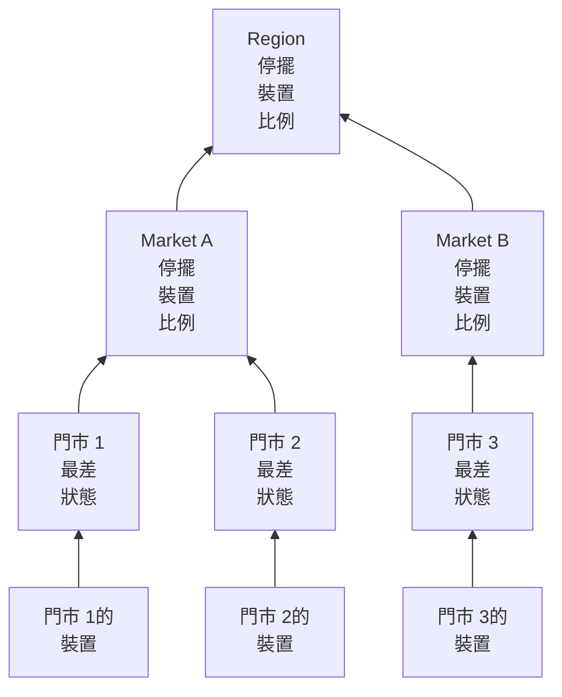

# 網路站點(健康彙總與正常運作時間)

網路站點就是一個地點：一個區域、一個市場、一個加盟商、一個配送中心、一家門市。站點可以彼此巢狀，網路裝置掛在站點上，OneUptime 會沿著樹往上彙總裝置的健康狀況，所以 Region 上的一個狀態就能回答「外面有什麼出問題了嗎？」

你可以在**網路 → 站點**下找到它們，也可以在**網路 → Map** 下的地圖上看到它們。本頁明確說明站點的狀態如何根據其下層內容計算、其正常運作時間代表什麼，以及排定維護如何改變這兩者。

:::cards
- [新增站點](#新增站點): 三個步驟，或用 CSV 檔案匯入整個環境。
- [設定監控預設值](#監控預設值): 為站點中的每台裝置提供探測器和憑證。
- [選擇健康狀況的彙總方式](#上層站點的健康狀況如何計算): 門市看最差狀態，區域看比例。
- [解讀正常運作時間](#正常運作時間): 百分比計算的是什麼，逐日查看。
:::

## 運作方式



每個站點的狀態來自其子樹中的每台裝置，並依站點自己的[彙總策略](#上層站點的健康狀況如何計算)判斷。站點的正常運作時間來自它自己的狀態時間軸，站點上的[維護時段](#網路站點的排定維護)會把其裝置從上層的投票中移除。

## 階層結構

站點構成一棵樹。每個站點都有一個 **Site Type** 和一個選用的上層站點。站點類型是專案自己的清單，位於**網路 → 設定 → Site Types** 下，新專案一開始由上而下依序有 Account Type、Region、Franchisee、Market 和 Unit，另外還有 Data Center 和 Other。類型本身也構成階層（**Parent Site Type**），它決定哪些站點可以作為某個站點的上層站點。標示為 **Is Unit Level** 的類型是你環境中的末端層級，也就是個別門市或分點：其站點容納的是裝置，而不是其他站點。

站點的類型、名稱、描述、上層站點和位置在一個地方編輯：站點**設定**頁面上的 **Site Settings** 卡片。站點的概覽會顯示這些資訊，並附有**在設定中編輯**連結；**站點**清單用於新增站點，但不用於編輯。

每台裝置掛在一個站點上。站點的子樹是站點本身加上其下的所有站點，子樹中的裝置就是其健康狀況彙總的來源，所以沒有自己裝置的 Region 仍然有狀態，因為它下面的 Unit 有裝置。

> [!NOTE]
> 當裝置狀態變化、裝置移到另一個站點、站點在樹中移動時，彙總會重新計算；此外每五分鐘一次的巡檢會抓出只因時間經過而改變結果的情況。

## 新增站點

:::steps
### 開始新增站點
前往**網路 → 站點**，按一下**新增Site**。

### 說明站點是什麼
在 **Site Details** 步驟中，選擇 **Site Type**（這是什麼樣的地點：區域、門市、資料中心），並輸入**名稱**。描述、街道地址，以及在地圖上標示站點的緯度和經度收合在**更多欄位**下：現在填寫或之後填寫都可以。

### 放到樹中
在 **Hierarchy** 步驟中，如果該站點位於另一個站點之下，請選擇 **Parent Site**。留空則站點保持在最上層。

### 設定其預設值
在 **Monitoring Defaults** 步驟中，為新增到該站點的裝置選擇[預設探測器和憑證設定檔](#監控預設值)，然後按一下**新增Site**。
:::

在站點自己的 **Child Sites** 頁面上，**新增子站點**只會詢問類型和名稱，表單只有一頁，位置收合起來，並會把新站點放在該站點之下。

### 從 CSV 檔案匯入站點

若要一次匯入整個環境，請開啟**站點**清單頂端的選單，按一下 **Import from CSV**。檔案需要有標題列；欄可以依任意順序排列，欄名不區分大小寫：

```csv title="sites.csv"
name,siteType,parentName,address,latitude,longitude
North,Region,,,,
Leeds,Market,North,,,
Store 0660,Unit,Leeds,"1 High Street, Leeds",53.7997,-1.5492
```

- `name` 和 `siteType` 是必填的。`siteType` 必須是專案的站點類型之一。
- `parentName` 指定上層站點，上層站點可以在同一個檔案中：沒有上層站點或上層站點已存在的列會先匯入，然後是它們的下層站點。最上層的站點請留空。
- 找不到上層站點的列會被略過，並在結果中列出。**Preview Import** 會在寫入任何內容之前顯示檔案將建立什麼。

## 地圖

**網路 → Map** 會在地圖上顯示你的站點，並自動框選到它們所在的位置；按一下站點即可深入查看。下面有站點的站點會顯示這些站點，既顯示在地圖上，也以它們之間連結的圖形顯示。下面沒有站點但有自己裝置的站點，或類型為單位層級的站點，會開啟這些裝置的即時拓撲。

還沒有站點的專案也有地圖：Map 會改為顯示其裝置的拓撲，把裝置分組到站點後，它們就會依位置顯示在地圖上。

## 監控預設值

站點也是你一次說明其中裝置如何被監控的地方。**Site Settings** 卡片上的**編輯設定**有一個包含兩個欄位的 **Monitoring Defaults** 步驟：

| 設定 | 效果 |
| --- | --- |
| **Default Probe** | Ping 此站點中的裝置、並在裝置有憑證時透過 SNMP 遍歷它們的探測器。在站點中建立且沒有自己探測器的裝置會使用它，沒有探測器而移入的裝置也一樣。 |
| **Default SNMP Credential Profile** | 當裝置本身及其自己的設定檔都沒有憑證時，用於遍歷此站點中裝置的[憑證設定檔](/docs/monitor/network-device-monitor#snmp-憑證和憑證設定檔)。 |

在站點上設定這兩項後，那裡的新裝置只憑位址就能新增：它從首次輪詢起被 Ping，也從首次輪詢起被遍歷。

兩者的行為刻意不同：

- 探測器會在裝置於站點中建立或移入站點時複製到裝置上。之後變更站點的預設探測器不會移動已有探測器的裝置：哪個探測器能到達某台裝置是關於網路的事實，而不是可以從站點表單批次改寫的偏好。
- 憑證設定檔會在每次輪詢時即時讀取。在站點上設定一個設定檔，站點中所有沒有憑證的裝置都會在下次輪詢時開始被遍歷，不需要逐台編輯；清除它，這些裝置就會恢復為僅 Ping。

它們沿著樹往下傳遞的距離也不同：

- 探測器會貫穿整棵樹。落在沒有預設探測器的站點中的裝置會使用最近上層的探測器，所以在 Region 上設定的一個探測器會涵蓋其下的每個 Market 和 Unit，而指定了自己探測器的 Market 會在其子樹中覆寫它。
- 憑證設定檔只會從裝置自己的站點讀取。Unit 中的裝置不會沿用其 Region 上設定的設定檔，所以請把它設定在裝置實際掛接的站點上。

## 上層站點的健康狀況如何計算

每個站點會在其**設定**頁面的 **Health Rollup** 卡片上（**Rollup Policy**）從兩種彙總策略中選擇一種。

### 任一裝置的最差狀態（預設）

子樹中任何裝置回報的最差狀態就是站點的狀態。狀態有多差取決於它作為監測器狀態的優先順序：新專案的狀態是 Operational（1）、Degraded（2）和 Offline（3），數值越高越差。一台離線裝置就會讓站點離線，不論旁邊有多少健康的裝置。

對於 Unit，這是正確的答案。同一棟建築裡的四台交換器和一台防火牆並不是彼此獨立的：其中一台斷了，就是該地址出了問題，把它平均掉會掩蓋真正的故障。

對於下面有四百家門市的 Region，這通常是錯誤的答案。12,000 號門市裡一台斷掉的交換器就會把整個區域標為 Offline：從最狹義上說沒錯，但在實務上毫無用處，因為只要任何地方的任何門市出了問題，區域就會變紅，因而不再告訴你任何資訊。

### 停擺裝置的比例

站點的狀態由子樹中正在回報的裝置裡處於非運作狀態的比例決定：

| 停擺裝置比例 | 站點狀態 |
| --- | --- |
| 0% | Operational |
| 高於 0%，低於臨界值 | Degraded：專案中既不是運作狀態也不是離線狀態的那個狀態；專案沒有這種狀態時為 Offline |
| 達到或高於臨界值 | Offline |

臨界值依站點設定，也就是 **Offline Threshold (%)**，預設為 50。

沒有裝置停擺時，不論臨界值設得多低都是 Operational：臨界值為 0 的意思是「任何裝置停擺都會讓它離線」，而不是「健康的區域是離線的」。

### 哪些裝置有投票權

兩種策略在這一點上一致，而且它比聽起來更重要：

- 已封存的裝置絕不投票。它們已經除役：保留其站點，但被排除在外。
- 從未回報過任何內容的裝置絕不投票。等待首次輪詢的裝置不能作為故障的證據，所以它會從比例的分子和分母中都排除，導入進行到一半的區域會依已經回應的那一半計分。
- 由探測器輪詢的裝置（最常見的類型）依其上一次輪詢的結果投票：是否能透過 Ping 或 SNMP 到達，而不是距離上次成功有多久。在 SNMP 遍歷失敗時仍回應 Ping 的裝置是可到達的，並依此投票；站點會顯示它在線上，裝置所在的列會顯示 **SNMP failing**，好讓有人去修正憑證。
- 由監測器支援的裝置，也就是在其設定頁面上切換為綁定監測器覆寫的裝置，會依綁定到它的監測器的狀態投票，因為沒有東西輪詢它。沒有綁定任何監測器時它從未回報過，因此完全不投票。

由探測器輪詢的裝置上的 Network Device 監測器不會改變裝置的投票方式。一個帶有「介面停擺即 Offline」條件的監測器會給回應每次 Ping 的交換器打上 Offline，一個熄滅的連接埠就會讓整個站點變紅，而它下面的每一列裝置都顯示 Up：站點會與它所彙總的清單不一致。對於被輪詢的裝置，輪詢才是其健康狀況的來源；監測器的作用是建立事件。

### 選擇策略

對於加盟連鎖環境，一個合理的起點：

| 層級 | 策略 | 原因 |
| --- | --- | --- |
| Unit 或門市 | 最差狀態 | 一台裝置停擺，就是一個站點出了問題。 |
| Market | 比例，臨界值約 50% | 一半門市停擺的市場就是停擺了。 |
| Region | 比例，臨界值 25% 到 50% | 單一門市的故障讓區域變為 Degraded 而不是 Offline，發生系統性問題時才變為 Offline。 |

策略依站點設定，所以你可以讓 Region 這些列使用比例策略，而讓其下的一切保持預設。

## 正常運作時間

每個站點都有一條狀態時間軸：其彙總狀態每變化一次就有一列，在狀態變化時開啟，在再次變化時關閉。正常運作時間據此計算：

- 處於未標示為運作狀態的時間都算作停機時間。
- 重疊的列會被合併，所以沒有哪一秒會被計算兩次。
- 沒有被任何列涵蓋的時間算作正常運作。時間軸只有在彙總執行之後才會有列，沒有證據並不等於故障。
- 仍然開啟的列會一直延續到所測量時段的結尾。

Degraded 不是運作狀態，所以也算作停擺。因此在任一策略下，站點的正常運作時間都是其下沒有任何正在回報的裝置停擺的時間所占的比例：策略改變的是局部故障顯示的狀態（Degraded 或 Offline），而不是它是否被計入。

完全沒有時間軸列的站點會顯示 `—` 而不是 100%：從未彙總過的站點是未被監控的，而不是完美的。

### 每日正常運作時間

除了 30 天的數字，每個站點的概覽都會顯示 **Uptime (24h)**，其**狀態時間軸**頁面會顯示過去 24 小時、7 天、30 天和 90 天，以及過去 30 天每天一條長條。

30 天平均值無法顯示糟糕的一天。在 30 天的時段中，一整天的故障只會扣掉 3.3 個百分點，所以整個星期二都斷線的站點在這個月仍會回報 96.7%，這個數字讀起來就像四捨五入。每日長條把同樣的資料放在一個糟糕的日子就是一條糟糕長條的地方。

這裡的「天」是截至此刻的滾動 24 小時區間，而不是日曆日：裝置、檢視者和伺服器可能各自位於不同的時區，不存在它們都認同的同一個「天」。

### 上層站點的正常運作時間不是下層站點正常運作時間的平均值

上層站點的正常運作時間來自上層站點自己的時間軸，該時間軸由其彙總策略產生，而不是來自其下層站點百分比的平均值。

對下層站點取平均，會把只有兩台裝置的門市與有兩百台裝置的配送中心同等看待。而上層站點自己的時間軸給出的是可以用一句話表述的讀數：區域中完全沒有任何東西停擺的時間所占的比例。它刻意設計得很嚴格，所以對於大區域，請搭配每日長條和狀態一起解讀，狀態會說明局部故障是 Degraded 還是 Offline。

## 網路站點的排定維護

像新增主機一樣，在排定維護事件的**受影響的資源**步驟中，把站點加到**其他受影響的資源**下。站點自己的**排定維護**頁面會列出關聯到它的事件，其中的**建立排定維護事件**會開啟已選好該站點的表單。

上層站點上的時段會涵蓋其下的一切：Region 上的時段會涵蓋其中的每個 Market 和 Unit，包括在排定時段之後才建立的站點，所以區域性的電信業者切換不必列出四百家門市。

涵蓋範圍只會往下傳遞。一個 Unit 上的時段不會讓其 Region 進入維護：該區域仍應在線上，同一時段內另一個 Unit 發生的真實故障仍會計入該區域。

### 維護時段會改變什麼

| 在時段期間 | 會發生什麼 |
| --- | --- |
| 站點的即時狀態 | 不變。因計畫工作而關閉的 Unit 在地圖和樹中仍顯示為 Offline，旁邊帶有「In maintenance」徽章：查看它的人需要知道它是關閉的。 |
| 站點的正常運作時間 | 時段會同時從停機時間和測量期間中扣除。兩小時的維護讓這一天變成 22 小時，這兩小時內發生的任何事都不計入任何一方。 |
| 其上層的健康彙總 | 被維護子樹中的裝置停止投票，所以區域不會因為行事曆上已排定的切換而變紅。 |
| 其上層的正常運作時間 | 不受影響，也沒有需要更正的內容，因為計畫內的中斷從未進入它們的時間軸。 |

最後一列說明了為什麼對上層是以暫停投票來處理，而不是把時段從其正常運作時間中扣除：從區域的測量期間中扣除時段，也會抹掉同一時段內區域其他地方發生的真實故障。

正常運作時間依事件宣告的開始和結束時間來更正，而不是依工作程序在狀態之間移動它的時間，所以這個數字可以對照行事曆手動核對。完全落在時段內的一天會在每日長條中顯示為維護，而不是完美的一天，而且不計入平均值。

### 與監測器的互動

把監測器關聯到同一個事件仍會照常運作：該監測器的主動監控會在時段期間暫停。兩者彼此獨立：關聯站點是為了把它排除在彙總和其正常運作時間之外，關聯監測器是為了讓它們停止發出警示。

## 站點警示

站點**設定**頁面上的 **Alerting** 卡片有 **Alert When Unhealthy**：當站點的彙總進入非運作狀態時會開啟一個警示，並在站點恢復時自動解決。**警示嚴重性**設定其嚴重程度；留空時使用專案中最嚴重的層級。

它只對變化發出警示：對一個已經不健康的站點開啟它，會為下一次變化做好準備，而不會對過去發出警示。Degraded 不是運作狀態，所以使用比例策略的站點會在其正在回報的裝置中有一台停擺時立即發出警示，與使用最差狀態策略的站點一樣；當站點在 Degraded 和 Offline 之間切換時，警示會保持開啟，不會產生第二個警示，其標題寫的是站點最先達到的狀態。

## 疑難排解

:::details 區域總是紅色
該站點使用的是最差狀態策略，所以其下任何地方的一台離線裝置都會讓它離線。在區域的 **Health Rollup** 卡片上把它切換為 **Percentage of devices down**，並設定一個臨界值，與你認為區域要停擺多大比例才算停擺相符。
:::

:::details 站點顯示 — 而不是正常運作時間
該站點從未執行過彙總，所以沒有時間軸列：它是未被監控的，而不是完美的。為該站點或其下的站點新增裝置，下一次彙總就會開始其時間軸。
:::

:::details 裝置沒有計入其站點
已封存的裝置和尚未回報的裝置絕不投票。沒有綁定監測器、由監測器支援的裝置也從未回報過。檢查裝置的狀態：**待處理**的裝置會在首次輪詢後開始投票。
:::

:::details 站點的警示沒有觸發
**Alert When Unhealthy** 會在從運作狀態變為任何其他狀態時觸發，所以你開啟它時已經不健康的站點，會在恢復之後的下一次變化時發出警示。還要檢查其裝置是否投票：已封存的裝置和等待首次輪詢的裝置絕不投票，處於維護中的站點的裝置不會在其上層的彙總中投票。
:::

## 後續步驟

:::cards
- [網路設備監控](/docs/monitor/network-device-monitor): 新增掛在這些站點上的裝置，輪詢它們並為其設定警示。
- [網路流量](/docs/monitor/network-traffic): 從裝置的流記錄查看站點的流量。
- [資產清單](/docs/inventory/overview): 網路裝置與你擁有的所有其他資產並列。
:::
