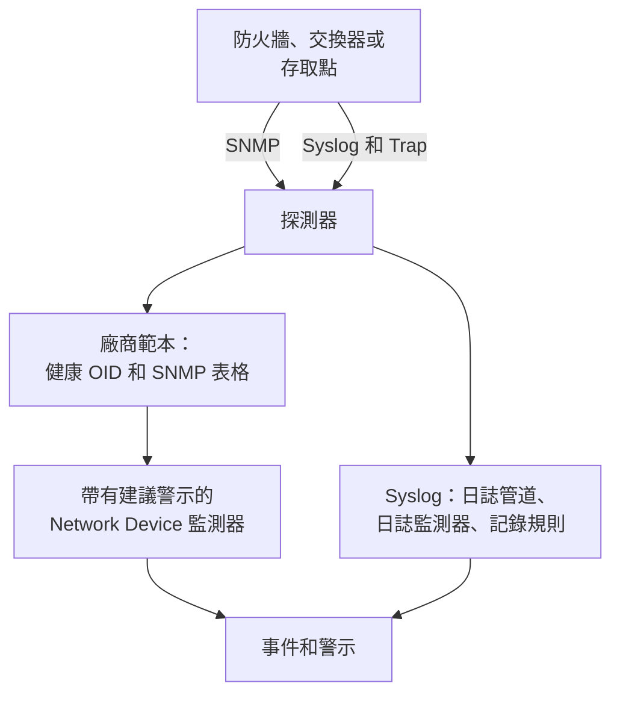

# 網路設備廠商指南(Sophos、Extreme、Cambium)

如何用 OneUptime 端對端監控三種常見環境：帶有 IPsec 通道、WAN 連結和 SD-WAN 的 Sophos Firewall（XGS、SFOS）；帶有 Fabric 的 Extreme Networks 交換器（EXOS / Switch Engine 和 Fabric Engine / VOSS）；以及 Cambium Networks cnMatrix 交換器和 Enterprise Wi-Fi 存取點，細到每個射頻的頻道和發射功率。

:::cards
- [Sophos Firewall](#sophos-firewall-xgs-sfos): 通道、WAN 連結、閘道和 SD-WAN。
- [Extreme Networks](#extreme-networks-exos-switch-engine-和-fabric-engine-voss): 交換器、Fabric 及其硬體。
- [Cambium Networks](#cambium-networks-enterprise-wi-fi-和-cnmatrix): 細到每個射頻的存取點，以及 cnMatrix 交換器。
:::

## 運作方式

每份指南都使用相同的組成部分：

- 每台設備一個[網路裝置](/docs/monitor/network-device-monitor)，由能到達它的探測器輪詢，並帶有一個廠商範本，提供合適的健康 OID 和 [SNMP 表格](/docs/monitor/network-device-monitor#snmp-表格)。
- 每台裝置一個用於警示的 Network Device 監測器。從裝置頁面建立它，[建議警示](/docs/monitor/network-device-monitor#建議警示套件)就會自動填入，其中包括為每個知道何謂健康的表格設定的依列警示。對於裝置群，[警示策略](/docs/monitor/network-device-monitor#警示策略)會在每台裝置上維持一個監測器。
- 對於廠商只在日誌中回報的內容：傳送到探測器的 syslog、把每一行轉換為屬性的[日誌管道](/docs/telemetry/log-pipelines)、依通道或閘道各發一次警示的[帶有 Group By 的日誌監測器](/docs/monitor/logs-monitor#依群組警示group-by)，以及把這些日誌中的數字繪製成圖表的[日誌記錄規則](/docs/telemetry/log-recording-rules)。

## Sophos Firewall (XGS / SFOS)

| 你想看到的 | 來自哪裡 |
| --- | --- |
| 防火牆健康狀況：記憶體、磁碟、交換空間、HA 狀態、IPsec 服務、每個核心的 CPU | SNMP，使用 **Sophos Firewall (SFOS / XGS)** 廠商範本 |
| 每條 IPsec 通道的狀態，依名稱 | SNMP 表格 `ipsec_tunnels`（SFOS v20 及更新版本） |
| 每條 WAN 連結的狀態、傳輸量、使用率和錯誤 | WAN 連接埠的介面遍歷 |
| 每條 WAN 連結的延遲、封包遺失率和抖動 | 來自 OneUptime 探測器的 Ping 監測器和裝置輪詢 |
| 閘道上線和停擺、SD-WAN SLA 是否達標、SD-WAN 路由變化 | 防火牆的 syslog |
| 每個閘道的 SD-WAN 延遲、抖動和封包遺失率圖表 | 以 SD-WAN SLA 日誌為基礎的日誌記錄規則 |

不論哪個 SFOS 版本，Sophos 都不會透過 SNMP 回報閘道或 SD-WAN 的健康狀況：這些資訊只存在於防火牆的日誌和 Sophos Central 的警示中，所以最後三列要透過 syslog 實現。

### 註冊防火牆

:::steps
1. 在防火牆上，在 **Administration → SNMP** 下開啟 SNMP：新增一個 SNMPv3 使用者或 v2c 社群字串，並允許探測器的位址查詢它。
2. 在 OneUptime 中，前往**網路 → Devices**，按一下 **Add Device**。輸入防火牆的管理位址，選擇一個能到達它的探測器，並在 **SNMP** 下新增 SNMP 憑證。
3. 在裝置的**設定**頁面上，在 **Polling & Data Collection** 下，從 **Vendor Health Template** 套用 **Sophos Firewall (SFOS / XGS)** 範本，並從 **Add a Vendor's Tables** 新增其表格。或者開啟 **Auto-Apply Vendor Health Template**，首次輪詢會同時完成這兩項。
:::

下一次輪詢後，裝置的 **SNMP Tables** 頁面會列出每個 IPsec 連線及其狀態（active、inactive、partially active），以及各個 CPU 核心。SFOS 從 196608 開始為其核心編號，這就是 CPU 來自表格而不是單一 `hrProcessorLoad.1` 的原因。

### 為每條 IPsec 通道發出警示

在裝置頁面上按一下**建立監測器**。建議警示包括 **IPsec Tunnels: row unhealthy**，也就是在 `ipsec_tunnels` 表格上 Row 為 `*` 的 **SNMP Table Row Is Unhealthy** 條件：它會為每條非 active 的通道開啟一個以通道命名的事件，並在通道恢復時逐一解決。

Sophos 回報為 active 的通道只表示其安全關聯已建立。若要證明有流量通過，請從一個站點的探測器向每條通道另一端的主機新增 [Ping 監測器](/docs/monitor/ping-monitor)，並在**網路 → 拓撲 → Site Links** 下把通道繪製為兩個[站點](/docs/monitor/network-sites)之間的站點連結，綁定到該監測器：地圖上的連結隨後會顯示該監測器的顏色。

### WAN 連結

- **連接埠健康狀況。** 介面遍歷已經測量了每個 WAN 連接埠的狀態、輸入和輸出位元、使用率和錯誤。在防火牆的監測器上，將**介面**設為 WAN 連接埠名稱（或設為 `*` 表示每個連接埠）的 **SNMP Interface Is Down** 或 **SNMP Interface Utilization (in %)** 條件會依連結發出警示。
- **路徑品質。** 每條連結的延遲、封包遺失率和抖動從防火牆外部測量：從 OneUptime 雲端探測器到每條 WAN 連結公用位址的 Ping 監測器，以及從站點的探測器到每個 ISP 閘道的 Ping 監測器。這些監測器上的封包遺失率和抖動條件會依連結發出警示，**網路 → 拓撲 → Latency Matrix** 則可以一眼看到每個探測器與每個監測器的對照。
- **流量。** SFOS 會匯出 NetFlow v5。把它傳送到探測器的 UDP 2055（探測器的流收集器預設在此監聽），裝置的 **Traffic** 頁面就會顯示每條 WAN 連結上誰在跟誰通訊；詳情請見[網路流量](/docs/monitor/network-traffic)。

### 從 syslog 取得閘道和 SD-WAN 資訊

:::steps
1. 開啟探測器的 syslog 接收器：在探測器上設定 `PROBE_SYSLOG_RECEIVER_ENABLED=true`。它預設監聽 UDP 5140（可用 `PROBE_SYSLOG_RECEIVER_PORT` 變更）；如果探測器在 Docker 中執行，請發布該連接埠。訊息會比對到主機名稱或某個**其他位址**是傳送方位址的網路裝置，並顯示在裝置的**日誌**頁面上。
2. 在防火牆上，在 **System services → Log settings** 下新增指向探測器和該連接埠的 syslog 伺服器，並勾選 IPsec 和閘道的 **Event** 日誌類型以及 **SD-WAN** 日誌類型：在勾選之前，SLA 日誌一直處於關閉狀態。
3. 在**日誌 → 設定 → 管道**下，建立一個篩選條件符合防火牆日誌的管道，例如 `attributes.networkDevice.name = 'hq-firewall'`，並新增一個 **Target Prefix** 為 `sophos` 的 **Key=Value Parser**。把防火牆的一行日誌貼到其測試器中，即可看到你的 SFOS 版本產生的確切屬性名稱；[Sophos 範例](/docs/telemetry/log-pipelines#範例sophos-xgs-防火牆)對此有逐步說明。
4. 在防火牆的日誌上建立[日誌監測器](/docs/monitor/logs-monitor)，每個都設定 **Group by Attributes**，讓每條通道或每個閘道單獨發出警示，條件為在幾分鐘內 **Log Count** **Greater Than** `0`。下表中的三列是可以先建立的監測器。
5. 繪製 SD-WAN 品質圖表：開啟 SD-WAN 日誌後，防火牆會依設定檔和閘道寫入 SLA 摘要（`latency`、`jitter`、`packet_loss`）。在**日誌 → 設定 → 記錄規則**下，為每個數字建立一條規則，例如依 `sophos.gw_name` 和 `sophos.profile_name` 分組的 `sophos.latency` 平均值，然後繪製結果圖表，或用依閘道分組的 [Metrics 監測器](/docs/monitor/metrics-monitor)為其發出警示。[日誌記錄規則](/docs/telemetry/log-recording-rules)逐步講解了這個範例。
:::

| 警示 | 要計算的日誌 | 分組依據 |
| --- | --- | --- |
| IPsec 通道終止 | 屬性 `sophos.log_component` = `IPSec`，內文包含 `terminated` | `sophos.con_name` |
| 閘道停擺 | 屬性 `sophos.log_component` = `Gateway`，內文包含 `is Down` | `sophos.gatewayname` |
| SD-WAN SLA 未達標 | 屬性 `sophos.log_type` = `SD-WAN`，內文包含 `SLA not met` | `sophos.gw_name` |

syslog 事件補足了 SNMP 表格：它們在通道中斷的那一刻到達，而表格還能發現從未建立起來的通道。

### Trap

每則 Sophos 通知都是同一個 Trap `sfosNotification`（`1.3.6.1.4.1.2604.5.1.8.1.1`），事件以文字形式放在 `sfosTrapMessage`（`1.3.6.1.4.1.2604.5.1.8.1.2`）中。若要為某一類事件發出警示，請把 **SNMP Trap Received (Trap OID)** Equal To `1.3.6.1.4.1.2604.5.1.8.1.1` 與針對該 varbind 的 **SNMP Trap Varbind Value** 結合起來，例如 Contains `IPSec`。把防火牆的 Trap 目的地設為 SNMP v2c：探測器的 Trap 接收器接收 v1 和 v2c Trap。

## Extreme Networks (EXOS / Switch Engine 和 Fabric Engine / VOSS)

| 你想看到的 | 來自哪裡 |
| --- | --- |
| EXOS：CPU、溫度及其警報、電源狀態、電源供應器、風扇、每個插槽的記憶體、堆疊成員 | **Extreme Networks EXOS / Switch Engine** 範本 |
| Fabric Engine：每個插槽的 CPU 和記憶體、溫度感測器、風扇、電源供應器、vIST 工作階段、I-SID 數量 | **Extreme Networks Fabric Engine / VOSS** 範本 |
| 每個 Fabric Connect（IS-IS）相鄰關係，依其鄰居命名 | Fabric Engine 範本的表格 `isis_adjacencies` |
| 連接埠、LLDP 鄰居、網路地圖 | 兩者都來自介面遍歷 |

### 選擇哪個範本

執行在 Extreme 通用硬體（5000 和 7000 系列）上的 Fabric Engine 回報的企業編號與 EXOS 相同：只有其系統描述（`7520-48Y-8C-FabricEngine (9.0.4.0)`）能說明正在執行哪個作業系統。OneUptime 會同時讀取兩者，所以自動套用和裝置頁面的建議都會選出正確的範本；較舊的 VSP 交換器回報的是 Avaya/Nortel 的 arc，會直接被辨識為 Fabric Engine。

### Fabric 和硬體警示

Fabric Engine 交換器上的建議警示包括 **Fabric Adjacencies (IS-IS): row unhealthy**，為相鄰關係未建立的每個鄰居開啟一個事件。Fabric Engine 還會在相鄰關係變化時傳送一個 Trap，也就是 `rcnIsisPlsbAdjStateTrap`（`1.3.6.1.4.1.2272.1.21.0.281`），針對它的 **SNMP Trap Received (Trap OID)** 條件能在幾秒內、趕在下一次輪詢之前發出警示。

電源供應器、風扇、溫度感測器和堆疊成員都是宣告了健康值的表格，所以它們在建議警示中各有一個依列警示。

### 流和 Wi-Fi

EXOS 和 Fabric Engine 會以 sFlow 和 IPFIX 匯出流。把 sFlow 傳送到探測器的 UDP 6343，或把 IPFIX 傳送到 UDP 4739，裝置的 **Traffic** 頁面就會顯示其流量；請參閱[網路流量](/docs/monitor/network-traffic)。

IQ Engine（HiveOS）存取點和 ExtremeCloud IQ Controller 有各自的廠商範本，會填入裝置的 **Wi-Fi** 頁面。[支援的 Wi-Fi 廠商](/docs/monitor/network-device-monitor#支援的-wi-fi-廠商)介紹了它們，以及 Ubiquiti UniFi、HPE Aruba、TP-Link Omada 和 Juniper Mist。

## Cambium Networks (Enterprise Wi-Fi 和 cnMatrix)

### 存取點

:::steps
1. 在存取點上開啟 SNMP。在 cnMaestro 中，SNMP 依 AP 群組設定：**Configuration → Wi-Fi Profiles → AP Groups → Management → SNMP**。使用 v2c 唯讀社群字串或 SNMPv3 使用者開啟它。
2. 用管理位址和這些憑證新增每個存取點，並套用 **Cambium Networks Enterprise Wi-Fi (cnPilot, XV, XE, XH)** 範本，或開啟自動套用。
3. 開啟裝置的 **Wi-Fi** 頁面。它會顯示有多少射頻開啟、用戶端和 SSID，接著是每個射頻的頻段、頻道、頻率、頻道頻寬、發射功率、用戶端、雜訊底限和空中時間，以及每個 SSID 及其用戶端。頻率根據頻段和頻道計算得出；存取點本身不回報它。
:::

有用的警示，全部設定在 `wifi_radios` 表格上，Row 為 `*`，讓每個射頻單獨發出警示：

| 警示 | 條件 |
| --- | --- |
| 射頻被關閉 | **SNMP Table Row Is Unhealthy**，屬於建議警示 |
| 發射功率發生變化 | **SNMP Table Value**，欄 TX Power，Not Equal To 你規劃的功率 |
| 擁擠的射頻 | **SNMP Table Value**，欄 Clients，Greater Than 你的上限 |
| 雜訊多的頻道 | **SNMP Table Value**，欄 Noise Floor，Greater Than `-80` |

每個數值型射頻值也是一個指標（`oneuptime.monitor.snmp.table.value`，每個射頻和每一欄一個序列），所以頻道、功率和用戶端可以在儀表板上隨時間繪製圖表；不斷變化的頻道表示 DFS 正在運作。

Cambium 只從韌體 6.5.3 起回報用戶端總數；更早的韌體會傳回 0。

### cnMatrix 交換器

**Cambium Networks cnMatrix** 範本會收集 CPU、RAM、快閃記憶體、溫度和供電電壓，並以表格形式收集風扇、備援電源供應器和每個連接埠的 PoE 耗電量。連接埠和 LLDP 鄰居與任何交換器一樣來自介面遍歷。

### cnMaestro 警報

cnMaestro 可以把它的警報（例如存取點離線）傳送到 HTTPS Webhook。把它指向一個 [Incoming Request 監測器](/docs/monitor/incoming-request-monitor)，即可把這些警報變成與 SNMP 資料並列的 OneUptime 事件。

## 疑難排解

:::details IPsec Tunnels 表格沒有狀態
通道狀態需要 SFOS v20 或更新版本。還要檢查你憑證的 SNMP 檢視是否包含 Sophos 企業樹（`1.3.6.1.4.1.2604`）：受限的 v3 使用者通常只能看到系統群組和 IF-MIB。
:::

:::details 收不到防火牆的 syslog
探測器的 syslog 接收器預設關閉：設定 `PROBE_SYSLOG_RECEIVER_ENABLED=true`，並把 UDP 5140 或你的 `PROBE_SYSLOG_RECEIVER_PORT` 發布到探測器。訊息會依傳送方的位址比對到裝置，所以防火牆在 OneUptime 中的主機名稱或其某個**其他位址**必須是它傳送 syslog 時使用的位址。
:::

:::details Fabric Engine 交換器被套用了 EXOS 範本
範本是根據交換器的系統描述選擇的。檢查裝置的概覽是否顯示了提到 Fabric Engine 的描述（例如 `7520-48Y-8C-FabricEngine (9.0.4.0)`）；如果是，請移除 EXOS 的 OID 和表格，並從 **Vendor Health Template** 套用 **Extreme Networks Fabric Engine / VOSS**。
:::

:::details Cambium 存取點回報 0 個用戶端
用戶端總數需要韌體 6.5.3 或更新版本。在更早的韌體上，射頻仍會回報其頻道、功率和雜訊底限。
:::

## 後續步驟

:::cards
- [網路設備監控](/docs/monitor/network-device-monitor): 裝置收集的一切，以及它可以發出警示的每個條件。
- [日誌管道](/docs/telemetry/log-pipelines): 把防火牆日誌解析為屬性。
- [日誌監控](/docs/monitor/logs-monitor): 依通道或閘道各發一次警示。
:::
