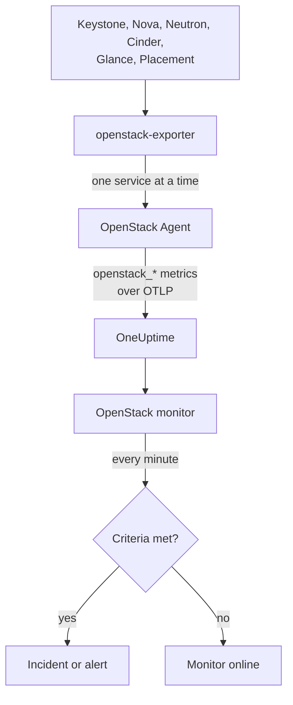

# OpenStack 監控

OpenStack 監測器會監看一座雲端，包括它的 API、API 背後的工作程序、虛擬化主機、執行個體、網路、儲存池和專案配額，並在 API 不再回應、工作程序停止、虛擬化主機已無餘裕可分配或儲存池寫滿時通知你。它讀取 OneUptime OpenStack Agent 從 openstack-exporter 收集的 `openstack_*` 序列，或由探測器從雲端的 API 收集的序列。

:::cards
- [建立監測器](#建立-openstack-監測器): 在儀表板中分六個步驟完成。
- [範本](#預先建立的警示範本): 現成的警示，每個工作程序、執行個體、網路或地區各產生一個事件。
- [從外部檢查](#從外部檢查): 從雲端之外的探測點確認是否真的有人能啟動執行個體。
- [身分屬性](#身分屬性): 如何鎖定單一地區、主機或專案。
- [指標](#收集的指標): 監測器可以設定警示的所有序列。
:::

## 運作方式

Agent 由 OpenTelemetry Collector 和 openstack-exporter 組成，你要把它們執行在能連到雲端 API 的機器上。它以各自獨立的收集作業讀取每個 OpenStack 服務，因此 Nova 故障時只會少掉 Nova 的序列，而且讀取的頻率很溫和：運算、網路、磁碟區和 Placement 每 2 分鐘一次，身分和映像檔每 5 分鐘一次。

每個序列都標有雲端名稱 `openstack.cloud.name`，每個資料點則標有 `openstack.region.name` 和 `openstack_service`。一座雲端就是一個 Keystone，而一個 OpenStack 監測器只對應一座雲端。它每分鐘會對該雲端的指標執行查詢，並將結果與條件比對。



## 開始之前

- **以 OpenStack Agent 收集雲端的指標**，或使用[探測器](/docs/telemetry/openstack-agentless)。**文件**位於 **產品 → 基礎設施 → OpenStack** 之下，會逐步帶你完成代理程式的安裝。
- **確認雲端已註冊。** 第一次收集之後，它會以 Agent 的 `OPENSTACK_CLOUD_NAME` 為名，出現在 **產品 → 基礎設施 → OpenStack** 之下。

## 建立 OpenStack 監測器

:::steps
### 開始新的監測器

前往 **監測器**，然後按一下 **建立監測器**。

### 選擇 OpenStack

在 **監測器類型** 下按一下 **更多監測器類型**，然後在 **基礎設施** 下選擇 **OpenStack**，或在搜尋方塊中輸入 `openstack`。輸入 **名稱**，它會用在事件和警示的標題中，然後按一下 **下一步**。

### 選擇雲端

在 **OpenStack Monitor Configuration** 下，從 **OpenStack 雲端** 選擇雲端。凡是傳送過資料的雲端都會出現在清單中。選好之後，欄位下方會有一行文字說明資料是否正在送達。

### 選擇要監看的項目

新的監測器預設使用 **告警內容** 下的 **Cloud Stopped Reporting**。若要監看其他項目：

- **變更** - 選擇另一個[範本](#預先建立的警示範本)。它會設定指標、屬性篩選器、彙總方式、時間範圍、分組依據和閾值，並以自己的內容取代下方的條件。你仍然可以更改 **時間範圍**。
- **Custom Metric**（位於 **更多欄位** 下）- 從 **OpenStack 指標** 選擇一個指標，然後設定 **彙總** 和 **時間範圍**，並以[篩選器](#監測器設定)縮小範圍。
- **進階**（位於 **更多欄位** 下）- 在 **選擇指標** 下自行建立查詢和公式，並以 `status`、`adminState` 或 `resourcetype` 等屬性進行篩選。使用 **分組依據** 依[身分屬性](#身分屬性)分組，即可分別判斷每個部分。

### 檢查條件

展開 **條件** 下的每個條件，檢查它的 **指標**、**彙總**、**條件** 和 **閾值**。範本會自動填入這些欄位。若使用 **Custom Metric** 或 **進階**，監測器一開始採用預設條件，只會偵測指標是否沒有送出資料，因此請自行設定閾值。

### 建立監測器

按一下 **建立監測器**。OneUptime 會開啟該監測器的頁面，並每分鐘評估一次。它所產生的事件和警示，也會列在雲端的 **事件** 和 **警示** 頁面中。
:::

> [!TIP]
> 若要一次設定多個範本，請從 **產品 → 基礎設施 → OpenStack** 開啟該雲端，前往 **建議**。選擇你要的範本，指定要呼叫哪些人，OneUptime 就會為每個範本建立一個監測器。

## 監測器設定

| 欄位 | 分頁 | 作用 |
| --- | --- | --- |
| **OpenStack 雲端** | 全部 | 必填。將每個查詢限定在 `resource.openstack.cloud.name`。 |
| **地區** | Custom Metric、Advanced | 選填。指定單一地區：`openstack.region.name`。每個序列都帶有此屬性。 |
| **可用性區域** | Custom Metric、Advanced | 選填。指定單一區域：虛擬化主機、執行個體、磁碟區和 Neutron agent 上用 `availability_zone`，Nova 和 Cinder 的工作程序上用 `zone`。 |
| **虛擬化主機** | Custom Metric、Advanced | 選填。指定單一主機：工作程序、虛擬化主機和 Placement 上用 `hostname`，執行個體上用 `hypervisor_hostname`。Nova 的工作程序使用主機的簡短名稱，而虛擬化主機、Placement 和執行個體使用完整名稱，因此請採用序列所標示的那一個。 |
| **服務** | Custom Metric、Advanced | 選填。指定單一工作程序的執行檔，例如 `nova-compute`：`service`。 |
| **專案 ID** | Custom Metric、Advanced | 選填。指定單一專案：Nova 和 Cinder 的序列以及網路和子網路上用 `tenant_id`，浮動 IP、路由器和位址可用性上用 `project_id`。 |
| **OpenStack 指標** | Custom Metric | 從[目錄](#收集的指標)中選擇一個指標。 |
| **彙總** | Custom Metric | 取樣值的合併方式：**平均**、**最大值**、**最小值**、**總和** 或 **計數**。預設為該指標常用的彙總方式。 |
| **時間範圍** | 全部 | 查詢所讀取的滾動視窗，從 **Past 1 Minute** 到 **Past 365 Days**。新的監測器預設為 **Past 15 Minutes**；範本會設定自己的值。 |
| **選擇指標** | Advanced | 查詢建立器：**指標**、**Aggregate by**、**Filter by attributes**、**分組依據**，以及用來組合查詢的 **新增指標** 和 **新增公式**。 |

篩選器只會縮小帶有該標籤的序列：`openstack_nova_up` 沒有專案，因此專案篩選器不會影響它。

請讓視窗涵蓋你所讀取指標至少三次收集：運算、網路、磁碟區和 Placement 為 6 分鐘，身分和映像檔為 15 分鐘。更短的視窗容納不了足夠的收集次數，**所有值** 就無法代表一段持續時間。

## 身分屬性

每個序列都以 **resource attribute** 的形式帶有 `openstack.cloud.name`，並以資料點屬性的形式帶有 `openstack.region.name` 和 `openstack_service`。其餘由 exporter 自己的標籤說明：

| 部分 | 序列 | 用來識別的標籤 |
| --- | --- | --- |
| API | `openstack_*_up` | `openstack.region.name`、`openstack_service` |
| 工作程序 | `openstack_nova_agent_state`、`openstack_neutron_agent_state`、`openstack_cinder_agent_state` | `hostname`、`service`。`adminState` 說明是否為操作員刻意保持啟用。切勿在 Cinder 的序列上依 `uuid` 分組：exporter 每次收集都會隨機產生新的值 |
| 虛擬化主機 | `openstack_placement_resource_*`、`openstack_nova_vcpus_*` | `hostname`（其完整名稱）、Placement 序列上的 `resourcetype` |
| 執行個體 | `openstack_nova_server_status` | `uuid`、`name`、`tenant_id`、`hypervisor_hostname`、`status`。其值是代碼：請依 `status` 字詞篩選 |
| 磁碟區 | `openstack_cinder_volume_gb` | `id`、`name`、`tenant_id`、`status` |
| 儲存池 | `openstack_cinder_pool_capacity_*` | `name`、`volume_backend_name` |
| 網路 | `openstack_neutron_network_ip_availabilities_*` | `network_id`、`network_name`、`cidr`、`ip_version` |
| 路由器 | `openstack_neutron_l3_agent_of_router` | `router_id`、`agent_host`、`ha_state`、`agent_alive`、`agent_admin_up` |
| 專案 | `openstack_nova_limits_*`、`openstack_cinder_limits_*` | `tenant_id`、`tenant` |

在監測器篩選器和分組鍵中，resource attribute 以 `resource.` 開頭（`resource.openstack.cloud.name`），資料點屬性則不加（`openstack.region.name`、`hostname`、`status`）。空的標籤不會送到 OneUptime，所以 `disabledReason` 只會出現在被人停用的工作程序上。

## 預先建立的警示範本

OneUptime 內建 120 個範本，對應常見的 OpenStack 問題，可在 **告警內容** 清單中選用。雲端的 Recommendations 頁面只會把 Heat、Magnum、Ironic、Manila、Octavia、Trove、Designate、Gnocchi 或 Swift 的範本提供給實際執行該服務的雲端；只有探測點才會送出的序列所對應的範本，只提供給由探測點收集的雲端；以[從外部檢查](#從外部檢查)為基礎的範本，只提供給已啟用該檢查的雲端：在其他雲端上，這些序列根本不存在，範本永遠不會觸發。每個範本都會建立完整的監測器：指標查詢、屬性篩選器、依一個事件所針對的對象設定的分組、一個觸發條件和一個復原條件。閾值與雲端自身頁面所畫的線相同，只是你可以自行修改的起點。

每個範本至少讀取所監看對象的三次收集，而且只有在條件於整個視窗內都成立時才會觸發。以比例為基礎的閾值，會在越過該線 10% 後才復原，因此徘徊在線附近的值不會反覆觸發與復原。

| 範本 | 類別 | 嚴重程度 | 監看項目 | 觸發時機 | 復原時機 |
| --- | --- | --- | --- | --- | --- |
| Cloud Stopped Reporting | 可用性 | 嚴重 | `openstack_identity_up`，整座雲端的計數，**過去 15 分鐘** | 整個視窗內都沒有資料：Agent 已停止、無法連到 OneUptime，或 exporter 無法登入 Keystone | 資料再度送達 |
| Identity API Down | 可用性 | 嚴重 | `identity` 的 `openstack_identity_up` 和 `scrape_samples_scraped`，每個地區的最小值，**過去 15 分鐘** | 每次呼叫都失敗，或因 exporter 無法登入而使收集結果為空 | 兩者都讀到 1 以上 |
| Compute API Down | 可用性 | 嚴重 | `compute` 的 `openstack_nova_up` 和 `scrape_samples_scraped`，每個地區的最小值，**過去 10 分鐘** | 每次呼叫都失敗，或因 exporter 無法連到 Nova 的 API 而使收集結果為空 | 兩者都讀到 1 以上 |
| Network API Down | 可用性 | 嚴重 | `network` 的 `openstack_neutron_up` 和 `up`，每個地區的最小值，**過去 10 分鐘** | 每次呼叫都失敗，或 exporter 沒有回應 | 兩者都讀到 1 |
| Block Storage API Down | 可用性 | 嚴重 | `volume` 的 `openstack_cinder_up` 和 `up`，每個地區的最小值，**過去 10 分鐘** | 每次呼叫都失敗，或 exporter 沒有回應 | 兩者都讀到 1 |
| Image API Down | 可用性 | 嚴重 | `image` 的 `openstack_glance_up` 和 `up`，每個地區的最小值，**過去 15 分鐘** | 每次呼叫都失敗，或 exporter 沒有回應 | 兩者都讀到 1 |
| Placement API Down | 可用性 | 嚴重 | `placement` 的 `openstack_placement_up` 和 `up`，每個地區的最小值，**過去 10 分鐘** | 每次呼叫都失敗，或 exporter 沒有回應 | 兩者都讀到 1 |
| Compute Service Down | 控制平面 | 嚴重 | 篩選為 `service = nova-compute` 且 `adminState = enabled` 的 `openstack_nova_agent_state`，每台主機的最小值，**過去 10 分鐘** | 低於 1：已啟用的 nova-compute 已停止。被人停用的永遠不會觸發 | 已啟動，或已被停用 |
| Compute Service Disabled | 控制平面 | 警告 | 篩選為 `service = nova-compute` 且 `adminState = disabled` 的 `openstack_nova_agent_state`，每台主機的計數，**過去 10 分鐘** | 高於 0：有 `nova-compute` 被停用，且沒有任何進行中的維護事件涵蓋其主機、可用性區域或雲端。因 libvirt 故障而自行停用的（原因以 `AUTO:` 開頭），在 libvirt Service Down 開啟期間保持安靜。不會通知各專案 | 已重新啟用，或有事件涵蓋它 |
| Scheduler or Conductor Down | 控制平面 | 警告 | 篩選為 `nova-scheduler` 或 `nova-conductor` 且 `adminState = enabled` 的 `openstack_nova_agent_state`，每台主機和執行檔的最小值，**過去 10 分鐘** | 低於 1。只要還有其他的在運作，系統就能繼續 | 已啟動，或已被停用 |
| Every Scheduler or Conductor Down | 控制平面 | 嚴重 | 同上，每個地區和執行檔的最大值，**過去 10 分鐘** | 低於 1：一個都沒有存活，所以無法再啟動任何新項目 | 有一個已啟動 |
| Network Agent Down | 控制平面 | 嚴重 | 篩選為 `adminState = up` 的 `openstack_neutron_agent_state`，每台主機和執行檔的最小值，**過去 10 分鐘** | 低於 1：設為啟用的 agent 並未存活。被人設為停用的永遠不會觸發 | 已存活，或已被設為停用 |
| Block Storage Service Down | 控制平面 | 嚴重 | 篩選為 `adminState = enabled` 的 `openstack_cinder_agent_state`，每台主機和執行檔的最小值，**過去 10 分鐘** | 低於 1：已啟用的 Cinder 服務已停止。被人停用的永遠不會觸發 | 已啟動，或已被停用 |
| vCPU Allocation High | 運算 | 警告 | 篩選為 `resourcetype = VCPU` 的 `openstack_placement_resource_*`，用量 / ((總量 - 保留量) x 比率)，每個虛擬化主機，**過去 10 分鐘** | 高於 90%：指的是分配量，而非負載 | 等於或低於 81% |
| Memory Allocation High | 運算 | 警告 | 同上，`resourcetype = MEMORY_MB` | 高於 90% | 等於或低於 81% |
| Local Disk Allocation High | 運算 | 警告 | 同上，`resourcetype = DISK_GB` | 高於 90% | 等於或低於 81% |
| Hypervisor CPU Saturated | 運算 | 警告 | `openstack.hypervisor.instances.cpu.utilization`，每個虛擬化主機，**過去 15 分鐘**。需要 libvirt 或 Ceilometer 的 exporter | 高於其 CPU 執行緒的 90%：指的是負載，而非分配量。其頁面會指出造成負載的執行個體 | 等於或低於 81% |
| Hypervisor Memory Pressure | 運算 | 警告 | `openstack.hypervisor.instances.memory.utilization`，每個虛擬化主機，**過去 15 分鐘**。需要 libvirt 的 exporter，或 Ceilometer 輪詢的 `memory.resident` | 高於其記憶體的 90%：指的是實際使用中，而非已承諾的 | 等於或低於 81% |
| Instance CPU Saturated | 運算 | 警告 | `openstack.instance.cpu.utilization`，每個執行個體的最大值，**過去 15 分鐘**。需要 libvirt 或 Ceilometer 的 exporter | 高於其 vCPU 的 95% | 等於或低於 85.5% |
| Instance Disk Latency High | 運算 | 警告 | `openstack.instance.disk.read.latency` 和 `openstack.instance.disk.write.latency`，每個執行個體和磁碟的最大值，**過去 15 分鐘**。需要 libvirt 的 exporter，或 Ceilometer 輪詢的 `disk.device.read.latency` 和 `disk.device.write.latency` | 每個請求高於 50 毫秒。沒有請求的磁碟沒有延遲，因此閒置的磁碟永遠不會觸發 | 等於或低於 45 毫秒，或不再被使用 |
| Instances in Error | 運算 | 警告 | 篩選為 `status = ERROR` 的 `openstack_nova_server_status`，每個地區的計數，**過去 10 分鐘** | 高於 0 | 一個都不剩 |
| Instance Stuck Building | 運算 | 警告 | 篩選為 `status = BUILD` 或 `BUILD(spawning)` 的 `openstack_nova_server_status`，每個執行個體的最大值，**過去 1 小時** | 一小時內每次收集都處於該狀態 | 已離開該狀態 |
| Instance Stuck Transitioning | 運算 | 警告 | 同上，針對 `REBUILD`、`RESIZE`、`REVERT_RESIZE`、`MIGRATING`、`REBOOT`、`HARD_REBOOT` 和 `PASSWORD`，**過去 1 小時** | 一小時內每次收集都處於其中之一 | 已離開該狀態 |
| Instance Stuck in Verify Resize | 運算 | 警告 | 同上，針對 `VERIFY_RESIZE`，**過去 1 小時** | 等待有人確認或還原已達一小時 | 已確認或還原 |
| Router Not Active | 網路 | 警告 | `openstack_neutron_routers_not_active`，每個地區的最大值，**過去 10 分鐘** | 高於 0 | 為 0 |
| Floating IP Not Active | 網路 | 警告 | `openstack_neutron_floating_ips_associated_not_active`，每個地區的最大值，**過去 10 分鐘** | 高於 0：使用中的浮動 IP 不是 ACTIVE。備用的本來就該是停止狀態 | 為 0 |
| External IP Pool Nearly Full | 網路 | 警告 | `ip_version = 4` 的 `openstack_neutron_network_ip_availabilities_*`，搭配 `openstack_neutron_network` 上的 `is_external = true`，每個網路，**過去 10 分鐘** | 高於外部網路 IPv4 位址的 90%。租戶的網路永遠不會觸發 | 等於或低於 81% |
| Network Out of IPs | 網路 | 嚴重 | 同上 | 達到 100%：已沒有剩餘位址 | 低於 90% |
| Router Without Active Agent | 網路 | 嚴重 | 篩選為 `agent_admin_up = true` 的 `openstack_neutron_l3_agent_of_router`，每個路由器的最大值，**過去 10 分鐘** | 低於 1：持有它的 agent 都沒有存活。在 OVN 上保持安靜，因為 OVN 沒有這類 agent | 有一個存活 |
| Router With Two Active Agents | 網路 | 嚴重 | 同上，篩選為 `ha_state = active` 且 `agent_alive = true`，每個路由器的計數，**過去 10 分鐘** | 高於 1：發生腦裂。在 OVN 上保持安靜 | 等於或低於 1 |
| Storage Pool Warning | 儲存 | 警告 | `openstack_cinder_pool_capacity_*`，(總量 - 可用量) / 總量，每個儲存池，**過去 10 分鐘** | 高於 85% | 等於或低於 76.5% |
| Storage Pool Critical | 儲存 | 嚴重 | 同上 | 高於 95% | 等於或低於 85.5% |
| Volumes in Error | 儲存 | 警告 | 針對每個錯誤字詞的 `openstack_cinder_volume_status_counter`，每個地區和字詞的最大值，**過去 10 分鐘** | 高於 0 | 為 0 |
| Volume Stuck | 儲存 | 警告 | 針對每個過渡狀態字詞的 `openstack_cinder_volume_gb`，每個磁碟區的最大值，**過去 30 分鐘** | 30 分鐘內每次收集都處於該狀態 | 已離開該狀態 |
| Image Stuck | 儲存 | 警告 | 針對每個過渡狀態字詞的 `openstack_glance_image_created_at`，每個映像檔的最大值，**過去 1 小時** | 一小時內每次收集都處於該狀態 | 已離開該狀態，或已被刪除 |
| Orchestration API Down | 可用性 | 嚴重 | `orchestration` 的 `openstack_heat_up` 和 `up`，每個地區的最小值，**過去 15 分鐘** | 每次呼叫都失敗（`heat-engine` 停止時也會讀到這種情況），或 exporter 沒有回應 | 兩者都讀到 1 |
| Kubernetes Clusters API Down | 可用性 | 嚴重 | `container-infra` 的 `openstack_container_infra_up` 和 `up`，每個地區的最小值，**過去 15 分鐘** | 每次呼叫都失敗，或 exporter 沒有回應 | 兩者都讀到 1 |
| Rating API Down | 可用性 | 嚴重 | `rating` 的 `openstack_cloudkitty_up` 和 `up`，每個地區的最小值，**過去 15 分鐘**。只有探測點會送出 | CloudKitty 的 API 沒有回應，因此各專案的計費評等不再更新 | 兩者都讀到 1 |
| Heat Engine Down | 控制平面 | 警告 | `openstack_heat_agent_state`，每台主機的最小值，**過去 15 分鐘**。只有探測點會送出 | Heat 將某個 `heat-engine` 列為停止。所有 engine 都停止時，Heat 無法列出它們，此時會改由 Orchestration API Down 觸發 | 讀到 1，或 Heat 移除其記錄 |
| Magnum Conductor Down | 控制平面 | 嚴重 | `adminState=enabled` 的 `openstack_container_infra_agent_state`，每台主機的最小值，**過去 15 分鐘**。只有探測點會送出 | Magnum 將已啟用的 `magnum-conductor` 列為停止。Magnum 的 API 仍持續回應，因此沒有其他項目會指出這件事 | 讀到 1，或有人將它停用 |
| Stack Failed | 編排 | 警告 | 針對每個 `*_FAILED` 狀態的 `openstack_heat_stack_status`，每個 stack，**過去 15 分鐘** | stack 在整個視窗內都處於失敗狀態 | 已更新或刪除 |
| Stack Stuck In Progress | 編排 | 警告 | 針對每個 `*_IN_PROGRESS` 狀態的 `openstack_heat_stack_status`，每個 stack，**過去 2 小時** | stack 在整個視窗內都處於進行中狀態，超過 Heat 預設給予的一小時（除非有人設定更長） | 已進入下一個狀態，或已被刪除 |
| Kubernetes Cluster Failed | 編排 | 警告 | 針對每個 `*_FAILED` 狀態的 `openstack_container_infra_cluster_status`，每個叢集，**過去 15 分鐘** | 叢集在整個視窗內都處於失敗狀態 | 已更新或刪除 |
| Kubernetes Cluster Stuck | 編排 | 警告 | 針對每個 `*_IN_PROGRESS` 狀態的 `openstack_container_infra_cluster_status`，每個叢集，**過去 2 小時** | 叢集在整個視窗內都處於進行中狀態。只有 Magnum 的 conductor 能推動它前進 | 已進入下一個狀態，或已被刪除 |
| Shared File Systems API Down | 可用性 | 嚴重 | `sharev2` 的 `openstack_sharev2_up` 和 `up`，每個地區的最小值，**過去 15 分鐘** | 每次呼叫都失敗，或 exporter 沒有回應。每個能登入的憑證都會讀到 1，因此這不可能是憑證被拒絕 | 兩者都讀到 1 |
| Manila Service Down | 控制平面 | 警告 | `adminState=enabled` 的 `openstack_sharev2_agent_state`，每台主機和服務的最小值，**過去 15 分鐘**。只有探測點會送出 | Manila 將已啟用的服務列為已停止或停機。它的 API 仍持續回應，因此沒有其他項目會指出這件事 | 讀到 1，或有人將它停用 |
| Share in Error | 儲存 | 警告 | 針對每個錯誤狀態的 `openstack_sharev2_share_gb`，每個共享，**過去 15 分鐘** | 共享在整個視窗內都處於錯誤狀態 | 已修復或刪除 |
| Share Stuck | 儲存 | 警告 | 針對每個過渡狀態的 `openstack_sharev2_share_gb`，每個共享，**過去 1 小時** | 共享在整個視窗內都處於過渡狀態。Manila 對速度緩慢的後端沒有自己的逾時機制。正在遷移或備份的共享不在監看範圍內 | 已進入下一個狀態，或已被刪除 |
| Load Balancers API Down | 負載平衡器 | 嚴重 | `openstack_loadbalancer_up`，每個地區的最小值，**過去 15 分鐘** | 低於 1。Octavia API 停止時，Agent 的 exporter 得到的是空回應而非 0，與沒有 Octavia 的雲端相同，因此在由 Agent 收集的雲端上，這個範本保持安靜，要由雲端的頁面說明最後一次收到 Octavia 訊息的時間 | 讀到 1，或已消失 |
| Load Balancer in Error | 負載平衡器 | 嚴重 | `provisioning_status=ERROR` 的 `openstack_loadbalancer_loadbalancer_status`，每個負載平衡器的計數，**過去 15 分鐘** | 負載平衡器在整個視窗內都處於 provisioning ERROR。Octavia 不會重試任何這類情況 | 已回到 ACTIVE，或已刪除 |
| Load Balancer Stuck Pending | 負載平衡器 | 警告 | 針對每個 `PENDING_*` provisioning 狀態的 `openstack_loadbalancer_loadbalancer_status`，每個負載平衡器的計數，**過去 1 小時** | 負載平衡器在整個視窗內都處於 PENDING 狀態：Octavia 的 worker 已停止，或遺失了請求 | 已進入 ACTIVE 或 ERROR，或已被刪除 |
| Load Balancer With Two Masters | 負載平衡器 | 嚴重 | `role=MASTER` 且 `status=ALLOCATED` 的 `openstack_loadbalancer_amphora_status`，每個負載平衡器的計數，**過去 15 分鐘**。需要有權列出 amphora 的憑證 | 同一個負載平衡器有超過一個已分配的 amphora 自稱為 MASTER | 只剩一個如此 |
| Amphora in Error | 負載平衡器 | 嚴重 | `status=ERROR` 的 `openstack_loadbalancer_amphora_status`，每個 amphora 的計數，**過去 15 分鐘**。需要有權列出 amphora 的憑證 | amphora 在整個視窗內都處於 ERROR：health manager 無法替換它 | 已被替換 |
| Pool Has No Healthy Members | 負載平衡器 | 嚴重 | `operating_status=ERROR` 的 `openstack_loadbalancer_pool_status`，每個 pool 的計數，**過去 15 分鐘** | pool 的每個成員都未通過健康檢查，但 pool 及其負載平衡器的 provisioning 仍是 ACTIVE | 有成員恢復健康 |
| DNS API Down | 可用性 | 嚴重 | `openstack_designate_up`，每個地區的最小值，**過去 15 分鐘**。只有探測點會提供 | 低於 1。Designate 停止時，Agent 的 exporter 得到的是空回應，與沒有 Designate 的雲端相同，因此由 Agent 收集的雲端只能表示它沉默了 | 讀到 1 |
| DNS Zone in Error | 網路 | 警告 | `status=ERROR` 的 `openstack_designate_zone_status` 計數，每個 zone，**過去 15 分鐘** | zone 在整個視窗內都讀到 `ERROR`：它的 worker 放棄將其寫入 DNS 伺服器 | 讀到其他值 |
| DNS Zone Stuck Pending | 網路 | 警告 | `status=PENDING` 的 `openstack_designate_zone_status` 計數，每個 zone，**過去 30 分鐘** | zone 在整個視窗內都讀到 `PENDING`。它的 worker 幾分鐘後就會放棄，所以沒有任何程序在處理它 | 讀到其他值 |
| DNS Recordset in Error | 網路 | 警告 | `status=ERROR` 且包含每個指定類型的 `openstack_designate_recordsets_status` 計數，每個 zone，**過去 15 分鐘** | zone 本身的 SOA 和 NS 以外的 recordset 讀到 `ERROR`。那兩個會隨 zone 一起讀到 `ERROR`，所以由 DNS Zone in Error 來說明 | 讀到其他值 |
| Metrics API Down | 可用性 | 嚴重 | `gnocchi` 的 `openstack_gnocchi_up` 和 `up`，每個地區的最小值，**過去 15 分鐘** | exporter 讀取 Gnocchi 失敗，或 exporter 沒有回應。Gnocchi 拒絕的憑證讀到的結果相同，因此憑證從未讀取過 Gnocchi 的雲端不會提供這個範本 | 兩者都讀到 1 |
| Gnocchi No Processors | 指標 | 嚴重 | `openstack_gnocchi_status_metricd_processors`，每個地區的最大值，**過去 15 分鐘** | Gnocchi 的狀態沒有列出任何 processor。它的 API 仍持續回應並接收量測值，所以 **Metrics API Down** 對此沒有任何訊息 | 列出一個 |
| Gnocchi Backlog Growing | 指標 | 警告 | `openstack_gnocchi_status_measures_to_process`，貫穿**過去 2 小時**的一條線 | 這條線在接下來一小時內會超過 10,000 筆量測值。超過該數量但正在下降的積壓不會觸發 | 這條線不再到達 9,000 |
| Object Storage API Down | 可用性 | 嚴重 | `object-store` 的 `openstack_object_store_up` 和 `up`，每個地區的最小值，**過去 15 分鐘** | exporter 讀取 Swift 失敗，或 exporter 沒有回應。Swift 拒絕的憑證讀到的結果相同，因此憑證從未讀取過 Swift 的雲端不會提供這個範本 | 兩者都讀到 1 |
| Object Container Growth Forecast | 儲存 | 警告 | `openstack_object_store_bytes`，貫穿**過去 7 天**的一條線，每個 container | 這條線在接下來一週內會超過 1 TiB。請改成你的雲端應該收到通知的數值 | 這條線不再到達該值的 90% |
| Key Manager API Down | 可用性 | 嚴重 | `openstack_barbican_up`，每個地區的最小值，**過去 15 分鐘**。只有探測點會提供 | 低於 1。exporter 完全沒有讀取 Barbican 的功能 | 讀到 1 |
| Swift Storage Server Not Answering | 儲存 | 警告 | `openstack_object_store_recon_up`，每台伺服器的最小值，**過去 15 分鐘**。只有探測點會提供，且須由雲端的設定指明其儲存伺服器 | 伺服器不回應 `/recon`。Swift 的 proxy 在沒有它的情況下仍持續回應 | 它有回應 |
| Swift Rings Differ | 儲存 | 警告 | `openstack_object_store_recon_rings_differ`，每個 ring 的最小值，**過去 15 分鐘**。只有探測點會提供 | 指名的伺服器對同一個 ring 回報不同的檢查碼 | 它們一致 |
| Swift Replication Stale | 儲存 | 警告 | `openstack_object_store_recon_replication_age_seconds`，每台伺服器和 ring 的最小值，**過去 15 分鐘**。只有探測點會提供 | 伺服器上次完成一輪複寫已是 6 小時以前 | 有一輪完成 |
| Databases API Down | 可用性 | 嚴重 | `database` 的 `openstack_trove_up` 和 `up`，每個地區的最小值，**過去 15 分鐘** | exporter 讀取 Trove 失敗，或 exporter 沒有回應。它讀取的是 Trove 的 mgmt API，因此憑證被拒絕與 API 停止讀到的結果相同，而憑證從未讀取過 Trove 的雲端不會提供這個範本 | 兩者都讀到 1 |
| Database Instance in Error | 資料庫 | 警告 | 針對每個錯誤狀態的 `openstack_trove_instance_status` 計數，每個執行個體，**過去 15 分鐘** | 執行個體在整個視窗內都處於錯誤狀態 | 已修復或刪除 |
| Database Instance Stuck | 資料庫 | 警告 | 針對每個過渡狀態的 `openstack_trove_instance_status` 計數，每個執行個體，**過去 1 小時** | 執行個體在整個視窗內都處於過渡狀態。Trove 沒有其 worker 的清單，所以由這個範本來指出 `trove-taskmanager` 已停止 | 已進入下一個狀態，或已被刪除 |
| Database Volume Nearly Full | 資料庫 | 警告 | `openstack_trove_instance_volume_used_gb` 除以 `openstack_trove_instance_volume_size_gb`，每個執行個體，**過去 15 分鐘** | 達到或超過 85%。未執行的執行個體已使用量讀到 0。沒有任何記錄涵蓋執行中的執行個體 | 已調整大小，或用量縮減 |
| Bare Metal API Down | 裸機 | 嚴重 | `openstack_ironic_up`，每個地區的最小值，**過去 15 分鐘** | 低於 1。只在能讀取 Ironic 並據以判斷的地方才會發聲：探測點，或 exporter 1.7.0。Ironic 停止時，Agent 的 exporter 沒有東西可讀，與沒有 Ironic 的雲端相同，因此在那裡保持安靜，要由雲端的頁面說明最後一次收到 Ironic 訊息的時間 | 讀到 1，或已消失 |
| Bare Metal Conductor Down | 裸機 | 警告 | `openstack_ironic_agent_state`，每台主機的最小值，**過去 15 分鐘**。只有探測點會送出，且僅限雲端的原則允許其憑證讀取 Ironic 的 conductor 時：預設會拒絕專案的憑證 | Ironic 將某個 conductor 列為未存活。它的 API 仍持續回應，且每個節點的讀數都和原來一樣，因此沒有其他項目會指出這件事 | 讀到 1，或 Ironic 移除其記錄 |
| Bare Metal Node in Error | 裸機 | 警告 | 針對每個失敗的 `provision_state` 的 `openstack_ironic_node`，每個節點的最大值，**過去 15 分鐘** | 15 分鐘內每次收集都處於該狀態，無論是否在維護中 | 已離開該狀態，或已被刪除 |
| Bare Metal Node Stuck Transitioning | 裸機 | 警告 | 針對每個過渡的 `provision_state` 且 `maintenance = false` 的 `openstack_ironic_node`，每個節點的最大值，**過去 2 小時** | 2 小時內每次收集都處於該狀態。長時間的磁碟抹除確實可能花這麼久，這一點節點的頁面看得出來，這個範本看不出來 | 已離開該狀態，或已被刪除 |
| Bare Metal Node in Maintenance Too Long | 裸機 | 警告 | `maintenance = true` 的 `openstack_ironic_node`，每個節點的最大值，**過去 7 天** | 7 天內每次收集都處於維護中。需要你的指標保留那麼久 | 已離開維護狀態，或已被刪除 |
| Bare Metal Power State Unexpected | 裸機 | 警告 | `provision_state = active`、`power_state = power off` 且 `maintenance = false` 的 `openstack_ironic_node`，每個節點的最大值，**過去 15 分鐘** | 15 分鐘內每次收集都是如此。擁有者自行停止的執行個體讀到的結果相同，這一點節點的頁面看得出來，這個範本看不出來 | 已開機，或不再部署 |
| Project Quota Nearly Reached | 專案 | 警告 | `openstack_nova_limits_*` 和 `openstack_cinder_limits_volume_*`，已用量 / 上限，每個專案，**過去 3 小時** | 高於其 vCPU、記憶體、執行個體或磁碟區配額的 90%。需要[啟用 limits 序列](#啟用-limits-序列) | 等於或低於 81% |
| Token Issue Failing | 可用性 | 嚴重 | `openstack_check_token_success`，每個地區的最小值，**過去 5 分鐘**。需要啟用 API 檢查 | 低於 1：Keystone 沒有發給探測點權杖 | 已發出權杖 |
| Service API Check Failing | 可用性 | 嚴重 | `openstack_check_api_success`，每個地區和 `service_type` 的最小值，**過去 5 分鐘**。需要啟用 API 檢查 | 低於 1：該服務沒有回應，適用於目錄中的任何服務 | 它有回應，或已離開目錄 |
| Public Certificate Expiring in 30 Days | 可用性 | 警告 | `openstack_check_certificate_expiry_days`，每個地區、主機和連接埠的最小值，**過去 5 分鐘**。需要啟用 API 檢查 | 剩餘不到 30 天 | 剩餘 33 天或以上，或端點已離開目錄 |
| Public Certificate Expiring in 7 Days | 可用性 | 嚴重 | 同上 | 剩餘不到 7 天 | 剩餘 7.7 天或以上，或端點已離開目錄 |
| Instance Boot Failing | 運算 | 嚴重 | 篩選為 `phase = boot` 的 `openstack_check_lifecycle_phase_success`，每個地區的最小值，**過去 5 分鐘**。需要啟用生命週期檢查 | 低於 1：最近一次執行無法啟動執行個體 | 有一次執行成功啟動 |
| Instance Boot Slow | 運算 | 警告 | 篩選為 `step = server_active` 的 `openstack_check_lifecycle_step_duration_seconds`，每個地區的最大值，**過去 5 分鐘**。需要啟用生命週期檢查 | 高於 300 秒，即 Tempest 自己的 `build_timeout` | 等於或低於 270 秒，或有一次執行未能啟動，這種情況由 Instance Boot Failing 負責回報 |
| Volume Attach Failing | 儲存 | 嚴重 | 篩選為 `phase = volume` 的 `openstack_check_lifecycle_phase_success`，每個地區的最小值，**過去 5 分鐘**。需要啟用該檢查的磁碟區部分 | 低於 1：最近一次執行無法建立或掛接磁碟區 | 有一次執行成功掛接 |
| Floating IP Unreachable | 網路 | 嚴重 | 篩選為 `phase = floating_ip` 的 `openstack_check_lifecycle_phase_success`，每個地區的最小值，**過去 5 分鐘**。需要啟用該檢查的浮動 IP 部分 | 低於 1：最近一次執行無法透過浮動 IP 連到它的伺服器 | 有一次執行成功連到 |
| Flavor Can No Longer Be Placed | 容量 | 警告 | `openstack_capacity_flavor_fits`，**每個 flavor 在每個地區** | 持續 10 分鐘沒有任何主機有空間再放一個。僅限有人能要求的 flavor，並排除對所有主機都太大的，或唯一的空間在被人停用的主機上的 | 有主機有空間，或不再監看該 flavor |
| Capacity Forecast Under 14 Days | 容量 | 警告 | `openstack_capacity_days_until_full`，**每個區域和資源類別、外部網路或儲存池** | 依過去一週的成長速度，距離寫滿不到 14 天，並持續 10 分鐘。歷史資料不到一天，或沒有成長時保持安靜 | 超過 15.4 天，或不再有預測 |
| Reserved Headroom Gone | 容量 | 警告 | `openstack_capacity_can_lose_a_host`，**每個區域** | 持續 10 分鐘無法在損失最大主機後仍容納其上執行的項目。只有一台主機的區域，或有主機被人停用時保持安靜 | 可以，或不再評估該區域 |

**嚴重程度** 是挑選器顯示的標籤。範本所建立的事件和警示，一開始使用你專案中最嚴重的事件嚴重程度和警示嚴重程度；請在條件中修改。

- **Up、alive 和 state 序列使用 Min**，因此只要有任何一個停機就會讀到 0。**計數和資訊序列使用 Max。** 沒有任何範本使用 Sum，因為監測器是跨序列與跨抓取讀取一分鐘的區間，而 Sum 會把它們加在一起。
- **除了 Cloud Stopped Reporting 之外，每個範本都依一個事件所針對的對象分組：** 工作程序的主機和執行檔、API 的地區、執行個體、路由器、網路、儲存池、專案。事件會指名該對象，並附上[接下來要執行的指令](#接下來要執行的指令)。
- **狀態序列的值是代碼**，不是計數：`openstack_nova_server_status` 對處於 ERROR 的執行個體讀到 4。範本依 `status` 字詞篩選。
- **剛出現的序列要等滿一個完整視窗**，因此只看到一次、正在轉往其他狀態的執行個體、磁碟區或映像檔不會觸發任何事件。每個範本會從該服務自己的 `_up` 序列得知其服務多久收集一次。
- **消失的序列視為已復原：** 被人停用的工作程序、最後一個處於 ERROR 而被刪除的執行個體、被移除的儲存池。每個範本都會在自己的序列旁讀取其服務自己的 `_up` 序列，所以能分辨是某個部分消失了，還是整座雲端沉默了。當完全沒有任何資料送達時，它的事件會保持開啟，並由 **Cloud Stopped Reporting** 發聲。
- **API 停機時，它自己的序列也會消失**，因此該服務的其他範本會解除，若故障仍在，會在 API 恢復後一個視窗再次觸發。如果每個 API 同時讀到停機，請先檢查 exporter。
- **沒有該服務的雲端保持安靜。** 對於不在雲端目錄中的服務，exporter 會回應空結果，而 **網路**、**Block Storage**、**映像檔** 和 **Placement API Down** 不會把這視為中斷。**身分** 和 **Compute API Down** 則會，因為 exporter 回報 Keystone 或 Nova 的 API 完全停止時也是這樣，而且每座雲端都有這兩者。

### 觸發時的樣子

`nova-compute` 停止後，它在雲端 **服務** 頁面上的那一列會在幾分鐘內變成停機：


一旦這個狀況持續了範本的整個視窗，**Compute Service Down** 就會開啟一個事件，指名該主機，並在服務恢復後自動解除：


### 服務怎麼說

另有七個範本讀取雲端的記錄而不是指標，因此它們是 Logs 監測器，並且需要 Agent 的[記錄設定檔](/docs/telemetry/openstack#服務日誌)。每個範本只讀取這座雲端的記錄，計算它要找的內容，並在計數下降後自動解除。

| 範本 | 類別 | 嚴重程度 | 讀取內容 | 觸發時機 | 復原時機 |
| --- | --- | --- | --- | --- | --- |
| No Valid Host | 服務記錄 | 警告 | 服務以 `WARNING` 或更嚴重的等級寫出、且包含 `No valid host was found` 的行，**過去 15 分鐘** | 一筆或更多 | 視窗內一筆都不剩 |
| RabbitMQ Connection Lost | 服務記錄 | 嚴重 | `AMQP server on <host> is unreachable`、`Unable to connect to AMQP server`、oslo.messaging 的 `Connection failed` 或 `MessagingTimeout`，**過去 5 分鐘** | 5 筆或更多 | 少於 5 筆 |
| Database Connection Lost | 服務記錄 | 嚴重 | `DBConnectionError`、`SQL connection failed`，或 MySQL 的 `Lost connection` 和 `Can't connect`，**過去 5 分鐘** | 5 筆或更多 | 少於 5 筆 |
| Too Many Errors from a Service | 服務記錄 | 警告 | `ERROR` 和 `CRITICAL` 行，每個服務和機器，**過去 5 分鐘** | 50 筆或更多 | 少於 50 筆 |
| Token Validation Failing | 服務記錄 | 嚴重 | 服務的 `Authorization failed for token`，**過去 5 分鐘** | 10 筆或更多。一筆只是某人過期的工作階段。Fernet 金鑰與其他控制器不同的控制器也會讀到這個結果，且沒有任何一行記錄說明更多，因此請比對每一台上的 `/etc/keystone/fernet-keys` | 少於 10 筆 |
| Instance Action Failed | 事件 | 警告 | `compute.exception` 和任何 `instance.*.error`，每個執行個體、事件和原因，**過去 15 分鐘**。需要[通知](/docs/telemetry/openstack#開啟通知)或探測點 | 一筆或更多 | 視窗內一筆都不剩 |
| Scheduling Failed | 事件 | 警告 | 指名 `NoValidHost` 的運算任務錯誤，例如 Nova 所送出的 `compute_task.build_instances.error`。也包含 Cinder 的 `scheduler.create_volume`，以及 Nova 文件列出、但我們的測試雲端從未送出的 `scheduler.select_destinations.error`。每個執行個體、事件和原因，**過去 15 分鐘**。需要相同的條件 | 一筆或更多 | 視窗內一筆都不剩 |

### 雲端所依賴的基礎

這些範本讀取在你指定名稱之後，[Agent 在雲端底層讀取的內容](/docs/telemetry/openstack#雲端所依賴的基礎)。每個視窗至少讀取三次收集。沒有任何範本使用 Sum，消失的序列視為已復原。每一個都是根據真實叢集被刻意弄壞時所呈現的結果寫成。

| 範本 | 嚴重程度 | 監看項目 | 觸發時機 | 每個事件針對 |
| --- | --- | --- | --- | --- |
| RabbitMQ Down | 嚴重 | `up`，**過去 5 分鐘** | 沒有任何節點回應 | 地區 |
| RabbitMQ Node Down | 警告 | `up`，**過去 10 分鐘** | 有節點沒有回應 | 機器 |
| RabbitMQ Partition Detected | 嚴重 | `erlang_vm_dist_node_state`，**過去 5 分鐘** | 每個節點都有回應，但兩個節點之間的連結未啟動 | 地區 |
| RabbitMQ Memory Alarm | 嚴重 | `rabbitmq_alarms_memory_used_watermark`，**過去 5 分鐘** | 高於 0：它已停止接收訊息 | 機器 |
| RabbitMQ Disk Alarm | 嚴重 | `rabbitmq_alarms_free_disk_space_watermark`，**過去 5 分鐘** | 高於 0：它已停止接收訊息 | 機器 |
| RabbitMQ File Descriptors High | 警告 | 已開啟數對比允許數，**過去 5 分鐘** | 超過 90% | 機器 |
| RabbitMQ Messages Unacknowledged | 警告 | `rabbitmq_queue_messages_unacked`，**過去 10 分鐘** | 超過 1000 | 機器 |
| RabbitMQ Queue Without Consumers | 警告 | 來自 `/metrics/detailed` 的每個佇列，**過去 10 分鐘** | 有待處理的訊息但沒有人讀取。回覆或扇出佇列不在此列 | 佇列 |
| MariaDB Cluster Down | 嚴重 | `up`、`mysql_up` 和 `wsrep_cluster_status`，**過去 5 分鐘** | 沒有任何節點回應，或沒有節點位於 Primary 元件中 | 地區 |
| Galera Cluster Size Dropped | 警告 | 讀到的節點數對比 `wsrep_cluster_size`，**過去 10 分鐘** | Galera 計算到的節點數少於你指定的數量 | 地區 |
| Galera Node Not Ready | 警告 | `wsrep_ready`，**過去 10 分鐘** | 在 Galera 啟用時低於 1 | 機器 |
| Galera Node Out of Sync | 警告 | `wsrep_local_state`，**過去 10 分鐘** | 不是 Synced，除非 `wsrep_desync` 表明是有人要求的，例如備份時 | 機器 |
| MariaDB Too Many Connections | 警告 | 已連線數對比允許數，**過去 5 分鐘** | 超過 80% | 機器 |
| MariaDB Slow Queries | 警告 | `mysql_slow_queries_increase`，**過去 10 分鐘** | 每分鐘超過 10 次 | 機器 |
| Memcached Cluster Down | 警告 | `memcached_up`，**過去 5 分鐘** | 沒有任何節點回應。不會有東西停止，但 API 會變慢 | 地區 |
| Memcached No Connections | 警告 | `memcached_current_connections` 和指令數，**過去 15 分鐘** | 連線數少於 10 且沒有人在請求。它從不會讀到 0：它自己的監聽器和 exporter 會佔用幾個連線 | 地區 |
| Memcached Evictions High | 警告 | `memcached_items_evicted_increase`，**過去 10 分鐘** | 每分鐘超過 100 | 機器 |
| HAProxy Down | 嚴重 | `up`，**過去 5 分鐘** | 沒有任何回應 | 地區 |
| HAProxy Backend Down | 嚴重 | `DOWN` 的 `haproxy_backend_status`，**過去 5 分鐘** | 在每個有回應的負載平衡器上都是停機 | 後端 |
| HAProxy Server Down | 警告 | `DOWN` 的 `haproxy_server_status`，**過去 10 分鐘** | 有伺服器停機，且其後端還有其他伺服器 | 後端 |
| API 5xx Rate High | 嚴重 | `haproxy_backend_http_responses_increase`，**過去 5 分鐘** | 超過 5%，且還有伺服器可以回應 | 後端 |
| API 4xx Rate High | 警告 | 同上，**過去 5 分鐘** | 超過 25%。HAProxy 依類別計數，所以突然一批 401 會在這裡顯現 | 後端 |
| OVN Controller Not Running | 嚴重 | `ovnc_encap_ip` 和 `ovnc_rconn_queued`，**過去 5 分鐘** | 原本有這些序列的 chassis 現在沒有了 | 機器 |
| Northbound or Southbound Database Without a Leader | 嚴重 | `ovn_raft_cluster_leader`，**過去 5 分鐘** | 沒有成員表示自己是 leader | 資料庫 |
| OVN Northd Not Active | 嚴重 | `ovn_northd_status`，**過去 10 分鐘** | 沒有任何一個是 active，OVN 的資料庫全部停止時也會讀到這個結果 | 地區 |
| Geneve Transmit Errors | 警告 | `type = geneve` 的 `ovs_interface_tx_errors_increase`，**過去 10 分鐘** | 每一分鐘都有錯誤 | 機器 |
| Open vSwitch Service Down | 嚴重 | `ovs_memory_rules_total`，**過去 5 分鐘** | 原本有它的機器上消失了，而 exporter 仍有回應 | 機器 |
| Exporter Lost Open vSwitch's Database | 警告 | `ovs_build_info`，**過去 10 分鐘** | 原本有它的機器上消失了，而 Open vSwitch 仍有回應。請重新啟動 exporter | 機器 |
| Network Exporter Target Down | 警告 | `up`，**過去 10 分鐘** | openstack-network-exporter 沒有回應 | 機器 |
| libvirt Service Down | 嚴重 | `libvirt_up`，**過去 5 分鐘** | 低於 1。nova-compute 會自行停用，所以 Compute Service Down 和 Compute Service Disabled 保持安靜 | 機器 |
| libvirt Exporter Target Down | 警告 | `up`，**過去 10 分鐘** | prometheus-libvirt-exporter 沒有回應 | 機器 |

**一次故障只開啟一個事件。** RabbitMQ 停止時，`nova-compute` 以及在 ML2/OVS 上 Neutron 的 agent 也會跟著停止，而它們各有自己的範本。因此，凡是隨著某項故障而一起發生的，等待的時間都比它更久，而且它的監測器會連結到它所等待的那一個：這是一種監測器相依關係，當兩者都來自這些範本時會自動建立，無論你先建立哪一個。只要 RabbitMQ Down 在某個地區處於開啟狀態，依賴它的項目就不會在該地區開啟任何事件，並在自己的頁面上顯示為停機。RabbitMQ Down 解除後，它仍會再等待 10 分鐘，因為 Agent 每 2 到 5 分鐘讀取這些工作程序一次，而過了這段時間仍然停機的工作程序，另有其他問題。

| 故障項目 | 等待它的項目 |
| --- | --- |
| RabbitMQ Down | RabbitMQ Node Down、每個工作程序和 API 範本，以及記錄類的 RabbitMQ Connection Lost 和 Too Many Errors from a Service |
| MariaDB Cluster Down | Galera 的節點與大小範本、每個工作程序和 API 範本、Cloud Stopped Reporting，以及記錄類的 Database Connection Lost、Token Validation Failing 和 Too Many Errors from a Service |
| HAProxy Down | HAProxy 的其他範本、每個 API 範本和 Cloud Stopped Reporting |
| OVN Controller Not Running, Open vSwitch Service Down | 該地區中針對 `ovn-controller`、`neutron-ovn-agent` 和 `neutron-openvswitch-agent`（不含其他）的 Network Agent Down |
| Northbound or Southbound Database Without a Leader | OVN Northd Not Active |

Exporter 以連線位址稱呼機器，Neutron 則以主機名稱稱呼，因此這兩者無法依機器比對。當某一台機器的 ovn-controller 停機時，該地區另一台機器上停機的 `ovn-controller` agent 會隨之等待。

事件會說明它導致哪些項目停機，而當相依項目停機時，工作程序上的警示則會說明它可能的成因。

### 啟用 limits 序列

三個 **容量** 範本讀取的是 OneUptime 在雲端回報期間，每兩分鐘根據雲端的清單自行寫入的序列。沒有任何 exporter 序列帶有區域或 flavor 的數量。它們的意義請見[容量](/docs/telemetry/openstack#容量)。這三個範本談的都是分配量，也就是已經承諾出去的部分，沒有任何一個談的是負載。

**Project Quota Nearly Reached** 讀取 `openstack_nova_limits_*` 和 `openstack_cinder_limits_*`，這些序列預設是關閉的，因為每個專案都要花費 API 呼叫。在你啟用之前，這個範本會保持安靜：請以 `OPENSTACK_COLLECT_QUOTAS=true` 再次執行 Agent 的 `install.sh`。接著會有第二個 exporter 每小時讀取一次，而範本要等到累積三次讀數。對於由探測點讀取的雲端，請在其 **設定** 頁面的 **資料收集** 下啟用 **專案限制**。

### 接下來要執行的指令

範本所開啟的事件，會針對它指名的對象說明該執行什麼指令，一律是唯讀的，而且只限於它自己的地區。例如：

| 事件指名的對象 | 它建議的指令 |
| --- | --- |
| nova-compute | `openstack compute service list --host <host> --service nova-compute --long`、`openstack server list --all-projects --host <host>` |
| Neutron agent | `openstack network agent list --host <host> --long` |
| Cinder 服務 | `openstack volume service list --host <host> --service <binary> --long` |
| 虛擬化主機 | `openstack hypervisor show <hypervisor>` |
| 執行個體 | `openstack server show <instance>`、`openstack server event list <instance> --long` |
| 路由器 | `openstack router show <router>`、`openstack network agent list --router <router> --long` |
| 網路 | `openstack ip availability show <network>`、`openstack floating ip list --network <network> --long` |
| 專案 | `openstack limits show --absolute --project <project>` |
| 裸機節點 | `openstack baremetal node show <node>`，處理完畢後再執行 `openstack baremetal node maintenance unset <node>` |

## 收集的指標

下列指標是監測器表單提供的目錄。**讀取** 是它常用的彙總方式，表單會以此為起點。以 GiB 和 MiB 為單位的大小，就是 OpenStack 自己的 `_gb` 和 `_mb` 欄位所存的值。

### 可用性

| 指標 | 單位 | 讀取 | 說明 |
| --- | --- | --- | --- |
| `up` | - | 最小值 | exporter 是否回應了這次收集（1）或完全沒有回應（0）：它已停止、逾時，或回應了錯誤。1 並不代表 API 本身正常，因為即使 exporter 無法連到 API，它也會回應。由 Agent 的 collector 回報，每個服務在每個地區各一個序列。 |
| `scrape_samples_scraped` | `count` | 最小值 | exporter 以多少個序列回應了一次收集。0 表示它沒有東西可說：它無法登入 Keystone，或無法連到 Nova 的 API 協商 microversion，而這些失敗完全不會留下該 exporter 的任何序列。由 Agent 的 collector 回報，每個服務在每個地區各一個序列。 |
| `openstack_identity_up` | - | 最小值 | Keystone 的 API 是否回應了 exporter 的呼叫（1）或每一次都失敗（0）。當完全無法登入 Keystone 時，exporter 會回應空結果，所以這個序列會消失，而不是讀到 0。 |
| `openstack_nova_up` | - | 最小值 | Nova 的 API 是否回應了 exporter 的呼叫（1）或每一次都失敗（0）。當完全無法連到 Nova 的 API 時，exporter 會回應空結果，所以這個序列會消失，而不是讀到 0。 |
| `openstack_neutron_up` | - | 最小值 | Neutron 的 API 是否回應了 exporter 的呼叫（1）或每一次都失敗（0）。 |
| `openstack_cinder_up` | - | 最小值 | Cinder 的 API 是否回應了 exporter 的呼叫（1）或每一次都失敗（0）。 |
| `openstack_glance_up` | - | 最小值 | Glance 的 API 是否回應了 exporter 的呼叫（1）或每一次都失敗（0）。 |
| `openstack_placement_up` | - | 最小值 | Placement 的 API 是否回應了 exporter 的呼叫（1）或每一次都失敗（0）。 |

### 控制平面

| 指標 | 單位 | 讀取 | 說明 |
| --- | --- | --- | --- |
| `openstack_nova_agent_state` | - | 最小值 | Nova 工作程序（nova-compute、nova-scheduler、nova-conductor）是運作中（1）還是停機（0），每個工作程序各一個序列。adminState 表示已啟用或已停用，被停用的屬於計畫中的作業，其原因記在 disabledReason。hostname 是 Nova 的簡短主機名稱，而虛擬化主機和 Placement 序列使用的是完整名稱。forced_down 表示操作員告知 Nova 它已停機：只有探測點會送出。 |
| `openstack_neutron_agent_state` | - | 最小值 | Neutron agent 是否存活（1）或否（0），每個主機和執行檔各一個序列。adminState 表示 up 或 down，被設為 down 的屬於計畫中的作業。dhcp_network_count 表示 DHCP agent 服務多少個網路：只有探測點會送出。 |
| `openstack_cinder_agent_state` | - | 最小值 | Cinder 服務（cinder-volume、cinder-scheduler、cinder-backup）是運作中（1）還是停機（0），每個主機和執行檔各一個序列。adminState 表示已啟用或已停用，被停用的屬於計畫中的作業。uuid 標籤在每次收集時都會重新產生，因此切勿依它分組。 |

### RabbitMQ

| 指標 | 單位 | 讀取 | 說明 |
| --- | --- | --- | --- |
| `erlang_vm_dist_node_state` | - | 最小值 | 此節點與另一個節點之間連結的狀態：3 表示已連通，1 表示待定，被分區切斷的對等節點就會讀到這個值。已停止的對等節點則完全沒有序列。 |
| `rabbitmq_alarms_memory_used_watermark` | - | 最大值 | 此節點超過其記憶體水位線時為 1。在此期間 RabbitMQ 會讓叢集中的每個發佈者停止。 |
| `rabbitmq_alarms_free_disk_space_watermark` | - | 最大值 | 此節點的可用磁碟空間低於其限制時為 1。在此期間 RabbitMQ 會讓叢集中的每個發佈者停止。 |
| `rabbitmq_process_open_fds` | `count` | 最大值 | 此節點已開啟的檔案描述元數量。每個連線佔用一個。 |
| `rabbitmq_process_max_fds` | `count` | 最大值 | 此節點可開啟的檔案描述元數量上限。 |
| `rabbitmq_queue_messages_unacked` | `count` | 最大值 | 此節點的佇列已遞送但尚未獲得確認的訊息數。只升不降的數量，表示消費者已停止運作卻沒有釋放。 |
| `rabbitmq_queue_messages` | `count` | 最大值 | 此節點的佇列中的訊息數，無論待處理或未確認。 |
| `rabbitmq_connections` | `count` | 最大值 | 此節點持有的連線數。 |
| `rabbitmq_detailed_queue_messages_ready` | `count` | 最大值 | 單一佇列中等待的訊息數，來自 RabbitMQ 的詳細端點。回覆與扇出佇列不在此列。 |
| `rabbitmq_detailed_queue_consumers` | `count` | 最大值 | 單一佇列上的消費者數，來自 RabbitMQ 的詳細端點。回覆與扇出佇列不在此列。 |

### MariaDB 與 Galera

| 指標 | 單位 | 讀取 | 說明 |
| --- | --- | --- | --- |
| `mysql_up` | - | 最小值 | MariaDB 是否回應了它的 exporter（1）或否（0）。exporter 就在它旁邊，所以 MariaDB 停止時，這個值會讀到 0 而不是消失。 |
| `mysql_global_status_wsrep_cluster_status` | - | 最大值 | 此節點位於 Primary 元件中時為 1，否則為 0。沒有人組成叢集的 MariaDB 也會讀到 0，所以請搭配 Galera On 一起讀。 |
| `mysql_global_variables_wsrep_on` | - | 最大值 | 啟用 Galera 的地方為 1。MariaDB 的套件已內建 Galera，所以沒有人組成叢集的伺服器也會回報其餘這些序列，只是此值為 0。 |
| `mysql_global_status_wsrep_cluster_size` | `count` | 最小值 | 此節點認為叢集有多少個節點。 |
| `mysql_global_status_wsrep_ready` | - | 最小值 | 此節點接受查詢時為 1，拒絕查詢時為 0。 |
| `mysql_global_status_wsrep_local_state` | - | 最小值 | 此節點所處的位置，是代碼而非數量：4 是 Synced，3 是 Joined，2 是 Donor 或 Desynced，1 是 Joining，0 表示在 Primary 元件之外。 |
| `mysql_global_variables_wsrep_desync` | - | 最大值 | 有人要求此節點脫離同步時為 1，通常是為了備份。這屬於計畫中的作業，不會因此觸發警示。 |
| `mysql_global_status_threads_connected` | `count` | 最大值 | 此節點持有的連線數。 |
| `mysql_global_variables_max_connections` | `count` | 最大值 | 此節點可接受的連線數。 |
| `mysql_slow_queries_increase` | `count` | 最大值 | 自上次收集以來，此節點計到多少個超過 long_query_time 的查詢：也就是 mysql_global_status_slow_queries 增加了多少。 |

### Memcached

| 指標 | 單位 | 讀取 | 說明 |
| --- | --- | --- | --- |
| `memcached_up` | - | 最小值 | Memcached 是否回應了它的 exporter（1）或否（0）。exporter 就在它旁邊，所以 Memcached 停止時，這個值會讀到 0 而不是消失。 |
| `memcached_current_connections` | `count` | 最大值 | 此 Memcached 持有的連線數。它從不會讀到 0，因為它自己的監聽器和 exporter 會佔用幾個連線。 |
| `memcached_commands_increase` | `count` | 最大值 | 自上次收集以來，此 Memcached 被要求執行各項操作的次數：也就是 memcached_commands_total 增加了多少。 |
| `memcached_items_evicted_increase` | `count` | 最大值 | 自上次收集以來，此 Memcached 為了騰出空間而提早丟棄的項目數：也就是 memcached_items_evicted_total 增加了多少。 |

### HAProxy

| 指標 | 單位 | 讀取 | 說明 |
| --- | --- | --- | --- |
| `haproxy_backend_status` | - | 最大值 | 後端可能處於的每個狀態各一個序列，其所處的狀態為 1。state 標籤就是該狀態的字詞。 |
| `haproxy_server_status` | - | 最大值 | 後端的伺服器可能處於的每個狀態各一個序列，其所處的狀態為 1。state 標籤就是該狀態的字詞。維護中既不算 up 也不算 down。 |
| `haproxy_backend_active_servers` | `count` | 最小值 | 每個後端有多少台伺服器是 up 的。沒有伺服器的區段會永遠讀到 0，所以光憑這個值無法判斷後端已停機。 |
| `haproxy_backend_http_responses_increase` | `count` | 最大值 | 自上次收集以來，每個後端依類別（2xx、3xx、4xx 和 5xx）回應的次數。HAProxy 不會分得更細，所以 401 算在 4xx 中。 |

### OVN 與 Open vSwitch

| 指標 | 單位 | 讀取 | 說明 |
| --- | --- | --- | --- |
| `ovnc_encap_ip` | - | 最小值 | 設定為 OVN chassis 的機器上為 1，並標有它的隧道位址。它是從 Open vSwitch 讀取的，所以 ovn-controller 停止時它仍然存在，並隨 Open vSwitch 一起消失。 |
| `ovnc_rconn_queued` | `count` | 最大值 | ovn-controller 自啟動以來已排入佇列的 OpenFlow 訊息數。只有執行中的 ovn-controller 才有這個序列，這裡正是為此而讀取它。 |
| `ovn_raft_cluster_leader` | - | 最大值 | 在 OVN 資料庫中擔任 leader 的成員上為 1，其他成員為 0。openstack-network-exporter 會在同時擁有兩個資料庫 socket 的機器上讀取 Southbound，所以只有在機器沒有 Southbound 可讀時才會顯示 Northbound。 |
| `ovn_northd_status` | - | 最大值 | active 的 ovn-northd 上為 1，備用的為 0。OVN 的資料庫都停止時，所有地方都讀到 0。 |
| `ovs_memory_rules_total` | `count` | 最大值 | ovs-vswitchd 持有的 OpenFlow 規則數。它是透過 ovs-vswitchd 自己的 socket 查詢的，所以它停止時這個序列就消失，啟動後又立刻回來。 |
| `ovs_build_info` | - | 最大值 | openstack-network-exporter 能讀取 Open vSwitch 的資料庫時為 1，並標有其版本。0.3.0 版只會連線到該資料庫一次，所以 Open vSwitch 重新啟動後，這個序列會一直消失，直到 exporter 也重新啟動。 |
| `ovs_interface_tx_errors_increase` | `count` | 最大值 | 自上次收集以來，機器的 Geneve 隧道回報了多少傳送錯誤。Agent 只保留 Geneve 的介面而不保留其他的，因為一台機器每個連接埠都有一個介面。 |

### libvirt

| 指標 | 單位 | 讀取 | 說明 |
| --- | --- | --- | --- |
| `libvirt_up` | - | 最小值 | libvirt 是否回應了它的 exporter（1）或否（0）。exporter 就在它旁邊，所以 libvirt 停止時，exporter 仍會回應，只是這個值為 0。 |

### 運算

| 指標 | 單位 | 讀取 | 說明 |
| --- | --- | --- | --- |
| `openstack_placement_resource_total` | - | 最大值 | 虛擬化主機在套用任何分配比率之前擁有多少資源：依 resourcetype 標籤，VCPU 為 vCPU 數，MEMORY_MB 為 MiB，DISK_GB 為 GiB。hostname 是虛擬化主機的完整名稱。 |
| `openstack_placement_resource_reserved` | - | 最大值 | Placement 在虛擬化主機上為執行個體保留不用的資源量，單位與 Placement Capacity 相同。 |
| `openstack_placement_resource_allocation_ratio` | `ratio` | 最大值 | Placement 會把虛擬化主機的資源超額承諾幾倍。它會承諾的量是 (容量 - 保留量) x 這個比率。 |
| `openstack_placement_resource_usage` | - | 最大值 | Placement 已對虛擬化主機上的執行個體承諾了多少資源。這是分配量，而非負載：閒置的執行個體也佔用全部。 |
| `openstack_placement_resource_generation` | `count` | 最大值 | 依 Placement 的計算，虛擬化主機的清單已變更幾次。每次變更都會增加，所以它只說明有東西變了，而不是變了什麼。 |
| `openstack_placement_resource_provider_allocations` | - | 最大值 | 單一消費者（其 uuid）在虛擬化主機上持有多少資源。 |
| `openstack_placement_flavor_fits` | `count` | 最大值 | 依 `GET /allocation_candidates`，Placement 認為還能再放進多少個某 flavor，以主機逐一計算：地區一個序列，每個區域和 aggregate 各一個序列。依序讀取，每次收集讀幾個 flavor，其間則以上次讀到的值送出。只有探測點會查詢這個。 |
| `openstack_nova_vcpus_available` | `count` | 最大值 | 虛擬化主機擁有的 vCPU，不論名稱如何，是套用任何分配比率之前的數量。Nova 自 microversion 2.88 起不再回報此項，所以應該信賴的是 Placement 的序列。 |
| `openstack_nova_vcpus_used` | `count` | 最大值 | Nova 已對虛擬化主機上的執行個體承諾的 vCPU。是分配量，而非負載。 |
| `openstack_nova_memory_available_bytes` | `bytes` | 最大值 | 虛擬化主機擁有的記憶體，不論名稱如何，是套用任何分配比率之前的量。 |
| `openstack_nova_memory_used_bytes` | `bytes` | 最大值 | Nova 已對虛擬化主機上的執行個體承諾的記憶體。是分配量，而非負載。 |
| `openstack_nova_local_storage_available_bytes` | `bytes` | 最大值 | 虛擬化主機擁有的本機磁碟，不論名稱如何，是套用任何分配比率之前的量。 |
| `openstack_nova_local_storage_used_bytes` | `bytes` | 最大值 | Nova 已對虛擬化主機上的執行個體承諾的本機磁碟。是分配量，而非用量。 |
| `openstack_nova_free_disk_bytes` | `bytes` | 最小值 | Nova 認為虛擬化主機上可用的本機磁碟。當虛擬化主機承諾的量超過它所擁有的時，這個值可能變成負數。 |
| `openstack_nova_current_workload` | `count` | 最大值 | 虛擬化主機上正在執行多少個建置、調整大小、快照、遷移和救援作業。這不是 CPU 負載。 |
| `openstack_nova_running_vms` | `count` | 最大值 | 虛擬化主機有多少個 ACTIVE 的執行個體。hostname 是虛擬化主機的完整名稱。 |
| `openstack_nova_server_status` | - | 最大值 | 每個執行個體一個序列，其值是代表狀態的數字代碼：ACTIVE 為 0，BUILD 為 1，ERROR 為 4。請從 status 標籤讀取字詞並依它篩選：這個代碼不是計數，也不是嚴重程度。在真實雲端上，Agent 的 exporter 會讓 address_ipv4 和 address_ipv6 保持空白，而探測點會根據 Nova 列出的位址填入。在執行個體被排程之前，hypervisor_hostname、host_id 和 availability_zone 是空的。image_id 指出它是從哪個映像檔啟動的：只有探測點會送出，而且從磁碟區啟動的執行個體沒有。network_names 以 JSON 陣列列出它有位址的網路名稱：只有探測點會送出。 |
| `openstack_nova_server_local_gb` | `GiB` | 最大值 | 單一執行個體持有的本機磁碟。_預設為關閉：_ 請從 exporter 中刪除 `--disable-metric=nova-server_local_gb`。 |
| `openstack_nova_total_vms` | `count` | 最大值 | 該地區有多少個執行個體，不論狀態。 |
| `openstack_nova_instances_by_status` | `count` | 最大值 | 每種狀態各有多少個執行個體，每個地區的每種狀態各一個序列。超過摘要大小的雲端會保留此項，取代每個執行個體一個序列。其他雲端不會送出。 |
| `openstack_nova_instances_by_project` | `count` | 最大值 | 每個專案持有多少個執行個體，每個地區的每個專案各一個序列。超過摘要大小的雲端會保留此項，取代每個執行個體一個序列。其他雲端不會送出。 |
| `openstack_nova_flavors` | `count` | 最大值 | 該地區有多少個 flavor。 |
| `openstack_nova_flavor` | `count` | 最大值 | 每個 flavor 一個序列，值永遠是 1，其大小記在 vcpus、ram（MiB）和 disk（GiB）標籤中。 |
| `openstack_nova_availability_zones` | `count` | 最大值 | Nova 在該地區有多少個可用性區域。 |
| `openstack_nova_security_groups` | `count` | 最大值 | Nova 在該地區回報了多少個安全群組。Agent 以 `--disable-metric=nova-security_groups` 排除它，因為 Nova 已不再有這個路由。 |
| `openstack.instance.cpu.usage` | `{cpu}` | 最大值 | 此執行個體正在使用其虛擬化主機的多少個 CPU 執行緒，由其累計 CPU 時間計算而得。僅在讀取 libvirt 或 Ceilometer 的 exporter 時回報。 |
| `openstack.instance.cpu.utilization` | `%` | 最大值 | 該 CPU 佔執行個體自己 vCPU 的比例。100 表示每個 vCPU 都在忙碌，而且在 QEMU 自己的執行緒為它工作時，可能讀到超過 100。僅在讀取 libvirt 或 Ceilometer 的 exporter 時回報。 |
| `openstack.instance.cpu.contention` | `%` | 最大值 | 執行個體的 vCPU 想要執行、卻被虛擬化主機讓它們等待的時間，佔其 vCPU 的比例：訪客作業系統稱之為 steal。它表示問題出在鄰居，而不是這個執行個體。來自 libvirt 的 exporter。目前已發行的 Ceilometer 還沒有它的 `cpu.delay` meter，等有了就會讀取。 |
| `openstack.instance.memory.usage` | `By` | 最大值 | 訪客作業系統自稱正在使用的量，來自它的 balloon 驅動程式。沒有 balloon 的訪客就沒有這項讀數。僅在讀取 libvirt 或 Ceilometer 的 exporter 時回報。 |
| `openstack.instance.memory.resident` | `By` | 最大值 | 執行個體實際佔用其虛擬化主機記憶體的量，不論訪客作業系統自稱使用多少，這個量會比 flavor 的大小多，因為 QEMU 本身也在其中。在讀取 libvirt 的 exporter，或 Ceilometer 輪詢 `memory.resident` 的地方回報。 |
| `openstack.instance.disk.read.rate` | `By/s` | 最大值 | 此執行個體每秒從單一磁碟（其 `device`）讀取的位元組數。僅在讀取 libvirt 或 Ceilometer 的 exporter 時回報。 |
| `openstack.instance.disk.write.rate` | `By/s` | 最大值 | 此執行個體每秒寫入單一磁碟的位元組數。僅在讀取 libvirt 或 Ceilometer 的 exporter 時回報。 |
| `openstack.instance.disk.read.operations` | `{operation}/s` | 最大值 | 此執行個體單一磁碟上每秒的讀取請求數。僅在讀取 libvirt 或 Ceilometer 的 exporter 時回報。 |
| `openstack.instance.disk.write.operations` | `{operation}/s` | 最大值 | 此執行個體單一磁碟上每秒的寫入請求數。僅在讀取 libvirt 或 Ceilometer 的 exporter 時回報。 |
| `openstack.instance.disk.read.latency` | `ms` | 最大值 | 此執行個體單一磁碟上一次讀取平均花費的時間。沒有讀取的磁碟沒有讀數，而不是讀到 0。僅在讀取 libvirt 或 Ceilometer 的 exporter 時回報。 |
| `openstack.instance.disk.write.latency` | `ms` | 最大值 | 此執行個體單一磁碟上一次寫入平均花費的時間。沒有寫入的磁碟沒有讀數，而不是讀到 0。僅在讀取 libvirt 或 Ceilometer 的 exporter 時回報。 |
| `openstack.instance.network.receive.rate` | `By/s` | 最大值 | 每秒抵達此執行個體單一網路介面（其 `device`）的位元組數。僅在讀取 libvirt 或 Ceilometer 的 exporter 時回報。 |
| `openstack.instance.network.transmit.rate` | `By/s` | 最大值 | 每秒離開此執行個體單一網路介面的位元組數。僅在讀取 libvirt 或 Ceilometer 的 exporter 時回報。 |
| `openstack.hypervisor.instances.cpu.usage` | `{cpu}` | 最大值 | 此虛擬化主機上的執行個體合計正在使用多少個 CPU 執行緒。主機自己的程序不在其中：若 OneUptime 的 Agent 執行在該主機上，Host 產品會有這些資料。僅在讀取 libvirt 或 Ceilometer 的 exporter 時回報。 |
| `openstack.hypervisor.instances.cpu.utilization` | `%` | 最大值 | 上述用量佔此虛擬化主機所擁有 CPU 執行緒的比例，是套用任何分配比率之前的數字。100 表示每個執行緒都在忙碌。僅在讀取 libvirt 或 Ceilometer 的 exporter，且清單已知道虛擬化主機擁有多少資源時才回報。 |
| `openstack.hypervisor.instances.memory.resident` | `By` | 最大值 | 此虛擬化主機上的執行個體合計實際佔用其記憶體的量，不論它們被承諾了多少。僅在讀取 libvirt 或 Ceilometer 的 exporter 時回報。 |
| `openstack.hypervisor.instances.memory.utilization` | `%` | 最大值 | 上述用量佔此虛擬化主機所擁有記憶體的比例，是套用任何分配比率之前的數字。僅在讀取 libvirt 或 Ceilometer 的 exporter，且清單已知道虛擬化主機擁有多少資源時才回報。 |
| `openstack.hypervisor.instances.reporting` | `{instance}` | 最大值 | 這些序列合計涵蓋多少個執行個體，因此可以分辨完整的總計與缺少部分執行個體的總計。僅在讀取 libvirt 或 Ceilometer 的 exporter 時回報。 |

### 網路

| 指標 | 單位 | 讀取 | 說明 |
| --- | --- | --- | --- |
| `openstack_neutron_routers_not_active` | `count` | 最大值 | 該地區有多少個路由器的狀態不是 ACTIVE。一切正常時讀到 0。 |
| `openstack_neutron_floating_ips_associated_not_active` | `count` | 最大值 | 該地區有多少個浮動 IP 已附加到某個對象但不是 ACTIVE。備用的本來就該是停止狀態，所以不計入。一切正常時讀到 0。 |
| `openstack_neutron_l3_agent_of_router` | - | 最大值 | 每個路由器與持有它的 L3 agent 各一個序列：agent 存活時為 1，否則為 0，並帶有 ha_state（active 或 standby）和 agent_admin_up 標籤。只要有任何 agent 存活，路由器就沒問題，所以請以 Max 並依路由器來讀取。使用 OVN 的雲端沒有這類 agent，因此也沒有這類序列。 |
| `openstack_neutron_network_ip_availabilities_total` | `count` | 最大值 | 子網路有多少個位址，每個網路的每個子網路各一個序列。 |
| `openstack_neutron_network_ip_availabilities_used` | `count` | 最大值 | 子網路的位址有多少已被佔用，每個網路的每個子網路各一個序列。 |
| `openstack_neutron_network` | - | 最大值 | 每個網路一個序列，其值是代表狀態的數字代碼：ACTIVE 為 0，BUILD 為 1，DOWN 為 2，ERROR 為 3。是否為外部網路記在 is_external 標籤。 |
| `openstack_neutron_networks` | `count` | 最大值 | 該地區有多少個網路。 |
| `openstack_neutron_subnet` | `count` | 最大值 | 每個子網路一個序列，值永遠是 1，詳細資料記在標籤中。 |
| `openstack_neutron_subnets` | `count` | 最大值 | 該地區有多少個子網路。 |
| `openstack_neutron_subnets_total` | `count` | 最大值 | 子網路池總共能容納多少個某前置長度的子網路。_預設為關閉：_ 請從 exporter 中刪除 `--disable-metric=neutron-subnets_total`。 |
| `openstack_neutron_subnets_used` | `count` | 最大值 | 子網路池已配出多少個某前置長度的子網路。_預設為關閉：_ 請從 exporter 中刪除 `--disable-metric=neutron-subnets_total`。 |
| `openstack_neutron_subnets_free` | `count` | 最小值 | 子網路池還剩多少個某前置長度的子網路可配。_預設為關閉：_ 請從 exporter 中刪除 `--disable-metric=neutron-subnets_total`。 |
| `openstack_neutron_router` | `count` | 最大值 | 每個路由器一個序列，值永遠是 1，帶有它的 status 和 admin_state_up 標籤。 |
| `openstack_neutron_routers` | `count` | 最大值 | 該地區有多少個路由器。 |
| `openstack_neutron_floating_ip` | `count` | 最大值 | 每個浮動 IP 一個序列，值永遠是 1，其 status 和所經過的路由器記在標籤中。備用的讀到 DOWN 且沒有 router_id。 |
| `openstack_neutron_floating_ips` | `count` | 最大值 | 該地區有多少個浮動 IP。 |
| `openstack_neutron_security_groups` | `count` | 最大值 | Neutron 在該地區有多少個安全群組。 |
| `openstack_neutron_port` | `count` | 最大值 | 每個連接埠一個序列，值永遠是 1，帶有它的 status 和 binding_vif_type 標籤。Agent 將它關閉，因為以管理員憑證列出每個連接埠，可能使大型雲端上的 Neutron 飽和。_預設為關閉：_ 請從 exporter 中刪除 `--disable-metric=neutron-port`。 |
| `openstack_neutron_ports` | `count` | 最大值 | 該地區有多少個連接埠。Agent 將它關閉，因為以管理員憑證列出每個連接埠，可能使大型雲端上的 Neutron 飽和。_預設為關閉：_ 請從 exporter 中刪除 `--disable-metric=neutron-ports`。 |
| `openstack_neutron_ports_no_ips` | `count` | 最大值 | 有多少個 ACTIVE 的連接埠沒有位址。Agent 將它與其他連接埠序列一併關閉。_預設為關閉：_ 請從 exporter 中刪除 `--disable-metric=neutron-ports_no_ips`。 |
| `openstack_neutron_ports_lb_not_active` | `count` | 最大值 | 有多少個負載平衡器的連接埠不是 ACTIVE。Agent 將它與其他連接埠序列一併關閉。_預設為關閉：_ 請從 exporter 中刪除 `--disable-metric=neutron-ports_lb_not_active`。 |
| `openstack_neutron_vpn_endpoint_groups` | `count` | 最大值 | 該地區有多少個 VPN 端點群組。 |
| `openstack_neutron_vpn_ike_policies` | `count` | 最大值 | 該地區有多少個 VPN IKE 原則。 |
| `openstack_neutron_vpn_ipsec_policies` | `count` | 最大值 | 該地區有多少個 VPN IPsec 原則。 |
| `openstack_neutron_vpn_services` | `count` | 最大值 | 該地區有多少個 VPN 服務。 |
| `openstack_neutron_vpn_service` | - | 最大值 | 每個 VPN 服務一個序列，其值是代表狀態的數字代碼：ACTIVE 為 0，DOWN 為 1，BUILD 為 2，ERROR 為 3。 |
| `openstack_neutron_vpn_siteconnections` | `count` | 最大值 | 該地區有多少個 VPN 站台連線。 |
| `openstack_neutron_vpn_siteconnection` | - | 最大值 | 每個 VPN 站台連線一個序列，其值是代表狀態的數字代碼：ACTIVE 為 0，DOWN 為 1，BUILD 為 2，ERROR 為 3。 |

### 儲存

| 指標 | 單位 | 讀取 | 說明 |
| --- | --- | --- | --- |
| `openstack_cinder_pool_capacity_total_gb` | `GiB` | 最大值 | Cinder 儲存池依其後端所述共有多少容量。 |
| `openstack_cinder_pool_capacity_free_gb` | `GiB` | 最小值 | Cinder 儲存池依其後端所述還有多少可用。 |
| `openstack_cinder_volume_status_counter` | `count` | 最大值 | 每種狀態各有多少個磁碟區，每個狀態字詞在 status 標籤中各一個序列。已知但沒有磁碟區的狀態讀到 0。 |
| `openstack_cinder_volume_gb` | `GiB` | 最大值 | 每個磁碟區一個序列，其值是它的大小，狀態字詞在 status 標籤中。在由探測點收集的雲端上，對於 Cinder 視為管理員的憑證，pool 標籤會指出是哪個儲存池持有它。 |
| `openstack_cinder_volume_status` | - | 最大值 | 每個磁碟區一個序列，其值是代表狀態的數字代碼。exporter 已將它列為棄用：請讀取 Volume Size 的 status 標籤，或 Volumes by Status。 |
| `openstack_cinder_volumes` | `count` | 最大值 | 該地區有多少個磁碟區。 |
| `openstack_cinder_snapshots` | `count` | 最大值 | 該地區有多少個磁碟區快照。 |
| `openstack_cinder_snapshot_gb` | `GiB` | 最大值 | 每個磁碟區快照一個序列，其值是它的大小，狀態字詞在 status 標籤中。只有探測點會送出：Agent 的 exporter 只計算快照數量。 |
| `openstack_cinder_backup_gb` | `GiB` | 最大值 | 每個磁碟區備份一個序列，其值是它的大小，狀態字詞在 status 標籤中，因此可以看出持續失敗的備份。只有探測點會送出：Agent 的 exporter 沒有備份資料。 |

### 容量

這些序列由 OneUptime 在雲端回報期間，每兩分鐘根據雲端的清單自行寫入。沒有任何東西收集它們。每一項都是分配量，也就是已經承諾出去的部分，沒有任何一項是負載。

| 指標 | 單位 | 讀取 | 內容 |
| --- | --- | --- | --- |
| `openstack_capacity_allocated` | - | 最大值 | 會被填滿的某項資源已分配多少：區域的資源類別、外部網路的 IPv4 位址，或儲存池的位元組。由 `capacity_scope`、`capacity_name` 和 `resourcetype` 說明是哪一項。會計入失聯與已停用主機所持有的部分，因為那些執行個體仍然存在。 |
| `openstack_capacity_total` | - | 最大值 | 該資源可以分配多少，根據能提供資源的主機計算：以區域而言，是 (總量 - 保留量) x 分配比率。 |
| `openstack_capacity_days_until_full` | `d` | 最大值 | 依過去一週的成長速度，還要多少天會寫滿，已滿時為 0。歷史資料不到一天，或沒有成長時沒有序列。 |
| `openstack_capacity_flavor_fits` | `count` | 最大值 | 每個地區中，依主機逐一計算，還能再放進多少個某 flavor。`source` 表示是 Placement 回答的，還是把清單加總出來的。僅限有人能要求的 flavor，並排除對所有主機都太大的。 |
| `openstack_capacity_can_lose_a_host` | - | 最小值 | 當某區域在損失其最大主機後仍能容納其上執行的項目時為 1，否則為 0，依資源類別計算。只有一台主機的區域，或有主機被人停用時沒有序列。 |

### 映像檔

| 指標 | 單位 | 讀取 | 說明 |
| --- | --- | --- | --- |
| `openstack_glance_images` | `count` | 最大值 | 該地區有多少個映像檔。 |
| `openstack_glance_image_bytes` | `bytes` | 最大值 | 每個映像檔一個序列，其值是它的大小。 |
| `openstack_glance_image_created_at` | `seconds` | 最大值 | 每個映像檔一個序列，其值是它的建立時間，以 Unix 時間表示。 |

### 身分

| 指標 | 單位 | 讀取 | 說明 |
| --- | --- | --- | --- |
| `openstack_identity_project_info` | `count` | 最大值 | 每個專案一個序列，值永遠是 1，帶有它的 name、domain 和 enabled 標籤。 |
| `openstack_identity_projects` | `count` | 最大值 | 雲端有多少個專案。 |
| `openstack_identity_domain_info` | `count` | 最大值 | 每個 domain 一個序列，值永遠是 1，帶有它的 name 和 enabled 標籤。 |
| `openstack_identity_domains` | `count` | 最大值 | 雲端有多少個 domain。 |
| `openstack_identity_users` | `count` | 最大值 | 雲端有多少個使用者。 |
| `openstack_identity_groups` | `count` | 最大值 | 雲端有多少個群組。 |
| `openstack_identity_regions` | `count` | 最大值 | Keystone 知道多少個地區。 |

### 編排

執行 Heat 或 Magnum 的雲端才有這些序列。沒有執行的雲端一個也沒有，其頁面和建議中也不會提到它們。

| 指標 | 單位 | 讀取 | 說明 |
| --- | --- | --- | --- |
| `openstack_heat_up` | | 最小值 | Heat 的 API 是否有回應。`heat-engine` 停止時也會讀到 0，因為 Heat 的 API 會向 engine 要求取得清單。 |
| `openstack_heat_stack_status` | | 最大值 | 每個 stack 一個序列，帶有 `id`、`name`、`project_id` 和 `status`。其值是代碼，所以請讀取它的 `status` 標籤。對於管理員以下的權限，`project_id` 是空的。 |
| `openstack_heat_stack_status_counter` | `count` | 最大值 | 各地區有多少個 stack 處於每種狀態。 |
| `openstack_heat_agent_state` | | 最小值 | Heat 是否將每個 `heat-engine` 列為 up。只有探測點會送出。 |
| `openstack_container_infra_up` | | 最小值 | Magnum 的 API 是否有回應。`magnum-conductor` 停止時仍維持 1。 |
| `openstack_cloudkitty_up` | | 最小值 | 在執行 CloudKitty 的雲端上，CloudKitty 的 API 是否有回應。只有探測點會送出。 |
| `openstack_cloudkitty_rated` | | 最大值 | CloudKitty 為某專案評定一個月的金額，每小時一次，依專案和月份。是一個數字，單位是其費率所採用的單位。只有探測點會送出。 |
| `openstack_container_infra_total_clusters` | `count` | 最大值 | Magnum 針對此憑證列出了多少個叢集。 |
| `openstack_container_infra_cluster_status` | | 最大值 | 每個叢集一個序列，帶有 `uuid`、`name`、`stack_id`、`status`、`node_count`、`master_count` 和 `project_id`。其值是代碼，所以請讀取它的 `status` 標籤。exporter 送出的 `project_id` 是空的。 |
| `openstack_container_infra_cluster_masters` | `count` | 最大值 | 每個叢集被要求建立多少個控制平面節點。 |
| `openstack_container_infra_cluster_nodes` | `count` | 最大值 | 每個叢集被要求建立多少個工作節點。 |
| `openstack_container_infra_agent_state` | | 最小值 | Magnum 是否將每個 `magnum-conductor` 列為 up。只有探測點會送出。 |

### 共享檔案系統

只有執行 Manila 的雲端才會送出這些序列，沒有它的雲端看不到任何痕跡。

| 指標 | 單位 | 讀取 | 說明 |
| --- | --- | --- | --- |
| `openstack_sharev2_up` | | 最小值 | Manila 的 API 是否有回應。API 停止時讀到 0，而每個能登入的憑證都讀到 1。`manila-share` 停止時仍維持 1。 |
| `openstack_sharev2_share_gb` | `GiB` | 最大值 | 每個共享一個序列，帶有 `id`、`name`、`project_id`、`availability_zone`、`share_proto`、`share_type` 和 `status`。其值永遠不是 0，所以它能表示共享在一段時間內維持某個狀態。 |
| `openstack_sharev2_share_status` | | 最大值 | 每個共享一個序列。其值是代碼，而 `creating` 的代碼是 0，所以請讀取它的 `status` 標籤。 |
| `openstack_sharev2_share_status_counter` | `count` | 最大值 | 各地區有多少個共享處於每種狀態。 |
| `openstack_sharev2_shares_counter` | `count` | 最大值 | Manila 針對此憑證列出了多少個共享，依地區。 |
| `openstack_sharev2_agent_state` | | 最小值 | Manila 是否將每個服務列為 up，其中 `state` 對正常關閉的服務是 `stopped`，對當掉的服務是 `down`。只有探測點會送出。 |

### 負載平衡器

只有執行 Octavia 的雲端才會送出這些序列，沒有它的雲端看不到任何痕跡。Octavia 的序列把狀態放在標籤中、把代碼放在值中，而健康狀態的代碼是 0，所以範本只讀取有哪些序列存在，從不讀取值。

| 指標 | 單位 | 讀取 | 說明 |
| --- | --- | --- | --- |
| `openstack_loadbalancer_up` | | 最小值 | 讀取 Octavia 是否進行到足以判斷的程度。API 停止時不會得到 0，只會得到空回應。 |
| `openstack_loadbalancer_loadbalancer_status` | | 最大值 | 每個負載平衡器一個序列，帶有 `provisioning_status`、`operating_status`、`provider`、`vip_address` 和 `project_id`。其值是 operating status 的代碼：請讀取字詞。 |
| `openstack_loadbalancer_pool_status` | | 最大值 | 每個 pool 一個序列，帶有 `provisioning_status`、`operating_status`、`protocol` 和 `lb_algorithm`。成員全部停機的 pool 仍然讀到 0：請讀取 `operating_status`。 |
| `openstack_loadbalancer_amphora_status` | | 最大值 | 每個 amphora 一個序列，帶有 `status`、`role`、`compute_id`、`loadbalancer_id` 和 `cert_expiration`（是文字而非數字）。只有管理員可以列出 amphora。 |
| `openstack_loadbalancer_listener_status` | | 最大值 | 每個 listener 一個序列，值永遠是 1，帶有 `provisioning_status`、`operating_status`、`protocol`、`protocol_port` 和 `loadbalancer_id`。只有探測點會送出。 |
| `openstack_loadbalancer_member_status` | | 最大值 | 每個 pool 成員一個序列，值永遠是 1，最重要的是 `operating_status`，另帶有 `pool_id`、`address`、`protocol_port` 和 `weight`。只有探測點會送出。 |
| `openstack_loadbalancer_stats_active_connections` | `{connection}` | 最大值 | 讀取當下開啟中的連線數，依負載平衡器。只有探測點會送出：它讀取的是 Octavia 的 API。 |
| `openstack_loadbalancer_stats_connections_per_second` | `{connection}/s` | 最大值 | 兩次讀取之間，每秒開啟的連線數，依負載平衡器。只有探測點會送出。 |
| `openstack_loadbalancer_stats_bytes_in_per_second` | `By/s` | 最大值 | 每秒抵達的位元組數，依負載平衡器。只有探測點會送出。 |
| `openstack_loadbalancer_stats_bytes_out_per_second` | `By/s` | 最大值 | 每秒送出的位元組數，依負載平衡器。只有探測點會送出。 |
| `openstack_loadbalancer_stats_request_errors_per_second` | `{request}/s` | 最大值 | 每秒失敗的請求數，依負載平衡器。只有探測點會送出。 |
| `openstack_loadbalancer_listener_stats_active_connections` | `{connection}` | 最大值 | 同上，依 listener。只有探測點會送出。 |
| `openstack_loadbalancer_listener_stats_connections_per_second` | `{connection}/s` | 最大值 | 同上，依 listener。只有探測點會送出。 |
| `openstack_loadbalancer_listener_stats_bytes_in_per_second` | `By/s` | 最大值 | 同上，依 listener。只有探測點會送出。 |
| `openstack_loadbalancer_listener_stats_bytes_out_per_second` | `By/s` | 最大值 | 同上，依 listener。只有探測點會送出。 |
| `openstack_loadbalancer_listener_stats_request_errors_per_second` | `{request}/s` | 最大值 | 同上，依 listener。只有探測點會送出。 |
| `openstack_loadbalancer_total_loadbalancers` | `count` | 最大值 | Octavia 針對此憑證列出了多少個負載平衡器，依地區。 |
| `openstack_loadbalancer_total_pools` | `count` | 最大值 | Octavia 針對此憑證列出了多少個 pool，依地區。 |
| `openstack_loadbalancer_total_amphorae` | `count` | 最大值 | Octavia 針對此憑證列出了多少個 amphora，依地區。 |

### DNS

只有執行 Designate 的雲端才會送出這些序列，沒有它的雲端看不到任何痕跡。

| 指標 | 單位 | 讀取 | 說明 |
| --- | --- | --- | --- |
| `openstack_designate_up` | | 最小值 | exporter 成功讀取 Designate 的 zone 時為 1。API 停止時完全沒有任何訊息，所以這個序列會沉默而不是讀到 0。因此 0 表示 Designate 有回應但拒絕提供 zone，管理員以外的任何憑證都會得到這個結果。 |
| `openstack_designate_zones` | `count` | 最大值 | Designate 列出了多少個 zone，依地區。 |
| `openstack_designate_zone_status` | | 最大值 | 每個 zone 一個序列，帶有 `id`、`name`、`tenant_id`、`type` 和 `status`。其值是代碼，而 `PENDING` 的代碼是 0，所以請讀取它的 `status` 標籤。 |
| `openstack_designate_recordsets` | `count` | 最大值 | 每個 zone 持有多少個 recordset。exporter 每次抓取都要為每個 zone 各呼叫一次才能得知這個數字。 |
| `openstack_designate_recordsets_status` | | 最大值 | 每個 recordset 一個序列，帶有 `id`、`name`、`type`、`zone_id`、`zone_name` 和 `status`。其值是代碼，而 `PENDING` 的代碼是 0，所以請讀取它的 `status` 標籤。 |
| `openstack_designate_agent_state` | | 最小值 | Designate 是否將它的每個服務列為 up。只有探測點會送出。 |

### 指標

只有執行 Gnocchi 的雲端才會送出這些序列，沒有它的雲端看不到任何痕跡。

| 指標 | 單位 | 讀取 | 說明 |
| --- | --- | --- | --- |
| `openstack_gnocchi_up` | | 最小值 | exporter 讀取 Gnocchi 是否有回應。它讀取的是 Gnocchi 的狀態，只有管理員可以讀取，所以管理員以外的任何憑證都會讀到 0，與 API 停止時相同。 |
| `openstack_gnocchi_status_measures_to_process` | `count` | 最大值 | `gnocchi-metricd` 還有多少量測值尚未處理。 |
| `openstack_gnocchi_status_metric_having_measures_to_process` | `count` | 最大值 | 有多少個指標還有量測值在等待。 |
| `openstack_gnocchi_status_metricd_processors` | `count` | 最大值 | Gnocchi 的狀態列出了多少個 processor。 |

### 物件儲存

只有執行 Swift 的雲端才會送出這些序列，沒有它的雲端看不到任何痕跡。

| 指標 | 單位 | 讀取 | 說明 |
| --- | --- | --- | --- |
| `openstack_object_store_up` | | 最小值 | exporter 讀取 Swift 是否有回應。Swift 拒絕的憑證會讀到 0，與 proxy 停止時相同。 |
| `openstack_object_store_bytes` | `bytes` | 最大值 | container 持有多少資料，帶有 `container_name`。僅限該憑證自己專案的，且沒有專案標籤。 |
| `openstack_object_store_recon_servers` | `count` | 最大值 | 雲端設定中，有多少台 Swift 儲存伺服器被指定要做 `/recon`。只有探測點會送出。 |
| `openstack_object_store_recon_up` | | 最小值 | 被指定的伺服器是否回應了 `/recon`，帶有 `address`。只有探測點會送出。 |
| `openstack_object_store_recon_servers_not_answering` | `count` | 最大值 | 被指定的伺服器中有多少台沒有回應。只有探測點會送出。 |
| `openstack_object_store_recon_replication_age_seconds` | `s` | 最小值 | 伺服器上次完成一輪複寫是多久以前，帶有 `address` 和 `ring`。只有探測點會送出。 |
| `openstack_object_store_recon_replication_failures` | `count` | 最大值 | 該輪複寫的嘗試中有多少次失敗，帶有 `address` 和 `ring`。只有探測點會送出。 |
| `openstack_object_store_recon_oldest_replication_seconds` | `s` | 最大值 | 其中任何一個的最長等待時間。只有探測點會送出。 |
| `openstack_object_store_recon_unmounted_drives` | `count` | 最大值 | 伺服器表示有多少個磁碟機未掛載，帶有 `address`。只有探測點會送出。 |
| `openstack_object_store_recon_rings_differ` | | 最小值 | 被指定的伺服器是否對某個 ring 回報不同的檢查碼，帶有 `ring`。只有探測點會送出。 |
| `openstack_object_store_recon_rings_differing` | `count` | 最大值 | 它們對多少個 ring 如此。只有探測點會送出。 |
| `openstack_object_store_objects` | `count` | 最大值 | container 持有多少個物件，帶有 `container_name`。僅限該憑證自己專案的，且沒有專案標籤。 |

### 金鑰管理

只有探測點會送出這些序列，且僅限目錄中列有 Barbican 的雲端：exporter 沒有讀取它的功能。沒有它的雲端看不到任何痕跡，由 Agent 收集的雲端也一樣。

| 指標 | 單位 | 讀取 | 說明 |
| --- | --- | --- | --- |
| `openstack_barbican_up` | | 最小值 | Barbican 的 API 是否有回應。它拒絕的憑證會讀到 1，因為它有回應。只有探測點會送出。 |
| `openstack_barbican_secrets` | `count` | 最大值 | 此憑證自己的專案持有多少個 secret。只有探測點會送出。 |
| `openstack_barbican_orders` | `count` | 最大值 | 此憑證自己的專案持有多少個 order。只有探測點會送出。 |
| `openstack_barbican_containers` | `count` | 最大值 | 此憑證自己的專案持有多少個 secret container。只有探測點會送出。 |

### 資料庫

只有執行 Trove 的雲端才會送出這些序列，沒有它的雲端看不到任何痕跡。

| 指標 | 單位 | 讀取 | 說明 |
| --- | --- | --- | --- |
| `openstack_trove_up` | | 最小值 | exporter 讀取 Trove 是否有回應。它讀取的是 Trove 的 mgmt API，只有管理員可以讀取，所以管理員以外的任何憑證都會讀到 0，與 API 停止時相同。`trove-taskmanager` 停止時仍維持 1。 |
| `openstack_trove_total_instances` | `count` | 最大值 | Trove 列出了多少個資料庫執行個體，依地區。 |
| `openstack_trove_instance_status` | | 最大值 | 每個執行個體一個序列，帶有 `id`、`name`、`tenant_id`、`datastore_type`、`datastore_version` 和 `status`。其值是代碼，所以請讀取它的 `status` 標籤。 |
| `openstack_trove_instance_volume_size_gb` | `GiB` | 最大值 | 每個執行個體的磁碟區有多少 GiB。 |
| `openstack_trove_instance_volume_used_gb` | `GiB` | 最大值 | 每個執行個體的資料庫已使用磁碟區的多少 GiB。未執行的執行個體不論裡面有什麼，都讀到 0。 |

### 裸機

只有執行 Ironic 的雲端才會送出這些序列，沒有它的雲端看不到任何痕跡。

| 指標 | 單位 | 讀取 | 說明 |
| --- | --- | --- | --- |
| `openstack_ironic_up` | | 最小值 | 讀取 Ironic 進行到足以判斷的程度時為 1。停止時，OpenStack Agent 執行的 exporter 會回應空的 200，與沒有 Ironic 的雲端相同，所以這個序列會沉默而不是讀到 0：探測點和 exporter 1.7.0 可以回報 0。 |
| `openstack_ironic_node` | | 最大值 | Ironic 向此憑證顯示的每個節點一個序列，值永遠是 1：它要表達的內容在標籤中，包括佈建狀態、電源狀態，以及是否處於維護中。Ironic 只會向專案顯示它所擁有的節點。 |
| `openstack_ironic_node_provision_updated_at` | `seconds` | 最大值 | Ironic 上次看到此節點佈建狀態變動的時間，以 Unix 時間表示。部署 agent 的心跳也會讓它變動，所以長時間的抹除不代表節點卡住。從未變動過的節點沒有這個序列。 |
| `openstack_ironic_node_updated_at` | `seconds` | 最大值 | 此節點的記錄上次變更的時間，以 Unix 時間表示。從未變更過的節點沒有這個序列。 |
| `openstack_ironic_agent_state` | | 最小值 | Ironic 認為 conductor 存活時為 1，心跳逾期後為 0。只有探測點會送出：exporter 沒有這類序列，而限定於專案的憑證會被拒絕列出。 |

### 專案

| 指標 | 單位 | 讀取 | 說明 |
| --- | --- | --- | --- |
| `openstack_nova_limits_vcpus_max` | `count` | 最大值 | 專案可使用多少個 vCPU，-1 表示無限制。_預設為關閉：_ 以 `OPENSTACK_COLLECT_QUOTAS=true` 執行 Agent 的 `install.sh`，即可每小時讀取一次。 |
| `openstack_nova_limits_vcpus_used` | `count` | 最大值 | 專案的執行個體持有多少個 vCPU。_預設為關閉：_ 以 `OPENSTACK_COLLECT_QUOTAS=true` 執行 Agent 的 `install.sh`，即可每小時讀取一次。 |
| `openstack_nova_limits_memory_max` | `MiB` | 最大值 | 專案可使用多少記憶體（以 MiB 計），-1 表示無限制。_預設為關閉：_ 以 `OPENSTACK_COLLECT_QUOTAS=true` 執行 Agent 的 `install.sh`，即可每小時讀取一次。 |
| `openstack_nova_limits_memory_used` | `MiB` | 最大值 | 專案的執行個體持有多少記憶體（以 MiB 計）。_預設為關閉：_ 以 `OPENSTACK_COLLECT_QUOTAS=true` 執行 Agent 的 `install.sh`，即可每小時讀取一次。 |
| `openstack_nova_limits_instances_max` | `count` | 最大值 | 專案可擁有多少個執行個體，-1 表示無限制。_預設為關閉：_ 以 `OPENSTACK_COLLECT_QUOTAS=true` 執行 Agent 的 `install.sh`，即可每小時讀取一次。 |
| `openstack_nova_limits_instances_used` | `count` | 最大值 | 專案擁有多少個執行個體。_預設為關閉：_ 以 `OPENSTACK_COLLECT_QUOTAS=true` 執行 Agent 的 `install.sh`，即可每小時讀取一次。 |
| `openstack_cinder_limits_volume_max_gb` | `GiB` | 最大值 | 專案可使用多少磁碟區空間，-1 表示無限制。_預設為關閉：_ 以 `OPENSTACK_COLLECT_QUOTAS=true` 執行 Agent 的 `install.sh`，即可每小時讀取一次。 |
| `openstack_cinder_limits_volume_used_gb` | `GiB` | 最大值 | 專案持有多少磁碟區空間。_預設為關閉：_ 以 `OPENSTACK_COLLECT_QUOTAS=true` 執行 Agent 的 `install.sh`，即可每小時讀取一次。 |
| `openstack_cinder_limits_backup_max_gb` | `GiB` | 最大值 | 專案可使用多少備份空間，-1 表示無限制。_預設為關閉：_ 以 `OPENSTACK_COLLECT_QUOTAS=true` 執行 Agent 的 `install.sh`，即可每小時讀取一次。 |
| `openstack_cinder_limits_backup_used_gb` | `GiB` | 最大值 | 專案持有多少備份空間。_預設為關閉：_ 以 `OPENSTACK_COLLECT_QUOTAS=true` 執行 Agent 的 `install.sh`，即可每小時讀取一次。 |
| `openstack_cinder_volume_type_quota_gigabytes` | `GiB` | 最大值 | 專案可使用某個磁碟區類型多少空間。_預設為關閉：_ 以 `OPENSTACK_COLLECT_QUOTAS=true` 執行 Agent 的 `install.sh`，即可每小時讀取一次。 |
| `openstack_nova_quota_cores` | `count` | 最大值 | 專案的 vCPU 配額。其 type 標籤表示這是哪個數字：in_use、reserved 或 limit。_預設為關閉：_ 請從 exporter 中刪除 `--disable-metric=nova-quota_cores`。 |
| `openstack_nova_quota_instances` | `count` | 最大值 | 專案的執行個體配額。其 type 標籤表示這是哪個數字：in_use、reserved 或 limit。_預設為關閉：_ 請從 exporter 中刪除 `--disable-metric=nova-quota_cores`。 |
| `openstack_nova_quota_ram` | `MiB` | 最大值 | 專案的記憶體配額，以 MiB 計。其 type 標籤表示這是哪個數字：in_use、reserved 或 limit。_預設為關閉：_ 請從 exporter 中刪除 `--disable-metric=nova-quota_cores`。 |
| `openstack_nova_quota_key_pairs` | `count` | 最大值 | 專案的金鑰組配額。其 type 標籤表示這是哪個數字：in_use、reserved 或 limit。_預設為關閉：_ 請從 exporter 中刪除 `--disable-metric=nova-quota_cores`。 |
| `openstack_nova_quota_metadata_items` | `count` | 最大值 | 專案每個執行個體的中繼資料項目配額。其 type 標籤表示這是哪個數字：in_use、reserved 或 limit。_預設為關閉：_ 請從 exporter 中刪除 `--disable-metric=nova-quota_cores`。 |
| `openstack_nova_quota_server_groups` | `count` | 最大值 | 專案的伺服器群組配額。其 type 標籤表示這是哪個數字：in_use、reserved 或 limit。_預設為關閉：_ 請從 exporter 中刪除 `--disable-metric=nova-quota_cores`。 |
| `openstack_nova_quota_server_group_members` | `count` | 最大值 | 專案每個伺服器群組的成員配額。其 type 標籤表示這是哪個數字：in_use、reserved 或 limit。_預設為關閉：_ 請從 exporter 中刪除 `--disable-metric=nova-quota_cores`。 |
| `openstack_nova_quota_fixed_ips` | `count` | 最大值 | 專案在 Nova 中的固定 IP 配額，新式雲端已改由 Neutron 負責。其 type 標籤表示這是哪個數字：in_use、reserved 或 limit。_預設為關閉：_ 請從 exporter 中刪除 `--disable-metric=nova-quota_cores`。 |
| `openstack_nova_quota_floating_ips` | `count` | 最大值 | 專案在 Nova 中的浮動 IP 配額，新式雲端已改由 Neutron 負責。其 type 標籤表示這是哪個數字：in_use、reserved 或 limit。_預設為關閉：_ 請從 exporter 中刪除 `--disable-metric=nova-quota_cores`。 |
| `openstack_nova_quota_security_groups` | `count` | 最大值 | 專案在 Nova 中的安全群組配額，新式雲端已改由 Neutron 負責。其 type 標籤表示這是哪個數字：in_use、reserved 或 limit。_預設為關閉：_ 請從 exporter 中刪除 `--disable-metric=nova-quota_cores`。 |
| `openstack_nova_quota_security_group_rules` | `count` | 最大值 | 專案在 Nova 中的安全群組規則配額，新式雲端已改由 Neutron 負責。其 type 標籤表示這是哪個數字：in_use、reserved 或 limit。_預設為關閉：_ 請從 exporter 中刪除 `--disable-metric=nova-quota_cores`。 |
| `openstack_nova_quota_injected_files` | `count` | 最大值 | 專案每個執行個體可注入的檔案數配額。其 type 標籤表示這是哪個數字：in_use、reserved 或 limit。_預設為關閉：_ 請從 exporter 中刪除 `--disable-metric=nova-quota_cores`。 |
| `openstack_nova_quota_injected_file_content_bytes` | `bytes` | 最大值 | 專案對注入檔案大小的配額。其 type 標籤表示這是哪個數字：in_use、reserved 或 limit。_預設為關閉：_ 請從 exporter 中刪除 `--disable-metric=nova-quota_cores`。 |
| `openstack_nova_quota_injected_file_path_bytes` | `bytes` | 最大值 | 專案對注入檔案路徑長度的配額。其 type 標籤表示這是哪個數字：in_use、reserved 或 limit。_預設為關閉：_ 請從 exporter 中刪除 `--disable-metric=nova-quota_cores`。 |
| `openstack_neutron_quota_network` | `count` | 最大值 | 專案的網路配額。其 type 標籤表示這是哪個數字：used、reserved 或 limit。_預設為關閉：_ 以 `OPENSTACK_COLLECT_QUOTAS=true` 執行 Agent 的 `install.sh`，即可每小時讀取一次。 |
| `openstack_neutron_quota_subnet` | `count` | 最大值 | 專案的子網路配額。其 type 標籤表示這是哪個數字：used、reserved 或 limit。_預設為關閉：_ 以 `OPENSTACK_COLLECT_QUOTAS=true` 執行 Agent 的 `install.sh`，即可每小時讀取一次。 |
| `openstack_neutron_quota_subnetpool` | `count` | 最大值 | 專案的子網路池配額。其 type 標籤表示這是哪個數字：used、reserved 或 limit。_預設為關閉：_ 以 `OPENSTACK_COLLECT_QUOTAS=true` 執行 Agent 的 `install.sh`，即可每小時讀取一次。 |
| `openstack_neutron_quota_port` | `count` | 最大值 | 專案的連接埠配額。其 type 標籤表示這是哪個數字：used、reserved 或 limit。_預設為關閉：_ 以 `OPENSTACK_COLLECT_QUOTAS=true` 執行 Agent 的 `install.sh`，即可每小時讀取一次。 |
| `openstack_neutron_quota_router` | `count` | 最大值 | 專案的路由器配額。其 type 標籤表示這是哪個數字：used、reserved 或 limit。_預設為關閉：_ 以 `OPENSTACK_COLLECT_QUOTAS=true` 執行 Agent 的 `install.sh`，即可每小時讀取一次。 |
| `openstack_neutron_quota_floatingip` | `count` | 最大值 | 專案的浮動 IP 配額。其 type 標籤表示這是哪個數字：used、reserved 或 limit。_預設為關閉：_ 以 `OPENSTACK_COLLECT_QUOTAS=true` 執行 Agent 的 `install.sh`，即可每小時讀取一次。 |
| `openstack_neutron_quota_security_group` | `count` | 最大值 | 專案的安全群組配額。其 type 標籤表示這是哪個數字：used、reserved 或 limit。_預設為關閉：_ 以 `OPENSTACK_COLLECT_QUOTAS=true` 執行 Agent 的 `install.sh`，即可每小時讀取一次。 |
| `openstack_neutron_quota_security_group_rule` | `count` | 最大值 | 專案的安全群組規則配額。其 type 標籤表示這是哪個數字：used、reserved 或 limit。_預設為關閉：_ 以 `OPENSTACK_COLLECT_QUOTAS=true` 執行 Agent 的 `install.sh`，即可每小時讀取一次。 |
| `openstack_neutron_quota_rbac_policy` | `count` | 最大值 | 專案的 RBAC 原則配額。其 type 標籤表示這是哪個數字：used、reserved 或 limit。_預設為關閉：_ 以 `OPENSTACK_COLLECT_QUOTAS=true` 執行 Agent 的 `install.sh`，即可每小時讀取一次。 |

### 檢查

探測點從雲端外部所發現的內容：請見[從外部檢查](#從外部檢查)。沒有任何東西收集這些序列，所以在有人啟用檢查之前它們是空的。每一個都帶有 `openstack.region.name`。

| 指標 | 單位 | 讀取 | 說明 |
| --- | --- | --- | --- |
| `openstack_check_token_success` | - | 最小值 | Keystone 是否向從外部檢查這座雲端的探測點發出了權杖：發出為 1，沒有發出為 0。 |
| `openstack_check_token_duration_seconds` | `s` | 最大值 | Keystone 發出該權杖花了多久。 |
| `openstack_check_api_success` | - | 最小值 | 目錄中的服務是否回應了單列讀取：回應，或拒絕此憑證時為 1（因為這表示它的 API 正常運作），失敗、逾時或無法連到時為 0。標籤有 `service_type`、`service_name`、`outcome`。 |
| `openstack_check_api_duration_seconds` | `s` | 最大值 | 該服務回應花了多久。標籤有 `service_type`、`service_name`。 |
| `openstack_check_certificate_expiry_days` | `d` | 最小值 | 目錄所列端點上的憑證還有幾天到期，到期後為負數。標籤有 `host`、`port`。 |
| `openstack_check_lifecycle_success` | - | 最小值 | 某地區最近一次完成的生命週期執行是否通過每個步驟：1 或 0。在下一次執行完成之前，每分鐘都會重複回報，所以它在一個月內的平均值，就是這個月中有人能啟動執行個體的時間比例。 |
| `openstack_check_lifecycle_phase_success` | - | 最小值 | 生命週期檢查的每個部分最近一次的結果：標籤 `phase`，為 `credential`、`boot`、`floating_ip`、`volume` 和 `cleanup` 其中之一。某次執行沒有進行到的部分，會保留它最近一次的結果。 |
| `openstack_check_lifecycle_step_success` | - | 最小值 | 最近一次執行的每個步驟是否通過：標籤 `step`。沒有進行到的步驟沒有序列。 |
| `openstack_check_lifecycle_step_duration_seconds` | `s` | 最大值 | 最近一次執行中每個步驟花了多久，僅限通過的步驟：標籤 `step`。`server_active` 就是啟動本身。 |
| `openstack_check_lifecycle_run_duration_seconds` | `s` | 最大值 | 最近一次執行從第一個請求到最後一個請求花了多久。 |
| `openstack_check_lifecycle_run_age_seconds` | `s` | 最大值 | 最近一次執行是多久以前完成的。 |
| `openstack_check_lifecycle_leftovers` | `count` | 最大值 | 最近一次執行有多少東西無法刪除。 |
| `openstack_check_lifecycle_janitor_removed` | `count` | 最大值 | 最近一次執行開始時，清理程序移除了多少東西：也就是中途當掉的執行所遺留的。 |
| `openstack_check_lifecycle_refused` | - | 最大值 | 檢查拒絕以其憑證寫入期間為 1，因此沒有任何執行有結論。 |

## 從外部檢查

每個服務都可能回報健康，但沒有人能啟動執行個體。`oslo.middleware` 的 `/healthcheck` 只能顯示服務是否可連線，所以最可靠的測試就是做使用者做的事。探測點從雲端外部執行這些操作，因為在已故障的雲端內部進行的檢查什麼也說明不了。請從雲端的 **檢查** 頁面啟用它們。[指南](/docs/telemetry/openstack#從外部檢查雲端)說明了做法，以及生命週期檢查會建立哪些東西、可能碰觸哪些東西。

- **API 檢查**預設每分鐘執行一次，而且只讀取。Keystone 發出一個權杖，目錄中的每個服務回應一次經過驗證的單列讀取，並讀取每個端點的憑證到期時間。不需要維護清單：有人加入目錄的服務，從那一刻起就會被檢查。
- **生命週期檢查**預設每 30 分鐘執行一次，而且只有在你選擇啟用時才會執行。它在一個專用的專案中自行完成：建立伺服器、等待 `ACTIVE`、選擇性地附加浮動 IP 並 ping 它、選擇性地建立並掛接磁碟區，然後刪除所有東西。每個步驟的耗時都是一個序列。

### 每個地區一個事件，從失敗的執行到成功的執行

生命週期執行每 30 分鐘回報一次，而範本會讀取多次收集。因此最近一次執行的發現，會隨每分鐘的 API 檢查重複回報，直到下一次執行為止。事件在失敗的執行後幾分鐘內開啟，並在下一次通過的執行後幾分鐘內關閉，不論間隔多長。失敗執行的事件會指出步驟，以及 Nova 或 Cinder 給出的錯誤，這些內容是從該次執行的回報中讀取的。錯誤是自由文字，因此不是標籤：下次以不同方式失敗的啟動，仍然屬於同一個事件。

沉默不等於復原。超過兩個半間隔的結論不再被回報，探測點停止後也不再回報任何東西，所以開啟中的事件會保持開啟，而不是顯示為已解決。

### 以這些序列為基礎

這些名稱和標籤是穩定的，SLO 和狀態頁面可以建立在它們之上。

- `openstack_check_lifecycle_success` 是地區運作正常與否最可靠的訊號。在任何時刻，它讀到的是最近一次執行是否通過，所以它一個月內的平均值，就是這個月中有人能啟動執行個體的時間比例。
- `openstack_check_api_success` 和 `openstack_check_token_success` 針對每個 API 回答同樣的問題，每分鐘一次。
- 拒絕自己的憑證，或因為可能有另一次執行正在進行而被略過的檢查，不能說明雲端的任何狀況，並會讓這些序列維持原樣。

## 監測條件

條件會將監測器的某個查詢或公式與閾值比較。OpenStack 監測器的條件沒有 **篩選器類型**：每條規則都檢查指標值，並使用下列欄位。

| 欄位 | 作用 |
| --- | --- |
| **指標** | 要檢查的查詢或公式，以其變數名稱指定。 |
| **彙總** | 視窗內的值如何變成一個答案：**平均**、**總和**、**最大值**、**最小值**、**所有值**（整個視窗內每個值都必須符合）或 **任一值**（一個符合即可）。 |
| **條件** | **大於**、**小於**、**大於或等於**、**小於或等於** 或 **等於**，也可以是異常條件：**異常偏高**、**異常偏低** 或 **異常**。**無資料** 在查詢於視窗內沒有送出任何資料時符合，**有資料** 在送出任何資料時符合。**預計高於** 和 **預計低於** 在指標於視窗內的趨勢將在 **預測範圍** 結束時超過閾值時符合。 |
| **閾值** | 用來比較的值。指標有單位時，旁邊會有單位清單。異常條件不會顯示。 |
| **敏感度** | 僅限異常條件。**低**（4σ）、**中**（3σ，預設值）或 **高**（2σ）。 |
| **基準視窗** | 僅限異常條件。14 天（預設值）、28、60 或 90 天的歷史資料。 |
| **如果沒有資料** | 位於 **更多欄位** 下。視窗內沒有取樣時的處理方式：**Ignore**（預設值）、**Treat As Zero** 或 **觸發器**。 |

異常條件會將每個值與基準中每週同一小時的值比較。在基準視窗累積足夠歷史資料之前，它們會停留在「Learning」狀態，不會觸發任何事件。這個監測器依屬性篩選查詢，所以每個查詢以及分組查詢的每個序列，都會與自己的歷史資料比較，範圍追溯到你的指標保存的最早時間。如果保存期間少於兩週，Sum、Count 或針對直方圖的查詢會永遠停留在該狀態，其他查詢則會與該指標的每個序列比較。直方圖的百分位數則一律停留在該狀態。

幾個可作為起點的條件：

- **某個區域的 nova-compute 停機：** `openstack_nova_agent_state`，篩選為 `service = nova-compute`、`adminState = enabled` 和 `zone = nova`，最小值，依 `hostname` 分組，**小於** `1`，範圍為過去 10 分鐘。
- **某台主機承載過多執行個體：** `openstack_nova_running_vms`，最大值，依 `hostname` 分組，**大於** 一台主機應該承載的數量。
- **儲存池剩餘空間很少：** `openstack_cinder_pool_capacity_free_gb`，最小值，依 `name` 分組，**小於** `100`。
- **同時有太多執行個體在建置中：** `openstack_nova_server_status`，篩選為 `status = BUILD`，計數，依 `openstack.region.name` 分組，**大於** `20`。

### 預設條件

不是從範本建立的監測器，一開始有兩個條件：

| 順序 | 條件 | 符合時機 | 結果 |
| --- | --- | --- | --- |
| 1 | Check if _monitor name_ is offline | 第一個查詢在整個視窗內都沒有資料 | 將監測器標示為 **離線**，並宣告事件「_monitor name_ is offline」，該事件會在監測器恢復時自動解除。 |
| 2 | Check if _monitor name_ is online | 第一個查詢有資料 | 將監測器標示為 **運作中**。 |

> [!IMPORTANT]
> 值 `0` 也算資料，所以經常為零的指標，例如重新啟動次數或錯誤數，不會讓監測器變成離線。若要針對某個值設定警示，請從範本開始，或新增帶有閾值的條件。當完全沒有資料送達且沒有任何條件符合時，監測器會維持其狀態，開啟中的事件也會保持開啟：沉默不等於復原。OneUptime 本身沒有在接收資料的時間，絕不會被當成沒有資料：視窗涵蓋該段時間的檢查會改為等待，詳見[OneUptime 未接收資料時](/docs/monitor/when-oneuptime-is-not-receiving)。

## Terraform

[OneUptime Terraform provider](/docs/terraform/monitor-steps) 以 `openstack_monitor` 屬性承載 OpenStack 監測步驟的設定：即 `openstackMonitor` 設定的原始 JSON（`cloudIdentifier`、`resourceFilters`、`metricViewConfig`、`rollingTime`）。

```hcl title="main.tf"
monitor_steps = [{
  openstack_monitor = jsonencode({
    cloudIdentifier = "production"
    resourceFilters = { regionName = "RegionOne" }
    rollingTime     = "Past 10 Minutes"
    metricViewConfig = {
      queryConfigs = [{
        metricAliasData = { metricVariable = "compute_service_up", title = "Compute Service", description = "", legend = "" }
        metricQueryData = {
          filterData = {
            metricName     = "openstack_nova_agent_state"
            attributes     = { service = "nova-compute", adminState = "enabled" }
            aggegationType = "Min"
            aggregateBy    = {}
          }
          groupByAttributeKeys = ["openstack.region.name", "hostname", "service"]
        }
      }]
      formulaConfigs = []
    }
  })
  criteria = [ /* ... */ ]
}]
```

`cloudIdentifier` 是雲端的 `openstack.cloud.name`，也就是 Agent 啟動時使用的 `OPENSTACK_CLOUD_NAME`，而不是它在 OneUptime 中的 ID。

## 疑難排解

:::details 雲端不在雲端清單中
雲端會根據 Agent 的資料自行註冊。請檢查 Agent 的容器是否正在執行，以及它是否能以其權杖連到 OneUptime。
:::

:::details Project Quota Nearly Reached 從不觸發
它的序列預設是關閉的。請見[啟用 limits 序列](#啟用-limits-序列)。
:::

:::details Router Without Active Agent 從不觸發
使用 OVN 的雲端沒有 L3 agent，所以那裡不存在 `openstack_neutron_l3_agent_of_router`，兩個路由器 agent 範本都保持安靜。
:::

:::details Keystone 停機時 Block Storage API Down 沒有觸發
沒有 Keystone，exporter 對任何服務都讀不到東西，並以空結果回應每次收集。會觸發的是 **Identity API Down** 和 **Cloud Stopped Reporting**。
:::

:::details 我停用的工作程序仍出現在圖表上
範本依 `adminState` 篩選工作程序，所以被人停用的永遠不會觸發，但沒有篩選器的圖表仍會畫出它。它的 `disabledReason` 說明了停用的原因。
:::

:::details 針對主機的篩選器沒有符合任何項目
Nova 的工作程序在 `hostname` 中使用主機的簡短名稱，而虛擬化主機、Placement 和執行個體使用完整名稱。請採用序列所標示的名稱。
:::

## 後續步驟

:::cards
- [Proxmox 監測器](/docs/monitor/proxmox-monitor): 針對 Proxmox VE 的同類監測器。
- [VMware 監測器](/docs/monitor/vmware-monitor): 針對 vCenter 的同類監測器。
- [事件](/docs/incidents/index): 條件宣告事件之後會發生什麼事。
:::
