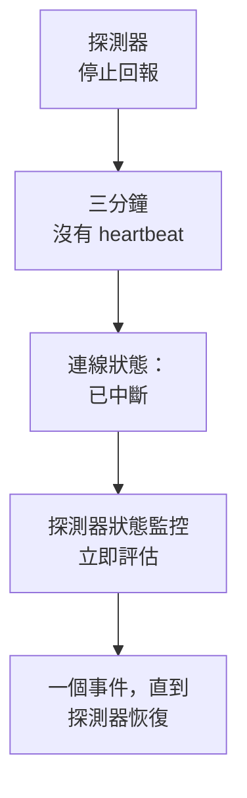

# 探測器狀態監控

探測器狀態監控會在探測器停止回報時通知您：探測器中斷時產生一個事件，探測器恢復後該事件自動解決。把它指向您的自訂探測器，或者在自行託管的 OneUptime 上指向執行所有監測器的全域探測器，這樣一個沉默的探測器就不會在無人知曉的情況下讓它的監測器無人檢查。新監測器還會在其某個探測器落後（其監測器的檢查或其網路裝置的輪詢頻率低於設定）時發出警示。

:::cards
- [建立一個](#建立探測器狀態監控): 選擇探測器，保留預設條件。
- [條件](#條件): 統計已連線、已中斷或落後的探測器，依目前值或一個時間範圍。
- [指標](#指標): 每分鐘記錄有多少探測器處於連線狀態。
:::

## 運作方式

OneUptime 每分鐘評估一次每個探測器狀態監控，並在它的任一探測器連線或中斷的那一刻再次評估。它讀取每個探測器的連線狀態，也就是探測器頁面上顯示的狀態：探測器在三分鐘內沒有任何消息即視為已中斷。在 OneUptime 本身停機或未接收資料之後，它會等滿三分鐘才把任何探測器視為已中斷，因此升級 OneUptime 永遠不會產生事件。它還會像探測器頁面一樣讀取每個已連線探測器是否落後（[探測器落後](/docs/probe/custom-probe#探測器落後)），並在某個探測器落後或趕上的那一刻再次評估監測器。

一直中斷的探測器只產生一個事件，而不是每分鐘一個。監測器保持離線、事件保持開啟，直到它關注的每個探測器都重新連線；然後事件自動解決。

一個監測器可以關注本專案的探測器和全域探測器。已刪除的探測器不計入任何一方。當監測器關注的探測器一個都不剩時，它保持現有狀態，並在一天後於概覽中提示這一點。

## 建立探測器狀態監控

:::steps
### 新增監測器

前往 **監測器**，點選 **建立監測器**。

### 選擇探測器狀態

在 **監測器類型** 下，點選 **更多監測器類型**，然後在 **其他** 下選擇 **探測器狀態**。填寫 **名稱**，點選 **下一步**。

### 選擇探測器

在 **要關注的探測器** 下選擇探測器。新監測器預設選取專案自己的探測器。沒有自有探測器的自行託管 OneUptime 預設選取它的全域探測器；在 OneUptime Cloud 上，全域探測器由 OneUptime 執行，因此專案如需關注它們，需要自行選擇。

### 建立監測器

保留下文介紹的預設條件，點選 **建立監測器**。監測器會立即被評估，其概覽會列出它關注的每個探測器，已中斷的排在最前。
:::

> [!TIP]
> 探測器頁面上以及 **監測器 → 設定 → 探測器** 中探測器所在列的選單裡的 **監測此探測器**，會開啟 **建立監測器**，並預先填入一個關注該探測器、以它命名的探測器狀態監控。

## 條件

探測器狀態監控的篩選條件統計的是探測器：

| 篩選條件 | 統計內容 |
| --- | --- |
| **已中斷連線的探測器數量** | 所關注的探測器中已中斷的探測器。 |
| **已連線的探測器數量** | 所關注的探測器中已連線的探測器。 |
| **落後的探測器數量** | 所關注的探測器中已連線但落後的探測器：其監測器的檢查或其網路裝置的輪詢頻率低於設定。 |

三者都是整數，可用 **大於**、**小於**、**等於** 等進行比較。新監測器預設帶有三條條件：

| 條件 | 篩選 | 作用 |
| --- | --- | --- |
| 檢查是否有探測器中斷連線 | **已中斷連線的探測器數量** 大於 `0` | 將監測器標記為離線，並宣告一個標題為「探測器已中斷連線：{{disconnectedProbeNames}}」的事件，該事件會自動解決。 |
| 檢查是否有探測器落後 | **落後的探測器數量** 大於 `0` | 發出一個標題為「探測器落後：{{behindProbeNames}}」的警示，該警示會自動解決。探測器仍在回報，因此它不會改變監測器的狀態，也不會宣告事件。 |
| 檢查所有探測器是否皆已連線 | **已中斷連線的探測器數量** 等於 `0` | 將監測器標記為正常運作。 |

在 **落後的探測器數量** 出現之前建立的監測器會保留其原有條件，因此在你把這項檢查加入它的條件之前，探測器落後時它不會收到通知。

**已連線的探測器數量** 適合關注多個探測器、可以容忍少一個的監測器：**已連線的探測器數量** 小於 `2` 只在剩下不足兩個時才宣告事件。

### 宣告事件前多等一會兒

探測器沉默三分鐘後才算中斷，因此短暫重新啟動不會產生任何事件。若要等更久，請在篩選條件下勾選 **在一段時間內評估此條件**，在 **評估** 中選擇 **所有值**，並在 **過去** 中選擇一個時間範圍。設為五分鐘時，探測器還需再中斷五分鐘才會宣告事件。

## 指標

每次評估都會在監測器上記錄三個序列：`oneuptime.monitor.probes.connected`、`oneuptime.monitor.probes.disconnected` 和 `oneuptime.monitor.probes.behind`，即所關注的探測器中已連線、已中斷和落後的數量。它們會在監測器的 **指標** 頁面上以圖表顯示，儀表板或指標監控也可以像讀取其他序列一樣讀取它們。

## 範本變數

除了每個監測器都有的變數外，探測器狀態監控的事件和警示範本還可以使用以下變數：

| 變數 | 值 |
| --- | --- |
| `{{disconnectedProbeNames}}` | 已中斷探測器的名稱，以逗號分隔。 |
| `{{disconnectedProbeCount}}` | 已中斷的探測器數量。 |
| `{{connectedProbeNames}}` | 已連線探測器的名稱，以逗號分隔。 |
| `{{connectedProbeCount}}` | 已連線的探測器數量。 |
| `{{behindProbeNames}}` | 落後的已連線探測器的名稱，以逗號分隔。 |
| `{{behindProbeCount}}` | 落後的探測器數量。 |
| `{{probeStatusSummary}}` | 一句話，列出已中斷的探測器（例如 `1 of 3 probes is disconnected: EU Probe.`），沒有則列出落後的探測器，或說明所有探測器均已連線。 |
| `{{probes}}` | 每個探測器，各帶 `probeName`、`isConnected`、`isBehind`、`isGlobalProbe` 和 `lastAliveAt`。 |

## 疑難排解

:::details 監測器顯示正在等待資料
新監測器會在一兩分鐘內顯示第一次評估結果。如果它沒有關注任何探測器，則會顯示 **未設定**：請在 **條件** 中選擇探測器。
:::

:::details 探測器離線了，卻沒有宣告事件
探測器在三分鐘沒有 heartbeat 後才算中斷，如果 OneUptime 本身曾停機則會更晚。請檢查監測器沒有被停用、不在維護時段內，並且它的條件仍會宣告事件。
:::

## 後續步驟

:::cards
- [自訂探測器](/docs/probe/custom-probe): 在您自己的網路中執行探測器。
- [條件與狀態](/docs/monitor/criteria-and-statuses): 條件如何決定監測器的狀態。
- [事件與警示範本](/docs/monitor/incident-alert-templating): 撰寫監測器所宣告事件的措辭。
:::
