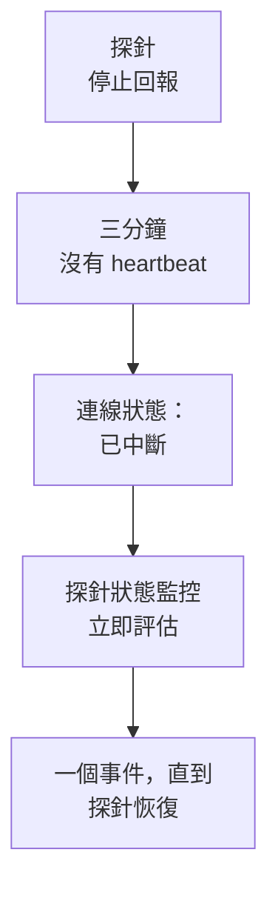

# 探針狀態監控

探針狀態監控會在探針停止回報時通知您：探針中斷時產生一個事件，探針恢復後該事件自動解決。把它指向您的自訂探針，或者在自行託管的 OneUptime 上指向執行所有監測器的全域探針，這樣一個沉默的探針就不會在無人知曉的情況下讓它的監測器無人檢查。

:::cards
- [建立一個](#建立探針狀態監控): 選擇探針，保留預設條件。
- [條件](#條件): 統計已連線或已中斷的探針，依目前值或一個時間範圍。
- [指標](#指標): 每分鐘記錄有多少探針處於連線狀態。
:::

## 運作方式

OneUptime 每分鐘評估一次每個探針狀態監控，並在它的任一探針連線或中斷的那一刻再次評估。它讀取每個探針的連線狀態，也就是探針頁面上顯示的狀態：探針在三分鐘內沒有任何消息即視為已中斷。在 OneUptime 本身停機或未接收資料之後，它會等滿三分鐘才把任何探針視為已中斷，因此升級 OneUptime 永遠不會產生事件。

一直中斷的探針只產生一個事件，而不是每分鐘一個。監測器保持離線、事件保持開啟，直到它關注的每個探針都重新連線；然後事件自動解決。

一個監測器可以關注本專案的探針和全域探針。已刪除的探針不計入任何一方。當監測器關注的探針一個都不剩時，它保持現有狀態，並在一天後於概覽中提示這一點。

## 建立探針狀態監控

:::steps
### 新增監測器

前往 **監測器**，點選 **建立監測器**。

### 選擇探針狀態

在 **監測器類型** 下，點選 **更多監測器類型**，然後在 **其他** 下選擇 **探測器狀態**。填寫 **名稱**，點選 **下一步**。

### 選擇探針

在 **要關注的探針** 下選擇探針。新監測器預設選取專案自己的探針。沒有自有探針的自行託管 OneUptime 預設選取它的全域探針；在 OneUptime Cloud 上，全域探針由 OneUptime 執行，因此專案如需關注它們，需要自行選擇。

### 建立監測器

保留下文介紹的預設條件，點選 **建立監測器**。監測器會立即被評估，其概覽會列出每個探針以及最後一次收到它消息的時間。
:::

> [!TIP]
> 探針頁面上以及 **監測器 → 設定 → 探測器** 中探針所在列的選單裡的 **監測此探針**，會開啟 **建立監測器**，並預先填入一個關注該探針、以它命名的探針狀態監控。

## 條件

探針狀態監控的篩選條件統計的是探針：

| 篩選條件 | 統計內容 |
| --- | --- |
| **Disconnected Probes** | 所關注的探針中已中斷的探針。 |
| **Connected Probes** | 所關注的探針中已連線的探針。 |

兩者都是整數，可用 **大於**、**小於**、**等於** 等進行比較。新監測器預設帶有兩條條件：

| 條件 | 篩選 | 作用 |
| --- | --- | --- |
| Check if a probe is disconnected | **Disconnected Probes** 大於 `0` | 將監測器標記為離線，並宣告一個標題為 `Probe disconnected: {{disconnectedProbeNames}}` 的事件，該事件會自動解決。 |
| Check if every probe is connected | **Disconnected Probes** 等於 `0` | 將監測器標記為正常運作。 |

**Connected Probes** 適合關注多個探針、可以容忍少一個的監測器：**Connected Probes** 小於 `2` 只在剩下不足兩個時才宣告事件。

### 宣告事件前多等一會兒

探針沉默三分鐘後才算中斷，因此短暫重新啟動不會產生任何事件。若要等更久，請在篩選條件下勾選 **在一段時間內評估此條件**，在 **評估** 中選擇 **All Values**，並在 **過去(以分鐘計)** 中選擇一個時間範圍。設為五分鐘時，探針還需再中斷五分鐘才會宣告事件。

## 指標

每次評估都會在監測器上記錄兩個序列：`oneuptime.monitor.probes.connected` 和 `oneuptime.monitor.probes.disconnected`，即所關注的探針中已連線和已中斷的數量。它們會在監測器的 **指標** 頁面上以圖表顯示，儀表板或指標監控也可以像讀取其他序列一樣讀取它們。

## 範本變數

除了每個監測器都有的變數外，探針狀態監控的事件和警示範本還可以使用以下變數：

| 變數 | 值 |
| --- | --- |
| `{{disconnectedProbeNames}}` | 已中斷探針的名稱，以逗號分隔。 |
| `{{disconnectedProbeCount}}` | 已中斷的探針數量。 |
| `{{connectedProbeNames}}` | 已連線探針的名稱，以逗號分隔。 |
| `{{connectedProbeCount}}` | 已連線的探針數量。 |
| `{{probeStatusSummary}}` | 一句話，列出已中斷的探針（例如 `1 of 3 probes is disconnected: EU Probe.`），或說明所有探針均已連線。 |
| `{{probes}}` | 每個探針，各帶 `probeName`、`isConnected`、`isGlobalProbe` 和 `lastAliveAt`。 |

## 疑難排解

:::details 監測器顯示正在等待資料
新監測器會在一兩分鐘內顯示第一次評估結果。如果它沒有關注任何探針，則會顯示 **Not set up**：請在 **條件** 中選擇探針。
:::

:::details 探針離線了，卻沒有宣告事件
探針在三分鐘沒有 heartbeat 後才算中斷，如果 OneUptime 本身曾停機則會更晚。請檢查監測器沒有被停用、不在維護時段內，並且它的條件仍會宣告事件。
:::

## 後續步驟

:::cards
- [自訂探針](/docs/probe/custom-probe): 在您自己的網路中執行探針。
- [監測器條件與狀態](/docs/monitor/criteria-and-statuses): 條件如何決定監測器的狀態。
- [事件與警示範本](/docs/monitor/incident-alert-templating): 撰寫監測器所宣告事件的措辭。
:::
