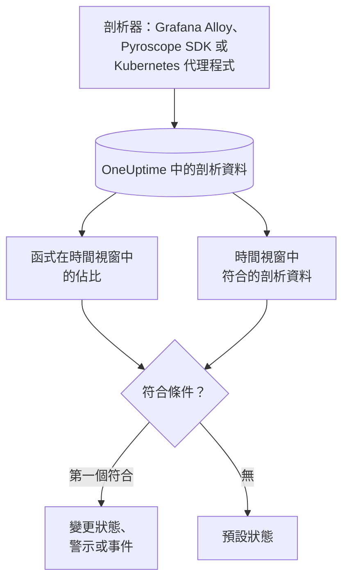

# 效能剖析監控

效能剖析監測器會讀取您的服務傳送到 OneUptime 的持續剖析資料，並在兩種情況下發出警示：某個函式佔用的時間比例超出應有水準，例如一次部署後變重的剖析器；以及某個服務不再傳送剖析資料。它每分鐘測量其時間視窗中有多少經過您指定的函式，計算符合其篩選器的剖析資料，並在符合您的條件時變更監測器狀態、建立警示或宣告事件。

:::cards
- [建立監測器](#建立效能剖析監測器): 從剖析器中的某個函式開始，或從 建立監測器 開始。
- [查詢內容](#查詢內容): 函式、剖析類型、服務和時間視窗。
- [條件](#條件): 函式在時間視窗中的佔比，或剖析資料的數量。
- [函式變重了](#實例函式變重了): 當某個函式的佔比暴增時發出警示。
:::

## 運作方式



OneUptime 每分鐘讀取符合監測器篩選器、且在其時間視窗內開始的剖析資料。它會計算這些資料，並在監測器指定了函式時，測量該視窗的時間中經過該函式的佔比。它由上而下將這些數字與監測器的條件比較，第一個符合的條件決定接下來發生什麼。如果沒有條件符合，監測器會回到預設狀態。

## 開始之前

- 您的服務透過 Grafana Alloy（eBPF）、Pyroscope SDK 或 OneUptime Kubernetes 代理程式，將持續剖析資料傳送到 OneUptime。請參閱 [持續效能剖析](/docs/telemetry/profiles)。
- 要關注某個函式，您需要知道它的名稱，或其檔案或套件路徑的一部分，與剖析器中顯示的一致。

## 建立效能剖析監測器

:::steps
### 從剖析器開始，或從 建立監測器 開始

最快的方式是從函式本身開始：在 **效能設定檔** 中開啟該函式，點擊為其佔比提供警示的連結。**建立監測器** 會開啟，監測器已為該函式及其服務填好，閾值高於它今天的佔比，詳見 [實例：函式變重了](#實例函式變重了)。否則，請前往 **監測器** 並點擊 **建立監測器**。

### 選擇 Profiles

在 **監測器類型** 下點擊 **更多監測器類型**，然後在 **遙測** 下選擇 **設定檔**，或在搜尋框中輸入 `profiles`。輸入 **名稱**，然後點擊 **下一步**。

### 選擇讀取的內容

在 **效能剖析監測器設定** 中，將 **函式** 設為要關注的函式，將 **分析內容** 設為剖析類型，將 **監控效能剖析的時長（時間）** 設為時間視窗。新監測器讀取 **過去 5 分鐘** 的 **CPU 時間**。欄位下方的 **此監測器現在讀取的內容** 會顯示有多少剖析資料符合，以及該函式今天佔視窗的多少，方便您把閾值設在它之上。開啟 **更多欄位** 可依遙測服務或基礎架構實體篩選。

### 設定條件

從 **建立監測器** 開始的監測器有兩個條件：**效能剖析數量** 為 0 時離線並建立事件，大於 0 時上線。要針對該函式發出警示，請新增 **函式佔比（%）** 篩選器，參見 [條件](#條件)。

### 建立監測器

點擊 **建立監測器**。監測器會在其 **概覽** 頁面開啟，第一次評估在一分鐘內執行。
:::

### 透過 API 或 Terraform 建立

監測器的步驟包含與其 `profileMonitor` 設定相同的設定。下面的設定在一個服務最近五分鐘的 CPU 剖析資料中關注 `parseOrder`：

```json
{
  "profileMonitor": {
    "telemetryServiceIds": [],
    "profileTypes": ["cpu"],
    "profileType": "",
    "functionName": "parseOrder",
    "attributes": {},
    "lastXSecondsOfProfiles": 300
  }
}
```

把服務 ID 放進 `telemetryServiceIds`，或將清單留空以讀取所有服務的剖析資料；只想計算剖析資料時，將 `functionName` 留空。透過 [API](/docs/api-reference/api-reference) 或 [Terraform](/docs/terraform/monitor-steps) 建立一個監測器類型為 `Profiles` 的監測器，其步驟包含此設定和至少一個條件。在 Terraform 中，將設定作為步驟的 `profile_monitor` 屬性傳入，並用 `jsonencode()` 撰寫。

## 查詢內容

| 欄位 | 符合什麼 | 預設值 |
| --- | --- | --- |
| `profileTypes` | 屬於這些類型之一的剖析資料，精確比對，例如 `cpu`。 | 空：所有類型 |
| `profileType` | 類型包含此文字的剖析資料，不區分大小寫。設定後會忽略 `profileTypes`。 | 空 |
| `functionName` | **函式佔比（%）** 測量其佔比的程式碼：函式名稱或檔案路徑包含此文字的堆疊框架，不區分大小寫。 | 空：不測量佔比 |
| `telemetryServiceIds` | 來自這些遙測服務之一的剖析資料。 | 空：所有服務 |
| `entityKeys` | 來自這些主機、Pod、容器和其他基礎架構實體之一的剖析資料。 | 空：所有實體 |
| `attributes` | 屬性具有這些值的剖析資料。 | 空：無條件 |
| `lastXSecondsOfProfiles` | 在評估前這麼多秒內開始的剖析資料。 | 無：務必設定，否則會計算所有已儲存的剖析資料，計數永遠不會降到 0 |

剖析資料必須符合您設定的所有篩選器才會被讀取。在表單中，**函式** 設定 `functionName`，**分析內容** 設定 `profileTypes`（選 **所有類型的效能剖析** 時為空），**監控效能剖析的時長（時間）** 設定 `lastXSecondsOfProfiles`，**依遙測服務篩選** 和 **依基礎架構實體篩選** 設定 `telemetryServiceIds` 和 `entityKeys`。

## 如何評估

- **每分鐘。** 效能剖析監測器不是由探測器檢查，因此沒有可設定的間隔，也沒有 **探測器與間隔** 頁面。
- **每次評估兩個數字。** 監測器會計算符合所有篩選器、且在 `lastXSecondsOfProfiles` 內開始的剖析資料，並測量該函式在這些剖析資料中的佔比。剖析器會依固定間隔上傳，所以請讓時間視窗留出容納多次上傳的空間。
- **一次一種單位。** 佔比只累加同一種單位的樣本：當讀取的類型混合了單位，例如來自 SDK 的以奈秒計的 CPU 時間和來自 eBPF 的樣本數，它會讀取視窗中樣本最多的單位。
- **沒有剖析資料就是計數 0，也沒有佔比。** 剖析器停止上傳的服務計數為 0，而 **函式佔比（%）** 條件不會符合空的視窗：請針對 **效能剖析數量** 發出警示，以便知道剖析已停止。
- **OneUptime 本身的停機不算沉默。** 只要時間視窗中包含 OneUptime 本身沒有接收資料的時間（正在重新啟動、升級或追趕積壓），檢查就會等待：狀態不會改變，也不會開啟或解決任何事件或警示。請參閱 [OneUptime 未接收資料時](/docs/monitor/when-oneuptime-is-not-receiving)。
- **條件由上而下。** 第一個符合的條件決定結果，因此請把最嚴重的放在最前面。

每次狀態變更及其原因，都會記錄在監測器的 **狀態時間軸** 上。

## 條件

效能剖析監測器的條件會將兩個數字之一與某個值比較。

**函式佔比（%）** 是視窗時間中經過監測器函式的佔比，範圍 0 到 100：每個帶有與 `functionName` 相符框架的堆疊只算一次，無論其深度如何，因此函式本身的程式碼及其呼叫的一切都包含在內。

| 篩選條件 | 當函式佔比…時符合 |
| --- | --- |
| **大於** | 高於該值 |
| **大於或等於** | 等於或高於該值 |
| **小於** | 低於該值 |
| **小於或等於** | 等於或低於該值 |

**效能剖析數量** 是在視窗中符合的剖析資料數量：

| 篩選條件 | 當剖析資料計數…時符合 |
| --- | --- |
| **大於** | 高於該值 |
| **大於或等於** | 等於或高於該值 |
| **小於** | 低於該值 |
| **小於或等於** | 等於或低於該值 |
| **等於** | 剛好等於該值 |
| **不等於** | 不等於該值 |

剖析資料計數沒有異常條件：沒有可與之比較的基準線。

## 實例：函式變重了

結帳服務中的 `parseOrder` 佔用其 CPU 時間的 18%。一次剖析更大承載的部署不應被忽視：

1. 在 **效能設定檔** 中選擇結帳服務並開啟 `parseOrder`。
2. 點擊為其佔比提供警示的連結。剖析器建議 30%：在今天的佔比上再加一半，至少高出 10 個百分點，並無條件進位到 5 的倍數。
3. **建立監測器** 開啟，其中是一個讀取結帳服務 **過去 5 分鐘** **CPU 時間** 的效能剖析監測器，帶有兩個條件：**函式佔比（%）** **大於** `30` 會發出一個可自行解決的警示，並將監測器標記為效能降低；**小於或等於** `30` 將其標記為正常運作。事件已填寫但處於關閉狀態：如需呼叫值班人員，請將其開啟。
4. 點擊 **建立監測器**。

當這次部署讓 `parseOrder` 佔用 45% 的 CPU 時間時，下一次評估就會發出警示。當修正讓它回到 30% 以下時，警示會自行解決。

## 實例：剖析資料不再抵達

結帳服務執行著一個上傳 CPU 剖析資料的 Pyroscope SDK。您希望它們停止五分鐘時建立事件：

- `profileTypes`：`["cpu"]`，`telemetryServiceIds`：結帳服務，`lastXSecondsOfProfiles`：`300`
- 條件 1：**效能剖析數量** **等於** `0`：將監測器標記為離線並宣告事件
- 條件 2：**效能剖析數量** **大於** `0`：將監測器標記為上線

只要 SDK 在上傳，每次評估都會計算到一些剖析資料，條件 2 讓監測器維持上線。當服務在沒有 SDK 的情況下部署後，計數會在最後一次上傳五分鐘後降到 0，條件 1 符合並宣告事件。修正後的第一次上傳讓計數重新高於 0，如果該事件開啟了 **自動解決事件**，事件會自行解決。

## 疑難排解

:::details 監測器計數為 0，但 OneUptime 中看得到剖析資料
把篩選器與您看到的剖析資料比較：`profileTypes` 必須與類型完全符合，`telemetryServiceIds` 必須包含正確的服務 ID。`lastXSecondsOfProfiles` 太短也可能剛好落在兩次上傳之間。
:::

:::details 函式佔比一直是 0%
視窗中沒有任何框架包含該函式文字。在剖析器中開啟該函式，照顯示的樣子複製它的名稱；名稱的一部分也可以，大小寫無關。然後檢查服務是否傳送了 **分析內容** 所讀取的剖析類型。
:::

## 後續步驟

:::cards
- [持續效能剖析](/docs/telemetry/profiles): 傳送剖析資料，並在剖析器中查看。
- [監控步驟](/docs/terraform/monitor-steps): 從 Terraform 傳入步驟設定。
- [追蹤監控](/docs/monitor/traces-monitor): 針對失敗的 Span 發出警示。
- [指標監控](/docs/monitor/metrics-monitor): 針對 CPU、記憶體與其他指標發出警示。
:::
