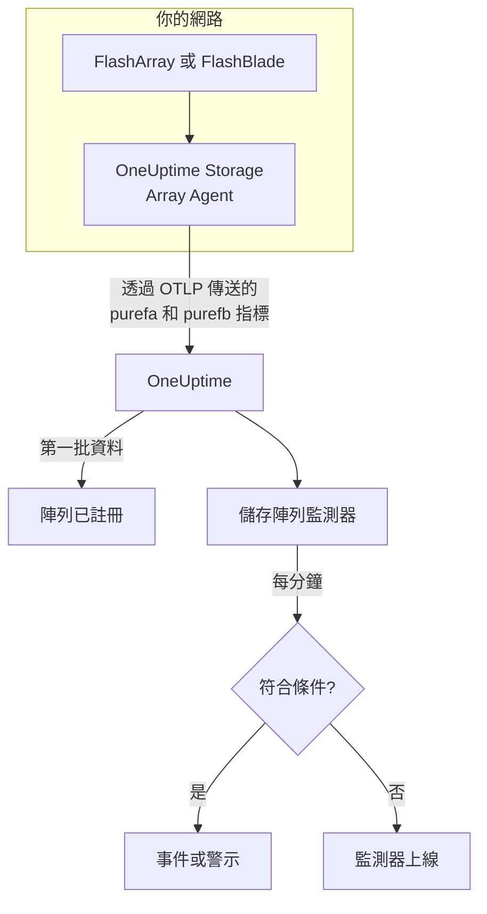

# 儲存陣列監控

儲存陣列監測器會監看一個儲存陣列，並在陣列本身發出警示、空間不足、變慢、遺失硬體或主機路徑，或複寫落後時通知你。它支援 Pure Storage FlashArray 和 Pure Storage FlashBlade，讀取陣列本身匯出的指標——Pure 的 `purefa_*` 和 `purefb_*` 序列——這些指標由 OneUptime Storage Array Agent 收集。

:::cards
- [建立監測器](#建立儲存陣列監測器): 在儀表板中的六個步驟。
- [範本](#預建警示範本): 十八個現成的警示，每個磁碟區、主機或元件一個事件。
- [Pure 序列的運作方式](#pure-序列的結構): 一個指標名稱，多個數值。
- [指標](#收集的指標): 監測器可以據以發出警示的每個序列。
:::

## 運作原理

OneUptime Storage Array Agent 執行在能夠連線到陣列管理介面的機器上。它使用唯讀 API 權杖讀取陣列的指標，為指標加上陣列的名稱 `storage.array.name` 和平台 `storage.system` 標籤，並透過 OTLP 傳送到 OneUptime。第一批資料送達時會註冊該陣列。

儲存陣列監測器繫結到一個陣列。它每分鐘對該陣列的指標執行一次查詢，並將結果與其條件比較。



## 開始之前

- **安裝 Storage Array Agent**，安裝在能透過 HTTPS 連線到陣列的位置，並使用擁有陣列 **readonly** 角色之使用者的 API 權杖。[Storage Array Agent 指南](/docs/telemetry/storage-arrays) 介紹了使用者、權杖和安裝，涉及 `ONEUPTIME_URL`、`ONEUPTIME_TELEMETRY_INGESTION_KEY`、`STORAGE_ARRAY_NAME`，以及陣列的位址和權杖(`PURE_FA_ENDPOINT` 和 `PURE_FA_API_TOKEN`，或 `PURE_FB_ENDPOINT` 和 `PURE_FB_API_TOKEN`)。
- **確認陣列已註冊。** 在第一次收集後大約一分鐘，它會以代理程式的 `STORAGE_ARRAY_NAME` 命名，出現在 **產品 → 基礎設施 → Storage Arrays → All Storage Arrays** 下。

## 建立儲存陣列監測器

:::steps
### 新增監測器

前往 **監測器**，點選 **建立監測器**。

### 選擇儲存陣列

在 **監測器類型** 下點選 **更多監測器類型**，然後在 **基礎設施** 下選擇 **儲存陣列**，或在搜尋方塊中輸入 `storage`。輸入 **名稱**(它會用在事件和警示標題中)，然後點選 **下一步**。

### 選擇陣列

在 **Storage Array Monitor Configuration** 下，從 **儲存陣列** 中選擇陣列。每個傳送過資料的陣列都在清單中。陣列的平台決定了表單提供哪些指標和範本。

### 選擇要監看的內容

選擇三個索引標籤之一：

- **Quick Setup**：點選一個 [範本](#預建警示範本)。它會設定指標、標籤篩選器、彙總、時間範圍和臨界值，並用自己的條件取代下面的條件。你仍然可以修改 **時間範圍**。
- **Custom Metric**：從 **Storage Array Metric** 中選擇一個指標，然後設定 **彙總** 和 **時間範圍**。[篩選器](#監測器設定) 可以把它縮小到一個磁碟區、主機、Pod、元件、檔案系統或儲存貯體。
- **進階**：在 **選擇指標** 下自行建構查詢和公式，例如用 `purefa_array_space_bytes` 篩選到 `space=capacity`，減去同一指標篩選到 `space=empty`，得到已用容量。以物件的標籤 **Group by**，即可分別判斷每個物件。

### 檢查條件

開啟 **監測器條件** 下的每個條件，檢查其 **指標**、**彙總**、**條件** 和 **Threshold**。範本會填入這些內容。使用 **Custom Metric** 或 **進階** 時，監測器會從 [預設條件](#預設條件) 開始，它只會注意到指標降為零，所以請設定你自己的臨界值。

### 建立監測器

點選 **建立監測器**。OneUptime 會開啟監測器的頁面，並每分鐘評估一次。它發出的事件和警示也會列在陣列的 **事件** 和 **警示** 頁面上。
:::

> [!TIP]
> 若要一次設定多個範本，請從 **產品 → 基礎設施 → Storage Arrays** 開啟陣列，然後前往 **Recommendations**。選擇你需要的範本和要呼叫的人員，OneUptime 會為每個範本建立一個監測器。

## 監測器設定

| 欄位 | 索引標籤 | 作用 |
| --- | --- | --- |
| **儲存陣列** | 全部 | 必填。把每個查詢限定到 `resource.storage.array.name`，因此兩個都有名為 `vol-01` 之磁碟區的陣列永遠不會混在一起。 |
| **磁碟區** | Custom Metric、進階 | 僅限 FlashArray。一個磁碟區，依 `name` 標籤，例如 `vol-db-01`。Pod 或磁碟區群組中的磁碟區命名為 `pod::volume` 或 `group/volume`。 |
| **主機** | Custom Metric、進階 | 僅限 FlashArray。陣列所知的一台主機，依 `host` 標籤，例如 `esxi-01`。 |
| **Pod** | Custom Metric、進階 | 僅限 FlashArray。一個 ActiveCluster 或 ActiveDR Pod，依 `name` 標籤，在複本連結序列上則依 `local_pod`。 |
| **Hardware Component** | Custom Metric、進階 | 一個硬體元件，例如 `CH0.BAY1` 或 `CT0`：在 FlashArray 上是 `component_name` 標籤，在 FlashBlade 上是 `name`。 |
| **File System** | Custom Metric、進階 | 僅限 FlashBlade。一個檔案系統，依 `name` 標籤。 |
| **Bucket** | Custom Metric、進階 | 僅限 FlashBlade。一個物件儲存貯體，依 `name` 標籤。 |
| **Storage Array Metric** | Custom Metric | [目錄](#收集的指標) 中的一個指標。表單會加入賦予其意義的標籤篩選器，並依它描述的物件分組，因此每個磁碟區、主機或元件都會單獨判斷。 |
| **彙總** | Custom Metric | 如何合併樣本：**平均**、**最大值**、**最小值**、**總和** 或 **計數**。從該指標的常用彙總開始。 |
| **時間範圍** | 全部 | 查詢讀取的滾動視窗，從 **Past 1 Minute** 到 **Past 365 Days**。新監測器從 **Past 5 Minutes** 開始；檔案系統或儲存貯體的自訂指標從 **Past 15 Minutes** 開始；範本會設定自己的值。 |
| **選擇指標** | 進階 | 查詢建構器：**指標**、**Aggregate by**、**Filter by attributes**、**Group by**，以及用於合併查詢的 **新增指標** 和 **新增公式**。 |

代理程式每 60 秒讀取一次陣列端點，每 2 分鐘讀取一次磁碟區、主機和 Pod，因此 5 分鐘的視窗中一定會有樣本。它每 5 分鐘讀取一次 FlashBlade 的檔案系統和儲存貯體(所以用 15 分鐘)，每 30 分鐘讀取一次 FlashArray 目錄：請給目錄監測器設定 60 分鐘的視窗。

## Pure 序列的結構

Pure 把多個數值放在 **一個** 指標名稱上，並用一個標籤區分它們：

- **`dimension`** 用於效能序列。`purefa_array_performance_latency_usec` 帶有讀取延遲(`usec_per_read_op`)、寫入延遲(`usec_per_write_op`)、鏡像寫入延遲，以及每項的 SAN、佇列、QoS 和服務時間。請一律依一個 `dimension` 篩選：跨它們取平均會把 200 µs 的讀取延遲和一個佇列數值混在一起。
- **`space`** 用於容量序列：`capacity`、`empty`、`snapshots`、`total_provisioned`、`total_physical`、`available_ratio` 等。

有幾個序列把狀態放在 **標籤** 中，其值一律為 1：

| 序列 | 狀態標籤 | 每個序列對應 |
| --- | --- | --- |
| `purefa_alerts_open` | `severity`，並帶有 `summary`、`code` 和 `component_type` | 一個未關閉的警示 |
| `purefa_hw_component_status` | `component_status` | 一個硬體元件 |
| `purefa_host_connectivity_info` | `status`，並帶有 `details` | 一台主機 |
| `purefa_drive_capacity_bytes` | `component_status`(值為磁碟機的容量) | 一個磁碟機 |

篩選到某個不良狀態的序列只在有物件處於該狀態時才存在，因此沒有序列就表示健康。這就是為什麼 **Max 大於 0 時觸發、為 0 時復原** 是適合它們的形式，範本也是這樣建構的：它們的復原條件把缺少的序列計為零。

在監測器篩選器和分組鍵中，代理程式的屬性以 `resource.` 開頭(`resource.storage.array.name`、`resource.storage.system`)，而 Pure 自己的標籤不以它開頭(`name`、`host`、`component_name`、`dimension`、`space`、`severity`)。

## 預建警示範本

OneUptime 提供 18 個範本——11 個用於 FlashArray，7 個用於 FlashBlade——**Quick Setup** 會提供適用於陣列平台的那些範本。每個範本都會建構一個完整的監測器：指標查詢、其標籤篩選器、依物件自身標籤的分組、一個觸發條件和一個復原條件。臨界值是可以編輯的起點。

只有當條件對視窗中的 **每個** 值都成立時，條件才會觸發。在容量、延遲、落後或比率臨界值上觸發的監測器，只有超過臨界值 10% 之後才會復原，因此在臨界值附近徘徊的值不會來回切換；警示和硬體範本會在狀態消失時立即復原。

### FlashArray

| 範本 | 類別 | 嚴重程度 | 監看內容 | 觸發條件 |
| --- | --- | --- | --- | --- |
| Critical Array Alert | Array Health | 嚴重 | `purefa_alerts_open` 篩選到 `severity=critical`，依 `summary` 取 Max，過去 5 分鐘 | > 0 — 陣列有一個未關閉的嚴重警示(元件故障、容量緊急、複寫失敗)。每個警示一個事件；警示關閉時復原 |
| Warning Array Alert | Array Health | Warning | `purefa_alerts_open` 篩選到 `severity=warning`，依 `summary` 取 Max，過去 5 分鐘 | > 0 — 陣列有一個未關閉的警告層級警示。每個警示一個事件；警示關閉時復原 |
| Capacity Above 80% | 容量 | Warning | `purefa_array_space_utilization`，Max，過去 15 分鐘 | > 80 — Pure 自己的第一個容量臨界值；≤ 72 時復原 |
| Capacity Above 90% | 容量 | 嚴重 | `purefa_array_space_utilization`，Max，過去 5 分鐘 | > 90 — 陣列即將拒絕寫入；≤ 81 時復原 |
| High Read Latency | Performance | Warning | `purefa_array_performance_latency_usec` 篩選到 `dimension=usec_per_read_op`，Avg，過去 10 分鐘 | > 5000 µs (5 ms) — FlashArray 的讀取通常遠低於 1 ms；≤ 4500 時復原 |
| High Write Latency | Performance | Warning | `purefa_array_performance_latency_usec` 篩選到 `dimension=usec_per_write_op`，Avg，過去 10 分鐘 | > 5000 µs (5 ms)；≤ 4500 時復原 |
| Hardware Component Failed | Hardware | 嚴重 | `purefa_hw_component_status` 篩選到 `component_status=critical`，依 `component_name` 取 Max，過去 5 分鐘 | > 0 — 某個控制器、電源供應器、風扇、槽位或連接埠處於嚴重狀態，備援已經喪失。每個元件一個事件；它回報 ok 時復原 |
| Hardware Component Degraded | Hardware | Warning | `purefa_hw_component_status` 篩選到 `component_status=degraded`，依 `component_name` 取 Max，過去 5 分鐘 | > 0 — 某個元件已降級。每個元件一個事件；它回報 ok 時復原 |
| Drive Failed | Hardware | 嚴重 | `purefa_drive_capacity_bytes` 篩選到 `component_status=failed`，依 `component_name` 取 Max，過去 5 分鐘 | > 0 — 某個 DirectFlash 模組或 SSD 故障，陣列正在其餘磁碟機上重建。每個磁碟機一個事件；更換後復原 |
| Host Lost Redundant Paths | 主機 | Warning | `purefa_host_connectivity_info` 篩選到 `status=critical`，依 `host` 取 Max，過去 5 分鐘 | > 0 — 主機只能透過一個控制器連線到陣列，或完全無法連線；一次控制器容錯移轉就會讓它的儲存離線。每台主機一個事件；路徑恢復時復原 |
| Replication Lag Above 1 Minute | Replication | Warning | `purefa_pod_replica_links_lag_max_msec`，依 `local_pod` 取 Max，過去 10 分鐘 | > 60000 ms (60 s) — 此時容錯移轉會遺失比計畫更多的近期寫入。每個 Pod 一個事件；≤ 54000 時復原 |

### FlashBlade

| 範本 | 類別 | 嚴重程度 | 監看內容 | 觸發條件 |
| --- | --- | --- | --- | --- |
| Critical Array Alert | Array Health | 嚴重 | `purefb_alerts_open` 篩選到 `severity=critical`，依 `summary` 取 Max，過去 5 分鐘 | > 0 — FlashBlade 有一個未關閉的嚴重警示。每個警示一個事件；警示關閉時復原 |
| Warning Array Alert | Array Health | Warning | `purefb_alerts_open` 篩選到 `severity=warning`，依 `summary` 取 Max，過去 5 分鐘 | > 0 — FlashBlade 有一個未關閉的警告層級警示。每個警示一個事件；警示關閉時復原 |
| Capacity Above 80% | 容量 | Warning | `purefb_array_space_utilization` 篩選到 `type=array`，Max，過去 15 分鐘 | > 80；≤ 72 時復原 |
| Capacity Above 90% | 容量 | 嚴重 | `purefb_array_space_utilization` 篩選到 `type=array`，Max，過去 5 分鐘 | > 90 — 寫滿時每個用戶端的寫入都會失敗；≤ 81 時復原 |
| Hardware Component Unhealthy | Hardware | 嚴重 | `purefb_hardware_health`，依 `name` 取 Min，過去 5 分鐘 | < 1 — 某個刀鋒、交換模組、電源供應器或風扇不健康(未使用的插槽回報 2)。每個元件一個事件；≥ 1 時復原 |
| High Read Latency | Performance | Warning | `purefb_array_performance_latency_usec` 篩選到 `dimension=usec_per_read_op` 和 `protocol=all`，Avg，過去 10 分鐘 | > 10000 µs (10 ms)，跨所有通訊協定；≤ 9000 時復原 |
| File System Near Full | File Systems | Warning | `purefb_file_systems_space_bytes` 篩選到 `space=available_ratio`，依 `name` 取 Min，過去 15 分鐘 | < 0.1 — 檔案系統佈建大小的剩餘不足 10%。每個檔案系統一個事件；≥ 0.11 時復原 |

**嚴重程度** 是選擇器顯示的標籤。範本建立的事件和警示會以專案中最嚴重的事件和警示嚴重程度開始；可以在條件中修改。

- **未關閉的警示和硬體狀態使用 Max**，因為這類序列只在警示未關閉或元件處於該狀態時才存在，所以只要有一次收集顯示它，就會超過臨界值。
- **每個依物件的範本都依物件自身的標籤分組**(`summary`、`component_name`、`host`、`local_pod`、`name`)，因此每個受影響的物件各觸發一個事件，並且事件中會寫出該物件。
- **延遲範本使用 Avg**，對陣列自身計算的每次作業平均值取平均；容量範本對陣列自身的使用率百分比取 **Max**。延遲固定以微秒為單位，容量固定以百分比為單位。
- **Hardware Component Unhealthy 依元件使用 Min**：元件健康時其健康值為 1，不健康時降到 0。

沒有針對每個磁碟區延遲的範本，因為合適的臨界值取決於工作負載：請從目錄中依 `name` 分組自行建構。容量預測需要的是成長趨勢而不是臨界值，而磁碟機磨損沒有可以發出警示的序列。

## 收集的指標

代理程式會傳送陣列匯出的所有內容；下面的序列是監測器表單提供的目錄。每個值都是陣列自己計算的量測值——延遲以每次作業的微秒計，輸送量以每秒計——因此不需要計算速率。**篩選器** 是賦予序列該列所述意義的標籤篩選器；表單會替你套用它。

### Array Health

| 指標 | 篩選器 | 平台 | 單位 | 描述 |
| --- | --- | --- | --- | --- |
| `purefa_alerts_open` | — | FlashArray | `count` | 陣列上每個未關閉的警示一個序列(值為 1)，帶有標籤 `severity`(`critical`、`warning`、`info`、`hidden`)、`category`、`code`、`component_type` 和 `summary` |
| `purefb_alerts_open` | — | FlashBlade | `count` | FlashBlade 上每個未關閉的警示一個序列(值為 1)，帶有標籤 `severity`(`info`、`warning`、`critical`)、`code`、`component_name`、`component_type`、`summary` 和 `kburl`(Pure 知識庫文章) |

### Capacity

| 指標 | 篩選器 | 平台 | 單位 | 描述 |
| --- | --- | --- | --- | --- |
| `purefa_array_space_utilization` | — | FlashArray | `%` | 陣列可用容量中已使用的比例。Pure 自己會在 80%、90% 和 100% 時發出容量警示 |
| `purefa_array_space_bytes` | `space=capacity` | FlashArray | `bytes` | 陣列的可用容量 |
| `purefa_array_space_bytes` | `space=empty` | FlashArray | `bytes` | 未使用的容量——追蹤其趨勢可以預測陣列何時寫滿 |
| `purefa_array_space_bytes` | `space=snapshots` | FlashArray | `bytes` | 僅由快照佔用的實體空間；快速成長通常表示某個保護群組保留的快照比計畫的多 |
| `purefa_array_space_data_reduction_ratio` | — | FlashArray | `ratio` | 整個陣列的重複資料刪除和壓縮，例如 4.2:1 記為 4.2。持續下降表示新資料的縮減效果不佳 |
| `purefb_array_space_utilization` | `type=array` | FlashBlade | `%` | FlashBlade 可用容量中已使用的比例 |
| `purefb_array_space_bytes` | `type=array`、`space=empty` | FlashBlade | `bytes` | FlashBlade 未使用的容量 |
| `purefb_array_space_data_reduction_ratio` | `type=array` | FlashBlade | `ratio` | 整個 FlashBlade 的資料縮減 |

### Performance

| 指標 | 篩選器 | 平台 | 單位 | 描述 |
| --- | --- | --- | --- | --- |
| `purefa_array_performance_latency_usec` | `dimension=usec_per_read_op` | FlashArray | `µs` | 主機看到的讀取平均延遲；FlashArray 的讀取通常遠低於 1 ms |
| `purefa_array_performance_latency_usec` | `dimension=usec_per_write_op` | FlashArray | `µs` | 主機看到的寫入平均延遲 |
| `purefa_array_performance_latency_usec` | `dimension=usec_per_mirrored_write_op` | FlashArray | `µs` | 寫入延伸 ActiveCluster Pod 的平均延遲，包括到夥伴陣列的來回 |
| `purefa_array_performance_latency_usec` | `dimension=san_usec_per_read_op` | FlashArray | `µs` | 讀取在 SAN 中花費的時間；SAN 延遲高而服務延遲低時，問題指向交換網路或主機 |
| `purefa_array_performance_throughput_iops` | `dimension=reads_per_sec` | FlashArray | `ops/s` | 每秒讀取作業數 |
| `purefa_array_performance_throughput_iops` | `dimension=writes_per_sec` | FlashArray | `ops/s` | 每秒寫入作業數 |
| `purefa_array_performance_bandwidth_bytes` | `dimension=read_bytes_per_sec` | FlashArray | `bytes/s` | 每秒讀取的位元組數 |
| `purefa_array_performance_bandwidth_bytes` | `dimension=write_bytes_per_sec` | FlashArray | `bytes/s` | 每秒寫入的位元組數 |
| `purefa_array_performance_queue_depth_ops` | — | FlashArray | `ops` | 陣列上排入佇列的作業；佇列增長且延遲上升表示主機傳送的量超過了陣列的處理能力 |
| `purefa_array_performance_average_bytes` | `dimension=bytes_per_op` | FlashArray | `bytes` | 作業的平均大小——大型 I/O 即使一切正常也會增加延遲 |
| `purefb_array_performance_latency_usec` | `dimension=usec_per_read_op`、`protocol=all` | FlashBlade | `µs` | 所有通訊協定的讀取平均延遲 |
| `purefb_array_performance_latency_usec` | `dimension=usec_per_write_op`、`protocol=all` | FlashBlade | `µs` | 所有通訊協定的寫入平均延遲 |
| `purefb_array_performance_throughput_iops` | `dimension=reads_per_sec`、`protocol=all` | FlashBlade | `ops/s` | 所有通訊協定的每秒讀取作業數 |
| `purefb_array_performance_throughput_iops` | `dimension=writes_per_sec`、`protocol=all` | FlashBlade | `ops/s` | 所有通訊協定的每秒寫入作業數 |
| `purefb_array_performance_bandwidth_bytes` | `dimension=read_bytes_per_sec`、`protocol=all` | FlashBlade | `bytes/s` | 所有通訊協定的每秒讀取位元組數 |
| `purefb_array_performance_bandwidth_bytes` | `dimension=write_bytes_per_sec`、`protocol=all` | FlashBlade | `bytes/s` | 所有通訊協定的每秒寫入位元組數 |

### Volumes

| 指標 | 篩選器 | 平台 | 單位 | 描述 |
| --- | --- | --- | --- | --- |
| `purefa_volume_performance_latency_usec` | `dimension=usec_per_read_op` | FlashArray | `µs` | 每個磁碟區的讀取平均延遲——依 `name` 分組 |
| `purefa_volume_performance_latency_usec` | `dimension=usec_per_write_op` | FlashArray | `µs` | 每個磁碟區的寫入平均延遲 |
| `purefa_volume_performance_throughput_iops` | `dimension=reads_per_sec` | FlashArray | `ops/s` | 每個磁碟區的每秒讀取作業數 |
| `purefa_volume_performance_throughput_iops` | `dimension=writes_per_sec` | FlashArray | `ops/s` | 每個磁碟區的每秒寫入作業數 |
| `purefa_volume_performance_bandwidth_bytes` | `dimension=read_bytes_per_sec` | FlashArray | `bytes/s` | 每秒從每個磁碟區讀取的位元組數 |
| `purefa_volume_performance_bandwidth_bytes` | `dimension=write_bytes_per_sec` | FlashArray | `bytes/s` | 每秒寫入每個磁碟區的位元組數 |
| `purefa_volume_space_bytes` | `space=total_provisioned` | FlashArray | `bytes` | 主機看到的每個磁碟區的大小 |
| `purefa_volume_space_bytes` | `space=total_physical` | FlashArray | `bytes` | 每個磁碟區在資料縮減後佔用的實體空間 |
| `purefa_volume_space_data_reduction_ratio` | — | FlashArray | `ratio` | 每個磁碟區的資料縮減比 |

### Hosts

| 指標 | 篩選器 | 平台 | 單位 | 描述 |
| --- | --- | --- | --- | --- |
| `purefa_host_connectivity_info` | — | FlashArray | `count` | 每台主機一個序列(值為 1)，帶有連線標籤 `status`(`healthy`、`critical`、`unused`)和 `details`(`Redundant`、`Single Controller`、`None`……) |
| `purefa_host_performance_latency_usec` | `dimension=usec_per_read_op` | FlashArray | `µs` | 每台主機看到的讀取平均延遲——依 `host` 分組 |
| `purefa_host_performance_latency_usec` | `dimension=usec_per_write_op` | FlashArray | `µs` | 每台主機看到的寫入平均延遲 |
| `purefa_host_performance_throughput_iops` | `dimension=reads_per_sec` | FlashArray | `ops/s` | 每台主機的每秒讀取作業數 |
| `purefa_host_performance_throughput_iops` | `dimension=writes_per_sec` | FlashArray | `ops/s` | 每台主機的每秒寫入作業數 |

### Replication

| 指標 | 篩選器 | 平台 | 單位 | 描述 |
| --- | --- | --- | --- | --- |
| `purefa_pod_replica_links_lag_max_msec` | — | FlashArray | `ms` | 每條 Pod 複本連結(ActiveDR / 非同步)的最大複寫落後，帶有標籤 `local_pod`、`remote_pod`、`remote`、`direction` 和 `status`——依 `local_pod` 分組 |
| `purefa_pod_replica_links_lag_average_msec` | — | FlashArray | `ms` | 每條 Pod 複本連結的平均複寫落後 |
| `purefa_pod_performance_replication_bandwidth_bytes` | — | FlashArray | `bytes/s` | 每個 Pod 的複寫流量，帶有標籤 `direction` 和 `dimension` |
| `purefa_pod_performance_latency_usec` | `dimension=usec_per_mirrored_write_op` | FlashArray | `µs` | 每個 ActiveCluster Pod 的鏡像寫入平均延遲 |

### Hardware

| 指標 | 篩選器 | 平台 | 單位 | 描述 |
| --- | --- | --- | --- | --- |
| `purefa_hw_component_status` | — | FlashArray | `count` | 每個硬體元件一個序列(值為 1)——機箱、控制器、磁碟機和 NVRAM 槽位、電源供應器、風扇、溫度感測器、乙太網路和光纖通道連接埠——帶有標籤 `component_status`(`ok`、`critical`、`degraded`、`device_off`、`identifying`、`not_installed`、`unknown`) |
| `purefa_hw_component_temperature_celsius` | — | FlashArray | `°C` | 每個感測器的溫度——依 `component_name` 分組 |
| `purefa_drive_capacity_bytes` | — | FlashArray | `bytes` | 每個磁碟機的原始容量，帶有其 `component_status`(`healthy`、`failed`、`missing`、`recovering`、`unhealthy`、`empty`……)和類型標籤 |
| `purefa_network_interface_performance_errors` | `dimension=total_errors_per_sec` | FlashArray | `errors/s` | 每個乙太網路和光纖通道介面上的每秒錯誤數——持續出錯通常表示纜線、光纖模組或交換器連接埠有問題 |
| `purefb_hardware_health` | — | FlashBlade | — | 每個硬體元件(刀鋒、交換模組、電源供應器、風扇……)的健康狀況：1 = 健康，2 = 未使用，0 = 不健康。依 `name` 取最小值 |

### File Systems

| 指標 | 篩選器 | 平台 | 單位 | 描述 |
| --- | --- | --- | --- | --- |
| `purefb_file_systems_performance_latency_usec` | `dimension=usec_per_read_op` | FlashBlade | `µs` | 每個檔案系統的讀取平均延遲——依 `name` 分組 |
| `purefb_file_systems_performance_latency_usec` | `dimension=usec_per_write_op` | FlashBlade | `µs` | 每個檔案系統的寫入平均延遲 |
| `purefb_file_systems_space_bytes` | `space=total_physical` | FlashBlade | `bytes` | 每個檔案系統佔用的實體空間 |
| `purefb_file_systems_space_bytes` | `space=available_ratio` | FlashBlade | `ratio` | 每個檔案系統佈建大小中仍然可用的比例，從 0 到 1——接近 0 時它即將用滿配額 |

### Buckets

| 指標 | 篩選器 | 平台 | 單位 | 描述 |
| --- | --- | --- | --- | --- |
| `purefb_buckets_performance_latency_usec` | `dimension=usec_per_read_op` | FlashBlade | `µs` | 每個儲存貯體的讀取平均延遲——依 `name` 分組 |
| `purefb_buckets_space_bytes` | `space=total_physical` | FlashBlade | `bytes` | 每個儲存貯體佔用的實體空間 |
| `purefb_buckets_object_count` | — | FlashBlade | `count` | 每個儲存貯體中的物件數量 |

## 監控條件

條件會把監測器的某個查詢或公式與臨界值比較。儲存陣列監測器的條件沒有 **篩選器類型**：每條規則都用以下欄位檢查指標值。

| 欄位 | 作用 |
| --- | --- |
| **指標** | 要檢查的查詢或公式，依其變數名稱。 |
| **彙總** | 視窗中的值如何變成一個答案：**平均**、**總和**、**Maximum Value**、**Minimum Value**、**All Values**(每個值都必須相符)或 **Any Value**(一個就夠)。 |
| **條件** | **Greater Than**、**Less Than**、**Greater Than Or Equal To**、**Less Than Or Equal To** 或 **Equal To**——或者一個異常條件：**Anomalously High**、**Anomalously Low** 或 **Anomalous**。 |
| **Threshold** | 用於比較的值。指標有單位時，旁邊會有一份單位清單。異常條件不會顯示此欄位。 |
| **敏感度** | 僅限異常條件。**低**(4σ)、**中**(3σ，預設)或 **高**(2σ)。 |
| **基準視窗** | 僅限異常條件。14 天(預設)、28、60 或 90 天的歷史。 |
| **如果沒有資料** | 位於 **更多欄位** 下。視窗中沒有樣本時會發生什麼：**Ignore**(預設)、**Treat As Zero** 或 **觸發器**。 |

異常條件會把每個值與基準中一週內相同時段的值比較。在基準視窗累積足夠的歷史之前，它們會一直處於 "Learning" 狀態，不會發出任何警示。

一些可以作為起點的條件：

- **某個磁碟區變慢：** `purefa_volume_performance_latency_usec` 篩選到 `dimension=usec_per_read_op`，平均，依 `name` 分組，**Greater Than** `2000`，過去 10 分鐘。
- **陣列即將寫滿：** `purefa_array_space_utilization`，最大值，**Greater Than** `85`，過去 15 分鐘。
- **某台主機只透過一個控制器運作：** `purefa_host_connectivity_info` 篩選到 `status=critical`，最大值，依 `host` 分組，**Greater Than** `0`。
- **某個 FlashBlade 檔案系統幾乎已滿：** `purefb_file_systems_space_bytes` 篩選到 `space=available_ratio`，最小值，依 `name` 分組，**Less Than** `0.05`。

### 預設條件

不是從範本建構的監測器會以兩個條件開始：

| 順序 | 條件 | 相符時機 | 然後 |
| --- | --- | --- | --- |
| 1 | Check if _monitor name_ is offline | 第一個查詢的任一值為 `0` | 把監測器標記為 **離線**，並宣告事件 "_monitor name_ is offline"，監測器復原時該事件會自行解決。 |
| 2 | Check if _monitor name_ is online | 任一值大於 `0` | 把監測器標記為 **運作中**。 |

> [!IMPORTANT]
> 靜默不會符合任何一個條件：停止傳送資料的陣列會讓監測器保持原樣。若要在資料停止時收到通知，請在某個條件上把 **如果沒有資料** 設定為 **觸發器**。OneUptime 本身未接收資料的時間永遠不算作沒有資料：視窗包含這段時間的檢查會改為等待，正如 [OneUptime 未接收資料時](/docs/monitor/when-oneuptime-is-not-receiving) 所說明的那樣。

## Terraform

[OneUptime Terraform 提供者](/docs/terraform/monitor-steps) 在 `storage_array_monitor` 屬性中承載儲存陣列監測器步驟的設定：即 `storageArrayMonitor` 設定(`arrayIdentifier`、`storageSystem`、`resourceFilters`、`metricViewConfig`、`rollingTime`)的原始 JSON，用 `jsonencode()` 撰寫：

```hcl title="main.tf"
monitor_steps = [{
  storage_array_monitor = jsonencode({
    arrayIdentifier = "my-storage-array"
    storageSystem   = "purestorage.flasharray"
    resourceFilters = {}
    rollingTime     = "Past 15 Minutes"
    metricViewConfig = {
      queryConfigs = [{
        metricAliasData = { metricVariable = "capacity_used_percent", title = "Capacity Used", description = "", legend = "" }
        metricQueryData = {
          filterData = {
            metricName     = "purefa_array_space_utilization"
            attributes     = {}
            aggegationType = "Max"
            aggregateBy    = {}
          }
        }
      }]
      formulaConfigs = []
    }
  })
  criteria = [ /* ... */ ]
}]
```

`arrayIdentifier` 是陣列的 `storage.array.name`——即代理程式啟動時使用的 `STORAGE_ARRAY_NAME`——而不是它的 OneUptime ID。`storageSystem` 是 `purestorage.flasharray` 或 `purestorage.flashblade`。它決定表單顯示哪個目錄和哪些範本，以及硬體篩選器讀取 `component_name` 還是 `name`。

## 疑難排解

:::details 陣列不在儲存陣列清單中
陣列會根據代理程式的資料自行註冊。請檢查代理程式是否在執行並傳送資料(請參閱 [Storage Array Agent 指南](/docs/telemetry/storage-arrays))，以及是否設定了 `STORAGE_ARRAY_NAME`。
:::

:::details 警示或硬體範本從不觸發
這正是健康的情況。`purefa_alerts_open`、`purefa_hw_component_status`、`purefa_drive_capacity_bytes` 和 `purefa_host_connectivity_info` 把狀態放在標籤中，而篩選到不良狀態的序列(`severity=critical`、`component_status=failed`)只在有物件處於該狀態時才存在。若要查看範本背後的序列，請在 **指標** 頁面上不加篩選器執行它的查詢。
:::

:::details 延遲監測器的讀數不對
Pure 把讀取、寫入、鏡像寫入、SAN、佇列和 QoS 數值放在同一個指標名稱上，只用 `dimension` 標籤區分，而沒有 `dimension` 篩選器的查詢會把它們全部平均。請像範本和表單的目錄那樣，依一個維度篩選。依磁碟區和依主機的序列只保留 `usec_per_read_op`、`usec_per_write_op` 和 `usec_per_mirrored_write_op`：代理程式為節省序列捨棄了其餘部分，只有陣列層級的 `purefa_array_performance_latency_usec` 保留全部。
:::

:::details 1 分鐘的視窗沒有顯示資料
代理程式每 2 分鐘讀取一次磁碟區、主機和 Pod，每 5 分鐘讀取一次 FlashBlade 的檔案系統和儲存貯體，每 30 分鐘讀取一次 FlashArray 目錄，因此 1 分鐘的視窗中可能沒有樣本。請使用 5 分鐘或更長：檔案系統和儲存貯體用 15 分鐘，目錄用 60 分鐘。
:::

:::details 事件對整個陣列只觸發一次，而不是每個磁碟區一次
依物件的標籤對查詢分組：磁碟區、Pod、目錄、檔案系統和儲存貯體用 `name`，主機用 `host`，FlashArray 硬體用 `component_name`。Pure 的標籤沒有前置詞，因此 `resource.name` 什麼也比對不到。
:::

## 後續步驟

:::cards
- [儲存陣列代理程式](/docs/telemetry/storage-arrays): 安裝傳送指標的代理程式。
- [Ceph 監控](/docs/monitor/ceph-monitor): 用於 Ceph 儲存叢集的同類監測器。
- [指標監控](/docs/monitor/metrics-monitor): 對任何來源的任何指標發出警示。
- [事件概觀](/docs/incidents/index): 條件宣告事件之後會發生什麼。
:::
