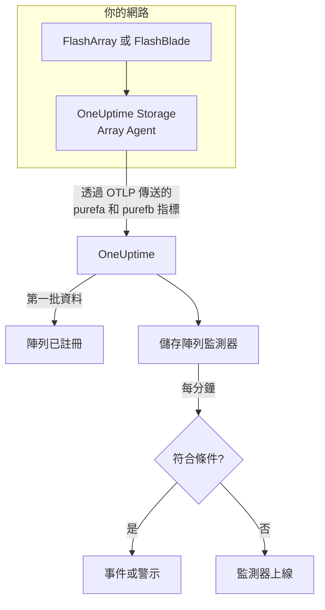

# 儲存陣列監控

儲存陣列監測器會監看一個儲存陣列，並在陣列本身發出警示、空間不足、變慢、遺失硬體或主機路徑，或複寫落後時通知你。它支援 Pure Storage FlashArray、Pure Storage FlashBlade 和 NetApp ONTAP（包括 Amazon FSx for NetApp ONTAP），讀取 OneUptime Storage Array Agent 收集的指標：Pure 的 `purefa_*` 和 `purefb_*` 序列，以及 NetApp Harvest 從 ONTAP 叢集讀取的 `netapp_*` 序列。

它也適用於 Dell PowerStore（`dell.powerstore`），依據 Dell 的 `powerstore_*` 序列。

:::cards
- [建立監測器](#建立儲存陣列監測器): 在儀表板中的六個步驟。
- [範本](#預建警示範本): 現成的警示，每個磁碟區、主機、專用設備或元件一個事件。
- [Pure 序列的運作方式](#pure-序列的結構): 一個指標名稱，多個數值。ONTAP 的序列[另有一節專門介紹](#ontap-序列的結構)。
- [指標](#收集的指標): 監測器可以據以發出警示的每個序列。
:::

## 運作原理

OneUptime Storage Array Agent 執行在能夠連線到陣列管理介面的機器上。它使用唯讀 API 權杖讀取陣列的指標，為指標加上陣列的名稱 `storage.array.name` 和平台 `storage.system` 標籤，並透過 OTLP 傳送到 OneUptime。第一批資料送達時會註冊該陣列。

Dell PowerMax (`dell.powermax`) 無需代理程式：OneUptime 探測器每 5 分鐘會使用唯讀帳戶登入一次 Unisphere for PowerMax，並以同樣的方式傳送它管理的每個陣列，陣列在你重新命名之前會以其 Symmetrix ID 命名([Dell PowerMax](/docs/telemetry/storage-arrays#dell-powermax))。

儲存陣列監測器繫結到一個陣列。它每分鐘對該陣列的指標執行一次查詢，並將結果與其條件比較。



## 開始之前

- **安裝 Storage Array Agent**，安裝在能透過 HTTPS 連線到陣列的位置，並使用擁有陣列 **readonly** 角色之使用者的 API 權杖。[Storage Array Agent 指南](/docs/telemetry/storage-arrays) 介紹了使用者、權杖和安裝，涉及 `ONEUPTIME_URL`、`ONEUPTIME_TELEMETRY_INGESTION_KEY`、`STORAGE_ARRAY_NAME`，以及陣列的位址和權杖(`PURE_FA_ENDPOINT` 和 `PURE_FA_API_TOKEN`，或 `PURE_FB_ENDPOINT` 和 `PURE_FB_API_TOKEN`)，對於 ONTAP 則涉及叢集的位址和一個唯讀 REST 使用者(`NETAPP_ONTAP_ENDPOINT`、`NETAPP_ONTAP_USERNAME` 和 `NETAPP_ONTAP_PASSWORD`)。
- **確認陣列已註冊。** 在第一次收集後大約一分鐘，它會以代理程式的 `STORAGE_ARRAY_NAME` 命名，出現在 **產品 → 基礎設施 → 儲存陣列 → 所有儲存陣列** 下。
- **對於 Dell PowerMax**，請改為在 **產品 → 基礎設施 → 儲存陣列 → 連線** 下連線管理它的 Unisphere for PowerMax，詳見 [Dell PowerMax](/docs/telemetry/storage-arrays#dell-powermax)。

## 建立儲存陣列監測器

:::steps
### 新增監測器

前往 **監測器**，點選 **建立監測器**。

### 選擇儲存陣列

在 **監測器類型** 下點選 **更多監測器類型**，然後在 **基礎設施** 下選擇 **儲存陣列**，或在搜尋方塊中輸入 `storage`。輸入 **名稱**(它會用在事件和警示標題中)，然後點選 **下一步**。

### 選擇陣列

在 **Storage Array Monitor Configuration** 下，從 **儲存陣列** 中選擇陣列。每個傳送過資料的陣列都在清單中。陣列的平台決定了表單提供哪些指標和範本。選好後，欄位下方的一行會顯示是否有資料傳入。**新增儲存陣列** 會開啟已填好你的金鑰的設定步驟，並等待第一批資料。

### 選擇要監看的內容

新監測器從 **告警內容** 下的 **Array Stopped Reporting** 開始。要監測其他內容：

- **變更**：選擇另一個 [範本](#預建警示範本)。它會設定指標、標籤篩選器、彙總、時間範圍和臨界值，並用自己的條件取代下面的條件。你仍然可以修改 **時間範圍**。
- **Custom Metric**（在 **更多欄位** 下）：從 **Storage Array Metric** 中選擇一個指標，然後設定 **彙總** 和 **時間範圍**。[篩選器](#監測器設定) 可以把它縮小到一個磁碟區、主機、Pod、元件、檔案系統或儲存貯體。
- **進階**（在 **更多欄位** 下）：在 **選擇指標** 下自行建構查詢和公式，例如用 `purefa_array_space_bytes` 篩選到 `space=capacity`，減去同一指標篩選到 `space=empty`，得到已用容量。以物件的標籤 **分組依據**，即可分別判斷每個物件。

### 檢查條件

開啟 **條件** 下的每個條件，檢查其 **指標**、**彙總**、**條件** 和 **閾值**。範本會填入這些內容。使用 **Custom Metric** 或 **進階** 時，監測器會從 [預設條件](#預設條件) 開始，它只會注意到指標不再傳送資料，所以請設定你自己的臨界值。

### 建立監測器

點選 **建立監測器**。OneUptime 會開啟監測器的頁面，並每分鐘評估一次。它發出的事件和警示也會列在陣列的 **事件** 和 **警示** 頁面上。
:::

> [!TIP]
> 若要一次設定多個範本，請從 **產品 → 基礎設施 → 儲存陣列** 開啟陣列，然後前往 **建議**。選擇你需要的範本和要呼叫的人員，OneUptime 會為每個範本建立一個監測器。

## 監測器設定

| 欄位 | 索引標籤 | 作用 |
| --- | --- | --- |
| **儲存陣列** | 全部 | 必填。把每個查詢限定到 `resource.storage.array.name`，因此兩個都有名為 `vol-01` 之磁碟區的陣列永遠不會混在一起。 |
| **磁碟區** | Custom Metric、進階 | 一個磁碟區：在 FlashArray 上依 `name` 標籤，例如 `vol-db-01`(Pod 或磁碟區群組中的磁碟區命名為 `pod::volume` 或 `group/volume`)；在 ONTAP 上依 `volume` 標籤，兩個 SVM 可以共用同一個磁碟區名稱；在 PowerMax 上依 `volume` 標籤，即其裝置 ID，例如 `00847`。 |
| **主機** | Custom Metric、進階 | 僅限 FlashArray。陣列所知的一台主機，依 `host` 標籤，例如 `esxi-01`。 |
| **Pod** | Custom Metric、進階 | 僅限 FlashArray。一個 ActiveCluster 或 ActiveDR Pod，依 `name` 標籤，在複本連結序列上則依 `local_pod`。 |
| **硬體元件** | Custom Metric、進階 | 一個硬體元件，例如 `CH0.BAY1` 或 `CT0`：在 FlashArray 上是 `component_name` 標籤，在 FlashBlade 上是 `name`，在 ONTAP 上則是其序列用來命名它的標籤(`node`、`disk`、`shelf` 或 `port`)，在 PowerMax 上是 `component`，即導向器(例如 `FA-1D`)或連接埠(例如 `FA-1D:4`)。 |
| **檔案系統** | Custom Metric、進階 | 僅限 FlashBlade。一個檔案系統，依 `name` 標籤。 |
| **儲存貯體** | Custom Metric、進階 | 僅限 FlashBlade。一個物件儲存貯體，依 `name` 標籤。 |
| **Storage Array Metric** | Custom Metric | [目錄](#收集的指標) 中的一個指標。表單會加入賦予其意義的標籤篩選器，並依它描述的物件分組，因此每個磁碟區、主機或元件都會單獨判斷。 |
| **彙總** | Custom Metric | 如何合併樣本：**平均**、**最大值**、**最小值**、**總和** 或 **計數**。從該指標的常用彙總開始。 |
| **時間範圍** | 全部 | 查詢讀取的滾動視窗，從 **Past 1 Minute** 到 **Past 365 Days**。新監測器從 **過去 5 分鐘** 開始；檔案系統或儲存貯體的自訂指標從 **過去 15 分鐘** 開始；範本會設定自己的值。 |
| **選擇指標** | 進階 | 查詢建構器：**指標**、**彙總方式**、**依屬性篩選**、**分組依據**，以及用於合併查詢的 **新增指標** 和 **新增公式**。 |

代理程式每 60 秒讀取一次陣列端點，每 2 分鐘讀取一次磁碟區、主機和 Pod，因此 5 分鐘的視窗中一定會有樣本。它每 5 分鐘讀取一次 FlashBlade 的檔案系統和儲存貯體(所以用 15 分鐘)，每 30 分鐘讀取一次 FlashArray 目錄：請給目錄監測器設定 60 分鐘的視窗。在 ONTAP 上，Harvest 每分鐘讀取一次叢集的效能，每 3 分鐘讀取一次其設定、狀態和 EMS 事件，因此 5 分鐘的視窗中一定會有樣本。

它每 5 分鐘讀取一次 PowerStore，每 60 秒讀取一次其叢集狀態：請為 PowerStore 監測器設定 15 分鐘的視窗。

## Pure 序列的結構

Pure 把多個數值放在 **一個** 指標名稱上，並用一個標籤區分它們：

- **`dimension`** 用於效能序列。`purefa_array_performance_latency_usec` 帶有讀取延遲(`usec_per_read_op`)、寫入延遲(`usec_per_write_op`)、鏡像寫入延遲，以及每項的 SAN、佇列、QoS 和服務時間。請一律依一個 `dimension` 篩選：跨它們取平均會把 200 µs 的讀取延遲和一個佇列數值混在一起。
- **`space`** 用於容量序列：`capacity`、`empty`、`snapshots`、`total_provisioned`、`total_physical`、`available_ratio` 等。

有幾個序列把狀態放在 **標籤** 中，其值一律為 1：

| 序列 | 狀態標籤 | 每個序列對應 |
| --- | --- | --- |
| `purefa_alerts_open` | `severity`，並帶有 `summary`、`code` 和 `component_type` | 一個未關閉的警示 |
| `purefa_hw_component_status` | `component_status` | 一個硬體元件 |
| `purefa_host_connectivity_info` | `status`，並帶有 `details` | 一台主機 |
| `purefa_drive_capacity_bytes` | `component_status`(值為磁碟機的容量) | 一個磁碟機 |

篩選到某個不良狀態的序列只在有物件處於該狀態時才存在，因此沒有序列就表示健康。這就是為什麼 **Max 大於 0 時觸發、為 0 時復原** 是適合它們的形式，範本也是這樣建構的：它們的復原條件把缺少的序列計為零。當完全沒有序列時，這類範本只有在同一時間視窗內收到 `purefa_info`、`purefb_info` 或 `powermax_array_info` 才會復原，因此已停止回報的陣列不會關閉任何內容。

PowerMax 的每個序列只包含一個數值，並以該數值命名：`powermax_array_response_time_usec` 用 `operation` 區分讀取和寫入。它的狀態序列同樣只在出現問題時存在：`powermax_alert_open` 在 Unisphere 有未關閉的警示時存在，`powermax_director_offline` 在導向器未上線時存在，`powermax_port_offline` 在有人依賴的連接埠停擺時存在，`powermax_srdf_group_not_healthy` 在 SRDF 群組暫停或離線時存在。

在監測器篩選器和分組鍵中，代理程式的屬性以 `resource.` 開頭(`resource.storage.array.name`、`resource.storage.system`)，而 Pure 自己的標籤不以它開頭(`name`、`host`、`component_name`、`dimension`、`space`、`severity`)，PowerMax 的標籤也不以它開頭(`storage_group`、`volume`、`director`、`port_id`、`srdf_group`)。

## PowerStore 序列的結構

Dell 的匯出器每個指標名稱只寫入一個值，因此 PowerStore 序列不需要標籤篩選。其標籤標示物件：`appliance_id` 是專用設備，`name` 是元件、磁碟區或檔案系統，而 `volume_id`、`fc_port_id`、`eth_port_id`、`nas_id` 或 `volume_group_id` 是效能序列的物件。其狀態序列在健康時為 1，否則為 0，因此範本在低於 1 時觸發。它自己的警示透過 syslog 送達，其範本（日誌監測器）列在下方表格之後。

## ONTAP 序列的結構

NetApp Harvest 把每個序列命名為 `netapp_<object>_<counter>`，並用標籤命名物件：磁碟區用 `volume`(位於其 `svm` 中)，Aggregate 用 `aggr`，LUN 用 `lun`(位於其 `volume` 和 `svm` 中)，節點用 `node`，磁碟用 `disk`，磁碟櫃用 `shelf`，SnapMirror 關係用 `destination_location`。延遲以每次作業的微秒計，`_ops` 為每秒作業數，`_data` 為每秒位元組數。

ONTAP 的狀態有三種表示方式：

| 序列 | 狀態 | 每個序列對應 |
| --- | --- | --- |
| `netapp_*_new_status` | 1 表示健康、在線、正常或執行中，0 表示不是 | 一個物件，每次輪詢都有 |
| `netapp_health_*_alerts` | 值為 1，其標籤中帶有 `severity`(`error` 或 `warning`)和原因 | 一個未解決的問題：已損壞的磁碟、磁碟櫃故障、無法接管其合作夥伴的節點、已中斷的連接埠、系統健康警示 |
| `netapp_ems_events` | 值為 1，帶有 `message`、`severity` 和該事件的參數 | 一個 EMS 事件，只在收集到它的那一次輪詢中存在；成對事件被清除時會以 0 再匯出一次 |

以數值表示的狀態在視窗中的每個讀數都低於 1 時觸發，一旦有讀數重新為 1 就復原。未解決的問題在其序列存在時觸發，在序列消失後復原，前提是 `netapp_cluster_new_status` 仍在送達，因此已停止的代理程式不會關閉任何內容。EMS 事件在其唯一的讀數上觸發，並在它處於範本的一小時視窗內期間保持開啟；一小時內沒有再出現同類事件時復原。

## 預建警示範本

OneUptime 提供 80 個範本——12 個用於 FlashArray，8 個用於 FlashBlade，16 個用於 PowerStore，31 個用於 ONTAP，13 個用於 PowerMax——**告警內容** 清單會提供適用於陣列平台的那些範本。每個範本都會建構一個完整的監測器：指標查詢、其標籤篩選器、依物件自身標籤的分組、一個觸發條件和一個復原條件。臨界值是可以編輯的起點。

只有當條件對視窗中的 **每個** 值都成立時，條件才會觸發，但 ONTAP EMS 範本的條件除外：Harvest 只在一次輪詢中匯出某個事件，因此一個讀數就夠了。在容量、延遲、落後或比率臨界值上觸發的監測器，只有超過臨界值 10% 之後才會復原，因此在臨界值附近徘徊的值不會來回切換。警示、硬體和連線範本在某個狀態在其整個 5 分鐘視窗內都出現後才會觸發，並在狀態消失約 5 分鐘後復原。

### FlashArray

| 範本 | 類別 | 嚴重程度 | 監看內容 | 觸發條件 |
| --- | --- | --- | --- | --- |
| Array Stopped Reporting | 可用性 | 嚴重 | `purefa_info`，Count，過去 10 分鐘 | 整個視窗內都沒有資料 — Storage Array Agent 已停止、失去通往 OneUptime 的路由或權杖被撤銷，或者陣列不再回應它；資料再次送達時復原 |
| Critical Array Alert | 陣列健康狀況 | 嚴重 | `purefa_alerts_open` 篩選到 `severity=critical`，依 `summary` 取 Max，過去 5 分鐘 | > 0 — 陣列有一個未關閉的嚴重警示(元件故障、容量緊急、複寫失敗)。每個警示一個事件；警示關閉時復原 |
| Warning Array Alert | 陣列健康狀況 | 警告 | `purefa_alerts_open` 篩選到 `severity=warning`，依 `summary` 取 Max，過去 5 分鐘 | > 0 — 陣列有一個未關閉的警告層級警示。每個警示一個事件；警示關閉時復原 |
| Capacity Above 80% | 容量 | 警告 | `purefa_array_space_utilization`，Max，過去 15 分鐘 | > 80 — Pure 自己的第一個容量臨界值；≤ 72 時復原 |
| Capacity Above 90% | 容量 | 嚴重 | `purefa_array_space_utilization`，Max，過去 5 分鐘 | > 90 — 陣列即將拒絕寫入；≤ 81 時復原 |
| High Read Latency | 效能 | 警告 | `purefa_array_performance_latency_usec` 篩選到 `dimension=usec_per_read_op`，Avg，過去 10 分鐘 | > 5000 µs (5 ms) — FlashArray 的讀取通常遠低於 1 ms；≤ 4500 時復原 |
| High Write Latency | 效能 | 警告 | `purefa_array_performance_latency_usec` 篩選到 `dimension=usec_per_write_op`，Avg，過去 10 分鐘 | > 5000 µs (5 ms)；≤ 4500 時復原 |
| Hardware Component Failed | 硬體 | 嚴重 | `purefa_hw_component_status` 篩選到 `component_status=critical`，依 `component_name` 取 Max，過去 5 分鐘 | > 0 — 某個控制器、電源供應器、風扇、槽位或連接埠處於嚴重狀態，備援已經喪失。每個元件一個事件；它回報 ok 時復原 |
| Hardware Component Degraded | 硬體 | 警告 | `purefa_hw_component_status` 篩選到 `component_status=degraded`，依 `component_name` 取 Max，過去 5 分鐘 | > 0 — 某個元件已降級。每個元件一個事件；它回報 ok 時復原 |
| Drive Failed | 硬體 | 嚴重 | `purefa_drive_capacity_bytes` 篩選到 `component_status=failed`，依 `component_name` 取 Max，過去 5 分鐘 | > 0 — 某個 DirectFlash 模組或 SSD 故障，陣列正在其餘磁碟機上重建。每個磁碟機一個事件；更換後復原 |
| Host Lost Redundant Paths | 主機 | 警告 | `purefa_host_connectivity_info` 篩選到 `status=critical`，依 `host` 取 Max，過去 5 分鐘 | > 0 — 主機只能透過一個控制器連線到陣列，或完全無法連線；一次控制器容錯移轉就會讓它的儲存離線。每台主機一個事件；路徑恢復時復原 |
| Replication Lag Above 1 Minute | 複寫 | 警告 | `purefa_pod_replica_links_lag_max_msec`，依 `local_pod` 取 Max，過去 10 分鐘 | > 60000 ms (60 s) — 此時容錯移轉會遺失比計畫更多的近期寫入。每個 Pod 一個事件；≤ 54000 時復原 |

### FlashBlade

| 範本 | 類別 | 嚴重程度 | 監看內容 | 觸發條件 |
| --- | --- | --- | --- | --- |
| Array Stopped Reporting | 可用性 | 嚴重 | `purefb_info`，Count，過去 10 分鐘 | 整個視窗內都沒有資料 — 代理程式、其匯出器或 FlashBlade 不再回應；資料再次送達時復原 |
| Critical Array Alert | 陣列健康狀況 | 嚴重 | `purefb_alerts_open` 篩選到 `severity=critical`，依 `summary` 取 Max，過去 5 分鐘 | > 0 — FlashBlade 有一個未關閉的嚴重警示。每個警示一個事件；警示關閉時復原 |
| Warning Array Alert | 陣列健康狀況 | 警告 | `purefb_alerts_open` 篩選到 `severity=warning`，依 `summary` 取 Max，過去 5 分鐘 | > 0 — FlashBlade 有一個未關閉的警告層級警示。每個警示一個事件；警示關閉時復原 |
| Capacity Above 80% | 容量 | 警告 | `purefb_array_space_utilization` 篩選到 `type=array`，Max，過去 15 分鐘 | > 80；≤ 72 時復原 |
| Capacity Above 90% | 容量 | 嚴重 | `purefb_array_space_utilization` 篩選到 `type=array`，Max，過去 5 分鐘 | > 90 — 寫滿時每個用戶端的寫入都會失敗；≤ 81 時復原 |
| Hardware Component Unhealthy | 硬體 | 嚴重 | `purefb_hardware_health`，依 `name` 取 Min，過去 5 分鐘 | < 1 — 某個刀鋒、交換模組、電源供應器或風扇不健康(未使用的插槽回報 2)。每個元件一個事件；≥ 1 時復原 |
| High Read Latency | 效能 | 警告 | `purefb_array_performance_latency_usec` 篩選到 `dimension=usec_per_read_op` 和 `protocol=all`，Avg，過去 10 分鐘 | > 10000 µs (10 ms)，跨所有通訊協定；≤ 9000 時復原 |
| File System Near Full | 檔案系統 | 警告 | `purefb_file_systems_space_bytes` 篩選到 `space=available_ratio`，依 `name` 取 Min，過去 15 分鐘 | < 0.1 — 檔案系統佈建大小的剩餘不足 10%。每個檔案系統一個事件；≥ 0.11 時復原 |

### PowerStore

| 範本 | 類別 | 嚴重程度 | 監看內容 | 觸發條件 |
| --- | --- | --- | --- | --- |
| Array Stopped Reporting | 可用性 | 嚴重 | `powerstore_cluster`，Count，過去 10 分鐘 | 整個視窗內都沒有資料 — 代理程式、Dell 的匯出器或叢集不再回應；資料再次送達時復原 |
| Capacity Above 80% | 容量 | 警告 | `powerstore_cap_physical_used_percent`，依 `appliance_id` 取 Max，過去 15 分鐘 | > 80 — 某台專用設備的容量正在填滿；≤ 72 時復原 |
| Capacity Above 90% | 容量 | 嚴重 | `powerstore_cap_physical_used_percent`，依 `appliance_id` 取 Max，過去 15 分鐘 | > 90 — 某台專用設備即將拒絕寫入；≤ 81 時復原 |
| High Read Latency | 效能 | 警告 | `powerstore_perf_avg_read_latency`，依 `appliance_id` 取 Avg，過去 15 分鐘 | > 5000 µs (5 ms)；≤ 4500 時復原 |
| High Write Latency | 效能 | 警告 | `powerstore_perf_avg_write_latency`，依 `appliance_id` 取 Avg，過去 15 分鐘 | > 5000 µs (5 ms)；≤ 4500 時復原 |
| Drive Failed | 硬體 | 嚴重 | `powerstore_hardware_Drive_state`，依 `name` 取 Min，過去 10 分鐘 | < 1 — 某個磁碟機發生故障或遭移除；≥ 1 時復原 |
| Node Unhealthy | 硬體 | 嚴重 | `powerstore_hardware_node_state`，依 `name` 取 Min，過去 10 分鐘 | < 1 — 某個節點不是 Healthy；≥ 1 時復原 |
| Power Supply Unhealthy | 硬體 | 警告 | `powerstore_hardware_Power_Supply_state`，依 `name` 取 Min，過去 10 分鐘 | < 1 — 某個電源供應器發生故障或斷電；≥ 1 時復原 |
| Fan Unhealthy | 硬體 | 警告 | `powerstore_hardware_Fan_state`，依 `name` 取 Min，過去 10 分鐘 | < 1 — 某個風扇發生故障；≥ 1 時復原 |
| Battery Unhealthy | 硬體 | 警告 | `powerstore_hardware_Battery_state`，依 `name` 取 Min，過去 10 分鐘 | < 1 — 某個電池備援模組發生故障；≥ 1 時復原 |
| Drive Wearing Out | 硬體 | 警告 | `powerstore_wear_metrics_by_drive`，依 `name` 取 Min，過去 15 分鐘 | < 10 — 某個磁碟機剩餘的耐用度不到 10%；≥ 11 時復原 |
| NAS Server Not Started | 檔案系統 | 警告 | `powerstore_nas_server_operational_status`，依 `name` 取 Max，過去 10 分鐘 | < 1 — 某個 NAS 伺服器已停止或已降級；≥ 1 時復原 |
| Volume Not Ready | 陣列健康狀況 | 警告 | `powerstore_volume_state`，依 `name` 取 Max，過去 15 分鐘 | < 1 — 某個磁碟區處於離線狀態；≥ 1 時復原 |
| File System Near Full | 檔案系統 | 警告 | `powerstore_filesystem_logical_used_percent`，依 `name` 取 Max，過去 15 分鐘 | > 90 — 某個檔案系統快滿了；≤ 81 時復原 |
| Cluster Not Configured | 陣列健康狀況 | 警告 | `powerstore_cluster`，Max，過去 10 分鐘 | < 1 — 叢集不是 Configured；≥ 1 時復原 |
| Metro Witness Not Connected | 複寫 | 警告 | `powerstore_metro_witness_status`，依 `name` 取 Min，過去 10 分鐘 | > 0 — 某個 Metro Witness 未連線；再次變為 OK 時復原 |

### 透過 syslog 的 PowerStore 警示

PowerStore 自己的警示以日誌形式送達，因此其範本是 **日誌** 監測器，在陣列的 **建議** 頁面的 **陣列警示** 下提供。每個範本為每則 PowerStore 警示開啟一則警示，依 `powerstore.resource.name` 和 `powerstore.alert.id` 分組，並在 PowerStore 清除該警示時將其解決：

| 範本 | 嚴重性 | 在包含以下內容的行上開啟 | 在以下內容上解決 |
| --- | --- | --- | --- |
| Critical Array Alert | 嚴重 | `powerstore.alert.severity=Critical` | `powerstore.alert.state=Cleared` |
| Major Array Alert | 警告 | `powerstore.alert.severity=Major` | `powerstore.alert.state=Cleared` |
| Port Link Down | 警告 | `powerstore.event.code=0x00307404` | `powerstore.alert.state=Cleared` |

### ONTAP

| 範本 | 類別 | 嚴重程度 | 監看內容 | 觸發條件 |
| --- | --- | --- | --- | --- |
| Array Stopped Reporting | 可用性 | 嚴重 | `netapp_cluster_new_status`，Count，過去 10 分鐘 | 整個視窗內都沒有資料 — 代理程式或 Harvest 已停止，或者叢集不再回應 Harvest；資料再次送達時復原 |
| Cluster Not Healthy | 陣列健康狀況 | 警告 | `netapp_cluster_new_status`，Max，過去 10 分鐘 | < 1 — ONTAP 回報叢集不健康；≥ 1 時復原 |
| System Health Alert | 陣列健康狀況 | 警告 | `netapp_health_support_alerts`，依 `name` 取 Max，過去 5 分鐘 | > 0 — ONTAP 的系統健康監測器發出了警示(缺少通往磁碟櫃的路徑、節點連線問題)。每個警示一個事件；ONTAP 清除它時復原 |
| Emergency EMS Event | 陣列健康狀況 | 嚴重 | `netapp_ems_events` 篩選到 `severity=emergency`，依 `message` 取 Max，過去 1 小時，任一讀數 | > 0 — ONTAP 記錄了一個緊急層級的 EMS 事件。每種 EMS 事件各一個事件；一小時內沒有再出現同類事件時復原 |
| Alert EMS Event | 陣列健康狀況 | 嚴重 | `netapp_ems_events` 篩選到 `severity=alert`，依 `message` 取 Max，過去 1 小時，任一讀數 | > 0 — ONTAP 記錄了一個警示層級的 EMS 事件(風扇故障)；一小時內沒有再出現同類事件時復原 |
| Disk Out of Service | 硬體 | 警告 | `netapp_ems_events` 篩選到 `message=disk.outOfService`，依 `disk` 取 Max，過去 1 小時，任一讀數 | > 0 — ONTAP 讓某個磁碟停止服務；一小時內沒有再出現同類事件時復原 |
| Node Panic | 硬體 | 嚴重 | `netapp_ems_events` 篩選到 `message=sk.panic`，依 `node` 取 Max，過去 1 小時，任一讀數 | > 0 — 某個節點發生 panic 並重新開機，其合作夥伴接管了它的儲存設備；一小時內沒有再出現同類事件時復原 |
| Aggregate Above 80% | 容量 | 警告 | `netapp_aggr_space_used_percent`，依 `aggr` 取 Max，過去 15 分鐘 | > 80；≤ 72 時復原 |
| Aggregate Above 90% | 容量 | 嚴重 | `netapp_aggr_space_used_percent`，依 `aggr` 取 Max，過去 5 分鐘 | > 90 — 其上的磁碟區無法再成長；≤ 81 時復原 |
| Volume Above 90% | 容量 | 警告 | `netapp_volume_size_used_percent`，依 `volume` 和 `svm` 取 Max，過去 15 分鐘 | > 90；≤ 81 時復原 |
| Volume Above 98% | 容量 | 嚴重 | `netapp_volume_size_used_percent`，依 `volume` 和 `svm` 取 Max，過去 5 分鐘 | > 98 — 用戶端會收到空間不足錯誤，其中的 LUN 可能會離線；≤ 88.2 時復原 |
| High Read Latency | 效能 | 警告 | `netapp_cluster_read_latency`，Avg，過去 15 分鐘 | > 10000 µs (10 ms)；≤ 9000 時復原 |
| High Write Latency | 效能 | 警告 | `netapp_cluster_write_latency`，Avg，過去 15 分鐘 | > 10000 µs (10 ms)；≤ 9000 時復原 |
| Volume Latency Above 20 ms | 效能 | 警告 | `netapp_volume_read_latency`，依 `volume` 和 `svm` 取 Avg，過去 15 分鐘 | > 20000 µs；≤ 18000 時復原 |
| Node Not Healthy | 硬體 | 嚴重 | `netapp_node_new_status`，依 `node` 取 Max，過去 10 分鐘 | < 1 — ONTAP 回報節點不健康；≥ 1 時復原 |
| Takeover Not Possible | 硬體 | 嚴重 | `netapp_health_ha_alerts`，依 `node` 取 Max，過去 5 分鐘 | > 0 — 某個節點無法接管其 HA 合作夥伴，因此一旦發生故障，該合作夥伴的儲存設備就會離線；能夠再次接管時復原 |
| Disk Failed | 硬體 | 嚴重 | `netapp_health_disk_alerts` 篩選到 `container_type=broken`，依 `disk` 取 Max，過去 5 分鐘 | > 0 — 某個磁碟已損壞；更換後復原 |
| Shelf Fault | 硬體 | 嚴重 | `netapp_health_shelf_alerts` 篩選到 `severity=error`，依 `shelf` 取 Max，過去 5 分鐘 | > 0 — ONTAP 回報某個磁碟櫃出現錯誤(電源供應器、模組、路徑)；ONTAP 清除它時復原 |
| Node Fan Failed | 硬體 | 警告 | `netapp_node_failed_fan`，依 `node` 取 Max，過去 10 分鐘 | > 0 個故障風扇；≤ 0 時復原 |
| Node Power Supply Failed | 硬體 | 嚴重 | `netapp_node_failed_power`，依 `node` 取 Max，過去 10 分鐘 | > 0 個故障電源供應器；≤ 0 時復原 |
| Shelf Power Supply Failed | 硬體 | 嚴重 | `netapp_shelf_psu_status`，依 `shelf` 取 Max，過去 10 分鐘 | < 1 — 某個磁碟櫃的電源供應器不正常；≥ 1 時復原 |
| Shelf Fan Failed | 硬體 | 警告 | `netapp_shelf_fan_status`，依 `shelf` 取 Max，過去 10 分鐘 | < 1 — 某個磁碟櫃的風扇不正常；≥ 1 時復原 |
| Ethernet Port Down | 硬體 | 警告 | `netapp_health_network_ethernet_port_alerts`，依 `port` 和 `node` 取 Max，過去 5 分鐘 | > 0 — 某個已啟用的乙太網路連接埠已中斷；其連結恢復正常時復原 |
| FC Port Link Failures | 硬體 | 警告 | `netapp_fcp_link_failure`，依 `port` 和 `node` 取 Max，過去 15 分鐘 | > 0 — 某個光纖通道連接埠的連結在視窗內失敗；≤ 0 時復原 |
| SnapMirror Behind Schedule | 複寫 | 警告 | `netapp_snapmirror_lag_time` 除以 `netapp_snapmirror_schedule_seconds`，依 `destination_location` 取 Max，過去 15 分鐘 | > 1.5 — 某個關係落後超過一個半排程間隔(每小時一次的排程為 90 分鐘)；≤ 1.35 時復原 |
| SnapMirror Relationship Unhealthy | 複寫 | 嚴重 | `netapp_snapmirror_labels` 篩選到 `healthy=false`，依 `destination_location` 取 Max，過去 5 分鐘 | > 0 — ONTAP 回報該關係不健康，原因在其 `unhealthy_reason` 標籤中；ONTAP 回報其健康時復原 |
| SnapMirror Lag Above 1 Day | 複寫 | 警告 | `netapp_snapmirror_lag_time`，依 `destination_location` 取 Max，過去 15 分鐘 | > 86400 s，無論其排程為何；≤ 77760 時復原 |
| Aggregate Offline | 可用性 | 嚴重 | `netapp_aggr_new_status`，依 `aggr` 取 Max，過去 10 分鐘 | < 1 — 某個 Aggregate 不在線，因此其所有磁碟區都無法存取；≥ 1 時復原 |
| Volume Offline | 可用性 | 警告 | `netapp_volume_new_status`，依 `volume` 和 `svm` 取 Max，過去 10 分鐘 | < 1 — 某個磁碟區不在線；≥ 1 時復原 |
| LUN Offline | 可用性 | 嚴重 | `netapp_lun_new_status`，依 `lun`、`volume` 和 `svm` 取 Max，過去 10 分鐘 | < 1 — 某個 LUN 不在線，其主機已失去該磁碟；≥ 1 時復原 |
| SVM Stopped | 可用性 | 警告 | `netapp_svm_labels` 篩選到 `state=stopped` 和 `type=data`，依 `svm` 取 Max，過去 10 分鐘 | > 0 — 某個資料 SVM 已停止；再次執行時復原。ONTAP 留給自己使用的 SVM 從不被監看 |

### PowerMax

| 範本 | 類別 | 嚴重程度 | 監看內容 | 觸發條件 |
| --- | --- | --- | --- | --- |
| Array Stopped Reporting | 可用性 | 嚴重 | `powermax_array_info`，Count，過去 10 分鐘 | 整個視窗內都沒有資料 — 探測器已停止收集該陣列：其連線失敗(其在 **連線** 下的頁面會說明原因)、探測器已中斷連線，或 Unisphere 不再管理該陣列；資料再次送達時復原 |
| Critical Unisphere Alert | 陣列健康狀況 | 嚴重 | `powermax_alert_open` 篩選到 `severity=critical`，依 `description` 取 Max，過去 10 分鐘 | > 0 — Unisphere 中該陣列有一個嚴重程度為 Critical 或 Fatal 的未關閉警示。每個警示一個事件；警示在 Unisphere 中被確認或清除時復原 |
| Warning Unisphere Alert | 陣列健康狀況 | 警告 | `powermax_alert_open` 篩選到 `severity=warning`，依 `description` 取 Max，過去 10 分鐘 | > 0 — Unisphere 中有一個嚴重程度為 Warning 或 Minor 的未關閉警示。每個警示一個事件；警示被確認或清除時復原 |
| Performance Collection Off | 陣列健康狀況 | 警告 | `powermax_array_performance_collection`，Min，過去 15 分鐘 | < 1 — Unisphere 沒有收集該陣列的 5 分鐘效能資料，因此回應時間、IOPS 和輸送量都不會繪製圖表或觸發警示；≥ 1 時復原 |
| Storage Resource Pool Above 80% | 容量 | 警告 | `powermax_srp_capacity_used_percent`，依 `srp` 取 Max，過去 15 分鐘 | > 80 — 儲存池寫滿時，其儲存群組將不再接受新的寫入。每個儲存池一個事件；≤ 72 時復原 |
| Storage Resource Pool Above 90% | 容量 | 嚴重 | `powermax_srp_capacity_used_percent`，依 `srp` 取 Max，過去 15 分鐘 | > 90 — 儲存池一旦寫滿，對其儲存群組的寫入就會失敗。每個儲存池一個事件；≤ 81 時復原 |
| Storage Group Response Time Above 5 ms | 效能 | 警告 | `powermax_storage_group_response_time_usec`，依 `storage_group` 取 Avg，過去 15 分鐘 | > 5000 µs (5 ms) — PowerMax 的回應時間通常遠低於一毫秒。每個儲存群組一個事件；≤ 4500 時復原 |
| High Read Response Time | 效能 | 警告 | `powermax_array_response_time_usec` 篩選到 `operation=read`，Avg，過去 15 分鐘 | > 3000 µs (3 ms)；≤ 2700 時復原 |
| High Write Response Time | 效能 | 警告 | `powermax_array_response_time_usec` 篩選到 `operation=write`，Avg，過去 15 分鐘 | > 3000 µs (3 ms) — 同步 SRDF 會為每次寫入加上到遠端陣列的來回時間；≤ 2700 時復原 |
| Director Not Online | 硬體 | 嚴重 | `powermax_director_offline`，依 `component` 取 Max，過去 10 分鐘 | > 0 — 某個導向器未上線，陣列依靠其他導向器運作。每個導向器一個事件；它重新上線時復原 |
| Port Down | 硬體 | 警告 | `powermax_port_offline`，依 `component` 取 Max，過去 10 分鐘 | > 0 — 連接埠群組、遮罩檢視或 SRDF 群組中的某個連接埠未啟動。每個連接埠一個事件；它重新啟動時復原 |
| SRDF Group Suspended or Offline | 複寫 | 嚴重 | `powermax_srdf_group_not_healthy`，依 `srdf_group` 取 Max，過去 10 分鐘 | > 0 — 群組的鏈路離線，或其配對處於暫停、分離或容錯移轉狀態，因此遠端副本無法保持最新。每個群組一個事件；重新同步時復原 |
| SRDF/A Lag Above 2 Minutes | 複寫 | 警告 | `powermax_srdf_group_lag_seconds`，依 `srdf_group` 取 Avg，過去 15 分鐘 | > 120 (2 分鐘) — 此時容錯移轉會遺失比計畫更多的近期寫入。每個群組一個事件；≤ 108 時復原 |

**嚴重程度** 是選擇器顯示的標籤。範本建立的事件和警示會以專案中最嚴重的事件和警示嚴重程度開始；可以在條件中修改。

- **Array Stopped Reporting** 計算平台的識別序列(`purefa_info` 或 `purefb_info`，代理程式收集的每個端點在每次收集時都會匯出該序列；或 `powermax_array_info`，每次 PowerMax 收集都會寫入該序列)。資料中斷時，其他範本沒有可比較的資料，會維持最後的狀態，因此要靠這個範本告訴你。
- **未關閉的警示和硬體狀態使用 Max**，因為這類序列只在警示未關閉或元件處於該狀態時才存在，所以狀態在整個 5 分鐘視窗內都出現後才會超過臨界值。
- **每個依物件的範本都依物件自身的標籤分組**(`summary`、`component_name`、`host`、`local_pod`、`name`，在 PowerMax 上還有 `description`、`component`、`srp`、`srdf_group` 和 `storage_group`)，因此每個受影響的物件各觸發一個事件，並且事件中會寫出該物件。
- **延遲範本使用 Avg**，對陣列自身計算的每次作業平均值取平均；容量範本對陣列自身的使用率百分比取 **最大**。延遲固定以微秒為單位，容量固定以百分比為單位。
- **Hardware Component Unhealthy 依元件使用 Min**：元件健康時其健康值為 1，不健康時降到 0。

沒有針對每個磁碟區延遲的 FlashArray 範本，因為合適的臨界值取決於工作負載：請從目錄中依 `name` 分組自行建構。容量預測需要的是成長趨勢而不是臨界值，而磁碟機磨損沒有可以發出警示的序列。

## 收集的指標

代理程式會傳送陣列匯出的所有內容，探測器會傳送它從 PowerMax 讀取的所有內容，單位相同(Unisphere 的毫秒換算為微秒，其每秒 MB 換算為每秒位元組數)；下面的序列是監測器表單提供的目錄。每個值都是陣列自己計算的量測值——延遲以每次作業的微秒計，輸送量以每秒計——因此不需要計算速率。**篩選器** 是賦予序列該列所述意義的標籤篩選器；表單會替你套用它。

### 陣列健康狀況

| 指標 | 篩選器 | 平台 | 單位 | 描述 |
| --- | --- | --- | --- | --- |
| `purefa_alerts_open` | — | FlashArray | `count` | 陣列上每個未關閉的警示一個序列(值為 1)，帶有標籤 `severity`(`critical`、`warning`、`info`、`hidden`)、`category`、`code`、`component_type` 和 `summary` |
| `purefb_alerts_open` | — | FlashBlade | `count` | FlashBlade 上每個未關閉的警示一個序列(值為 1)，帶有標籤 `severity`(`info`、`warning`、`critical`)、`code`、`component_name`、`component_type`、`summary` 和 `kburl`(Pure 知識庫文章) |
| `powerstore_cluster` | — | PowerStore | `count` | PowerStore 叢集為 Configured（已組成並在提供服務）時為 1，處於其他任何狀態時為 0：Configuring、Expanding、Removing、Clustering_Failed 或 Unconfigured。 |
| `netapp_cluster_new_status` | — | ONTAP | — | ONTAP 回報叢集健康時為 1；也用來表示代理程式仍在讀取叢集 |
| `netapp_cluster_subsystem_outstanding_alerts` | — | ONTAP | `count` | ONTAP 每個健康子系統中未關閉的警示，依 `subsystem` 區分 |
| `netapp_health_support_alerts` | — | ONTAP | `count` | ONTAP 系統健康監測器中每個未關閉的警示一個序列，在警示未關閉期間存在 |
| `netapp_ems_events` | — | ONTAP | `count` | 每個 EMS 事件一個序列，只在收集到它的那次輪詢中存在；成對事件被清除時會以 0 再匯出一次 |
| `powermax_alert_open` | — | PowerMax | `count` | Unisphere 為該陣列開啟的每個警示對應一個序列(值為 1)：未確認、未清除且嚴重程度為 Minor 或更高。其 severity 標籤為 critical(Critical 和 Fatal)或 warning(Warning 和 Minor)；其 alert_type、object 和 description 標籤說明警示內容。在 Unisphere 中確認該警示後，序列即消失 |
| `powermax_array_health_score` | — | PowerMax | `score` | Unisphere 給出的陣列健康分數，範圍 0 到 100，依 health_metric 區分：整體分數，以及其評分的每個面向(容量、組態、效能、服務等級合規性) |
| `powermax_array_performance_collection` | — | PowerMax | `count` | Unisphere 正在為該陣列收集 5 分鐘效能資料時為 1，否則為 0。關閉時，OneUptime 仍會列出該陣列的清單和警示，但不會繪製任何效能圖表。請在 Unisphere 的 Settings > Performance > System Registrations 中開啟 |

### 容量

| 指標 | 篩選器 | 平台 | 單位 | 描述 |
| --- | --- | --- | --- | --- |
| `purefa_array_space_utilization` | — | FlashArray | `%` | 陣列可用容量中已使用的比例。Pure 自己會在 80%、90% 和 100% 時發出容量警示 |
| `purefa_array_space_bytes` | `space=capacity` | FlashArray | `bytes` | 陣列的可用容量 |
| `purefa_array_space_bytes` | `space=empty` | FlashArray | `bytes` | 未使用的容量——追蹤其趨勢可以預測陣列何時寫滿 |
| `purefa_array_space_bytes` | `space=snapshots` | FlashArray | `bytes` | 僅由快照佔用的實體空間；快速成長通常表示某個保護群組保留的快照比計畫的多 |
| `purefa_array_space_data_reduction_ratio` | — | FlashArray | `ratio` | 整個陣列的重複資料刪除和壓縮，例如 4.2:1 記為 4.2。持續下降表示新資料的縮減效果不佳 |
| `purefb_array_space_utilization` | `type=array` | FlashBlade | `%` | FlashBlade 可用容量中已使用的比例 |
| `purefb_array_space_bytes` | `type=array`、`space=empty` | FlashBlade | `bytes` | FlashBlade 未使用的容量 |
| `purefb_array_space_data_reduction_ratio` | `type=array` | FlashBlade | `ratio` | 整個 FlashBlade 的資料縮減 |
| `powerstore_cap_physical_used_percent` | — | PowerStore | `%` | 每台專用設備實體容量的使用比例，以百分比表示：實體已使用除以實體總量，來自 PowerStore 的每日空間彙總。PowerStore 從 70% 起發出自己的容量警示。按 appliance_id 分組。 |
| `powerstore_cap_last_physical_total` | — | PowerStore | `bytes` | 每台專用設備的可用實體容量，以位元組為單位。 |
| `powerstore_cap_last_physical_used` | — | PowerStore | `bytes` | 每台專用設備使用的實體容量，以位元組為單位，為重複資料刪除和壓縮之後的值。觀察其趨勢，預測專用設備何時寫滿。 |
| `powerstore_cap_last_logical_provisioned` | — | PowerStore | `bytes` | 每台專用設備上佈建的邏輯容量，以位元組為單位：其所含每個磁碟區、檔案系統和 vVol 的大小，可能遠高於其實體容量。 |
| `powerstore_cap_last_logical_used` | — | PowerStore | `bytes` | 主機寫入每台專用設備的資料，以位元組為單位，為重複資料刪除和壓縮之前的值。 |
| `powerstore_cap_last_data_reduction` | — | PowerStore | `ratio` | 每台專用設備上的重複資料刪除和壓縮效果，例如 3.4:1 記為 3.4。持續下降表示新寫入的資料縮減效果差：加密或已壓縮的資料。 |
| `powerstore_cap_last_efficiency_ratio` | — | PowerStore | `ratio` | 每台專用設備的整體效率：資料縮減加上快照和精簡佈建節省的空間。 |
| `netapp_aggr_space_used_percent` | — | ONTAP | `%` | 每個 Aggregate 可用空間中已使用的比例——依 `aggr` 分組 |
| `netapp_aggr_space_total` | — | ONTAP | `bytes` | 每個 Aggregate 的可用空間；叢集的容量是它們的總和 |
| `netapp_aggr_space_used` | — | ONTAP | `bytes` | 每個 Aggregate 已使用或已保留的空間 |
| `netapp_aggr_space_available` | — | ONTAP | `bytes` | 每個 Aggregate 上剩餘的空間——追蹤其趨勢可以預測它何時寫滿 |
| `netapp_aggr_inode_used_percent` | — | ONTAP | `%` | 每個 Aggregate 中已用檔案(inode)的比例 |
| `netapp_aggr_new_status` | — | ONTAP | — | Aggregate 在線時為 1 |
| `netapp_aggr_logical_used_wo_snapshots_flexclones` | — | ONTAP | `bytes` | 每個 Aggregate 的資料在沒有儲存效率時會佔用的空間，不計快照和 FlexClone |
| `netapp_aggr_physical_used_wo_snapshots_flexclones` | — | ONTAP | `bytes` | 每個 Aggregate 的資料經過儲存效率處理後在磁碟上佔用的空間 |
| `powermax_array_capacity_used_percent` | — | PowerMax | `%` | 陣列所有儲存資源池中可用容量已使用的比例(百分比) |
| `powermax_array_capacity_usable_bytes` | — | PowerMax | `bytes` | Unisphere 回報的陣列可用容量，以位元組為單位 |
| `powermax_array_capacity_used_bytes` | — | PowerMax | `bytes` | 陣列已使用的可用容量，以位元組為單位 |
| `powermax_array_capacity_subscribed_bytes` | — | PowerMax | `bytes` | 陣列上所有精簡磁碟區的容量，以位元組為單位：即向主機承諾的容量，可能超過可用容量 |
| `powermax_array_data_reduction_ratio` | — | PowerMax | `ratio` | 主機寫入的資料是其經過壓縮和重複資料刪除後所占空間的多少倍，以 Unisphere 回報的為準 |
| `powermax_srp_capacity_used_percent` | — | PowerMax | `%` | 每個儲存資源池可用容量中已使用的比例(百分比)，依其 srp 標籤區分。儲存池寫滿後，將不再為其中的任何儲存群組接受新的寫入 |
| `powermax_srp_capacity_used_bytes` | — | PowerMax | `bytes` | 每個儲存資源池已使用的可用容量，以位元組為單位，依其 srp 標籤區分 |

### 效能

| 指標 | 篩選器 | 平台 | 單位 | 描述 |
| --- | --- | --- | --- | --- |
| `purefa_array_performance_latency_usec` | `dimension=usec_per_read_op` | FlashArray | `µs` | 主機看到的讀取平均延遲；FlashArray 的讀取通常遠低於 1 ms |
| `purefa_array_performance_latency_usec` | `dimension=usec_per_write_op` | FlashArray | `µs` | 主機看到的寫入平均延遲 |
| `purefa_array_performance_latency_usec` | `dimension=usec_per_mirrored_write_op` | FlashArray | `µs` | 寫入延伸 ActiveCluster Pod 的平均延遲，包括到夥伴陣列的來回 |
| `purefa_array_performance_latency_usec` | `dimension=san_usec_per_read_op` | FlashArray | `µs` | 讀取在 SAN 中花費的時間；SAN 延遲高而服務延遲低時，問題指向交換網路或主機 |
| `purefa_array_performance_throughput_iops` | `dimension=reads_per_sec` | FlashArray | `ops/s` | 每秒讀取作業數 |
| `purefa_array_performance_throughput_iops` | `dimension=writes_per_sec` | FlashArray | `ops/s` | 每秒寫入作業數 |
| `purefa_array_performance_bandwidth_bytes` | `dimension=read_bytes_per_sec` | FlashArray | `bytes/s` | 每秒讀取的位元組數 |
| `purefa_array_performance_bandwidth_bytes` | `dimension=write_bytes_per_sec` | FlashArray | `bytes/s` | 每秒寫入的位元組數 |
| `purefa_array_performance_queue_depth_ops` | — | FlashArray | `ops` | 陣列上排入佇列的作業；佇列增長且延遲上升表示主機傳送的量超過了陣列的處理能力 |
| `purefa_array_performance_average_bytes` | `dimension=bytes_per_op` | FlashArray | `bytes` | 作業的平均大小——大型 I/O 即使一切正常也會增加延遲 |
| `purefb_array_performance_latency_usec` | `dimension=usec_per_read_op`、`protocol=all` | FlashBlade | `µs` | 所有通訊協定的讀取平均延遲 |
| `purefb_array_performance_latency_usec` | `dimension=usec_per_write_op`、`protocol=all` | FlashBlade | `µs` | 所有通訊協定的寫入平均延遲 |
| `purefb_array_performance_throughput_iops` | `dimension=reads_per_sec`、`protocol=all` | FlashBlade | `ops/s` | 所有通訊協定的每秒讀取作業數 |
| `purefb_array_performance_throughput_iops` | `dimension=writes_per_sec`、`protocol=all` | FlashBlade | `ops/s` | 所有通訊協定的每秒寫入作業數 |
| `purefb_array_performance_bandwidth_bytes` | `dimension=read_bytes_per_sec`、`protocol=all` | FlashBlade | `bytes/s` | 所有通訊協定的每秒讀取位元組數 |
| `purefb_array_performance_bandwidth_bytes` | `dimension=write_bytes_per_sec`、`protocol=all` | FlashBlade | `bytes/s` | 所有通訊協定的每秒寫入位元組數 |
| `powerstore_perf_avg_read_latency` | — | PowerStore | `µs` | 每台專用設備上讀取的平均延遲，以微秒為單位，依據 PowerStore 最近的五分鐘樣本。PowerStore 的讀取通常遠低於 1 ms 即可完成。 |
| `powerstore_perf_avg_write_latency` | — | PowerStore | `µs` | 每台專用設備上寫入的平均延遲，以微秒為單位。 |
| `powerstore_perf_avg_read_iops` | — | PowerStore | `ops/s` | 每台專用設備上每秒的讀取操作數。 |
| `powerstore_perf_avg_write_iops` | — | PowerStore | `ops/s` | 每台專用設備上每秒的寫入操作數。 |
| `powerstore_perf_avg_read_bandwidth` | — | PowerStore | `bytes/s` | 每台專用設備上每秒讀取的位元組數。 |
| `powerstore_perf_avg_write_bandwidth` | — | PowerStore | `bytes/s` | 每台專用設備上每秒寫入的位元組數。 |
| `powerstore_perf_avg_io_workload_cpu_utilization` | — | PowerStore | `%` | 每台專用設備專用於儲存 I/O 的 CPU 核心中處於忙碌狀態的比例，以百分比表示。持續偏高表示該專用設備已接近其能承受的負載。 |
| `netapp_cluster_read_latency` | — | ONTAP | `µs` | 整個叢集的讀取平均延遲 |
| `netapp_cluster_write_latency` | — | ONTAP | `µs` | 整個叢集的寫入平均延遲 |
| `netapp_cluster_read_ops` | — | ONTAP | `ops/s` | 整個叢集的每秒讀取作業數 |
| `netapp_cluster_write_ops` | — | ONTAP | `ops/s` | 整個叢集的每秒寫入作業數 |
| `netapp_cluster_total_ops` | — | ONTAP | `ops/s` | 整個叢集的每秒全部作業數，包括中繼資料作業 |
| `netapp_cluster_read_data` | — | ONTAP | `bytes/s` | 整個叢集每秒讀取的位元組數 |
| `netapp_cluster_write_data` | — | ONTAP | `bytes/s` | 整個叢集每秒寫入的位元組數 |
| `netapp_aggr_read_latency` | — | ONTAP | `µs` | 每個 Aggregate 的讀取平均延遲 |
| `netapp_aggr_write_latency` | — | ONTAP | `µs` | 每個 Aggregate 的寫入平均延遲 |
| `netapp_aggr_read_ops` | — | ONTAP | `ops/s` | 每個 Aggregate 的每秒讀取作業數 |
| `netapp_aggr_write_ops` | — | ONTAP | `ops/s` | 每個 Aggregate 的每秒寫入作業數 |
| `netapp_svm_vol_read_latency` | — | ONTAP | `µs` | 每個 SVM 的磁碟區的讀取平均延遲 |
| `netapp_svm_vol_write_latency` | — | ONTAP | `µs` | 每個 SVM 的磁碟區的寫入平均延遲 |
| `netapp_svm_vol_read_ops` | — | ONTAP | `ops/s` | 每個 SVM 的磁碟區的每秒讀取作業數 |
| `netapp_svm_vol_write_ops` | — | ONTAP | `ops/s` | 每個 SVM 的磁碟區的每秒寫入作業數 |
| `netapp_svm_vol_read_data` | — | ONTAP | `bytes/s` | 每秒從每個 SVM 的磁碟區讀取的位元組數 |
| `netapp_svm_vol_write_data` | — | ONTAP | `bytes/s` | 每秒寫入每個 SVM 的磁碟區的位元組數 |
| `powermax_array_response_time_usec` | `operation=read` | PowerMax | `µs` | 陣列上主機讀取的平均耗時，以微秒為單位，取 Unisphere 最近一個 5 分鐘間隔(operation read) |
| `powermax_array_response_time_usec` | `operation=write` | PowerMax | `µs` | 陣列上主機寫入的平均耗時，以微秒為單位，取 Unisphere 最近一個 5 分鐘間隔(operation write) |
| `powermax_array_read_iops` | — | PowerMax | `ops/s` | 陣列上每秒的主機讀取次數：Unisphere 的主機 IO 數乘以其中讀取所占的比例 |
| `powermax_array_write_iops` | — | PowerMax | `ops/s` | 陣列上每秒的主機寫入次數：Unisphere 的主機 IO 數乘以其中寫入所占的比例 |
| `powermax_array_read_throughput_bytes` | — | PowerMax | `bytes/s` | 主機每秒從陣列讀取的位元組數 |
| `powermax_array_write_throughput_bytes` | — | PowerMax | `bytes/s` | 主機每秒寫入陣列的位元組數 |
| `powermax_array_cache_hit_percent` | — | PowerMax | `%` | 陣列從快取回應的主機 I/O 所占比例(百分比) |
| `powermax_array_write_pending_percent` | — | PowerMax | `%` | 陣列快取中保存尚未轉存到其磁碟機的寫入所占的比例(百分比)。接近上限時，陣列會減慢主機寫入 |
| `powermax_array_frontend_busy_percent` | — | PowerMax | `%` | 為主機提供服務的導向器的忙碌程度(百分比) |
| `powermax_array_backend_busy_percent` | — | PowerMax | `%` | 為磁碟機提供服務的導向器的忙碌程度(百分比) |
| `powermax_array_srdf_busy_percent` | — | PowerMax | `%` | 向其他陣列複寫資料的導向器的忙碌程度(百分比) |
| `powermax_srp_response_time_usec` | — | PowerMax | `µs` | 每個儲存資源池中 I/O 的平均耗時，以微秒為單位，依其 srp 標籤區分 |

### 磁碟區

| 指標 | 篩選器 | 平台 | 單位 | 描述 |
| --- | --- | --- | --- | --- |
| `purefa_volume_performance_latency_usec` | `dimension=usec_per_read_op` | FlashArray | `µs` | 每個磁碟區的讀取平均延遲——依 `name` 分組 |
| `purefa_volume_performance_latency_usec` | `dimension=usec_per_write_op` | FlashArray | `µs` | 每個磁碟區的寫入平均延遲 |
| `purefa_volume_performance_throughput_iops` | `dimension=reads_per_sec` | FlashArray | `ops/s` | 每個磁碟區的每秒讀取作業數 |
| `purefa_volume_performance_throughput_iops` | `dimension=writes_per_sec` | FlashArray | `ops/s` | 每個磁碟區的每秒寫入作業數 |
| `purefa_volume_performance_bandwidth_bytes` | `dimension=read_bytes_per_sec` | FlashArray | `bytes/s` | 每秒從每個磁碟區讀取的位元組數 |
| `purefa_volume_performance_bandwidth_bytes` | `dimension=write_bytes_per_sec` | FlashArray | `bytes/s` | 每秒寫入每個磁碟區的位元組數 |
| `purefa_volume_space_bytes` | `space=total_provisioned` | FlashArray | `bytes` | 主機看到的每個磁碟區的大小 |
| `purefa_volume_space_bytes` | `space=total_physical` | FlashArray | `bytes` | 每個磁碟區在資料縮減後佔用的實體空間 |
| `purefa_volume_space_data_reduction_ratio` | — | FlashArray | `ratio` | 每個磁碟區的資料縮減比 |
| `powerstore_volume_state` | — | PowerStore | `count` | 磁碟區為 Ready 時為 1，為 Initializing、Offline 或正在銷毀時為 0。按 name 分組，找出主機無法存取的磁碟區。 |
| `powerstore_volume_size` | — | PowerStore | `bytes` | 主機看到的每個磁碟區的大小，以位元組為單位。 |
| `powerstore_volume_logical_used` | — | PowerStore | `bytes` | 主機寫入每個磁碟區的資料，以位元組為單位，為重複資料刪除和壓縮之前的值。 |
| `powerstore_metricVolume_avg_read_latency` | — | PowerStore | `µs` | 每個磁碟區的平均讀取延遲，以微秒為單位。按 volume_id 分組（它包含磁碟區的名稱），找出慢的磁碟區。 |
| `powerstore_metricVolume_avg_write_latency` | — | PowerStore | `µs` | 每個磁碟區的平均寫入延遲，以微秒為單位。 |
| `powerstore_metricVolume_avg_read_iops` | — | PowerStore | `ops/s` | 每個磁碟區每秒的讀取操作數。 |
| `powerstore_metricVolume_avg_write_iops` | — | PowerStore | `ops/s` | 每個磁碟區每秒的寫入操作數。 |
| `powerstore_metricVolume_avg_read_bandwidth` | — | PowerStore | `bytes/s` | 每秒從每個磁碟區讀取的位元組數。 |
| `powerstore_metricVolume_avg_write_bandwidth` | — | PowerStore | `bytes/s` | 每秒寫入每個磁碟區的位元組數。 |
| `powerstore_volumegroup_logical_provisioned` | — | PowerStore | `bytes` | 為每個磁碟區群組中各磁碟區佈建的容量，以位元組為單位。按 name 分組。 |
| `powerstore_volumegroup_logical_used` | — | PowerStore | `bytes` | 主機寫入每個磁碟區群組中各磁碟區的資料，以位元組為單位，為重複資料刪除和壓縮之前的值。 |
| `powerstore_metricVg_avg_read_latency` | — | PowerStore | `µs` | 每個磁碟區群組中各磁碟區的平均讀取延遲，以微秒為單位。按 volume_group_id 分組，它包含群組的名稱。 |
| `powerstore_metricVg_avg_write_latency` | — | PowerStore | `µs` | 每個磁碟區群組中各磁碟區的平均寫入延遲，以微秒為單位。 |
| `powerstore_metricVg_avg_total_iops` | — | PowerStore | `ops/s` | 每個磁碟區群組中各磁碟區每秒的讀寫操作數。 |
| `netapp_svm_new_status` | — | ONTAP | — | SVM 執行中時為 1——依 `svm` 分組 |
| `netapp_svm_labels` | `state=stopped`、`type=data` | ONTAP | — | 每個已停止的資料 SVM 一個序列 |
| `netapp_volume_size_used_percent` | — | ONTAP | `%` | 每個磁碟區空間中已使用的比例，以 `volume show` 的回報為準——依 `volume` 和 `svm` 分組 |
| `netapp_volume_size_total` | — | ONTAP | `bytes` | 每個磁碟區的可用大小，不含其快照保留空間 |
| `netapp_volume_size_used` | — | ONTAP | `bytes` | 每個磁碟區已使用的空間 |
| `netapp_volume_size_available` | — | ONTAP | `bytes` | 每個磁碟區中剩餘的空間 |
| `netapp_volume_snapshots_size_used` | — | ONTAP | `bytes` | 每個磁碟區的快照佔用的空間 |
| `netapp_volume_inode_used_percent` | — | ONTAP | `%` | 每個磁碟區中已用檔案(inode)的比例 |
| `netapp_volume_sis_total_saved_percent` | — | ONTAP | `%` | 重複資料刪除和壓縮為每個磁碟區的資料節省的比例 |
| `netapp_volume_new_status` | — | ONTAP | — | 磁碟區在線時為 1 |
| `netapp_volume_read_latency` | — | ONTAP | `µs` | 每個磁碟區的讀取平均延遲 |
| `netapp_volume_write_latency` | — | ONTAP | `µs` | 每個磁碟區的寫入平均延遲 |
| `netapp_volume_read_ops` | — | ONTAP | `ops/s` | 每個磁碟區的每秒讀取作業數 |
| `netapp_volume_write_ops` | — | ONTAP | `ops/s` | 每個磁碟區的每秒寫入作業數 |
| `netapp_volume_read_data` | — | ONTAP | `bytes/s` | 每秒從每個磁碟區讀取的位元組數 |
| `netapp_volume_write_data` | — | ONTAP | `bytes/s` | 每秒寫入每個磁碟區的位元組數 |
| `netapp_lun_size_used_percent` | — | ONTAP | `%` | 每個 LUN 的大小中已被其主機寫入的比例 |
| `netapp_lun_size` | — | ONTAP | `bytes` | 每個 LUN 向其主機呈現的大小 |
| `netapp_lun_size_used` | — | ONTAP | `bytes` | 每個 LUN 在其磁碟區中佔用的空間 |
| `netapp_lun_new_status` | — | ONTAP | — | LUN 在線時為 1 |
| `netapp_lun_avg_read_latency` | — | ONTAP | `µs` | 每個 LUN 的讀取平均延遲 |
| `netapp_lun_avg_write_latency` | — | ONTAP | `µs` | 每個 LUN 的寫入平均延遲 |
| `netapp_lun_read_ops` | — | ONTAP | `ops/s` | 每個 LUN 的每秒讀取作業數 |
| `netapp_lun_write_ops` | — | ONTAP | `ops/s` | 每個 LUN 的每秒寫入作業數 |
| `netapp_lun_read_data` | — | ONTAP | `bytes/s` | 每秒從每個 LUN 讀取的位元組數 |
| `netapp_lun_write_data` | — | ONTAP | `bytes/s` | 每秒寫入每個 LUN 的位元組數 |
| `powermax_storage_group_response_time_usec` | — | PowerMax | `µs` | 每個儲存群組的 I/O 平均耗時，以微秒為單位，依其 storage_group 標籤區分，取 Unisphere 最近一個 5 分鐘間隔 |
| `powermax_storage_group_read_response_time_usec` | — | PowerMax | `µs` | 每個儲存群組的讀取平均耗時，以微秒為單位，依其 storage_group 標籤區分 |
| `powermax_storage_group_write_response_time_usec` | — | PowerMax | `µs` | 每個儲存群組的寫入平均耗時，以微秒為單位，依其 storage_group 標籤區分 |
| `powermax_storage_group_iops` | — | PowerMax | `ops/s` | 每個儲存群組每秒的主機 I/O 數，依其 storage_group 標籤區分 |
| `powermax_storage_group_throughput_bytes` | — | PowerMax | `bytes/s` | 主機對每個儲存群組每秒讀寫的位元組數，依其 storage_group 標籤區分 |
| `powermax_storage_group_used_bytes` | — | PowerMax | `bytes` | 每個儲存群組的磁碟區所使用的容量，以位元組為單位，依其 storage_group 標籤區分 |
| `powermax_storage_group_host_io_limit_exceeded_percent` | — | PowerMax | `%` | 每個儲存群組因主機 I/O 限制而受阻的時間占間隔的比例(百分比)。只有設定了限制的儲存群組才會回報此值 |
| `powermax_storage_group_realtime_read_response_time_usec` | — | PowerMax | `µs` | 在 Unisphere 中已註冊即時收集的儲存群組的讀取回應時間，以微秒為單位，每 5 秒一次。每個陣列最多可註冊 100 個儲存群組 |
| `powermax_storage_group_realtime_write_response_time_usec` | — | PowerMax | `µs` | 在 Unisphere 中已註冊即時收集的儲存群組的寫入回應時間，以微秒為單位，每 5 秒一次 |
| `powermax_storage_group_realtime_iops` | — | PowerMax | `ops/s` | 已註冊即時收集的儲存群組每秒的主機 I/O 數，每 5 秒一次 |
| `powermax_storage_group_realtime_throughput_bytes` | — | PowerMax | `bytes/s` | 已註冊即時收集的儲存群組每秒的位元組數，每 5 秒一次 |
| `powermax_volume_response_time_usec` | — | PowerMax | `µs` | 每個磁碟區的 I/O 平均耗時，以微秒為單位，依其 volume 標籤區分。Unisphere 僅為已註冊即時收集的儲存群組中的磁碟區回報此值 |
| `powermax_volume_iops` | — | PowerMax | `ops/s` | 每個磁碟區每秒的主機 I/O 數，依其 volume 標籤區分，僅限已註冊即時收集的儲存群組中的磁碟區 |
| `powermax_volume_used_bytes` | — | PowerMax | `bytes` | 每個磁碟區使用的容量，以位元組為單位，依其 volume 標籤區分 |

### 主機

| 指標 | 篩選器 | 平台 | 單位 | 描述 |
| --- | --- | --- | --- | --- |
| `purefa_host_connectivity_info` | — | FlashArray | `count` | 每台主機一個序列(值為 1)，帶有連線標籤 `status`(`healthy`、`critical`、`unused`)和 `details`(`Redundant`、`Single Controller`、`None`……) |
| `purefa_host_performance_latency_usec` | `dimension=usec_per_read_op` | FlashArray | `µs` | 每台主機看到的讀取平均延遲——依 `host` 分組 |
| `purefa_host_performance_latency_usec` | `dimension=usec_per_write_op` | FlashArray | `µs` | 每台主機看到的寫入平均延遲 |
| `purefa_host_performance_throughput_iops` | `dimension=reads_per_sec` | FlashArray | `ops/s` | 每台主機的每秒讀取作業數 |
| `purefa_host_performance_throughput_iops` | `dimension=writes_per_sec` | FlashArray | `ops/s` | 每台主機的每秒寫入作業數 |

### 複寫

| 指標 | 篩選器 | 平台 | 單位 | 描述 |
| --- | --- | --- | --- | --- |
| `purefa_pod_replica_links_lag_max_msec` | — | FlashArray | `ms` | 每條 Pod 複本連結(ActiveDR / 非同步)的最大複寫落後，帶有標籤 `local_pod`、`remote_pod`、`remote`、`direction` 和 `status`——依 `local_pod` 分組 |
| `purefa_pod_replica_links_lag_average_msec` | — | FlashArray | `ms` | 每條 Pod 複本連結的平均複寫落後 |
| `purefa_pod_performance_replication_bandwidth_bytes` | `direction=total` | FlashArray | `bytes/s` | 每個 Pod 的複寫流量，帶有標籤 `direction` 和 `dimension` |
| `purefa_pod_performance_latency_usec` | `dimension=usec_per_mirrored_write_op` | FlashArray | `µs` | 每個 ActiveCluster Pod 的鏡像寫入平均延遲 |
| `powerstore_metro_witness_status` | — | PowerStore | `count` | 每個 Metro Witness 的狀態：0 OK，1 部分連線，2 已中斷連線，3 正在刪除，4 正在初始化。大於 0 時，Metro 工作階段可能無法自行容錯移轉。 |
| `netapp_snapmirror_lag_time` | — | ONTAP | `s` | 每個 SnapMirror 關係的目標落後其來源多少 |
| `netapp_snapmirror_schedule_seconds` | — | ONTAP | `s` | 每個關係的排程多久傳輸一次；代理程式根據排程的名稱寫入該值 |
| `netapp_snapmirror_last_transfer_duration` | — | ONTAP | `s` | 每個關係上次傳輸的耗時 |
| `netapp_snapmirror_last_transfer_size` | — | ONTAP | `bytes` | 每個關係上次傳輸傳送的資料量 |
| `netapp_snapmirror_update_failed_count` | — | ONTAP | `count` | 每個關係失敗的更新次數；只增不減 |
| `netapp_snapmirror_labels` | `healthy=false` | ONTAP | — | ONTAP 回報為不健康的每個關係一個序列，原因在 `unhealthy_reason` 中 |
| `powermax_srdf_group_not_healthy` | — | PowerMax | `count` | 每個鏈路離線或其配對處於暫停、分割區、分離、容錯移轉或無效狀態的 SRDF 群組對應一個序列(值為 1)，帶有 srdf_group、state 和 remote_symmetrix_id 標籤。群組正常複寫時沒有該序列 |
| `powermax_srdf_group_lag_seconds` | — | PowerMax | `s` | 每個非同步 SRDF 群組的遠端副本落後的時間，以秒為單位，依其 srdf_group 標籤區分。此時進行容錯移轉將遺失這段時間內的寫入 |
| `powermax_srdf_group_throughput_bytes` | — | PowerMax | `bytes/s` | 每個 SRDF 群組每秒傳送到其遠端陣列的位元組數，依其 srdf_group 標籤區分 |
| `powermax_srdf_group_response_time_usec` | — | PowerMax | `µs` | 每個 SRDF 群組中複寫的寫入到達遠端陣列的平均耗時，以微秒為單位，依其 srdf_group 標籤區分 |

### 硬體

| 指標 | 篩選器 | 平台 | 單位 | 描述 |
| --- | --- | --- | --- | --- |
| `purefa_hw_component_status` | — | FlashArray | `count` | 每個硬體元件一個序列(值為 1)——機箱、控制器、磁碟機和 NVRAM 槽位、電源供應器、風扇、溫度感測器、乙太網路和光纖通道連接埠——帶有標籤 `component_status`(`ok`、`critical`、`degraded`、`device_off`、`identifying`、`not_installed`、`unknown`) |
| `purefa_hw_component_temperature_celsius` | — | FlashArray | `°C` | 每個感測器的溫度——依 `component_name` 分組 |
| `purefa_drive_capacity_bytes` | — | FlashArray | `bytes` | 每個磁碟機的原始容量，帶有其 `component_status`(`healthy`、`failed`、`missing`、`recovering`、`unhealthy`、`empty`……)和類型標籤 |
| `purefa_network_interface_performance_errors` | `dimension=total_errors_per_sec` | FlashArray | `errors/s` | 每個乙太網路和光纖通道介面上的每秒錯誤數——持續出錯通常表示纜線、光纖模組或交換器連接埠有問題 |
| `purefb_hardware_health` | — | FlashBlade | — | 每個硬體元件(刀鋒、交換模組、電源供應器、風扇……)的健康狀況：1 = 健康，2 = 未使用，0 = 不健康。依 `name` 取最小值 |
| `powerstore_hardware_node_state` | — | PowerStore | `count` | 專用設備的節點為 Healthy 時為 1，處於其他任何狀態時為 0，狀態由其 state 標籤指出（Failed、Disconnected、Initializing...）。按 name 和 appliance_id 分組。 |
| `powerstore_hardware_Drive_state` | — | PowerStore | `count` | 磁碟機為 Healthy 時為 1，發生故障、遭移除或未就緒時為 0。按 name 分組，每個磁碟機觸發一個事件。 |
| `powerstore_wear_metrics_by_drive` | — | PowerStore | `%` | 每個磁碟機剩餘的寫入耐用度比例，以百分比表示。接近 0 的磁碟機已接近使用壽命終點：請規劃更換。 |
| `powerstore_hardware_Fan_state` | — | PowerStore | `count` | 節點的風扇模組為 Healthy 時為 1，發生故障或遭移除時為 0。 |
| `powerstore_hardware_Power_Supply_state` | — | PowerStore | `count` | 節點的電源供應器為 Healthy 時為 1，發生故障、失去輸入電源或中斷連線時為 0。 |
| `powerstore_hardware_Battery_state` | — | PowerStore | `count` | 節點的電池備援模組為 Healthy 時為 1，發生故障或中斷連線時為 0。 |
| `powerstore_fc_port_is_link_up` | — | PowerStore | `count` | 光纖通道連接埠連結啟動時為 1，中斷時為 0；未接任何纜線的連接埠一律處於中斷狀態。按 fc_port_id 分組，它包含連接埠的名稱。 |
| `powerstore_eth_port_is_link_up` | — | PowerStore | `count` | 乙太網路連接埠連結啟動時為 1，中斷時為 0。按 eth_port_id 分組，它包含連接埠的名稱。 |
| `powerstore_metricFcPort_avg_read_latency` | — | PowerStore | `µs` | 經過每個光纖通道連接埠的讀取的平均延遲，以微秒為單位。 |
| `powerstore_metricFcPort_avg_write_latency` | — | PowerStore | `µs` | 經過每個光纖通道連接埠的寫入的平均延遲，以微秒為單位。 |
| `powerstore_metricFcPort_avg_total_iops` | — | PowerStore | `ops/s` | 每秒經過每個光纖通道連接埠的讀寫操作數。 |
| `powerstore_metricFcPort_avg_total_bandwidth` | — | PowerStore | `bytes/s` | 每秒經過每個光纖通道連接埠讀取和寫入的位元組數。 |
| `powerstore_metricFcPort_avg_invalid_crc_count_ps` | — | PowerStore | `errors/s` | 每個光纖通道連接埠每秒收到的 CRC 無效的訊框數。持續出現錯誤通常表示纜線、光學模組或交換器連接埠有問題。 |
| `powerstore_metricFcPort_avg_link_failure_count_ps` | — | PowerStore | `errors/s` | 每個光纖通道連接埠每秒的連結失敗數。出現任何一次都值得檢查該連接埠的纜線、光學模組和交換器。 |
| `powerstore_metricEthPort_avg_bytes_rx_ps` | — | PowerStore | `bytes/s` | 每個乙太網路連接埠每秒接收的位元組數。 |
| `powerstore_metricEthPort_avg_bytes_tx_ps` | — | PowerStore | `bytes/s` | 每個乙太網路連接埠每秒傳送的位元組數。 |
| `powerstore_metricEthPort_avg_pkt_rx_crc_error_ps` | — | PowerStore | `errors/s` | 每個乙太網路連接埠每秒收到的含 CRC 錯誤的封包數。持續出現錯誤通常表示纜線、光學模組或交換器連接埠有問題。 |
| `netapp_node_new_status` | — | ONTAP | — | ONTAP 回報節點健康時為 1——依 `node` 分組 |
| `netapp_node_avg_processor_busy` | — | ONTAP | `%` | 每個節點處理器的忙碌程度 |
| `netapp_node_failed_fan` | — | ONTAP | `count` | 每個節點的故障風扇 |
| `netapp_node_failed_power` | — | ONTAP | `count` | 每個節點的故障電源供應器 |
| `netapp_node_uptime` | — | ONTAP | `s` | 每個節點已運行的時間長度；數值下降表示重新開機或恢復 |
| `netapp_disk_new_status` | — | ONTAP | — | 磁碟未回報中斷時為 1——依 `disk` 分組 |
| `netapp_health_disk_alerts` | — | ONTAP | `count` | ONTAP 回報為已損壞或未指派的每個磁碟一個序列，在該狀態持續期間存在 |
| `netapp_shelf_new_status` | — | ONTAP | — | 磁碟櫃在線時為 1 |
| `netapp_health_shelf_alerts` | — | ONTAP | `count` | ONTAP 在磁碟櫃上回報的每個故障一個序列，在故障持續期間存在 |
| `netapp_shelf_psu_status` | — | ONTAP | — | 磁碟櫃電源供應器正常時為 1 |
| `netapp_shelf_fan_status` | — | ONTAP | — | 磁碟櫃風扇正常時為 1 |
| `netapp_shelf_temperature_status` | — | ONTAP | — | 磁碟櫃溫度感測器在其閾值範圍內時為 1 |
| `netapp_shelf_temperature_reading` | — | ONTAP | `°C` | 每個磁碟櫃溫度感測器的讀數 |
| `netapp_environment_sensor_status` | — | ONTAP | — | 節點的環境感測器在其閾值範圍內時為 1 |
| `netapp_health_node_alerts` | — | ONTAP | `count` | ONTAP 回報為不健康的每個節點一個序列，在該狀態持續期間存在 |
| `netapp_health_ha_alerts` | — | ONTAP | `count` | 無法接管其 HA 合作夥伴的每個節點一個序列，在無法接管期間存在 |
| `netapp_net_port_status` | — | ONTAP | — | 乙太網路連接埠連結正常時為 1 |
| `netapp_health_network_ethernet_port_alerts` | — | ONTAP | `count` | 每個已中斷的已啟用乙太網路連接埠一個序列，在中斷期間存在 |
| `netapp_nic_rx_bytes` | — | ONTAP | `bytes/s` | 每個乙太網路連接埠每秒接收的位元組數 |
| `netapp_nic_tx_bytes` | — | ONTAP | `bytes/s` | 每個乙太網路連接埠每秒傳送的位元組數 |
| `netapp_nic_util_percent` | — | ONTAP | `%` | 每個乙太網路連接埠的速度已使用了多少 |
| `netapp_nic_rx_total_errors` | — | ONTAP | `count` | 每個乙太網路連接埠在最近一分鐘內計數的接收錯誤 |
| `netapp_fcp_read_data` | — | ONTAP | `bytes/s` | 每秒透過每個光纖通道連接埠讀取的位元組數 |
| `netapp_fcp_write_data` | — | ONTAP | `bytes/s` | 每秒透過每個光纖通道連接埠寫入的位元組數 |
| `netapp_fcp_util_percent` | — | ONTAP | `%` | 每個光纖通道連接埠的速度已使用了多少 |
| `netapp_fcp_link_failure` | — | ONTAP | `count` | 每個光纖通道連接埠在最近一分鐘內計數的連結失敗 |
| `powermax_director_offline` | — | PowerMax | `count` | 每個未上線的導向器對應一個序列(值為 1)，帶有 director、role 和 status 標籤。所有導向器都上線時沒有該序列 |
| `powermax_director_busy_percent` | — | PowerMax | `%` | 每個導向器的忙碌程度(百分比)，依其 component 標籤區分(例如 FA-1D) |
| `powermax_port_offline` | — | PowerMax | `count` | 每個為主機或 SRDF 提供服務(位於連接埠群組、遮罩檢視或 SRDF 群組中)但未啟動的連接埠對應一個序列(值為 1)，帶有 component、protocol 和 status 標籤。無人使用的連接埠不計入：它們可能是刻意關閉的 |
| `powermax_port_busy_percent` | — | PowerMax | `%` | 每個連接埠的忙碌程度(百分比)，依其 component 標籤區分(例如 FA-1D:4) |
| `powermax_port_read_throughput_bytes` | — | PowerMax | `bytes/s` | 每秒透過每個連接埠讀取的位元組數，依其 component 標籤區分 |
| `powermax_port_rx_power_milliwatts` | — | PowerMax | `mW` | 每個光纖連接埠接收的光功率，以毫瓦為單位，依其 component 標籤區分。數值下降表示光模組或纜線正在劣化。需要 Unisphere 10.3 或更新版本 |

### 檔案系統

| 指標 | 篩選器 | 平台 | 單位 | 描述 |
| --- | --- | --- | --- | --- |
| `purefb_file_systems_performance_latency_usec` | `dimension=usec_per_read_op` | FlashBlade | `µs` | 每個檔案系統的讀取平均延遲——依 `name` 分組 |
| `purefb_file_systems_performance_latency_usec` | `dimension=usec_per_write_op` | FlashBlade | `µs` | 每個檔案系統的寫入平均延遲 |
| `purefb_file_systems_space_bytes` | `space=total_physical` | FlashBlade | `bytes` | 每個檔案系統佔用的實體空間 |
| `purefb_file_systems_space_bytes` | `space=available_ratio` | FlashBlade | `ratio` | 每個檔案系統佈建大小中仍然可用的比例，從 0 到 1——接近 0 時它即將用滿配額 |
| `powerstore_nas_server_operational_status` | — | PowerStore | `count` | NAS 伺服器為 Started 時為 1，為 Stopped、Starting、Stopping、已容錯移轉或 Degraded（在沒有備援節點的情況下執行）時為 0。按 name 分組。 |
| `powerstore_metricNas_avg_read_latency` | — | PowerStore | `µs` | 每個 NAS 伺服器處理的讀取的平均延遲，以微秒為單位。按 nas_id 分組，它包含伺服器的名稱。 |
| `powerstore_metricNas_avg_write_latency` | — | PowerStore | `µs` | 每個 NAS 伺服器處理的寫入的平均延遲，以微秒為單位。 |
| `powerstore_metricNas_avg_total_iops` | — | PowerStore | `ops/s` | 每個 NAS 伺服器每秒處理的讀寫操作數。 |
| `powerstore_filesystem_logical_used_percent` | — | PowerStore | `%` | 每個檔案系統大小的使用比例，以百分比表示：邏輯已使用除以佈建大小。按 name 分組。 |
| `powerstore_filesystem_logical_provisioned` | — | PowerStore | `bytes` | 用戶端看到的每個檔案系統的大小，以位元組為單位。 |
| `powerstore_filesystem_logical_used` | — | PowerStore | `bytes` | 用戶端寫入每個檔案系統的資料，以位元組為單位。 |
| `powerstore_metricFilesystem_avg_read_latency` | — | PowerStore | `µs` | 從每個檔案系統讀取的平均延遲，以微秒為單位。按 name 分組。 |
| `powerstore_metricFilesystem_avg_write_latency` | — | PowerStore | `µs` | 寫入每個檔案系統的平均延遲，以微秒為單位。 |
| `powerstore_metricFilesystem_avg_read_iops` | — | PowerStore | `ops/s` | 每個檔案系統每秒的讀取操作數。 |
| `powerstore_metricFilesystem_avg_write_iops` | — | PowerStore | `ops/s` | 每個檔案系統每秒的寫入操作數。 |

### 儲存貯體

| 指標 | 篩選器 | 平台 | 單位 | 描述 |
| --- | --- | --- | --- | --- |
| `purefb_buckets_performance_latency_usec` | `dimension=usec_per_read_op` | FlashBlade | `µs` | 每個儲存貯體的讀取平均延遲——依 `name` 分組 |
| `purefb_buckets_space_bytes` | `space=total_physical` | FlashBlade | `bytes` | 每個儲存貯體佔用的實體空間 |
| `purefb_buckets_object_count` | — | FlashBlade | `count` | 每個儲存貯體中的物件數量 |

## 監控條件

條件會把監測器的某個查詢或公式與臨界值比較。儲存陣列監測器的條件沒有 **篩選器類型**：每條規則都用以下欄位檢查指標值。

| 欄位 | 作用 |
| --- | --- |
| **指標** | 要檢查的查詢或公式，依其變數名稱。 |
| **彙總** | 視窗中的值如何變成一個答案：**平均**、**總和**、**最大值**、**最小值**、**所有值**(整個視窗內每個值都必須相符)或 **任一值**(一個就夠)。 |
| **條件** | **大於**、**小於**、**大於或等於**、**小於或等於**、**等於** 或 **不等於**——或者一個異常條件：**異常偏高**、**異常偏低** 或 **異常**。**無資料** 在查詢於視窗內沒有傳回任何資料時符合，**有資料** 在傳回了資料時符合。 **預計高於** 和 **預計低於** 在時間範圍內指標的趨勢到 **預測範圍** 結束時越過閾值時符合。 |
| **閾值** | 用於比較的值。指標有單位時，旁邊會有一份單位清單。異常條件不會顯示此欄位。 |
| **敏感度** | 僅限異常條件。**低**(4σ)、**中**(3σ，預設)或 **高**(2σ)。 |
| **基準視窗** | 僅限異常條件。14 天(預設)、28、60 或 90 天的歷史。 |
| **如果沒有資料** | 位於 **更多欄位** 下。視窗中沒有樣本時會發生什麼：**Ignore**(預設)、**Treat As Zero** 或 **觸發器**。 |

異常條件會把每個值與基準中一週內相同時段的值比較。在基準視窗累積足夠的歷史之前，它們會一直處於 "Learning" 狀態，不會發出任何警示。 此監測器依屬性篩選查詢，因此每個查詢以及分組查詢的每個序列都與自身的歷史比較，回溯範圍取決於您的指標的保留時長。如果不足兩週，總和、計數或針對直方圖的查詢會一直保持這個狀態，其餘查詢則與該指標的所有序列比較。直方圖的百分位數始終保持這個狀態。

一些可以作為起點的條件：

- **某個磁碟區變慢：** `purefa_volume_performance_latency_usec` 篩選到 `dimension=usec_per_read_op`，平均，依 `name` 分組，**大於** `2000`，過去 10 分鐘。
- **陣列即將寫滿：** `purefa_array_space_utilization`，最大值，**大於** `85`，過去 15 分鐘。
- **某台主機只透過一個控制器運作：** `purefa_host_connectivity_info` 篩選到 `status=critical`，最大值，依 `host` 分組，**大於** `0`。
- **某個 FlashBlade 檔案系統幾乎已滿：** `purefb_file_systems_space_bytes` 篩選到 `space=available_ratio`，最小值，依 `name` 分組，**小於** `0.05`。

### 預設條件

不是從範本建構的監測器會以兩個條件開始：

| 順序 | 條件 | 相符時機 | 然後 |
| --- | --- | --- | --- |
| 1 | 檢查 _監測器名稱_ 是否離線 | 第一個查詢在整個視窗內沒有資料 | 把監測器標記為 **離線**，並宣告事件 "_監測器名稱_ 已離線"，監測器復原時該事件會自行解決。 |
| 2 | 檢查 _監測器名稱_ 是否在線 | 第一個查詢有資料 | 把監測器標記為 **運作中**。 |

> [!IMPORTANT]
> 值為 `0` 也是資料，因此經常為零的指標（例如重新啟動次數或錯誤數）不會讓監測器離線。要針對某個值告警，請從範本開始，或新增帶有閾值的條件。當完全沒有資料到達且沒有任何條件符合時，監測器會保持原有狀態，未解決的事件也保持開啟：沉默不等於恢復。OneUptime 本身未接收資料的時間絕不算作無資料：視窗包含這段時間的檢查會改為等待，詳見 [OneUptime 未接收資料時](/docs/monitor/when-oneuptime-is-not-receiving)。

## Terraform

[OneUptime Terraform 提供者](/docs/terraform/monitor-steps) 在 `storage_array_monitor` 屬性中承載儲存陣列監測器步驟的設定：即 `storageArrayMonitor` 設定(`arrayIdentifier`、`storageSystem`、`resourceFilters`、`metricViewConfig`、`rollingTime`)的原始 JSON，用 `jsonencode()` 撰寫：

```hcl title="main.tf"
monitor_steps = [{
  storage_array_monitor = jsonencode({
    arrayIdentifier = "my-storage-array"
    storageSystem   = "purestorage.flasharray"
    resourceFilters = {}
    rollingTime     = "Past 15 Minutes"
    metricViewConfig = {
      queryConfigs = [{
        metricAliasData = { metricVariable = "capacity_used_percent", title = "Capacity Used", description = "", legend = "" }
        metricQueryData = {
          filterData = {
            metricName     = "purefa_array_space_utilization"
            attributes     = {}
            aggegationType = "Max"
            aggregateBy    = {}
          }
        }
      }]
      formulaConfigs = []
    }
  })
  criteria = [ /* ... */ ]
}]
```

`arrayIdentifier` 是陣列的 `storage.array.name`——即代理程式啟動時使用的 `STORAGE_ARRAY_NAME`——而不是它的 OneUptime ID。`storageSystem` 是 `purestorage.flasharray`、`purestorage.flashblade` 或 `netapp.ontap`。它決定表單顯示哪個目錄和哪些範本，以及磁碟區篩選器或硬體篩選器讀取哪個標籤。

## 疑難排解

:::details 陣列不在儲存陣列清單中
陣列會根據代理程式的資料自行註冊。請檢查代理程式是否在執行並傳送資料(請參閱 [Storage Array Agent 指南](/docs/telemetry/storage-arrays))，以及是否設定了 `STORAGE_ARRAY_NAME`。
:::

:::details 警示或硬體範本從不觸發
這正是健康的情況。`purefa_alerts_open`、`purefa_hw_component_status`、`purefa_drive_capacity_bytes` 和 `purefa_host_connectivity_info` 把狀態放在標籤中，而篩選到不良狀態的序列(`severity=critical`、`component_status=failed`)只在有物件處於該狀態時才存在。若要查看範本背後的序列，請在 **指標** 頁面上不加篩選器執行它的查詢。
:::

:::details 延遲監測器的讀數不對
Pure 把讀取、寫入、鏡像寫入、SAN、佇列和 QoS 數值放在同一個指標名稱上，只用 `dimension` 標籤區分，而沒有 `dimension` 篩選器的查詢會把它們全部平均。請像範本和表單的目錄那樣，依一個維度篩選。依磁碟區和依主機的序列只保留 `usec_per_read_op`、`usec_per_write_op` 和 `usec_per_mirrored_write_op`：代理程式為節省序列捨棄了其餘部分，只有陣列層級的 `purefa_array_performance_latency_usec` 保留全部。
:::

:::details 以 EMS 事件為基礎的 ONTAP 範本從不觸發
只有當同類事件位於其視窗內時，EMS 範本才會觸發：Harvest 只在收集到某個事件的那次輪詢中匯出它一次。請檢查代理程式的 Harvest 是否執行 `Ems` 收集器(隨附設定預設會執行)，以及該事件是否在 Harvest 的預設清單中：`sk.panic`、`disk.outOfService` 以及警示層級和緊急層級事件都在其中。持續存在的 ONTAP 故障(已損壞的磁碟、磁碟櫃錯誤、無法接管其合作夥伴的節點)也會由對應的未解決問題範本監看，該範本會一直保持開啟，直到 ONTAP 清除該故障。
:::

:::details 1 分鐘的視窗沒有顯示資料
代理程式每 2 分鐘讀取一次磁碟區、主機和 Pod，每 5 分鐘讀取一次 FlashBlade 的檔案系統和儲存貯體，每 30 分鐘讀取一次 FlashArray 目錄，因此 1 分鐘的視窗中可能沒有樣本。請使用 5 分鐘或更長：檔案系統和儲存貯體用 15 分鐘，目錄用 60 分鐘。
:::

:::details PowerMax 監測器沒有顯示資料
探測器每 5 分鐘讀取一次 PowerMax，因此請使用 10 分鐘或更長的視窗。回應時間、IOPS 和輸送量需要 Unisphere 的效能收集，**Performance Collection Off** 範本會監看這一點；磁碟區的數值還需要在 Unisphere 中為其儲存群組註冊即時收集。**產品 → 基礎設施 → 儲存陣列 → 連線** 下的連線頁面會說明其最近一次收集未能讀取哪些內容。
:::

:::details 事件對整個陣列只觸發一次，而不是每個磁碟區一次
依物件的標籤對查詢分組：磁碟區、Pod、目錄、檔案系統和儲存貯體用 `name`，主機用 `host`，FlashArray 硬體用 `component_name`；在 PowerMax 上用 `storage_group`、`volume`、`component` 或 `srdf_group`。Pure 和 PowerMax 的標籤都沒有前置詞，因此 `resource.name` 什麼也比對不到。
:::

## 後續步驟

:::cards
- [儲存陣列代理程式](/docs/telemetry/storage-arrays): 安裝傳送指標的代理程式。
- [Ceph 監控](/docs/monitor/ceph-monitor): 用於 Ceph 儲存叢集的同類監測器。
- [指標監控](/docs/monitor/metrics-monitor): 對任何來源的任何指標發出警示。
- [事件概觀](/docs/incidents/index): 條件宣告事件之後會發生什麼。
:::
