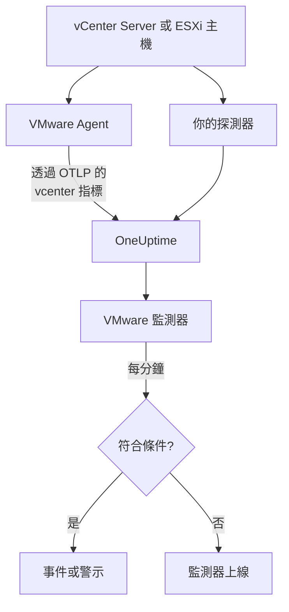

# VMware 監控

VMware 監測器會監看一個 vCenter——它的資料中心、叢集、ESXi 主機、虛擬機器、資料存放區、資源集區和 vSAN——並在主機飽和、VM 缺少 CPU 或記憶體、資料存放區寫滿，或 vSphere 發出警報時通知你。它讀取 OneUptime VMware Agent 收集的 `vcenter.*` 指標，或你的某個探測器在免代理程式的情況下收集的指標。

:::cards
- [建立監測器](#建立-vmware-監測器): 在儀表板中的六個步驟。
- [範本](#預建警示範本): 二十三個現成的警示，每台主機、每個 VM 或每個資料存放區一個事件。
- [識別屬性](#識別屬性): 如何鎖定一台主機、一個 VM 或一個資料存放區。
- [指標](#收集的指標): 監測器可以據以發出警示的每個 `vcenter.*` 序列。
:::

## 運作原理

指標來自 vCenter 的 API，使用唯讀帳戶透過以下兩種方式之一讀取：

- **VMware Agent**：一個帶有 `vcenter` 接收器的 OpenTelemetry Collector，執行在能夠連線到 vCenter 的機器上。請參閱 [VMware 代理程式](/docs/telemetry/vmware)。
- **探測器**：不需要安裝任何東西：在 OneUptime 中連接 vCenter，並選擇能連線到它的探測器。請參閱 [免代理程式的 VMware](/docs/telemetry/vmware-agentless)。

兩者都會在每個收集間隔(預設 2 分鐘)傳送相同的序列，並標記上 vCenter 的名稱 `vmware.vcenter.name`。一個 vCenter 就是一個 vSphere 端點：一台 vCenter Server 或一台獨立的 ESXi 主機。VMware 監測器繫結到一個 vCenter。它每分鐘對該 vCenter 的指標執行一次查詢，並將結果與其條件比較。



## 開始之前

- **收集 vCenter 的指標**，使用 [VMware Agent](/docs/telemetry/vmware) 或 [免代理程式](/docs/telemetry/vmware-agentless)。兩者都使用一個在最上層 vCenter 物件上擁有 **Read-Only** 角色、並勾選了 **Propagate to children** 的 vSphere 使用者。代理程式讀取 `ONEUPTIME_URL`、`ONEUPTIME_TELEMETRY_INGESTION_KEY`、`VMWARE_VCENTER_NAME`、`VCENTER_ENDPOINT`、`VCENTER_USERNAME` 和 `VCENTER_PASSWORD`。
- **確認 vCenter 已註冊。** 它會出現在 **產品 → 基礎設施 → VMware → 所有 vCenter** 下：透過代理程式時，在第一次完整收集後以代理程式的 `VMWARE_VCENTER_NAME` 命名；免代理程式時，從你連接它的那一刻起出現。

## 建立 VMware 監測器

:::steps
### 新增監測器

前往 **監測器**，點選 **建立監測器**。

### 選擇 VMware

在 **監測器類型** 下點選 **更多監測器類型**，然後在 **基礎設施** 下選擇 **VMware**，或在搜尋方塊中輸入 `vmware`。輸入 **名稱**(它會用在事件和警示標題中)，然後點選 **下一步**。

### 選擇 vCenter

在 **VMware Monitor Configuration** 下，從 **vCenter** 中選擇 vCenter。每個傳送過資料或你在免代理程式的情況下連接的 vCenter 都在清單中。

### 選擇要監看的內容

選擇三個索引標籤之一：

- **Quick Setup**：點選一個 [範本](#預建警示範本)。它會設定指標、屬性篩選器、彙總、時間範圍、分組和臨界值，並用自己的條件取代下面的條件。你仍然可以修改 **時間範圍**。
- **Custom Metric**：從 **VMware Metric** 中選擇一個指標，然後設定 **彙總** 和 **時間範圍**。表單會依它描述的物件分組，因此每台主機、每個 VM 或每個資料存放區都會單獨判斷，而 [篩選器](#監測器設定) 可以把它縮小到一個資料中心、叢集、主機、VM、資料存放區或資源集區。
- **進階**：在 **選擇指標** 下自行建構查詢和公式，並依 `disk_state`、`power_state` 或 `status` 等屬性篩選。以一個 [識別屬性](#識別屬性) 進行 **Group by**，即可分別判斷每個物件。

### 檢查條件

開啟 **監測器條件** 下的每個條件，檢查其 **指標**、**彙總**、**條件** 和 **Threshold**。範本會填入這些內容。使用 **Custom Metric** 或 **進階** 時，監測器會從 [預設條件](#預設條件) 開始，它只會注意到指標降為零，所以請設定你自己的臨界值。

### 建立監測器

點選 **建立監測器**。OneUptime 會開啟監測器的頁面，並每分鐘評估一次。它發出的事件和警示也會列在 vCenter 的 **事件** 和 **警示** 頁面上。
:::

> [!TIP]
> 若要一次設定多個範本，請從 **產品 → 基礎設施 → VMware** 開啟 vCenter，然後前往 **Recommendations**。選擇你需要的範本和要呼叫的人員，OneUptime 會為每個範本建立一個監測器。

## 監測器設定

| 欄位 | 索引標籤 | 作用 |
| --- | --- | --- |
| **vCenter** | 全部 | 必填。把每個查詢限定到 `resource.vmware.vcenter.name`。 |
| **Datacenter** | Custom Metric、進階 | 選填。一個資料中心：`resource.vcenter.datacenter.name`。每個序列都帶有它。 |
| **叢集** | Custom Metric、進階 | 選填。一個叢集：`resource.vcenter.cluster.name`。比對叢集自身的序列，以及其中的主機、VM 和資源集區的序列；獨立的 ESXi 主機沒有叢集。 |
| **ESXi Host** | Custom Metric、進階 | 選填。一台 ESXi 主機：`resource.vcenter.host.name`。比對主機自身的序列 **以及** 它執行的每個 VM 的序列，因為 VM 帶有其主機的名稱。 |
| **Virtual Machine** | Custom Metric、進階 | 選填。一個 VM：`resource.vcenter.vm.name`。VM 名稱不一定唯一：當兩個 VM 同名時，請再加上一台主機或一個叢集。 |
| **Datastore** | Custom Metric、進階 | 選填。一個資料存放區：`resource.vcenter.datastore.name`。 |
| **Resource Pool Path** | Custom Metric、進階 | 選填。一個資源集區，依其清單路徑(`/DC/host/Cluster/Resources/pool`)：`resource.vcenter.resource_pool.inventory_path`。之所以用路徑，是因為資源集區名稱只在其父物件內唯一。 |
| **VMware Metric** | Custom Metric | [目錄](#收集的指標) 中的一個指標。 |
| **彙總** | Custom Metric | 如何合併樣本：**平均**、**最大值**、**最小值**、**總和** 或 **計數**。從該指標的常用彙總開始。 |
| **時間範圍** | 全部 | 查詢讀取的滾動視窗，從 **Past 1 Minute** 到 **Past 365 Days**。新監測器從 **Past 5 Minutes** 開始；範本會設定自己的值。 |
| **選擇指標** | 進階 | 查詢建構器：**指標**、**Aggregate by**、**Filter by attributes**、**Group by**，以及用於合併查詢的 **新增指標** 和 **新增公式**。 |

vCenter 每個收集間隔(預設 2 分鐘)讀取一次，因此 1 分鐘的視窗可能根本沒有樣本。請把視窗保持在 5 分鐘或更長；如果你為大型清單調高了收集間隔，還要更長。

## 識別屬性

`vcenter` 接收器為每個 vSphere 物件傳送一個 OpenTelemetry 資源，並用 **資源屬性** 為它命名。一個序列帶有哪些屬性，就說明了它描述的是哪種物件：

| vSphere 物件 | 識別資源屬性 |
| --- | --- |
| 資料中心 | `vcenter.datacenter.name` |
| 叢集 | `vcenter.datacenter.name`、`vcenter.cluster.name` |
| ESXi 主機 | `vcenter.datacenter.name`、`vcenter.host.name`(屬於叢集時 + `vcenter.cluster.name`) |
| 虛擬機器 | `vcenter.datacenter.name`、`vcenter.host.name`、`vcenter.vm.name`、`vcenter.vm.id`(+ `vcenter.cluster.name`；`vcenter.resource_pool.*` 或 `vcenter.virtual_app.*`) |
| VM 範本 | `vcenter.datacenter.name`、`vcenter.host.name`、`vcenter.vm_template.name`、`vcenter.vm_template.id` |
| 資料存放區 | `vcenter.datacenter.name`、`vcenter.datastore.name` |
| 資源集區 | `vcenter.datacenter.name`、`vcenter.resource_pool.name`、`vcenter.resource_pool.inventory_path`(+ `vcenter.cluster.name` 或 `vcenter.host.name`) |

在監測器篩選器和分組鍵中，資源屬性以 `resource.` 開頭(`resource.vcenter.host.name`)，而資料點屬性不以它開頭(`disk_state`、`power_state`、`status`、`effective`、`direction`、`object`、`type`)。布林屬性 `effective` 以文字 `"true"` 或 `"false"` 儲存，因此請用文字篩選它。依識別屬性篩選可鎖定一個物件，依它分組則可分別判斷每個物件。

## 預建警示範本

OneUptime 為常見的 VMware 問題提供 23 個範本，**Quick Setup** 會提供全部範本。每個範本都會建構一個完整的監測器：指標查詢、其屬性篩選器、依物件自身識別屬性的分組、一個觸發條件和一個復原條件。臨界值是可以編輯的起點。

除非表格另有說明，範本讀取過去 5 分鐘。只有當條件在視窗的每一分鐘都成立時，條件才會觸發；臨界值條件會在超過臨界值 10% 之後復原，因此在這條線附近徘徊的值不會來回切換。

| 範本 | 類別 | 嚴重程度 | 監看內容 | 觸發條件 | 復原條件 |
| --- | --- | --- | --- | --- | --- |
| Host CPU Saturation | 主機 | Warning | `vcenter.host.cpu.utilization`，依 `resource.vcenter.host.name` 取 Avg | 高於 90%：主機上的每個 VM 都在爭奪核心，並出現 CPU 就緒時間 | 達到或低於 81% |
| Host Memory Saturation | 主機 | Warning | `vcenter.host.memory.utilization`，依主機取 Avg | 高於 90%：主機開始透過氣球回收、壓縮和置換收回記憶體 | 達到或低於 81% |
| Host Disk Latency High | 主機 | Warning | `vcenter.host.disk.latency.max`，依主機取 Max | 高於 50 ms：磁碟位於該路徑上的每個 VM 都在等待儲存。需要效能計數器層級 3 | 達到或低於 45 ms |
| Host Network Packet Errors | 主機 | Warning | `vcenter.host.network.packet.error.rate`，依主機取 Max | 高於 0：幾乎都是纜線、SFP 或交換器連接埠故障 | 恢復為 0 |
| Host Network Packet Drops | 主機 | Warning | `vcenter.host.network.packet.drop.rate`，依主機取 Max | 高於 0：上行鏈路超額訂閱，或 NIC 環形緩衝區溢位 | 恢復為 0 |
| VM CPU Saturation | Virtual Machine | Warning | `vcenter.vm.cpu.utilization`，依 `resource.vcenter.vm.name` 取 Avg，**過去 15 分鐘** | 在整整 15 分鐘內都高於 VM vCPU 的 90%：VM 可以使用分配給它的資源，因此只有始終不降下來的 VM 才會呼叫 | 達到或低於 81% |
| VM CPU Ready Contention | Virtual Machine | Warning | `vcenter.vm.cpu.readiness`，依 VM 取 Avg | 高於 10%：VM 已準備好執行，但主機沒有實體核心分配給它。在客體內部看不到 | 達到或低於 9% |
| VM Memory Saturation | Virtual Machine | Warning | `vcenter.vm.memory.utilization`，依 VM 取 Avg | 高於其記憶體的 90%：客體即將開始分頁 | 達到或低於 81% |
| VM Memory Ballooning | Virtual Machine | Warning | `vcenter.vm.memory.ballooned`，依 VM 取 Max | 高於 0：主機記憶體不足，正在從這個客體收回記憶體 | 恢復為 0 |
| VM Memory Swapping | Virtual Machine | 嚴重 | `vcenter.vm.memory.swapped`，依 VM 取 Max | 高於 0：主機正在置換 VM 的記憶體，這是在氣球回收和壓縮之後的最後手段 | 恢復為 0 |
| VM Disk Latency High | Virtual Machine | Warning | `vcenter.vm.disk.latency.max`，依 VM 取 Max | 高於 50 ms：客體中的應用程式 I/O 逾時 | 達到或低於 45 ms |
| VM Disk Usage High | Virtual Machine | Warning | `vcenter.vm.disk.utilization`，依 VM 取 Avg | 已佔用其佈建儲存的 90% 以上：精簡佈建的 VM 即將佔滿其全部大小 | 達到或低於 81% |
| Datastore Capacity Warning | Datastore | Warning | `vcenter.datastore.disk.utilization`，依 `resource.vcenter.datastore.name` 取 Avg | 高於 80%：一個提前的警告，因為精簡磁碟和快照會很快用完剩餘空間 | 達到或低於 72% |
| Datastore Capacity Critical | Datastore | 嚴重 | `vcenter.datastore.disk.utilization`，依資料存放區取 Avg | 高於 90%：寫滿的資料存放區會暫停每個在其上有磁碟的 VM | 達到或低於 81% |
| Cluster Host Not Effective | 叢集 | 嚴重 | `vcenter.cluster.host.count` 篩選到 `effective = false`，依 `resource.vcenter.cluster.name` 取 Max | 高於 0：某台主機處於維護模式、已中斷連線或沒有回應，因此叢集以低於其設計容量的容量運作 | 恢復為 0 |
| Datacenter Hosts Unhealthy | Datacenter | 嚴重 | `vcenter.datacenter.host.count` 篩選到 `status = red`，依 `resource.vcenter.datacenter.name` 取 Max | 高於 0：某台主機有嚴重警報，例如硬體感測器、遺失的儲存路徑或 HA 代理程式錯誤 | 恢復為 0 |
| Datacenter Hosts Degraded | Datacenter | Warning | `vcenter.datacenter.host.count` 篩選到 `status = yellow`，依資料中心取 Max | 高於 0：某台主機有警告層級警報 | 恢復為 0 |
| Datacenter Hosts Powered Off | Datacenter | Warning | `vcenter.datacenter.host.count` 篩選到 `power_state = off`，依資料中心取 Max | 高於 0：某台主機已關機——它當機了、斷電了，或被 DPM 置於待命狀態 | 恢復為 0 |
| Datacenter VMs Unhealthy | Datacenter | Warning | `vcenter.datacenter.vm.count` 篩選到 `status = red`，依資料中心取 Max | 高於 0：某個 VM 有嚴重警報，例如 HA 重新啟動失敗、遺失的資料存放區或遺失的 Tools 活動訊號 | 恢復為 0 |
| Datacenter Clusters Unhealthy | Datacenter | 嚴重 | `vcenter.datacenter.cluster.count` 篩選到 `status = red`，依資料中心取 Max | 高於 0：某個叢集有嚴重警報，例如 HA 容錯移轉資源不足、HA 選舉失敗或嚴重的 vSAN 健康狀態檢查 | 恢復為 0 |
| vSAN Latency High | vSAN | Warning | `vcenter.cluster.vsan.latency.avg`，依叢集取 Avg | 高於 20 000 µs (20 ms)：vSAN 資料存放區上每個 VM 的儲存都變慢。在沒有 vSAN 的叢集上保持靜默 | 達到或低於 18 000 µs |
| vSAN Congestion | vSAN | Warning | `vcenter.cluster.vsan.congestions`，依叢集取 Max | 高於 0：某個磁碟群組跟不上，vSAN 正在減慢其用戶端的 I/O | 恢復為 0 |
| Resource Pool Memory Swapped | 叢集 | Warning | `vcenter.resource_pool.memory.swapped`，依 `resource.vcenter.resource_pool.inventory_path` 取 Max | 高於 0：資源集區的 VM 正從主機置換空間取得記憶體，通常是因為資源集區的記憶體限制或配額過低 | 恢復為 0 |

**嚴重程度** 是選擇器顯示的標籤。範本建立的事件和警示會以專案中最嚴重的事件和警示嚴重程度開始；可以在條件中修改。

- **使用率範本使用 Avg：** 接收器為每個物件回報真實的 0 到 100 百分比，因此一分鐘內的平均值就是持續的使用率。
- **延遲範本使用 Max：** 該指標已經是物件所有磁碟中最差的延遲，因此其最高樣本才是真實的值。
- **計數和狀態範本使用 Max**，因此只要有一次收集顯示該狀況就會觸發：封包錯誤、氣球回收、置換、紅色和黃色狀態、未生效的主機、壅塞。
- **每個範本都依物件自身的識別屬性分組**，因此每個受影響的物件各觸發一個事件，並且事件中會寫出該物件。
- **臨界值固定在其單位上**(`%`、`ms`、`us`)，因此無論圖表顯示什麼單位，它們的意義都不變。

## 收集的指標

下面的指標是監測器表單提供的目錄。單位是接收器自己的單位：`MHz`、`%`、`MiBy`(MiB)、`By`(位元組)、`KiBy`、`ms`、`us`(微秒)、`{KiBy/s}`、`By/s` 和計數。標記為 _預設關閉_ 的指標在你於代理程式的 `otel-collector-config.yaml` 中開啟之前不會被收集；隨附的設定已經開啟了 `vcenter.host.memory.capacity`。

### 資料中心

| 指標 | 單位 | 描述 |
| --- | --- | --- |
| `vcenter.datacenter.cluster.count` | `{clusters}` | 資料中心中的叢集，依 `status`(`red` / `yellow` / `green` / `gray`)細分。加總得到總數；篩選 `status = red` 可得到有嚴重警報的叢集 |
| `vcenter.datacenter.cpu.limit` | `MHz` | 資料中心在所有 ESXi 主機上可用的 CPU 總量 |
| `vcenter.datacenter.datastore.count` | `{datastores}` | 資料中心中的資料存放區 |
| `vcenter.datacenter.disk.space` | `By` | 整個資料中心的資料存放區空間，依 `disk_state`(`used` / `available`)細分。used ÷ (used + available) 是整個資料中心的儲存使用率 |
| `vcenter.datacenter.host.count` | `{hosts}` | 資料中心中的 ESXi 主機，依 `status` 和 `power_state`(`on` / `off` / `standby` / `unknown`)細分。篩選 `status = red` 或 `power_state = off` |
| `vcenter.datacenter.memory.limit` | `By` | 資料中心在所有 ESXi 主機上可用的實體記憶體總量 |
| `vcenter.datacenter.vm.count` | `{virtual_machines}` | 資料中心中的虛擬機器，依 `status` 和 `power_state`(`on` / `off` / `suspended` / `unknown`)細分。篩選 `power_state = on` 可得到正在執行的 VM |

### 叢集

| 指標 | 單位 | 描述 |
| --- | --- | --- |
| `vcenter.cluster.cpu.effective` | `MHz` | 叢集實際可以排程的 CPU——不含處於維護模式或沒有回應的主機。與 `vcenter.cluster.cpu.limit` 比較可看出停止服務的容量 |
| `vcenter.cluster.cpu.limit` | `MHz` | 叢集中每台 ESXi 主機的 CPU 總量，與主機狀態無關 |
| `vcenter.cluster.host.count` | `{hosts}` | 叢集中的 ESXi 主機，依 `effective`(`"true"` / `"false"`)細分。主機處於維護模式、已中斷連線或沒有回應時不算生效 |
| `vcenter.cluster.memory.effective` | `By` | 叢集實際可以分配給 VM 的記憶體——不含處於維護模式或沒有回應的主機，也不含 ESXi 本身保留的記憶體 |
| `vcenter.cluster.memory.limit` | `By` | 叢集中每台 ESXi 主機的實體記憶體總量 |
| `vcenter.cluster.vm.count` | `{virtual_machines}` | 叢集中的虛擬機器，依 `power_state` 細分。加總得到總數；篩選 `power_state = on` 可得到正在執行的 VM |
| `vcenter.cluster.vm_template.count` | `{virtual_machine_templates}` | 叢集中的虛擬機器範本 |

### 主機(ESXi)

| 指標 | 單位 | 描述 |
| --- | --- | --- |
| `vcenter.host.cpu.capacity` | `MHz` | ESXi 主機的 CPU 總容量(核心數 × 時脈)——`vcenter.host.cpu.usage` 的分母 |
| `vcenter.host.cpu.reserved` | `MHz` | 為虛擬機器保留的 CPU，依 `cpu_reservation_type`(`total` / `used`)細分。`used` 接近 `total` 表示新的保留將無法通過許可控制 |
| `vcenter.host.cpu.usage` | `MHz` | 主機上目前被所有 VM 和 Hypervisor 本身耗用的 CPU |
| `vcenter.host.cpu.utilization` | `%` | 主機的 CPU 使用率，佔其容量的百分比(0–100) |
| `vcenter.host.disk.latency.avg` | `ms` | 平均磁碟延遲(裝置 + 核心時間)，依 `direction`(`read` / `write`)和 `object`(磁碟裝置)細分。需要效能計數器層級 2 |
| `vcenter.host.disk.latency.max` | `ms` | 在最近 20 s 的間隔內，主機使用的所有磁碟中觀察到的最高延遲，依 `object`。需要效能計數器層級 3 |
| `vcenter.host.disk.throughput` | `{KiBy/s}` | 每秒從主機磁碟讀取或寫入的 KB 數，依 `direction` 和 `object`。需要效能計數器層級 4 |
| `vcenter.host.memory.active` | `MiBy` | 主機上已開機的 VM 正在使用中的記憶體。_預設關閉_——在代理程式設定中開啟 `vcenter.host.memory.active` |
| `vcenter.host.memory.ballooned` | `MiBy` | 氣球驅動程式從主機的 VM 回收的客體記憶體；高於 0 表示主機有記憶體壓力。_預設關閉_ |
| `vcenter.host.memory.capacity` | `MiBy` | 主機的實體記憶體總量——`vcenter.host.memory.usage` 的分母。上游預設關閉；隨附的代理程式設定會開啟它 |
| `vcenter.host.memory.granted` | `MiBy` | 分配給主機上已開機 VM 的機器記憶體。_預設關閉_ |
| `vcenter.host.memory.usage` | `MiBy` | 主機上目前耗用的記憶體，包括 Hypervisor 本身的負擔 |
| `vcenter.host.memory.utilization` | `%` | 主機的記憶體使用率，佔其實體容量的百分比(0–100) |
| `vcenter.host.network.packet.drop.rate` | `{packets/s}` | 每個實體 NIC 上每秒捨棄的封包，依 `direction`(`transmitted` / `received`)和 `object`(例如 `vmnic0`)——上行鏈路超額訂閱或 NIC 即將故障 |
| `vcenter.host.network.packet.error.rate` | `{errors/s}` | 主機實體 NIC 上每秒的封包錯誤，依 `direction` 和 `object`——幾乎都是纜線、SFP 或交換器連接埠故障 |
| `vcenter.host.network.packet.rate` | `{packets/s}` | 每個實體 NIC 上每秒傳送或接收的封包，依 `direction` 和 `object` |
| `vcenter.host.network.throughput` | `{KiBy/s}` | 主機每秒傳送或接收的 KB 數，依 `direction` 和 `object` |
| `vcenter.host.network.usage` | `{KiBy/s}` | 主機所有 NIC 的傳送與接收合計速率，依 `object` |

### 虛擬機器

| 指標 | 單位 | 描述 |
| --- | --- | --- |
| `vcenter.vm.cpu.readiness` | `%` | VM 已準備好執行但無法被排程到實體 CPU 上的時間百分比(CPU 就緒)。超過 5% 時客體會感到遲緩；超過 10% 時主機已超額訂閱。僅限已開機的 VM |
| `vcenter.vm.cpu.time` | `%` | VM 的 vCPU 在每種狀態下花費的時間，依 `cpu_state`(`idle` / `ready` / `wait`)和 `object`(vCPU)。_預設關閉_——開啟 `vcenter.vm.cpu.time` |
| `vcenter.vm.cpu.usage` | `MHz` | VM 耗用的 CPU。僅限已開機的 VM——OneUptime 正是根據它是否存在來推斷 VM 的電源狀態 |
| `vcenter.vm.cpu.utilization` | `%` | VM 的 CPU 使用率，佔其設定之 vCPU 的百分比(0–100)。僅限已開機的 VM |
| `vcenter.vm.disk.latency.avg` | `ms` | 平均磁碟延遲，依 `direction`(`read` / `write`)、`disk_type`(`virtual` / `physical`)和 `object`(虛擬磁碟)。需要效能計數器層級 2 |
| `vcenter.vm.disk.latency.max` | `ms` | 在 20 s 的間隔內，VM 在任一磁碟上看到的最高總延遲(裝置 + 核心時間)，依 `object` |
| `vcenter.vm.disk.throughput` | `{KiBy/s}` | 每秒從 VM 磁碟讀取或寫入的 KB 數，依 `direction` 和 `object`。需要效能計數器層級 2 |
| `vcenter.vm.disk.usage` | `By` | VM 檔案佔用的資料存放區空間，依 `disk_state`(`used` / `available`)細分。VM 範本也會傳送。篩選 `disk_state = used` 可得到已佔用大小 |
| `vcenter.vm.disk.utilization` | `%` | VM 的佈建儲存中已在資料存放區上佔用的百分比(0–100)——接近 100% 的精簡佈建 VM 即將佔滿其全部大小 |
| `vcenter.vm.memory.ballooned` | `MiBy` | 氣球驅動程式(VMware Tools)從 VM 回收的客體記憶體。高於 0 表示 ESXi 主機記憶體不足 |
| `vcenter.vm.memory.granted` | `MiBy` | 主機分配給 VM 的機器記憶體。_預設關閉_——開啟 `vcenter.vm.memory.granted` |
| `vcenter.vm.memory.swapped` | `MiBy` | 從主機置換檔分配給 VM 的記憶體——氣球回收和壓縮之後的最後手段；任何高於 0 的值都表示 VM 正在以磁碟延遲換取 RAM |
| `vcenter.vm.memory.swapped_ssd` | `KiBy` | VM 被置換到主機快閃置換快取中的記憶體——比置換檔的影響小，但仍然是記憶體壓力 |
| `vcenter.vm.memory.usage` | `MiBy` | VM 的客體正在使用中的記憶體。已開機和已關機的 VM 都會傳送(關機時為 0) |
| `vcenter.vm.memory.utilization` | `%` | VM 的記憶體使用率，佔其設定之記憶體的百分比(0–100) |
| `vcenter.vm.network.broadcast.packet.rate` | `{packets/s}` | 每個 vNIC 每秒的廣播封包，依 `direction` 和 `object`。_預設關閉_ |
| `vcenter.vm.network.multicast.packet.rate` | `{packets/s}` | 每個 vNIC 每秒的多點傳送封包，依 `direction` 和 `object`。_預設關閉_ |
| `vcenter.vm.network.packet.drop.rate` | `{packets/s}` | 每個 vNIC 每秒捨棄的封包，依 `direction` 和 `object`。接收端捨棄封包通常表示客體清空其環形緩衝區的速度不夠快 |
| `vcenter.vm.network.packet.rate` | `{packets/s}` | 每個 vNIC 每秒傳送或接收的封包，依 `direction` 和 `object` |
| `vcenter.vm.network.throughput` | `By/s` | VM 網路每秒傳送或接收的位元組數，依 `direction` 和 `object` |
| `vcenter.vm.network.usage` | `{KiBy/s}` | VM 的傳送與接收合計速率，依 `object` |

### 資料存放區

| 指標 | 單位 | 描述 |
| --- | --- | --- |
| `vcenter.datastore.disk.usage` | `By` | 資料存放區上的空間，依 `disk_state`(`used` / `available`)細分。used + available 是資料存放區的容量 |
| `vcenter.datastore.disk.utilization` | `%` | 資料存放區容量中已使用的百分比(0–100)。寫滿的資料存放區會暫停每個寫入它的 VM，因此請在遠未達到 100% 之前發出警示 |

### 資源集區

| 指標 | 單位 | 描述 |
| --- | --- | --- |
| `vcenter.resource_pool.cpu.shares` | `{shares}` | 資源集區上設定的 CPU 配額——父物件資源緊張時，它相對於同層資源集區的優先順序 |
| `vcenter.resource_pool.cpu.usage` | `MHz` | 資源集區(及其子資源集區)中每個 VM 耗用的 CPU |
| `vcenter.resource_pool.memory.ballooned` | `MiBy` | 氣球驅動程式從資源集區中所有 VM 回收的記憶體 |
| `vcenter.resource_pool.memory.granted` | `MiBy` | 分配給資源集區 VM 的主機記憶體，依 `type`(`private` / `shared`——共用頁面由透明頁面共用去除重複)細分 |
| `vcenter.resource_pool.memory.shares` | `{shares}` | 資源集區上設定的記憶體配額 |
| `vcenter.resource_pool.memory.swapped` | `MiBy` | 從 ESXi 主機置換空間分配給資源集區 VM 的記憶體——任何高於 0 的值都表示資源集區中至少有一個 VM 正在被主機置換 |
| `vcenter.resource_pool.memory.usage` | `MiBy` | 資源集區使用的記憶體，在較新的收集器組建中依 `type`(`guest` / `host` / `overhead`)細分；較舊的組建傳送一個不帶類型的序列。篩選 `type = guest` |

### vSAN

僅針對啟用了 vSAN 的叢集、其中的主機以及 vSAN 資料存放區上的 VM 傳送。延遲以 **微秒** (`us`) 為單位，不同於主機和 VM 以毫秒為單位的延遲：

| 指標 | 單位 | 描述 |
| --- | --- | --- |
| `vcenter.cluster.vsan.congestions` | `{congestions/s}` | 針對叢集中每個 vSAN 用戶端的 I/O 每秒發出的壅塞事件——vSAN 自己的背壓訊號 |
| `vcenter.cluster.vsan.latency.avg` | `us` | 叢集存取 vSAN 儲存時看到的平均延遲，依 `type`(`read` / `write`)。20 000 µs = 20 ms |
| `vcenter.cluster.vsan.operations` | `{operations/s}` | 整個叢集每秒的 vSAN I/O 作業數，依 `type`(`read` / `write` / `unmap`) |
| `vcenter.cluster.vsan.throughput` | `By/s` | 叢集的 vSAN 輸送量，依 `direction`(`read` / `write`) |
| `vcenter.host.vsan.cache.hit_rate` | `%` | 在最近 5 min 的間隔內，主機的 vSAN 讀取 I/O 中由其本機用戶端快取提供的百分比——比率下降表示讀取落到了容量層 |
| `vcenter.host.vsan.congestions` | `{congestions/s}` | 針對來自該主機的 vSAN I/O 每秒發出的壅塞事件 |
| `vcenter.host.vsan.latency.avg` | `us` | 主機存取 vSAN 儲存時看到的平均延遲，依 `type` |
| `vcenter.host.vsan.operations` | `{operations/s}` | 主機每秒發出的 vSAN I/O 作業數，依 `type` |
| `vcenter.host.vsan.throughput` | `By/s` | 主機的 vSAN 輸送量，依 `direction` |
| `vcenter.vm.vsan.latency.avg` | `us` | VM 存取 vSAN 儲存時看到的平均延遲，依 `type` |
| `vcenter.vm.vsan.operations` | `{operations/s}` | VM 每秒發出的 vSAN I/O 作業數，依 `type` |
| `vcenter.vm.vsan.throughput` | `By/s` | VM 的 vSAN 輸送量，依 `direction` |

> [!NOTE]
> VM 的電源狀態不是一個指標。接收器只為已開機的 VM 傳送 `vcenter.vm.cpu.*`，因此 OneUptime 根據 CPU 資料是否與 VM 的記憶體和磁碟資料在同一次收集中送達，來區分 **Powered on** 和 **Powered off**；vCenter 的 **Virtual Machines** 頁面會顯示結果。若要針對已關機的主機或正在執行的 VM 數量發出警示，請使用 `power_state` 屬性，它位於 `vcenter.datacenter.host.count`、`vcenter.datacenter.vm.count` 或 `vcenter.cluster.vm.count` 上。

## 監控條件

條件會把監測器的某個查詢或公式與臨界值比較。VMware 監測器的條件沒有 **篩選器類型**：每條規則都用以下欄位檢查指標值。

| 欄位 | 作用 |
| --- | --- |
| **指標** | 要檢查的查詢或公式，依其變數名稱。 |
| **彙總** | 視窗中的值如何變成一個答案：**平均**、**總和**、**Maximum Value**、**Minimum Value**、**All Values**(每個值都必須相符)或 **Any Value**(一個就夠)。 |
| **條件** | **Greater Than**、**Less Than**、**Greater Than Or Equal To**、**Less Than Or Equal To** 或 **Equal To**——或者一個異常條件：**Anomalously High**、**Anomalously Low** 或 **Anomalous**。 |
| **Threshold** | 用於比較的值。指標有單位時，旁邊會有一份單位清單。異常條件不會顯示此欄位。 |
| **敏感度** | 僅限異常條件。**低**(4σ)、**中**(3σ，預設)或 **高**(2σ)。 |
| **基準視窗** | 僅限異常條件。14 天(預設)、28、60 或 90 天的歷史。 |
| **如果沒有資料** | 位於 **更多欄位** 下。視窗中沒有樣本時會發生什麼：**Ignore**(預設)、**Treat As Zero** 或 **觸發器**。 |

異常條件會把每個值與基準中一週內相同時段的值比較。在基準視窗累積足夠的歷史之前，它們會一直處於 "Learning" 狀態，不會發出任何警示。

一些可以作為起點的條件：

- **某台主機已飽和：** `vcenter.host.cpu.utilization`，平均，依 `resource.vcenter.host.name` 分組，**Greater Than** `90`，過去 5 分鐘。
- **某個資料存放區即將寫滿：** `vcenter.datastore.disk.utilization`，平均，依 `resource.vcenter.datastore.name` 分組，**Greater Than** `80`。
- **某個叢集失去了一台主機：** `vcenter.cluster.host.count` 篩選到 `effective = false`，最大值，依 `resource.vcenter.cluster.name` 分組，**Greater Than** `0`。
- **執行中的 VM 少於預期：** `vcenter.cluster.vm.count` 篩選到 `power_state = on` 和 `resource.vcenter.cluster.name = Production`，總和，**Less Than** 你預期的數量。
- **某個 VM 正被主機置換：** `vcenter.vm.memory.swapped`，最大值，依 `resource.vcenter.vm.name` 分組，**Greater Than** `0`。

### 預設條件

不是從範本建構的監測器會以兩個條件開始：

| 順序 | 條件 | 相符時機 | 然後 |
| --- | --- | --- | --- |
| 1 | Check if _monitor name_ is offline | 第一個查詢的任一值為 `0` | 把監測器標記為 **離線**，並宣告事件 "_monitor name_ is offline"，監測器復原時該事件會自行解決。 |
| 2 | Check if _monitor name_ is online | 任一值大於 `0` | 把監測器標記為 **運作中**。 |

> [!IMPORTANT]
> 靜默不會符合任何一個條件：停止傳送資料的 vCenter 會讓監測器保持原樣。若要在資料停止時收到通知，請在某個條件上把 **如果沒有資料** 設定為 **觸發器**。OneUptime 本身未接收資料的時間永遠不算作沒有資料：視窗包含這段時間的檢查會改為等待，正如 [OneUptime 未接收資料時](/docs/monitor/when-oneuptime-is-not-receiving) 所說明的那樣。

## Terraform

[OneUptime Terraform 提供者](/docs/terraform/monitor-steps) 在 `vmware_monitor` 屬性中承載 VMware 監測器步驟的設定：即 `vmwareMonitor` 設定(`vcenterIdentifier`、`resourceFilters`、`metricViewConfig`、`rollingTime`)的原始 JSON，用 `jsonencode()` 撰寫：

```hcl title="main.tf"
monitor_steps = [{
  vmware_monitor = jsonencode({
    vcenterIdentifier = "prod-vcenter"
    resourceFilters   = { clusterName = "Production" }
    rollingTime       = "Past 5 Minutes"
    metricViewConfig = {
      queryConfigs = [{
        metricAliasData = { metricVariable = "host_cpu", title = "Host CPU", description = "", legend = "" }
        metricQueryData = {
          filterData = {
            metricName     = "vcenter.host.cpu.utilization"
            attributes     = {}
            aggegationType = "Avg"
            aggregateBy    = {}
          }
          groupByAttributeKeys = ["resource.vcenter.host.name"]
        }
      }]
      formulaConfigs = []
    }
  })
  criteria = [ /* ... */ ]
}]
```

`vcenterIdentifier` 是 vCenter 的 `vmware.vcenter.name`——即代理程式啟動時使用的 `VMWARE_VCENTER_NAME`——而不是它的 OneUptime ID。

## 疑難排解

:::details vCenter 不在 vCenter 清單中
代理程式從中收集資料的 vCenter 會根據代理程式的資料自行註冊。請檢查代理程式是否在執行並傳送資料(請參閱 [驗證安裝](/docs/telemetry/vmware#驗證安裝))、是否設定了 `VMWARE_VCENTER_NAME`，以及是否已經過了一個收集間隔：在第一次完整走訪清單完成之前不會傳送任何內容。
:::

:::details 主機有指標，但 VM、資料存放區或叢集沒有
唯讀 vSphere 使用者取得角色時沒有勾選 **Propagate to children**，或者角色是授予在 vCenter 根以下的某個物件上。使用者看不到的物件就不會出現在指標中。請在最上層 vCenter 物件上設定權限，並勾選傳播。
:::

:::details Host CPU Saturation 從不觸發
範本對 `vcenter.host.cpu.utilization` 取平均，依 `resource.vcenter.host.name` 分別計算，因此每台主機都會單獨檢查。如果你建構了自己的查詢，請依帶有 `resource.` 前置詞的識別屬性分組：沒有前置詞的 `vcenter.host.name` 什麼也比對不到，而跨所有主機的平均值會被閒置的主機拉低。
:::

:::details vSAN 範本從不觸發
`vcenter.cluster.vsan.*`、`vcenter.host.vsan.*` 和 `vcenter.vm.vsan.*` 只針對啟用了 vSAN 的叢集、其中的主機以及 vSAN 資料存放區上的 VM 傳送。沒有 vSAN 時這些序列不存在，範本保持靜默。
:::

:::details 依 effective 篩選的條件什麼也比對不到
接收器的布林屬性 `effective` 以文字 `"true"` 或 `"false"` 儲存。請用文字篩選它，而不是用布林值。
:::

:::details 缺少磁碟延遲或輸送量指標
`vcenter.host.disk.latency.avg` 和 `vcenter.vm.disk.*` 需要 vCenter 統計層級 2，`vcenter.host.disk.latency.max` 需要層級 3，`vcenter.host.disk.throughput` 需要層級 4。請在 _vCenter → Configure → General → Statistics_ 下提高 5 分鐘間隔的統計層級。
:::

:::details 1 分鐘的視窗沒有顯示資料
vCenter 每個收集間隔讀取一次，預設 2 分鐘，大型清單通常更長，因此 1 分鐘的視窗中可能沒有樣本。請使用 5 分鐘或更長。
:::

## 後續步驟

:::cards
- [VMware 代理程式](/docs/telemetry/vmware): 安裝從 vCenter 收集資料的代理程式。
- [免代理程式的 VMware](/docs/telemetry/vmware-agentless): 改為讓探測器收集。
- [Proxmox 監控](/docs/monitor/proxmox-monitor): 用於 Proxmox VE 的同類監測器。
- [事件概觀](/docs/incidents/index): 條件宣告事件之後會發生什麼。
:::
