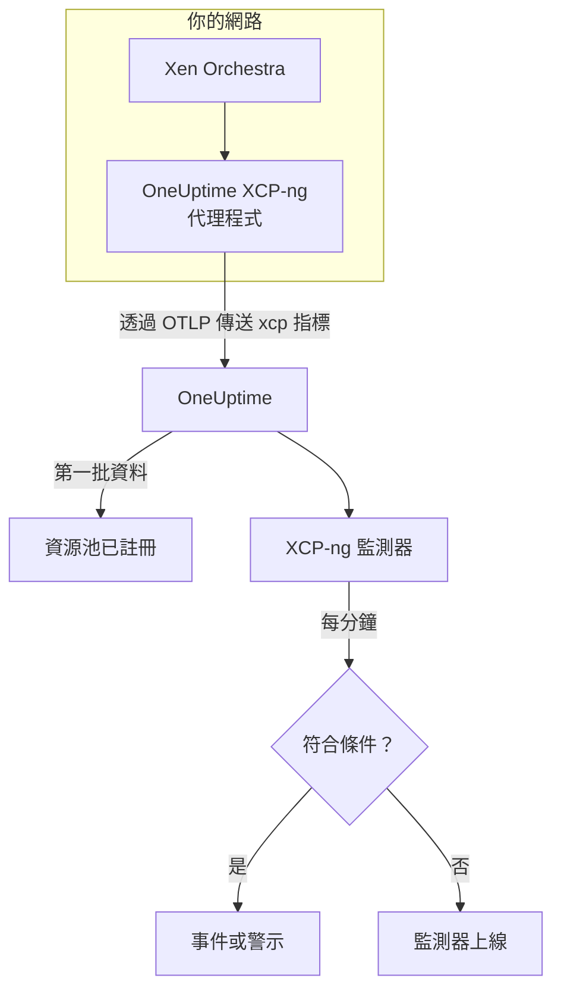

# XCP-ng 監控

XCP-ng 監測器監控一個 XCP-ng 資源池（它的主機、虛擬機器、儲存庫和虛擬磁碟），並在 Xen Orchestra 失去該資源池、主機離線或一直處於停用狀態、執行中的虛擬機器停止或 CPU 不足，或者儲存庫寫滿或變慢時通知你。它讀取 OneUptime XCP-ng 代理程式收集的 Xen Orchestra OpenMetrics 外掛程式的 `xcp_*` 序列，以及 OneUptime 從中衍生的健康序列，因此不會從外部探測任何東西。

:::cards
- [建立監測器](#建立-xcp-ng-監測器): 在儀表板中完成六個步驟。
- [範本](#現成的警示範本): 十個現成的警示，每台主機、每台虛擬機器或每個儲存庫一個事件。
- [資源識別](#資源識別): 如何指定單一主機、單一虛擬機器或單一儲存庫。
- [指標](#收集的指標): 監測器可以據以發出警示的每個序列。
:::

## 運作方式

OneUptime XCP-ng 代理程式在一台能連到 Xen Orchestra 的機器上執行。它每 60 秒讀取一次 Xen Orchestra 的 OpenMetrics 外掛程式（外掛程式會讀取 Xen Orchestra 管理的每個資源池的每台主機），並透過 OTLP 把序列傳送到 OneUptime，每個資源池一個資源，並標上資源池的 UUID `xcp_ng.pool.id`。第一批資料會註冊每個資源池。

XCP-ng 監測器綁定到一個資源池。它每分鐘對該資源池的指標執行一次查詢，並把結果與其條件比較。



## 開始之前

- **安裝 XCP-ng 代理程式**，裝在能連到 Xen Orchestra 的地方，並使用 Xen Orchestra OpenMetrics 外掛程式的密鑰。[XCP-ng 代理程式指南](/docs/telemetry/xcp-ng) 說明了外掛程式、Xen Orchestra 的憑證和安裝。
- **確認資源池已註冊。** 第一次擷取後大約一分鐘，它會以 Xen Orchestra 中的名稱出現在 **產品 → 基礎設施 → XCP-ng → 所有資源池** 下。

## 建立 XCP-ng 監測器

:::steps
### 開始新的監測器

前往 **監測器** 並按一下 **建立監測器**。

### 選擇 XCP-ng

在 **監測器類型** 下按一下 **更多監測器類型**，然後在 **基礎設施** 下選擇 **XCP-ng**，或在搜尋方塊中輸入 `xcp`。輸入 **名稱**（會用在事件和警示標題中），然後按一下 **下一步**。

### 選擇資源池

在 **XCP-ng Monitor Configuration** 下，從 **XCP-ng 資源池** 中選擇資源池。傳送過資料的每個資源池都在清單中。選好後，欄位下方的一行會顯示是否有資料傳入。**新增 XCP-ng 資源池** 會開啟已填好你的金鑰的設定步驟，這些步驟會等待第一批資料。

### 選擇要監控的內容

新監測器從 **告警內容** 下的 **Pool Disconnected** 開始。要監測其他內容：

- **變更** – 選擇另一個 [範本](#現成的警示範本)。它會設定指標、篩選器、彙總、時間範圍和閾值，並用自己的條件取代下方的條件。你仍然可以變更 **時間範圍**。
- **Custom Metric**（在 **更多欄位** 下） – 從 **XCP-ng Metric** 中選擇一個指標，然後設定 **彙總** 和 **時間範圍**。[篩選器](#監測器設定) 可以把範圍縮小到某類物件或單一物件。
- **進階**（在 **更多欄位** 下） – 在 **選擇指標** 下自行建立查詢和公式，例如由 `xcp_sr_physical_usage_bytes / xcp_sr_physical_size_bytes` 算出儲存庫的已用比例。使用 **分組依據** `xcp_ng.id` 可以個別評判每個物件。

### 檢查條件

開啟 **條件** 下的每個條件，檢查其 **指標**、**彙總**、**條件** 和 **閾值**。範本會填好這些內容。使用 **Custom Metric** 或 **進階** 時，監測器會從 [預設條件](#預設條件) 開始，這些條件只會注意到指標不再傳送資料，所以請設定你自己的閾值。

### 建立監測器

按一下 **建立監測器**。OneUptime 會開啟監測器的頁面，並每分鐘評估一次。它開啟的事件和警示也會列在資源池的 **事件** 和 **警示** 頁面上。
:::

> [!TIP]
> 若要一次設定多個範本，請從 **產品 → 基礎設施 → XCP-ng** 開啟資源池，然後前往 **建議**。選擇你需要的範本和要呼叫的人，OneUptime 就會為每個範本建立一個監測器。

## 監測器設定

| 欄位 | 分頁 | 作用 |
| --- | --- | --- |
| **XCP-ng 資源池** | 全部 | 必填。把每個查詢限定在資源池的 UUID `resource.xcp_ng.pool.id`，因此兩個同名的資源池絕不會混在一起。 |
| **資源範圍** | Custom Metric、進階 | 選用。**主機**、**虛擬機器**、**儲存庫**、**虛擬磁碟**、**XOSTOR** 或 **XCP-ng 資源池**，與 `xcp_ng.scope` 完全相符。 |
| **UUID** | Custom Metric、進階 | 選用。與 `xcp_ng.id` 完全相符：單一主機、虛擬機器、儲存庫或虛擬磁碟的 UUID，與 Xen Orchestra 中顯示的一致。與範圍搭配即可指定單一物件。 |
| **主機名稱** | Custom Metric、進階 | 選用。與 Xen Orchestra 的 `host_name` 標籤完全相符：主機自己的序列，以及在該主機上執行的虛擬機器的序列。 |
| **XCP-ng Metric** | Custom Metric | [目錄](#收集的指標) 中的一個指標。 |
| **彙總** | Custom Metric | 樣本的合併方式：**平均**、**最大值**、**最小值**、**總和** 或 **計數**。初始值為該指標通常的彙總方式。 |
| **時間範圍** | 全部 | 查詢讀取的滾動視窗，從 **Past 1 Minute** 到 **Past 365 Days**。新監測器從 **Past 1 Minute** 開始；範本會設定自己的值。 |
| **選擇指標** | 進階 | 查詢建立器：**指標**、**彙總方式**、**依屬性篩選**、**分組依據**，以及用來組合查詢的 **新增指標** 和 **新增公式**。 |

代理程式每 60 秒讀取一次 Xen Orchestra，而 Xen Orchestra 以 60 秒的解析度讀取其主機，因此 1 分鐘的視窗大約只有一個樣本；範本會讀取 5 分鐘或更長的時間。

## 資源識別

Xen Orchestra 用 `uuid` 標籤識別主機或虛擬機器，用 `sr_uuid` 識別儲存庫，用 `vdi_uuid` 識別虛擬磁碟。OneUptime 會在每個資料點送達時標上兩個屬性，這樣無論物件是由哪個標籤識別的，一個篩選器就能讀取它的每個序列。範本依賴這些屬性：

| 屬性 | 值 | 對於虛擬機器 |
| --- | --- | --- |
| `xcp_ng.scope` | `pool`、`host`、`vm`、`sr`（儲存庫）、`vdi`（虛擬磁碟）、`xostor` | `vm` |
| `xcp_ng.id` | 物件的 UUID，小寫：主機或虛擬機器的 `uuid`、儲存庫或 XOSTOR 叢集的 `sr_uuid`、虛擬磁碟的 `vdi_uuid`，以及資源池自身序列上的資源池 UUID | `5c6d7e8f-1a2b-4c3d-9e8f-0a1b2c3d4e5f` |

依 `xcp_ng.scope` 篩選一類物件，依 `xcp_ng.id` 篩選單一物件，並依 `xcp_ng.id` 分組以個別評判每個物件。Xen Orchestra 自己的標籤保持其傳送時的樣子：`host_name` 在主機的序列上代表主機，在虛擬機器的序列上代表該虛擬機器所在的主機，`vm_name`、`sr_name` 和 `vdi_name` 代表其餘物件，`power_state` 和 `enabled` 在狀態序列上承載主機或虛擬機器的狀態，`is_control_domain` 在控制網域的虛擬機器序列上為 `true`。

資源池本身就是序列送達時所在的資源，因此它的屬性在篩選器和分組鍵中要加上 `resource.` 前置詞：`resource.xcp_ng.pool.id`（它的 UUID）、`resource.xcp_ng.pool.name`（它在 Xen Orchestra 中的名稱）和 `resource.xen_orchestra.name`（讀取它的 Xen Orchestra）。

## 現成的警示範本

**告警內容** 清單提供 12 個範本。每個範本都會建立一個完整的監測器：查詢、屬性篩選器、分組、一個觸發的條件和一個恢復的條件。大多數依 `xcp_ng.id` 分組，所以每台主機、每台虛擬機器或每個儲存庫都有自己的事件和警示。閾值只是起點，你可以編輯。

條件只有在其視窗的每一分鐘都成立時才會觸發，閾值條件會在越過閾值 10% 處恢復，這樣在邊界附近徘徊的值就不會來回跳動。0/1 序列會在另一個值處恢復。

| 範本 | 類別 | 嚴重程度 | 監控內容 | 觸發時機 | 恢復時機 |
| --- | --- | --- | --- | --- | --- |
| Pool Disconnected | 可用性 | 嚴重 | `xcp_pool_connected`，對整個資源池取 Count，最近 10 分鐘 | 整個視窗內都沒有資料 | 資料再次送達 |
| Host Offline | 可用性 | 嚴重 | `xcp_ng.host.running`（`xcp_ng.scope = host`），依 `xcp_ng.id` 取 Min，最近 5 分鐘 | 低於 1 | 等於 1 |
| HA Cannot Tolerate a Host Failure | 可用性 | 嚴重 | `xcp_ng.pool.ha.can_tolerate_host_failure`（`xcp_ng.scope = pool`），對整個資源池取 Max，最近 5 分鐘 | 低於 1 | 等於 1 |
| VM Stopped | 虛擬機器 | 警告 | `xcp_ng.vm.stopped_after_running`（`xcp_ng.scope = vm`），依 `xcp_ng.id` 取 Min，最近 5 分鐘 | 高於 0 | 等於 0 |
| VM Not Backed Up | 虛擬機器 | 警告 | `xcp_ng.vm.backup_overdue`（`xcp_ng.scope = vm`），依 `xcp_ng.id` 取 Min，最近 10 分鐘 | 高於 0 | 等於 0 |
| Storage Repository Near Full | 儲存空間 | 嚴重 | `xcp_sr_physical_usage_bytes` ÷ `xcp_sr_physical_size_bytes` × 100（`xcp_ng.scope = sr`，兩者都取總和），依 `xcp_ng.id`，最近 5 分鐘 | 高於 90% | 不高於 81% |
| Host Disabled | 主機 | 警告 | `xcp_ng.host.enabled`（`xcp_ng.scope = host`），依 `xcp_ng.id` 取 Max，最近 30 分鐘 | 低於 1 | 等於 1 |
| Host Restarted | 主機 | 警告 | `xcp_host_uptime_seconds` 和 `xcp_ng.host.running`（`xcp_ng.scope = host`），依 `xcp_ng.id` 取 Min，最近 5 分鐘 | `xcp_host_uptime_seconds` 低於 900（15 分鐘），同時 `xcp_ng.host.running` 為 1 | `xcp_host_uptime_seconds` 達到 990 或以上，或 `xcp_ng.host.running` 為 0 |
| High Host CPU Usage | 主機 | 警告 | `xcp_host_cpu_average`（`xcp_ng.scope = host`），依 `xcp_ng.id` 取 Avg，最近 10 分鐘 | 高於 0.9（主機 CPU 的 90%） | 不高於 0.81 |
| High Host Memory Usage | 主機 | 警告 | (`xcp_host_memory_total_bytes` − `xcp_host_memory_free_bytes`) ÷ `xcp_host_memory_total_bytes` × 100（`xcp_ng.scope = host`，兩者都取總和），依 `xcp_ng.id`，最近 10 分鐘 | 高於 95% | 不高於 85.5% |
| VM Starved of CPU | 虛擬機器 | 警告 | `xcp_vm_runstate_full_contention`（`xcp_ng.scope = vm`），依 `xcp_ng.id` 取 Avg，最近 15 分鐘 | 高於 0.1（10% 的時間） | 不高於 0.09 |
| Storage Repository Slow | 儲存空間 | 警告 | `xcp_host_disk_latency_seconds`（`xcp_ng.scope = host`），依 `sr` 取 Avg，最近 15 分鐘 | 高於 0.05（50 毫秒） | 不高於 0.045 |

**嚴重程度** 是選擇清單中顯示的標籤。範本建立的事件和警示會從專案中最嚴重的事件和警示嚴重程度開始；請在條件中變更它們。

- **Pool Disconnected** 範本會在 `xcp_pool_connected` 連續十分鐘沒有送達時觸發。Xen Orchestra 在連線到資源池期間每次擷取都會傳送它，而在失去資源池的主節點時會停止傳送，而不是傳送 0；當 Xen Orchestra、其外掛程式或 XCP-ng 代理程式停止，或代理程式失去通往 OneUptime 的路由時，它也會停止。序列恢復後即會解決。資料停止時，其他範本沒有可比較的東西，會保持其最後的狀態，因此由這個範本來告訴你。
- **Host Offline** 範本讀取 `xcp_ng.host.running`，它由 OneUptime 從 `xcp_host_status` 衍生：當 Xen Orchestra 回報主機為 Halted，或因資源池主節點與其失去聯繫而狀態為 Unknown 時為 0。除非 HA 在別處重新啟動了它們，否則在該主機上執行的虛擬機器也已停機。
- **HA Cannot Tolerate a Host Failure** 讀取 `xcp_ng.pool.ha.can_tolerate_host_failure`。直接從 XAPI 讀取時，它就是 HA 自己的計畫：已過度承諾，或涵蓋的主機故障數少於它設定要承受的數量。透過 Xen Orchestra 讀取時（其 REST API 不回報該計畫），它表示可用來重新啟動虛擬機器的已啟動且已啟用的主機少於兩台，因此在兩台主機的 HA 資源池中停用一台主機就足以觸發。HA 關閉期間它從不觸發。
- **VM Stopped** 範本讀取 `xcp_ng.vm.stopped_after_running`：當過去 24 小時內執行過的虛擬機器為 Halted 或 Paused 時為 1。關機超過一天的虛擬機器會被視為刻意關機，不再發出警示；暫停的虛擬機器從不發出警示；控制網域和虛擬機器範本不計入。
- **VM Not Backed Up** 讀取 `xcp_ng.vm.backup_overdue`，它來自 Xen Orchestra 的備份日誌：排程備份工作所包含的虛擬機器在其間隔（其工作排程中兩次執行之間最長的間隔）再加上四分之一（至少一小時）內沒有成功備份時為 1。每晚工作中的虛擬機器在 30 小時後觸發，任何排程工作都不包含的虛擬機器從不觸發。
- **Host Disabled** 範本會在主機連續 30 分鐘處於停用狀態時觸發：處於維護模式，或在撤離後一直處於停用狀態。XAPI 不會在其上啟動任何虛擬機器，HA 也無法容錯移轉到它。三十分鐘可以讓計畫內的重新開機或更新過去而不呼叫任何人。
- **Host Restarted** 範本會在主機上線但執行不到 15 分鐘時觸發：它重新開機了，或者當機後又恢復了。主機執行滿 16.5 分鐘（越過閾值 10%）後即會解決；停機的主機則會觸發 **Host Offline**。
- **比率公式** 對兩邊都取 **總和**。兩邊來自同一次擷取，所以結果是真正的百分比。回報大小為 0 的儲存庫（某些 ISO 媒體櫃和卸除式媒體就是這樣）永遠不會觸發。
- **VM Starved of CPU** 範本讀取完全爭用：虛擬機器的所有 vCPU 都已準備好執行、卻在等待實體 CPU 的時間占比。它的主機上可執行的 vCPU 多於 CPU 執行緒，因此虛擬機器執行得比其自身 CPU 使用率所顯示的更慢。
- **Storage Repository Slow** 範本依 `sr` 分組，這是每台主機的磁碟序列上 Xen Orchestra 為儲存庫使用的短 ID，因此每個儲存庫只有一個事件，其延遲是對讀寫它的各台主機取平均。

**HA Cannot Tolerate a Host Failure** 和 **VM Not Backed Up** 讀取的是探測器讀取資源池時加入的序列，因此需要從探測器連線資源池：XCP-ng 代理程式讀取的外掛程式不回報 HA 狀態，也不回報備份。由探測器讀取的資源池也可以針對其 XAPI 訊息和警報（例如當機的虛擬機器或 HA 失去的主機）以及失敗的備份工作發出警示：依[免代理程式的 XCP-ng](/docs/telemetry/xcp-ng-agentless)中的說明，在資源池的 **建議** 中開啟這些範本。

## 收集的指標

代理程式每 60 秒讀取一次 Xen Orchestra OpenMetrics 外掛程式的每個序列；下面的序列是監測器表單提供的目錄。Xen Orchestra 已經把 XAPI 的 KiB、MiB/s 和微秒轉換為位元組、每秒位元組數和秒。它命名為 `_total` 並宣告為計數器的八個序列存放的是每秒速率，OneUptime 會照它們本來的樣子把它們存為速率，正如 [XCP-ng 代理程式指南](/docs/telemetry/xcp-ng#代理程式收集的內容) 所說明的。`xcp_ng.*` 序列是 OneUptime 自己的：四個在 Xen Orchestra 的狀態序列送達時由其推導，六個由探測器在指標之外讀取的內容推導；僅由 XCP-ng 代理程式讀取的資源池沒有後者。

### 可用性

| 指標 | 單位 | 說明 |
| --- | --- | --- |
| `xcp_pool_connected` | — | 當 Xen Orchestra 連線到資源池時為 1。Xen Orchestra 失去資源池時會停止傳送它，而不是傳送 0：請留意它是否停止。 |
| `xcp_ng.host.running` | — | 當 Xen Orchestra 回報主機為 Running 時為 1，為 Halted 或狀態為 Unknown 時為 0。由 OneUptime 從主機的狀態衍生。 |
| `xcp_ng.host.enabled` | — | 當主機已啟用時為 1，處於維護模式或正在撤離、XAPI 不會在其上啟動任何虛擬機器時為 0。由 OneUptime 從主機的狀態衍生。 |
| `xcp_ng.vm.running` | — | 當虛擬機器為 Running 時為 1，為 Halted、Paused 或 Suspended 時為 0。控制網域不計入。由 OneUptime 從虛擬機器的狀態衍生。 |
| `xcp_ng.vm.stopped_after_running` | — | 當過去 24 小時內執行過的虛擬機器為 Halted 或 Paused 時為 1，否則為 0。一天內沒人看過執行的虛擬機器會被視為刻意關機，暫停的虛擬機器從不計入。由 OneUptime 衍生。 |
| `xcp_ng.pool.ha.enabled` | — | 資源池的高可用性開啟時為 1，否則為 0。由探測器透過 Xen Orchestra 的 REST API 或直接從 XAPI 讀取；XCP-ng 代理程式不會讀取。 |
| `xcp_ng.pool.ha.can_tolerate_host_failure` | — | HA 開啟期間：仍能承受主機故障時為 1，一旦不能則為 0。直接從 XAPI 讀取時，這是 HA 自己的計畫；透過不回報計畫的 Xen Orchestra 時，表示除故障主機外是否還有處於執行並已啟用狀態的主機。由 OneUptime 推導。 |
| `xcp_ng.pool.ha.host_failures_to_tolerate` | — | HA 設定為可承受的主機故障數。僅在直接從 XAPI 讀取時提供：Xen Orchestra 的 REST API 不會回報此項。 |
| `xcp_ng.pool.ha.plan_exists_for` | — | 在重新啟動每台受保護虛擬機器的情況下，HA 計畫還能承受的主機故障數。僅在直接從 XAPI 讀取時提供。 |
| `xcp_host_status` | count | 每台主機無論是否執行都始終為 1；主機的狀態在 `power_state`（Running、Halted、Unknown）和 `enabled` 標籤中。 |
| `xcp_vm_status` | count | 除控制網域和虛擬機器範本外，每台虛擬機器都始終為 1；虛擬機器的狀態在 `power_state` 標籤（Running、Halted、Paused、Suspended）中。 |
| `xcp_host_uptime_seconds` | seconds | 主機自開機以來的執行時間。 |
| `xcp_vm_uptime_seconds` | seconds | 執行中的虛擬機器自啟動以來的執行時間。只在虛擬機器執行時回報。 |

### 主機

| 指標 | 單位 | 說明 |
| --- | --- | --- |
| `xcp_ng.host.missing_patches` | — | 主機缺少的修補程式數量，以 Xen Orchestra 最近一次列出的為準（每六小時檢查一次）。 |
| `xcp_host_cpu_average` | ratio | 主機在其各核心上平均的 CPU 使用率，為 0 到 1 的比率。 |
| `xcp_host_cpu_core_usage` | ratio | 主機上一個 CPU 執行緒的使用率，為 0 到 1 的比率；`core` 標籤說明是哪一個。 |
| `xcp_host_load` | — | 主機上正在執行或等待執行的 vCPU，依每個實體 CPU 計算。高於 1 時虛擬機器在等待 CPU。 |
| `xcp_host_load_average` | — | 主機控制網域（dom0）的平均負載。 |
| `xcp_host_memory_total_bytes` | bytes | 主機的實體記憶體。 |
| `xcp_host_memory_free_bytes` | bytes | 主機上未配置給任何虛擬機器的記憶體。把它與 `xcp_host_memory_total_bytes` 比較即可看出主機有多滿。 |
| `xcp_host_memory_reclaimed_bytes` | bytes | 動態記憶體控制從主機的虛擬機器回收的記憶體。 |
| `xcp_host_memory_reclaimed_max_bytes` | bytes | 動態記憶體控制能從主機的虛擬機器回收的最大記憶體。 |
| `xcp_host_running_vcpus` | count | 主機上執行的虛擬機器的 vCPU 總數。 |
| `xcp_host_power_consumption_watts` | W | 從主機的 DCMI 感測器讀取的耗電量。在 Xen Orchestra 改為透過 IPMI 讀取的情況下，它傳送這項讀數時不附其資源池，因此代理程式不保留它；每台虛擬機器的估計份額會保留。 |

### 虛擬機器

| 指標 | 單位 | 說明 |
| --- | --- | --- |
| `xcp_ng.vm.backup_overdue` | — | 對於 Xen Orchestra 排程備份工作中的虛擬機器：在其工作間隔加上該間隔的四分之一（至少一小時）內沒有成功備份時為 1，否則為 0。由 OneUptime 根據備份記錄推導。 |
| `xcp_vm_cpu_usage` | ratio | 虛擬機器在其各 vCPU 上平均的 CPU 使用率，為 0 到 1 的比率。 |
| `xcp_vm_cpu_core_usage` | ratio | 一個 vCPU 的使用率，為 0 到 1 的比率；`core` 標籤說明是哪一個。 |
| `xcp_vm_runstate_full_contention` | ratio | 虛擬機器的所有 vCPU 都已準備好執行、卻在等待實體 CPU 的時間占比，從 0 到 1。值高表示虛擬機器的 CPU 被其鄰居擠占。 |
| `xcp_vm_runstate_partial_contention` | ratio | 虛擬機器的部分 vCPU 在等待實體 CPU、其餘被封鎖的時間占比，從 0 到 1。 |
| `xcp_vm_runstate_concurrency_hazard` | ratio | 虛擬機器的部分 vCPU 在執行、其他在等待實體 CPU 的時間占比，從 0 到 1。 |
| `xcp_vm_runstate_fullrun` | ratio | 虛擬機器的所有 vCPU 都在執行的時間占比，從 0 到 1。 |
| `xcp_vm_runstate_partial_run` | ratio | 虛擬機器的部分 vCPU 在執行、其餘被封鎖的時間占比，從 0 到 1。 |
| `xcp_vm_runstate_blocked` | ratio | 虛擬機器的所有 vCPU 都被封鎖（無事可做或在等待 I/O）的時間占比，從 0 到 1。 |
| `xcp_vm_memory_bytes` | bytes | 配置給虛擬機器的記憶體。 |
| `xcp_vm_memory_target_bytes` | bytes | 動態記憶體控制打算配置給虛擬機器的記憶體。 |
| `xcp_vm_memory_internal_free_bytes` | bytes | 客體回報的可用記憶體。需要在虛擬機器中安裝客體工具。 |
| `xcp_vm_power_consumption_watts` | W | Xen Orchestra 依 CPU 負載拆分估計的、虛擬機器在其主機耗電量中所占的份額。當虛擬機器的 CPU 讀數缺少時，它的 `data_complete` 標籤為 `false`。 |

### 儲存空間

| 指標 | 單位 | 說明 |
| --- | --- | --- |
| `xcp_sr_physical_size_bytes` | bytes | 儲存庫的實體大小。某些 ISO 媒體櫃和卸除式媒體回報為 0。 |
| `xcp_sr_physical_usage_bytes` | bytes | 儲存庫上已使用的空間。用它除以大小即可看出有多滿。 |
| `xcp_sr_virtual_size_bytes` | bytes | 儲存庫上每顆磁碟的虛擬大小總和。超過其大小時，表示該儲存庫透過精簡佈建配置的空間超出了它的容量。 |
| `xcp_vdi_virtual_size_bytes` | bytes | 虛擬機器看到的虛擬磁碟大小。 |
| `xcp_vdi_physical_usage_bytes` | bytes | 虛擬磁碟在其儲存庫上占用的空間。 |
| `xcp_host_disk_iops_read` | ops/s | 主機對儲存庫每秒的讀取作業數；`sr_name` 標籤說明是哪一個。 |
| `xcp_host_disk_iops_write` | ops/s | 主機對儲存庫每秒的寫入作業數。 |
| `xcp_host_disk_iops_total` | ops/s | 主機對儲存庫每秒的讀寫作業數。 |
| `xcp_host_disk_throughput_read_bytes` | bytes/s | 主機每秒從儲存庫讀取的位元組數。 |
| `xcp_host_disk_throughput_write_bytes` | bytes/s | 主機每秒寫入儲存庫的位元組數。 |
| `xcp_host_disk_throughput_total_bytes` | bytes/s | 主機每秒從儲存庫讀取和寫入的位元組數。 |
| `xcp_host_disk_read_latency_seconds` | seconds | 主機從儲存庫讀取所需的時間。 |
| `xcp_host_disk_write_latency_seconds` | seconds | 主機向儲存庫寫入所需的時間。 |
| `xcp_host_disk_latency_seconds` | seconds | 主機在儲存庫上讀寫所需的時間。 |
| `xcp_host_disk_iowait` | ratio | 主機等待儲存庫的時間占比，從 0 到 1。 |
| `xcp_vm_disk_read_bytes_total` | bytes/s | 虛擬機器每秒從其某顆磁碟讀取的位元組數；`device` 標籤說明是哪一顆。它是速率，儘管 Xen Orchestra 將其命名為 `_total` 並宣告為計數器。 |
| `xcp_vm_disk_write_bytes_total` | bytes/s | 虛擬機器每秒寫入其某顆磁碟的位元組數。它是速率，儘管 Xen Orchestra 將其命名為 `_total` 並宣告為計數器。 |
| `xcp_vm_disk_iops_read` | ops/s | 虛擬機器磁碟上每秒的讀取作業數。 |
| `xcp_vm_disk_iops_write` | ops/s | 虛擬機器磁碟上每秒的寫入作業數。 |
| `xcp_vm_disk_iops_total` | ops/s | 虛擬機器磁碟上每秒的讀寫作業數。 |
| `xcp_vm_disk_throughput_read_bytes` | bytes/s | 每秒從虛擬機器磁碟讀取的位元組數。 |
| `xcp_vm_disk_throughput_write_bytes` | bytes/s | 每秒寫入虛擬機器磁碟的位元組數。 |
| `xcp_vm_disk_throughput_total_bytes` | bytes/s | 每秒從虛擬機器磁碟讀取和寫入的位元組數。 |
| `xcp_vm_disk_read_latency_seconds` | seconds | 從虛擬機器磁碟讀取所需的時間。 |
| `xcp_vm_disk_write_latency_seconds` | seconds | 向虛擬機器磁碟寫入所需的時間。 |
| `xcp_vm_disk_latency_seconds` | seconds | 虛擬機器磁碟上讀寫平均所需的時間。 |
| `xcp_vm_disk_iowait` | ratio | 虛擬機器等待其某顆磁碟的時間占比，從 0 到 1。 |
| `xcp_vm_disk_inflight` | count | 虛擬機器磁碟上尚未得到回應的要求。 |
| `xcp_vm_disk_queue_size` | count | 虛擬機器磁碟上要求佇列的平均長度。 |

### 網路

| 指標 | 單位 | 說明 |
| --- | --- | --- |
| `xcp_host_network_receive_bytes_total` | bytes/s | 主機每秒在一個實體介面上接收的位元組數；`interface` 標籤說明是哪一個。它是速率，儘管 Xen Orchestra 將其命名為 `_total` 並宣告為計數器。 |
| `xcp_host_network_transmit_bytes_total` | bytes/s | 主機每秒在一個實體介面上傳送的位元組數。它是速率，儘管 Xen Orchestra 將其命名為 `_total` 並宣告為計數器。 |
| `xcp_host_network_aggregated_receive_bytes` | bytes/s | 主機每秒在其所有實體介面上接收的位元組數。 |
| `xcp_host_network_aggregated_transmit_bytes` | bytes/s | 主機每秒在其所有實體介面上傳送的位元組數。 |
| `xcp_vm_network_receive_bytes_total` | bytes/s | 虛擬機器每秒在其某個網路介面上接收的位元組數；`vif` 標籤說明是哪一個。它是速率，儘管 Xen Orchestra 將其命名為 `_total` 並宣告為計數器。 |
| `xcp_vm_network_transmit_bytes_total` | bytes/s | 虛擬機器每秒在其某個網路介面上傳送的位元組數。它是速率，儘管 Xen Orchestra 將其命名為 `_total` 並宣告為計數器。 |
| `xcp_vm_network_receive_errors_total` | errors/s | 虛擬機器某個網路介面上每秒的接收錯誤數。它是速率，儘管 Xen Orchestra 將其宣告為計數器。 |
| `xcp_vm_network_transmit_errors_total` | errors/s | 虛擬機器某個網路介面上每秒的傳送錯誤數。它是速率，儘管 Xen Orchestra 將其宣告為計數器。 |

### XOSTOR

只針對執行 XOSTOR（Vates 以 LINSTOR 建置的複寫儲存）的資源池傳送。

| 指標 | 單位 | 說明 |
| --- | --- | --- |
| `xcp_xostor_up` | — | Xen Orchestra 能讀取 XOSTOR 叢集的健康狀態時為 1，不能時為 0。 |
| `xcp_xostor_node_status` | count | XOSTOR 叢集的每個節點始終為 1；它的角色和狀態在 `role` 和 `state` 標籤中。 |
| `xcp_xostor_resource_total` | count | XOSTOR 叢集定義的 LINSTOR 資源。 |
| `xcp_xostor_resource_state_count` | count | XOSTOR 叢集在每種磁碟狀態下的資源複本；`state` 標籤說明是哪一種。 |
| `xcp_xostor_alarms_up` | — | Xen Orchestra 能讀取 XOSTOR 叢集的警報時為 1，不能時為 0。 |
| `xcp_xostor_alarms_count` | count | XOSTOR 儲存庫或其主機上的作用中 XAPI 警報，依 `alarm_name` 和 `target_type` 區分。沒有警報時不存在。 |
| `xcp_xostor_smart_up` | — | Xen Orchestra 能為 XOSTOR 讀取主機的 SMART 資料時為 1，不能時為 0。 |
| `xcp_xostor_disk_smart_status` | count | XOSTOR 主機的每顆磁碟始終為 1；它的 SMART 健康狀態在 `status` 標籤中。 |
| `xcp_xostor_updates_up` | — | 主機的 XOSTOR 更新檢查有回應時為 1，失敗時為 0。 |
| `xcp_xostor_package_update_available` | count | 主機上每個有待安裝更新的 XOSTOR 套件為 1；`package` 標籤說明是哪一個。 |

## 監控條件

條件會把監測器的某個查詢或公式與閾值比較。XCP-ng 監測器的條件沒有 **篩選器類型**：每條規則都以下列欄位檢查指標值。

| 欄位 | 作用 |
| --- | --- |
| **指標** | 要檢查的查詢或公式，以其變數名稱指定。 |
| **彙總** | 視窗中的值如何變成一個結果：**平均**、**總和**、**最大值**、**最小值**、**所有值**（整個視窗內每個值都必須符合）或 **任一值**（一個就夠）。 |
| **條件** | **大於**、**小於**、**大於或等於**、**小於或等於**、**等於** 或 **不等於**，或是異常條件：**異常偏高**、**異常偏低** 或 **異常**。**無資料** 在查詢於視窗內沒有傳回任何資料時符合，**有資料** 在傳回了資料時符合。 **預計高於** 和 **預計低於** 在時間範圍內指標的趨勢到 **預測範圍** 結束時越過閾值時符合。 |
| **閾值** | 用來比較的值。如果指標有單位，旁邊會有單位清單。異常條件下不會顯示。 |
| **敏感度** | 僅限異常條件。**低**（4σ）、**中**（3σ，預設）或 **高**（2σ）。 |
| **基準視窗** | 僅限異常條件。14 天（預設）、28、60 或 90 天的歷史。 |
| **如果沒有資料** | 位於 **更多欄位** 下。視窗中沒有樣本時的處理方式：**Ignore**（預設）、**Treat As Zero** 或 **觸發器**。 |

異常條件會把每個值與基準中一週的同一小時比較。在基準視窗累積足夠的歷史之前，它們會停留在「Learning」狀態，不產生任何結果。 此監測器依屬性篩選查詢，因此每個查詢以及分組查詢的每個序列都與自身的歷史比較，回溯範圍取決於您的指標的保留時長。如果不足兩週，總和、計數或針對直方圖的查詢會一直保持這個狀態，其餘查詢則與該指標的所有序列比較。直方圖的百分位數始終保持這個狀態。

每個條件也會說明符合時要做什麼：變更監測器狀態、建立警示或宣告事件。條件會由上而下檢查，第一個符合的條件決定結果。

### 預設條件

不是從範本建立的監測器會以兩個條件開始：

| 順序 | 條件 | 符合時機 | 結果 |
| --- | --- | --- | --- |
| 1 | 檢查 _監測器名稱_ 是否離線 | 第一個查詢在整個視窗內沒有資料 | 將監測器標記為 **離線**，並宣告事件「_監測器名稱_ 已離線」，監測器恢復後該事件會自動解決。 |
| 2 | 檢查 _監測器名稱_ 是否在線 | 第一個查詢有資料 | 將監測器標記為 **運作中**。 |

> [!IMPORTANT]
> 值為 `0` 也是資料，因此經常為零的指標（例如虛擬機器的網路錯誤數）不會讓監測器離線。要針對某個值告警，請從範本開始，或新增帶有閾值的條件。當完全沒有資料到達且沒有任何條件符合時，監測器會保持原有狀態，未解決的事件也保持開啟：沉默不等於恢復。OneUptime 本身未接收資料的時間絕不算作無資料：視窗包含這段時間的檢查會改為等待，詳見 [OneUptime 未接收資料時](/docs/monitor/when-oneuptime-is-not-receiving)。

## Terraform

[OneUptime Terraform 提供者](/docs/terraform/monitor-steps) 在 `xcp_ng_monitor` 屬性中承載 XCP-ng 監測器步驟的設定：即 `xcpNgMonitor` 設定(`poolIdentifier`、`resourceFilters`、`metricViewConfig`、`rollingTime`)的原始 JSON，以 `jsonencode()` 撰寫：

```hcl title="main.tf"
monitor_steps = [{
  xcp_ng_monitor = jsonencode({
    poolIdentifier  = "b7569d99-30f8-178a-7d94-801de3e29b5b"
    resourceFilters = { scope = "host" }
    rollingTime     = "Past 10 Minutes"
    metricViewConfig = {
      queryConfigs = [{
        metricAliasData = { metricVariable = "host_cpu", title = "Host CPU", description = "", legend = "" }
        metricQueryData = {
          filterData = {
            metricName     = "xcp_host_cpu_average"
            attributes     = {}
            aggegationType = "Avg"
            aggregateBy    = {}
          }
          groupByAttributeKeys = ["xcp_ng.id"]
        }
      }]
      formulaConfigs = []
    }
  })
  criteria = [ /* ... */ ]
}]
```

`poolIdentifier` 是資源池的 UUID，也就是資源池的 **設定** 中顯示的 `xcp_ng.pool.id`，而不是它的 OneUptime ID。`resourceFilters` 包含表單中稱為 **資源範圍**、**UUID** 和 **主機名稱** 的 [篩選器](#監測器設定)：`scope`（`host`、`vm`、`sr`、`vdi`、`xostor` 或 `pool`）、`xcpNgId` 和 `hostName`。

## 疑難排解

:::details 資源池不在 XCP-ng 資源池 清單中
資源池會根據代理程式的資料自行註冊。請檢查代理程式是否在執行並傳送資料（參閱 [XCP-ng 代理程式指南](/docs/telemetry/xcp-ng)），以及 Xen Orchestra 是否已連線到該資源池：Xen Orchestra 不回報的資源池永遠不會到達 OneUptime。
:::

:::details Host Offline 或 VM Stopped 從不觸發
它們讀取 `xcp_ng.host.running` 和 `xcp_ng.vm.stopped_after_running`，OneUptime 由 `xcp_host_status` 和 `xcp_vm_status` 衍生它們。這兩個狀態序列都來自 Xen Orchestra 6.9 或更新版本的 OpenMetrics 外掛程式：請升級較舊的 Xen Orchestra。對於過去 24 小時內沒人看過執行的虛擬機器以及暫停的虛擬機器，**VM Stopped** 也保持沉默。
:::

:::details 事件對整個資源池只觸發一次，而不是每台主機觸發一次
像範本那樣依 `xcp_ng.id` 將查詢分組。不分組時，查詢會把資源池的每台主機、每台虛擬機器或每個儲存庫當成一個序列讀取，對它們取平均會掩蓋出問題的那一個。
:::

:::details 輸送量圖表讀數過高，或跌到零以下
存放速率的八個 `_total` 序列以量測的形式儲存，單位為每秒位元組數或每秒錯誤數，也就是 Xen Orchestra 提供的值。請照原樣讀取它們，使用 **平均** 或 **最大值**：查詢建立器中的 **轉換為每秒速率** 會求速率的速率。你自己設定的收集器也必須把它們轉換為量測，就像代理程式的 `transform/xcp-ng-rates` 處理器那樣；OneUptime 也會轉換仍以計數器形式送達的序列。
:::

:::details 一個 Xen Orchestra 的所有資源池同時觸發 Pool Disconnected
代理程式、Xen Orchestra 或其 OpenMetrics 外掛程式停止了，或者代理程式失去了通往 OneUptime 的路由：那個 Xen Orchestra 的所有資源池一起沉默了。代理程式的 `troubleshoot.sh` 會指出失敗的步驟，正如 [XCP-ng 代理程式指南](/docs/telemetry/xcp-ng#疑難排解) 所說明的。
:::

## 後續步驟

:::cards
- [XCP-ng 代理程式](/docs/telemetry/xcp-ng): 安裝傳送指標的代理程式。
- [Proxmox 監控](/docs/monitor/proxmox-monitor): 用於 Proxmox VE 的同類監測器。
- [VMware 監控](/docs/monitor/vmware-monitor): 適用於 vSphere 的同類監測器。
- [事件概觀](/docs/incidents/index): 條件宣告事件之後會發生什麼事。
:::
