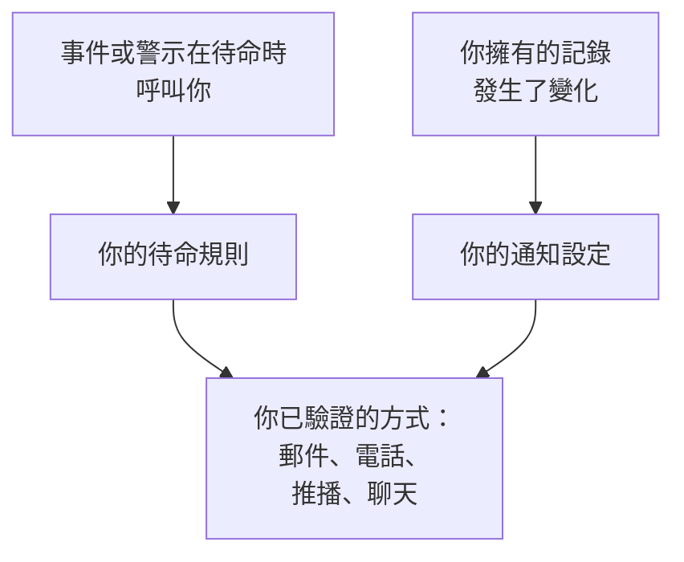

# OneUptime 如何聯絡你

OneUptime 透過兩種方式聯絡你。當你待命時有事件或警示觸發，它會呼叫你；它也會讓你隨時掌握你所擁有的內容：你的事件上的一則備註、一個狀態改變的監測器、你的下一個班次。兩者都會送到你在 **使用者設定** 中依專案維護的聯絡方式。本頁說明這些部分如何搭配、它們在哪裡，以及你一開始擁有什麼。

:::cards
- [三個頁面，三個問題](#三個頁面三個問題): 通知方式、待命規則和通知設定，以及各自決定什麼。
- [在哪裡找到它們](#在哪裡找到它們): 使用者設定中的各個頁面，依區段列出。
- [一開始擁有什麼](#一開始擁有什麼): 新成員獲得的通知方式、規則和設定。
- [沒有相符的規則時](#沒有相符的規則時): 呼叫仍然如何送達你，以及誰會收到通知。
:::

## 運作方式

- 當待命策略的某條上報規則指定了你、你所在的團隊，或你正在待命的排程時，該策略會呼叫你。接著由你的待命規則決定 OneUptime 嘗試你的哪些通知方式，以及多久之後嘗試。
- 當你擁有的記錄或你的班次發生變化時，由你的通知設定決定這則更新要送到哪些管道。
- 無論哪種情況，OneUptime 只使用你在呼叫或更新所屬專案中已驗證的通知方式。

## 三個頁面，三個問題

| 頁面 | 包含的內容 | 回答的問題 |
| --- | --- | --- |
| **通知方式** | 你的電子郵件地址、電話號碼、WhatsApp 號碼、Telegram、Slack 和 Microsoft Teams 帳戶、推播裝置和 Webhook | OneUptime 可以透過哪裡聯絡到我？ |
| **待命規則** | 針對每種呼叫和每個嚴重程度，要嘗試哪種通知方式，以及多久之後嘗試 | 我待命時如何被呼叫？ |
| **通知設定** | 針對與你擁有的記錄或你的班次相關的每個通知項目，要使用哪些管道 | 我還會收到哪些消息，在哪裡收到？ |

它們是刻意分開的。在 **通知設定** 中開啟所有管道永遠不會呼叫你；而你未驗證的通知方式，無論規則怎麼寫，都不會被使用。

> [!IMPORTANT]
> 通知方式、規則和設定都屬於某一個專案。請在你參與的每個專案中分別設定： **使用者設定** 一律顯示你目前所在的專案。

## 在哪裡找到它們

開啟頂端列下方那一列右側的 **使用者設定**。它的側邊選單包含與 OneUptime 如何聯絡你有關的一切：

| 區段 | 頁面 |
| --- | --- |
| **開始使用** | **設定檢查清單**：還有哪些需要設定，依重要程度排列 |
| **警示與通知** | **通知方式**、 **待命規則**、 **通知設定** 和 **郵件偏好設定**，後者設定你的更新會彙總成多少封郵件 |
| **待命日誌** | **待命日誌**：你在此專案中每次被呼叫的記錄，以及傳送了什麼 |
| **來電策略** | **來電號碼**：來電策略撥打給你的號碼 |
| **行事曆** | **行事曆訂閱**：在你的行事曆應用程式中顯示你的班次，並在班次開始前提醒你 |
| **個人資料** | **自訂欄位**：專案要求成員填寫的資訊 |
| **工作區** | **Slack** 和 **Microsoft Teams**：你在專案已連線的每個工作區中的個人帳戶 |

**開始使用** 和 **警示與通知** 預設為展開；其他區段一開始是摺疊的，當你位於某區段的頁面時，該區段會自動展開。只有在專案已連線 Slack 或 Microsoft Teams 時，才會顯示 **工作區**。

專案擁有者和管理員也可以查看你的設定：在 **使用者** 下，他們開啟你所在的列及其 **待命** 區段，其中有 **就緒狀態**、 **通知方式** 和 **待命規則**。他們可以在那裡為你新增通知方式，但驗證碼會傳送到該方式本身，因此只有你能完成驗證。

## 一開始擁有什麼

當你使用已驗證的登入電子郵件加入專案時，OneUptime 會為你完成以下設定，確保呼叫一定能送達你：

1. 你的登入電子郵件會被新增為已驗證的電子郵件通知方式。
2. 在 **待命規則** 的四個分頁上，針對每個嚴重程度，都有一條規則在你被呼叫時立即寄郵件給你。
3. 一組關於你所擁有的內容和你的班次的更新會透過郵件開啟。請參閱 [通知設定](/docs/notifications/notification-settings#新成員預設開啟的內容)。

你之後驗證的每種通知方式都會獲得相同的規則：每個嚴重程度一條，在你被呼叫時立即傳送。因此，驗證一個用於簡訊的電話號碼，代表每次呼叫也會傳簡訊給你。若只想在嚴重的呼叫時收到簡訊，請刪除其他嚴重程度的簡訊規則。請參閱 [個人待命規則](/docs/notifications/on-call-rules#一開始擁有的規則)。

## 設定檢查清單

**使用者設定 → 設定檢查清單** 會開啟 **Your setup checklist**：OneUptime 聯絡你所需的一切，依重要程度排列。每個步驟都連結到完成它的頁面， **重新檢查** 會重新檢查所有內容。

| 區段 | 檢查的內容 |
| --- | --- |
| **So we can reach you** | 你有通知方式，你新增的每種方式都已驗證，而且至少有一種位於專案已開啟的管道上 |
| **How you want to be paged** | 在 **待命規則** 的四個分頁上，每個嚴重程度都有規則 |
| **Staying informed** | 你會在班次開始時收到通知，而且你在 **通知設定** 中開啟的每個管道背後都有已驗證的通知方式 |
| **Nice to have** | 用於來電的號碼、你的 Slack 和 Microsoft Teams 帳戶、行事曆連結和你的個人資料欄位 |

**Nice to have** 不計入進度列，只有其他人才能解決的步驟也不計入。頂端的一行文字概括了狀態：

| 標題 | 含義 |
| --- | --- |
| **一切就緒** | 呼叫能送達你，沒有需要做的事 |
| **還有幾項需要設定** | 某個嚴重程度沒有規則，或某個步驟尚未完成 |
| **目前還無法聯絡到您** | 你的通知方式都無法使用：沒有一種已驗證，或每種已驗證的方式都位於此專案已關閉的管道上 |
| **您已完成設定，目前不在待命** | 一切都已就緒，等待策略指定你的那一天 |

## 沒有相符的規則時

呼叫可能以你沒有規則的類型和嚴重程度送達你，例如在你加入後新增的嚴重程度。OneUptime 仍然會透過你已驗證的方式呼叫你：

1. 你擁有的所有免費方式：推播裝置、電子郵件地址、Slack 和 Microsoft Teams。
2. 如果這些都沒有，則依以下順序選擇一種付費方式：簡訊、電話、WhatsApp、Telegram。它是你已驗證、且位於專案已開啟管道上的第一種。
3. 如果這些也都沒有，則使用 Webhook。

你會收到一封說明此情況的郵件，待命策略的擁有者也會收到；如果策略沒有擁有者，則由專案擁有者收到。如果你沒有任何已驗證的方式，呼叫將無法送達，郵件會改為說明這一點。在呼叫持續湧入期間，這些郵件會暫緩寄送，因此一陣密集的呼叫不會變成一陣密集的郵件。若要新增缺少的規則，請參閱 [個人待命規則](/docs/notifications/on-call-rules#某個嚴重程度沒有規則時)。

## 疑難排解

:::details 我在待命，但什麼都沒收到
開啟 **使用者設定 → 待命日誌**。如果沒有該事件的列，表示它的待命策略從未呼叫你：請檢查它的上報規則以及當時誰在待命。對於狀態為 **錯誤** 的列， **檢視狀態訊息** 會說明原因，例如專案關閉了某個管道。接著檢查你的通知方式是否已驗證，以及 **Your setup checklist** 中 **So we can reach you** 下是否沒有剩餘事項。
:::

:::details 我收到關於我從未關注過的記錄的郵件
你直接或透過團隊成為該記錄的擁有者，或者該記錄沒有擁有者而你是專案擁有者。請在 **使用者設定 → 通知設定** 中關閉該通知項目，或在 **使用者設定 → 郵件偏好設定** 中減少郵件數量。
:::

:::details 我新增了電話號碼，但它不在我的規則中
號碼在驗證後才會加入你的規則。點選其所在列的 **驗證** 並輸入驗證碼。如果它的卡片上沒有新增按鈕，表示專案關閉了該管道。請參閱 [通知方式](/docs/notifications/notification-methods#為專案開啟管道)。
:::

## 後續步驟

:::cards
- [通知方式](/docs/notifications/notification-methods): 新增並驗證 OneUptime 可以聯絡你的地址。
- [個人待命規則](/docs/notifications/on-call-rules): 決定每次呼叫嘗試哪種方式，以及何時嘗試。
- [通知設定](/docs/notifications/notification-settings): 選擇你要收到的更新，以及透過哪些管道。
- [上報規則](/docs/on-call/escalation-rules): 待命策略如何逐級決定呼叫誰。
:::
